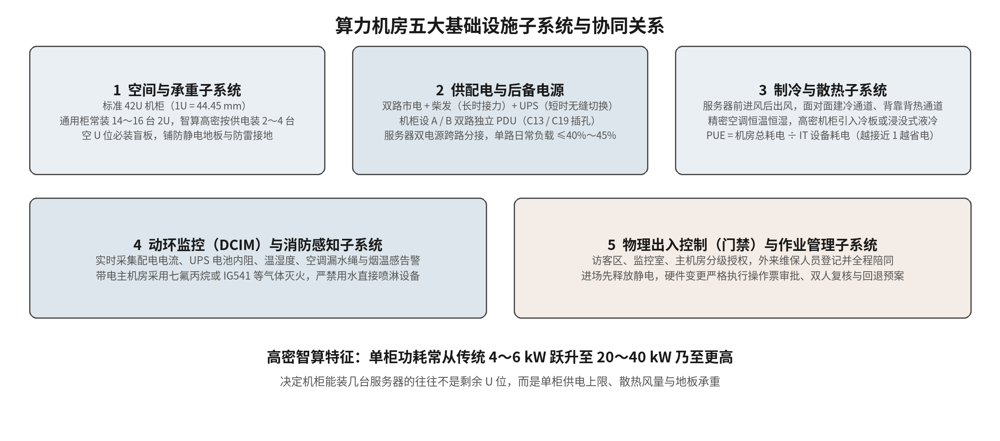
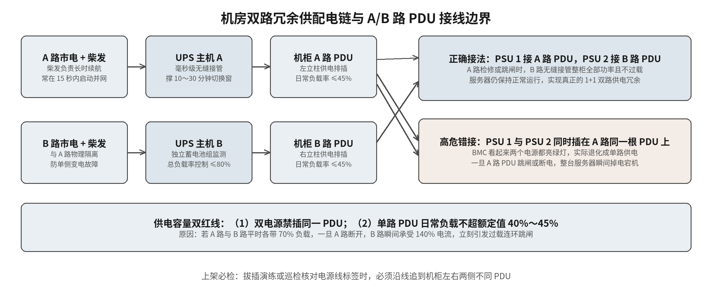
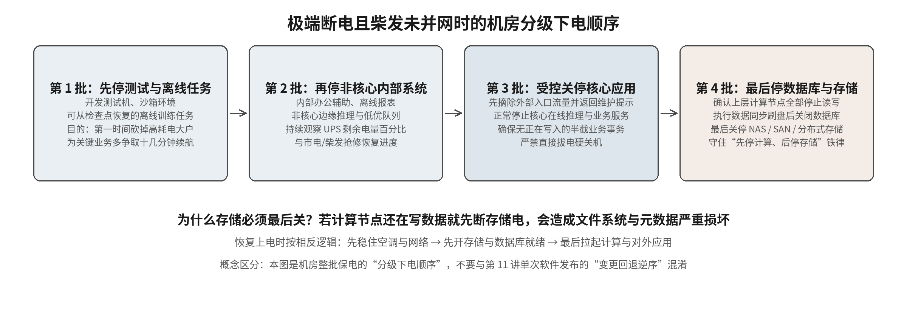
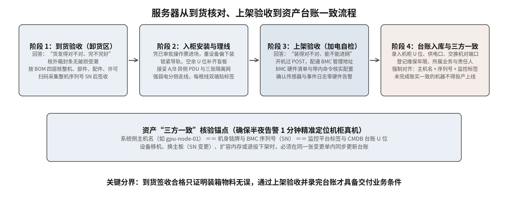

# 第10讲 机房、BOM 与资产管理

**本课程定位：** 前面几讲我们认识了服务器、算力卡、网络、操作系统和虚拟化。这些软硬件最终都安放在算力中心机房的机柜里，靠供配电、空调制冷和综合布线维持 24 小时连续运转。作为第二章的收官讲，本讲从机房五大基础设施和配套设备讲起，串联起操作票作业规范、BOM 物料到货核对、入柜上架验收与资产台账登记，让你把屏幕里的主机名和机房里的真实设备准确对应起来。

采购的新一批服务器刚刚运抵机房卸货区。机房主管交给你四个问题：42U 的机柜能不能直接塞满 21 台 2U 服务器？两根电源线怎么插才算真双路冗余？进主机房做变更，操作票缺了哪一项绝对不能批？怎样确保半夜监控弹出告警时，值班同事能在 1 分钟内找到准确的机柜和机器？本讲把这四件事逐一讲透。

## 本讲学习目标

学完后，你应能：

- 说出算力机房五大基础设施子系统的职责，解释 42U 机柜实际装机密度受供电、散热和承重约束的原因。
- 区分 UPS 与柴油发电机的续航分工，核算机柜双路 PDU 安全负载余量，并排定极端断电时的分级下电顺序。
- 识别机房出入与特种作业规范，按操作票七要素核查变更方案（重点检查回退方案是否可执行）。
- 按四层结构核对服务器采购 BOM，分清到货验收与上架验收的边界，做到主机名、序列号、监控标签三方一致。

## 10.1、认识机房基础设施：五大子系统与智算高密特征

传统办公服务器单机柜总功率常在 4～6 kW 左右，而装有多张加速卡的智算服务器单台额定功率就达 5～10.2 kW，单机柜功率密度普遍升至 20～40 kW 甚至更高。算力中心机房围绕这些设备构建了五大基础设施子系统。

### 10.1.1、空间承重与标准机柜 U 位

机柜内部垂直安装高度以 **U** 为标准单位，**1U ＝ 44.45 mm**（1.75 英寸）。例如第 3 讲的主例服务器 `H3C UniServer R4930 G7` 高度为 `2U`（约 88.9 mm），8 卡智算整机常见为 `4U` 或 `8U`。

机房主流标准机柜高度为 **42U**（部分新建高密机房采用 47U 或 48U）。算术上 42 ÷ 2 ＝ 21，但**生产环境中 42U 机柜绝不能塞满 21 台 2U 服务器**，原因有三点：

1. **配套占空间**：机柜顶部需要预留 2U～4U 安装接入层交换机（ToR）、光纤配线架与理线器；
2. **供电与散热先触顶**：单机柜分配的电功率和空调冷量有限，通用 2U 服务器在生产机柜中通常装 **14～16 台**，而高功耗 8 卡智算服务器在普通风冷机柜中往往只能装 **2～4 台**；
3. **地板承重与重心稳定**：高密服务器单台重量可达几十至上百千克，重型设备应优先安装在机柜中下部以降低重心，同时核对机房防静电架空地板的每平方米承重上限。

机柜正面所有未安装设备的**空余 U 位必须加装盲板（挡风板）**。如果不装盲板，机柜背部排出的高温热风会直接从正面空洞倒灌回服务器进风口，导致局部过热降频。

### 10.1.2、供配电与制冷散热：守住供电双红线与 PUE

在供配电链路上，外部双路市电经变压器降压后进入 **UPS（不间断电源，配套蓄电池组）**，再分配至列头柜和每个机柜内的 A、B 双路 **PDU（电源分配单元）**。这里必须分清两级后备电源的角色：**UPS 的核心作用是在市电闪断瞬间实现毫秒级零中断接管，靠蓄电池撑住 10～30 分钟的短时切换窗口；真正应对数小时长时间市电停电的，是室外在 15 秒左右自动点火并网的柴油发电机组（柴发）**。

服务器双路冗余电源（PSU 1 与 PSU 2）上架接线必须严守两条红线：

- **红线一：双电源严禁插在同一根 PDU 上**。两根电源线必须一左一右分别接入机柜的 A 路 PDU 和 B 路 PDU。若图省事全插在 A 路，BMC 面板虽然显示两个电源模块都通电正常，但只要 A 路开关跳闸或检修断电，整台服务器就会瞬间断电停机。
- **红线二：单路 PDU 日常负载率控制在额定容量的 40%～45% 以内（UPS 整机负载率常控制在 80% 以内）**。假设 A、B 两路平时各带 70% 负载，一旦 A 路断电，全部负载瞬间压向 B 路，B 路总电流飙升到 140%，会立即触发过载保护连环跳闸，造成整柜瘫痪。

在制冷散热子系统上，机架服务器统一遵循“前进风、后出风”风道。机房将成排机柜按**面对面、背靠背**方式摆放，正面相对形成低温送风的**冷通道**（常做封闭冷通道减少冷气散失，精密空调维持常见温度 22±2℃、相对湿度 40%～60%），背面相对形成集中排热的**热通道**。当单柜功率超过传统风冷极限（如突破 30～40 kW）时，新建智算中心常引入冷板式或浸没式液冷，由冷却液分配单元（CDU）带走芯片高热。

衡量机房绿色节能水平的核心指标是 **PUE（电能利用效率）**，计算公式为：

- **PUE ＝ 机房总耗电量 ÷ IT 设备实际耗电量**（注意比较不同机房 PUE 时，必须统一按全年平均或相同季节负载率口径统计）。机房总耗电量包含 IT 设备、空调制冷、供配电损耗和照明。PUE 恒大于 1，越接近 **1.0** 说明花在散热和配电损耗上的额外电费越少。

### 10.1.3、动环监控、消防基础与物理准入

机房另外两大支撑系统负责全天候看护环境与出入安全：

- **动环监控（DCIM）与消防感知**：动环系统 24 小时采集市电与 PDU 电流、UPS 蓄电池内阻与温度、机柜冷热通道温湿度、精密空调底部的漏水检测绳，以及天花板与地板下的烟感、温感探测器。一旦越界立即发信告警。注意：**带电运行的算力主机房采用七氟丙烷或 IG541 混合气体灭火，严禁使用水喷淋直接浇淋带电服务器机柜**（详细的网络边界设备与机房消防巡检将在第 36 讲专门展开）。
- **物理出入控制（门禁系统）与防静电**：机房按外围办公区、监控值班室、供配电室、核心主机房划分不同门禁系统权限，离职或转岗人员须当月清理门禁权限；外部厂家维修人员进场须提前审批登记并由本单位运维人员全程陪同；进入主机房接触设备前先触摸静电释放柱消除人体静电。

<!-- pagebreak -->

## 10.2、认识配套设备：参数核对与断电分级下电

服务器入柜离不开 PDU、KVM、配线架等机柜级配套设备。采购与上架前要把规格对准，断电应急时要按既定优先级有序处置。

### 10.2.1、PDU、KVM 与综合布线核对要点

表10-1、机柜常用配套设备选型与巡检核对要点

| 配套设备 | 关键核对参数 | 运维现场注意事项 |
| --- | --- | --- |
| 机柜 PDU | 电压制式（220V 单相 / 380V 三相）、额定电流（16A / 32A / 63A）、插孔规格 | 普通电源线多用 10A 的 C13 插孔；高功率智算服务器电源线多用 16A 方形 C19 插孔，到货前必须核对插头匹配 |
| 本地 KVM | 接口类型（VGA / HDMI + USB）、切换口数或移动推车完好度 | 当服务器管理网不通且 BMC 带外也失联时，推本地 KVM 推车或接柜内切换器是最后的现场接管通道 |
| 配线架与理线 | 光纤配线架（ODF）/ 铜缆配线架口数、机柜两侧垂直理线槽 | 强电电源线与弱电光纤网线分左右两侧走槽；光纤弯曲半径留足余量防折断；每根线两端必须贴机打持久标签 |

【例题】某风冷机柜配有 A、B 双路单相 220V、额定电流 32A 的工业 PDU（每路额定视在功率按 220V × 32A ＝ 7.04 kW 计）。为保证任一路 PDU 断电检修时另一路能 100% 安全接管整柜负载且留有安全余量，规定整柜服务器满载总运行功率不得超过单路 PDU 额定功率的 80%。若计划安装满载功耗为 900 W（0.9 kW）的通用 2U 服务器，这个机柜最多能装几台？剩余 U 位怎样处理？

解：先算整柜允许的安全功率上限：7.04 kW × 80% ＝ 5.632 kW（此时正常双路均摊状态下，A、B 每路日常只承担约 2.816 kW，占单路额定值 40%，完全满足跨路冗余接管要求）。再算可装服务器台数：5.632 ÷ 0.9 ≈ 6.25，向下取整最多只能安装 **6 台**（共占 12U 高度）。即使机柜还空着近 30U 空间，也不能继续往里加装服务器，所有空余 U 位全部安装盲板封闭。

### 10.2.2、极端停电应急：机房保电“分级下电顺序”

遇到极端情况——双路外市电同时中断，且室外柴油发电机启动失败未能并网，此时全机房完全靠 UPS 蓄电池维持，电量每分钟都在往下掉。值班工程师不能等电池耗尽导致全机房硬断电，必须立即按应急预案启动**整批保电“分级下电顺序”**。

分级下电严格遵循四个批次推进：

1. **第一批先停测试开发机与可中断离线任务**：第一时间停掉测试环境以及功耗极高、但有定期检查点（Checkpoint）的大模型离线训练集群，迅速砍掉一半以上的耗电大户，把宝贵的剩余电池电量留给核心生产与存储设备。
2. **第二批停内部非关键辅助系统**：关停内部报表、非核心边缘业务与低优先级队列，同时紧盯市电或柴发抢修进度。
3. **第三批保护性关停核心在线应用**：若电池电量跌破兜底红线仍无法来电，先在入口网关摘除外部流量，再正常停止核心推理与在线交易应用进程，避免产生写了一半的残缺业务记录。
4. **第四批最后关停数据库与存储集群**：确认所有上层计算节点与虚拟机已停止读写后，将数据库内存脏数据同步刷盘并停库，**最后一步才关闭 NAS、SAN 或分布式存储服务器**。

【关键区别】请严格区分两个名字相似但场景完全不同的顺序：本讲的**“分级下电顺序”**用于机房整批停机保电（测试离线先停 → 核心应用后停 → 数据库与存储最后停，守住“先停计算、后停存储”）；下一讲（第 11 讲）将要学习的**“变更回退逆序”**用于单次软件发布失败还原（停服务 → 还原旧配置 → 回退软件包）。两套顺序各有各的用途，切勿混为一谈。

【随堂思考】如果在应急下电时顺序搞反了——上层几十台计算节点的业务程序还在往共享存储里高频写数据，值班员却先把存储机柜的电源拉闸关了，恢复供电后会面临什么后果？

<!-- pagebreak -->

## 10.3、遵守管理规范：出入安全与操作票七要素

在机房现场，绝大部分人为停机事故都不是因为技术太难，而是因为“没办票顺手拔了一根线”或“走错相邻机柜按错了电源键”。机房日常作业规范可归纳为下表四条硬约束：

表10-2、机房现场作业四类常规安全约束

| 管理类别 | 核心执行要求 | 违规直接风险 |
| --- | --- | --- |
| 分级出入与陪同 | 按区域授权刷卡并登记进出时间；外部厂商工程师须由内部专人全程陪同作业 | 走错客户机柜、越权接触无关生产设备 |
| 禁带物品与防静电 | 严禁带水杯饮料、易燃纸箱进入主机房（拆箱一律在拆包暂存区完成）；触碰设备前先释放静电 | 液体泼洒短路、纸箱助燃或碎屑堵风道、静电击穿板卡 |
| 高危特种作业审批 | 机房内动火焊接、配电柜带电搭接、登高布线必须单独办理特种作业许可并配现场监护与灭火器材 | 引发电气火灾、误触发气体灭火或人身触电 |
| 变更窗口与双人复核 | 生产设备上下架、插拔电源网线、改配电开关均安排在约定维护窗口，执行“一人操作、一人唱票复核” | 眼睛看花拔错上下相邻 U 位的在网生产机器网线或电源线 |

凡是在机房动生产设备、改线缆或调配电，进场前必须填写并通过审批**《机房变更操作票》**。一份合格的操作票包含缺一不可的**七要素**：

表10-3、机房变更操作票七要素核查表

| 要素序号 | 要素名称 | 必须写清的具体内容 |
| --- | --- | --- |
| 1 | 作业目标与单号 | 本次变更要解决什么问题，关联哪张工单号（如 OPS-2018） |
| 2 | 精确目标定位 | 机房号、列号、机柜号、起止 U 位、主机名、机身序列号 SN、BMC IP（现场三核对防认错机器） |
| 3 | 窗口与影响范围 | 计划起止时间点，执行期间哪些业务会闪断、是否已提前通知业务方与监控值班台静默告警 |
| 4 | 前置检查条件 | 配置或数据备份是否已完成、对端冗余链路或另一路 PSU 是否确认在位正常 |
| 5 | 分步执行步骤 | 按先后顺序列出每一步具体动作、操作人与现场复核人姓名 |
| 6 | 成功验证标准 | 操作完看什么证明成功（带外 BMC 传感器无红黄告警 + 带内端口与业务侧请求正常） |
| 7 | **回退方案** | **七要素中最关键的一条**：明确一旦出现什么异常或到几点仍未调通，如何在窗口剩余时间内退回变更前状态 |

审核操作票时，如果第 7 项“回退方案”只敷衍写了“如有问题及时排查处理”六个字，没有写明具体的回退触发时刻、回退动作步骤和预计耗时，这张操作票**一律不予批准执行**。

<!-- pagebreak -->

## 10.4、管理机器资产：从 BOM 到货核对到台账三方一致

一台服务器从供应商货车卸下到正式承接算力业务，要跨过物料核对、两阶段验收和台账入库三道关卡。

### 10.4.1、按四层结构逐项核对采购 BOM

**BOM（Bill of Materials，物料清单）** 是采购合同与装箱单附带的设备明细表。服务器到货拆包（在机房外拆箱区拆除外包装纸箱）时，不能只数“到了 10 个大铁盒”就签字，必须按**四层结构**逐项清点：

1. **整机层**：核对品牌、具体机型（如 `H3C UniServer R4930 G7`）、整机台数，检查机箱外壳有无磕碰变形、防拆封条是否完好，并用扫码枪逐台采集外箱与机身铭牌上的**整机序列号（SN）**。
2. **核心部件层**：对照配置单核实 CPU 型号与颗数、内存条单根容量与频率及根数、硬盘介质（SSD/NVMe/HDD）容量与块数、RAID 控制卡型号、管理与业务网卡速率口数、人工智能加速卡型号与张数。不开机箱盖的情况下，可在后续加电阶段通过 BMC“硬件清单”页面及系统内命令（`lscpu`、`lsmem`、`lsblk`、`lspci`、`nvidia-smi` 或 `hy-smi`）做 100% 账实交叉核验。
3. **随机配件层**：最容易漏发或混放的一层——清点专用滑动导轨套件副数、C13 或 C19 电源线规格与根数、光模块速率波长与数量、光纤跳线及理线臂。少一副导轨或电源线插头制式不对，当天就装不进机柜。
4. **授权许可与维保层**：核对 BMC 高级远程控制（KVM 虚拟媒体）许可密钥、虚拟化或加速软件授权文件，以及原厂维保服务起止日期凭证。

### 10.4.2、严格分清“到货验收”与“上架验收”

工程交付中，**到货验收**和**上架验收**是前后分开的两次签字确认，责任边界完全不同：

表10-4、到货验收与上架验收的边界对比

| 对比项 | 到货验收 | 上架验收 |
| --- | --- | --- |
| 核心回答的问题 | **“货发得对不对、外观完不完好”** | **“装得规不规范、上电进网稳不稳定”** |
| 作业地点 | 园区卸货平台与机房外拆箱暂存区 | 主机房目标机柜与远程运维管理终端 |
| 主要核查动作 | 查外箱完好、清点整机与配件数量型号、登记 SN | 查导轨稳固与盲板、A/B 异侧双路供电、双端线标、POST 自检、BMC 与系统无告警 |
| 通过后的状态 | 物料签收入库，具备搬入主机房施工资格 | 硬件与基础环境就绪，具备移交上层部署业务资格 |

### 10.4.3、资产台账登记与“三方一致”铁律

通过上架验收的机器，必须在投产前录入单位的 **CMDB（配置管理数据库）或固定资产台账**，完整记录序列号 SN、机型配置、所在机房与机柜 U 位（如 `F2-A03 机柜 10U-11U`）、A/B 路对应的 PDU 插孔编号、业务网与存储网对应的上联交换机名称及端口号、BMC 管理 IP、操作系统业务 IP、归属部门、责任人及维保到期日。

录入台账后，必须做最后一项强制校验——**资产“三方一致”**：

- **操作系统内主机名（如 gpu-node-01） ＝＝ 机身物理铭牌与 BMC 读出的序列号（SN） ＝＝ 监控系统标签与台账位置记录**。

只有守住这三方一致，当某天凌晨监控弹出“`gpu-node-01` 块设备故障或电源模块掉电”告警时，现场工程师才能顺着主机名立刻查到唯一对应的序列号 SN 和精确机柜 U 位，走到机柜前核对机身 SN 铭牌完全吻合后再动手，绝不会发生“台账没更新、拔掉隔壁正常核心机器硬盘”的事故。后续服务器若发生机柜移位、更换主板（注意换主板后 BMC 里的整机 SN 需同步刷写或更新台账）、内存扩容或报废退役（退役前硬盘须做安全擦除或消磁销毁，第 37 讲详述），必须在变更工单完成当天同步刷新台账。

【例题】一批新到的 4 台服务器刚由集成商装进 `A05` 机柜并配好了系统。你在远程验收时登录 `gpu-node-01`（IP `192.168.10.31`），通过带内工具查出本机主板序列号尾号是 `8802`；可打开资产台账表格一看，台账里写着“`gpu-node-01` 位于 `A05` 机柜 `10U-13U`，序列号尾号 `8804`”，而机房同事拍回来的机柜现场照片显示 `10U-13U` 贴的纸质标签确实是 `8804`。请问这里出了什么问题？在没有核清改正前，这批机器能不能签字投产？

解：出现了典型的**“网络 IP / 主机名装机配置串位，导致账实与三方不一致”**——很可能装机配网时把两台机器的管理口或业务网 MAC 地址搞反了，使得物理上躺在另一 U 位（尾号 `8802`）的机器被配成了 `gpu-node-01`（`192.168.10.31`）。在核清改正前**绝对不能签字投产**！处理办法：立刻结合 BMC 点亮机身定位指示灯（UID 蓝灯）和交换机端口 MAC 地址表，把 4 台机器的物理 U 位、机身 SN、BMC IP、业务 IP 与主机名逐台重新对齐，复测确认“主机名、序列号、监控与台账标签”100% 三方一致后方可验收通过。

<!-- pagebreak -->

## 10.5、本讲回顾与自测

学习完本讲后，试着用自己的话回答四个问题：为什么 42U 机柜不能装满 21 台 2U 服务器？UPS 和柴油发电机各管哪一段断电时间？操作票七要素里哪一条最关键？什么是资产管理的“三方一致”？

表10-5、本讲目标与对应判断

| 学习目标 | 应能做出的判断 |
| --- | --- |
| 认识五大基础设施 | 说清 1U=44.45 mm 与机柜功率/散热密度限制；知道空 U 位装盲板、冷热通道隔离与 PUE 计算口径 |
| 核对供电与分级下电 | 分清 UPS 短时接管与柴发长时供电；守住双电源跨 A/B 路 PDU 且单路日常 ≤40%～45%；掌握四批分级下电顺序 |
| 执行机房操作票规范 | 遵守拆箱不进主机房、防静电与陪同制度；审核操作票七要素时重点核查精确位置与可执行回退方案 |
| BOM 验收与资产一致 | 按整机、部件、配件、许可四层核 BOM；分清到货验收与上架验收；强制对齐主机名、序列号、监控标签三方一致 |

### 10.5.1、本讲自测

**1 机柜与供电红线。** 关于算力机房机柜安装与双路供电，下列做法符合运维规范的是哪一项？

- A. 标准 42U 机柜只要物理空间塞得下，就应当装满 21 台 2U 智算服务器以提高机柜利用率
- B. 为方便理线，把一台双电源服务器的 PSU 1 和 PSU 2 都插在机柜左侧的 A 路 PDU 上
- C. 机柜正面未装设备的空余 U 位加装盲板，服务器两个电源分别接入 A 路与 B 路独立 PDU，且每路日常负载不超过 45%
- D. 只要机房配了大容量 UPS，市电停电一整天也无需启动柴油发电机

**2 能效计算。** 某智算中心上月统计总耗电量为 150 万千瓦时（度），其中所有服务器、存储和网络等 IT 设备实际耗电量为 120 万千瓦时，另外 30 万千瓦时消耗在空调制冷、配电损耗与照明上。请计算这座机房上月的 PUE 值。

**答：**

____________________________

**3 分级下电。** 双路市电中断且柴发故障无法并网，UPS 电量告急。现有机房内运行着：① 核心分布式存储集群；② 算法团队离线训练任务与测试环境；③ 核心在线业务应用。请写出正确的关停先后顺序，并简述为什么存储集群要放在那个位置。

**答：**

____________________________

**4 操作票审核。** 同事提交了一份《夜间更换机柜故障交换机操作票》，上面写了工单号、时间窗口、机柜位置、分步更换命令和验证方法，但在“回退方案”一栏只写了“万一不通现场再想办法调试”。如果你是审核人，能否批准？应该要求补充什么内容？

**答：**

____________________________

**5 两阶段验收。** 采购专员催促说：“物流单显示那 8 台服务器早上已经在卸货区拆外箱清点完数量、扫完序列号签收了，既然验收完了，下午直接让业务方远程登上去部署模型吧！”请用“到货验收”与“上架验收”的区别回应这位同事。

**答：**

____________________________

**6 资产三方一致。** 什么是机器资产管理的“三方一致”？如果某台服务器因主板损坏更换了新主板，除了验证系统恢复运行外，资产管理上还必须同步做什么动作？

**答：**

____________________________

<!-- pagebreak -->

## 10.6、参考答案与解析

### 10.6.1、随堂思考解析

**思考 1（计算节点未停写就先拉闸关存储）：** 正在进行的大量文件写入与数据库事务会被强行截断，内存缓存里的脏数据来不及落盘，轻则导致业务文件残缺、数据库无法正常启动需要漫长修复，重则导致分布式存储元数据或文件系统超级块损坏，引发严重的数据丢失事故。因此应急下电必须严守“先停计算应用、最后停数据库与存储”。

### 10.6.2、课后自测解析

**1 选 C。** A 错在忽视了供电、散热与顶部网络配线空间约束；B 错在同插一路 PDU 丧失了双路供电冗余；D 错在 UPS 仅负责毫秒级切换和 10～30 分钟短时支撑，长时间断电必须依靠柴油发电机接力。

**2 PUE ＝ 1.25。** 计算过程：PUE ＝ 机房总耗电量 ÷ IT 设备耗电量 ＝ 150 ÷ 120 ＝ 1.25（统计条件为这座机房上月整月电量口径）。

**3 正确顺序：② 离线训练与测试环境 → ③ 核心在线业务应用 → ① 核心分布式存储集群。** 理由：先停高功耗但可中断恢复的测试和离线训练，能立刻大幅降低放电电流、为关键业务争取时间；最后确认所有计算与应用节点已停止读写后再关存储集群，可防止正在写入的文件系统和元数据因突然断连而损坏。

**4 不能批准。** 回退方案是操作票七要素中最关键的安全兜底，不能写空话。必须要求补充：（1）明确的回退触发条件与截止时间点（例如凌晨 02:30 前若新交换机端口仍未调通就立即启动回退）；（2）旧交换机完整配置备份文件路径及原线缆端口对应表；（3）装回旧交换机、恢复原连线并验证业务恢复的具体分步动作与预计耗时。

**5** 早上在卸货区完成的只是**到货验收**，只证明“货发得对、外观完好、配件齐备”；设备尚未完成入柜装导轨、接妥 A/B 双路异侧供电、布放管理/业务/存储网线并贴标、开机通过 POST 自检、核查 BMC 零告警以及录入资产台账等**上架验收**环节，目前根本不具备业务部署条件。

**6** “三方一致”是指**操作系统主机名、机身铭牌与 BMC 硬件序列号（SN）、监控系统标签与台账位置记录**三者完全对应一致。更换主板后，新主板的硬件信息（或未刷写前的默认主板/整机 SN、BMC 网卡 MAC 地址）可能发生变化，必须核对原厂工程师是否已按规范将整机 SN 同步写入新主板，并在同一张变更工单内立即更新 CMDB 台账记录与监控采集信息。

### 10.6.3、复习时再问自己

如果你走进机房只看机柜还有没有空位、不看 PDU 电流表，回看 10.1.2 与 10.2.1 节；如果你分不清什么时候算签收到货、什么时候算具备上线条件，回看 10.4.2 节。到这里，第二章《操作系统与机房运维》就全部学完了。从下一讲（第三章《自动化》第 11 讲）开始，我们将告别一台台手工敲命令的低效模式，学习用 Shell、Python 和 Git 安全高效地管理成批算力节点。

<!-- pagebreak -->

## 10.7、术语与疑问

### 10.7.1、术语

表10-6、本讲术语

| 术语 | 本讲中的含义 |
| --- | --- |
| U（机柜高度单位） | 服务器与机柜垂直安装高度通用单位，1U 等于 44.45 mm；标准机柜常见为 42U |
| 盲板 | 安装在机柜正面空余 U 位上的挡风板，用于防止机柜背部热风倒灌回正面冷风进风口 |
| UPS | 不间断电源。在市电中断瞬间靠蓄电池提供毫秒级零中断电力接管，支撑短时切换窗口 |
| PDU | 机柜电源分配单元。安装在机柜内部立柱上的工业级配电排插，生产机柜常配 A、B 双路独立 PDU |
| PUE | 电能利用效率，等于机房总耗电量除以 IT 设备耗电量；越接近 1.0 说明制冷与配电损耗越低 |
| 操作票 | 机房现场变更与维护的标准审批执行单据，包含目标、位置、窗口、前置检查、步骤、验证与回退方案七要素 |
| BOM | 物料清单。列明采购整机、内部核心板卡、导轨线材配件与软件维保许可的核对基准表 |
| 资产三方一致 | 强制要求操作系统主机名、硬件序列号（SN）、监控标签与台账机柜位置三者严格对齐一致 |

文中机柜编号（`A05`）、工单号（`OPS-2018`）、IP（`192.168.10.31`）及电量数据均为教学示例，生产环境以本单位规划为准。

### 10.7.2、我的疑问

**写下一项你在机房供电核算、操作票或资产核对中希望进一步了解的问题**

____________________________

<!-- pagebreak -->

## 附录、服务器到货、上架与资产入账核对卡

新购算力服务器从到货签收到正式移交投产，可按下方一体化核对卡逐关勾选留档（脱敏模板）：

表10-7、服务器到货、上架与资产入账一体化核对卡

| 验收阶段 | 核对项目 | 核验标准与记录要求 | 结果确认 |
| --- | --- | --- | --- |
| 到货验收 | 外观与整机 SN | 外箱无破损受潮，防拆封条完好；外箱与机身 SN 扫码入表且与发货单一致 | 合格 / 异常 |
| 到货验收 | BOM 四层清点 | 整机型号、内部板卡规格、导轨副数、C13/C19 电源线、光模块与许可文件齐全 | 合格 / 缺件 |
| 上架验收 | 导轨、重心与盲板 | 在拆箱区拆箱后入场；重型机器装中下部、导轨锁紧，柜面空余 U 位盲板已补齐 | 合格 / 待改 |
| 上架验收 | A/B 双路供电 | PSU 1 与 PSU 2 分别接入左右两侧 A 路、B 路 PDU，整柜总功率未超单路安全冗余线 | 合格 / 待改 |
| 上架验收 | 三网布线与标签 | 管理网、业务网、存储网按规划接入对应交换机口，强弱电分槽，双端贴妥机打标签 | 合格 / 待改 |
| 上架验收 | 加电自检与互核 | 开机通过 POST；BMC 硬件清单与带内命令核实部件数一致，传感器与日志无告警 | 合格 / 异常 |
| 资产入账 | 台账与三方一致 | 机柜 U 位、供电口、对端交换机口、维保期已录 CMDB；主机名、SN、监控标签三方一致 | 合格 / 待录 |

<!-- md-only -->

## 附：主要参考资料（仅 Markdown 保留，不印入 Word/PDF）

- 中国信通服务《2025 算力运维体系技术白皮书》（课程资料库本地 PDF）。参阅第 1.2.3 节机柜功耗高密度化数据（PDF 第 7–8 页）、第 2.1 节基础设施运维之电气系统、通风空调、消防系统与智能化门禁/DCIM 运维作业矩阵（PDF 第 11–15 页）、第 2.2.1 节硬件资源台账与全生命周期管理（PDF 第 15–16 页）。
- 国家标准 GB 50174-2017《数据中心设计规范》。用于核对机房分级、冷热通道布置、温湿度参考范围、供配电冗余、防静电与气体灭火区域基本要求。
- EIA-310-E / IEC 60297 机柜机械尺寸标准。用于核对标准机架高度单位 `1U = 44.45 mm`（1.75 英寸）与 19 英寸机柜安装规范。
- 新华三《H3C UniServer R4930 G7 系列服务器用户指南》与《HDM 用户指南》。用于核对 2U 机架服务器导轨上架、1+1 冗余热插拔电源跨路接线要求及带外硬件清单核验流程。

<!-- /md-only -->
