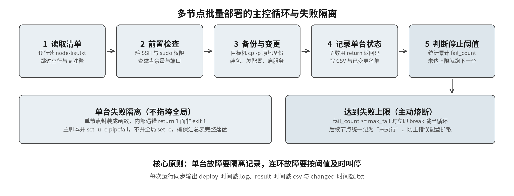
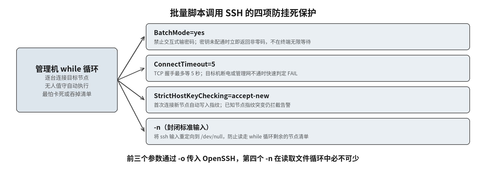
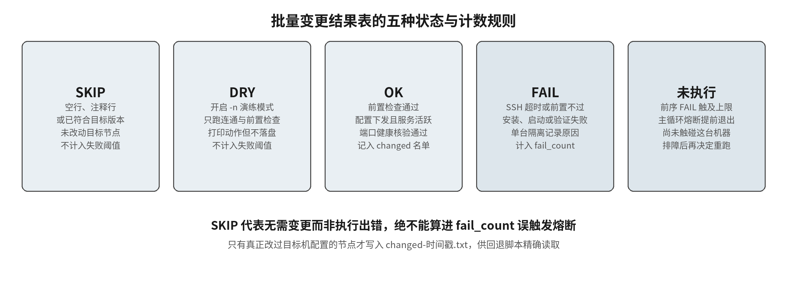
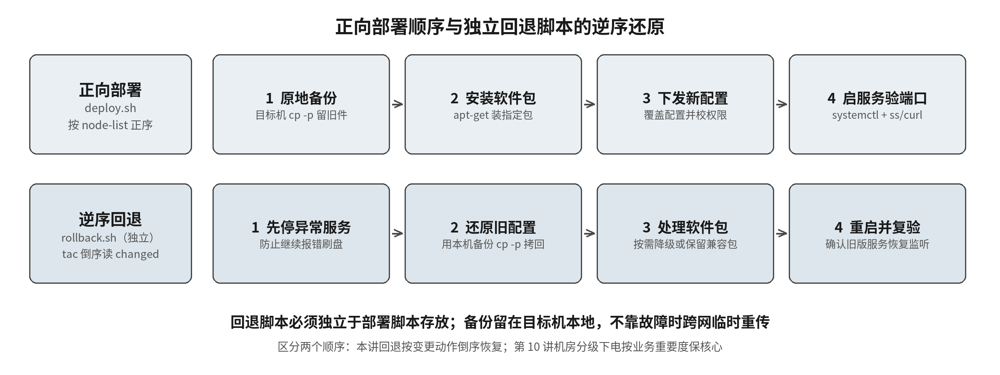

# 第11讲 Shell实现自动化部署

**本课程定位：** 面向自建智算中心运维。第 7、8 讲完成了单台 Linux 主机的服务管理、存储扩容与只读巡检，第 10 讲建立了机房操作票与回退要求。从本讲进入第三章“自动化”，解决多节点场景的第一个实际难题：怎样把单机敲过的命令写成受控脚本，安全地发往一批服务器。

监控组要求今天在 20 台推理节点上统一部署 `prometheus-node-exporter` 并修改采集参数。如果开 20 个终端手工复制粘贴，不仅容易漏改或敲错目录，遇到第 3 台机器报错时也很难说清前面改到了哪一步。本讲围绕四个问题展开：Shell 部署脚本需要哪些基础语法？怎样让脚本逐台非交互执行且单台报错不拖垮全局？失败达到几台必须自动停手？发布出错后怎样按相反顺序准确回退？

## 本讲学习目标

学完后，你应能：

- 运用 Bash 变量、双中括号条件判断、文件读取循环、函数返回值与参数解析编写结构清晰的运维脚本。
- 按“前置检查、原地备份、软件与配置下发、服务与端口验证”四步组织多节点批量部署脚本。
- 为非交互 SSH 配置防卡死参数，区分结果表中的 `OK`、`DRY`、`SKIP`、`FAIL`、`未执行` 五种状态。
- 设置失败台数停止阈值，实现单节点失败隔离与超阈值自动中断。
- 编写独立于部署脚本的逆序回退脚本，在单台故障演练中完成变更还原与服务复测。

## 11.1、为什么多节点变更不能靠手敲

在单台实验机上测试命令，敲错一行可以马上重来。到了几十台算力节点上做生产变更，手工逐台操作有三个明显短板：每台敲的命令可能有细微出入，出了问题翻不全终端历史，需要紧急还原时来不及逐台找旧配置。

把变更写成标准化 Shell 脚本，核心价值只有三条：**可复制**（同一份逻辑在测试环境与生产节点行为一致）、**可审计**（所有输入参数、执行时间戳与每台节点的返回结果全部落盘）、**可回退**（改动前先在目标机留好备份，改动过哪几台有明确账本）。

生产上做批量变更，不能只写一个孤零零的 `.sh` 文件。本课程统一把批量变更目录定在 `/opt/deploy/`（属主 `opsadmin:opsadmin`，权限 `750`），日志与结果目录定在 `/var/log/deploy/`，每次发布配套准备“批量变更四件套”，具体组成如下表所示。

<!-- pagebreak -->

表11-1、批量变更目录四件套与运行产物

| 组成部分 | 存放位置 | 作用说明 |
| --- | --- | --- |
| 节点清单 | `/opt/deploy/node-list.txt` | 一行一个目标主机名或 IP，支持 `#` 注释行与空行 |
| 配置模板 | `/opt/deploy/node-exporter.default` | 待统一分发到目标节点的标准配置文件 |
| 部署脚本 | `/opt/deploy/deploy.sh` | 主控脚本，负责参数解析、逐台检查、备份、下发与汇总 |
| 回退脚本 | `/opt/deploy/rollback.sh` | 独立脚本，读取已变更名单并按相反顺序恢复旧状态 |
| 运行产物 | `/var/log/deploy/` | 保存过程日志 `.log`、五态结果表 `.csv`、已变更名单 `changed-时间戳.txt` |

## 11.2、够写部署脚本的 Shell 核心语法

运维写 Shell 脚本不追求花哨技巧，重点是边界清楚、遇到空变量或异常输入不乱删文件。下面挑出编写部署脚本必用的基础规则。

### 11.2.1、脚本头与严格模式取舍

脚本第一行固定写 `#!/usr/bin/env bash`，明确交给 `bash` 解释执行，避免系统默认的 `sh` 不支持扩展语法。紧接着开启两项保护：`set -u` 让未定义的变量直接报错退出，防止路径拼空（例如误把 `/data/$empty_dir` 展开成 `/data/`）；`set -o pipefail` 让管道命令只要有一环非零就返回失败码。

【关键区别】单机初始化脚本常写 `set -e`（任一命令返回非零就立刻退出整个脚本），但**多节点批量主控脚本不要开全局 set -e**。批量脚本本来就要面对单台节点断网或装包报错；一旦开了 `set -e`，第 2 台机器 `ssh` 返回非零码会直接杀死主脚本，导致后面的节点状态无法写入汇总表。批量脚本应当手动捕获每台节点的返回值并记账。

### 11.2.2、变量引用、参数解析与条件判断

引用变量一律加双引号，写成 `"$node"`、`"${log_file}"`，防止值里带有空格时被拆成多个参数。命令行选项用内置的 `getopts` 解析，比手工硬数 `$1`、`$2` 更稳妥。例如用 `-f` 接收节点清单路径、`-m` 接收最大容忍失败台数、`-n` 开启只检查不改动的演练模式（dry-run）。

新编写的 Bash 脚本，条件判断统一使用双中括号 `[[ ]]`，不再用旧式单中括号 `[ ]`。`[[ ]]` 是 Bash 关键字，支持正则匹配 `=~` 和逻辑与 `&&`，也不会因为变量为空就报语法错误。校验用户输入的最大失败台数是不是非负整数时，统一写成 `[[ "$max_fail" =~ ^[[:digit:]]+$ ]]`，代表字符串从头到尾由一个或多个十进制数字组成。

### 11.2.3、文件读取循环与函数返回隔离

逐行读取节点清单时，推荐把单台节点的全部变更动作封装进一个函数（如 `deploy_one_node`）。函数内部哪一步失败，打印原因后用 `return 1` 把失败码交回主循环统计，绝不在函数里写 `exit 1`（`exit` 会直接终止整个脚本进程）。

表11-2、批量脚本高频语法与防坑写法

| 语法环节 | 推荐写法 | 常见错写与后果 |
| --- | --- | --- |
| 脚本开关 | `set -u -o pipefail` | 照搬 `set -euo pipefail`，首台节点报错直接中断主进程且丢汇总 |
| 变量展开 | `cp -p "$src" "$dst"` | 不加双引号，路径含空格或为空时拆词报错 |
| 条件判断 | `[[ -f "$cfg" && -s "$cfg" ]]` | 用单中括号 `[ -f $cfg ]`，变量为空时参数个数不匹配 |
| 数字校验 | `[[ "$val" =~ ^[[:digit:]]+$ ]]` | 不做校验直接参与算术比较，传入字母时报语法错 |
| 单机函数 | 遇错执行 `return 1` | 函数里写 `exit 1`，单台失败把整批任务直接杀死 |
| 循环读表 | `while IFS= read -r node` 配合 `ssh -n` | 循环内裸跑 `ssh`，远程进程吞光标准输入里剩余的节点行 |

**【例题】** 运维同学写了一段循环读 `node-list.txt`（共 5 台机器）的脚本：`while read -r node; do ssh "opsadmin@$node" "uptime"; done < node-list.txt`。运行后只打印了第 1 台机器的负载就结束了，也没有任何报错。问题出在哪里？怎么改？

**解：** `while` 循环通过 `< node-list.txt` 把文件内容放进了标准输入。循环体里的 `ssh` 默认也会读取标准输入，第 1 次执行 `ssh` 时就把标准输入里剩下的 4 行主机名全部读走并丢弃了，下一轮 `read` 读到文件末尾自然退出。修复方法是在 `ssh` 命令上加 `-n` 参数（如 `ssh -n "opsadmin@$node" "uptime"`），把 `ssh` 的标准输入重定向到 `/dev/null`，让 `read` 独占节点清单。

## 11.3、逐台执行、五态记录与停止阈值

语法跑通后，下一步是设计多节点控制流。目标很明确：每台节点按固定顺序走完检查与变更，任何一台卡住或报错都能在几秒内被识别并隔离，同时用停止阈值守住故障半径。



### 11.3.1、非交互 SSH 必带的四项保护参数

批量脚本在后台或终端自动运行时，身边不一定有人盯着屏幕敲回车。如果某台节点免密公钥没配好、网络丢包或者重装过系统，默认参数的 `ssh` 会停在密码提示符或指纹确认提示符上一直等下去。因此脚本里的 `ssh` 和 `scp` 必须统一带上固定保护参数。



表11-3、非交互 SSH/SCP 必备参数说明

| 参数项 | 写法 | 解决的具体现场问题 |
| --- | --- | --- |
| 禁密等待 | `-o BatchMode=yes` | 免密登录失效时立即返回错误码，不卡在 `Password:` 等待输入 |
| 连接超时 | `-o ConnectTimeout=5` | 目标节点断电或管理网不通时 5 秒返回，不等默认长超时 |
| 主机指纹 | `-o StrictHostKeyChecking=accept-new` | 首次连新机器自动记下公钥；已知机器公钥变化时仍拒绝连接 |
| 封闭输入 | `ssh -n`（仅 `ssh` 用） | 防止 `ssh` 把外层 `while read` 循环尚未读完的节点清单吞掉 |

### 11.3.2、单节点四步法与结果表五种状态

对单台节点执行部署时，内部固定拆成四步：**前置检查**（SSH 可达、`opsadmin` 具备免密 `sudo -n` 权限、`/var` 与根分区剩余空间充足）→ **原地备份**（在目标机本地用 `sudo cp -p` 把原配置文件拷出 `.bak` 留底，保留原属主、权限与修改时间）→ **软件与配置下发**（安装包、替换配置）→ **服务启动与端口核验**（`systemctl enable --now` 后，在目标机用 `ss -tln` 或 `curl -fsS` 实测业务端口）。

全部节点跑完（或中途停手）后，`result-时间戳.csv` 中的每台机器必须落入下面五种明确状态之一（脚本写入纯英文环境 CSV 时，可将“未执行”编码为 `NOT-RUN`，防止精简终端缺少中文字库出现乱码）。



表11-4、批量变更结果表五种状态定义

| 状态名 | 判定条件 | 计入失败阈值 | 写入已变更名单 |
| --- | --- | --- | --- |
| `OK` | 检查、备份、装包、发配置、启服务与端口验证全过 | 否 | 是 |
| `DRY` | 带 `-n` 演练参数运行，前置检查通过但未改目标机 | 否 | 否 |
| `SKIP` | 清单注释行、空行，或目标机已处于期望配置无需改动 | 否 | 否 |
| `FAIL` | 连通超时、前置不过、装包报错或服务启动后端口不通 | 是 | 仅已动过配置时写入 |
| `未执行` | 前序节点累计 `FAIL` 达到停止阈值，脚本熔断后未触碰的节点 | 否 | 否 |

注意 `FAIL` 与 `changed-时间戳.txt` 的关系：如果某台机器在前置检查阶段就因磁盘满返回 `FAIL`，目标机分毫未动，不写进 `changed` 名单；如果这台机器已经覆盖了新配置文件，在最后一步启动服务时失败返回 `FAIL`，由于现场配置已经被改过，就必须写进 `changed` 名单，好让回退脚本把旧配置恢复回来。

### 11.3.3、设置停止条件（失败阈值中断）

假设要变更 20 台推理节点，前 2 台都报配置语法错误启动失败，说明配置模板本身多半有问题。继续往后跑只会把剩下 18 台好机器也改坏。脚本必须维护计数器 `fail_count`，每出现一台 `FAIL` 就加 1；一旦满足 `(( fail_count >= max_fail ))`（例如小批量默认设 `-m 1`，即坏 1 台立刻停），主循环马上中断，并把清单里排在后面的节点逐行记为 `未执行`。

**【例题】** `node-list.txt` 共有 5 台节点（`infer-node-01` 到 `infer-node-05`）。运行 `./deploy.sh -m 2` 时，第 1 台已是目标版本返回 `SKIP`，第 2 台部署成功返回 `OK`，第 3 台免密 `sudo` 未配好返回 `FAIL`，第 4 台新配置端口冲突启动失败返回 `FAIL`。请问第 5 台是什么状态？`changed` 名单里有哪几台？

**解：** 第 1 台 `SKIP` 不计入失败数（`fail_count=0`）；第 2 台 `OK`（`fail_count=0`）；第 3 台前置检查失败，`fail_count` 变为 1，未达上限 2，且未改动目标机；第 4 台改完配置后启动失败，`fail_count` 变为 2，触发 `fail_count >= 2` 熔断条件，循环中断，因此第 5 台状态为 `未执行`。实际改过目标机的是第 2 台和第 4 台，所以 `changed` 名单里记录 `infer-node-02` 和 `infer-node-04`。

【随堂思考】如果有人图省事，把 `SKIP`（已安装同版本跳过）和 `FAIL` 都返回非零码 `1` 并统一累加进 `fail_count`，在重跑一份已经成功了一半的节点清单时会发生什么？

## 11.4、独立回退脚本与逆序还原

按第 10 讲操作票规范，没有可执行的回退方案就不能发起变更。在自动化脚本里，回退设计要守住三条工程规矩。

第一，**回退脚本 rollback.sh 必须独立存放**。不要把回退逻辑塞进 `deploy.sh` 最复杂的分支深处。发布现场一旦因为 `deploy.sh` 自身逻辑缺陷中断，运维人员需要一个短小、依赖极少的独立脚本立刻止损。

第二，**备份文件留在目标机原地，用 cp -p 恢复**。正向部署时已经在目标机生成了 `/etc/default/prometheus-node-exporter.bak`。回退时直接在目标机本地把 `.bak` 拷回原路径，既保留文件原有的属主和权限，又避免故障期间管理机网络拥塞传不过去文件。

第三，**节点顺序与单机动作都按相反顺序（逆序）执行**。节点层面，用 Linux `coreutils` 自带的 `tac` 命令倒序读取 `changed-时间戳.txt`（最后改的那台最先退）；单机内部，正向部署是“备份 → 装包 → 发配置 → 启服务”，逆序回退则是“**先停异常服务 → 还原旧配置 → 按需处理软件包 → 重启服务并验证端口**”。



**【关键区别】** 不要把第 10 讲的**机房分级下电顺序**和本讲的**变更回退逆序**混为一谈。机房市电中断、UPS 即将耗尽时的分级下电，是为了保住核心业务供电时长，按“先停测试与离线训练 → 再停非核心推理 → 最后停核心在线服务与存储”的业务重要度顺序关机；而本讲的变更回退逆序，是针对单次软件配置发布失败，按“先停新进程 → 拷回旧配置 → 处理包版本”的操作倒序把现场还原到变更前一刻。

【随堂思考】回退脚本为什么只读取 `changed-时间戳.txt`，而不是直接拿原始的 `node-list.txt` 倒着跑一遍？

## 11.5、上机实训：多节点部署、故障中断与回退演练

本节在 `Ubuntu Server 22.04 LTS` 环境下，使用 `opsadmin` 账号完成 `prometheus-node-exporter`（监听 `9100` 端口，后续第 25 讲监控采集的节点代理）的批量部署、单节点故障隔离与逆序回退演练。

### 11.5.1、前置环境准备

实验标准拓扑包含 3 台节点：`infer-node-01`（`192.168.10.15`，兼作操作发起机）、`infer-node-02`（`192.168.10.16`）、`infer-node-03`（`192.168.10.17`），均已建立 `opsadmin` 账号 SSH 免密登录与免密码 `sudo`。若你在单台虚拟机或容器里独立练习，可在 `/etc/hosts` 中把三个主机名临时都指向 `127.0.0.1` 并给自己配好 `ssh-copy-id opsadmin@127.0.0.1`，脚本控制流完全一致。

在发起机 `infer-node-01`（`opsadmin` 账号）上创建四件套目录与日志目录：

```bash
sudo mkdir -p /opt/deploy /var/log/deploy
sudo chown opsadmin:opsadmin /opt/deploy /var/log/deploy
chmod 750 /opt/deploy /var/log/deploy
```

### 11.5.2、准备节点清单与配置模板

在发起机 `infer-node-01` 上写入节点清单 `/opt/deploy/node-list.txt` 与待下发的配置模板 `/opt/deploy/node-exporter.default`：

```bash
cat <<'EOF' > /opt/deploy/node-list.txt
# Node list for prometheus-node-exporter rollout
infer-node-01
infer-node-02
infer-node-03
EOF

cat <<'EOF' > /opt/deploy/node-exporter.default
# Managed by /opt/deploy/deploy.sh
ARGS="--web.listen-address=:9100"
EOF
```

### 11.5.3、编写批量部署脚本与独立回退脚本

在 `infer-node-01` 上创建 `/opt/deploy/deploy.sh`。脚本按四步执行单机部署：先验免密 `sudo` 与 `/var` 至少 `200 MB` 剩余空间，若已处于目标状态记 `SKIP`，演练模式记 `DRY`；再原地 `cp -p` 备份并安装包、下发配置、重启服务并用 `curl` 实测 `9100` 端口；累计 `FAIL` 触及 `MAX_FAIL` 时中断循环，后续节点记 `NOT-RUN`（对应五态中的“未执行”）：

```bash
cat <<'EOF' > /opt/deploy/deploy.sh
#!/usr/bin/env bash
set -u -o pipefail

LIST_FILE="/opt/deploy/node-list.txt"
CFG_SRC="/opt/deploy/node-exporter.default"
CFG_DST="/etc/default/prometheus-node-exporter"
SVC_NAME="prometheus-node-exporter"
MAX_FAIL=1
DRY_RUN=0

while getopts ":f:m:n" opt; do
  case "$opt" in
    f) LIST_FILE="$OPTARG" ;;
    m) MAX_FAIL="$OPTARG" ;;
    n) DRY_RUN=1 ;;
    *) echo "Usage: $0 [-f list] [-m max_fail] [-n]" >&2; exit 2 ;;
  esac
done

if [[ ! -f "$LIST_FILE" || ! -f "$CFG_SRC" ]]; then
  echo "ERROR: missing node-list or config template" >&2; exit 2
fi
if [[ ! "$MAX_FAIL" =~ ^[[:digit:]]+$ ]] || (( MAX_FAIL < 1 )); then
  echo "ERROR: -m must be an integer >= 1" >&2; exit 2
fi

TS="$(date +%Y%m%d-%H%M%S)"
LOG_FILE="/var/log/deploy/deploy-${TS}.log"
CSV_FILE="/var/log/deploy/result-${TS}.csv"
CHG_FILE="/var/log/deploy/changed-${TS}.txt"
SSH_OPTS=(-o BatchMode=yes -o ConnectTimeout=5 -o StrictHostKeyChecking=accept-new)

echo "node,status,detail" > "$CSV_FILE"
: > "$CHG_FILE"

log() { echo "[$(date '+%F %T')] $*" | tee -a "$LOG_FILE"; }

deploy_one_node() {
  local node="$1"
  # Step 1: Precheck SSH, passwordless sudo, and /var free >= 200MB
  if ! ssh -n "${SSH_OPTS[@]}" "opsadmin@${node}" \
    "sudo -n true && avail=\$(df -Pm /var | awk 'NR==2{print \$4}') && (( avail >= 200 ))" \
    >>"$LOG_FILE" 2>&1; then
    echo "${node},FAIL,precheck-or-ssh-failed" >> "$CSV_FILE"
    return 1
  fi

  if ssh -n "${SSH_OPTS[@]}" "opsadmin@${node}" \
    "systemctl is-active --quiet ${SVC_NAME} && cmp -s ${CFG_DST} -" \
    < "$CFG_SRC" >>"$LOG_FILE" 2>&1; then
    echo "${node},SKIP,already-up-to-date" >> "$CSV_FILE"
    return 0
  fi

  if (( DRY_RUN == 1 )); then
    echo "${node},DRY,precheck-passed-dry-run" >> "$CSV_FILE"
    return 0
  fi

  # Step 2: Local cp -p backup and package installation
  echo "$node" >> "$CHG_FILE"
  if ! ssh -n "${SSH_OPTS[@]}" "opsadmin@${node}" \
    "if [[ -f ${CFG_DST} ]]; then sudo cp -p ${CFG_DST} ${CFG_DST}.bak; fi && \
     sudo DEBIAN_FRONTEND=noninteractive apt-get install -y ${SVC_NAME}" \
    >>"$LOG_FILE" 2>&1; then
    echo "${node},FAIL,install-or-backup-failed" >> "$CSV_FILE"
    return 1
  fi

  # Step 3: Push config with explicit owner and mode
  if ! scp "${SSH_OPTS[@]}" "$CFG_SRC" "opsadmin@${node}:/tmp/ne.default" >>"$LOG_FILE" 2>&1 || \
     ! ssh -n "${SSH_OPTS[@]}" "opsadmin@${node}" \
       "sudo install -o root -g root -m 0644 /tmp/ne.default ${CFG_DST} && rm -f /tmp/ne.default" \
       >>"$LOG_FILE" 2>&1; then
    echo "${node},FAIL,config-push-failed" >> "$CSV_FILE"
    return 1
  fi

  # Step 4: Restart service and verify HTTP /metrics endpoint
  if ! ssh -n "${SSH_OPTS[@]}" "opsadmin@${node}" \
    "sudo systemctl enable ${SVC_NAME} && sudo systemctl restart ${SVC_NAME} && \
     sleep 1 && curl -fsS http://127.0.0.1:9100/metrics >/dev/null" \
    >>"$LOG_FILE" 2>&1; then
    echo "${node},FAIL,service-or-port-failed" >> "$CSV_FILE"
    return 1
  fi

  echo "${node},OK,deployed-and-verified" >> "$CSV_FILE"
  return 0
}

fail_count=0
halted=0
log "Batch ${TS} start (MAX_FAIL=${MAX_FAIL}, DRY_RUN=${DRY_RUN})"

while IFS= read -r raw || [[ -n "$raw" ]]; do
  line="${raw%%#*}"
  node="${line//[[:space:]]/}"
  [[ -z "$node" ]] && continue

  if (( halted == 1 )); then
    echo "${node},NOT-RUN,halted-by-max-fail" >> "$CSV_FILE"
    continue
  fi

  log "Processing node: ${node}"
  if ! deploy_one_node "$node"; then
    fail_count=$((fail_count + 1))
    log "Node ${node} FAILED (${fail_count}/${MAX_FAIL})"
    if (( fail_count >= MAX_FAIL )); then
      log "Reached MAX_FAIL=${MAX_FAIL}, halting remaining nodes"
      halted=1
    fi
  fi
done < "$LIST_FILE"

log "Batch ${TS} finished: csv=${CSV_FILE} changed=${CHG_FILE}"
(( fail_count == 0 ))
EOF
chmod 750 /opt/deploy/deploy.sh
```

接着在 `infer-node-01` 上创建独立回退脚本 `/opt/deploy/rollback.sh`，用 `tac` 倒序读取 `changed-时间戳.txt`，按“停服务 → 拷回本地 `.bak` 备份 → 清失败计数并重启验证”逆序恢复：

```bash
cat <<'EOF' > /opt/deploy/rollback.sh
#!/usr/bin/env bash
set -u -o pipefail

CHG_FILE="${1:-}"
if [[ -z "$CHG_FILE" || ! -f "$CHG_FILE" ]]; then
  echo "Usage: $0 /var/log/deploy/changed-TIMESTAMP.txt" >&2; exit 2
fi

CFG_DST="/etc/default/prometheus-node-exporter"
SVC_NAME="prometheus-node-exporter"
TS="$(date +%Y%m%d-%H%M%S)"
RB_LOG="/var/log/deploy/rollback-${TS}.log"
SSH_OPTS=(-o BatchMode=yes -o ConnectTimeout=5 -o StrictHostKeyChecking=accept-new)

rblog() { echo "[$(date '+%F %T')] $*" | tee -a "$RB_LOG"; }
rblog "Rolling back in reverse order from: ${CHG_FILE}"

rb_fail=0
while IFS= read -r node || [[ -n "$node" ]]; do
  [[ -z "$node" ]] && continue
  rblog "Rolling back node: ${node}"
  if ssh -n "${SSH_OPTS[@]}" "opsadmin@${node}" "
    sudo systemctl stop ${SVC_NAME} || true
    if [[ -f ${CFG_DST}.bak ]]; then
      sudo cp -p ${CFG_DST}.bak ${CFG_DST}
    fi
    sudo systemctl reset-failed ${SVC_NAME} || true
    sudo systemctl start ${SVC_NAME}
    sleep 1
    systemctl is-active --quiet ${SVC_NAME}
  " >>"$RB_LOG" 2>&1; then
    rblog "Node ${node} rollback OK"
  else
    rblog "Node ${node} rollback FAILED"
    rb_fail=$((rb_fail + 1))
  fi
done < <(tac "$CHG_FILE")

rblog "Rollback finished: log=${RB_LOG}"
(( rb_fail == 0 ))
EOF
chmod 750 /opt/deploy/rollback.sh
```

### 11.5.4、演练正常发布、故障中断与逆序回退

在 `infer-node-01` 上依次执行演练态（`-n`）、正常批量发布、幂等重跑，随后故意写入一条非法启动参数 `--invalid-flag-for-test`，设 `-m 1` 触发单台失败熔断：

```bash
/opt/deploy/deploy.sh -n
cat /var/log/deploy/result-*.csv | tail -n 4

/opt/deploy/deploy.sh -m 1
/opt/deploy/deploy.sh -m 1

cat <<'EOF' > /opt/deploy/node-exporter.default
ARGS="--invalid-flag-for-test"
EOF
/opt/deploy/deploy.sh -m 1 || true
```

查看最新生成的 `result-时间戳.csv`，预期输出如下：

```text
node,status,detail
infer-node-01,FAIL,service-or-port-failed
infer-node-02,NOT-RUN,halted-by-max-fail
infer-node-03,NOT-RUN,halted-by-max-fail
```

可以看到：第 1 台 `infer-node-01` 启动校验失败后，`fail_count` 达到 `1`，脚本立刻熔断，把后两台标为 `NOT-RUN`（未执行），保住了 `infer-node-02` 和 `infer-node-03` 的正常服务；同时 `changed-时间戳.txt` 里只记录了 `infer-node-01`。现在传入最新一份 `changed` 名单执行独立回退脚本，复测 `9100` 端口并恢复标准配置模板：

```bash
LATEST_CHG="$(ls -1t /var/log/deploy/changed-*.txt | head -n 1)"
/opt/deploy/rollback.sh "$LATEST_CHG"
ssh opsadmin@infer-node-01 "systemctl is-active prometheus-node-exporter && ss -tlnp | grep 9100"

cat <<'EOF' > /opt/deploy/node-exporter.default
# Managed by /opt/deploy/deploy.sh
ARGS="--web.listen-address=:9100"
EOF
```

### 11.5.5、常见报错分层排查与交付物验收

实训过程中若输出与预期不符，按下面顺序逐项定位，不要盲目删改脚本。

表11-5、批量部署常见报错与排查路径

| 现场现象 | 先查位置 | 常见根因与修复方法 |
| --- | --- | --- |
| 只跑第 1 台就退出 | 循环内 `ssh` 参数 | 漏加 `-n`，`ssh` 读空了标准输入里的节点清单 |
| 整批前置检查失败 | 免密密钥与 `sudoers` | 未跑 `ssh-copy-id`，或 `opsadmin` 执行 `sudo -n true` 仍需输密码 |
| 服务报 `start-limit-hit` | 目标机 `journalctl -u` | 呼应第 8 讲启动限流机制，回退修好配置后执行 `systemctl reset-failed` |
| 报 `bash\r` 找不到文件 | 脚本换行符格式 | 从 Windows 拷入带 CRLF，执行 `sed -i 's/\r$//' /opt/deploy/deploy.sh` 转 LF |

本讲实训完成后，核对 `/opt/deploy/` 与 `/var/log/deploy/` 下是否齐备四项交付物：可执行脚本文件（`deploy.sh`、`rollback.sh`）、带时间戳的执行日志（`deploy-*.log`）、包含五态判定的节点结果表（`result-*.csv`）以及故障回退记录（`rollback-*.log` 与对应的 `changed-*.txt`）。

<!-- pagebreak -->

## 11.6、本讲回顾与自测

学习完本讲后，试着用自己的话回答四个问题：批量主控脚本为什么不开 `set -e`？循环里调 `ssh` 为什么要配齐四项参数？结果表里的 `SKIP`、`FAIL`、`未执行` 各代表什么？回退脚本为什么要独立存放并倒序读取 `changed` 名单？

表11-6、本讲目标与对应判断

| 学习目标 | 应能做出的判断 |
| --- | --- |
| 写稳健语法 | 用 `[[ ]]`、`getopts`、双引号变量与函数 `return` 编写脚本，不在单机函数里写 `exit` |
| 控远程连接 | 配齐 `BatchMode=yes`、`ConnectTimeout=5`、`accept-new` 与 `ssh -n` 防止挂死或吞行 |
| 记五态结果 | 准确区分 `OK`、`DRY`、`SKIP`、`FAIL`、`未执行`，清楚 `SKIP` 不计入失败阈值 |
| 设阈值熔断 | 累计失败数触及停止上限立即停手，把未触碰节点标为 `未执行` 保护剩余机器 |
| 做逆序回退 | 用独立 `rollback.sh` 读取 `changed` 名单倒序还原，不与机房分级下电顺序混淆 |

### 11.6.1、本讲自测

**1 严格模式。** 同事在多节点批量部署主脚本开头写了 `set -euo pipefail`。当第 1 台节点因为断电导致 `ssh` 返回 `255` 时，脚本会发生什么？正确的做法是什么？

**2 SSH 参数。** 在无人值守脚本里连接新上架的节点时，为什么要写 `-o BatchMode=yes` 和 `-o StrictHostKeyChecking=accept-new`？缺了这两个参数各自会卡在哪里？

**3 五态判读。** 一份含 6 台节点的清单，运行 `./deploy.sh -m 2` 后：第 1 台空行忽略，第 2 台已是新版，第 3 台成功，第 4 台 SSH 超时，第 5 台装包后启动失败，第 6 台未跑。请写出第 2、3、4、5、6 台在汇总表中的五态名称，以及写入 `changed` 名单的节点。

**4 数字校验。** 写出在 Bash 双中括号 `[[ ]]` 中校验变量 `max_fail` 完全由十进制数字组成的判断表达式。

**5 回退顺序。** 说明单台节点上正向部署与逆序回退在“装包、发配置、启停服务”三个动作上的先后关系，并解释为什么备份文件要用 `cp -p` 留在目标机原地。

**6 概念区分。** 机房停电应急演练时的“分级下电顺序”与本讲发布失败时的“变更回退逆序”分别按什么依据排先后？

**答：**

____________________________

____________________________

____________________________

____________________________

## 11.7、参考答案与解析

### 11.7.1、随堂思考解析

**思考 1（把 SKIP 算进失败数）：** 重跑一份前面已经成功过一半的节点清单时，已达标的前几台机器本来是正常的 `SKIP`，却会被误计入 `fail_count`，很快触及 `MAX_FAIL` 熔断上限，导致真正还没部署的后半批机器全部停在 `未执行`，脚本失去幂等重跑能力。

**思考 2（只读 changed 名单而非原清单）：** `node-list.txt` 里包含 `SKIP`（本来就没动过）和熔断后的 `未执行`（根本没轮到）节点。如果拿完整清单倒着跑回退，不仅浪费宝贵的故障恢复时间，还可能把无关机器上更早之前的 `.bak` 旧文件误拷出来覆盖线上正常配置。

### 11.7.2、课后自测解析

**1** 开启 `set -e` 后，第 1 台 `ssh` 未被条件语句捕获而返回非零码 `255` 时，整个主控脚本会立刻退出，后面节点的检查与 CSV 汇总全部丢失。正确做法是保留 `set -u -o pipefail`，去掉全局 `set -e`，在 `if ! deploy_one_node "$node"` 中显式捕获单台返回码并累加 `fail_count`。

**2** `BatchMode=yes` 禁止交互式密码询问，缺了它在公钥未生效时会一直停在 `Password:` 提示符等待人工输入；`StrictHostKeyChecking=accept-new` 让首次连接的新机器自动记录公钥指纹，缺了它会停在 `Are you sure you want to continue connecting (yes/no/[fingerprint])?` 提示符卡死。

**3** 第 2 台 `SKIP`，第 3 台 `OK`，第 4 台 `FAIL`（`fail_count=1`），第 5 台 `FAIL`（`fail_count=2`，触发上限中断），第 6 台 `未执行`（CSV 编码为 `NOT-RUN`）。写入 `changed` 名单的是第 3 台和第 5 台（第 4 台连 SSH 都没通，未改动目标机配置）。

**4** 表达式为 `[[ "$max_fail" =~ ^[[:digit:]]+$ ]]`。在 `[[ ]]` 右侧使用 `=~` 时，正则表达式不要加引号，否则锚点与字符类会按普通字面字符比较。

**5** 正向部署先原地 `cp -p` 备份，再装包、下发新配置、启动服务并验证端口；逆序回退先停止异常服务，再用本地备份还原旧配置，按需处理软件包，最后重新拉起服务并复测端口。`cp -p` 能完整保留原文件的属主、属组、权限位与时间戳，留在目标机原地可避免故障时受管理网传输阻塞影响。

**6** 分级下电顺序按“业务重要度”排先后，先关测试与离线任务、再关非核心业务、最后关核心在线服务与底层存储，目的是把有限的 UPS 电量留给核心业务；变更回退逆序按“单次发布动作的先后倒序”排，最后改的节点与最后执行的动作最先撤回，目的是干净还原软件现场。

<!-- pagebreak -->

## 11.8、术语

表11-7、本讲术语

| 术语 | 本讲中的含义 |
| --- | --- |
| 幂等（Idempotent） | 同一份部署脚本对同一节点执行一次与重复执行多次，最终系统状态一致，已达标节点返回 `SKIP`。 |
| 演练模式（Dry-run） | 只运行连通性与前置条件检查、打印拟执行步骤，不对目标节点做任何写入或重启。 |
| 失败隔离 | 把单台节点的变更封装在函数内用 `return` 返回状态，单台报错不中断主控进程对其他节点的记录。 |
| 停止阈值（熔断） | 预先设定的最大允许失败台数，一旦累计 `FAIL` 触及上限立即停止后续节点变更。 |
| 原地备份 | 变更前在目标服务器本地使用 `cp -p` 生成带原权限与属主的备份文件，供回退直接调用。 |
| 逆序回退 | 用独立的 `rollback.sh` 配合 `tac` 倒序读取实际变更过的节点名单，按与部署相反的步骤恢复现场。 |

文中 IP、域名、路径与参数为教学示例，生产环境以本单位规划为准。

<!-- md-only -->
## 附：主要参考资料（仅 Markdown 保留，不印入 Word/PDF）

- GNU Bash Reference Manual（Bash 5.1 官方参考手册）：Shell 内置命令 `set`、`getopts`、条件表达式 `[[ ... ]]`、POSIX 字符类 `[[:digit:]]` 与函数返回机制。
- OpenSSH 官方手册 `ssh(1)` 与 `ssh_config(5)`：`BatchMode`、`ConnectTimeout`、`StrictHostKeyChecking=accept-new` 及 `-n` 标准输入重定向行为说明。
- GNU Coreutils 官方文档：`cp -p` 保留文件元数据、`install` 原子设置属主与权限位、`tac` 按行逆序输出用法。
- Prometheus Node Exporter 官方文档与 Ubuntu 22.04 `prometheus-node-exporter` 软件包维护说明：默认监听端口 `:9100`、`/etc/default/prometheus-node-exporter` 启动参数及 `/metrics` 验证接口。
- 中国信通服务《2025 算力运维体系技术白皮书》（本地 `./资料/`）：算力集群标准化配置下发、变更风险控制与应急回退管理要求。
<!-- /md-only -->
