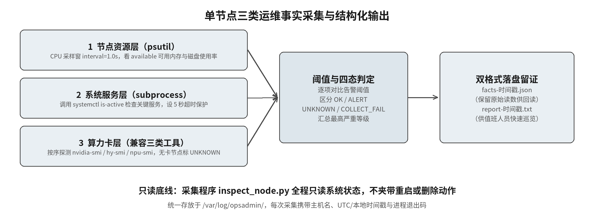
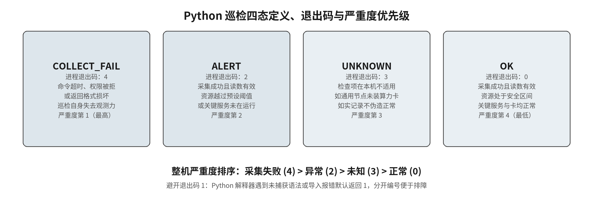
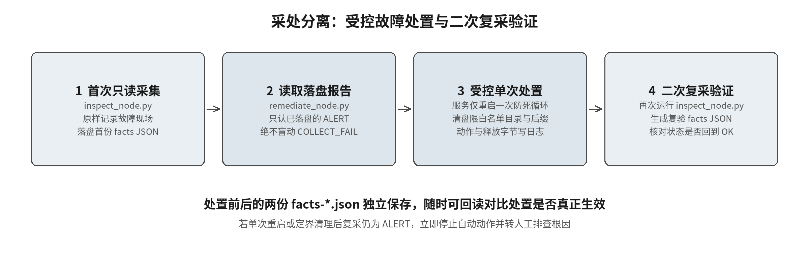
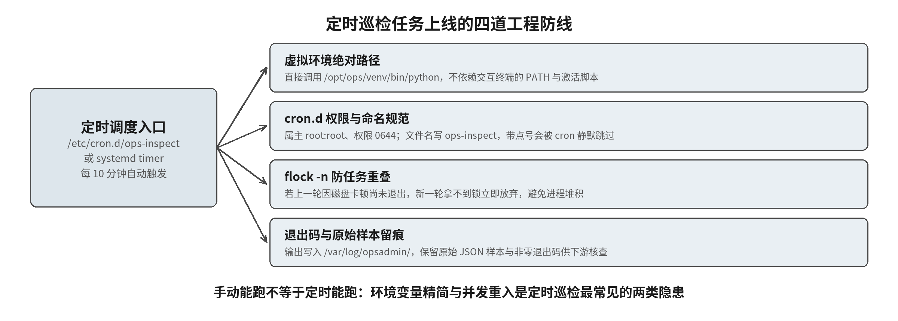

# 第12讲 Python实现自动化运维

**本课程定位：** 面向自建智算中心运维。第 8 讲运行过单机只读 Shell 巡检，第 11 讲用 Bash 完成了多节点软件与配置下发。当巡检对象同时包含主机资源、系统服务与算力卡，并且要求把读数整理成下游程序可直接解析的结构化文件、对明确故障做受控自愈时，纯文本切割的 Shell 脚本会变得脆弱难读。本讲引入 Python 运维程序编写，补齐从结构化采集到受控处置的一环。

夜班巡检汇总里经常混着两类让人头疼的记录：一类是纯 CPU 节点因为没装 `nvidia-smi` 被脚本直接判成“显卡故障”，半夜把值班员吵醒；另一类是脚本发现磁盘快满就直接删文件，事后连删之前到底是哪个目录超标都没留下证据。本讲围绕四个问题展开：什么场景要从 Shell 切换到 Python？怎样用 `psutil` 和标准库采齐节点、服务与算力卡三类事实并分清四种状态？自动处理故障为什么要坚持“采处分离”？挂上定时任务有哪些必查防线？

## 本讲学习目标

学完后，你应能：

- 在独立虚拟环境中运用 Python 字典、函数、异常捕获、文件读写与退出码编写规范的运维脚本。
- 使用 `psutil` 与 `subprocess` 采集节点资源、系统服务与算力卡事实，准确区分 `OK`、`ALERT`、`UNKNOWN`、`COLLECT_FAIL` 四种状态。
- 按“采集只读、处置独立、单次重启、定界清盘、复采验证”原则编写受控故障处理脚本，保证原始数据可回读。
- 通过 `/etc/cron.d/` 或 `systemd timer` 部署定时巡检，配置解释器绝对路径与文件锁防止并发堆积。
- 独立完成一次异常样本注入、自动恢复与前后结构化报告比对验收。

## 12.1、什么时候要从 Shell 换成 Python

Shell 和 Python 不是谁取代谁的关系，而是按任务复杂度分工配合。串接三五条现成系统命令、搬运配置文件时，第 11 讲的 Bash 脚本最直接；一旦需要处理嵌套数据、组合多项阈值、捕获细分异常并输出标准 JSON 报告，Python 标准库与第三方生态明显更稳妥。

<!-- pagebreak -->

表12-1、Shell 脚本与 Python 运维程序的选型边界

| 对比维度 | Shell 脚本（Bash） | Python 运维程序 |
| --- | --- | --- |
| 擅长任务 | 软件包安装、文件分发、短命令串联 | 多源指标采集、复杂条件判定、JSON 结构化输出 |
| 数据处理 | 靠文本行与空格切列，输出格式微变易切错 | 原生字典与列表，字段按键名存取不易错位 |
| 错误区分 | 主要看命令整数返回码，难细分超时与解析错 | 用异常类型精确区分文件不存在、权限拒绝与超时 |
| 依赖管理 | 直接调系统自带工具，几乎无额外包依赖 | 需管理解释器版本与第三方库，统一使用虚拟环境 |

### 12.1.1、独立虚拟环境基线

在 `Ubuntu Server 22.04 LTS` 上，系统包管理器自身依赖全局 Python 环境。生产上严禁直接执行 `sudo pip install` 往系统目录塞包，否则很容易把系统工具依赖的版本冲坏。

本课程统一使用 `Python 3.11`，把运维专用虚拟环境建在 `/opt/ops/venv`（解释器固定为 `/opt/ops/venv/bin/python`），在虚拟环境内安装跨平台系统信息库 `psutil>=7.0,<8`。脚本统一存放在 `/opt/ops/`，巡检产物与日志统一落盘到 `/var/log/opsadmin/`（属主 `opsadmin:opsadmin`，权限 `750`）。

### 12.1.2、够写巡检程序的五项 Python 核心语法

零基础写运维程序，先把下面五项高频语法练熟就够支撑本讲全部开发：

- **字典与列表组织事实**：用字典（`dict`）存放带名字的键值对（如主机名、状态码、各项读数），用列表（`list`）存放多块磁盘或多张算力卡条目，天然对应一份 JSON 文档。
- **函数封装单类检查**：把 CPU、内存、磁盘、服务、算力卡各自写成独立函数，统一返回包含状态、数值和说明文字的小字典，主函数只管汇总。
- **异常捕获兜住采集错误**：调用外部命令或读受限路径时包上 `try ... except`，分别捕获 `FileNotFoundError`（命令未安装）、`subprocess.TimeoutExpired`（命令卡死超时）与 `PermissionError`（权限不足），不让单处报错导致整个脚本崩溃退出。
- **上下文管理器安全落盘**：使用 `with open(path, "w", encoding="utf-8") as f:` 配合 `json.dump(..., indent=2)` 写文件，代码块结束自动关闭文件句柄，不怕半途漏刷缓存。
- **显式返回进程退出码**：程序末尾用 `sys.exit(code)` 把最终状态码交给操作系统，供外层定时任务或编排工具直接判断成败。

## 12.2、采集三类事实与巡检四态模型

一份合格的算力节点巡检程序，不能只看 CPU 和磁盘，必须把**节点资源**、**关键系统服务**与**算力加速卡**三层事实一次采齐，并且用统一的四态模型表达判断结果。



### 12.2.1、用 psutil 与 subprocess 采准三层数据

采集节点层资源时，直接使用 `psutil` 读取内核计数，不必再去切割 `top` 或 `free` 的屏幕文本，但有三个参数口径必须写准：

- **CPU 利用率必须给采样时间窗**：调用 `psutil.cpu_percent(interval=1.0)`，让程序阻塞观察 `1.0` 秒前后的内核时间片差值。如果漏写 `interval` 或传 `0`，首次调用只会返回无意义的 `0.0%`。
- **内存充足度看 available**：调用 `psutil.virtual_memory()`，延续第 8 讲口径，用 `available / total` 计算真实可用内存占比（或 `100 - available * 100 / total` 算实际占用率），不要只看 `free` 字段而把系统可随时回收的缓存误判成内存耗尽。
- **磁盘空间绑定具体挂载点**：调用 `psutil.disk_usage("/")` 与 `psutil.disk_usage("/data")`，明确记录被测路径、总容量字节数与已用百分比。

采集系统服务与算力卡状态时，使用标准库 `subprocess.run(cmd, capture_output=True, text=True, timeout=5)`：

- **系统服务检查**：传入参数列表 `["systemctl", "is-active", "prometheus-node-exporter"]`（不开启 `shell=True`，防止命令拼接注入风险）。返回码为 `0` 且输出 `active` 判为正常，否则判为异常。
- **算力卡兼容探测**：按顺序用 `shutil.which()` 检测本机是否装有 `nvidia-smi`（NVIDIA GPU）、`hy-smi`（海光 DCU）或 `npu-smi`（华为昇腾 NPU）。以 `nvidia-smi` 为例，加上 `--query-gpu=index,name,temperature.gpu,utilization.gpu,memory.used,memory.total --format=csv,noheader,nounits` 可直接拿到无单位纯数字行，解析最稳；设 `timeout=5` 可防止驱动异常锁死时把巡检进程永久挂住。

### 12.2.2、巡检四态定义、退出码与严重度排序

为什么巡检结果不能简单二分法写成“正常 / 异常”？因为算力机房里既有带卡的推理节点 `gpu-node-01`，也有纯通用计算节点 `os-node-01`；同时还会遇到驱动卡死导致命令超时的情况。本讲锁定四种巡检状态与固定退出码。



表12-2、自动化巡检四种状态、退出码与判定口径

| 巡检状态 | 英文标识 | 退出码 | 判定条件与典型场景 | 严重度 |
| --- | --- | --- | --- | --- |
| 采集失败 | `COLLECT-FAIL` | `4` | 命令超时、权限不足或返回格式损坏 | 第 1 级（最高） |
| 异常 | `ALERT` | `2` | 采集成功，指标越阈值或关键服务停运 | 第 2 级 |
| 未知 | `UNKNOWN` | `3` | 本机不适用，如通用节点无算力卡工具 | 第 3 级 |
| 正常 | `OK` | `0` | 采集成功，各项资源与服务均在正常区间 | 第 4 级（最低） |

注：脚本 JSON 字段与代码中统一将采集失败写为下划线格式 `COLLECT_FAIL`。这里有两个非常关键的设计细节：

第一，**整机汇总严重度遵循 COLLECT_FAIL (4) > ALERT (2) > UNKNOWN (3) > OK (0)**。采集失败排在异常前面，是因为一旦采集失败，运维就失去了对现场的观测能力——哪怕机器已经过热或掉卡也看不见，必须最先修复巡检链路本身。

第二，**业务退出码特意避开 1**。当 Python 脚本自身出现语法拼写错或缺少 `psutil` 模块崩溃时，解释器默认返回退出码 `1`。把巡检业务异常定为 `2`、未知定为 `3`、采集失败定为 `4`，外层调度器一看见退出码 `1` 就知道是脚本代码本身崩了。

【关键区别】不要混淆两处边界：一是本讲的 `UNKNOWN` 与 `COLLECT_FAIL`——纯 CPU 节点本来就没有显卡工具属于 `UNKNOWN`（如实登记不适用，既不瞎报故障也不假装显卡正常），而算力节点装有 `nvidia-smi` 却执行超时或报驱动通信错属于 `COLLECT_FAIL`；二是不要把第 11 讲的五态（`OK/DRY/SKIP/FAIL/未执行`，描述批量变更动作走到哪一步）和本讲的四态（描述巡检观测到的健康结论）混套。

**【例题】** `inspect_node.py` 在通用控制节点 `os-node-01` 上运行：CPU 占用 `18.5%`（阈值 `85%`），可用内存占比 `62.0%`（下限阈值 `15%`），根分区已用 `41.0%`（阈值 `80%`），`prometheus-node-exporter` 服务状态为 `active`，本机未装任何算力卡命令（未配置必须有卡）。请问这五项各自是什么状态？整机汇总状态与进程退出码是多少？

**解：** CPU、内存、磁盘、系统服务四项均为 `OK`；算力卡检查项在本机不适用，判为 `UNKNOWN`。按严重度 `COLLECT_FAIL > ALERT > UNKNOWN > OK` 取最高一档，整机汇总状态为 `UNKNOWN`，脚本进程返回退出码 `3`。如果确认这台机器长期作为纯 CPU 节点运行，可在节点角色配置中显式关闭算力卡检查项或让下游汇总台识别 `UNKNOWN` 免告警。

【随堂思考】如果某台推理节点 `gpu-node-01` 昨天还能正常采集到 4 张算力卡，今天运行 `nvidia-smi` 卡了 5 秒触发 `TimeoutExpired`，脚本应当把这一项标成 `ALERT`、`UNKNOWN` 还是 `COLLECT_FAIL`？为什么不能直接触发“自动重启业务服务”？

## 12.3、采处分离：受控故障处置与原始数据回读

新手写自动化脚本最容易踩的大坑，是在采集函数里顺手加上“发现异常立刻重启服务、发现盘满立刻 `rm` 删文件”。这种把采集和修改揉在一起的做法有两个严重后果：一是故障发生瞬间的原始读数还没落盘就被覆盖了，事后查不出根因；二是万一阈值写错或遇到 `COLLECT_FAIL`，脚本会在错误前提下反复破坏现场。

本课程执行严格的**采处分离**架构：只读采集脚本 `inspect_node.py` 与自动处置脚本 `remediate_node.py` 拆成两个独立文件，通过落盘的 `facts-时间戳.json` 衔接。



自动处置程序 `remediate_node.py` 必须守住四条安全边界：

1. **只认已落盘的 ALERT 原始数据**：处置前先读取 `inspect_node.py` 刚刚写入磁盘的 `facts-时间戳.json`；对于 `OK`、`UNKNOWN` 以及观测失灵的 `COLLECT_FAIL` 一律不动手，确保故障第一现场的原始 JSON 完整保留、随时可回读。
2. **服务异常仅执行单次重启**：检测到白名单内的关键服务（如 `prometheus-node-exporter`）处于 `ALERT` 时，最多执行一次 `systemctl restart`，绝不在脚本里写 `while` 死循环反复拉起（避免配置损坏时打满系统日志，与第 8 讲启动限流同源）。
3. **空间清理限定白名单目录、后缀与配额**：绝不允许对业务根目录执行宽泛删除。自动清理只能针对预先约定的缓存或归档日志目录（如演练目录 `/var/log/opsadmin/RotatableCache`），只清理符合指定后缀（如 `.old`、`.gz`）的旧文件，按文件修改时间从旧到新逐个删除，达到释放上限或目录回落至阈值内即停，并把每个被删文件的路径与字节数写进处置日志。
4. **处置后必须二次复采验证**：动作执行完毕并不算故障处理结束。脚本末尾必须再次调用 `inspect_node.py` 生成一份新的复验 JSON，核对原异常项是否真正从 `ALERT` 变回 `OK`；若仍为 `ALERT`，说明单次自愈无效，立即停止自动动作并输出人工介入提示。

表12-3、两类典型异常的受控自动处置与边界约束

| 异常样本类型 | 触发条件（来自首份 JSON） | 允许执行的受控动作 | 严禁越过的红线 |
| --- | --- | --- | --- |
| 关键服务停止 | 指定服务项状态为 `ALERT` | 执行单次 `systemctl restart` 并等待 1 秒复采 | 严禁写死循环无限重启；严禁对 `COLLECT-FAIL` 乱重启 |
| 归档目录超限 | 指定目录使用率状态为 `ALERT` | 在白名单子目录按最旧时间清理 `.old` 文件并记账 | 严禁跨出白名单目录删除；严禁未记文件名与大小就静默删除 |

**【例题】** 凌晨 2 点，定时巡检生成 `facts-20261118-020001.json`，记录归档日志区已用率 `88.5%`（阈值 `80%`，状态 `ALERT`）。随后 `remediate_node.py` 读取这份文件，按修改时间清理了白名单目录下的 3 个 `.old` 归档文件共释放 `1.2 GB`，接着触发二次复采生成 `facts-20261118-020005.json` 显示已用率降至 `71.0%`（状态 `OK`）。早上值班交接时，工程师怎样证明夜间确实发生过超限且清理合规？

**解：** 直接回读 `/var/log/opsadmin/` 下按时间戳独立保存的三份证据文件：`020001` 的首份 JSON 保留了处置前 `88.5%` 的真实读数；`remediate-*.log` 记录了读取哪份 JSON、具体删了哪 3 个 `.old` 文件及各自释放的字节数；`020005` 的复验 JSON 证明清理后使用率已回落到 `71.0%`。因为首次采集只读且不覆盖同名文件，整个链条随时可复核。

【随堂思考】如果有人让 `remediate_node.py` 处理完故障后直接打开原来的 `facts-20261118-020001.json`，把里面的 `"status": "ALERT"` 改成 `"OK"` 保存回去，说是“让报表看着全绿”，这样做破坏了什么原则？会带来什么隐患？

## 12.4、挂上定时任务：cron.d 与 systemd timer

程序手动调试通过后，最后一步是交给系统按固定周期（例如每 10 分钟）自动运行。许多同学手动敲 `python inspect_node.py` 一切正常，一挂进定时任务就没动静或者报错，问题几乎都出在下面四道防线上。



以 `/etc/cron.d/ops-inspect` 为例，标准配置只有短短几行，但每一处都有明确规矩：

- **显式写虚拟环境解释器绝对路径**：`cron` 默认的 `PATH` 极短（通常只有 `/usr/bin:/bin`），也不会自动执行 `source venv/bin/activate`。命令必须直接写 `/opt/ops/venv/bin/python /opt/ops/inspect_node.py`。
- **注意 /etc/cron.d/ 专有的用户名字段、权限与文件名**：与普通用户的 `crontab -e` 不同，`/etc/cron.d/` 下的文件在五个时间字段后面**必须多写一列运行账号**（如 `opsadmin` 或按需配置的采集账号）；文件属主必须是 `root:root`、权限 `0644`；**文件名只能用字母、数字、下划线和连字符（如 ops-inspect），一旦带点号（如 ops-inspect.cron）会被 Ubuntu 的 cron 守护进程直接静默忽略**。
- **加 flock -n 文件锁防任务重叠**：万一某次磁盘 I/O 严重卡顿导致上一轮巡检 10 分钟还没退，下一轮又准点启动，进程就会越积越多。在命令前加上 `/usr/bin/flock -n /tmp/ops-inspect.lock`，拿不到锁时立即跳过本轮。

除了传统的 `/etc/cron.d/`，现代 Linux 也推荐用第 8 讲接触过的 `systemd timer` 调度巡检服务，两者对比如下。

表12-4、两种定时巡检调度方式对比

| 对比维度 | `/etc/cron.d/` 定时文件 | `systemd timer` 定时器单元 |
| --- | --- | --- |
| 配置复杂度 | 单文件一行搞定，上手最快 | 需配对编写 `.service` 与 `.timer` 两个单元文件 |
| 并发防重入 | 默认会并发重入，必须手工加 `flock -n` 锁 | 同名 `.service` 正在运行时默认不会重复拉起第二个实例 |
| 日志与耗时追踪 | 标准输出需手工重定向到日志文件 | 自动接入 `journalctl -u`，自带上次运行耗时与退出码记录 |
| 错过窗口补跑 | 机器关机期间错过的时刻不会补跑 | 开启 `Persistent=true` 后，开机可自动补跑一次错过的巡检 |

## 12.5、上机实训：编写 Python 巡检与受控处置程序

本节在 `infer-node-01`（`Ubuntu Server 22.04 LTS`，已按第 11 讲装好 `prometheus-node-exporter` 服务）上，完成虚拟环境搭建、`inspect_node.py` 与 `remediate_node.py` 编写、异常样本注入与定时巡检上线。

### 12.5.1、搭建 `/opt/ops/venv` 虚拟环境与准备目录

使用 `opsadmin` 账号创建代码目录 `/opt/ops`、巡检落盘目录 `/var/log/opsadmin` 及用于空间清理演练的白名单归档子目录 `/var/log/opsadmin/archive`，并初始化 `Python 3.11`（若系统默认 `python3` 为 `3.10` 或 `3.11` 均可兼容运行）虚拟环境安装 `psutil`：

```bash
sudo apt-get update && sudo apt-get install -y python3-venv python3-pip
sudo mkdir -p /opt/ops /var/log/opsadmin/archive
sudo chown -R opsadmin:opsadmin /opt/ops /var/log/opsadmin
chmod 750 /opt/ops /var/log/opsadmin

python3 -m venv /opt/ops/venv
/opt/ops/venv/bin/pip install "psutil>=7.0,<8"
/opt/ops/venv/bin/python -c "import psutil; print(psutil.__version__)"
```

### 12.5.2、编写只读采集程序

创建 `/opt/ops/inspect_node.py`。程序采集 CPU、可用内存、根分区磁盘、演练归档目录大小、`prometheus-node-exporter` 服务状态与算力卡事实，按四态模型同时输出原始 `facts-时间戳.json` 和可读摘要 `report-时间戳.txt`，并以对应状态码退出：

```bash
cat <<'EOF' > /opt/ops/inspect_node.py
#!/usr/bin/env python3
import argparse
import datetime as dt
import json
import os
import shutil
import socket
import subprocess
import sys
from pathlib import Path
import psutil

EXIT_CODES = {"OK": 0, "ALERT": 2, "UNKNOWN": 3, "COLLECT_FAIL": 4}
SEVERITY = {"OK": 0, "UNKNOWN": 1, "ALERT": 2, "COLLECT_FAIL": 3}


def check_host_resources(archive_dir: Path, archive_limit_mb: float) -> dict:
    items = {}
    try:
        cpu_pct = round(psutil.cpu_percent(interval=1.0), 1)
        items["cpu"] = {
            "status": "ALERT" if cpu_pct >= 85.0 else "OK",
            "value_pct": cpu_pct,
            "threshold_pct": 85.0,
        }
        vm = psutil.virtual_memory()
        avail_pct = round(vm.available * 100.0 / vm.total, 1)
        items["memory"] = {
            "status": "ALERT" if avail_pct < 15.0 else "OK",
            "available_pct": avail_pct,
            "min_available_pct": 15.0,
        }
        du = psutil.disk_usage("/")
        items["root_disk"] = {
            "status": "ALERT" if du.percent >= 80.0 else "OK",
            "mount": "/",
            "used_pct": round(du.percent, 1),
            "threshold_pct": 80.0,
        }
        total_bytes = sum(
            p.stat().st_size for p in archive_dir.glob("*") if p.is_file()
        )
        used_mb = round(total_bytes / (1024 * 1024), 2)
        items["archive_dir"] = {
            "status": "ALERT" if used_mb >= archive_limit_mb else "OK",
            "path": str(archive_dir),
            "used_mb": used_mb,
            "threshold_mb": archive_limit_mb,
        }
    except Exception as exc:
        items["host_error"] = {"status": "COLLECT_FAIL", "error": str(exc)}
    return items


def check_service(service_name: str) -> dict:
    try:
        proc = subprocess.run(
            ["systemctl", "is-active", service_name],
            capture_output=True, text=True, timeout=5,
        )
        state = proc.stdout.strip() or "unknown"
        return {
            "service": service_name,
            "active_state": state,
            "status": "OK" if proc.returncode == 0 and state == "active" else "ALERT",
        }
    except subprocess.TimeoutExpired:
        return {"service": service_name, "status": "COLLECT_FAIL", "error": "timeout"}
    except Exception as exc:
        return {"service": service_name, "status": "COLLECT_FAIL", "error": str(exc)}


def check_accelerator() -> dict:
    tools = (
        ("nvidia", "nvidia-smi", [
            "nvidia-smi",
            "--query-gpu=index,name,temperature.gpu,utilization.gpu,memory.used,memory.total",
            "--format=csv,noheader,nounits",
        ]),
        ("hygon_dcu", "hy-smi", ["hy-smi"]),
        ("ascend_npu", "npu-smi", ["npu-smi", "info"]),
    )
    found = next(((v, b, c) for v, b, c in tools if shutil.which(b)), None)
    if found is None:
        return {
            "status": "UNKNOWN",
            "detail": "no accelerator CLI installed on this node",
        }
    vendor, _, cmd = found
    try:
        proc = subprocess.run(cmd, capture_output=True, text=True, timeout=5)
        if proc.returncode != 0:
            return {
                "vendor": vendor,
                "status": "COLLECT_FAIL",
                "error": proc.stderr.strip() or f"rc={proc.returncode}",
            }
        lines = [ln.strip() for ln in proc.stdout.splitlines() if ln.strip()]
        if not lines:
            return {"vendor": vendor, "status": "COLLECT_FAIL", "error": "empty output"}
        return {"vendor": vendor, "status": "OK", "raw_lines": lines[:8]}
    except subprocess.TimeoutExpired:
        return {"vendor": vendor, "status": "COLLECT_FAIL", "error": "cli timeout >5s"}
    except Exception as exc:
        return {"vendor": vendor, "status": "COLLECT_FAIL", "error": str(exc)}


def main() -> int:
    ap = argparse.ArgumentParser()
    ap.add_argument("--out-dir", default="/var/log/opsadmin")
    ap.add_argument("--service", default="prometheus-node-exporter")
    ap.add_argument("--archive-dir", default="/var/log/opsadmin/archive")
    ap.add_argument("--archive-limit-mb", type=float, default=10.0)
    ap.add_argument("--tag", default="inspect")
    args = ap.parse_args()

    out_dir = Path(args.out_dir)
    out_dir.mkdir(parents=True, exist_ok=True)
    now = dt.datetime.now()
    ts = now.strftime("%Y%m%d-%H%M%S")

    checks = check_host_resources(Path(args.archive_dir), args.archive_limit_mb)
    checks["service"] = check_service(args.service)
    checks["accelerator"] = check_accelerator()

    overall = max((v["status"] for v in checks.values()), key=lambda s: SEVERITY[s])
    payload = {
        "hostname": socket.gethostname(),
        "timestamp": now.isoformat(timespec="seconds"),
        "tag": args.tag,
        "overall_status": overall,
        "exit_code": EXIT_CODES[overall],
        "checks": checks,
    }

    json_path = out_dir / f"facts-{ts}-{args.tag}.json"
    txt_path = out_dir / f"report-{ts}-{args.tag}.txt"
    with open(json_path, "w", encoding="utf-8") as jf:
        json.dump(payload, jf, indent=2)

    summary_lines = [
        f"Host: {payload['hostname']}  Time: {payload['timestamp']}",
        f"Overall: {overall} (exit_code={EXIT_CODES[overall]})",
    ]
    for name, item in checks.items():
        summary_lines.append(f"  - {name}: {item['status']} | {json.dumps(item)}")
    with open(txt_path, "w", encoding="utf-8") as tf:
        tf.write("\n".join(summary_lines) + "\n")

    print(str(json_path))
    return EXIT_CODES[overall]


if __name__ == "__main__":
    sys.exit(main())
EOF
chmod 750 /opt/ops/inspect_node.py
```

### 12.5.3、编写独立受控处置程序

创建 `/opt/ops/remediate_node.py`。程序读取指定的首份 `facts-*.json`，只对服务停止和白名单归档目录超限两类明确 `ALERT` 执行单次重启与 `.old` 文件清理，把每步动作写入 `remediate-*.log`，最后自动调用 `inspect_node.py --tag post-remediate` 生成二次复采验证文件：

```bash
cat <<'EOF' > /opt/ops/remediate_node.py
#!/usr/bin/env python3
import datetime as dt
import json
import subprocess
import sys
import time
from pathlib import Path

ALLOWED_SERVICES = ("prometheus-node-exporter",)
ALLOWED_ARCHIVE = Path("/var/log/opsadmin/archive").resolve()


def log_line(log_path: Path, msg: str) -> None:
    stamp = dt.datetime.now().strftime("%Y-%m-%d %H:%M:%S")
    line = f"[{stamp}] {msg}"
    print(line)
    with open(log_path, "a", encoding="utf-8") as lf:
        lf.write(line + "\n")


def main() -> int:
    if len(sys.argv) != 2:
        print("Usage: remediate_node.py /var/log/opsadmin/facts-TIMESTAMP.json", file=sys.stderr)
        return 2

    _, raw_arg = sys.argv
    facts_path = Path(raw_arg).resolve()
    if not facts_path.is_file():
        print(f"ERROR: missing facts file {facts_path}", file=sys.stderr)
        return 2

    with open(facts_path, "r", encoding="utf-8") as f:
        facts = json.load(f)

    ts = dt.datetime.now().strftime("%Y%m%d-%H%M%S")
    log_path = Path("/var/log/opsadmin") / f"remediate-{ts}.log"
    log_line(log_path, f"Loaded source facts (read-only preserved): {facts_path}")

    checks = facts.get("checks", {})
    acted = False

    # 1. Single-shot restart for whitelisted service in ALERT state
    svc_info = checks.get("service", {})
    svc_name = svc_info.get("service", "")
    if svc_info.get("status") == "ALERT" and svc_name in ALLOWED_SERVICES:
        log_line(log_path, f"Service {svc_name} is ALERT; executing single restart")
        proc = subprocess.run(
            ["sudo", "-n", "systemctl", "restart", svc_name],
            capture_output=True, text=True, timeout=15,
        )
        log_line(log_path, f"Restart rc={proc.returncode} stderr={proc.stderr.strip()}")
        acted = True

    # 2. Bounded cleanup of *.old files inside whitelisted archive directory
    arc_info = checks.get("archive_dir", {})
    if arc_info.get("status") == "ALERT":
        target = Path(arc_info.get("path", "")).resolve()
        limit_bytes = float(arc_info.get("threshold_mb", 10.0)) * 1024 * 1024
        if target == ALLOWED_ARCHIVE and target.is_dir():
            old_files = sorted(
                (p for p in target.glob("*.old") if p.is_file()),
                key=lambda p: p.stat().st_mtime,
            )
            cur_bytes = sum(p.stat().st_size for p in target.glob("*") if p.is_file())
            for cand in old_files:
                if cur_bytes < limit_bytes:
                    break
                sz = cand.stat().st_size
                cand.unlink()
                cur_bytes -= sz
                log_line(log_path, f"Removed {cand.name} ({sz} bytes)")
                acted = True

    if not acted:
        log_line(log_path, "No actionable ALERT items matched whitelist; skipping")
        return 0

    time.sleep(1)
    recheck = subprocess.run(
        ["/opt/ops/venv/bin/python", "/opt/ops/inspect_node.py", "--tag", "post-remediate"],
        capture_output=True, text=True, timeout=30,
    )
    new_facts = recheck.stdout.strip()
    log_line(log_path, f"Post-remediation facts saved to: {new_facts} (rc={recheck.returncode})")
    return 0 if recheck.returncode in (0, 3) else 2


if __name__ == "__main__":
    sys.exit(main())
EOF
chmod 750 /opt/ops/remediate_node.py
```

### 12.5.4、制造异常样本、验证受控自愈并配置定时巡检

按“正常基线采集 → 注入服务停止与归档超限双异常 → 只读采集留证 → 运行受控处置 → 回读前后两份 JSON 对照”五步执行：

```bash
# 1. Baseline inspection
/opt/ops/venv/bin/python /opt/ops/inspect_node.py --tag baseline || true

# 2. Inject two controlled faults: stop service + create 12MB of .old files (limit 10MB)
sudo systemctl stop prometheus-node-exporter
dd if=/dev/zero of=/var/log/opsadmin/archive/batch1.old bs=1M count=6 status=none
sleep 1
dd if=/dev/zero of=/var/log/opsadmin/archive/batch2.old bs=1M count=6 status=none

# 3. Run read-only inspection (expect exit code 2 ALERT)
FAULT_JSON="$(/opt/ops/venv/bin/python /opt/ops/inspect_node.py --tag fault || echo "")"
FAULT_JSON="$(ls -1t /var/log/opsadmin/facts-*-fault.json | head -n 1)"
cat "$FAULT_JSON"

# 4. Run independent remediation and verify post-remediate JSON
/opt/ops/venv/bin/python /opt/ops/remediate_node.py "$FAULT_JSON"
POST_JSON="$(ls -1t /var/log/opsadmin/facts-*-post-remediate.json | head -n 1)"
cat "$POST_JSON"
```

核对两份 JSON 的变化：`facts-*-fault.json` 原封不动保留在磁盘上，里面 `service` 与 `archive_dir` 均为 `ALERT`，`archive_dir.used_mb` 为 `12.0`；处置日志 `remediate-*.log` 记录了单次重启 `prometheus-node-exporter` 并删除最早的 `batch1.old`（释放 `6291456` 字节后目录降至 `6.0 MB`，低于 `10.0 MB` 阈值即停手保留 `batch2.old`）；`facts-*-post-remediate.json` 中两项均恢复为 `OK`。

最后，把只读巡检挂入 `/etc/cron.d/ops-inspect`，每 10 分钟配合 `flock -n` 自动运行一次，并清理演练残留文件：

```bash
sudo tee /etc/cron.d/ops-inspect >/dev/null <<'EOF'
SHELL=/bin/bash
PATH=/usr/local/sbin:/usr/local/bin:/usr/sbin:/usr/bin:/sbin:/bin
*/10 * * * * opsadmin /usr/bin/flock -n /tmp/ops-inspect.lock /opt/ops/venv/bin/python /opt/ops/inspect_node.py --tag cron >>/var/log/opsadmin/cron.log 2>&1
EOF
sudo chown root:root /etc/cron.d/ops-inspect
sudo chmod 0644 /etc/cron.d/ops-inspect
rm -f /var/log/opsadmin/archive/*.old
```

<!-- pagebreak -->

### 12.5.5、常见报错分层排查与交付物验收

实训或排障时遇到异常现象，按下面路径逐项核查。

表12-5、Python 巡检与定时任务常见故障排查表

| 现场现象 | 先查位置 | 常见根因与修复方法 |
| --- | --- | --- |
| 定时任务报 `No module named psutil` | 调用的解释器路径 | 误写成系统 `/usr/bin/python3`，改为 `/opt/ops/venv/bin/python` |
| `/etc/cron.d/` 文件完全不触发 | 文件名、属主与权限 | 文件名含点号、权限非 `0644`、属主非 `root` 或漏写第 6 列用户名 |
| CPU 读数永远显示 `0.0%` | `cpu-percent` 参数 | 漏传 `interval=1.0` 采样窗口，补上 `1.0` 秒阻塞采样 |
| 处置脚本重启服务卡住或失败 | `sudoers` 免密策略 | `opsadmin` 未获授指定服务的免密重启权限，用 `visudo` 最小授权 |

核对 `/opt/ops/` 与 `/var/log/opsadmin/` 下的四项实训交付物：程序源码（`inspect_node.py`、`remediate_node.py`）、结构化样例数据（处置前 `facts-*-fault.json` 与处置后 `facts-*-post-remediate.json`）、异常处置记录（`remediate-*.log`）以及可读巡检报告（`report-*.txt`）。

<!-- pagebreak -->

## 12.6、本讲回顾与自测

学习完本讲后，试着用自己的话回答四个问题：为什么要建独立虚拟环境 `/opt/ops/venv` 而不直接往系统装包？巡检四态里 `COLLECT_FAIL` 为什么严重度高于 `ALERT`？采集脚本与处置脚本为什么要分开成两个文件？`/etc/cron.d/` 定时配置最容易漏掉哪三个细节？

表12-6、本讲目标与对应判断

| 学习目标 | 应能做出的判断 |
| --- | --- |
| 搭环境写语法 | 用 `/opt/ops/venv` 隔离依赖，用字典、`try...except` 与 `json.dump` 输出结构化事实 |
| 判巡检四态 | 区分 `OK(0)`、`ALERT(2)`、`UNKNOWN(3)`、`COLLECT-FAIL(4)`，按 `4>2>3>0` 汇总严重度 |
| 守采处分离 | 采集严格只读先落盘，处置只认 `ALERT` 做单次重启或白名单定界清理并二次复采 |
| 挂定时巡检 | 配准解释器绝对路径、`/etc/cron.d/` 无点号命名与 `0644` 权限，加 `flock -n` 防重入 |
| 留可回读证据 | 保留处置前后两份独立时间戳 JSON 与处置日志，绝不篡改原始异常文件 |

### 12.6.1、本讲自测

**1 内存与 CPU 口径。** 用 `psutil` 采集节点资源时，为什么 CPU 要传 `interval=1.0`，而判断内存是否紧缺要看 `virtual_memory().available` 而不是 `free`？

**2 四态区分。** 两台节点运行同一份 `inspect_node.py`：节点 A 是未装任何加速卡管理命令的存储节点；节点 B 是插了 8 张 GPU 但执行 `nvidia-smi` 超过 5 秒无响应的推理节点。写出两台节点在算力卡检查项上的状态名与退出码。

**3 退出码设计。** 本讲巡检四态分别使用退出码 `0`、`2`、`3`、`4`，为什么特意跳过退出码 `1`？

**4 采处边界。** 自动处置程序 `remediate_node.py` 读到算力卡检查项状态为 `COLLECT_FAIL` 时，能不能自动重启这台机器上的推理服务？为什么？

**5 清理防呆。** 设计自动清理日志目录逻辑时，至少需要限定哪三项边界条件，才能避免误删线上有效文件并保证可追溯？

**6 定时排障。** 工程师手动运行 `/opt/ops/venv/bin/python /opt/ops/inspect_node.py` 成功，但写了 `/etc/cron.d/ops.inspect`（权限 `0666`，内容为 `*/10 * * * * python3 /opt/ops/inspect_node.py`）后既不运行也找不到 `psutil`。请指出里面的四处错误。

**答：**

____________________________

____________________________

____________________________

____________________________

## 12.7、参考答案与解析

### 12.7.1、随堂思考解析

**思考 1（nvidia-smi 超时的状态判定与禁盲动）：** 应当标成 `COLLECT_FAIL`（退出码 `4`）。昨天有卡、今天工具执行超时，不是“本机不适用”（`UNKNOWN`），而是驱动通信锁死或总线挂起导致巡检失去观测力。此时绝不能盲目重启上层业务服务——在底层驱动卡死时强行重启容器或进程往往同样卡死在内核态，应当第一时间发出最高优先级告警由人工结合带外 BMC 与内核 `dmesg` 排查。

**思考 2（直接覆写原 JSON 文件的危害）：** 破坏了“原始巡检数据只读可回读”的审计底线。一旦把 `020001` 原文件改成 `OK`，事后既无法统计某项故障一周内真实触发了多少次，也无法核对自动清理前磁盘到底涨到了多少，遇到反复发作的隐性内存或磁盘泄漏会被完全掩盖。正确做法是保留原故障 JSON 不动，二次复采另存一份带新时间戳的验证 JSON。

### 12.7.2、课后自测解析

**1** `cpu_percent` 需要比较一段采样窗口前后的 CPU 时间片计数，不传 `interval` 首次调用没有参照差值会返回 `0.0%`；Linux 会把空闲内存借作页缓存加速读写，这部分内存在程序需要时可立即回收并计入 `available`，单看 `free` 会把健康机器误报为内存不足。

**2** 节点 A 为 `UNKNOWN`（退出码 `3`，本机不适用）；节点 B 为 `COLLECT_FAIL`（退出码 `4`，工具存在但超时失败）。

**3** Python 解释器在遇到代码语法错误、未捕获异常或模块导入失败（`ImportError`）崩溃时默认返回退出码 `1`。业务状态避开 `1` 后，监控或外层脚本看到 `1` 就能立刻区分是“巡检代码自身崩了”还是“被检节点业务指标超阈值（`2`）”。

**4** 不能。`COLLECT_FAIL` 代表采集过程出错、当前真实状态不明，不是明确确认的业务服务停止。对不明现场乱做重启既掩盖根因，还可能扩大故障影响面。

**5** 至少限定三项边界：一是严格限制在预设白名单目录路径内；二是限制匹配可安全清理的文件后缀（如 `.old`、`.gz`）并按修改时间从旧到新处理；三是设定单次清理上限（降至安全水位即停），且把每个删除文件的名称与字节数写入处置日志。

**6** 四处错误：①文件名 `ops.inspect` 含有点号，会被 Ubuntu `cron` 忽略，应改为 `ops-inspect`；②文件权限 `0666` 过宽被 `cron` 拒绝，应改为 `0644`（属主 `root:root`）；③`/etc/cron.d/` 格式漏写了第 6 列的执行用户名（如 `opsadmin`）；④调用系统 `python3` 而非虚拟环境绝对路径 `/opt/ops/venv/bin/python`，且未加 `flock -n` 防重叠锁。

<!-- pagebreak -->

## 12.8、术语

表12-7、本讲术语

| 术语 | 本讲中的含义 |
| --- | --- |
| 虚拟环境（venv） | 独立于操作系统全局目录的 Python 运行目录，隔离运维程序依赖包版本（如 `/opt/ops/venv`）。 |
| `psutil` | 跨平台的 Python 系统与进程信息采集库，直接读取 CPU、内存、磁盘与进程内核指标。 |
| 巡检四态 | 自动化巡检统一输出的四种状态：正常 `OK(0)`、异常 `ALERT(2)`、未知 `UNKNOWN(3)`、采集失败 `COLLECT-FAIL(4)`。 |
| 采处分离 | 采集脚本保持纯粹只读并先落盘原始数据，故障处置由独立脚本读取落盘结果后受控执行。 |
| 二次复采 | 自动处置动作完成后再次运行采集脚本生成新样本，用真实读数验证故障是否恢复。 |
| `flock` 文件锁 | 利用内核文件锁控制定时任务互斥执行，加 `-n` 参数可在上轮未退时立即跳过本轮防堆积。 |

文中 IP、域名、路径与参数为教学示例，生产环境以本单位规划为准。

<!-- md-only -->
## 附：主要参考资料（仅 Markdown 保留，不印入 Word/PDF）

- Python 3.11 官方标准库文档：`venv`、`subprocess`、`json`、`pathlib`、`argparse` 与系统退出码说明。
- `psutil` 官方文档（7.x 版本）：`cpu_percent(interval)`、`virtual_memory().available` 与 `disk_usage()` 跨平台统计口径。
- Ubuntu 22.04 `cron(8)` 与 `crontab(5)` 系统手册：`/etc/cron.d/` 目录命名限制（Debian/Ubuntu `run-parts` 规则）、权限要求与第 6 列用户字段规范。
- `util-linux` 官方手册 `flock(1)`：非阻塞文件锁 `-n` 防止定时任务并发重入用法。
- NVIDIA System Management Interface (`nvidia-smi`)、海光 `hy-smi` 与华为昇腾 `npu-smi` 命令行工具参考手册。
- 中国信通服务《2025 算力运维体系技术白皮书》（本地 `./资料/`）：算力基础设施自动化巡检、分级告警与受控故障自愈规范。
<!-- /md-only -->
