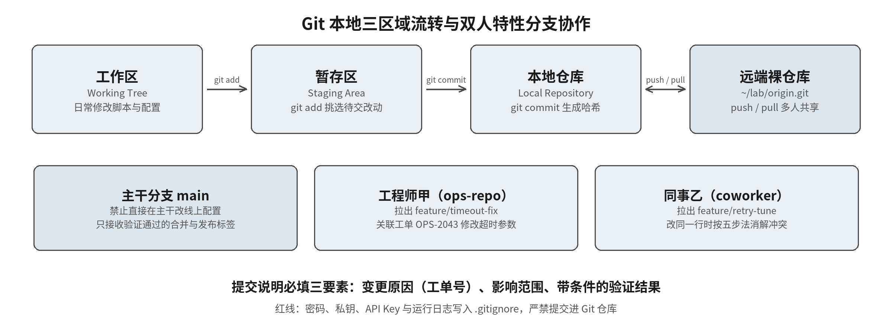
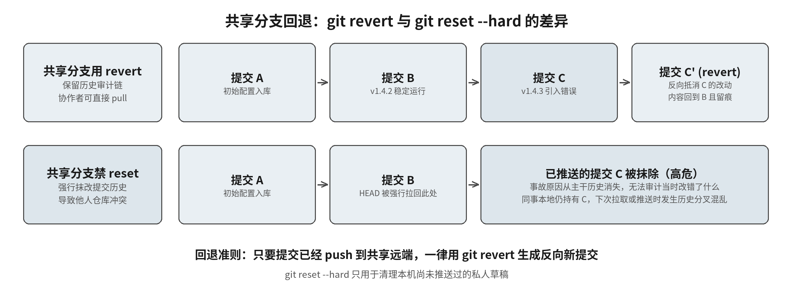
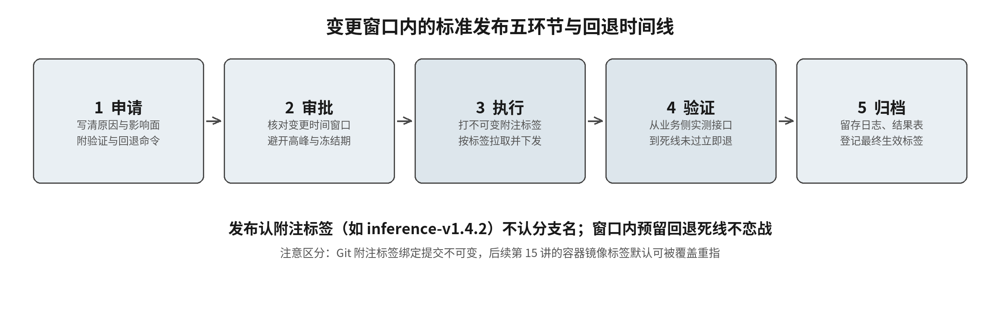
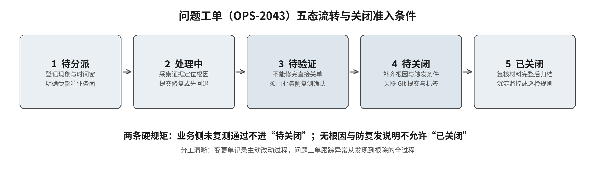

# 第13讲 版本、工单与持续运维

**本课程定位：** 面向自建智算中心运维。第 11 讲编写了多节点部署与回退脚本，第 12 讲编写了 Python 结构化巡检与受控处置程序。脚本和配置文件写出来之后，如果团队里三个人同时在服务器上直接改文件，很快就会出现“谁覆盖了我的配置”“上周正常跑的那一版去哪了”的混乱。本讲作为第三章收官课，把代码配置版本控制、窗口化发布与问题工单串成可持续运转的日常秩序。

推理网关今天上午偶发 `504` 超时告警（工单号 `OPS-2043`）。你准备把反向代理超时从 `30s` 调到 `60s`，打开服务器目录却看见 `infer-proxy.conf.bak`、`infer-proxy.conf.0512`、`infer-proxy.conf.zhang` 四个文件，没人说得清线上正在跑哪一份。本讲围绕四个问题展开：版本控制要给每次改动补齐什么信息？多人改同一份配置撞车时怎么用 Git 解决冲突？发版出错为什么要用 `git revert` 而不是强行抹历史？变更发布五环节与问题工单五态怎样配合运作？

## 本讲学习目标

学完后，你应能：

- 解释版本控制的四项基本要求，用 `.gitignore` 拦住私钥、密码与运行日志，写出含“原因、影响范围、验证结果”的规范提交说明。
- 运用 Git 工作区、暂存区、本地仓库与远端裸仓库完成特性分支开发，按五步法消解多人同行合并冲突。
- 使用不可变附注标签标记生产发布版本，区分共享分支上 `git revert` 与 `git reset --hard` 的适用边界。
- 按“申请、审批、执行、验证、归档”五环节与变更窗口回退死线组织发布，避免超时硬拖。
- 区分主动变更记录与问题工单的职责，按“待分派、处理中、待验证、待关闭、已关闭”五态跟踪问题直至根因归档。

## 13.1、建立版本控制思维：让每次改动有身份可回读

靠手工复制 `deploy_v2_final.sh` 管运维文件，有三个绕不开的硬伤：看不出两个文件到底差在哪几行，查不到是谁为了什么故障改的，多人同时编辑时后保存的人会静默覆盖前一个人的修改。

引入版本控制，核心是给运维脚本和配置文件补齐四项基础能力。

<!-- pagebreak -->

表13-1、运维配置与脚本版本控制的四项核心要求

| 核心要求 | 解决的具体现场问题 | Git 对应机制 |
| --- | --- | --- |
| 唯一身份 | 告别混乱的文件后缀名，精确指代某一次状态 | 每次提交自动生成唯一的 SHA-1 校验哈希值 |
| 完整记录 | 半年后仍能查清谁、在何时、因哪张工单做了修改 | 提交元数据绑定作者、时间戳与结构化提交说明 |
| 随时回读 | 发布前逐行核对差异，排障时对比故障前后的改动 | `git diff` 比对行级增删，`git log -p` 回读历史 |
| 安全回退 | 新配置引发异常时，几秒内准确切回上一稳定版本 | 按附注标签检出旧版，或用 `git revert` 生成反向提交 |

### 13.1.1、什么要进仓库，什么严禁进仓库

第 11 讲的部署脚本、第 12 讲的巡检代码、反向代理配置模板、后续第四章的容器编排清单，都属于**确定性配置与代码**，应当全部纳入 Git 仓库。

相反，两类文件**严禁提交进 Git 仓库**：一类是运行期不断膨胀的产物（如 `*.log`、`*.pyc`、`__pycache__/`、临时备份 `*.bak`）；另一类是**敏感凭据**（SSH 私钥、数据库密码、API 密钥、证书私钥 `*.key`）。一旦把密码写进某次提交并推上远端，就算下一秒删掉文件再提交一次，密码明文依然留在历史记录里。仓库根目录下必须第一时间建立 `.gitignore` 忽略规则；生产凭据的安全存储、定期轮换与代码库分支写权限控制，将在第 37、38 讲专门展开。

### 13.1.2、提交说明必填三要素

运维仓库最忌讳 `git commit -m "update"` 或 `"fix"` 这类没有信息量的说明。每次提交说明必须写清三项事实：**变更原因**（关联问题工单号如 `OPS-2043` 或需求背景）、**影响范围**（涉及哪个服务、哪类节点、是否需要重启进程）、**带条件的验证结果**（在什么测试节点、用什么命令验证通过）。

## 13.2、Git 三区域、特性分支与多人冲突解决

把单机目录变成多人协作仓库前，先看清文件在 Git 里的流转路径，以及团队怎样保护主干分支不被半成品污染。



### 13.2.1、本地三区域与主干保护规矩

在开发者自己的机器上，Git 把文件分成三个区域：**工作区**（你正在编辑的普通目录）→ 用 `git add` 把确认要交的改动挑进**暂存区**（防止把顺手改乱的调试代码一锅端交上去）→ 用 `git commit` 正式存入**本地仓库**生成快照，最后通过 `git push` 和 `git pull` 与团队共享的远端仓库同步。

多人协作的第一条纪律是：**主干分支 main 代表随时可发布的生产基线，禁止直接在 main 上改文件**。日常修复或调参，一律从最新 `main` 拉出一条命名清晰的**特性分支**（如 `feature/timeout-fix`），在分支上改完、测通后，再合并回 `main`。

表13-2、日常协作高频 Git 命令速查

| 操作阶段 | 常用命令示例 | 用途与核对要点 |
| --- | --- | --- |
| 克隆与同步 | `git clone` / `git pull --ff-only` | 拉取远端仓库，优先快进同步避免无意义分叉 |
| 建特性分支 | `git switch -c feature/timeout-fix` | 从当前最新 `main` 切出独立修改分支 |
| 核对与暂存 | `git status` / `git diff` / `git add` | 提交前必看 `diff` 逐行核对，再点名 `add` 目标文件 |
| 合并回主干 | `git switch main` 后 `git merge` | 把验证通过的特性分支合入本地 `main` |
| 历史回读 | `git log --oneline --graph --decorate` | 查看分支合并拓扑、提交哈希与标签位置 |

### 13.2.2、合并冲突五步解决法

当工程师甲在 `feature/timeout-fix` 修改了 `infer-proxy.conf` 第 4 行并率先推入远端 `main`，同事乙也在自己的 `feature/retry-tune` 分支修改了同一文件的第 4 行或相邻行，乙拉取远端 `main` 合并时，Git 无法替人类拍板保留哪一边，就会报 `CONFLICT (content)` 暂停合并。

遇到冲突不要慌张删库重克隆，严格按下面五步处理：

1. **查冲突名单**：运行 `git status`，看 `Unmerged paths` 下列出了哪几个 `both modified` 文件。
2. **读懂三段标记并对齐意图**：打开冲突文件，`<<<<<<< HEAD` 到 `=======` 之间是当前分支的修改，`=======` 到 `>>>>>>>` 之间是待合入分支的修改。先找同改人确认双方各自想解决什么业务问题，不盲目删掉别人的配置。
3. **手工编辑定稿并删净标记**：保留协商后的最终配置（有时是取一边，更多时候是把双方的合理参数融合成最终版），把 `<<<<<<<`、`=======`、`>>>>>>>` 三行标记删得干干净净。
4. **本地语法与功能校验**：配置合并完后先跑语法检查（如 `nginx -t` 或 `bash -n`），防止残留半截符号把线上服务搞崩。
5. **标记已解决并生成合并提交**：执行 `git add <冲突文件>` 告诉 Git 冲突已人工排解，再运行 `git commit` 写明冲突取舍依据并推送。

**【例题】** 甲把 `read_timeout` 从 `30s` 改成 `60s` 以修复长文本推理超时（`OPS-2043`）并已合入 `main`；乙不知情，在旧基线上把同一行改成 `read_timeout = 45s` 并新增一行 `max_retries = 2`。乙执行 `git pull --no-rebase origin main` 时触发冲突。乙应当怎么定稿？

**解：** 乙先用 `git status` 定位冲突文件，找甲核对得知长文本推理压测需要 `60s` 才不超时（`45s` 仍会截断），而乙新增的 `max_retries = 2` 是为了应对后端瞬断，两项需求并不矛盾。因此乙手工把文件定稿为 `read_timeout = 60s` 加 `max_retries = 2`，删净三行冲突符号，跑完配置校验后执行 `git add` 与 `git commit`，在提交说明里写清保留 `60s` 并合入重试参数的依据。

【随堂思考】如果合并冲突后忘了删掉文件里的 `<<<<<<< HEAD` 这行符号，直接 `git add`、`git commit` 并下发到了线上服务器，Git 会拦截这次提交吗？线上服务重启时会怎样？

## 13.3、版本发布、附注标签与安全回退

配置合入 `main` 后，准备推向生产环境。此时必须解决两件事：用什么标识唯一锁定这次上线的版本？一旦上线后发现隐藏缺陷，怎样在共享仓库里安全回退？

### 13.3.1、发布认不可变附注标签，不认分支名

生产操作票上不能写“本次部署 `main` 分支”——因为明天别人往 `main` 合入新代码后，`main` 指向的内容就变了，下周复盘根本说不清当时发的到底是哪一版。

正确做法是在验证通过的提交上打**附注标签**（Annotated Tag），例如 `git tag -a inference-v1.4.2 -m "Release v1.4.2 for OPS-2043"` 并执行 `git push origin inference-v1.4.2`。附注标签本身是一个完整的 Git 对象，记录了打标人、打标时间、发布说明以及所绑定的精确提交哈希。部署脚本按标签号检出文件，任何时候回查 `inference-v1.4.2` 拿到的都是分毫不差的同一套文件。

【关键区别】提前留心三个跨讲次高频易混词：第一，**Git 附注标签是绑定特定提交、默认不可移动的发布指针**，而第 15、23 讲将学到的**容器镜像标签**（如 `myapp:latest`）默认可以随时被新镜像覆盖重指（容器生产锁定内容还要看 `sha256` 摘要）；第二，本讲管的 **Git 代码配置仓库**只存纯文本源码与配置清单，不同于第 15、23 讲存容器镜像层的 **Harbor 镜像仓库**，也不同于第 23 讲存 Kubernetes 应用包的 **Helm Chart 仓库**，三类仓库各司其职。

### 13.3.2、共享分支回退：用 git revert，禁 git reset --hard

假设 `inference-v1.4.3`（对应提交 `C`）已推上共享远端 `main` 并部署上线，5 分钟后监控发现新加的参数导致请求报错，需要立刻退回 `v1.4.2`（提交 `B`）的配置。Git 里有两个长得很像的撤销命令，在团队共享分支上必须严格分清。



表13-3、两种 Git 版本回退方式对比与适用边界

| 对比维度 | `git revert <提交号>` | `git reset --hard <提交号>` |
| --- | --- | --- |
| 工作原理 | 自动生成一次“反向抵消原改动”的新提交 `C'` | 直接把分支指针强行拽回旧提交，抹掉中间历史 |
| 审计追溯 | 完整保留“引入错误的提交 `C`”与“回退提交 `C'`” | 错误提交从分支日志消失，事后查不出当时改了什么 |
| 多人协作 | 历史只往前长，同事直接 `git pull` 平滑同步 | 远端强推后，同事本地仍含旧提交，拉推时历史分叉混乱 |
| 适用场景 | 所有已 `push` 到共享远端分支的线上回退 | 仅限自己本机尚未 `push` 过的私人临时草稿清理 |

**【例题】** 工程师发现刚推到远端 `main` 的提交 `a8f31c2` 把巡检阈值 `85.0` 误写成了 `8.5`，引起全网误告警。同事已经在各自电脑上执行过 `git pull`。此时应敲哪几条命令完成配置库回退并发布修复标签？

**解：** 提交已公开共享，严禁使用 `git reset --hard`。应在最新 `main` 上执行 `git revert a8f31c2 --no-edit`（或补写回退原因与工单号），Git 会自动生成一次把 `8.5` 改回 `85.0` 的新提交；核对 `git diff a8f31c2~1` 确认内容完全复原后，打上新附注标签 `git tag -a ops-v1.2.2 -m "Revert bad threshold a8f31c2"`，最后执行 `git push origin main --follow-tags` 同步给全团队并触发回退下发。

## 13.4、变更窗口、发布五环节与问题工单五态

有了 Git 和脚本，还需要流程纪律兜底，防止“半夜随便挑个时间直接往生产推代码”或“告警响了口头说一声修好了却没人复测”。

### 13.4.1、标准发布五环节与变更窗口死线

生产环境的常规发布统一走完五个环节：**申请**（提交变更单，写明关联工单、Git 标签、影响面、验证方法与回退步骤）→ **审批**（技术负责人核查风险与时间窗）→ **执行**（在核准窗口内按标签拉取并运行第 11 讲的受控脚本）→ **验证**（回到业务接口侧实测响应与指标）→ **归档**（把执行日志、节点结果表与最终生效标签封存备查）。



管好**变更窗口**有两个实操要点：一是避开业务流量高峰与重大活动**冻结期**（冻结期内除紧急止损抢修外暂停一切常规变更）；二是在窗口内部划定明确的**回退触发死线（Cut-off Time）**。例如获批凌晨 `02:00–03:00` 共 60 分钟窗口，已知执行回退脚本加复测需要 15 分钟，那么 `02:40` 就是回退死线——到了 `02:40` 新版本如果还没调通，无条件启动回退恢复业务，绝不允许抱着侥幸心理拖过 `03:00` 影响早高峰。

### 13.4.2、变更单与问题工单分工及工单五态

【关键区别】日常运维有两本不同的账：**变更记录（Change）管“我们主动改了什么”**（如例行升级、扩容、参数调优），核心防的是改动失控；**问题工单（Ticket，编号如 OPS-2043）管“现场出了什么异常、怎样彻底解决”**，核心防的是故障遗漏与反复发作。当一次线上故障需要改配置修复时，先建问题工单跟踪异常，修复代码提交与紧急变更单里相互填写对方的编号，两本账双向可查。

一张问题工单从创建到结束，严格经历五个状态流转。



表13-4、问题工单五种状态流转与准入准则

| 工单状态 | 当前责任动作 | 流转到下一状态的硬性条件 |
| --- | --- | --- |
| 待分派 | 登记发现时间、告警原文、报错现象与受影响范围 | 指定明确主责处理人并确认优先级 |
| 处理中 | 采集现场证据（如第 12 讲原始 JSON）、定位原因、实施修复或回退 | 修复或止损动作已完成，处理人自测通过 |
| 待验证 | 由业务方、提单人或独立值班员从用户侧复测服务表现 | 业务接口响应与监控指标在观察窗内确认恢复正常 |
| 待关闭 | 补齐真实根因（区分表面现象与根因）、关联 Git 提交号与防复发措施 | 值班长或技术负责人审阅根因与证据链完整 |
| 已关闭 | 正式归档备查，必要时将新发现的盲区转化为巡检规则 | 终态（若同类现象再次复发，新建或重开并追查前次根因） |

【随堂思考】处理人重启了一次异常进程，看到进程 PID 在跑，立刻把工单 `OPS-2043` 从“处理中”直接点成了“已关闭”，原因栏只写了四个字“重启恢复”。对照表 13-4，这种做法跳过了哪两个关键要求？

## 13.5、上机实训：双人 Git 协作、冲突处理与版本回退演练

本节在单台 `Ubuntu Server 22.04 LTS`（或任意安装 Git 2.34+ 的 Linux 终端）上，完全使用本地裸仓库 `~/lab/origin.git` 充当共享远端，用 `~/lab/ops-repo`（工程师甲）和 `~/lab/coworker`（同事乙）两个目录模拟真实多人协作，不依赖任何外部代码托管平台。

### 13.5.1、初始化共享裸仓库与工程师甲首版入库

创建实验目录，初始化远端裸仓库 `origin.git`，并在 `ops-repo` 中克隆建库、配置 `.gitignore`、提交首版推理代理配置并打上初始标签 `inference-v1.4.1`：

```bash
rm -rf ~/lab/origin.git ~/lab/ops-repo ~/lab/coworker
mkdir -p ~/lab
git init --bare --initial-branch=main ~/lab/origin.git

git clone ~/lab/origin.git ~/lab/ops-repo
cd ~/lab/ops-repo
git config user.name "opsadmin"
git config user.email "opsadmin@lab.example"

cat <<'EOF' > .gitignore
*.log
*.bak
*.key
.env
EOF

mkdir -p conf scripts
cat <<'EOF' > conf/infer-proxy.conf
upstream_url = http://127.0.0.1:8000
read_timeout = 30s
max_retries = 1
EOF

git add .gitignore conf/infer-proxy.conf
git commit -m "Init infer-proxy baseline config

Reason: initialize repository for inference gateway config
Scope: conf/infer-proxy.conf and .gitignore rules
Verified: syntax checked on infer-node-01 testbed"

git tag -a inference-v1.4.1 -m "Baseline release v1.4.1"
git push -u origin main --follow-tags
```

### 13.5.2、特性分支开发与模拟双人同行修改冲突

现在模拟工单 `OPS-2043` 协作场景：先为同事乙克隆 `~/lab/coworker`（与甲处在同一 `v1.4.1` 基线）；随后甲在 `feature/timeout-fix` 分支把 `read_timeout` 改为 `60s` 合入远端 `main`；乙在不知情的情况下于 `feature/retry-tune` 分支把 `read_timeout` 改为 `45s`、同时把 `max_retries` 改为 `2`：

```bash
# Coworker clones at v1.4.1 baseline
git clone ~/lab/origin.git ~/lab/coworker
cd ~/lab/coworker
git config user.name "coworker"
git config user.email "coworker@lab.example"
git switch -c feature/retry-tune
cat <<'EOF' > conf/infer-proxy.conf
upstream_url = http://127.0.0.1:8000
read_timeout = 45s
max_retries = 2
EOF
git commit -am "Tune retry and timeout on gateway

Reason: mitigate brief backend jitter (OPS-2044)
Scope: conf/infer-proxy.conf timeout and retries
Verified: local dry-run passed"

# Meanwhile opsadmin merges feature/timeout-fix to main and pushes
cd ~/lab/ops-repo
git switch -c feature/timeout-fix
sed -i 's/read_timeout = 30s/read_timeout = 60s/' conf/infer-proxy.conf
git commit -am "Increase read_timeout to 60s for long prompts

Reason: fix 504 gateway timeout under 4k context (OPS-2043)
Scope: conf/infer-proxy.conf on inference proxy nodes
Verified: 50 requests with 4k tokens all returned 200 OK"
git switch main
git merge --no-ff feature/timeout-fix -m "Merge branch feature/timeout-fix (OPS-2043)"
git push origin main
```

### 13.5.3、按五步法消解冲突并发布 `inference-v1.4.2`

同事乙切回本地 `main` 拉取最新远端基线，再执行 `git merge feature/retry-tune`，此时触发 `CONFLICT (content)`。按五步法查看冲突、融合双方合理配置（保留 `60s` 与 `max_retries = 2`）、校验无冲突标记残留、提交合并并打上发布标签 `inference-v1.4.2`：

```bash
cd ~/lab/coworker
git switch main
git pull --ff-only origin main
git merge feature/retry-tune || true

# Step 1 & 2: Inspect conflicted status and markers
git status -s
cat conf/infer-proxy.conf

# Step 3 & 4: Resolve conflict cleanly and verify zero conflict markers remain
cat <<'EOF' > conf/infer-proxy.conf
upstream_url = http://127.0.0.1:8000
read_timeout = 60s
max_retries = 2
EOF
! grep -En '^(<<<<<<<|=======|>>>>>>>)' conf/infer-proxy.conf

# Step 5: Stage, commit with three-element message, tag v1.4.2, and push
git add conf/infer-proxy.conf
git commit -m "Merge feature/retry-tune and keep 60s timeout

Reason: combine OPS-2043 60s timeout with OPS-2044 retry=2
Scope: conf/infer-proxy.conf
Verified: grep marker check clean and proxy reload passed"

git tag -a inference-v1.4.2 -m "Release v1.4.2 (OPS-2043, OPS-2044)"
git push origin main --follow-tags
```

### 13.5.4、演练缺陷提交与 `git revert` 安全回退

工程师甲拉取 `v1.4.2` 后，模拟一次错误变更（误把上游端口从 `8000` 改成错误的 `9999` 并发布了 `inference-v1.4.3`）。验证阶段发现接口不通且已到窗口回退死线，立即用 `git revert` 在共享分支生成反向提交恢复为 `8000`，发布修复标签 `inference-v1.4.4` 并回读完整审计图谱：

```bash
cd ~/lab/ops-repo
git pull --ff-only --tags origin main

# Simulate a faulty change pushed to shared main
sed -i 's/8000/9999/' conf/infer-proxy.conf
git commit -am "Point upstream to port 9999

Reason: test new upstream port migration
Scope: conf/infer-proxy.conf
Verified: unit syntax check only (missed live port check)"
git tag -a inference-v1.4.3 -m "Faulty release v1.4.3"
git push origin main --follow-tags

# Safe rollback on shared branch via git revert
BAD_SHA="$(git rev-parse HEAD)"
git revert --no-edit "$BAD_SHA"
git diff inference-v1.4.2 -- conf/infer-proxy.conf
git tag -a inference-v1.4.4 -m "Rollback faulty port change via revert"
git push origin main --follow-tags

# Audit full commit graph, tags, and verify coworker can pull cleanly
git log --oneline --graph --decorate
cd ~/lab/coworker && git pull --ff-only --tags origin main
cat ~/lab/coworker/conf/infer-proxy.conf
```

观察 `git diff inference-v1.4.2` 输出为空，证明文件已分毫不差恢复到 `v1.4.2` 的状态；同时 `git log --oneline --graph --decorate` 清晰保留了错误提交与 `Revert` 提交的完整时间线，同事乙执行 `git pull --ff-only` 一次顺畅通过。

<!-- pagebreak -->

### 13.5.5、常见报错分层排查与交付物验收

实训中遇到 Git 提示拦截时，先读英文提示关键词再按表处理，不要随手加 `--force` 强推。

表13-5、Git 协作与发布回退常见报错排查表

| 现场报错关键词 | 先查原因 | 标准处理动作 |
| --- | --- | --- |
| `non-fast-forward` 拒推 | 远端已有别人先推的新提交 | 先 `git pull` 同步合并并在本地校验，严禁直接加 `-f` 强推覆盖 |
| `Unmerged paths` 无法切分支 | 上一次冲突还没解完 | 用 `git status` 找未 `add` 的冲突文件解完提交，或 `git merge --abort` 放弃合并 |
| 标签名已存在 `already exists` | 试图重用已发布的旧标签号 | 生产禁止删改已发标签，递增新版本号（如 `v1.4.4`）重新打附注标签 |
| 误把 `.log` 或临时文件追踪入库 | 先 `git add` 后才补写 `.gitignore` | 执行 `git rm --cached 文件名` 移出暂存跟踪（保留本地文件）再提交 |

核对本讲实训的三项核心交付物：带三要素说明与分支图谱的提交日志（`git log --stat --decorate` 输出）、同行冲突处理前后的对比记录、以及基于 `git revert` 与附注标签的版本回退恢复说明。实验结束后可保留 `~/lab/` 供复习，或删除临时目录释放空间。

## 13.6、本讲回顾与自测

学习完本讲后，试着用自己的话回答四个问题：每次提交为什么要强制写清原因、影响范围和带条件的验证结果？多人改同一行触发冲突时五步法怎么走？已经推到共享远端的错误提交为什么必须用 `git revert` 而不是 `git reset --hard`？变更单和问题工单各管哪一摊事？

表13-6、本讲目标与对应判断

| 学习目标 | 应能做出的判断 |
| --- | --- |
| 守仓库边界 | 用 `.gitignore` 拦住私钥凭据与运行日志，每条提交补齐原因、影响范围与验证结果 |
| 解分支冲突 | 主干禁直改，拉特性分支协作，按五步法人工融合冲突并跑语法检查删净标记 |
| 打标与回退 | 发布认附注标签不认分支名，共享分支回退一律用 `git revert` 保留历史审计链 |
| 控变更窗口 | 走完申请、审批、执行、验证、归档五环节，设回退死线避免超时拖垮业务高峰 |
| 追问题工单 | 分清变更单与工单职责，守住“业务未复测不进待关闭、无根因分析不关闭”两条红线 |

### 13.6.1、本讲自测

**1 仓库安全。** 同事为了省事，想把节点免密私钥 `id_ed25519` 和脚本一起放进 Git 仓库。请说明为什么绝对禁止这样做，以及如果不小心提交了，只删掉工作区文件再 `commit` 一次为什么还不够。

**2 提交说明。** 把一句不合格的提交说明 `"change timeout"` 改写成符合本讲三要素规范的提交说明（结合工单 `OPS-2043` 场景）。

**3 冲突排查。** 写出解决 Git 合并冲突的五个标准步骤，并指出哪一步最容易漏做而直接导致线上服务重启报错。

**4 标签对比。** 为什么生产发布操作票上必须写附注标签（如 `inference-v1.4.2`）而不能只写 `main` 分支？Git 附注标签与后续要学的容器镜像标签（如 `:latest`）在可变性上有什么关键区别？

**5 回退选型。** 错误提交已经 `git push` 到团队共享的 `main` 分支，同事也拉取过了。此时为什么严禁用 `git reset --hard` 回退？正确的回退命令是什么？

**6 工单与窗口。** 凌晨 `02:00–03:00` 变更窗口（回退需 15 分钟），`02:45` 新配置仍报错未调通，值班工程师应当继续排查还是立即启动回退？若这次异常对应工单 `OPS-2043`，恢复服务后需要满足哪两个条件才能把工单置为“已关闭”？

**答：**

____________________________

____________________________

____________________________

____________________________

## 13.7、参考答案与解析

### 13.7.1、随堂思考解析

**思考 1（漏删冲突标记符号的后果）：** Git 不会拦截——只要你执行了 `git add`，Git 就认为那是你主动确认保留的文件正文。一旦带有 `<<<<<<< HEAD` 或 `=======` 的配置文件下发到线上，代理或服务进程解析配置语法时无法识别这些特殊符号，会在重启时直接报错退出导致服务中断。所以冲突五步法的第 4 步必须跑语法校验或正则检查。

**思考 2（重启完直接关单且只写“重启恢复”）：** 跳过了“待验证”和“待关闭”两道准入要求。第一，只看进程 PID 在跑没有回到用户业务侧复测接口是否真正恢复正常；第二，“重启恢复”只是止损动作而非真实根因（到底是因为内存泄漏、连接池耗尽还是上游超时导致卡死完全没查清），直接关单会让同一故障很快再次发作。

### 13.7.2、课后自测解析

**1** 凡有仓库读取权限的人或流水线都能拿到私钥，权限彻底失控；而且 Git 完整保存每一次历史提交快照，在后续提交里删掉文件并不会抹去旧提交对象里的私钥明文（一旦泄露必须立即吊销并轮换新密钥）。

**2** 示例：标题写“将推理代理 `read_timeout` 由 `30s` 调大至 `60s`（`OPS-2043`）”；正文写明原因（`4k` 长上下文推理偶发 `504` 超时）、影响范围（`conf/infer-proxy.conf`，涉及推理网关节点平滑重载）、验证结果（在测试节点发起 50 次 `4k` 上下文请求全部返回 `200 OK`）。

**3** 五步：①`git status` 定位冲突文件；②读懂三段冲突标记并与同改人核对意图；③手工编辑定稿并删净 `<<<<<<<`、`=======`、`>>>>>>>` 标记；④本地运行语法与功能校验；⑤`git add` 加 `git commit` 完成合并。最容易漏做的是第 3 步漏删标记和第 4 步未做配置语法检查。

**4** `main` 分支指针会随着后续每次合并不断前移，事后无法单靠分支名还原发布当天的确切文件集合；附注标签固定指向特定提交哈希不可移动。Git 附注标签默认固定不变，而容器镜像标签（如 `:latest`）默认可被重新推送的新镜像覆盖指向不同内容。

**5** `git reset --hard` 会改写并抹除已公开的提交历史，一方面毁掉故障审计记录，另一方面导致已拉取旧提交的同事出现远端与本地历史分叉冲突。正确做法是在最新 `main` 上执行 `git revert <错误提交号>` 生成一次反向抵消的新提交并打新标签推送。

**6** `02:45` 距窗口结束仅剩 15 分钟，已触及回退死线，必须立即停止排查、启动回退脚本保住 `03:00` 窗口结束前恢复线上服务。工单 `OPS-2043` 要置为“已关闭”，一是必须经业务侧复测确认请求与指标恢复正常（通过“待验证”），二是必须补齐真实根因、触发条件、关联提交号与防复发措施并通过复核（通过“待关闭”）。

<!-- pagebreak -->

## 13.8、术语

表13-7、本讲术语

| 术语 | 本讲中的含义 |
| --- | --- |
| 裸仓库（Bare Repo） | 不含工作区编辑目录、专门用来充当团队中心同步远端的 Git 仓库（`git init --bare`）。 |
| 暂存区（Staging） | 工作区与本地仓库之间的缓冲清单，用 `git add` 精确挑选本次要打包提交的改动。 |
| 附注标签 | 用 `git tag -a` 创建的不可变版本对象，包含打标人、时间、说明及绑定的提交哈希。 |
| `git revert` | 通过新建一次“反向修改提交”来抵消指定历史提交的命令，不破坏已有提交历史。 |
| 变更窗口与死线 | 允许执行生产变更的低峰时间段，以及窗口内一旦未调通必须无条件启动回退的最晚时刻。 |
| 问题工单五态 | 跟踪线上异常的标准生命周期：待分派 → 处理中 → 待验证 → 待关闭 → 已关闭。 |

文中 IP、域名、路径与参数为教学示例，生产环境以本单位规划为准。

## 附录、变更发布与问题工单联动记录卡

日常演练或值班交接时，可参照下表将 Git 标签、批量脚本产物与问题工单编号一一对应归档。

表13-8、变更发布与问题工单联动记录样表

| 记录字段 | 填写示例（脱敏口径） | 核验要求 |
| --- | --- | --- |
| 问题工单 | `OPS-2043`（当前状态：待验证 → 已关闭） | 无工单或需求单号不发起生产变更 |
| 仓库分支 | `origin.git` / 合入 `main`（源自 `feature/timeout-fix`） | 确认主干无未审直接提交 |
| 发布标签 | `inference-v1.4.2`（回退演练修复版为 `inference-v1.4.4`） | 必须为不可变附注标签而非分支名 |
| 窗口死线 | `02:00–03:00`（回退触发死线 `02:40`） | 避开业务高峰与保障冻结期 |
| 产物归档 | `/var/log/deploy/result-时间戳.csv` 与 `changed-时间戳.txt` | 与第 11 讲批量脚本输出一致可查 |
| 业务复测 | 连续 50 次长上下文请求返回 `200 OK`，无 `504` 超时 | 须由业务侧或独立值班员核认 |
| 根因措施 | 默认 `30s` 小于 `4k` 推理耗时；已纳入第 12 讲配置基线巡检 | 未填清根因与关联提交号禁止关单 |

<!-- md-only -->
## 附：主要参考资料（仅 Markdown 保留，不印入 Word/PDF）

- Pro Git（第 2 版，Scott Chacon & Ben Straub）与 Git 2.34+ 官方参考手册：`git init --bare`、`git switch`、`git merge`、三路合并冲突标记、`git tag -a` 附注标签及 `git revert` 与 `git reset` 机制对比（实训采用本地裸仓库模拟远端，企业内网亦可部署 GitLab 或 Gitea 等开源托管服务承载同一工作流）。
- ITIL 4 变更使能（Change Enablement）与事件/问题管理实践指南：标准变更五环节、变更窗口与冻结期控制、变更记录与问题工单职责分离原则。
- Google《Site Reliability Engineering (SRE)》变更管理与事后无指责复盘章节：生产变更可回退性、安全发布标签与根因归档准入要求。
- 中国信通服务《2025 算力运维体系技术白皮书》（本地 `./资料/`）：算力中心配置版本基线、工单流转跟踪与持续运维管理体系。
<!-- /md-only -->
