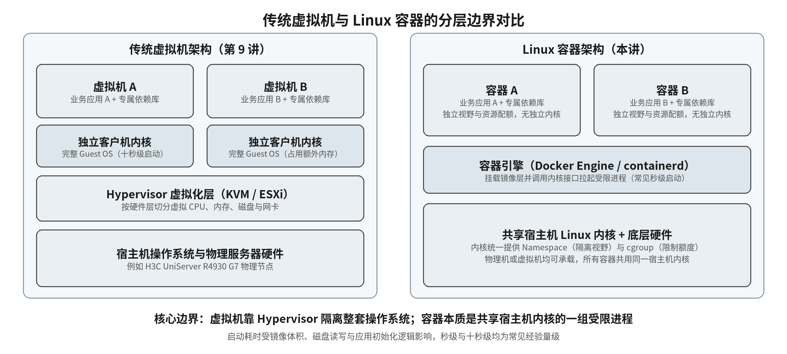
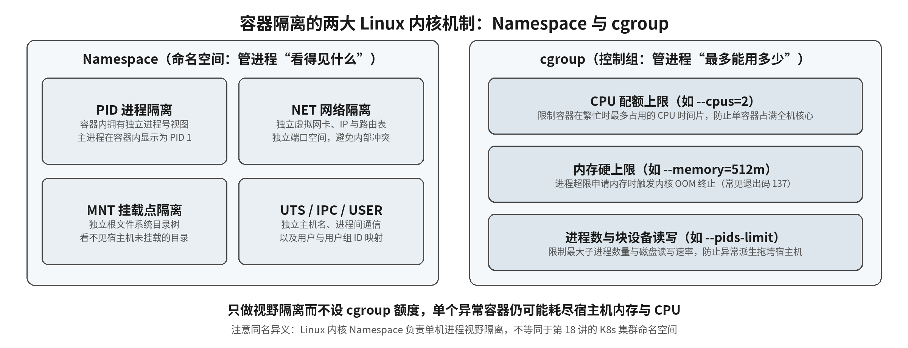
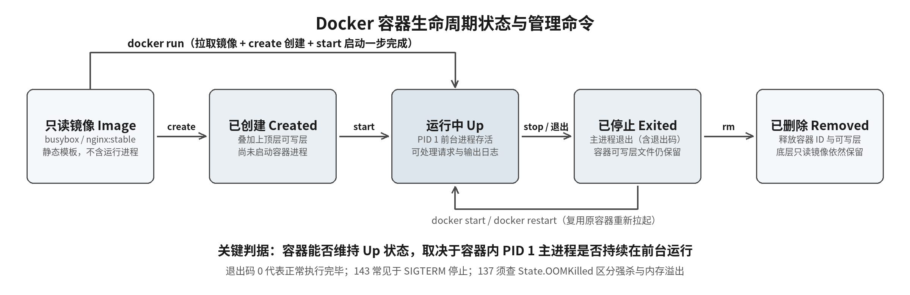
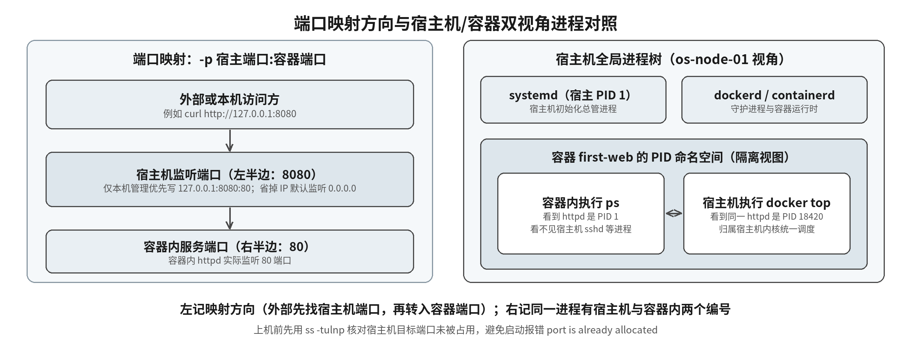

# 第14讲 认识容器

**本课程定位：** 本讲开启第四章“容器与 Kubernetes”。第 9 讲已经介绍过用虚拟机切分物理服务器，第 11 至 13 讲建立了脚本自动化与代码版本控制习惯。从本讲起，交付对象从散装脚本升级为标准化容器，为后续镜像构建与 Kubernetes 集群调度打下底座。

测试节点 `os-node-01` 上同时跑着两套图像预处理程序。一套依赖 Python 3.8 和旧版动态库，另一套必须用 Python 3.11。直接装在同一台宿主机上会互相覆盖依赖，为每个小工具单开一台虚拟机又太占内存。本讲围绕这个现场矛盾解决四个核心问题：容器与虚拟机的隔离边界差在哪里？Linux 内核靠哪两项机制管住容器？怎样启动并安全暴露第一个容器？为什么同一个进程在容器内外看到的编号不一样？

## 本讲学习目标

学完后，你应能：

- 对比虚拟机与容器的架构层次，说清共享宿主机内核带来的优势与边界。
- 区分 Linux 内核 Namespace 与 cgroup 的职责，解释“视野隔离”与“额度限制”的差别。
- 使用 `docker run` 启动带端口映射与命名的首个容器，并验证页面响应与日志输出。
- 对照宿主机与容器内的进程视图，解释容器内 `PID 1` 与容器运行状态的关系。
- 走完创建、观察、停止、删除与重建的完整生命周期，并结合 `State.OOMKilled` 判读退出码 `137`。

## 14.1、为什么有了虚拟机还要用容器

在传统部署方式下，应用程序直接安装在宿主机操作系统里。一旦多个服务共用同一套系统目录，运行库版本冲突、环境变量污染和残留配置文件就会频繁引发故障。第 9 讲介绍的虚拟机通过虚拟化层（Hypervisor）切出多台独立客户机，虽然隔开了运行环境，但每台虚拟机都要额外运行一整套客户机操作系统内核，占用数以 GB 计的内存和磁盘。

容器换了一种更轻的思路。**镜像（Image）**是把应用程序、运行库和基础目录打包在一起的只读模板。**容器（Container）**是在只读镜像顶部叠上一层可写层后运行起来的一组受限进程。容器不再模拟底层硬件，也不单独启动客户机内核，而是直接共享宿主机的 Linux 内核。



对比虚拟机与容器时，必须放在同一组维度下衡量，并留意启动耗时背后的前提条件。

表14-1、虚拟机与容器的核心差异对比

| 对比维度 | 传统虚拟机（第 9 讲） | Linux 容器（本讲） |
| --- | --- | --- |
| 隔离层次 | 硬件虚拟化层隔离，含独立客户机内核 | 操作系统进程级隔离，共享宿主机内核 |
| 额外开销 | 较高，每台虚机常驻独立内核与系统服务 | 很低，仅运行业务进程本身 |
| 启动量级 | 常见十秒级至分钟级（含内核引导自检） | 常见秒级（镜像已在本地且应用轻量的经验值） |
| 异构内核 | Linux 宿主机可运行 Windows 虚机 | 受宿主机内核约束，原生 Linux 内核只跑 Linux 容器 |
| 典型场景 | 强安全隔离、异构操作系统混部、算力整机切分 | 快速交付、微服务扩缩容、AI 推理运行环境封装 |

阅读表 14-1 时要注意两点边界。第一，“秒级启动”是在镜像已拉取到本地、应用无需加载超大文件时的常见经验量级，不是无条件硬指标。到了第 31 讲加载十几 GB 大模型权重时，容器进程拉起虽快，业务真正就绪仍需等待权重读入显存。第二，在实际智算机房中，虚拟机与容器经常组合使用：先用虚拟机做多租户强隔离，再在虚拟机内部运行容器统一交付软件环境。

【关键区别】容器不是“轻量级虚拟机”。容器里面没有独立的操作系统内核，本质上是宿主机内核直接调度的一组受限进程。宿主机内核一旦崩溃或升级重启，机上所有容器都会一起中断。

## 14.2、隔离边界靠什么实现：Namespace 与 cgroup

既然容器只是宿主机上的进程，为什么在容器里执行命令时，既看不见宿主机上的其他业务进程，也不能随意吃光整台机器的内存？这靠 Linux 内核原生提供的两项机制配合完成：**Namespace（命名空间）管视野，cgroup（控制组）管额度**。



### 14.2.1、Namespace：划分进程能看见的视野

Namespace 把宿主机原本全局共享的系统资源拆分成多份独立视图。进入某个容器命名空间的进程，只能看见分配给自己的那一份进程列表、网卡地址和目录树。

表14-2、常见 Linux 内核命名空间与隔离对象

| 命名空间 | 隔离内容 | 在容器里观察到的直接表现 |
| --- | --- | --- |
| PID | 进程编号空间 | 容器内主进程编号从 `PID 1` 开始，看不见宿主机其他进程 |
| NET | 网络设备与端口 | 拥有独立虚拟网卡、IP、路由表与监听端口，不与宿主直接混用 |
| MNT | 文件系统挂载点 | 拥有独立根目录 `/`，默认看不见宿主机未挂载进来的目录 |
| UTS | 主机名与域名 | 容器内部可显示独立 `hostname`，不影响宿主机名 `os-node-01` |
| IPC | 进程间通信资源 | 隔离共享内存与信号量，仅同命名空间进程可直接互通 |
| USER | 用户与用户组编号 | 支持将容器内 `root` 映射为宿主机普通非特权 UID |

这里要提前划清一个高频同名概念：**本讲的 Linux Namespace 是单机内核的进程视野隔离机制，第 18 讲将学习的 Kubernetes Namespace 是集群层面的逻辑资源分组隔间**。两套机制名字相同，所处层次和作用完全不同，排障时切勿混为一谈。

### 14.2.2、cgroup：限制进程能消耗的额度

只有视野隔离还不够。如果一个数据清洗容器出现死循环或内存泄漏，即使看不见别的容器，也会把整台宿主机的 CPU 和物理内存占满，拖垮同机在线推理服务。

**cgroup（Control Groups，控制组）**专门负责给进程组设定资源使用上限与记账统计。在运行容器时，运维人员可通过参数直接下发内核配额：例如用 `--cpus="2"` 限制容器繁忙时最多使用相当于 2 颗逻辑 CPU 的时间片，用 `--memory="512m"` 设定 512 MiB 物理内存硬上限，用 `--pids-limit=256` 限制容器内最大进程数以防异常派生耗尽宿主机进程表。

【例题】节点 `os-node-01`（8 核 16 GiB 内存）同时运行一个日志归档容器和一个业务接口容器。夜间日志归档任务解压大文件时，整台宿主机 SSH 卡死，业务接口随之超时。查看启动记录发现归档容器只做了默认目录与网络隔离，未配置任何资源参数。问题出在哪一层机制缺失？应当补上什么保护措施？

解：问题出在只依赖了默认 Namespace 视野隔离，未配置 cgroup 资源配额。Namespace 只能不让归档容器看到其他进程的文件，拦不住归档进程向宿主机内核无限申请内存和 CPU。改进措施是在创建归档容器时显式加上 `--cpus="1"` 与 `--memory="1g"` 等 cgroup 限制参数；即便归档任务再次内存暴涨，也只会在 1 GiB 边界内单独停止，不会拖垮宿主机和旁边的业务容器。

## 14.3、Docker 引擎与第一个容器的生命周期

理解了内核原理后，日常运维并不需要手工调用底层系统接口，而是通过容器引擎统一编排镜像拉取、网络配置与生命周期。本课程单机容器阶段统一采用 `Ubuntu Server 22.04 LTS` 搭配 `Docker Engine 26`。

### 14.3.1、引擎结构、配置重载与权限边界

在宿主机敲下 `docker run` 时，命令会沿着清晰的组件链条向下传递：**命令行客户端**（`docker` CLI）把请求发给后台常驻的**守护进程**（`dockerd`），再由守护进程调用底层容器运行时 **containerd** 与 **runc** 真正创建受限进程。（到了第 17 讲 Kubernetes 集群环境，节点会直接调用 `containerd` 而不必再绕经 `dockerd`，底层隔离机制完全相通。）

引擎全局配置文件位于 `/etc/docker/daemon.json`，常用于配置镜像仓库加速地址与日志轮转大小上限。修改 `/etc/docker/daemon.json` 后必须执行 `sudo systemctl restart docker` 才能完全生效。在生产或共享实验机重启守护进程前，务必先执行 `docker ps` 核查当前正在运行的业务容器，因为默认配置下重启 `dockerd` 会导致机上运行中的容器短暂中断。

还要严守一条账号安全边界（承接第 7 讲最小权限要求）：日常使用 `opsadmin` 登录宿主机时，如果图省事把普通账号直接加入 `docker` 用户组，虽然敲 `docker` 命令免去了 `sudo`，但任何能执行 `docker run` 的人都可以把宿主机根目录 `/` 挂载进容器随意读写，**docker 组权限在安全上等价于宿主机 root 最高权限**。测试机临时赋权须登记在册，生产环境的权限收口将在第 38 讲专项落实。初次装好引擎后，可先运行 `docker run --rm hello-world` 验证客户端、守护进程与仓库拉取链路全部畅通。

### 14.3.2、端口映射方向与状态流转

由于容器默认处于独立的 `NET` 命名空间，外部客户端无法直接连进容器私有 IP。对外暴露服务需要用 `-p 宿主端口:容器端口` 建立端口映射：**冒号左边是宿主机对外监听的门牌号，冒号右边是容器内程序实际监听的端口**。

- **上机前先查端口空闲**：映射宿主机 `8080` 端口前，先在宿主机执行 `ss -tulnp` 核对 `8080` 未被别的程序占用。
- **按暴露范围绑定监听地址**：直接写 `-p 8080:80` 会默认在宿主机所有网卡（`0.0.0.0:8080`）对外监听，且 Docker 底层改写转发逻辑可能绕过常规主机防火墙预期。如果只是本机调试或后台管理接口，应优先绑定回环地址，写成 `-p 127.0.0.1:8080:80`。



一个容器从创建到销毁会经历明确的状态流转，日常排障还要重点读懂停止后的退出码（Exit Code）。

表14-3、常见容器状态与典型退出码判读

| 状态或代码 | 含义说明 | 运维核查要点 |
| --- | --- | --- |
| Created | 已分配容器 ID 与顶层可写层，进程尚未启动 | 常见于只执行了 `docker create` 或端口映射冲突导致启动中断 |
| Up | 容器内 `PID 1` 前台主进程正在运行 | 进程存活不代表业务一定正常，仍需用 `curl` 验证接口响应 |
| Exited (0) | 主进程正常执行完毕并主动退出 | 一次性批处理属正常；常驻服务出现 `0` 多因缺少前台常驻命令 |
| Exited (143) | 收到 `SIGTERM` 终止信号优雅退出（`128+15`） | 常见于管理员主动执行 `docker stop` 正常停机 |
| Exited (137) | 收到 `SIGKILL` 强制终止信号（`128+9`） | 可能是 `docker kill`/超时强杀，或内存超限触发 OOM，须查 `OOMKilled` |

【关键区别】看到 `Exited (137)` 不能一口咬定“一定是内存不够”。`137` 只证明进程是被 `SIGKILL`（信号编号 9，`128 + 9 = 137`）强行杀掉的。管理员执行 `docker kill`、或者 `docker stop` 等待 10 秒优雅退出超时后补发强杀信号，退出码同样是 `137`。下结论前必须执行 `docker inspect -f '{{.State.OOMKilled}}' 容器名`：返回 `true` 并结合宿主机内核日志印证，才能确诊为容器内存超限（OOM）。

【随堂思考】同事执行 `docker run -d --name test-box busybox` 想在后台保留一个工具容器随时进去敲命令，但一秒后运行 `docker ps` 却什么都没看到，运行 `docker ps -a` 发现状态变成了 `Exited (0)`。这是 Docker 引擎出故障了吗？为什么？

## 14.4、理解双视角进程视图与资源观察

理解容器最关键的一步，是打破“容器像一台黑盒小电脑”的错觉，亲眼核对同一个进程在容器内外两套编号视图下的对应关系。



如上方示意图右侧所示，当我们在容器 `first-web` 里运行 Web 服务进程 `httpd` 时：

- **站在容器内部看**（受 `PID` 命名空间隔离）：`httpd` 是容器启动的第一个进程，编号为 **PID 1**，容器里看不见宿主机上的 `systemd` 或 `sshd`。这个 `PID 1` 就是容器的“命根子”：只要 `PID 1` 还在前台运行，容器状态就是 `Up`；一旦 `PID 1` 结束或转入后台退出，无论容器里还有没有别的子进程，容器都会立即终止并变为 `Exited`。因此，在容器里启动 `nginx` 或 `httpd` 时，必须加上前台运行参数（如 `httpd -f` 或 `nginx -g 'daemon off;'`）。
- **站在宿主机全局看**（宿主机根命名空间包含所有子空间）：执行 `docker top first-web` 或宿主机 `ps -ef`，能直接看到同一个 `httpd` 进程，只是编号变成了宿主机统一分配的普通进程号（例如 `PID 18420`），父进程是容器运行时垫片进程（`containerd-shim`）。

日常观察运行中容器时，四条基础只读命令各有明确分工，不要混用：

- **docker ps 与 docker ps -a**：`docker ps` 只显示当前 `Up` 的容器；排查启动失败或刚退出的容器必须加 `-a` 看全量列表。
- **docker top 容器名**：无需进入容器，直接从宿主机查看容器内进程在宿主机上的真实 `PID`、运行用户与启动命令。
- **docker logs 容器名**：读取容器内主进程打印到标准输出（stdout）与标准错误（stderr）的日志，加 `--tail 50` 可只看最近 50 行。
- **docker stats --no-stream 容器名**：按当前时刻采样一次容器的 CPU 百分比、当前内存用量与 cgroup 内存上限对比、网络收发流量与块设备读写量（加 `--no-stream` 便于脚本记录快照，不加就会持续刷新）。

【例题】值班时发现预处理容器 `prep-worker` 已停止，`docker ps -a` 显示 `Exited (137) 2 minutes ago`。请按“先看证据再下判断”的顺序写出三步核查命令，区分它是被人手动强停还是触发了内存上限。

解：第一步，执行 `docker inspect -f 'ExitCode={{.State.ExitCode}} OOMKilled={{.State.OOMKilled}}' prep-worker` 查看引擎状态记录。如果 `OOMKilled=true`，说明容器触碰了 cgroup 内存上限或宿主机内存枯竭被内核终止；如果 `OOMKilled=false`，说明倾向于外部发送了 `SIGKILL` 或 `docker stop` 超时强杀。第二步，执行 `docker logs --tail 50 prep-worker` 检查停止前正在处理哪一批输入数据。第三步，在宿主机查看内核日志（如 `sudo dmesg -T` 配合 `grep` 过滤 `Killed process`）核对被杀时刻的内存水位，再决定是修复程序内存泄漏还是按需上调 `--memory` 配额。

【随堂思考】如果在宿主机上误对容器主进程对应的宿主机真实 PID（如上图中的 `18420`）执行了 `kill -9 18420`，容器 `first-web` 会继续运行还是立即停止？`docker ps -a` 会显示什么退出码？

## 14.5、上机实训：第一个容器的创建与观察

本节实训在安装了 `Docker Engine 26` 的 `Ubuntu Server 22.04 LTS` 主机（示例节点 `os-node-01`，IP `192.168.10.15`）上独立完成。我们将严格按任务要求使用轻量工具镜像 `busybox`（体积仅数 MB，内置小型 `httpd` 网页服务与常用基础命令）完成首个容器的端口映射、页面验证、双视角进程核对、资源观察与停删重建，同时给出常驻 Web 镜像 `nginx:stable` 的对照写法。

### 14.5.1、前置检查与对比观察默认退出行为

在宿主机 `os-node-01` 终端（`opsadmin` 账号，未入 `docker` 组时在 `docker` 命令前加 `sudo`）先核对引擎版本并确认宿主机 `8080` 端口空闲，再不带前台命令直接启动一次 `busybox` 观察立即退出行为：

```bash
docker version --format 'Client={{.Client.Version}} Server={{.Server.Version}}'
ss -tulnp | grep ':8080 ' || echo "Port 8080 is free"

docker run -d --name box-once busybox
docker ps -a --filter name=box-once
docker rm box-once
```

预期输出核对：`box-once` 的 `STATUS` 列会显示 `Exited (0)`，因为默认 `/bin/sh` 在后台读不到交互输入就会立即正常退出。

### 14.5.2、启动带页面与端口映射的首个容器并验证访问

仍在宿主机 `os-node-01` 执行。下面用 `busybox` 内置的 `httpd` 在前台监听容器 `80` 端口（`-f` 保持前台常驻，`-v` 把每次请求记录打到标准输出供 `docker logs` 读取），配置容器名称 `first-web`、本机回环端口映射 `127.0.0.1:8080:80` 与内存上限 `128m`（若需同网段 `192.168.10.0/24` 局域网机器访问，把 `-p` 改为 `-p 8080:80`；若使用常驻 Web 镜像 `nginx:stable`，可直接运行 `docker run -d --name demo-nginx -p 127.0.0.1:8081:80 nginx:stable`）：

```bash
docker run -d \
  --name first-web \
  -p 127.0.0.1:8080:80 \
  --cpus="0.5" \
  --memory="128m" \
  busybox sh -c 'mkdir -p /www && echo "Hello from first-web container" > /www/index.html && httpd -f -v -p 80 -h /www'

docker ps --filter name=first-web
curl -i http://127.0.0.1:8080/
```

预期输出核对：`docker ps` 的 `STATUS` 列显示 `Up ...`，`PORTS` 列显示 `127.0.0.1:8080->80/tcp`；`curl -i` 返回 `HTTP/1.1 200 OK` 及正文 `Hello from first-web container`。

### 14.5.3、对照双视角进程、日志与资源占用

保持 `first-web` 运行，在宿主机 `os-node-01` 依次执行以下四组命令，对比容器内 `PID`、宿主机真实 `PID`、标准输出日志与实时资源水位：

```bash
# 1) Inside container PID namespace
docker exec first-web ps -ef

# 2) Host global PID view
docker top first-web
ps -ef | grep 'httpd -f -v' | grep -v grep

# 3) Container stdout logs and cgroup snapshot
docker logs first-web
docker stats --no-stream first-web
```

预期输出核对：第一条 `docker exec` 在容器内看到 `httpd -f -v -p 80 -h /www` 处于容器专属编号空间（主进程为 `PID 1`），看不见宿主机其他服务；第二组 `docker top` 与宿主机 `ps -ef` 对同一个 `httpd` 显示宿主机分配的四位或五位真实进程号（如 `18420`）；`docker logs` 能看到刚才 `curl` 访问 `index.html` 的请求行；`docker stats --no-stream` 的 `LIMIT` 列准确显示 `128MiB`。

### 14.5.4、停止、删除后重建与常见报错排查

最后在宿主机 `os-node-01` 演练优雅停止、清理与同名重建流程，并在验证完成后清理实验容器：

```bash
docker stop first-web
docker ps -a --filter name=first-web
curl -i http://127.0.0.1:8080/ || echo "Port closed after stop"

docker rm first-web

docker run -d --name first-web -p 127.0.0.1:8080:80 --memory="128m" \
  busybox sh -c 'mkdir -p /www && echo "Recreated first-web OK" > /www/index.html && httpd -f -v -p 80 -h /www'
curl http://127.0.0.1:8080/

docker stop first-web && docker rm first-web
```

实训过程中若遇到报错，按下方排查表逐项核对，不盲目重装引擎。

表14-4、首个容器实训常见报错与排查动作

| 报错关键词或现象 | 常见根因 | 核查与修复动作 |
| --- | --- | --- |
| permission denied（连 docker.sock 失败） | 当前账号无守护进程套接字权限 | 在命令前加 `sudo` 执行，不随意把生产普通账号长期塞进 `docker` 组 |
| Conflict. The container name is already in use | 同名容器（含已 `Exited` 容器）未清理 | 执行 `docker ps -a` 确认无用后，先 `docker rm 旧容器名` 再重建 |
| port is already allocated / address already in use | 宿主机目标端口已被别的容器或宿主程序占用 | 用 `docker ps` 与 `ss -tulnp` 找出占用者，更换宿主端口或停掉冲突测试进程 |
| 启动不报错但瞬间变成 Exited (0) | 漏写 `-f` 等前台参数，主进程执行完即退出 | 检查启动命令，确保 `PID 1` 持续在前台监听 |
| 容器状态 Up 但 curl 宿主机端口报拒绝或超时 | `-p` 左右端口写反，或容器内程序监听端口不一致 | 执行 `docker port 容器名` 与 `docker logs 容器名` 核对实际监听端口 |

**本节实训交付物核对清单（四件齐全方可收工）：**

- 完整命令执行记录（含创建、查看、停止、删除与再次创建）。
- 页面访问验证结果（`curl -i` 返回的 `200 OK` 响应头与页面正文，以及 `docker logs` 对应日志）。
- 宿主机与容器双视角进程对照记录（写明同一 `httpd` 进程在容器内的 `PID` 与宿主机 `docker top` 中的真实 `PID`）。
- 一段简短的生命周期说明（用自己的话写清 `Created`、`Up`、`Exited`、`Removed` 四个状态何时出现，以及删除容器为什么不会删掉镜像）。

## 14.6、本讲回顾与自测

学习完本讲后，试着用自己的话回答四个问题：容器和虚拟机到底隔在哪一层？Namespace 与 cgroup 少了哪一个会出什么乱子？`-p 8080:80` 哪边是宿主机、哪边是容器？看到 `Exited (137)` 为什么要多查一步 `OOMKilled`？

表14-5、本讲目标与对应判断

| 学习目标 | 应能做出的判断 |
| --- | --- |
| 区分虚机与容器边界 | 说清容器共享宿主机内核、无独立 Guest OS，知道秒级启动有本地镜像等前提 |
| 解释 Namespace 与 cgroup | 准确区分“视野隔离（看得见什么）”与“配额限制（最多用多少）”，不与 K8s 命名空间混淆 |
| 安全映射容器端口 | 分清 `-p 宿主端口:容器端口` 左右方向，测试与管理接口优先绑定 `127.0.0.1` |
| 对照内外进程视图 | 解释为什么容器内 `PID 1` 在宿主机上是普通进程号，且 `PID 1` 退出容器即停止 |
| 管理生命周期与判读退出码 | 熟练执行创建、观察、停删、重建，并用 `State.OOMKilled` 区分强杀与容器内存溢出 |

### 14.6.1、本讲自测

**1 隔离边界判断。** 业务部门有一款闭源工业控制软件，只提供原生 Windows Server 内核驱动版本。能否直接在 `Ubuntu Server 22.04` 宿主机的 Docker Engine 上用容器原生运行这款软件？应当选容器还是虚拟机？为什么？

**2 内核机制配对。** 容器 A 里的运维同学看不见容器 B 里的进程号，但容器 A 一旦开启多线程压测就把整台宿主机 CPU 打到 100%。写出哪一项内核机制已经生效、哪一项机制缺失，并给出 `docker run` 补齐限制的参数示例。

**3 端口映射排错。** 容器内的推理测试页面实际监听 `8000` 端口，同事启动命令写成了 `docker run -d --name demo -p 8000:80 busybox httpd -f -p 8000`。在本机执行 `curl http://127.0.0.1:8000` 为什么会失败？写出正确的 `-p` 参数（要求仅允许本机回环访问）。

**4 进程视图分析。** 在容器内部执行 `ps` 看到主进程是 `PID 1`，在宿主机执行 `docker top` 看到同一进程是 `PID 24680`。为什么同一个进程会有两个不同的编号？如果容器内的 `PID 1` 执行完毕退出，容器会进入什么状态？

**5 退出码取证。** 早上巡检发现夜间批处理容器状态为 `Exited (137)`。同事直接提单申请把服务器内存翻倍。你会先补敲哪条命令核实证据？写出两种可能导致 `137` 的不同原因。

**6 场景实操复述。** 你需要在宿主机创建名为 `check-web` 的容器，停止并删除后再用同名重建一次。如果删除前漏掉了 `docker rm check-web`，直接第二次执行 `docker run --name check-web ...` 会报什么错？删除容器后，下次重建还需要重新从远端下载镜像吗？

**答：**

____________________________

____________________________

____________________________

____________________________

## 14.7、参考答案与解析

### 14.7.1、随堂思考解析

**思考 1（后台直接运行 busybox 秒退）：** 不是引擎故障。`busybox` 默认启动命令是 `/bin/sh`，加 `-d` 放到后台且未分配交互终端时，`sh` 读不到后续输入就会立刻正常结束，返回退出码 `0`。容器内 `PID 1` 一旦退出，容器生命周期随之进入 `Exited (0)`。若要保持 `Up`，必须给定持续在前台运行的命令（如 `httpd -f` 或测试用的 `sleep 3600`）。

**思考 2（宿主机 kill -9 容器主进程真实 PID）：** 容器 `first-web` 会立即停止。因为容器内的 `PID 1` 和宿主机的 `PID 18420` 本质上是同一个内核进程；主进程收到信号 `9`（`SIGKILL`）终止后，`docker ps -a` 会显示 `Exited (137)`，且 `docker inspect` 中 `State.OOMKilled` 为 `false`。

### 14.7.2、课后自测解析

**1** 不能直接用原生 Linux 容器运行，应当选虚拟机。容器共享宿主机 Linux 内核，无法直接提供 Windows 内核及底层驱动接口；虚拟机通过 Hypervisor 虚拟硬件，可以在 Linux 宿主机上安装完整的 Windows Server 客户机操作系统。

**2** `PID Namespace`（进程视野隔离）已经生效，`cgroup` 的 CPU 配额限制缺失。应在 `docker run` 时补上 `--cpus="2"`（具体核数按节点规划设定）限制容器最多可消耗的 CPU 时间片，并配合 `--memory` 设定内存上限。

**3** `-p` 参数格式是 `宿主端口:容器端口`。写成 `-p 8000:80` 会把宿主机 `8000` 端口流量转发到容器内的 `80` 端口，而容器内 `httpd` 正在听 `8000` 端口，导致容器内 `80` 端口无人监听。仅允许本机回环访问的正确写法是 `-p 127.0.0.1:8000:8000`。

**4** Linux 内核支持层级化的 `PID Namespace`：`PID 24680` 是宿主机全局根命名空间分配的真实编号，`PID 1` 是容器专属子命名空间内部的映射编号，两者指向同一个进程结构体。一旦容器内的 `PID 1` 退出，容器立即停止并进入 `Exited` 状态。

**5** 先执行 `docker inspect -f '{{.State.OOMKilled}}' 容器名`（并配合宿主机 `dmesg -T` 核查内核日志）。导致退出码 `137`（`128 + 9`）的两种常见原因：一是容器内存超限触发内核 OOM Killer 强杀（此时 `OOMKilled` 为 `true`）；二是人为执行了 `docker kill` 或执行 `docker stop` 等待优雅退出超时后由引擎补发 `SIGKILL`（此时 `OOMKilled` 为 `false`）。

**6** 会报容器重名冲突错误（`Conflict. The container name "/check-web" is already in use`），因为 `Exited` 状态的容器仍保留着容器名称与可写层。执行 `docker rm check-web` 只删除容器实例与顶层可写层，底层只读镜像仍缓存在本机，第二次创建无需重新下载镜像。

## 14.8、术语

表14-6、本讲术语

| 术语 | 本讲中的含义 |
| --- | --- |
| 镜像（Image） | 打包了应用程序、运行依赖与目录结构的只读静态模板，是创建容器的底座。 |
| 容器（Container） | 在只读镜像之上叠加一层可写层后运行起来的受限进程实例，共享宿主机内核。 |
| Namespace | Linux 内核命名空间，负责隔离进程可见范围（如 PID、网络、挂载点、主机名）。 |
| cgroup | Linux 内核控制组（Control Groups），负责限制与统计进程组的 CPU、内存等资源额度。 |
| PID 1 | 容器命名空间内的首个主进程；一旦 `PID 1` 退出，容器随之进入 `Exited` 停止状态。 |
| 端口映射（-p） | 按 `宿主端口:容器端口` 方向把发往宿主机的流量转发进容器独立网络空间。 |
| OOMKilled | 容器状态布尔字段，标记进程是否因触碰内存上限被内核内存保护机制强制终止。 |

文中 IP、域名、路径与参数为教学示例，生产环境以本单位规划为准。

<!-- md-only -->

## 附：主要参考资料（仅 Markdown 保留，不印入 Word/PDF）

- 中国信通服务《2025 算力运维体系技术白皮书》（本地 `./资料/` 目录 PDF），用于本讲课程定位中云原生容器化封装与算力资源承载背景说明。
- Docker 官方文档《Docker Overview》《Running containers》《Container resource constraints》，用于 14.1–14.5 的客户端与守护进程架构、端口映射规则、生命周期状态及 `--cpus` / `--memory` 参数口径。
- Linux Kernel 官方手册《namespaces(7)》与《cgroups(7)》，用于 14.2 与 14.4 的六类内核命名空间职责、控制组资源限额及双视角进程编号原理解释。
- OCI（Open Container Initiative）《Runtime Specification》，用于容器运行时状态流转与信号退出码（`128 + 信号值`）标准定义。

<!-- /md-only -->
