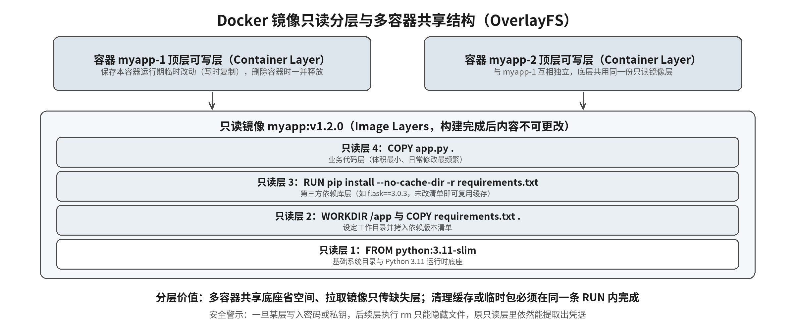
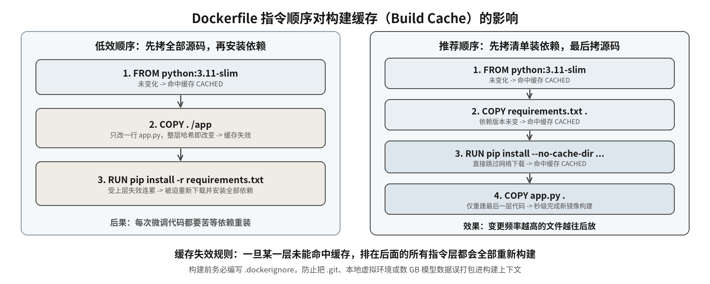
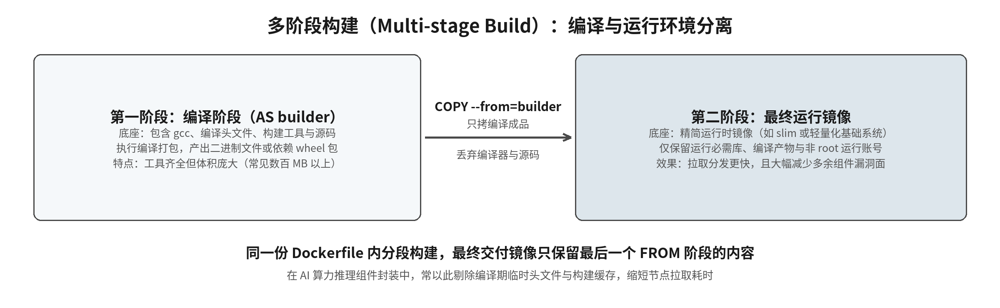
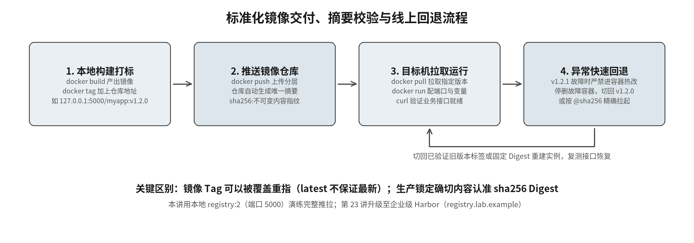

# 第15讲 构建Docker镜像

**本课程定位：** 第 13 讲用 Git 管住了代码与配置的历史版本，第 14 讲用官方现成镜像启动了第一个受限容器。本讲把两条线合在一起：将团队自己的业务代码与运行依赖打包成标准化 Docker 镜像，推送进镜像仓库并实现可验证的版本回退，为第 16 讲多容器编排和第 23 讲企业级 Harbor 制品分发打好基础。

算法工程同学发来一套状态查询接口脚本 `app.py`，说在开发笔记本上运行正常，搬到测试机 `os-node-01` 却因缺少 `Flask` 库和端口绑错连不上。上线后新版本 `v1.2.1` 返回报错，值班人员又试图进容器手工改代码救急。本讲围绕这类交付痛点解决四个问题：镜像底层怎样分层存储？`Dockerfile` 怎么写才能既小又快命中缓存？镜像标签与内容摘要有什么本质区别？线上新镜像出问题时怎样规范回退？

## 本讲学习目标

学完后，你应能：

- 解释只读镜像层与容器顶层可写层的叠加关系，说明同层清理缓存与禁放密钥的原因。
- 编写规范的 `Dockerfile` 与 `.dockerignore`，通过调整指令顺序命中构建缓存并理解多阶段构建。
- 完成自有应用的镜像构建、容器常用运维操作（端口映射、环境变量注入、进入容器核查与状态取证）。
- 区分可移动的镜像标签（Tag）与不可变的内容摘要（`sha256` Digest），完成镜像仓库推拉与快速版本回退。
- 定位并修复镜像交付运行中的端口冲突、监听地址绑错、命令写错导致的启动失败或秒退故障。

## 15.1、镜像是什么：只读分层与顶层可写层

在第 14 讲里，我们用过 `busybox` 和 `nginx:stable`。从交付视角看，**镜像（Image）是包含根文件系统、运行库、应用代码及启动元数据的标准化只读包**。无论底层宿主机是 Ubuntu、Rocky Linux 还是 openEuler，只要内核兼容且装有容器运行时，同一个镜像拉起的文件目录和依赖版本都分毫不差。

镜像并不是一个实心的大压缩包，而是采用联合文件系统（Docker Engine 26 默认常用 **OverlayFS**）由多层**只读层（Image Layers）**自底向上叠合而成。



结合上方结构图，运维日常管理磁盘与安全时必须掌握三条分层规律：

- **多容器共享只读底座**：用同一个 `myapp:v1.2.0` 镜像启动 10 个容器时，宿主机磁盘上只存一份底层只读镜像层；每个容器仅仅在最顶部新建一层薄薄的**容器可写层（Container Layer）**。
- **写时复制（Copy-on-Write）**：容器运行期如果需要修改底层某个配置文件，内核会把原文件从只读层拷贝一份到顶层可写层再修改，底层只读镜像毫发无损；一旦执行 `docker rm` 删除容器，顶层可写层里的改动也随之清空。
- **下层内容无法靠上层 rm 真正抹除**：每一条构建指令都会固化成一层只读快照。如果在第 2 层下载了 300 MB 安装包或拷入了数据库私钥，到第 3 层再执行 `rm` 删除，只是在第 3 层打了一个“白障标记”遮住文件，第 2 层占用的 300 MB 体积一字节都不会减少，任何拿到镜像的人用 `docker history` 或解包分层文件依然能把私钥完整提取出来。

【关键区别】在 `Dockerfile` 里安装系统软件包时，必须把更新索引、安装软件与清理缓存用 `&&` 合并在同一条 `RUN` 指令里（例如 `RUN apt-get update && apt-get install -y --no-install-recommends curl && rm -rf /var/lib/apt/lists/*`）。拆成多条 `RUN` 会导致软件源索引锁死在上一层，白白撑大镜像体积；账号密码、API 密钥更严禁写进镜像层，应当在容器启动时通过环境变量或受控挂载传入（凭据轮换与许可证核查将在第 37 讲展开）。

## 15.2、编写 Dockerfile 与命中构建缓存

构建自有镜像的标准做法是编写一份纯文本清单 **Dockerfile**，交给 `docker build` 自动逐条执行。手工启动一个容器在里面敲命令再导出快照（`docker commit`）无法审计构建过程、极易混入垃圾文件，生产交付一律禁用黑盒快照做主流程，统一将 `Dockerfile` 纳入第 13 讲的 Git 仓库管理。

### 15.2.1、核心指令与高频编写陷阱

一份生产可用的 `Dockerfile` 不求花哨，但每条核心指令都有需要留心的工程边界。

表15-1、Dockerfile 常用指令与运维注意事项

| 指令与作用 | 核心用途 | 编写规范与避坑要点 |
| --- | --- | --- |
| FROM（底座镜像） | 指定基础系统与运行时 | 固定明确小版本（如 `python:3.11-slim`），不用含义漂移的 `latest` |
| WORKDIR（工作目录） | 设定后续指令所在目录 | 写绝对路径（如 `/app`），目录不存在会自动创建，代替零散的 `cd` |
| COPY（复制文件） | 从构建上下文拷入文件 | 常规本地文件复制优先用行为透明的 `COPY`，不用会自动解压远程包的 `ADD` |
| RUN（构建命令） | 构建期在镜像层内执行命令 | 合并同类安装与缓存清理命令，`pip` 加 `--no-cache-dir` 减小层体积 |
| ENV（环境变量） | 设定镜像默认环境变量 | 适合非敏感默认参数（如 `PORT=8000`），运行期可用 `-e` 覆盖；禁写密码 |
| EXPOSE（端口声明） | 声明容器内服务监听端口 | **仅作文档声明**，不会自动映射宿主机端口，外部访问仍需运行时加 `-p` |
| USER（运行账号） | 切换运行期非特权账号 | 生产镜像尽量创建普通账号运行业务进程，降低容器逃逸风险 |
| CMD（启动命令） | 指定容器启动默认主命令 | **优先写 JSON 数组格式**（如 `["python", "app.py"]`），保证主进程任 `PID 1` |

表 15-1 中有两处极易引发线上故障的细节需要重点核对：

第一，**监听地址不能绑死回环口**（回引第 6 讲端口排查）：容器拥有独立网络命名空间。如果 `app.py` 监听 `127.0.0.1:8000`，代表只接收容器自己内部发来的回环请求，宿主机哪怕配了 `-p 8080:8000` 转进去也会报连接重置或拒绝。容器内对外提供服务的程序必须监听 `0.0.0.0:8000`。

第二，**CMD 优先采用 JSON 数组（exec 形式）**：写成 `CMD ["python", "app.py"]` 时，`python` 直接成为容器的 `PID 1`，执行 `docker stop` 发出的 `SIGTERM` 优雅停止信号能直接送达业务进程；如果写成字符串形式 `CMD python app.py`，引擎会默认包一层 `/bin/sh -c` 当 `PID 1`，`sh` 往往不转发停止信号，导致每次 `docker stop` 都要卡住苦等 10 秒超时才被 `SIGKILL` 强杀（退出码变成 `137`）。

### 15.2.2、构建上下文、层缓存顺序与多阶段构建

执行构建命令 `docker build -t myapp:v1.2.0 .` 时，末尾那个不起眼的点号 `.` 代表**构建上下文（Build Context）目录**，而不是指代 `Dockerfile` 文件本身。客户端会把上下文目录里的所有文件打包发给守护进程 `dockerd`。如果误在家目录或放有几十 GB 模型权重的目录下直接执行 `docker build .`，终端会长时间卡在发送上下文步骤。动手构建前，务必在项目根目录建好 **.dockerignore**，将 `.git`、`__pycache__`、本地虚拟环境 `venv` 和临时日志排除在外。

为了加快日常迭代，`docker build` 会自顶向下逐层比对指令与拷入文件的校验和，命中即直接复用历史缓存（输出 `CACHED`）。一旦某一层发生变化，排在后面的所有层都会全部失效重跑。



对于需要编译 C/C++、Go 或算子扩展的应用，如果在最终镜像里保留 `gcc` 编译器和源码，镜像动辄上 GB。此时应采用**多阶段构建（Multi-stage Build）**，在同一份 `Dockerfile` 里写多个 `FROM` 阶段。



【例题】开发同学提交了一份 `Dockerfile`，顺序依次为：`FROM python:3.11-slim` → `WORKDIR /app` → `COPY . .` → `RUN pip install --no-cache-dir -r requirements.txt` → `CMD ["python", "app.py"]`。每次只改 `app.py` 里的一行提示文字，构建都要重新联网下载安装两分钟依赖。请说明根因并给出修改后的指令顺序。

解：根因是 `COPY . .` 放在了 `RUN pip install` 之前。只要 `app.py` 改动一个字符，`COPY . .` 这一层的校验和就会改变而无法命中缓存，连带下方紧跟的 `RUN pip install` 缓存一并失效。修改方法是将变动少的依赖清单单独提前：先写 `COPY requirements.txt .`，紧跟 `RUN pip install --no-cache-dir -r requirements.txt`，最后再写 `COPY app.py .`。这样只要不增删第三方库，改代码重建时依赖层会直接显示 `CACHED`，几秒钟即可构建完成。

【随堂思考】同事在 `Dockerfile` 里写了 `EXPOSE 8000`，随后执行 `docker run -d --name api myapp:v1.2.0`（未加 `-p` 参数），接着在宿主机执行 `curl http://127.0.0.1:8000` 报 `Connection refused`。为什么写了 `EXPOSE` 在宿主机还是连不上？

## 15.3、镜像仓库、标签管理与版本回退

在本机打好镜像后，怎样发给集群里的几十台工作节点？答案是通过**镜像仓库（Image Registry）**集中存储与分发。镜像完整命名遵循统一三段格式：`仓库域名或地址/项目或命名空间/镜像名:标签`。

- **官方默认公共库**：省略仓库前缀时（如 `nginx:stable`），引擎默认去 Docker Hub 官方仓库拉取。
- **单机实验仓库**：本讲实训使用开源官方组件 `registry:2` 在本机 `127.0.0.1:5000` 启动轻量仓库，完整名字形如 `127.0.0.1:5000/myapp:v1.2.0`。
- **企业级私有仓库**：生产智算中心普遍部署带权限控制与漏洞扫描的 **Harbor**（第 23 讲将专门实战，全课程统一示例地址为 `registry.lab.example`，完整名字形如 `registry.lab.example/lab/myapp:v1.2.0`）。

在镜像分发与上线回退环节，必须分清**镜像标签（Tag）**与**内容摘要（Digest）**的本质差异，还要注意不要与第 13 讲的 Git 标签混同。

表15-2、镜像标签（Tag）与内容摘要（Digest）对比

| 对比项 | 镜像标签（Tag） | 内容摘要（Digest） |
| --- | --- | --- |
| 外观写法 | 冒号后可读版本号，如 `myapp:v1.2.0` | `@` 后接哈希指纹，如 `myapp@sha256:4f8c...` |
| 可变性 | **可被覆盖重指**，同名标签重推会指向新镜像 | **绝对不可变**，镜像内容改一字节摘要必变 |
| `latest` 陷阱 | 仅是未写标签时的默认字符串，不保证最新也不保证稳定 | 无默认别名，精确锁定唯一一份二进制分层内容 |
| 适用场景 | 日常开发测试、配合发版规范标注语义化版本 | 生产关键发布锁版本、跨环境一致性核验与安全审计 |



【关键区别】 第一点，**分清同名异义**：第 13 讲的 Git 标签是绑定某次代码提交的不可移动锚点，而 Docker 镜像标签随时可以被新构建的镜像覆盖；生产环境严禁用 `:latest` 上线，关键服务应记录并核对 `sha256` 摘要。第二点，**严守回退规矩**：当新上线的 `myapp:v1.2.1` 出现接口报错时，严禁通过 `docker exec` 钻进正在运行的容器里手改 `app.py`（容器一旦重启或重调度，可写层里的手工补丁就会立刻丢失，造成线上环境与镜像不一致）。正确的回退动作是：停止并删除异常的 `v1.2.1` 容器，直接用仓库里已验证过的旧版本 `myapp:v1.2.0`（或对应 `@sha256:...` 摘要）重新拉起容器，再回到业务接口做复测。

【随堂思考】早班同事把修复前后的两次构建都推成了 `127.0.0.1:5000/myapp:latest`，结果测试机与生产机都显示镜像名叫 `myapp:latest`，接口返回内容却不一样。你会用哪条命令核对两台机器跑的到底是不是同一份镜像内容？

## 15.4、上机实训：构建镜像、仓库推拉与容器常用操作

本节实训在 `os-node-01`（`Ubuntu Server 22.04 LTS` + `Docker Engine 26`）上独立完成。我们将围绕轻量开源 Web 框架 `Flask`（固定版本 `flask==3.0.3`）编写状态接口应用，完整演练 `Dockerfile` 构建缓存、容器日常十项常用操作、本地 `registry:2` 仓库推拉回退，以及三类典型故障定位。

### 15.4.1、准备应用代码、忽略清单与 Dockerfile 并验证分层缓存

在宿主机 `os-node-01` 创建实验目录 `~/lab/myapp/`，依次写入依赖文件 `requirements.txt`、监听 `0.0.0.0:8000` 并支持读取环境变量 `APP_ENV` 的 `app.py`、`.dockerignore` 以及分层优化后的 `Dockerfile`：

```bash
mkdir -p ~/lab/myapp && cd ~/lab/myapp

cat <<'EOF' > requirements.txt
flask==3.0.3
EOF

cat <<'EOF' > app.py
import os
from flask import Flask, jsonify

app = Flask(__name__)

@app.route("/")
def index():
    return jsonify({
        "service": "myapp",
        "version": "v1.2.0",
        "env": os.getenv("APP_ENV", "dev")
    })

if __name__ == "__main__":
    app.run(host="0.0.0.0", port=8000)
EOF

cat <<'EOF' > .dockerignore
.git
__pycache__
*.pyc
*.log
venv
EOF

cat <<'EOF' > Dockerfile
FROM python:3.11-slim
WORKDIR /app
ENV PYTHONDONTWRITEBYTECODE=1 \
    PYTHONUNBUFFERED=1 \
    APP_ENV=prod
COPY requirements.txt .
RUN pip install --no-cache-dir -r requirements.txt
COPY app.py .
EXPOSE 8000
CMD ["python", "app.py"]
EOF
```

接下来构建首个版本 `myapp:v1.2.0`，查看镜像列表与分层大小；随后把 `app.py` 中的版本号改为 `v1.2.1` 构建第二个版本，观察 `pip install` 层是否直接命中 `CACHED`：

```bash
cd ~/lab/myapp
docker build -t myapp:v1.2.0 .
docker images myapp
docker history myapp:v1.2.0

sed -i 's/v1.2.0/v1.2.1/' app.py
docker build -t myapp:v1.2.1 .
```

预期输出核对：第二次 `docker build` 输出中，`COPY requirements.txt .` 与 `RUN pip install --no-cache-dir -r requirements.txt` 步骤旁应明确标有 `CACHED`，只有最后一层 `COPY app.py .` 重新执行，耗时大幅缩短。

### 15.4.2、容器常用命令全流程实操

在宿主机 `os-node-01` 先检查 `8080` 端口空闲，再用 `myapp:v1.2.0` 完整走一遍端口映射、环境变量覆盖、状态检查、日志读取、进入容器只读核查以及停删操作：

```bash
ss -tulnp | grep ':8080 ' || echo "Port 8080 is free"

# 1) Run with port mapping and environment variable override
docker run -d \
  --name myapp-svc \
  -p 127.0.0.1:8080:8000 \
  -e APP_ENV=staging \
  --memory="256m" \
  myapp:v1.2.0

# 2) Check status, health metadata, logs, and HTTP response
docker ps --filter name=myapp-svc
docker inspect -f 'Status={{.State.Status}} IP={{.NetworkSettings.IPAddress}}' myapp-svc
curl -s http://127.0.0.1:8080/ && echo ""
docker logs --tail 20 myapp-svc

# 3) Enter container for read-only environment verification (do NOT edit code inside)
docker exec myapp-svc sh -c 'pwd && ls -l /app && printenv APP_ENV'
```

预期输出核对：`curl` 返回的 JSON 中 `"version"` 为 `"v1.2.0"`，且 `"env"` 被 `-e` 参数成功覆盖为 `"staging"`；`docker exec` 输出工作目录为 `/app`，`APP_ENV` 值为 `staging`（若需交互式进入排障，在终端加 `-it` 执行 `docker exec -it myapp-svc sh`，核查完输入 `exit` 退出，不会影响容器主进程运行）。

### 15.4.3、本地镜像仓库推拉、摘要核对与版本回退

下面在宿主机 `127.0.0.1:5000` 启动官方轻量仓库 `registry:2`（本机回环地址默认支持直接 HTTP 推拉，无需额外改 TLS 配置），完成打标签、推送、`sha256` 摘要核对与版本回退演练：

```bash
# 1) Start local registry on 127.0.0.1:5000
docker run -d --name local-reg -p 127.0.0.1:5000:5000 registry:2

# 2) Tag and push both v1.2.0 and v1.2.1
docker tag myapp:v1.2.0 127.0.0.1:5000/myapp:v1.2.0
docker tag myapp:v1.2.1 127.0.0.1:5000/myapp:v1.2.1
docker push 127.0.0.1:5000/myapp:v1.2.0
docker push 127.0.0.1:5000/myapp:v1.2.1

# 3) Inspect immutable RepoDigests and pull by digest
docker inspect -f '{{.RepoDigests}}' 127.0.0.1:5000/myapp:v1.2.0

# 4) Simulate upgrade to v1.2.1, then rollback to verified v1.2.0
docker stop myapp-svc && docker rm myapp-svc
docker run -d --name myapp-svc -p 127.0.0.1:8080:8000 127.0.0.1:5000/myapp:v1.2.1
curl -s http://127.0.0.1:8080/ && echo ""

# Rollback to v1.2.0 cleanly by recreating from the previous immutable image
docker stop myapp-svc && docker rm myapp-svc
docker run -d --name myapp-svc -p 127.0.0.1:8080:8000 127.0.0.1:5000/myapp:v1.2.0
curl -s http://127.0.0.1:8080/ && echo ""
```

预期输出核对：`docker push` 末尾会打印形如 `v1.2.0: digest: sha256:...` 的唯一摘要（记下这串摘要，可使用 `docker pull 127.0.0.1:5000/myapp@sha256:<实际摘要>` 验证按摘要精确拉取）；回退动作完成后，`curl` 响应立即变回 `"version": "v1.2.0"`。（到了第 23 讲接入企业级 Harbor 时，只需将前缀换为 `registry.lab.example/lab/myapp:v1.2.0` 并先执行 `docker login` 即可。）

### 15.4.4、故障注入与分层排查演练

保持 `myapp-svc` 在 `8080` 端口运行，在宿主机依次触发并排解两类高频交付故障，最后统一清理实验资源：

```bash
# Fault 1: Host port conflict (8080 is already used by myapp-svc)
docker run -d --name myapp-conflict -p 127.0.0.1:8080:8000 myapp:v1.2.0 || true
docker ps -a --filter name=myapp-conflict
docker rm myapp-conflict

# Fault 2: Bad startup command causing immediate failure / container exit
docker run -d --name myapp-badcmd myapp:v1.2.0 python missing_file.py || true
docker ps -a --filter name=myapp-badcmd
docker logs myapp-badcmd
docker rm myapp-badcmd

# Cleanup lab containers (keep myapp:v1.2.0 image for review or L23 reuse)
docker stop myapp-svc local-reg && docker rm myapp-svc local-reg
```

实训排障时可对照表 15-3 快速定界：

表15-3、镜像构建与容器运行常见故障排查表

| 故障现象 | 首查证据命令 | 常见根因与修复方法 |
| --- | --- | --- |
| 构建极慢，发送上下文达数 GB | 检查构建目录文件与 `.dockerignore` | 在大目录误敲 `docker build .`；迁入独立应用目录并补齐 `.dockerignore` |
| 宿主机报 port is already allocated | `docker ps` 与 `ss -tulnp` | 宿主机左侧映射端口已被占用；清理冲突测试容器或换用空闲宿主端口 |
| 容器启动即变 Exited (2) 或报错失败 | `docker ps -a` 与 `docker logs 容器名` | `CMD` 脚本路径写错、缺依赖包或语法报错；修正 `Dockerfile` 重新构建 |
| 容器 Up 但宿主机 curl 报连接重置 | `docker logs` 看监听地址与 `docker port` | 应用误绑 `127.0.0.1` 而不是 `0.0.0.0`，或 `-p` 容器端口与代码不一致 |
| `docker stop` 每次都卡满 10 秒且退出码 137 | 检查 `Dockerfile` 的 `CMD` 写法 | 使用了字符串 shell 形式导致信号未达业务进程；改为 JSON 数组格式 |

**本节实训交付物核对清单：**

- 完整的 `Dockerfile`、`.dockerignore` 与应用源码清单。
- 两次 `docker build` 构建记录（体现第二次命中 `CACHED`）及本地仓库 `push` 生成的 `sha256` 摘要记录。
- 容器常用操作与版本回退验证记录（含端口映射、`-e` 环境变量生效、`exec` 只读核查、从 `v1.2.1` 回退至 `v1.2.0` 的 `curl` 输出）。
- 端口冲突与启动命令错误两项故障的报错原文、取证命令与修复说明。

## 15.5、本讲回顾与自测

学习完本讲后，试着用自己的话回答四个问题：为什么在下一条 `RUN` 里删文件减不掉镜像大小？为什么先拷 `requirements.txt` 再拷业务代码能省时间？镜像标签和 `sha256` 摘要哪个才锁得住内容？线上容器代码出 bug 时为什么绝不能 `docker exec` 进去改文件？

表15-4、本讲目标与对应判断

| 学习目标 | 应能做出的判断 |
| --- | --- |
| 理解分层存储机制 | 说清只读镜像层与容器可写层的分工，不在镜像层留凭据或跨层删缓存 |
| 编写高效 Dockerfile | 善用 `.dockerignore`、前置依赖安装命中缓存、用 JSON 数组写 `CMD`、让服务听 `0.0.0.0` |
| 区分 Tag 与 Digest | 知道镜像 Tag 可被覆盖且 `latest` 不可信，关键环境认准不可变的 `sha256` 摘要 |
| 执行仓库推拉与回退 | 独立完成打标、推送、拉取，遇新版本故障用旧版镜像重建容器并复测接口 |
| 排查交付运行障碍 | 用 `ps -a`、`logs`、`inspect`、`ss -tulnp` 快速定位端口冲突、绑错地址与启动失败 |

### 15.5.1、本讲自测

**1 分层体积与安全。** 同事写了两条连续指令：第一条 `RUN wget https://example.com/sdk.tar.gz && tar -xzf sdk.tar.gz`，第二条 `RUN rm -f sdk.tar.gz`。构建出的镜像体积并没有减小 `sdk.tar.gz` 的大小。请解释原因并写出正确改法。

**2 指令误区辨析。** `Dockerfile` 中写了 `EXPOSE 8000`，同时 `app.py` 写的是 `app.run(host="127.0.0.1", port=8000)`。就算启动时补上了 `-p 127.0.0.1:8080:8000`，宿主机 `curl http://127.0.0.1:8080` 依然不通。指出这两处概念误区并给出改法。

**3 构建缓存排序。** 现有四条指令：①`COPY src/ /app/src/`、②`FROM python:3.11-slim`、③`RUN pip install --no-cache-dir -r requirements.txt`、④`COPY requirements.txt /app/`（前置已设 `WORKDIR /app`）。按构建缓存命中率最高的目标排出正确顺序，并说明理由。

**4 标签与摘要。** 有人说：“既然第 13 讲 Git 的发布标签不可移动，那 Docker 镜像打上 `:v1.0` 或 `:latest` 标签后内容也永远不会变。”这句话对吗？生产环境要锁定分毫不差的同一份镜像，应当凭什么标识？

**5 线上回退规范。** 刚把推理前置网关从 `myapp:v1.2.0` 升级到 `myapp:v1.2.1`，监控就报出 500 错误。值班员提议直接执行 `docker exec -it myapp-svc vi /app/app.py` 把报错行注释掉。请指出这种做法的隐患，并写出标准回退步骤。

**6 场景命令组合。** 要把本机镜像 `myapp:v1.2.0` 推送到企业私有仓库 `registry.lab.example` 的 `lab` 项目下（版本仍为 `v1.2.0`），已执行过 `docker login registry.lab.example`。请写出打标签和推送的两条完整命令。

**答：**

____________________________

____________________________

____________________________

____________________________

## 15.6、参考答案与解析

### 15.6.1、随堂思考解析

**思考 1（写了 EXPOSE 却连不上）：** `EXPOSE 8000` 只是镜像里的端口元数据声明，供阅读者和编排工具参考，Docker 引擎不会凭 `EXPOSE` 自动在宿主机打开端口。要在宿主机回环口访问，必须在 `docker run` 时显式加上 `-p 127.0.0.1:8000:8000`（或映射到其他空闲宿主端口）。

**思考 2（核对两台机器 latest 是否为同一份内容）：** 在两台机器上分别执行 `docker inspect -f '{{.Id}} {{.RepoDigests}}' 127.0.0.1:5000/myapp:latest`（或 `docker images --digests`），比对输出的 `sha256` 镜像 ID 与 `RepoDigests` 摘要字符串。只要哈希值不同，就证明虽然都挂着 `latest` 名字，实际运行的是两次不同构建的内容。

### 15.6.2、课后自测解析

**1** 每条 `RUN` 指令都会生成一层不可更改的只读镜像层。第一条 `RUN` 结束时 `sdk.tar.gz` 已永久写进第一层；第二条 `RUN rm` 只是在上层标记文件不可见，底层文件依然占用体积。正确改法是合并进同一条指令：`RUN wget https://example.com/sdk.tar.gz && tar -xzf sdk.tar.gz && rm -f sdk.tar.gz`。

**2** 误区一：以为 `EXPOSE` 会自动映射端口（本题已补 `-p`）；误区二：容器拥有独立的网络命名空间，`app.py` 监听 `127.0.0.1` 只接收容器内部自己的回环流量，拒收从宿主机网桥转发进来的请求。改法是将代码监听地址改为 `host="0.0.0.0"`，重新构建镜像后再用 `-p 127.0.0.1:8080:8000` 启动。

**3** 正确顺序：② `FROM python:3.11-slim` →（`WORKDIR /app`）→ ④ `COPY requirements.txt /app/` → ③ `RUN pip install --no-cache-dir -r requirements.txt` → ① `COPY src/ /app/src/`。理由：缓存按层从上到下比对，将很少变动的依赖清单和耗时的依赖安装放在频繁修改的业务源码 `src/` 之前，日常改代码时前几层都能直接命中 `CACHED`。

**4** 不对。Docker 镜像标签（Tag）是可以随时被重新打标推送覆盖的可变别名，`latest` 更只是默认标签名，完全不能保证最新或不变。生产环境要精确锁定唯一镜像内容，应使用不可变的 `sha256` 内容摘要（Digest，形如 `myapp@sha256:...`）。

**5** 隐患：修改只落在当前容器的顶层临时可写层中，不仅没有经过代码评审与构建留痕，而且一旦容器因故障重启、宿主机维护或集群扩缩容重建，手工改动会立刻全部丢失，导致故障重现。标准回退步骤：①停止并删除异常的 `v1.2.1` 容器（`docker stop` 与 `docker rm`）；②用已验证正常的旧镜像 `myapp:v1.2.0`（或对应 `sha256` 摘要）和原运行参数重新 `docker run` 拉起服务；③用 `curl` 与日志回到业务侧复测恢复正常，随后在 Git 分支修复代码并走新版本号 `v1.2.2` 重新构建发布。

**6** 第一条打标签：`docker tag myapp:v1.2.0 registry.lab.example/lab/myapp:v1.2.0`。第二条推送：`docker push registry.lab.example/lab/myapp:v1.2.0`。

## 15.7、术语

表15-5、本讲术语

| 术语 | 本讲中的含义 |
| --- | --- |
| OverlayFS | Linux 联合挂载文件系统，把多层只读镜像层与顶层容器可写层合并成统一目录视图。 |
| Dockerfile | 记录镜像制作全过程的纯文本指令清单，可纳入 Git 做版本化审计与复现构建。 |
| 构建上下文 | `docker build` 发送给守护进程的文件目录范围，常配合 `.dockerignore` 剔除无关文件。 |
| 构建缓存 | 按指令顺序逐层复用的历史镜像层；某层一旦变化，下方所有后续层缓存同时失效。 |
| 多阶段构建 | 在同一份 `Dockerfile` 中用多个 `FROM` 分离编译环境与精简运行环境，缩小最终镜像体积。 |
| 镜像仓库 | 集中存储与分发容器镜像的服务端（单机实验常用 `registry:2`，企业级常用 Harbor）。 |
| 内容摘要（Digest） | 由镜像内容计算出的 `sha256` 唯一哈希指纹，内容不变摘要就永不改变，用于精确锁版本。 |

文中 IP、域名、路径与参数为教学示例，生产环境以本单位规划为准。

<!-- md-only -->

## 附：主要参考资料（仅 Markdown 保留，不印入 Word/PDF）

- 中国信通服务《2025 算力运维体系技术白皮书》（本地 `./资料/` 目录 PDF），用于标准化容器镜像封装与云原生应用交付定位。
- Docker 官方文档《Dockerfile reference》《Build cache》《Multi-stage builds》《OverlayFS storage driver》，用于 15.1–15.2 的只读层与写时复制机制、核心指令边界、构建上下文与缓存失效规则及多阶段构建说明。
- OCI（Open Container Initiative）《Image Specification》与《Distribution Specification》，用于 15.3 的镜像分层清单、可变标签（Tag）与不可变内容摘要（`sha256` Digest）规范。
- CNCF Distribution（`registry:2`）官方文档，用于 15.4 单机实验镜像仓库部署与推拉验证流程。

<!-- /md-only -->
