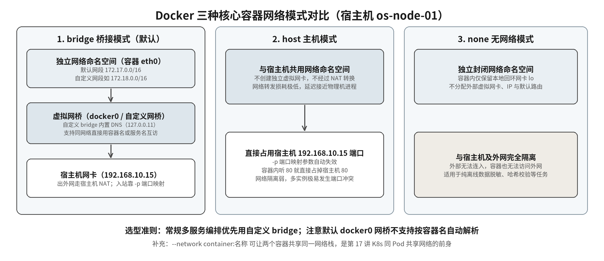
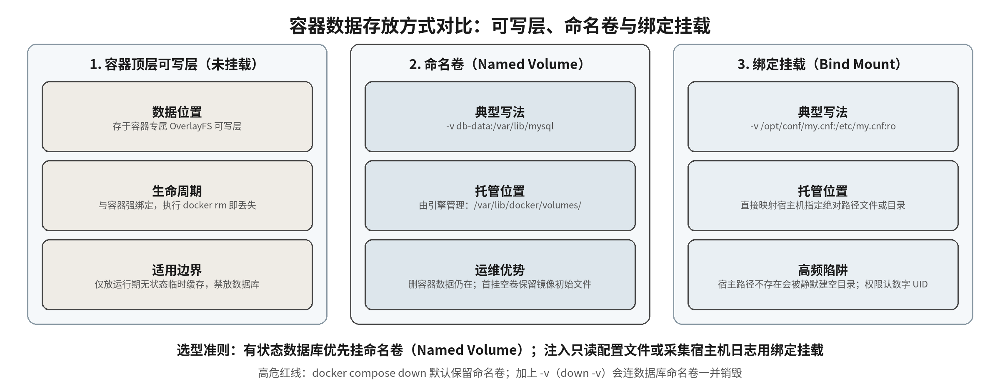
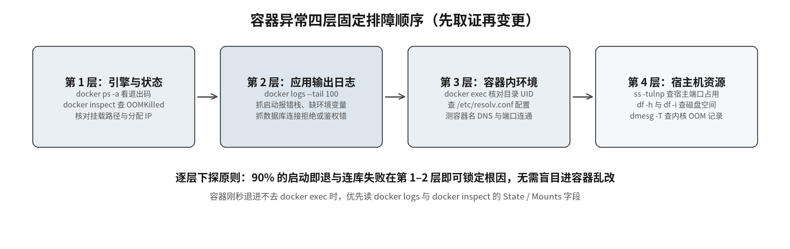
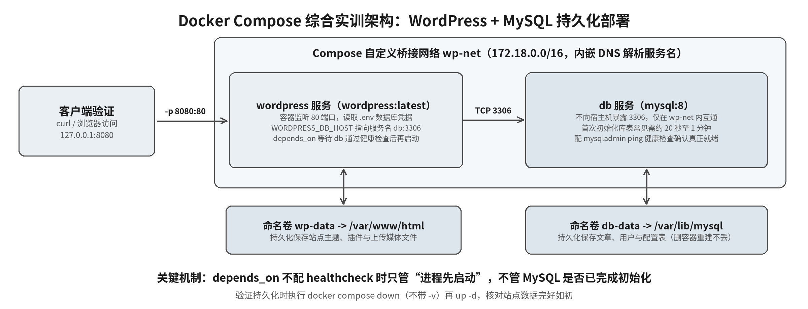

# 第16讲 运行与管理容器

**本课程定位：** 第 14 讲认识了单容器隔离与生命周期，第 15 讲把应用打成了标准化镜像。到了真实业务现场，一个完整系统往往由前端页面与后端数据库协同组成：容器之间要按名字互访，容器删除重建后业务数据不能丢，运行中还要盯住资源水位并快速排障。本讲打通单机多容器运维全链路，并为第 17 讲进入多节点 Kubernetes 编排铺平道路。

值班同事在测试机 `os-node-01` 上手工用两条 `docker run` 拉起了 `WordPress` 与 `MySQL`：先是前端连不上数据库的临时 IP，好不容易填通了，第二天升级重建容器时整站文章又被清空。本讲围绕这一连串实战隐患解决四个核心问题：容器之间和容器对外分别走哪种网络模式？怎样用数据卷保住有状态数据并避开挂载权限陷阱？怎样用 `Docker Compose` 一次管好多容器？遇到启动秒退、端口冲突、挂载报错、OOM 和 DNS 异常时按什么顺序取证？

## 本讲学习目标

学完后，你应能：

- 按职责归类并熟练使用容器生命周期、交互核查与状态监控常用命令。
- 区分 `bridge`（含默认网桥与自定义网桥）、`host`、`none` 三种网络模式的连通边界与选型依据。
- 对比容器可写层、命名卷与绑定挂载的适用场景，避开宿主机空目录静默创建与数字 `UID/GID` 权限陷阱。
- 使用 `Docker Compose v2` 编排 `WordPress + MySQL` 多容器应用，验证删容器重建后的数据持久化。
- 按“引擎状态 → 应用日志 → 容器内环境 → 宿主机资源”四层顺序排查五类常见容器障碍。

## 16.1、容器日常管理与监控命令全景

经过前两讲实操，我们已经接触了多条零散的 `docker` 子命令。在进入复杂编排前，先把日常高频命令按运维动作归成三类，做到查状态、看水位、取证据时随手可调且不越界操作。

表16-1、Docker 容器日常运维核心命令分类速查

| 命令类别 | 代表命令写法 | 关键运维用途与边界说明 |
| --- | --- | --- |
| 生命周期控制 | `run` / `start` / `stop` / `restart` / `rm` | `stop` 先发 `SIGTERM` 优雅停机；`rm` 只删容器可写层，不删镜像与命名卷 |
| 交互与文件核查 | `exec` 与 `cp` | `docker exec` 用于只读检查环境与连通性，禁在运行容器内手改业务代码 |
| 状态与日志取证 | `ps -a` / `inspect` / `logs` | `ps -a` 查退出码，`inspect` 查结构化配置与 `OOMKilled`，`logs` 读标准输出 |
| 资源与事件监控 | `stats` 与 `events` | `stats` 看 CPU、内存、网络与块读写水位；`events` 按时间流捕获 `oom`、`die` 事件 |

监控单机容器运行状态时，重点盯紧两条实时线索：

- **看资源水位（docker stats）**：执行 `docker stats --no-stream` 可一次性抓取所有运行容器的 CPU 百分比与 `MEM USAGE / LIMIT`（当前内存用量与 cgroup 限额）。如果某个容器内存长期贴近 `LIMIT` 红线，随时可能触发内存保护被杀（结合第 25 讲 `cAdvisor` 可将这些指标接入 Prometheus 长期绘图）。
- **看引擎事件流（docker events）**：容器异常重启或被内核强杀的瞬间，执行 `docker events --since 30m` 可以按精确时间戳回放容器的 `start`、`oom`、`die`、`restart` 轨迹，是还原夜间闪断现场的重要证据。

## 16.2、容器网络模式：bridge、host 与 none

容器网络并不是凭空造出来的，而是叠加在第 5 至 6 讲机房物理网络（如宿主机 `192.168.10.15/24`）之上的本机软件转发层。创建容器时通过 `--network` 指定网络模式，决定了容器能和谁说话、用什么地址说话。



表16-2、三种核心容器网络模式特性与选型对比

| 网络模式 | 网络命名空间与地址 | 连通表现与端口规则 | 典型适用场景 |
| --- | --- | --- | --- |
| bridge（桥接） | 独立命名空间，分得 `172.17` 或 `172.18` 段私有 IP | 出外网经宿主 NAT，外部入站靠 `-p` 映射 | 默认首选，绝大多数 Web 与微服务容器 |
| host（主机） | 与宿主机共用同一网络命名空间与 IP | 无 NAT 损耗，`-p` 参数失效，直占宿主机端口 | 对网络转发延迟极敏感或需采集宿主机网卡指标的组件 |
| none（无网络） | 独立命名空间，仅有 `lo` 回环口无外网卡 | 无法连外网，外部也无法通过网络连入 | 离线日志脱敏、加密验签、纯本地文件批处理 |

（补充了解：还有第四种 `--network container:目标容器名` 模式，让新容器直接共用另一个容器的网络命名空间与 `localhost` 回环口；第 17 讲与第 20 讲中 Kubernetes 同一个 Pod 内的多个容器共享网络，正是沿用了这一原理。）

【关键区别】 同样叫 `bridge`，**默认 docker0 网桥（172.17.0.0/16）与用户自定义 bridge 网桥（如 172.18.0.0/16）有一项决定性的生产差异**：直接 `docker run` 不指定网络时连入默认 `docker0`，容器之间只能靠易变的容器 IP 通信，**不支持直接用容器名做 DNS 解析**；而通过 `docker network create` 或 `Docker Compose` 创建的自定义 `bridge` 网络，会自动启用守护进程内嵌 DNS（`127.0.0.11`），同网络内的前端容器直接连主机名 `db` 就能稳定找到数据库容器，哪怕数据库容器删掉重建换了 IP 也完全不受影响。

【例题】节点 `os-node-01` 上已经有一个监控采集程序占用了宿主机的 `80` 端口。现在要部署两个不同版本的内部文档容器，都使用镜像默认的容器内 `80` 端口对外提供测试访问。如果图省事给两个容器都加上 `--network host` 会发生什么？应当改用什么网络方案？

解：加上 `--network host` 后，容器不再隔离端口空间，也不认 `-p` 映射参数，而是直接去抢宿主机的 `80` 端口。由于宿主机 `80` 端口已被占用，两个文档容器都会因 `address already in use` 启动失败。正确方案是使用默认的 `bridge`（或自定义 `bridge`）网络，分别通过 `-p 127.0.0.1:8081:80` 和 `-p 127.0.0.1:8082:80` 映射到宿主机不同的空闲端口。

## 16.3、容器存储挂载与多容器 Compose 编排

### 16.3.1、为什么数据库不能放在容器可写层

第 15 讲讲过，容器顶层可写层与容器实例同生共死。把 `MySQL` 库表或用户上传的图片直接留在容器可写层会有两大硬伤：一是执行 `docker rm` 升级镜像版本时数据立刻灰飞烟灭；二是联合文件系统（OverlayFS）的写时复制机制会拖慢频繁随机读写的数据库性能。要让数据独立于容器生命周期存活，必须把宿主机存储挂载进容器，常用方式分为**命名卷（Named Volume）**与**绑定挂载（Bind Mount）**。



表16-3、容器可写层、命名卷与绑定挂载对比

| 对比维度 | 容器可写层（不挂载） | 命名卷（Named Volume） | 绑定挂载（Bind Mount） |
| --- | --- | --- | --- |
| 参数示例 | 无 `-v` 或 `--mount` | `-v db-data:/var/lib/mysql` | `-v /opt/conf/my.cnf:/etc/my.cnf:ro` |
| 宿主机路径 | 引擎内部临时层目录 | 引擎托管目录 `/var/lib/docker/volumes/` | 运维显式指定的宿主机绝对路径 |
| 删容器后数据 | 随 docker rm 立即清空 | 完整保留，新容器重挂同一卷名即可接着用 | 完整保留在宿主机原路径中 |
| 空目录覆盖行为 | 使用镜像原有文件 | 新空卷首次挂到非空容器目录时自动拷入初始文件 | 宿主机空目录会直接遮盖容器原目录内容 |
| 典型用途 | 无状态临时计算缓存 | 数据库文件、站点持久化业务附件 | 注入只读配置文件（`:ro`）、导出日志到宿主机 |

使用绑定挂载时，必须严防两个现场高频陷阱：

- **宿主机路径不存在被静默建成空目录**：用 `-v /opt/conf/nginx.conf:/etc/nginx/nginx.conf:ro` 挂载单个配置文件时，如果宿主机上漏建了 `/opt/conf/nginx.conf` 文件，`-v` 不会报错，而是**静默在宿主机创建一个名叫 nginx.conf 的空文件夹**（属主 `root:root`），再把这个文件夹硬塞给容器里的文件路径，导致容器启动报 `not a directory` 或 `Are you trying to mount a directory onto a file`。（若改用显式语法 `--mount type=bind,src=/opt/conf/nginx.conf,dst=/etc/nginx/nginx.conf,readonly`，宿主机源文件不存在时引擎会直接拦截报错，更易提前发现拼写失误。）
- **挂载读写权限只认数字 UID/GID，不认用户名**：Linux 内核判断文件权限只看数字编号。例如官方某数据库或中间件容器内部以非特权用户（数字 `UID 999`）运行，而宿主机绑定挂载目录 `/data/app` 属主是 `root:root`（`UID 0`）、权限 `755`，容器进程往里写数据就会直接报 `Permission denied`。排障时用 `docker exec` 跑 `id`（或查镜像文档）确认容器进程数字 `UID`，在宿主机按最小权限调整目录属主，切忌无脑执行 `chmod 777`。

### 16.3.2、用 Docker Compose v2 编排多容器应用

当一个系统包含前端、后端、数据库以及自定义网桥和多个命名卷时，靠手工拼写几行超长的 `docker run` 极易漏写参数或搞乱启动顺序。本课程统一使用插件式 **Docker Compose v2**（命令是带空格的 `docker compose`，不再使用早期独立的 `docker-compose` 旧脚本），用一份声明式的 `compose.yaml` 清单把服务（`services`）、网络（`networks`）与数据卷（`volumes`）集中管理。

阅读和编写 `compose.yaml` 时要注意三条工程要点：

- **密码分离存 .env**：数据库根密码与业务账号密码放在同目录权限设为 `600` 的 `.env` 文件中（并在 `.gitignore` 忽略），不在公开版本库的 `compose.yaml` 里硬编码明文口令。
- **区分“启动先后”与“服务就绪”**：在前端服务下只写 `depends_on: [db]`，仅仅保证 Docker 先拉起 `db` 容器进程再拉起前端进程，**并不保证 MySQL 已经准备好接收连接**（例如 `mysql:8` 首次在空卷初始化系统表时，常见需要约 20 秒至 1 分钟的经验准备窗口，具体快慢取决于磁盘性能）。稳妥写法是给 `db` 配上 `healthcheck`，并在前端写 `condition: service_healthy`，或者配置 `restart: on-failure` 容错重试。
- **分清 down 与 down -v 的风险差别**：日常停服清理容器执行 `docker compose down`，它只删除容器和项目网络，命名卷里的数据库文件安然无恙；**一旦误敲 docker compose down -v，-v 参数会把清单声明的命名卷连根删除，未做外部备份的数据将直接丢失**！

【随堂思考】同事准备把宿主机上的自定义配置 `/etc/myapp/app.conf` 挂进容器，手滑把宿主机路径写成了不存在的 `/etc/myap/app.conf`（少写了一个 `p`），使用 `-v /etc/myap/app.conf:/app/app.conf` 启动容器后程序报错无法读取配置文件。去宿主机查看 `/etc/myap/app.conf` 时，看到的会是“文件不存在”还是别的什么东西？

## 16.4、排查五类常见容器障碍的四层方法

容器起不来或访问异常时，最忌讳不看日志直接删容器重建，结果把第一现场证据全抹掉了。排障应严格沿着固定四层顺序由表及里取证，在哪一层拿到实锤就停在哪一层修复。



将四层取证法落到大纲要求的五类高频容器障碍上，每一类都有明确的证据特征与处置动作。

表16-4、五类常见容器障碍现象、取证点与处置方法

| 障碍类型 | 典型表面现象 | 关键取证命令与证据点 | 标准修复方法 |
| --- | --- | --- | --- |
| 启动后立即退出 | `ps` 看不到，`ps -a` 显示 `Exited` | `docker logs 容器名` 与 `inspect` 退出码 | 补齐缺失必填环境变量、修正启动命令或补前台常驻参数 |
| 宿主机端口冲突 | 启动报错 `port is already allocated` | `docker ps` 与宿主机 `ss -tulnp` | 找出占用宿主机端口的进程或旧容器，更换空闲宿主映射端口 |
| 挂载路径或权限错 | 日志报 `Permission denied` 或非文件报错 | `inspect` 看 `Mounts` 源路径，宿主机 `ls -ln` 看数字 UID | 删除被 `-v` 误建的空目录补齐真实文件；对齐宿主机目录数字 `UID/GID` |
| 容器内存溢出 OOM | 运行中突然重启或 `Exited (137)` | `inspect` 查 `State.OOMKilled` 为 `true`，`docker events` 见 `oom` | 排查应用内存泄漏或超大并发输入，按容量评估合理上调 `--memory` |
| 容器内 DNS 异常 | 容器内调域名或库名报无法解析主机 | 核对所属网络模式，查容器内 `/etc/resolv.conf` 与宿主 DNS | 多容器互访迁入自定义 `bridge`；外网解析失败检查宿主机 `223.5.5.5` 等上游连通性 |

【例题】测试环境一套采集容器每隔几分钟就自动中断，执行 `docker ps -a` 看到 `Exited (137)`。另外还有一套单命令启动的 Web 容器报连不上同机 `redis` 容器名。请分别按四层排障法写出两套问题的定位步骤。

解：针对采集容器 `Exited (137)`：第 1 层执行 `docker inspect -f '{{.State.OOMKilled}}' 采集容器名` 并跑 `docker events --since 15m`；确认 `OOMKilled=true` 且出现 `oom` 事件后，第 2 层用 `docker logs --tail 100` 查看崩溃前处理的批次大小，第 4 层看宿主机 `free -h` 余量，确认为容器 `--memory` 设得过小（仅 `64m`）导致峰值溢出，评估后调整内存限额。针对 Web 容器解析不了 `redis` 容器名：第 1 层执行 `docker inspect` 查看两个容器的 `Networks` 字段，发现两者都挂在默认的 `bridge`（`docker0`）上；默认网桥不提供容器名 DNS 解析，创建自定义网桥把两个容器接入同一自定义网络（或改用 `Docker Compose` 编排）即可直接按名字解析互通。

【随堂思考】 用 `Docker Compose` 部署应用并测试完，准备把容器临时停掉释放内存，明天接着用里面已经录入的数据库记录。应当执行 `docker compose stop` / `docker compose down`，还是执行 `docker compose down -v`？为什么？

## 16.5、上机实训：Docker Compose 部署 WordPress + MySQL 综合实践

本节实训在 `os-node-01`（`Ubuntu Server 22.04 LTS` + `Docker Engine 26` + `Docker Compose v2`）上完成。我们将使用官方开源镜像 `wordpress:latest` 与 `mysql:8` 完成有状态应用编排、数据库连接与页面验证、删容器重建持久化验证，以及故意改错端口和挂载路径后的定位修复。



### 16.5.1、准备环境变量与 Compose 部署清单

在宿主机 `os-node-01` 检查 `Docker Compose v2` 版本与 `8080` 端口状态，创建工作目录 `~/lab/wp-stack/`，先写入权限收紧为 `600` 的 `.env` 环境变量文件，再编写完整的 `compose.yaml`：

```bash
docker compose version
ss -tulnp | grep ':8080 ' || echo "Port 8080 is free"

mkdir -p ~/lab/wp-stack && cd ~/lab/wp-stack

cat <<'EOF' > .env
MYSQL_ROOT_PASSWORD=RootPass_2026_Lab
MYSQL_DATABASE=wordpress
MYSQL_USER=wpuser
MYSQL_PASSWORD=WpPass_2026_Lab
WP_HOST_PORT=8080
EOF
chmod 600 .env

cat <<'EOF' > compose.yaml
services:
  db:
    image: mysql:8
    container_name: wp-db
    restart: on-failure
    env_file:
      - .env
    volumes:
      - db-data:/var/lib/mysql
    networks:
      - wp-net
    deploy:
      resources:
        limits:
          memory: 1024M
    healthcheck:
      test: "mysqladmin ping -h 127.0.0.1 -p$$MYSQL_ROOT_PASSWORD"
      interval: 10s
      timeout: 5s
      retries: 6
      start_period: 30s

  wordpress:
    image: wordpress:latest
    container_name: wp-web
    restart: on-failure
    depends_on:
      db:
        condition: service_healthy
    ports:
      - "127.0.0.1:${WP_HOST_PORT}:80"
    environment:
      WORDPRESS_DB_HOST: db:3306
      WORDPRESS_DB_USER: ${MYSQL_USER}
      WORDPRESS_DB_PASSWORD: ${MYSQL_PASSWORD}
      WORDPRESS_DB_NAME: ${MYSQL_DATABASE}
    volumes:
      - wp-data:/var/www/html
    networks:
      - wp-net
    deploy:
      resources:
        limits:
          memory: 512M

networks:
  wp-net:
    driver: bridge
    ipam:
      config:
        - subnet: 172.18.0.0/16

volumes:
  db-data:
  wp-data:
EOF
```

（说明：若需要从同网段 `192.168.10.0/24` 局域网电脑打开浏览器完成可视化安装体验，可将 `compose.yaml` 中的 `"127.0.0.1:${WP_HOST_PORT}:80"` 改为 `"${WP_HOST_PORT}:80"`。）

### 16.5.2、启动应用并验证页面响应与数据库连接

在 `~/lab/wp-stack/` 目录下拉取镜像并后台启动整套栈（注意 `mysql:8` 首次初始化数据目录通常需要约 20 秒至 1 分钟的经验等待窗口，待 `wp-db` 状态变为 `healthy` 后 `wp-web` 会自动启动）：

```bash
cd ~/lab/wp-stack
docker compose config -q && echo "Compose syntax OK"
docker compose up -d

# Check service status, resource snapshot, and WordPress setup page
docker compose ps
docker stats --no-stream wp-db wp-web
curl -I -L http://127.0.0.1:8080/
```

预期输出核对：`docker compose ps` 中 `wp-db` 显示 `Up ... (healthy)`，`wp-web` 显示 `Up ...`；`curl -I -L http://127.0.0.1:8080/` 最终跳转到 `/wp-admin/install.php` 并返回 `HTTP/1.1 200 OK`（若返回 `500` 或提示 `Error establishing a database connection`，说明数据库尚未就绪或账号变量不匹配，立刻查 `docker compose logs db`）。

### 16.5.3、写入测试数据并验证重启、删容器重建后数据仍在

为使纯终端环境也能 100% 精确验证数据持久化（同时也欢迎在浏览器打开安装页创建一篇测试文章），我们在 `MySQL` 的 `wordpress` 库中建一张运维验收记录表写入一条标记数据，随后依次执行**重启容器**与**删除全部容器后重建**，核对数据与命名卷是否完好留存：

```bash
# 1) Write a persistent verification record into MySQL wordpress database
docker exec wp-db sh -c 'mysql -u"$MYSQL_USER" -p"$MYSQL_PASSWORD" "$MYSQL_DATABASE" -e "
  CREATE TABLE IF NOT EXISTS ops_verify (id INT PRIMARY KEY, note VARCHAR(64));
  REPLACE INTO ops_verify VALUES (1, \"persist-ok-after-rebuild\");
  SELECT * FROM ops_verify;"'

# 2) Restart containers and verify data
docker compose restart
docker compose ps

# 3) Remove ALL containers and network (WITHOUT -v!), then recreate from scratch
docker compose down
docker ps -a --filter name=wp-
docker volume ls | grep wp-stack

docker compose up -d
# Wait until wp-db passes healthcheck, then query the record again
docker exec wp-db sh -c 'mysql -u"$MYSQL_USER" -p"$MYSQL_PASSWORD" "$MYSQL_DATABASE" -e "SELECT * FROM ops_verify;"'
curl -I -L http://127.0.0.1:8080/
```

预期输出核对：`docker compose down` 后 `wp-db` 和 `wp-web` 容器均已彻底删除，但 `docker volume ls` 仍能看到两个命名卷；重新 `docker compose up -d` 后无需再次做冗长初始化，查询 `ops_verify` 表立刻原样返回 `persist-ok-after-rebuild`（若你刚才通过浏览器完成了站点初始化，刷页面也会发现文章与标题分毫不差）。

### 16.5.4、故障注入、logs/inspect 取证定位与修复

接下来严格按实训要求故意注入两处典型配置故障，演练用 `logs` 与 `inspect` 定位并恢复：

**演练 A（故意制造端口冲突并定位修复）：** 先在宿主机临时起一个占用 `8080` 的测试容器，再尝试重建 `wp-web`，观察报错并用取证命令定位恢复：

```bash
cd ~/lab/wp-stack
docker compose stop wordpress
docker run -d --name port-hog -p 127.0.0.1:8080:80 busybox httpd -f -p 80

# Trigger port conflict on startup
docker compose up -d || true

# Evidence collection: check listening sockets and container status
ss -tulnp | grep ':8080 ' || docker ps --filter publish=8080
docker inspect -f '{{.State.Status}} {{.State.Error}}' wp-web

# Fix: remove conflicting test container and bring wordpress back up
docker stop port-hog && docker rm port-hog
docker compose up -d
curl -I http://127.0.0.1:8080/
```

**演练 B（故意写错单文件绑定挂载路径并定位修复）：** 给 `wordpress` 追加一条拼写错误的单文件绑定挂载（宿主机实际不存在 `/tmp/missing-php.ini`），观察引擎静默建空目录引发异常并用 `inspect` 定位修复：

```bash
# Demonstrate how -v silently creates a directory when host file is missing
docker run -d --name bad-mount \
  -v /tmp/missing-php.ini:/etc/hostname:ro \
  busybox sleep 60 || true

docker inspect -f '{{json .Mounts}}' bad-mount
ls -ld /tmp/missing-php.ini

# Fix: clean up container and mistakenly auto-created empty directory, create real file first
docker rm -f bad-mount
sudo rmdir /tmp/missing-php.ini
echo "memory_limit = 256M" > ~/lab/wp-stack/custom-php.ini
ls -l ~/lab/wp-stack/custom-php.ini
```

预期输出核对：演练 B 中 `ls -ld /tmp/missing-php.ini` 首字母为 `d`（真的是一个空目录！），导致文件级挂载报错失败；清理误建空目录并提前建好真实文件 `custom-php.ini` 后即可正常按 `:ro` 只读挂载。

实训全部验收完毕后，若不再保留实验环境，在 `~/lab/wp-stack` 下执行清理（再次确认：只有在彻底废弃实验靶场时才允许加 `-v` 清理实验卷）：

```bash
cd ~/lab/wp-stack
docker compose down -v
```

**本节实训交付物核对清单：**

- 部署清单（脱敏后的 `.env` 变量名说明与完整 `compose.yaml`）。
- 页面与数据库连接验证结果（`docker compose ps` 健康状态、`curl -I -L` 返回 `200 OK` 记录）。
- 数据持久化验证记录（执行 `docker compose down` 删容器并重新 `up -d` 前后的库表查询或站点文章截图对比）。
- 端口冲突与错误挂载路径两项故障注入的报错信息、`inspect` / `logs` 取证输出及修复过程记录。

## 16.6、本讲回顾与自测

学习完本讲后，试着用自己的话回答四个问题：默认 `bridge` 和自定义 `bridge` 在容器互访上差了什么？数据库为什么要挂命名卷而不放容器可写层？`depends_on` 为什么不能单独保证连库成功？排障时为什么要先看 `ps -a`、`inspect` 和 `logs` 再动手？

表16-5、本讲目标与对应判断

| 学习目标 | 应能做出的判断 |
| --- | --- |
| 归类容器常用命令 | 分清生命周期控制、`exec` 只读核查与 `stats` / `events` 实时观测边界 |
| 选择容器网络模式 | 说清 `bridge`、`host`、`none` 差异，多容器按服务名互访自觉使用自定义 `bridge` |
| 规划持久化挂载 | 数据库用命名卷、配置文件用只读绑定挂载，防备空目录静默创建与数字 UID 权限错 |
| 编排多容器应用 | 用 `docker compose` 管好服务、网络、卷与 `healthcheck`，严守不误敲 `down -v` 红线 |
| 四层排查五类障碍 | 遇秒退、端口冲突、挂载权限、OOM、DNS 异常时按四层顺序取证定界 |

### 16.6.1、本讲自测

**1 网络模式与 DNS。** 同事用两条默认命令启动了容器：`docker run -d --name db mysql:8 ...` 和 `docker run -d --name web wordpress:latest ...`（均未指定 `--network`）。在 `web` 容器里把数据库地址填成 `db:3306` 报无法解析主机名 `db`。解释原因并给出不写死容器 IP 的改法。

**2 网络选型判断。** 某离线批处理任务只需要读取绑定挂载进来的本地脱敏文本并输出统计结果，安全要求容器运行期间严禁与任何内外网地址通信。应选用哪种容器网络模式？如果改用 `--network host` 又会带来什么端口与隔离变化？

**3 挂载陷阱识别。** 运维人员想把宿主机配置文件 `/data/conf/redis.conf` 挂进容器，因提前忘建文件就执行了 `docker run -d -v /data/conf/redis.conf:/etc/redis/redis.conf redis:7 redis-server /etc/redis/redis.conf`，容器启动报错退出。宿主机上的 `/data/conf/redis.conf` 此刻变成了什么？写出修复步骤。

**4 挂载权限排错。** 容器内业务进程以普通用户（`UID=1001`）运行，需要向绑定挂载的 `/var/app/upload`（对应宿主机 `/data/upload`）写入文件，日志报 `Permission denied`。宿主机 `ls -ldn /data/upload` 显示 `drwxr-xr-x 2 0 0`。为什么写不进去？怎样按最小权限修复？

**5 Compose 编排细节。** 在 `compose.yaml` 中只写了 `depends_on: [db]`（未配 `healthcheck`），首次在空卷启动时前端容器日志报 `Connection refused` 后退出，过一分钟再手工 `docker compose up -d` 却又通了。解释这一现象的原因。

**6 高危命令与排障顺序。** 线上单机 Compose 部署的内部工单库需要更新前端镜像版本。交接文档里有人写了 `docker compose down -v && docker compose up -d`。指出这条命令的严重后果、正确替代命令，并写出若更新后新容器异常退出时你的四层排查顺序。

**答：**

____________________________

____________________________

____________________________

____________________________

## 16.7、参考答案与解析

### 16.7.1、随堂思考解析

**思考 1（写错绑定挂载宿主机文件路径）：** 去宿主机查看 `/etc/myap/app.conf` 时，看到的不是“不存在”，而是一个由 Docker 守护进程自动新建、属主为 `root` 的**同名空目录**。因为 `-v` 参数遇到不存在的宿主机源路径时会默认当成目录自动创建，导致容器内原本期望读取文件的路径被挂上了一个文件夹。

**思考 2（临时停容器保留明天要用的数据库）：** 应当执行 `docker compose stop`（仅停止容器进程）或 `docker compose down`（删除容器但默认完整保留命名卷），绝不能加 `-v` 执行 `docker compose down -v`。加上 `-v` 会把存放 MySQL 库表的命名卷一并删除，导致已录入的数据全部丢失。

### 16.7.2、课后自测解析

**1** 未指定 `--network` 时，两个容器接入默认的 `docker0` 网桥，默认网桥不启用容器名自动 DNS 解析功能。改法：先执行 `docker network create app-net` 创建自定义 `bridge` 网络，再让两个容器都带上 `--network app-net` 启动（或改写为一份 `compose.yaml` 交由 `Docker Compose` 自动创建项目专属桥接网络），即可直接通过容器名/服务名 `db` 解析通信。

**2** 离线高隔离任务应选用 `--network none` 模式，容器内只有 `lo` 回环口，彻底阻断内外网收发。如果改用 `--network host`，容器将与宿主机共享网络命名空间，不再有网络隔离，`-p` 映射失效，容器监听什么端口就直接占用宿主机什么端口。

**3** 宿主机上的 `/data/conf/redis.conf` 变成了一个空目录。修复步骤：①执行 `docker rm` 删除启动失败的容器；②在宿主机删除被误建的空目录（`rmdir /data/conf/redis.conf`）；③先在宿主机写入真实合法的配置文件 `/data/conf/redis.conf`，核对 `ls -l` 为普通文件（首字母 `-`）后，再带 `:ro` 重新启动容器（或改用 `--mount type=bind` 提前拦截缺失文件）。

**4** Linux 文件权限校验只认数字 `UID` 和 `GID`。宿主机目录属主是 `0:0`（`root`），权限 `755` 代表只有 `UID 0` 有写权限，其他用户（含容器内的 `UID 1001`）只有读和进入权限。按最小权限修复：在宿主机执行 `sudo chown -R 1001:1001 /data/upload`（及 `chmod 750 /data/upload`），不要粗暴执行 `chmod 777`。

**5** 不带健康检查条件的 `depends_on` 只管容器进程“启动先后”，只要 `db` 容器的主进程刚一拉起就会立刻启动前端容器；而 `MySQL` 首次在空卷初始化系统表通常需要约 20 秒至 1 分钟的准备窗口，期间尚未监听好 `3306` 业务连接，所以前端首轮连接被拒绝。一分钟后数据库初始化完毕，再次拉起前端自然就通了。

**6** 严重后果：`docker compose down -v` 中的 `-v` 会把工单数据库对应的命名卷彻底删除，导致线上历史工单数据清空。正确更新做法：修改前端镜像标签后直接执行 `docker compose up -d`（Compose 只会平滑重建配置有变化的那个服务容器，不动数据库容器与命名卷；即便需要先拆容器也严禁加 `-v`）。若新容器异常退出，按固定四层顺序排查：①看引擎状态（`docker compose ps -a` 与 `docker inspect` 查退出码及 `OOMKilled`）；②看应用标准输出日志（`docker compose logs`）；③查容器内环境（挂载路径、数字 UID、网络与 DNS）；④查宿主机端口与磁盘内存水位（`ss -tulnp`、`df -h`、`dmesg -T`）。

## 16.8、术语

表16-6、本讲术语

| 术语 | 本讲中的含义 |
| --- | --- |
| 自定义 bridge | 用户或 Compose 创建的桥接网络，内置守护进程 DNS（`127.0.0.11`），支持按容器名互访。 |
| host 网络模式 | 容器与宿主机共用同一套网络命名空间，无 NAT 转换损耗，但牺牲端口与网络隔离。 |
| none 网络模式 | 容器内仅保留 `lo` 本地回环网卡，无外部网络连接，用于纯离线隔离计算。 |
| 命名卷（Volume） | 由 Docker 托管在专用目录下的持久化数据卷，独立于容器存亡，适合数据库存储。 |
| 绑定挂载（Bind） | 把宿主机指定的绝对路径文件或目录直接映射进容器，常用于只读配置与日志采集。 |
| Docker Compose | 用一份 `compose.yaml` 声明式编排单机多容器服务、自定义网络与持久化卷的工具（v2 插件命令为 `docker compose`）。 |
| 四层排障顺序 | 容器异常取证路径：引擎状态与退出码 → 应用日志 → 容器内环境 → 宿主机资源与端口。 |

文中 IP、域名、路径与参数为教学示例，生产环境以本单位规划为准。

<!-- md-only -->

## 附：主要参考资料（仅 Markdown 保留，不印入 Word/PDF）

- 中国信通服务《2025 算力运维体系技术白皮书》（本地 `./资料/` 目录 PDF），用于容器运行时状态监控与云原生基础设施衔接说明。
- Docker 官方文档《Networking overview》《Bridge network driver》《Host network driver》，用于 16.2 的三种核心网络模式差异及默认网桥与自定义网桥内嵌 DNS（`127.0.0.11`）行为对比。
- Docker 官方文档《Volumes》《Bind mounts》，用于 16.3.1 的命名卷与绑定挂载选型、`-v` 缺失源路径自动建目录行为及数字 `UID/GID` 权限规则。
- Docker 官方文档《Docker Compose overview》《Control startup and shutdown order in Compose》，用于 16.3.2 与 16.5 的 `compose.yaml` 规范、`depends_on` 配合 `healthcheck` 就绪判断及 `down -v` 风险警示。

<!-- /md-only -->
