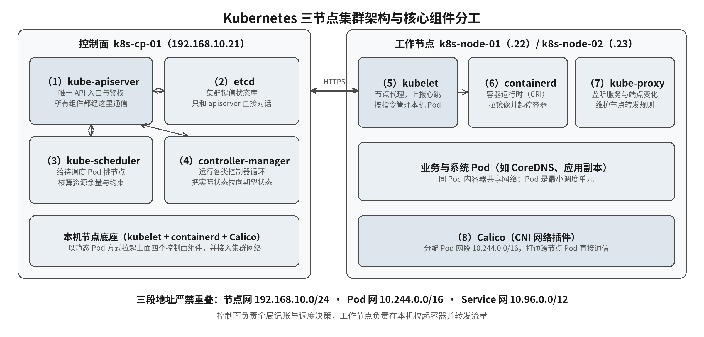
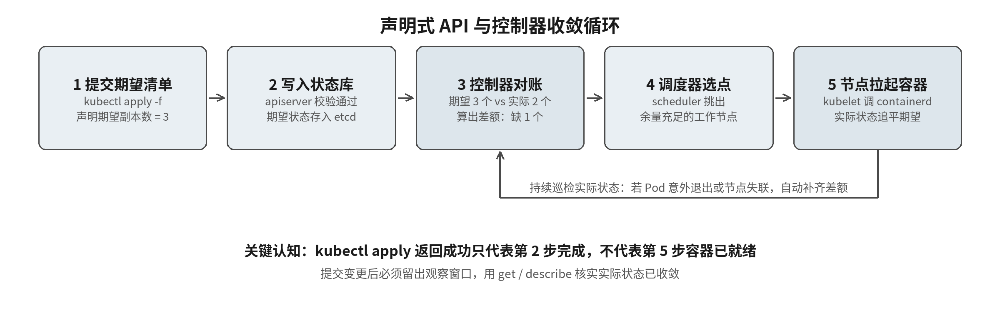
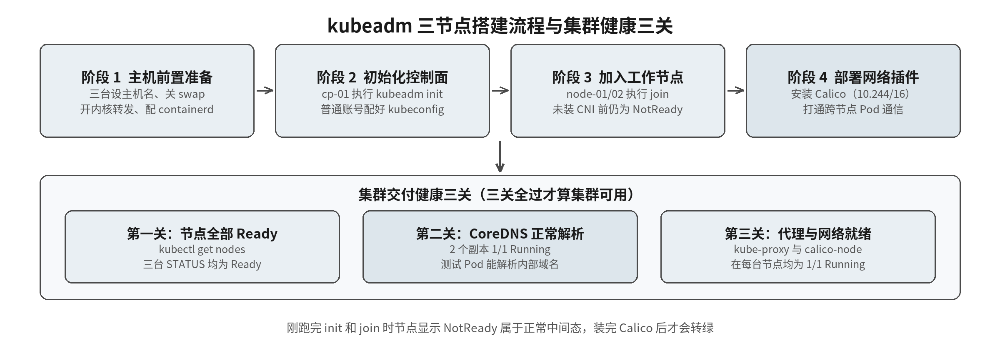
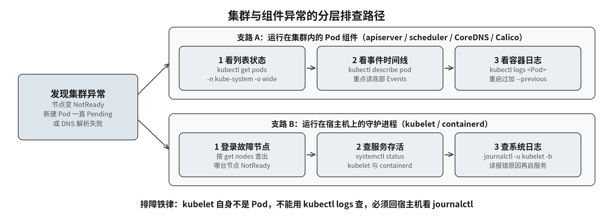

# 第17讲 Kubernetes 集群

**本课程定位：** 第 14～16 讲在一台 Linux 主机上跑通了 Docker 容器与 Compose 编排。从本讲起进入多机集群阶段。自建智算中心往往有几十到上百台服务器，单机命令管不过来。本讲把一套三节点 Kubernetes 集群搭起来、验清楚，并保留给第 18～25 讲继续使用。

机房刚交付三台新装好的服务器。业务团队要求部署多副本推理网关：一台机器断电时副本要能迁到别的机器，更新版本时不能中断服务。单机 `docker compose` 只能管眼前这一台宿主机，做不到跨机迁移。这就需要解决四个问题：Kubernetes 到底管什么？控制面和工作节点各跑哪些组件？怎样用 `kubeadm` 搭出一套健康集群？某个组件停了该去哪里查？

## 本讲学习目标

学完后，你应能：

- 说清容器编排解决的多机调度与自愈问题，区分适合与不适合引入 Kubernetes 的场景。
- 对照架构图说出控制面四组件、工作节点三组件与 CNI 网络插件的职责及故障表现。
- 解释声明式 API 与控制器收敛循环，区分“命令返回成功”与“容器实际就绪”。
- 使用 `kubeadm` 在三台主机上搭起 Kubernetes v1.30 集群，独立完成健康三关与 DNS 验证。
- 运用 `get`、`describe`、`logs` 与宿主机 `journalctl` 定位并恢复节点或组件异常。

## 17.1、为什么需要 Kubernetes

第 16 讲用 `docker compose` 在一台机器上拉起了 Web 与数据库。只要业务还装在一台机器里，Compose 简单够用。一旦机器增加到三台、十台甚至上百台，运维马上会撞上三道难题：新容器该放到哪台有余量的机器上？某台机器夜里死机，上面的业务谁来挪走重建？升级版本时，怎样换一批、验一批，不让用户断连？

Kubernetes（常简写为 K8s，字母 K 与 s 之间有 8 个字母）就是一套开源容器编排系统。“编排”可以把多台独立服务器池化成一整块资源，按规则做三件事：**调度**（挑余量够的机器落盘）、**扩缩与发布**（按副本数增减和平滑替换）、**自愈**（容器异常退出或节点失联时自动补齐副本）。

在 Kubernetes 里，调度的最小单位不是单个容器，而是 **Pod**（可理解为一个贴着统一编号的“容器荚”）。一个 Pod 里通常只放一个主业务容器，也可以顺带放一个紧密配合的辅助容器。同一个 Pod 里的容器共享同一个网络栈和 IP 地址。

表17-1、单机 Compose 与多机 Kubernetes 的选型边界

| 对比维度 | 单机 Docker Compose | 多机 Kubernetes 集群 |
| --- | --- | --- |
| 管理范围 | 单台宿主机内部 | 多台控制面与工作节点组成的资源池 |
| 节点宕机 | 整机业务一起中断，需人工换机恢复 | 控制面感知节点失联后，在健康节点重建副本 |
| 多租户与算力卡 | 无原生配额账本，靠人工约定 | 支持命名空间隔离、RBAC 权限与加速卡调度 |
| 运维复杂度 | 低，装好引擎和插件就能跑 | 高，需维护控制面、证书、网络插件与存储 |
| 适用场景 | 单机开发测试、只有一两台机器的小工具 | 生产微服务、智算资源池、高可用在线推理 |

【关键区别】Kubernetes 不是用来替代所有单机部署的。如果现场只有一台内部测试机、跑两个固定小脚本，强行搭一套 Kubernetes 反而多背了控制面和网络插件的维护负担。先看有没有跨机调度、弹性副本与多团队分池需求，再决定上不上集群。

## 17.2、认识集群组件与三段网络

一套标准 Kubernetes 集群分成两类角色：**控制面（Control Plane）** 负责记账、排班和发号施令；**工作节点（Worker Node）** 负责提供 CPU、内存和算力卡，真正把容器跑起来。下方架构图标出了本课程统一使用的三节点拓扑与八个关键部件。



### 17.2.1、控制面四组件（部件 1～4）

控制面通常跑在专用的管理节点上（本课程主例为 `k8s-cp-01`，IP `192.168.10.21`）。生产环境常部署三台控制面做高可用，教学实验先用单控制面看清脉络。控制面包含四个核心组件：

- **kube-apiserver（部件 1）**：整个集群唯一的 API 入口。无论是运维敲 `kubectl` 命令，还是节点汇报状态，都必须经过 `kube-apiserver` 认证和鉴权。
- **etcd（部件 2）**：保存集群全部配置与状态数据的键值数据库。集群里只有 `kube-apiserver` 能直接读写 `etcd`，别的组件一律不碰数据库。
- **kube-scheduler（部件 3）**：调度器。专门盯着还没分配落脚点的新建 Pod，核算各节点的 CPU、内存、算力卡余量和约束条件，挑出一台最合适的节点写回账本。
- **kube-controller-manager（部件 4）**：控制器大管家。内部运行节点控制器、副本控制器等一串后台循环，持续对比“账本写的期望数量”和“现场跑的实际数量”，少了就补，多了就删。

### 17.2.2、工作节点三组件与 CNI 插件（部件 5～8）

工作节点承担实际业务负载（本课程主例为 `k8s-node-01` `192.168.10.22` 与 `k8s-node-02` `192.168.10.23`）。为了让控制面自身也能运行系统级容器，控制面机器上同样装着这一套底座：

- **kubelet（部件 5）**：跑在每台宿主机上的节点代理（以 Linux `systemd` 服务直接运行）。`kubelet` 定期向 `kube-apiserver` 上报本机心跳与资源状态，拿到分配给本机的 Pod 清单后，调用容器运行时拉起容器。
- **containerd（部件 6）**：容器运行时，负责拉取镜像、创建和停止容器。Kubernetes 从 v1.24 起移除了早期对接 Docker Engine 的中间适配层，直接通过 **CRI（Container Runtime Interface，容器运行时接口）** 调用轻量的 `containerd`。第 15 讲构建的标准镜像在 `containerd` 上完全通用，但集群节点上不再使用 `docker ps` 管理业务 Pod。
- **kube-proxy（部件 7）**：跑在每台节点上的网络代理，监听服务与后端名单变化，在本机维护 `iptables` 或 `IPVS` 转发规则（第 20 讲详细展开）。
- **CNI 网络插件（部件 8，本课选用 Calico）**：实现 **CNI（Container Network Interface，容器网络接口）** 标准。Kubernetes 原生不自带跨机 Pod 网络，必须安装 `Calico` 这类插件，才能给每个 Pod 分配独立 IP 并打通跨节点直连通信。

表17-2、核心组件异常时的现场表现对照

| 异常组件 | 已有业务容器是否立刻中断 | 现场最先看到的现象 |
| --- | --- | --- |
| apiserver | 不中断，本机容器照常处理请求 | `kubectl` 命令报错连不上端口 6443，一切变更与查询停摆 |
| etcd | 不中断，但状态无法更新 | `apiserver` 读写状态失败，无法新建或修改任何资源对象 |
| scheduler | 不中断，存量 Pod 继续运行 | 新提交的 Pod 一直停在 `Pending`，事件里没有调度落点记录 |
| controller | 不中断，存量 Pod 继续运行 | 删掉一个副本后无人自动补齐，节点失联后状态不再更新 |
| kubelet | 本机已启动容器进程暂时还在 | 约 40 秒无心跳后节点变为 `NotReady`，无法在这台机器新起或停止 Pod |
| Calico | 跨节点 Pod 通信可能受阻 | 新节点卡在 `NotReady`，新建 Pod 卡在 `ContainerCreating` 拿不到 IP |

### 17.2.3、三段网络 CIDR 严禁重叠

搭建集群前，必须结合第 5 讲的子网规划提前划好三段互不重叠的网段：

1. **节点网段（192.168.10.0/24）**：物理机或虚拟机网卡的真实局域网地址，由机房网络分配。
2. **Pod 网段（10.244.0.0/16）**：`Calico` 给每个 Pod 发的内部地址段。
3. **Service 网段（10.96.0.0/12）**：`kube-apiserver` 给集群内部服务分配的虚拟 IP 地址段。

三段地址一旦发生重叠，节点上的路由表就会混淆本机流量和容器流量，后续排障极难收拾。

【随堂思考】凌晨巡检时，你发现线上已有的推理服务接口访问完全正常，但刚提交的新任务 Pod 连续 10 分钟停在 `Pending`，且 `kubectl get nodes` 显示两台工作节点都是 `Ready`、空闲资源充足。结合表 17-2，你优先去查控制面的哪一个组件？

## 17.3、声明式 API 与控制器收敛

在第 14 讲单机操作时，敲一条 `docker run` 就建一个容器，敲错或中断就得手工重敲。这种“一步步下口令告诉机器怎么做”的方式叫**命令式操作**。

Kubernetes 主推**声明式 API（Declarative API）**。运维编写一份 YAML 格式的资源清单，在清单里写明“我期望长期保持 3 个 nginx 副本”，然后用 `kubectl apply -f` 提交给 `kube-apiserver`。至于现在是 0 个要新建 3 个，还是已有 2 个只需补 1 个，全部交由后台控制器自动对账完成。这个持续纠偏的过程叫**收敛循环（Reconcile Loop）**。



**【例题】** 运维修改 `web.yaml` 把 `replicas` 从 `2` 改成 `3`，执行 `kubectl apply -f web.yaml`，终端立刻输出 `deployment.apps/web configured`。运维当场在群里汇报“扩容已完成，新副本已上线”。这个判断哪里出了错？应当补哪一步？

**解：** `configured` 只证明第 2 步完成——YAML 语法合法、权限通过，期望副本数 `3` 已经写进了 `etcd`。此时第 3～5 步（控制器建 Pod、调度器找机器、节点从仓库拉镜像并启动进程）才刚刚开始。如果目标节点磁盘满了或镜像名字写错，第 3 个副本会卡在拉取失败，根本没有上线。正确做法是提交后留出约 1 分钟的经验观察窗（注：1 分钟为常规小镜像经验观察窗，大图或慢启动服务耗时更长，不是硬性承诺指标），执行 `kubectl get pods` 确认 3 个副本全部 `Running` 且 `1/1` 就绪后再汇报。

【关键区别】命令返回成功 ≠ 容器已经生效。在声明式系统里，命令的退出码 `0` 只管“交单成功”，不管“完工验收”。

## 17.4、上机实训：搭建三节点集群并验证健康三关

本节在三台 `Ubuntu Server 22.04 LTS` 主机上使用官方工具 `kubeadm` 搭建 `Kubernetes v1.30` 集群。每台主机建议分配 **4 核 CPU、8 GB 内存、40 GB 磁盘**（注：`kubeadm` 官方文档检查下限为 2 核 CPU、2 GB 内存，但后续章节还要跑监控与多副本实验，2 核 2 GB 会频繁内存吃紧，教学实验统一推荐 4 核 8 GB）。



表17-3、三节点实验拓扑与角色分工

| 主机名 | 管理与业务 IP | 集群角色 | 本机运行的关键服务与组件 |
| --- | --- | --- | --- |
| k8s-cp-01 | 192.168.10.21/24 | 控制面节点 | 控制面四组件、`kubelet`、`containerd`、`Calico` |
| k8s-node-01 | 192.168.10.22/24 | 工作节点 1 | `kubelet`、`kube-proxy`、`containerd`、`Calico` |
| k8s-node-02 | 192.168.10.23/24 | 工作节点 2 | `kubelet`、`kube-proxy`、`containerd`、`Calico` |

### 17.4.1、阶段 1：三台节点统一前置准备

以下步骤在**全部三台主机**（`k8s-cp-01`、`k8s-node-01`、`k8s-node-02`）上以 `opsadmin` 提权执行。任何一台漏关交换分区或漏改 `cgroup` 驱动，都会导致后面 `kubelet` 反复崩溃。

第一步，分别在三台机器设好各自的主机名（下方第一行以 `k8s-cp-01` 为例，另外两台改为 `k8s-node-01` 和 `k8s-node-02`），并在三台的 `/etc/hosts` 写入一致解析，核对时间同步：

```bash
# Run on each node (adjust hostname per node)
sudo hostnamectl set-hostname k8s-cp-01

cat <<'EOF' | sudo tee -a /etc/hosts
192.168.10.21 k8s-cp-01
192.168.10.22 k8s-node-01
192.168.10.23 k8s-node-02
EOF
timedatectl status
```

第二步，在三台节点关闭 Linux 交换分区（Swap），并注释掉 `/etc/fstab` 里的 `swap` 行防止重启后复燃。`kubelet` 默认要求关闭 Swap，以便准确核算节点内存上限：

```bash
# Run on all 3 nodes: disable swap immediately and persistently
sudo swapoff -a
sudo sed -ri 's/^([^#].*\sswap\s.*)$/# \1/' /etc/fstab
free -h
```

预期 `free -h` 输出中 `Swap:` 行的总量与已用均为 `0B`。

第三步，在三台节点加载容器网络必需的 `overlay` 与 `br_netfilter` 内核模块，并开启网桥二层流量过防火墙与 IPv4 路由转发：

```bash
# Run on all 3 nodes: kernel modules and sysctl networking params
cat <<'EOF' | sudo tee /etc/modules-load.d/k8s.conf
overlay
br_netfilter
EOF
sudo modprobe overlay
sudo modprobe br_netfilter

cat <<'EOF' | sudo tee /etc/sysctl.d/k8s.conf
net.bridge.bridge-nf-call-iptables  = 1
net.bridge.bridge-nf-call-ip6tables = 1
net.ipv4.ip_forward                 = 1
EOF
sudo sysctl --system
```

第四步，在三台节点安装并配置 `containerd` 运行时。关键动作是把 `/etc/containerd/config.toml` 里的 `SystemdCgroup` 改为 `true`，让 `containerd` 与 `kubelet` 共用 `systemd` 管资源限额（回引第 14 讲 `cgroup`）：

```bash
# Run on all 3 nodes: install containerd and enable SystemdCgroup
sudo apt-get update && sudo apt-get install -y \
  containerd apt-transport-https ca-certificates curl gpg
sudo mkdir -p /etc/containerd
containerd config default | sudo tee /etc/containerd/config.toml >/dev/null
sudo sed -i 's/SystemdCgroup = false/SystemdCgroup = true/' /etc/containerd/config.toml
sudo systemctl enable --now containerd
sudo systemctl restart containerd
```

第五步，在三台节点配置 Kubernetes `v1.30` 软件源，安装 `kubelet`、`kubeadm`、`kubectl` 三个软件包，并用 `apt-mark hold` 锁定版本，防止日后系统常规更新时意外跨大版本升级破坏集群：

```bash
# Run on all 3 nodes: install and hold kubelet, kubeadm, kubectl v1.30
sudo mkdir -p -m 755 /etc/apt/keyrings
curl -fsSL https://pkgs.k8s.io/core:/stable:/v1.30/deb/Release.key \
  | sudo gpg --dearmor -o /etc/apt/keyrings/kubernetes-apt-keyring.gpg
K8S_REPO="https://pkgs.k8s.io/core:/stable:/v1.30/deb/"
echo "deb [signed-by=/etc/apt/keyrings/kubernetes-apt-keyring.gpg] ${K8S_REPO} /" \
  | sudo tee /etc/apt/sources.list.d/kubernetes.list

sudo apt-get update
sudo apt-get install -y kubelet kubeadm kubectl
sudo apt-mark hold kubelet kubeadm kubectl
sudo systemctl enable --now kubelet
```

注：国内机房拉取上游源受阻时，可按相同目录结构替换为阿里云等国内开源镜像站的 `kubernetes-new/core/stable/v1.30/deb/` 源，并在 `kubeadm init` 时附加 `--image-repository=registry.aliyuncs.com/google_containers`。此时 `kubelet` 在执行 `init` 前处于等待配置循环重启状态，属于正常现象。

### 17.4.2、阶段 2 与阶段 3：初始化控制面并加入工作节点

只在控制面 **k8s-cp-01** 上执行 `kubeadm init`，显式绑定三段网段与版本：

```bash
# Run on k8s-cp-01 only
sudo kubeadm init \
  --apiserver-advertise-address=192.168.10.21 \
  --pod-network-cidr=10.244.0.0/16 \
  --service-cidr=10.96.0.0/12 \
  --kubernetes-version=v1.30.0
```

屏幕末尾输出 `Your Kubernetes control-plane has initialized successfully!` 后，在 `k8s-cp-01` 上为日常运维账号 `opsadmin` 配置凭据文件 `~/.kube/config`（`kubectl` 靠这份文件里的证书和地址连接 `6443` 端口）：

```bash
# Run on k8s-cp-01 as opsadmin
mkdir -p "$HOME/.kube"
sudo cp -i /etc/kubernetes/admin.conf "$HOME/.kube/config"
sudo chown "$(id -u):$(id -g)" "$HOME/.kube/config"
chmod 600 "$HOME/.kube/config"
```

复制 `kubeadm init` 末尾打印的那条 `kubeadm join` 命令（若终端刷屏丢了，可在 `k8s-cp-01` 执行 `kubeadm token create --print-join-command` 重新生成），分别到 **k8s-node-01** 和 **k8s-node-02** 上执行（实际 `token` 与哈希值以现场输出为准）：

```bash
# Run on k8s-node-01 and k8s-node-02
sudo kubeadm join 192.168.10.21:6443 --token abcdef.0123456789abcdef \
  --discovery-token-ca-cert-hash sha256:8f2c4e1a9d0b...9a1b
```

回到 `k8s-cp-01` 执行 `kubectl get nodes`，你会看到三台节点都已上榜，但 `STATUS` 全是 `NotReady`。不要慌，这是因为第 4 阶段的网络插件还没装。

### 17.4.3、阶段 4：安装 Calico 并核验健康三关

在 `k8s-cp-01` 上安装 `Calico` 网络插件（确保清单中的 `CALICO_IPV4POOL_CIDR` 与初始化时填写的 `10.244.0.0/16` 一致）：

```bash
# Run on k8s-cp-01 only
CALICO_URL="https://raw.githubusercontent.com/projectcalico/calico/v3.28.0/manifests/calico.yaml"
kubectl apply -f "${CALICO_URL}"
```

等待约 1～2 分钟镜像拉取完成后，在 `k8s-cp-01` 按顺序逐一核验**集群健康三关**（第一关查全部节点 `Ready`，第二关与第三关查 `CoreDNS`、`kube-proxy`、`calico-node` 全部 `1/1 Running`，并起一个阅后即焚的 `busybox` 容器实测内部域名解析）：

```bash
# Gate 1: all 3 nodes Ready
kubectl get nodes -o wide

# Gate 2 & 3: CoreDNS, kube-proxy, calico-node Running (1/1)
kubectl get pods -n kube-system -o wide

# Verify internal DNS resolution
kubectl run dns-check --image=busybox:1.36 --rm -it --restart=Never -- \
  nslookup kubernetes.default.svc.cluster.local
```

预期终端关键输出如下（`nslookup` 解析出 Service 网段首地址 `10.96.0.1`）：

```text
NAME          STATUS   ROLES           AGE   VERSION   INTERNAL-IP
k8s-cp-01     Ready    control-plane   6m    v1.30.0   192.168.10.21
k8s-node-01   Ready    <none>          4m    v1.30.0   192.168.10.22
k8s-node-02   Ready    <none>          4m    v1.30.0   192.168.10.23

Server:    10.96.0.10
Address 1: 10.96.0.10 kube-dns.kube-system.svc.cluster.local
Name:      kubernetes.default.svc.cluster.local
Address 1: 10.96.0.1 kubernetes.default.svc.cluster.local
```

接着花两分钟体验一次**声明式自愈**：提交一个 2 副本的 `nginx:stable` 清单，故意手工删掉其中一个 Pod，立刻执行 `kubectl get pods` 观察。你会看到旧 Pod 进入 `Terminating` 的同时，控制器已经自动拉起了一个带新后缀的替补 Pod，使总数重新回到 2 个。验证完毕后执行 `kubectl delete deployment demo-nginx` 清理测试负载。

## 17.5、观测三板斧与组件异常排障演练

集群跑起来之后，遇到节点掉线或系统 Pod 卡住时，严禁上来就敲 `kubeadm reset` 推倒重装。先分清目标组件是“跑在集群里的 Pod”还是“跑在宿主机上的系统服务”，再沿下图两条支路取证。



### 17.5.1、只读排障的 kubectl 三板斧

针对跑在集群内的 Pod（包括业务 Pod、`CoreDNS`、`Calico` 以及控制面静态 Pod），统一按顺序使用**观测三板斧**：

1. **第一斧 kubectl get**：看全局列表、`STATUS` 状态、`READY` 就绪比（如 `0/1`）和 `RESTARTS` 重启次数，加 `-o wide` 看落在哪台节点。
2. **第二斧 kubectl describe**：如 `kubectl describe pod <名称> -n kube-system`，重点拉到最底部的 `Events`（事件时间线），调度失败、拉不下镜像、网络没配好都会写在这里。
3. **第三斧 kubectl logs**：看容器内部程序的标准输出报错；如果 `RESTARTS` 大于 0 说明刚才崩过，加上 `--previous` 读取上一轮崩溃退出前的遗言。

如果异常出在宿主机守护进程（`kubelet` 或 `containerd`），`kubectl logs` 查不到它们，必须登录对应节点用第 8 讲学过的 `systemctl status kubelet` 和 `journalctl -u kubelet -b --no-pager | tail -n 30` 读取系统日志。

### 17.5.2、受控故障注入与定位恢复演练

下面在实验集群上人为制造一次组件故障，完整演练“发现现象 → 定位组件 → 修复验证”。

第一步，登录工作节点 **k8s-node-01**，受控停止 `kubelet` 服务模拟节点代理意外中断：

```bash
# On k8s-node-01: stop kubelet to simulate agent failure
sudo systemctl stop kubelet
```

第二步，回到控制面 **k8s-cp-01**，等待约 45 秒（节点控制器默认在约 40 秒收不到心跳后判定失联），用三板斧前两步取证：

```bash
# On k8s-cp-01: inspect node status and Conditions
kubectl get nodes
kubectl describe node k8s-node-01 | grep -A 8 "Conditions:"
```

你会看到 `k8s-node-01` 的 `STATUS` 变成了 `NotReady`，`Conditions` 里的 `Ready` 行显示 `Unknown`，提示 `Kubelet stopped posting node status`。证据直指 `k8s-node-01` 上的 `kubelet` 停止汇报状态，而不是 `Calico` 或 `apiserver` 故障。

第三步，SSH 登录到 `k8s-node-01` 核实服务状态并恢复，再回控制面 `k8s-cp-01` 复测健康三关与 DNS 解析：

```bash
# On k8s-node-01: verify stopped state and restart kubelet
sudo systemctl status kubelet --no-pager
sudo systemctl start kubelet

# Back on k8s-cp-01: re-verify Ready state and internal DNS
kubectl get nodes
kubectl run dns-recheck --image=busybox:1.36 --rm -it --restart=Never -- \
  nslookup kubernetes.default.svc.cluster.local
```

表17-4、`kubeadm` 搭建与运行常见障碍速查

| 现场现象 | 优先检查点 | 常见根因与修复动作 |
| --- | --- | --- |
| init 预检报错退出 | 终端 `[preflight]` 提示行 | 未执行 `swapoff -a`，或网桥转发与路由转发内核参数未开启 |
| 控制面反复断连重启 | 节点 `journalctl -u kubelet` | `containerd` 未开 `SystemdCgroup = true`，两套 cgroup 驱动冲突 |
| 节点长期停在 NotReady | `kubectl get pods -n kube-system` | 未安装 `Calico`，或 `calico-node` 镜像拉取失败处于 `ImagePullBackOff` |
| CoreDNS 一直 Pending | `kubectl describe pod coredns-xxx` | CNI 网络插件尚未就绪，节点带 `not-ready` 污点无法调度 |
| 普通账号敲 kubectl 拒连 | 检查 `~/.kube/config` 与环境变量 | 漏拷 `/etc/kubernetes/admin.conf`，客户端误连本机 `localhost:8080` |

**实训环境保留提醒：** 演练完成后不要执行 `kubeadm reset`。请确认三台节点全部处于 `Ready` 状态，这套集群将直接作为第 18～25 讲多租户、发布、网络、存储与监控实训的底座。

【随堂思考】新同事刚在 `k8s-cp-01` 跑完 `kubeadm init`，切回普通账号敲 `kubectl get nodes`，屏幕报错 `The connection to the server localhost:8080 was refused`。他第一反应是“apiserver 崩了，我要重装集群”。你会让他先检查哪两个地方？

<!-- pagebreak -->

## 17.6、本讲回顾与自测

学习完本讲后，试着用自己的话回答四个问题：多机环境下 Kubernetes 比单机 Compose 多解决了哪三件事？控制面四组件和节点三组件各司什么职？为什么 `kubectl apply` 返回成功不代表变更已经生效？`kubelet` 停了为什么不能用 `kubectl logs` 查？

表17-5、本讲目标与对应判断

| 学习目标 | 应能做出的判断 |
| --- | --- |
| 判断集群适用边界 | 区分单机小工具与多机高可用/算力池场景，不为了一台机器盲目上集群 |
| 识别组件职责 | 根据“新 Pod 卡 Pending”“节点变 NotReady”等现象反推对应故障组件 |
| 理解声明式收敛 | 区分请求写入 `etcd` 与实际容器就绪，变更后留出观察窗查证实际状态 |
| 独立搭群与过三关 | 完成关 Swap、配 `SystemdCgroup`、`init/join` 与装 `Calico`，验通健康三关 |
| 分层定位异常 | 集群内 Pod 用 `get/describe/logs`，宿主机守护进程用 `systemctl/journalctl` |

### 17.6.1、本讲自测

**1 场景选型。** 团队只有一台测试虚拟机，上面固定跑一个内部周报汇总容器，允许夜间重启几分钟。是否建议为此专门搭建一套 Kubernetes 集群？写出你的判断和两条理由。

**2 组件定界。** 集群上原有的 Web 容器都能正常访问，但你敲 `kubectl get pods` 直接报连接 `192.168.10.21:6443` 被拒绝。此时业务容器为什么还没断？最可能是控制面哪个组件异常？

**3 运行时配置。** 安装 `containerd` 时如果漏掉了把 `SystemdCgroup` 改成 `true`，与默认使用 `systemd` 驱动的 `kubelet` 配合会出现什么后果？

**4 中间态识别。** 刚执行完 `kubeadm init` 和两台工作节点的 `kubeadm join`，还没有安装 `Calico`。此时敲 `kubectl get nodes` 和看 `CoreDNS` 各是什么状态？原因是什么？

**5 声明式判断。** 同事执行 `kubectl apply -f app.yaml` 看到 `created`，立刻关闭终端下班。第二天发现应用根本没跑起来。指出他漏掉了哪两步验证动作。

**6 排障路径。** 监控提示 `k8s-node-02` 变成 `NotReady`。写出你从控制面初步确认，到登录 `k8s-node-02` 查清是 `kubelet` 还是 `containerd` 故障的完整命令顺序。

**答：**

____________________________

____________________________

____________________________

____________________________

## 17.7、参考答案与解析

### 17.7.1、随堂思考解析

**思考 1（存量正常、新 Pod 卡 Pending）：** 优先检查控制面的 `kube-scheduler`（`kubectl get pods -n kube-system` 看 `kube-scheduler-k8s-cp-01` 状态与日志）。节点 `Ready` 且资源充足说明 `kubelet` 与 `apiserver` 正常，存量业务不受影响但新 Pod 无人分配节点，正是调度器停摆的典型特征。

**思考 2（报错连接 localhost:8080 被拒）：** 先不要重装。`localhost:8080` 是 `kubectl` 找不到任何配置文件时的远古回退地址。第一先查当前普通账号下 `~/.kube/config` 是否存在且权限可读（是否漏做了拷贝 `/etc/kubernetes/admin.conf` 那三步）；第二若文件已在，再用 `sudo ss -tulnp | grep 6443` 看控制面的 `kube-apiserver` 是否在监听 `6443` 端口。

### 17.7.2、课后自测解析

**1** 不建议。理由一：只有单台机器且允许短时中断，用第 16 讲的 `docker compose` 加重启策略就能低成本满足；理由二：Kubernetes 控制面自身就要常驻消耗数 GB 内存并带来证书、CNI 插件等额外维护工作，收益远小于运维成本。

**2** 因为容器实际跑在各工作节点的 `containerd` 上，只要容器进程没退出、节点上 `kube-proxy` 转发规则还在，数据面流量不经过控制面。连不上 `6443` 端口最可能是控制面的 `kube-apiserver` 异常退出（或控制面主机防火墙拦截）。

**3** 会导致节点上出现 `cgroupfs` 与 `systemd` 两套资源统计与限制视图，内存压力下控制面组件或 `kubelet` 会出现连接不稳、频繁重启，严重时集群刚搭好几分钟就断连。

**4** 三台节点均为 `NotReady`，`CoreDNS` 的 Pod 停在 `Pending`。原因是还没部署 CNI 网络插件（如 `Calico`），容器跨机网络未就绪，节点自动带着未就绪污点，`CoreDNS` 不会被调度启动。

**5** `created` 只说明期望清单已写入 `etcd`。他漏了：一、执行 `kubectl get pods` 等待并确认副本进入 `Running` 且 `READY` 列全绿（如 `1/1`），如有异常用 `kubectl describe pod` 查 `Events`；二、从访问侧实测业务端口或页面响应。

**6** 第一步在 `k8s-cp-01` 执行 `kubectl get nodes -o wide` 与 `kubectl describe node k8s-node-02`，查看底部 `Conditions` 与 `Events` 确认失联时间与提示；第二步 SSH 登录 `k8s-node-02`，依次执行 `sudo systemctl status containerd` 与 `sudo systemctl status kubelet`；第三步对停止或报错的服务执行 `sudo journalctl -u kubelet -b -n 50`（或 `containerd`）定位根因，修复后重启服务并回控制面复核 `Ready` 状态。

## 17.8、术语与疑问

表17-6、本讲术语

| 术语 | 本讲中的含义 |
| --- | --- |
| Kubernetes（K8s） | 开源容器编排系统，把多台主机池化，统一负责容器调度、扩缩发布与故障自愈。 |
| Pod | Kubernetes 最小调度与运行单元，内部包含一个或多个共享网络栈与 IP 的容器。 |
| 控制面 | 负责集群全局状态存储、API 鉴权、调度排班和控制器对账的管理层组件集合。 |
| kube-apiserver | 集群唯一 API 入口，负责认证、鉴权并作为唯一组件读写 `etcd` 状态库。 |
| etcd | 高可用键值存储库，持久化保存整个集群的期望配置与当前状态账本。 |
| kubelet | 运行在每台宿主机上的节点代理，向控制面上报心跳并调用运行时起停本机容器。 |
| containerd | 符合 CRI 标准的容器运行时，负责在节点上拉取镜像并管理容器生命周期。 |
| CNI（Calico） | 容器网络接口标准与常用网络插件，负责给 Pod 分配 IP 并打通跨节点通信。 |
| 声明式 API | 只提交期望终态清单（YAML），由后台控制器循环自动对比实际状态并补齐差额。 |
| 健康三关 | 集群交付验收底线：节点全部 `Ready`、`CoreDNS` 正常解析、`kube-proxy` 与网络插件就绪。 |

文中 IP、域名、路径与参数为教学示例，生产环境以本单位规划为准。

**我的疑问（记下阅读或实操中没弄明白的一点）：**

____________________________

<!-- md-only -->

## 附：主要参考资料（仅 Markdown 保留，不印入 Word/PDF）

- 中国信通服务《2025 算力运维体系技术白皮书》（本地 `./资料/` PDF，文件第 16、31、44、55 页关于基于 Kubernetes 构建弹性算力集群、容器快速重建与平台故障恢复监控体系的论述）。
- Kubernetes v1.30 官方文档《Kubernetes 组件（Kubernetes Components）》，说明控制面四组件、节点三组件及插件职责边界。
- Kubernetes v1.30 官方文档《使用 kubeadm 创建集群（Creating a cluster with kubeadm）》与《容器运行时（Container Runtimes）》，说明关闭 Swap、开启网桥与路由转发内核参数及配置 `containerd` 的 `SystemdCgroup = true` 要求。
- Project Calico 官方文档《Install Calico networking and network policy for on-premises deployments》，说明 Pod CIDR 规划与节点网络就绪检查。
- Kubernetes v1.30 官方文档《使用调试工具排查集群故障（Troubleshooting Clusters）》，说明节点 `NotReady`、`kubelet` 日志与系统组件分层排障路径。

<!-- /md-only -->
