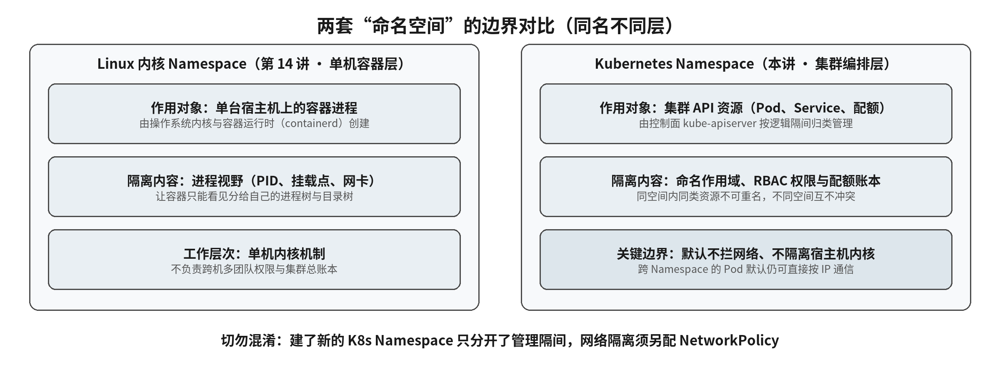
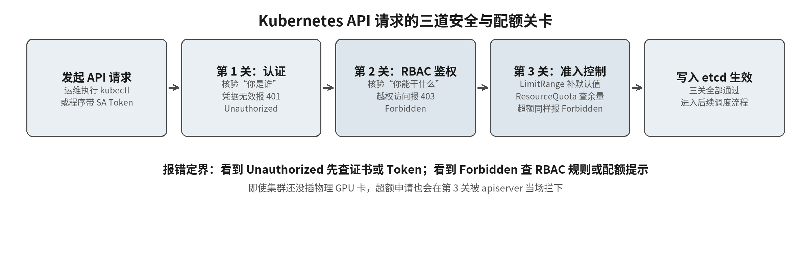
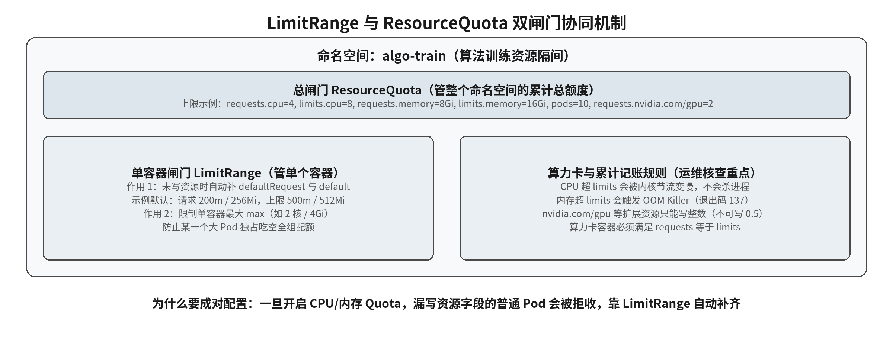
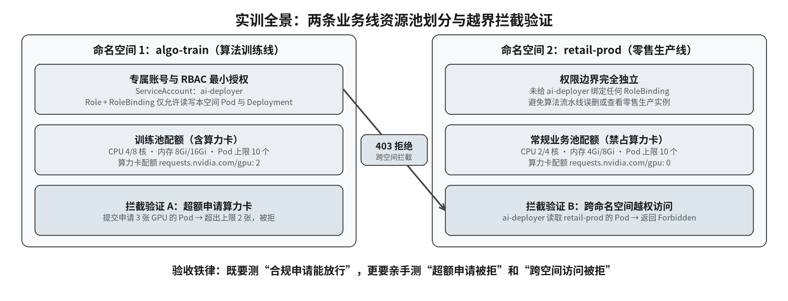

# 第18讲 命名空间与资源池管理

**本课程定位：** 第 17 讲搭起了三节点 Kubernetes 集群。集群刚交付时，如果所有团队都用管理员配置往 `default` 里塞任务，很快就会出两类事故：算法训练任务把整机内存和算力卡吃光，挤垮线上零售服务；或者某条自动化流水线写错名字，误删了隔壁团队的生产服务。本讲用命名空间、RBAC 权限与双层配额把一台大集群切成边界清晰的多租户资源池。

算法团队和零售业务团队要共用这套集群。主管交给你四项任务：把两条业务线的资源隔开；给算法发布账号只开本空间的最小权限；给算法训练池划出 2 张算力卡上限、禁止零售业务误占算力卡；最后亲手提交一次超额申请和跨空间访问，证明拦截真的生效。

## 本讲学习目标

学完后，你应能：

- 区分 Linux 内核命名空间与 Kubernetes 命名空间，按“业务线-环境”规范划分多租户空间。
- 说清 API 请求经过认证、RBAC 鉴权与准入控制的顺序，分清 `Unauthorized` 与 `Forbidden`。
- 使用 `ServiceAccount`、`Role` 与 `RoleBinding` 配置命名空间级最小权限，并用 `can-i` 验证。
- 搭配使用 `ResourceQuota` 与 `LimitRange` 管控 CPU、内存与算力卡配额，掌握算力卡整数记账规则。
- 独立完成双业务线资源池实训，实测默认值补齐、超额申请被拒与跨命名空间越权被拒。

## 18.1、规划命名空间：告别 default 混跑

在同一个集群里，Kubernetes 用 **Namespace（命名空间）** 把资源划分成不同的逻辑隔间。同一个命名空间内，同一种资源（例如两个 `Deployment`）不能重名；换到不同命名空间，双方都叫 `web` 也互不干扰。删掉一个测试命名空间时，里面的 Pod、服务和配置会一并清理干净。

### 18.1.1、先分清两套同名“命名空间”

第 14 讲学过容器底层的 **Linux Namespace**，本讲又遇到 **Kubernetes Namespace**。两者中文译名相同，但工作层次和管辖边界完全不同。



【关键区别】建了两个 Kubernetes Namespace，**默认并不隔离网络**。第 17 讲安装的 `Calico` 默认允许集群内任意两个 Pod 按 IP 直接通信，跨命名空间也能用 `服务名.命名空间名` 互访。如果业务要求两个隔间连网络包都不能互通，必须额外部署 `NetworkPolicy`（网络策略，第 20 讲与第 38 讲展开）。不要误以为“分了 Namespace 就等于砌了防火墙”。

### 18.1.2、内置空间与生产命名规范

刚搭好的集群自带四个系统命名空间，日常业务一律不要往里混放：

表18-1、集群内置命名空间与多租户划分规范

| 空间名称或类别 | 核心用途 | 运维使用规矩 |
| --- | --- | --- |
| kube-system | 运行控制面、`CoreDNS`、`Calico` 等核心组件 | 严禁部署业务容器，误删组件会导致全集群瘫痪 |
| kube-public | 存放全集群公开可读的少量引导信息 | 只读公共区，不放业务负载 |
| kube-node-lease | 存放节点心跳租约对象，减轻状态库压力 | 系统自动维护，人工不介入 |
| default | 未指定 `-n` 时的默认落脚空间 | 生产环境禁止把多团队业务长期混放在 `default` |
| 业务自建空间 | 按 `<业务线>-<环境>` 命名并打标签归档 | 如 `retail-dev`、`retail-prod`、`algo-train`、`algo-prod` |

生产中给业务建命名空间时，推荐统一采用 **<业务线>-<环境>** 小写连字符格式，并顺手打上业务线与负责人标签（Label），方便第 25 讲按命名空间汇总监控账单。

## 18.2、认证、鉴权与 RBAC 权限边界

命名空间划好后，怎样拦住甲团队去动乙团队的隔间？每条 `kubectl` 命令或程序请求发到 `kube-apiserver` 的 `6443` 端口时，都必须连闯三道关卡才能写入 `etcd`。



### 18.2.1、第一关认证与两类账号

**认证（Authentication）** 只回答一个问题：“你是谁？”请求如果没带有效客户端证书或令牌（Token），或者证书已过期，第一关就会直接打回 **401 Unauthorized**。

Kubernetes 区分两类身份主体：

- **User（普通用户）**：分给真人运维或开发人员使用。Kubernetes 内部没有 `User` 这种 API 资源对象，不能敲 `kubectl create user` 创建，身份由外部证书签发或企业统一身份系统提供（例如第 17 讲 `admin.conf` 里内嵌的管理员客户端证书）。
- **ServiceAccount（服务账号，简称 SA）**：分给部署脚本、持续集成流水线或 Pod 内部程序使用。`ServiceAccount` 是原生 API 对象，隶属于具体某个命名空间（如 `algo-train` 下的 `ai-deployer`）。

### 18.2.2、第二关 RBAC 鉴权与最小授权

身份认出来之后，**RBAC（Role-Based Access Control，基于角色的访问控制）** 回答第二个问题：“你能对哪个资源干什么动作？”如果身份合法但没被授予对应动作，第二关会打回 **403 Forbidden**。

RBAC 由“两类角色（定义权限清单）”和“两类绑定（把清单发给账号）”两两组合而成：

表18-2、RBAC 四类核心对象的管辖范围与选型原则

| 对象名称 | 作用范围 | 职责说明与最小权限建议 |
| --- | --- | --- |
| Role | 单个命名空间 | 列出某一个空间内允许操作的资源（如 `pods`）与动作（如 `get`、`create`） |
| ClusterRole | 整个集群 | 定义集群级资源（如 `nodes`）权限，或作为跨空间复用的公共权限模板 |
| RoleBinding | 单个命名空间 | 把 `Role` 或 `ClusterRole` 授予某个账号，权限严格锁死在当前命名空间内 |
| ClusterRoleBinding | 整个集群 | 一旦绑定，被授权账号在**所有命名空间**（含 `kube-system`）均生效，高危慎用 |

配置权限时严守两条底线：第一，多租户团队隔离优先使用 **Role + RoleBinding**，绝不图省事给业务流水线绑 `cluster-admin` 超级管理员；第二，`apiGroups`、`resources`（资源名）和 `verbs`（动作词，如 `get`、`list`、`watch`、`create`、`delete`）逐项写明，不写 `*` 通配符。

配完权限后，不必真去删线上资源试探，直接用内置自检命令核验：

```bash
kubectl auth can-i create deployments -n algo-train \
  --as=system:serviceaccount:algo-train:ai-deployer
```

返回 `yes` 代表放行，返回 `no` 代表拦截。

【随堂思考】值班时同事发来两张报错截图：甲同学执行 `kubectl get pods` 提示 `error: You must be logged in to the server (Unauthorized)`；乙同学执行 `kubectl delete pod web-1 -n retail-prod` 提示 `Error from server (Forbidden): pods "web-1" is forbidden`。两人各自卡在了哪一关？分别该查什么？

## 18.3、规划资源配额：ResourceQuota 与 LimitRange 双闸门

过了认证和 RBAC，只说明账号“有权创建 Pod”。但这个 Pod 张口要 64 核 CPU 和 8 张算力卡，隔间里还剩不剩这么多额度？这就轮到第三关**准入控制（Admission Control）** 里的双闸门出场。

### 18.3.1、先读懂 requests、limits 与单位换算

在容器资源字段里，每类硬件都要分清“保底预订量”和“封顶硬上限”：

- **requests（请求量）**：给 `kube-scheduler` 调度排班用的账面预订值。节点剩余未分配额度大于等于 `requests`，Pod 才能落上去。
- **limits（限制量）**：给节点内核 `cgroup`（回引第 14 讲）划定的运行封顶线。
- **CPU 单位与超限后果**：`1` 代表 1 个虚拟核（vCPU），等价于 **1000m**（毫核，`500m` 即半核）。CPU 属于可压缩资源，容器跑到 `limits` 时会被内核节流变慢，**不会被杀进程**。
- **内存单位与超限后果**：统一使用二进制幂次单位 **Mi / Gi**（`1 Gi = 1024 Mi`，注意与十进制 `1 G = 1000 M` 区分）。内存属于不可压缩资源，进程一旦突破 `limits`，会立刻触发内核 OOM Killer 强杀容器，状态变为 `OOMKilled`（对应第 14 讲退出码 `137`）。

### 18.3.2、双闸门分工与算力卡整数配额规则

如果只限制单个容器大小，别人可以一口气建 200 个小容器把池子撑爆；如果只限制整个命名空间总额，某一个忘写限制的大容器就能把全组额度吞光。所以生产环境总是把 **LimitRange** 和 **ResourceQuota** 成对部署。



表18-3、多租户资源池双闸门与算力卡记账规则

| 管控维度 | LimitRange（单容器闸门） | ResourceQuota（命名空间总闸门） |
| --- | --- | --- |
| 管辖粒度 | 单个容器或单个 Pod 的上下限与默认值 | 整个命名空间内所有存活 Pod 的累计总额 |
| 漏写资源时 | 自动注入 `defaultRequest` 与 `default`（默认上限） | 若空间开启了 CPU/内存配额且无 LimitRange，直接拒收这个 Pod |
| 超额表现 | 单容器超出 `max` 时在 API 第 3 关报 `Forbidden` | 新 Pod 加上已用 `Used` 超过 `Hard` 时报 `exceeded quota` |
| 算力卡规则 | 一般不设半卡默认值，按需显式申请整数卡 | 用 `requests.nvidia.com/gpu: "2"` 锁死整池最多用 2 张卡 |

在智算中心里，给 AI 命名空间配置算力卡（如 NVIDIA GPU 资源名 `nvidia.com/gpu`，以及第 28 讲将接入的海光 DCU `hygon.com/dcu`、华为昇腾 NPU `huawei.com/Ascend910`）有三条硬规矩：

1. **只能填非负整数**：原生设备插件按整卡分配，可以写 `1`、`2`，不能写 `0.5`（共享切分机制留到第 29 讲专门讨论）。
2. **requests 必须等于 limits**：算力卡不支持像 CPU 那样超卖争抢；在 Pod 里如果只写了 `limits: 1`，Kubernetes 会自动把 `requests` 也补成 `1`；如果两边写了不同数字，API 会直接报错拒绝。
3. **非算力空间显式清零**：对纯 Web 或零售业务命名空间（如 `retail-prod`），可以在 `ResourceQuota` 里写上 `requests.nvidia.com/gpu: "0"`，从源头杜绝普通业务容器误挂昂贵的算力卡。

**【例题】** `algo-train` 命名空间的 `ResourceQuota` 设定 `requests.cpu: "4"`、`limits.cpu: "8"`、`requests.nvidia.com/gpu: "2"`。当前空间里已经跑着 1 个训练 Pod（占用了 `requests.cpu: 2`、`limits.cpu: 4`、`nvidia.com/gpu: 1`）。现在组员又提交一个新 Pod，申请 `requests.cpu: 1`、`limits.cpu: 2`、`nvidia.com/gpu: 2`。这个新 Pod 能创建成功吗？停在哪一步？

**解：** 不能创建成功，会在第 3 关准入控制被 `kube-apiserver` 直接拦截，根本到不了调度器（连 `Pending` 的 Pod 对象都不会产生）。原因核算：CPU 请求累计 `2 + 1 = 3 <= 4` 未超，CPU 上限累计 `4 + 2 = 6 <= 8` 未超；但算力卡累计 `1 + 2 = 3 > 2`，触发 `exceeded quota: requests.nvidia.com/gpu`，返回 `403 Forbidden`。

## 18.4、上机实训：划分两条业务线资源池并验证隔离

本实训在第 17 讲搭好的三节点集群上操作（全程在 `k8s-cp-01` 以 `opsadmin` 执行）。即使实验虚拟机上没有插物理 GPU 卡，第 3 关配额账本核算在 `kube-apiserver` 内存里就能真实完成拦截验证。



### 18.4.1、步骤 1：创建两条业务线命名空间与最小权限账号

建立工作目录 `~/lab/l18`，创建 `algo-train`（算法训练线）与 `retail-prod`（零售生产线）两个命名空间，并在 `algo-train` 内创建服务账号 `ai-deployer` 及仅限本空间的 `Role` 和 `RoleBinding`：

```bash
mkdir -p ~/lab/l18 && cd ~/lab/l18

cat <<'EOF' > namespaces-rbac.yaml
apiVersion: v1
kind: Namespace
metadata:
  name: algo-train
  labels:
    biz: algo
    env: train
---
apiVersion: v1
kind: Namespace
metadata:
  name: retail-prod
  labels:
    biz: retail
    env: prod
---
apiVersion: v1
kind: ServiceAccount
metadata:
  name: ai-deployer
  namespace: algo-train
---
apiVersion: rbac.authorization.k8s.io/v1
kind: Role
metadata:
  name: deployer-role
  namespace: algo-train
rules:
- apiGroups: ["", "apps"]
  resources: ["pods", "deployments"]
  verbs: ["get", "list", "watch", "create", "update", "delete"]
---
apiVersion: rbac.authorization.k8s.io/v1
kind: RoleBinding
metadata:
  name: deployer-binding
  namespace: algo-train
subjects:
- kind: ServiceAccount
  name: ai-deployer
  namespace: algo-train
roleRef:
  kind: Role
  name: deployer-role
  apiGroup: rbac.authorization.k8s.io
EOF

kubectl apply -f namespaces-rbac.yaml
```

### 18.4.2、步骤 2：为两条业务线配置 LimitRange 与 ResourceQuota

先为 `algo-train` 配置单容器默认上下限（未声明时默认请求 `200m` CPU / `256Mi` 内存、上限 `500m` / `512Mi`，单容器最高不超过 `2` 核 / `4Gi`）与命名空间总额度（最多 `2` 张 GPU 卡）：

```bash
cat <<'EOF' > algo-quota.yaml
apiVersion: v1
kind: LimitRange
metadata:
  name: algo-limits
  namespace: algo-train
spec:
  limits:
  - type: Container
    defaultRequest:
      cpu: 200m
      memory: 256Mi
    default:
      cpu: 500m
      memory: 512Mi
    max:
      cpu: "2"
      memory: 4Gi
---
apiVersion: v1
kind: ResourceQuota
metadata:
  name: algo-quota
  namespace: algo-train
spec:
  hard:
    requests.cpu: "4"
    limits.cpu: "8"
    requests.memory: 8Gi
    limits.memory: 16Gi
    pods: "10"
    requests.nvidia.com/gpu: "2"
EOF

kubectl apply -f algo-quota.yaml
```

再为 `retail-prod` 配置常规业务配额，并显式把 `requests.nvidia.com/gpu` 设为 `"0"` 禁止占用算力卡：

```bash
cat <<'EOF' > retail-quota.yaml
apiVersion: v1
kind: LimitRange
metadata:
  name: retail-limits
  namespace: retail-prod
spec:
  limits:
  - type: Container
    defaultRequest:
      cpu: 100m
      memory: 128Mi
    default:
      cpu: 500m
      memory: 512Mi
    max:
      cpu: "1"
      memory: 2Gi
---
apiVersion: v1
kind: ResourceQuota
metadata:
  name: retail-quota
  namespace: retail-prod
spec:
  hard:
    requests.cpu: "2"
    limits.cpu: "4"
    requests.memory: 4Gi
    limits.memory: 8Gi
    pods: "10"
    requests.nvidia.com/gpu: "0"
EOF

kubectl apply -f retail-quota.yaml
kubectl describe quota -n algo-train
kubectl describe quota -n retail-prod
```

此时查看 `describe quota` 输出，`Used` 列全为 `0`，`Hard` 列清楚列出了每项封顶账本。

### 18.4.3、步骤 3：执行三项隔离与越界拦截验证

**验证 1（默认补齐与正常入账）：** 用 `ai-deployer` 身份在 `algo-train` 创建一个不写任何资源字段的普通 Pod，验证本空间权限放行且 `LimitRange` 自动补齐默认值：

```bash
kubectl run norm-pod --image=nginx:stable -n algo-train \
  --as=system:serviceaccount:algo-train:ai-deployer

kubectl get pod norm-pod -n algo-train -o yaml | grep -A 6 "resources:"
kubectl describe quota algo-quota -n algo-train
```

预期 `norm-pod` 自动带上了 `cpu: 200m`、`memory: 256Mi` 请求值，且 `algo-quota` 的 `Used` 列同步扣减了对应额度。

**验证 2（算力卡超额申请被拒 + 零售空间禁卡被拒）：** 在 `algo-train` 提交一份张口申请 `3` 张 GPU 卡的训练 Pod 清单，并在 `retail-prod` 提交申请 `1` 张 GPU 卡的清单：

```bash
cat <<'EOF' > over-gpu-pod.yaml
apiVersion: v1
kind: Pod
metadata:
  name: train-over-gpu
  namespace: algo-train
spec:
  containers:
  - name: trainer
    image: busybox:1.36
    command: ["sh", "-c", "sleep 3600"]
    resources:
      requests:
        cpu: "1"
        memory: 1Gi
        nvidia.com/gpu: "3"
      limits:
        cpu: "1"
        memory: 1Gi
        nvidia.com/gpu: "3"
EOF

kubectl apply -f over-gpu-pod.yaml
```

预期终端立刻拦截并打印如下关键证据：

```text
Error from server (Forbidden): error when creating "over-gpu-pod.yaml":
pods "train-over-gpu" is forbidden: exceeded quota: algo-quota,
requested: requests.nvidia.com/gpu=3, used: requests.nvidia.com/gpu=0,
limited: requests.nvidia.com/gpu=2
```

同样，若把上面清单中的 `namespace` 改为 `retail-prod`、`nvidia.com/gpu` 改为 `"1"` 再次提交，也会被 `retail-quota` 以 `limited: requests.nvidia.com/gpu=0` 当场拒之门外。

**验证 3（跨命名空间越权访问被拒）：** 用 `ai-deployer` 身份分别测试在本空间与跨入 `retail-prod` 空间的操作结果：

```bash
# Allowed inside algo-train -> prints "yes"
kubectl auth can-i list pods -n algo-train \
  --as=system:serviceaccount:algo-train:ai-deployer

# Denied across namespace into retail-prod -> prints "no" and Forbidden
kubectl auth can-i list pods -n retail-prod \
  --as=system:serviceaccount:algo-train:ai-deployer

kubectl get pods -n retail-prod \
  --as=system:serviceaccount:algo-train:ai-deployer
```

最后一条命令预期返回 `Error from server (Forbidden): pods is forbidden: User "system:serviceaccount:algo-train:ai-deployer" cannot list resource "pods" in API group "" in the namespace "retail-prod"`。

表18-4、多租户配置常见报错与排查定界

| 报错关键词 | 触发关卡 | 根因与修复办法 |
| --- | --- | --- |
| Unauthorized | 第 1 关认证 | `kubeconfig` 证书失效或 SA Token 错误，重新核对客户端凭据文件 |
| cannot list resource | 第 2 关 RBAC | `Role` 漏写对应 `resources`/`verbs`，或 `RoleBinding` 绑错了命名空间 |
| must specify limits.cpu | 第 3 关配额 | 空间开了 CPU `ResourceQuota` 但 Pod 没写限制，补写字段或配 `LimitRange` |
| maximum cpu usage per Container | 第 3 关单容器 | 单容器申请值超过 `LimitRange` 的 `max`，调小单 Pod 规格或拆任务 |
| exceeded quota | 第 3 关总账本 | 空间剩余额度不足，用 `kubectl describe quota` 查清哪项触顶并清理闲置 Pod |

**实验收尾：** 删除刚才用于占位的测试实例 `kubectl delete pod norm-pod -n algo-train`，保留建好的 `algo-train` 与 `retail-prod` 命名空间结构供后续演练参考。

【随堂思考】某团队管理员只给 `retail-prod` 创建了 `ResourceQuota`（限制了 `limits.cpu` 和 `limits.memory`），忘记创建 `LimitRange`。结果开发人员用原版 Deployment 清单（未写 `resources` 块）发布应用时全部失败。为什么？有两种修复办法，哪一种更省日常沟通成本？

<!-- pagebreak -->

## 18.5、本讲回顾与自测

学习完本讲后，试着用自己的话回答四个问题：Kubernetes Namespace 管得住哪三样、管不住哪一样？`Unauthorized` 和 `Forbidden` 分别查哪里？为什么 `ResourceQuota` 和 `LimitRange` 要成对配置？算力卡配额写法和 CPU 有哪两点不同？

表18-5、本讲目标与对应判断

| 学习目标 | 应能做出的判断 |
| --- | --- |
| 区分两套命名空间 | 说清内核视野隔离与集群逻辑隔间的差别，知道 K8s Namespace 默认不拦网络 |
| 定界三道 API 关卡 | 按 `401 Unauthorized` 与 `403 Forbidden` 迅速分流凭据问题、RBAC 问题与超额问题 |
| 配置最小 RBAC | 用 `ServiceAccount` + `Role` + `RoleBinding` 把权限锁在单空间，不滥发集群级绑定 |
| 搭配双层配额闸门 | 用 `LimitRange` 补默认控单顶，用 `ResourceQuota` 锁总额与整卡 GPU 数量 |
| 双向实测隔离效果 | 既验证本空间合规放行，也拿到超额与跨空间 `Forbidden` 的真实拦截证据 |

### 18.5.1、本讲自测

**1 概念辨析。** 同事说：“我已经把测试库和生产库放进了两个不同的 Kubernetes Namespace，网络上已经彻底物理隔离，测试 Pod 绝对连不上生产库 IP。”这句话对吗？为什么？

**2 绑定选型。** 算法流水线账号 `ai-deployer` 只需要管理 `algo-train` 里的训练任务。如果图省事用 `ClusterRoleBinding` 把编辑角色绑给了 `ai-deployer`，会带来什么安全隐患？

**3 单位与后果。** 容器配置了 `limits.cpu: 500m` 和 `limits.memory: 512Mi`。当业务流量突增，CPU 跑满 `500m` 与内存冲过 `512Mi` 时，容器分别会发生什么？

**4 算力卡写法。** 组员在 Pod 清单里写 `requests: {nvidia.com/gpu: "0.5"}`、`limits: {nvidia.com/gpu: "1"}`。指出这段配置违反了哪两条原生算力卡规则。

**5 报错读数。** 提交 Pod 时报错 `forbidden: exceeded quota: algo-quota, requested: pods=1, used: pods=10, limited: pods=10`。此时 CPU 和内存其实还有一半空闲，为什么还是建不出来？该敲哪条命令核查？

**6 方案设计。** 新接入一条在线推理环境，需要建命名空间、限制最多用 4 张海光 DCU 卡（资源名 `hygon.com/dcu`），并给发布账号只开本空间查看日志权限。列出你要创建的四类对象名称与关键字段。

**答：**

____________________________

____________________________

____________________________

____________________________

## 18.6、参考答案与解析

### 18.6.1、随堂思考解析

**思考 1（甲 Unauthorized vs 乙 Forbidden）：** 甲卡在第 1 关认证，`kube-apiserver` 没认出他的合法身份，应查他的 `~/.kube/config` 证书或登录令牌是否缺失、过期。乙已经通过了第 1 关身份认证，卡在第 2 关 RBAC 鉴权，说明乙的账号在 `retail-prod` 命名空间没有对 `pods` 执行 `delete` 的 `RoleBinding` 授权。

**思考 2（只配 Quota 漏配 LimitRange）：** 一旦命名空间对 `limits.cpu` 或 `limits.memory` 启用了 `ResourceQuota`，准入控制器要求这个空间内新建 Pod 的每个容器都显式带有对应的资源限制值，漏写就会因为无法记账而直接拒收。修复办法一是让所有开发在每份 YAML 里手工补齐 `resources`；办法二是在命名空间补建一份带 `default` 和 `defaultRequest` 的 `LimitRange` 自动兜底。办法二更省日常沟通成本，还能顺带卡住单容器上限。

### 18.6.2、课后自测解析

**1** 不对。Kubernetes Namespace 只隔离对象命名作用域、RBAC 权限边界和配额账本，默认不隔离网络；在未配置 `NetworkPolicy` 前，两个命名空间的 Pod 仍可直接通过 Pod IP 或跨空间服务名互通。

**2** `ClusterRoleBinding` 在全集群所有命名空间生效，`ai-deployer` 将同时获得修改或删除 `retail-prod`、`algo-prod` 甚至 `kube-system` 内同类型资源的权限，一旦脚本写错 `-n` 参数就会酿成跨业务线误删事故。应改用 `RoleBinding`。

**3** `500m` 表示 0.5 个 CPU 核，CPU 跑满时会被宿主机内核 `cgroup` 节流限速，响应变慢但进程不会退出；`512Mi` 是不可压缩的内存硬上限，一旦超出就会触发内核 OOM Killer 强杀容器进程（退出码 `137`）。

**4** 违反两条规则：第一，原生设备插件算力卡数量只能填非负整数，不能写小数 `"0.5"`；第二，算力卡不支持超分争抢，`requests` 与 `limits` 必须完全相等（如都写成 `"1"`）。

**5** 因为 `ResourceQuota` 同时对 Pod 对象总个数设了上限 `pods: "10"`，当前已跑满 10 个 Pod，触及对象数量红线。应执行 `kubectl describe quota algo-quota -n algo-train` 和 `kubectl get pods -n algo-train` 核查并清理已完成或闲置的 Pod。

**6** 四类对象：① `Namespace`（按规范命名为 `algo-prod`）；② `ResourceQuota`（在 `algo-prod` 内设置 `hard` 下的 `requests.hygon.com/dcu: "4"` 及对应 CPU/内存上限，并搭配 `LimitRange`）；③ `ServiceAccount`（在 `algo-prod` 内创建只读账号）；④ `Role` 与 `RoleBinding`（在 `algo-prod` 内限定 `resources: ["pods", "pods/log"]`，`verbs: ["get", "list", "watch"]` 并绑定给这个服务账号）。

## 18.7、术语与疑问

表18-6、本讲术语

| 术语 | 本讲中的含义 |
| --- | --- |
| Namespace | Kubernetes 集群内的逻辑资源隔间，用于划分对象命名、权限与配额作用域，默认不隔离网络。 |
| 认证（AuthN） | API 第一关，核验请求方证书或令牌以确认身份，失败返回 `401 Unauthorized`。 |
| 鉴权（AuthZ） | API 第二关，核验已认证身份是否有权对目标资源执行指定动作，失败返回 `403 Forbidden`。 |
| ServiceAccount | 面向程序、流水线或 Pod 的命名空间级原生服务账号。 |
| RBAC | 基于角色的访问控制，通过 `Role`/`ClusterRole` 定义权限、通过 `RoleBinding`/`ClusterRoleBinding` 授予主体。 |
| requests 与 limits | 容器的资源保底调度请求量与运行封顶上限；CPU 用核或毫核 `m`，内存用 `Mi`/`Gi`。 |
| ResourceQuota | 命名空间级总配额对象，管控整个空间内 CPU、内存、Pod 数及算力卡的累计总额上限。 |
| LimitRange | 单容器/单 Pod 级限制对象，为漏写字段的容器自动注入默认值并限制单个容器最大规格。 |

文中 IP、域名、路径与参数为教学示例，生产环境以本单位规划为准。

**我的疑问（记下阅读或实操中没弄明白的一点）：**

____________________________

<!-- md-only -->

## 附：主要参考资料（仅 Markdown 保留，不印入 Word/PDF）

- 中国信通服务《2025 算力运维体系技术白皮书》（本地 `./资料/` PDF，文件第 11、44、53 页关于多团队算力资源规划、配额分配规则与权限安全协作体系的论述）。
- Kubernetes v1.30 官方文档《名字空间（Namespaces）》，说明内置四个命名空间的职责与命名空间不默认提供网络隔离的边界。
- Kubernetes v1.30 官方文档《使用 RBAC 鉴权（Using RBAC Authorization）》与《管理 ServiceAccount》，说明 `Role`、`ClusterRole`、`RoleBinding`、`ClusterRoleBinding` 与 `kubectl auth can-i` 校验方法。
- Kubernetes v1.30 官方文档《资源配额（Resource Quotas）》与《限制范围（Limit Ranges）》，说明 CPU/内存单位、双闸门配合关系及超额拦截机制。
- Kubernetes v1.30 官方文档《调度 GPU（Schedule GPUs）》，说明 `nvidia.com/gpu` 等扩展资源的非负整数约束与 `requests` 等于 `limits` 规则。

<!-- /md-only -->
