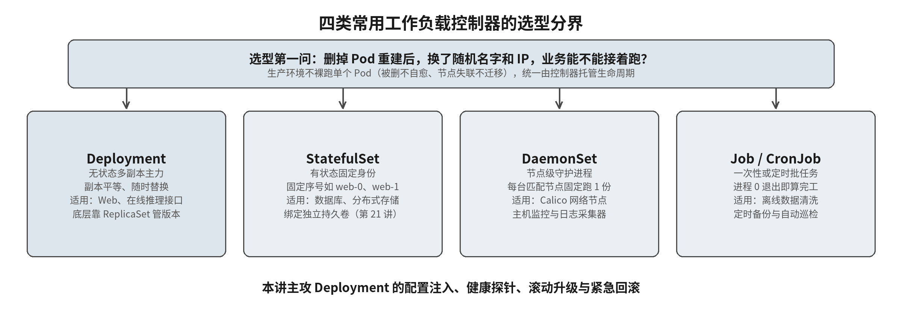
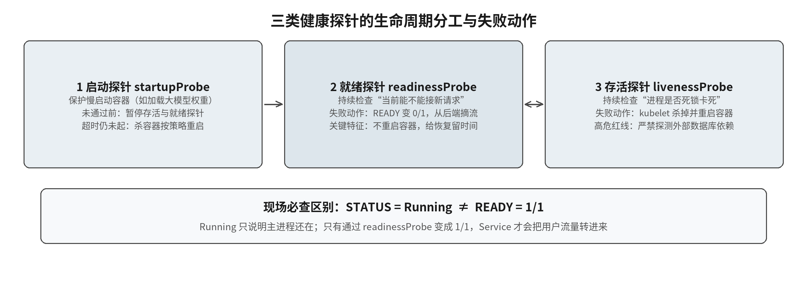
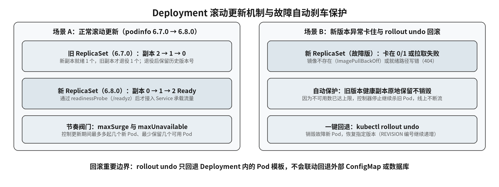
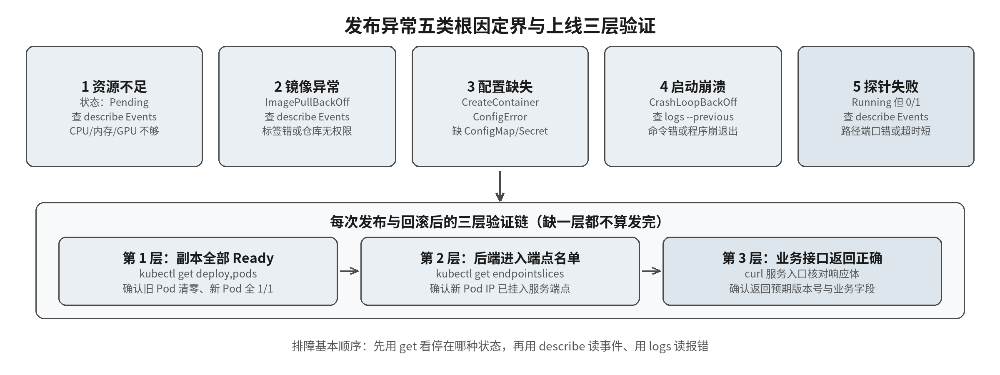

# 第19讲 工作负载、探针与滚动更新

**本课程定位：** 第 17 讲搭起了集群，第 18 讲划好了命名空间与配额池。从本讲起，真正的业务应用要住进集群。日常运维最多的变更动作不是装集群，而是发新版本、调副本数、查发布卡死和紧急回滚。本讲把应用安全交付到集群内并完成版本替换，下一讲（第 20 讲）再专门打通集群内外的多种网络访问入口。

变更工单 `OPS-2107` 要求把开源演示服务 `podinfo` 从 `6.7.0` 升级到 `6.8.0`，全过程保持 2 个副本在线不断流。如果新版本镜像标签写错或者健康检查没过，线上会不会瞬间全挂？怎样快速退回 `6.7.0` 并证明服务真恢复了？本讲围绕这次发布解决四个问题：选哪种控制器托管应用？配置和密钥怎样注入？三类探针各管什么？滚动更新卡住时怎样定位并回滚？

## 本讲学习目标

学完后，你应能：

- 按“删 Pod 重建后业务能否继续”区分无状态与有状态负载，选出合适的控制器。
- 使用 `ConfigMap` 与 `Secret` 将配置和凭据注入容器，说清 `Secret` 默认编码边界。
- 说清启动、就绪、存活三类探针的分工，解释为什么 `Running` 不等于 `Ready`。
- 运用扩缩、滚动更新与回滚完成 `podinfo` 从 `6.7.0` 到 `6.8.0` 的升级及回退演练。
- 在发布异常时按镜像、资源、配置、启动命令、探针五类原因快速定位，并完成三层发布验证。

## 19.1、控制器选型与 Deployment 清单结构

在生产环境里，运维几乎从不直接提交单个裸 Pod。裸 Pod 属于“一次性个体”：被人误删了不会重生，所在工作节点断电了也不会迁移到别的机器。要想具备副本维持、故障自愈和版本升级能力，必须把 Pod 交给**工作负载控制器**托管。

### 19.1.1、先分清无状态与有状态

挑选控制器前先问自己一句话：**“删掉眼前这个 Pod 重新建一个，名字和 IP 全换了，业务能不能直接接着跑？”**



表19-1、四类常用工作负载控制器的职责与适用场景

| 类别 | 控制器与副本特征 | 典型算力与业务场景 |
| --- | --- | --- |
| 无状态 | `Deployment`：副本平等、名字带随机后缀，随时销毁重建 | Web 前端、网关、无本地状态的在线推理接口 |
| 有状态 | `StatefulSet`：固定序号（`web-0`、`web-1`），绑定独立持久卷 | MySQL/PostgreSQL 数据库、分布式中间件（第 21 讲） |
| 节点级 | `DaemonSet`：每台匹配节点固定跑 1 个副本，新节点自动补齐 | `calico-node` 网络插件、节点日志与硬件指标采集 |
| 批处理 | `Job` / `CronJob`：进程以退出码 `0` 结束即算完工，不常驻重启 | 训练数据清洗、模型离线评测、定时备份脚本 |

### 19.1.2、读懂 Deployment 的三层嵌套关系

本讲聚焦使用最广的 **Deployment**。`Deployment` 并不直接管理单个 Pod，而是在底层自动创建并管理 **ReplicaSet（副本集）**：每一个应用版本对应一个 `ReplicaSet`，升级版本就是让新 `ReplicaSet` 逐步放大、旧 `ReplicaSet` 逐步缩零。

编写一份标准 `Deployment` YAML 清单时，必须核对下面三个字段严丝合缝：

1. **spec.replicas**：期望维持的副本数量（如 `2`）。
2. **spec.selector.matchLabels**：控制器靠什么标签认领自己的 Pod（如 `app: podinfo`）。
3. **spec.template.metadata.labels**：新建出来的 Pod 身上贴什么标签。**这条标签必须包含上面 matchLabels 的全部键值**，一旦写不一致，`kube-apiserver` 会当场拒绝创建。

## 19.2、注入配置：ConfigMap 与 Secret

第 15 讲讲过标准化镜像原则：同一份镜像既要在测试环境跑，也要在生产环境跑，数据库地址、欢迎语、日志级别等可变参数不能写死进镜像层。Kubernetes 提供两类原生对象在启动时把配置喂给容器：

- **ConfigMap（配置映射）**：存放非敏感的明文配置项，如服务端口、超时阈值、功能开关或完整配置文件。
- **Secret（保密字典）**：存放密码、API 密钥、TLS 证书（第 20 讲）或私有镜像仓库拉取凭据（第 23 讲）。

表19-2、两类配置注入方式的更新行为对比

| 注入方式 | 容器内看到的形态 | 修改 ConfigMap 或 Secret 后的生效规律 |
| --- | --- | --- |
| 环境变量注入 | 进程启动时的环境变量（`env` 或 `envFrom`） | 已运行容器内的环境变量**不会自动改变**，需滚动重启 Pod 才读新值 |
| 挂载为数据卷 | 容器指定目录下的只读配置文件（`volumeMounts`） | 约 1 分钟内节点会自动同步更新文件内容（注：用了 `subPath` 单文件挂载除外） |

【关键区别】默认情况下，**Secret 里的内容只是做了 Base64 编码，不是加密**。任何有权限读取这个 Secret 的人，敲一条 `base64 -d` 就能瞬间还原出明文密码。保障凭据安全要靠两件事：一是用第 18 讲的 RBAC 严格限制谁能 `get/list` Secret；二是严禁把写有真实密码的 Secret YAML 明文提交进公共 Git 代码库。

## 19.3、三类健康探针与“Running 不等于 Ready”

容器主进程启动了（`STATUS` 显示 `Running`），就代表服务已经能正常处理用户请求了吗？不一定。比如 Java 服务还在初始化连接池，或者 7B 大模型推理容器正花 40 秒把 15 GB 权重从磁盘读进显存——此时进程虽然活着，但谁发请求进来谁就会报错。

为了把“进程活着”和“能接业务”彻底分开，每个节点上的 `kubelet` 支持对容器执行三类健康探针（支持 `httpGet` 状态码 200～399、`tcpSocket` 端口连通、`exec` 命令退出码 0 三种探测动作）：



表19-3、三类健康探针的职责与失败处置边界

| 探针 | 字段名与探测失败动作 | 回答的问题与高危禁忌 |
| --- | --- | --- |
| 启动 | `startupProbe`：超出宽限次数后杀容器重启 | 慢启动初始化完了吗；未过前暂停后两类探针，适合大模型加载 |
| 就绪 | `readinessProbe`：`READY` 变 `0/1` 摘除流量，不重启容器 | 此刻能不能接新请求；短暂过载恢复后自动重新挂回流量 |
| 存活 | `livenessProbe`：`kubelet` 直接杀掉并重建，`RESTARTS` 加 1 | 进程是否彻底死锁；严禁在存活探针里检查外部数据库或下游接口 |

为什么严禁在 `livenessProbe` 里检测外部数据库？设想后端数据库网络抖动了 15 秒：如果 Web 容器的存活探针去连数据库，全部 10 个 Web 副本会同时探测失败、同时被 `kubelet` 强杀重启，把原本 15 秒的下游抖动放大成整站长时间雪崩。外部依赖状态只适合按需体现在就绪控制或业务降级逻辑里，存活探针只查本进程自身有没有死锁。

【随堂思考】发布新版本后，你敲 `kubectl get pods` 看到输出：`NAME: infer-6d8f-x9k2p`，`READY: 0/1`，`STATUS: Running`，`RESTARTS: 0`，且持续了 5 分钟。为什么 `RESTARTS` 一直是 `0`？此时用户请求会不会打进这个 Pod？你第一步敲哪条命令查原因？

## 19.4、滚动更新、版本回滚与两套“三板斧”

### 19.4.1、分清“运维变更三板斧”与“排障观测三板斧”

日常管理 `Deployment` 时，大家常提到两套“三板斧”，千万不要混为一谈：

- **应用运维三板斧（主动变更动作）**：**扩缩副本**（修改 YAML 中 `replicas` 后 `apply`，或临时执行 `kubectl scale`）、**滚动更新**（修改镜像版本后 `apply` 并用 `rollout status` 盯进度）、**版本回滚**（用 `rollout history` 查历史版本，用 `rollout undo` 退回健康版本）。
- **kubectl 排障三板斧（只读观测手段，回引第 17 讲）**：**get 看状态与就绪列 → describe 看底部 Events 事件 → logs 看容器报错（崩溃过加 --previous）**。

### 19.4.2、滚动更新节奏与回滚边界

修改 `Deployment` 的镜像标签并提交后，默认采用 `RollingUpdate`（滚动更新）策略，由两个参数控制新旧交替的步子：

- **maxSurge（最大激增数）**：更新过程中，最多允许比期望副本数 `replicas` **多创建**几个 Pod（默认 `25%`）。
- **maxUnavailable（最大不可用数）**：更新过程中，最多允许比期望副本数**少几个**可用 Pod（默认 `25%`）。对于核心在线服务，常设为 `maxUnavailable: 0`、`maxSurge: 1`，即“必须先拉起 1 个新副本并通过 `readinessProbe` 变成 `1/1`，才允许停掉 1 个旧副本”，代价是更新瞬间集群里要多占 1 份资源（算力卡紧缺时需提前留出空闲卡，不然新 Pod 会卡在 `Pending`）。



执行 `kubectl rollout undo` 回滚时，有两条极易踩坑的生产边界必须记牢：

1. **只退 Pod 模板，不退外部配置与数据**：`rollout undo` 只把 `Deployment` 里的 `spec.template`（镜像版本、环境变量引用等）退回旧版，**不会自动回退外部独立的 ConfigMap、Secret 或数据库表结构**。如果故障是因为直接改坏了线上 `ConfigMap` 引起的，光敲 `rollout undo` 于事无补（工程上常给配置加版本后缀，如 `podinfo-cfg-v1`、`podinfo-cfg-v2`）。
2. **REVISION 版本号只增不减**：假设第 1 版是 `6.7.0`，升级第 2 版是 `6.8.0`；当你回滚回 `6.7.0` 时，历史记录里第 1 版会被重新提拔为最新的 **REVISION 3**，编号不会倒退回 `1`。如果经历过多次变更（如第 1 版 `6.7.0` → 第 2 版 `6.8.0` → 第 3 版故障配置），不加参数的 `rollout undo` 只退回紧邻的上一版（第 2 版），想直达最初基线版必须先查 `rollout history`，再显式指定 `--to-revision=1`。

**【例题】** 某推理服务设定 `replicas: 2`、`maxSurge: 1`、`maxUnavailable: 0`。运维把镜像更新为一个拼错标签的新版本 `v2.9-typo` 并提交。请推演集群接下来会发生什么，线上业务会不会断？

**解：** 线上业务**不会中断**。推演过程：`maxUnavailable: 0` 要求时刻保持 2 个可用副本，不能先杀旧 Pod；`maxSurge: 1` 允许先多建 1 个新版本 Pod。新 Pod 因为镜像标签不存在停在 `ImagePullBackOff`（`READY 0/1`），永远成不了可用副本。此时再多建新 Pod 会违反 `maxSurge: 1`，杀旧 Pod 又会违反 `maxUnavailable: 0`，滚动更新自动“踩刹车”停住——原有的 2 个旧版健康 Pod 原地保留继续处理全部流量，等待运维修正清单或执行 `rollout undo`。

## 19.5、发布故障五类定界与上机实训

### 19.5.1、五类常见发布故障与三层发布验证

当新副本迟迟变不成 `1/1 Running` 时，对照下图上半部分的五类原因对号入座；每次发布或回滚做完后，必须按图下半部分跑满**三层验证**才算真正收工。



表19-4、工作负载发布失败五类原因定界速查

| 分类 | 典型状态与首选取证命令 | 高频根因与处置方法 |
| --- | --- | --- |
| 资源 | `Pending`（查 `kubectl describe pod`） | 节点剩余 CPU、内存或 GPU 不足，或节点有污点；调小请求或扩容节点 |
| 镜像 | `ErrImagePull` 或 `ImagePullBackOff`（查 `describe pod`） | 镜像名/标签拼错、网络不通，或拉私有库漏配 `imagePullSecrets` |
| 配置 | `CreateContainerConfigError`（查 `describe pod`） | 引用的 `ConfigMap` 或 `Secret` 尚未创建，或里面的键名拼写不一致 |
| 命令 | `CrashLoopBackOff`（查 `kubectl logs --previous`） | 启动命令参数写错、缺依赖文件或端口冲突导致主进程一启动就退出 |
| 探针 | `Running` 但 `READY 0/1`（查 `describe pod`） | 探针路径/端口写错（返回 404 或拒绝连接），或启动太慢未配 `startupProbe` |

### 19.5.2、上机实训：podinfo 部署、滚动升级、故障定位与回滚（工单 OPS-2107）

本实训在 `k8s-cp-01` 上操作，使用独立命名空间 `lab`（同时供第 20 讲继续使用），以开源微服务 `ghcr.io/stefanprodan/podinfo`（监听端口 `9898`，内置 `/readyz` 就绪接口与 `/healthz` 存活接口）完成完整变更流程。注：若机房外网受限，可提前将 `6.7.0` 与 `6.8.0` 镜像同步至企业私有仓库 `registry.lab.example/lab/podinfo` 并替换下方 `image` 地址。

**步骤 1：创建命名空间、ConfigMap 并部署 6.7.0 基线版本**

创建 `~/lab/l19` 目录，用 `ConfigMap` 注入欢迎语，编写带资源声明与双探针的 `Deployment`（2 副本）及集群内部访问 `Service`：

```bash
mkdir -p ~/lab/l19 && cd ~/lab/l19
kubectl create namespace lab

cat <<'EOF' > podinfo-v1.yaml
apiVersion: v1
kind: ConfigMap
metadata:
  name: podinfo-cfg
  namespace: lab
data:
  ui-message: "OPS-2107 baseline 6.7.0"
---
apiVersion: apps/v1
kind: Deployment
metadata:
  name: podinfo
  namespace: lab
  annotations:
    kubernetes.io/change-cause: "OPS-2107 deploy podinfo 6.7.0"
spec:
  replicas: 2
  strategy:
    type: RollingUpdate
    rollingUpdate:
      maxSurge: 1
      maxUnavailable: 0
  selector:
    matchLabels:
      app: podinfo
  template:
    metadata:
      labels:
        app: podinfo
    spec:
      containers:
      - name: podinfo
        image: ghcr.io/stefanprodan/podinfo:6.7.0
        ports:
        - containerPort: 9898
        env:
        - name: PODINFO_UI_MESSAGE
          valueFrom:
            configMapKeyRef:
              name: podinfo-cfg
              key: ui-message
        resources:
          requests:
            cpu: 100m
            memory: 64Mi
          limits:
            cpu: 300m
            memory: 128Mi
        readinessProbe:
          httpGet:
            path: /readyz
            port: 9898
          initialDelaySeconds: 2
          periodSeconds: 5
        livenessProbe:
          httpGet:
            path: /healthz
            port: 9898
          initialDelaySeconds: 5
          periodSeconds: 10
---
apiVersion: v1
kind: Service
metadata:
  name: podinfo-svc
  namespace: lab
spec:
  selector:
    app: podinfo
  ports:
  - port: 9898
    targetPort: 9898
EOF

kubectl apply -f podinfo-v1.yaml
kubectl rollout status deployment/podinfo -n lab
```

按**三层发布验证**核实 `6.7.0` 已稳妥上线（第 1 层看 2 个 Pod 全 `1/1`，第 2 层看 `EndpointSlice` 有 2 个后端地址，第 3 层请求服务接口核对版本号与欢迎语）：

```bash
# Layer 1: replicas Ready
kubectl get deploy,rs,pods -n lab

# Layer 2: EndpointSlice populated with 2 Pod IPs
kubectl get endpointslices -n lab -l kubernetes.io/service-name=podinfo-svc

# Layer 3: business HTTP response check
SVC_IP=$(kubectl get svc podinfo-svc -n lab -o jsonpath='{.spec.clusterIP}')
curl -s "http://${SVC_IP}:9898" | grep -E '"version"|"message"'
```

预期第 3 层输出包含 `"version": "6.7.0"` 与 `"message": "OPS-2107 baseline 6.7.0"`。

**步骤 2：滚动更新到 6.8.0 并观察新旧交替**

更新镜像到 `6.8.0` 并记录变更原因注解，实时观察滚动状态与新旧 `ReplicaSet` 副本变化：

```bash
kubectl set image deployment/podinfo \
  podinfo=ghcr.io/stefanprodan/podinfo:6.8.0 -n lab
kubectl annotate deployment/podinfo \
  kubernetes.io/change-cause="OPS-2107 upgrade to 6.8.0" -n lab --overwrite

kubectl rollout status deployment/podinfo -n lab
kubectl get rs -n lab
curl -s "http://${SVC_IP}:9898" | grep '"version"'
```

你会看到 `get rs` 里旧 `ReplicaSet` 的副本数降为 `0`，新 `ReplicaSet` 的副本数升为 `2`，接口返回 `"version": "6.8.0"`。

**步骤 3：故意注入探针错误制造发布卡住，用三板斧取证**

现在模拟一次人为变更失误——把 `readinessProbe` 的检测路径改错成不存在的 `/readyz-wrong`（你也可以额外测试把镜像改为不存在的 `podinfo:6.8.99` 观察 `ImagePullBackOff`）：

```bash
# Inject bad readinessProbe path to stall rollout
PROBE_PATH="/spec/template/spec/containers/0/readinessProbe/httpGet/path"
kubectl patch deployment podinfo -n lab --type='json' \
  -p="[{\"op\":\"replace\",\"path\":\"${PROBE_PATH}\",\"value\":\"/readyz-wrong\"}]"
kubectl annotate deployment/podinfo \
  kubernetes.io/change-cause="OPS-2107 faulty readiness path" -n lab --overwrite
```

注意：上面 JSON Patch 中的路径段 `0` 指第一个容器。提交约 15 秒后，用排障三板斧取证，并顺手测一次业务接口看看线上断没断：

```bash
# 1. get: check Pod status (new Pod stuck at 0/1 Running, 2 old Pods still 1/1!)
kubectl get pods -n lab

# 2. describe: inspect Events on the 0/1 Pod
BAD_POD=$(kubectl get pods -n lab --field-selector=status.phase=Running \
  -o jsonpath='{.items[?(@.status.containerStatuses[0].ready==false)].metadata.name}')
kubectl describe pod "${BAD_POD}" -n lab | tail -n 12

# 3. logs & live service check: service still responds 6.8.0 without outage!
kubectl logs "${BAD_POD}" -n lab --tail=10
curl -s "http://${SVC_IP}:9898" | grep '"version"'
```

取证结果一目了然：`BAD_POD` 状态是 `Running` 但 `READY` 为 `0/1`；`describe` 底部清晰打印 `Warning Unhealthy: Readiness probe failed: HTTP probe failed with statuscode: 404`；因为 `maxUnavailable: 0` 生效，那 2 个健康的 `6.8.0` 旧副本毫发无损，`curl` 业务接口依旧正常返回！

**步骤 4：执行版本回滚并回到业务侧复测**

先查历史修订记录，再按工单要求通过 `--to-revision=1` 回退到最初验证过的 `6.7.0` 基线版本（若只想退回刚才正常的 `6.8.0`，去掉 `--to-revision=1` 或写 `--to-revision=2` 即可）：

```bash
# Check revision history first
kubectl rollout history deployment/podinfo -n lab

# Roll back to revision 1 (6.7.0 baseline) and wait for convergence
kubectl rollout undo deployment/podinfo -n lab --to-revision=1
kubectl rollout status deployment/podinfo -n lab

# Re-run 3-layer verification after rollback
kubectl get deploy,pods -n lab
kubectl get endpointslices -n lab -l kubernetes.io/service-name=podinfo-svc
curl -s "http://${SVC_IP}:9898" | grep -E '"version"|"message"'
kubectl rollout history deployment/podinfo -n lab
```

复测确认：故障 Pod 已被自动销毁，2 个 `6.7.0` 副本全部 `1/1 Ready`，`EndpointSlice` 恢复为这 2 个健康后端，`curl` 重新返回 `"version": "6.7.0"`，且 `rollout history` 中原第 1 版已递增为最新的 **REVISION 4**。请保留 `lab` 命名空间与健康运行的 `podinfo` 供第 20 讲练习服务网络。

【随堂思考】某次上线同时执行了两条命令：先 `kubectl apply -f configmap-new.yaml` 覆盖了原有同名 `ConfigMap`（里面不小心把下游端口写错了），再升级了 `Deployment` 镜像。发现报错后，值班同学只敲了一条 `kubectl rollout undo deployment/app`，重启完还是报错。为什么？

<!-- pagebreak -->

## 19.6、本讲回顾与自测

学习完本讲后，试着用自己的话回答四个问题：什么应用能用 `Deployment`、什么应用必须用 `StatefulSet`？`readinessProbe` 失败和 `livenessProbe` 失败动作差在哪里？为什么新版本探针失败时线上没断流？为什么敲完 `rollout undo` 还不算回滚结束？

表19-5、本讲目标与对应判断

| 学习目标 | 应能做出的判断 |
| --- | --- |
| 选准负载控制器 | 按是否依赖固定序号与独立持久盘区分 `Deployment`、`StatefulSet`、`DaemonSet`、`Job` |
| 安全注入配置 | 区分环境变量与挂载卷的更新差异，牢记默认 `Secret` 仅是 Base64 编码而非加密 |
| 配准三类探针 | 用 `startupProbe` 护慢启动、用 `readinessProbe` 控流量进出、不在 `livenessProbe` 查外部库 |
| 掌控升级与回滚 | 理解 `maxSurge`/`maxUnavailable` 刹车机制，熟知 `rollout undo` 不退外部 `ConfigMap` |
| 五类定界与三层验 | 对照五类状态迅速取证，每次变更后必验副本 `Ready`、`EndpointSlice` 与业务响应 |

### 19.6.1、本讲自测

**1 控制器选型。** 下面三个任务各选哪种控制器：① 无本地状态的图像分类推理 API（3 副本）；② 每台工作节点必须跑 1 个的日志采集器；③ 需要固定主从编号和独立数据盘的数据库。

**2 Secret 认知。** 新同事把含有生产数据库密码的 `secret.yaml`（里面填好了 Base64 字符串）直接提交进了团队公共 Git 仓库，理由是“密码已经加密成乱码了”。请指出他的错误并给出正确做法。

**3 探针事故分析。** 某微服务把检查 Redis 缓存连通性的脚本配进了 `livenessProbe`。当机房 Redis 主从切换中断 20 秒时，这组微服务 Pod 会发生什么现象？应该怎样调整探针设计？

**4 排障分流。** `kubectl get pods` 看到三个异常 Pod：甲是 `Pending`，乙是 `CreateContainerConfigError`，丙是 `CrashLoopBackOff`。分别写出你排查甲、乙、丙的第一条命令与重点关注信息。

**5 回滚细节。** 一个应用依次发布了第 1 版（v1.0）、第 2 版（v1.1）、第 3 版（v1.2 故障版）。执行 `kubectl rollout undo deployment/web --to-revision=1` 成功后，当前线上跑的是哪个版本？此时敲 `rollout history` 看到的最新 `REVISION` 数字是几？

**6 发布验证。** 同事升级完推理服务，截了一张 `kubectl get pods` 全部 `Running` 的图就宣布上线成功。对照三层发布验证标准，指出这张截图漏掉了哪三处关键核查。

**答：**

____________________________

____________________________

____________________________

____________________________

## 19.7、参考答案与解析

### 19.7.1、随堂思考解析

**思考 1（Running 但 0/1 且 RESTARTS 为 0）：** 说明容器主进程没崩，存活探针也没触发杀容器，所以 `RESTARTS` 是 `0`；但 `readinessProbe` 一直没通过，因此 `READY` 为 `0/1`。此时 `Service` 会把这个 Pod 从 `EndpointSlice` 名单中剔除，用户流量**不会**打进来。第一步应敲 `kubectl describe pod infer-6d8f-x9k2p` 查看底部 `Events` 里的 `Readiness probe failed` 具体报错（如端口不对、路径 404 或模型尚未加载完）。

**思考 2（只 undo Deployment 仍报错）：** `kubectl rollout undo` 只回退 `Deployment` 内部的 Pod 模板（如镜像版本），不会联动回退外部独立的同名 `ConfigMap`。回滚出来的旧版镜像重启后读取的依然是被改坏的新 `ConfigMap` 端口。必须先从 Git 版本库把 `ConfigMap` 还原并重新触发滚动重启（生产中推荐每次变更创建带新版本号的不可变 `ConfigMap` 再切换引用，这样 `rollout undo` 就能连同配置引用一并退回）。

### 19.7.2、课后自测解析

**1** ① 选 `Deployment`；② 选 `DaemonSet`；③ 选 `StatefulSet`。

**2** Base64 只是公开可逆的文本编码，不是加密，任何人执行 `echo ... | base64 -d` 即可还原明文密码。正确做法：立即轮换已泄露的数据库密码，不在公共代码库存放真实凭据，在集群内通过 RBAC 收紧对应命名空间 `Secret` 的读取权限。

**3** 20 秒内所有微服务副本的 `livenessProbe` 都会连续失败，被各节点 `kubelet` 集体强杀重启，即使第 21 秒 Redis 恢复，微服务仍深陷重启风暴无法对外服务。调整方法：`livenessProbe` 只检查微服务自身进程 HTTP/TCP 是否响应死锁，绝不连外部 Redis；对下游依赖异常通过代码重试降级或 `readinessProbe` 摘流处理。

**4** 甲（`Pending`）：敲 `kubectl describe pod 甲`，看 `Events` 里的 `FailedScheduling` 是 CPU/内存/算力卡不足还是节点污点拦截；乙（`CreateContainerConfigError`）：敲 `kubectl describe pod 乙`，看缺失了哪个 `ConfigMap`、`Secret` 或键名；丙（`CrashLoopBackOff`）：敲 `kubectl logs 丙 --previous`，直接读取容器上一轮崩溃退出前打印的错误堆栈。

**5** 线上跑的是 `v1.0`（原第 1 版的模板内容）；`rollout history` 看到的最新 `REVISION` 数字是 **4**（修订号始终递增，原第 1 版被提拔为第 4 版，旧序号 `1` 从列表隐去）。

**6** 漏掉三处：第一，只看 `STATUS: Running` 没核对 `READY` 列是否全为 `1/1` 以及旧版本 Pod 是否已完全退出；第二，没敲 `kubectl get endpointslices` 确认新副本 IP 已挂入服务端点名单；第三，没回到业务侧用 `curl` 或客户端实测接口返回状态码、版本号与响应内容是否正确。

## 19.8、术语与疑问

表19-6、本讲术语

| 术语 | 本讲中的含义 |
| --- | --- |
| Deployment | 面向无状态应用的常用控制器，通过管理底层 `ReplicaSet` 实现多副本维持、滚动升级与版本回滚。 |
| StatefulSet | 面向有状态应用的控制器，为每个副本保留固定编号身份与独立持久化存储绑定。 |
| ConfigMap / Secret | 用于将明文配置或敏感凭据与镜像解耦的 API 对象；默认 `Secret` 仅做 Base64 编码而非加密。 |
| startupProbe | 启动探针，给加载大模型权重等慢启动容器留足初始化时间，未过前暂停另外两类探针。 |
| readinessProbe | 就绪探针，探测失败时将 Pod 标为未就绪并从服务端点摘除流量，不重启容器。 |
| livenessProbe | 存活探针，探测失败时由 `kubelet` 杀掉并重启死锁容器，严禁写入外部数据库依赖。 |
| maxSurge / maxUnavailable | 控制滚动更新期间最多超额新建几个副本、最多允许少几个可用副本的两个节奏参数。 |
| rollout undo | 将 `Deployment` 的 Pod 模板回退到上一版或指定历史修订号，不回退外部 `ConfigMap` 且修订号继续递增。 |

文中 IP、域名、路径与参数为教学示例，生产环境以本单位规划为准。

**我的疑问（记下阅读或实操中没弄明白的一点）：**

____________________________

## 附录、应用发布与回滚验收记录卡（脱敏模板）

表19-7、应用变更发布与异常回滚核对单（以 OPS-2107 为例）

| 核对阶段 | 核对项目 | 现场实测记录示例 |
| --- | --- | --- |
| 变更前准备 | 工单号 / 命名空间 / 回退基线 | `OPS-2107` / `lab` / 基线修订号 `REVISION 1`（`6.7.0`） |
| 正常升级验证 | 目标版本与三层验证结果 | 升至 `6.8.0`；`2/2 Ready`；`EndpointSlice` 含 2 个 IP；接口返回 `6.8.0` |
| 异常现象取证 | 故障表现与 `describe` 关键证据 | 新 Pod 卡在 `0/1 Running`；事件报 `/readyz-wrong` 返回 `404`；旧副本未断流 |
| 回滚与复测 | 回滚命令与业务侧复测结论 | 执行 `rollout undo --to-revision=1`；升成 `REVISION 4`；接口复测恢复 `6.7.0` |

<!-- md-only -->

## 附：主要参考资料（仅 Markdown 保留，不印入 Word/PDF）

- 中国信通服务《2025 算力运维体系技术白皮书》（本地 `./资料/` PDF，文件第 26、31、55 页关于容器化应用快速重建、异常事件监控及变更上线前健康评估的论述）。
- Kubernetes v1.30 官方文档《工作负载资源：Deployment、StatefulSet、DaemonSet、Job》，说明四类控制器的适用边界、`ReplicaSet` 版本机制及 `maxSurge`/`maxUnavailable` 滚动更新参数。
- Kubernetes v1.30 官方文档《ConfigMap》与《Secret》，说明环境变量与卷挂载差异，以及默认 Secret 仅采用 Base64 编码的安全注意事项。
- Kubernetes v1.30 官方文档《配置存活、就绪和启动探针（Configure Liveness, Readiness and Startup Probes）》，说明三类探针生命周期、失败动作与外部依赖设计禁忌。
- Stefan Prodan 开源项目《podinfo》官方文档（GitHub `stefanprodan/podinfo`），说明端口 `9898`、`/readyz`、`/healthz` 与环境变量 `PODINFO_UI_MESSAGE` 用法。

<!-- /md-only -->
