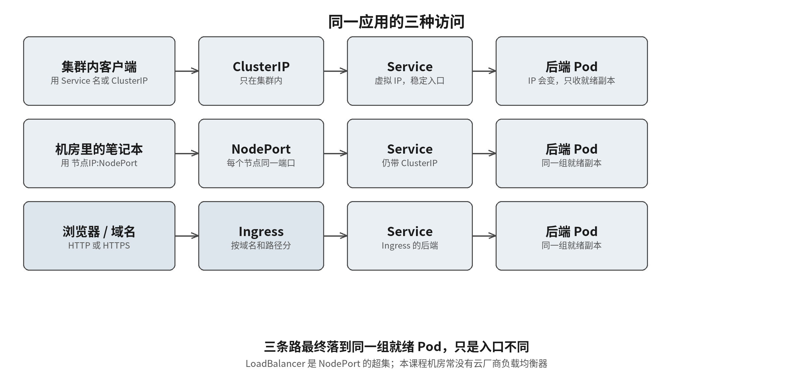
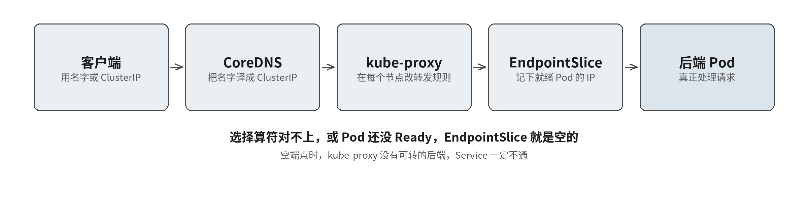
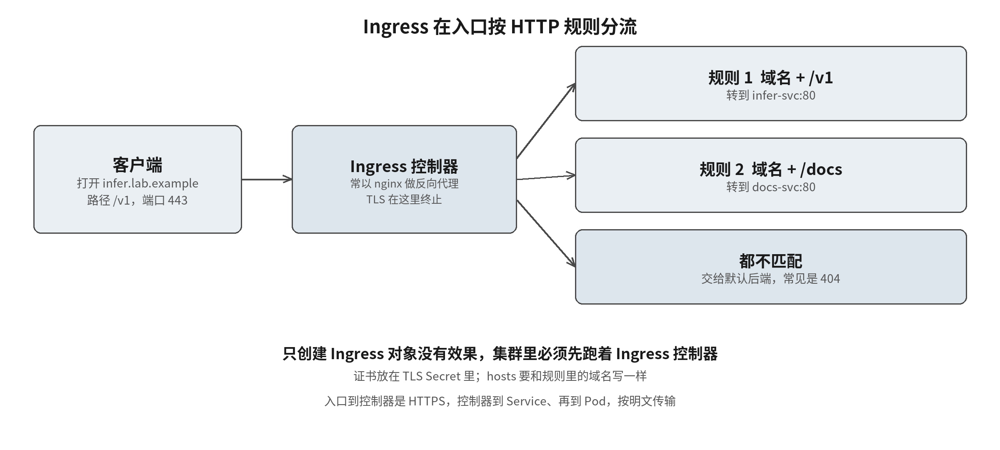
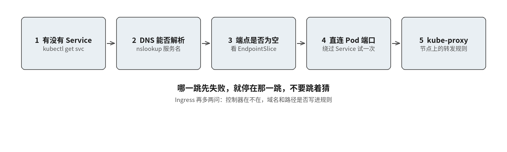

# 第20讲 服务网络

**本课程定位：** 面向自建智算中心运维。第 17 讲把集群搭起来，第 19 讲把工作负载发布出去。本讲解决下一件事：别人怎么访问这个应用。容器化部署要把入口选对，还要在不通时按跳定位。

推理服务已经有两个副本 Ready。同事问你：集群里的另一个 Pod 怎么调它？机房笔记本怎么测？业务要用域名 https://infer.lab.example 怎么进？本讲就练这三件事，以及不通时从哪一跳查起。

## 本讲学习目标

学完后，你应能：

- 按访问来源选出 ClusterIP、NodePort 或 LoadBalancer，说出各自能到哪里、到不了哪里。
- 说清选择算符、EndpointSlice 和 kube-proxy 怎样把流量转到就绪 Pod。
- 给一个 HTTP 应用配 Ingress：域名、路径、TLS，并知道只创建 Ingress 对象不够。
- 从集群内、节点外、域名各验一次，画清访问链路。
- 不通时按 DNS、端点、端口映射、kube-proxy 逐跳定位，不跳着猜。

## 20.1、为什么 Pod 还不够

第 19 讲说过，Pod 是最小调度单元。每个 Pod 会拿到自己的 IP。Deployment 会按期望副本创建和销毁 Pod。这一刻的后端集合，下一刻就可能换一批。前端不能把某个 Pod IP 写死。

Service 就是为这件事准备的抽象。它把一组 Pod 公开成一个网络服务，并规定怎么访问。客户端只认这个稳定入口。后面的 Pod 换了，入口还在。

Ingress 不是一种 Service。工作负载走 HTTP 时，可以用 Ingress 做集群的入口点。它按主机名和路径把 Web 流量分到不同后端。

【关键区别】“Pod Running”只说明容器进程还在。“别人能访问这个服务”还要有 Service，还要有就绪端点。第 19 讲的 Ready 在这里变成能不能进流量。

## 20.2、选择服务类型

访问从哪里来，类型就怎么选。类型是层层加上去的：NodePort 包含 ClusterIP，LoadBalancer（下表写作 LB）再包含 NodePort。

表20-1、三种 Service 类型（LB 即 LoadBalancer）与适用场景

| 类型 | 入口 | 谁能访问 | 适用场景 |
| --- | --- | --- | --- |
| ClusterIP | 集群内虚拟 IP，也可用服务名 | 只限集群内 | 默认。微服务互调、Ingress 后端 |
| NodePort | 每个节点同一端口，默认 30000–32767 | 能连到节点 IP 的人 | 机房临时验证、尚无七层入口 |
| LB | 云平台再给一个外部负载均衡器 | 集群外（云厂商入口） | 接了云平台且对方能创建负载均衡器 |

不写 type 时，默认就是 ClusterIP。Kubernetes 本身不提供负载均衡器组件。要用 LoadBalancer，必须自己提供，或把集群接到某个云平台。本课程面向自建机房，课堂默认没有云厂商负载均衡器。对外入口优先用 Ingress。需要临时从节点外验证时，再用 NodePort。

### 20.2.1、ClusterIP：集群内的稳定名字

ClusterIP 从集群预留的地址池里拿一个虚拟 IP。同命名空间的 Pod，用服务名就能解析到这个 IP。例如命名空间 lab 里有服务 infer-svc，同命名空间的客户端可以问 infer-svc。其他命名空间要写成 infer-svc.lab。完整名字形如 infer-svc.lab.svc.cluster.local，解析结果是 ClusterIP。

端口要写两层。port 是客户端连 Service 时用的端口。targetPort 是流量落到 Pod 时用的端口。不写 targetPort 时，它默认等于 port。应用在容器里听 8080，Service 对外用 80，就要把这两项分开写。写错 targetPort，端点看起来有，应用却收不到。

### 20.2.2、NodePort：每个节点开同一扇门

把 type 写成 NodePort，控制面会再分配一个节点端口，默认范围 30000–32767。集群里每个节点都监听这个端口，再把流量转到这个 Service。从集群外访问，用“任意节点的 IP:这个端口”。它仍然带着 ClusterIP，集群内原来的访问方式还在。

NodePort 方便，但不适合当生产总入口。每个服务占一个端口，端口会很快不够用。节点 IP 变了，调用方也要跟着改。机房里更常见的用法是：先用它确认节点外能打到应用，再把稳定入口交给 Ingress。

### 20.2.3、LoadBalancer：建立在 NodePort 之上

云平台支持外部负载均衡器时，把 type 写成 LoadBalancer。平台会给 Service 做一个负载均衡器，并把外部流量转到后端 Pod。实现上，集群常常先做和 NodePort 类似的改动，再让云控制器把外部负载均衡器指到这个节点端口。

自建机房没有这层云组件，创建后 EXTERNAL-IP 会一直停在 pending。这不是应用坏了，是类型选错了。不要为了“看起来能出集群”就写 LoadBalancer。

**【例题】** 推理服务有两个副本，都在 lab 命名空间。集群里的网关 Pod 要调它。测试同学要用笔记本访问。业务要用域名。三种需求各选什么入口？

**解：** 网关 Pod 在集群内，用 ClusterIP，按服务名访问即可。笔记本在集群外，可临时用 NodePort，访问“节点 IP:节点端口”。业务要域名和 HTTPS，配 Ingress，后端仍然指向这个 ClusterIP Service。三种入口可以同时存在，不必删掉 ClusterIP 再换类型。

【随堂思考】有同事把所有服务都改成 NodePort，说“这样集群内外都能测”。从端口占用和入口稳定两点，你会怎么回应？

## 20.3、后端怎样接到 Pod

Service 自己不处理请求。它靠选择算符找到 Pod，把结果写进 EndpointSlice。每个节点上的 kube-proxy 再按这份名单改转发规则。

### 20.3.1、选择算符决定谁进名单

Service 的 selector 要和 Pod 的标签对得上。控制面会持续扫描匹配的 Pod，并更新 EndpointSlice。标签写错一个字母，名单就是空的。第 19 讲的 Deployment 常用 app=infer 这类标签。Service 必须用同一套键值，不能自己另起一套。

名单里只放就绪端点。EndpointSlice 用 serving 表示这个端点正在响应，对应 Pod 的 Ready。副本还在启动、就绪探针没过，就不会进流量。Running 却没有流量，优先查探针，不要先怀疑网络。

旧的 Endpoints 对象已经弃用。查后端时看 EndpointSlice。命令示例：`kubectl get endpointslices -l kubernetes.io/service-name=infer-svc`。地址列为空或 none，先对选择算符和 Pod 标签，再查 Ready。

### 20.3.2、kube-proxy 把虚拟 IP 转到端点

每个节点跑一个 kube-proxy。它监视 Service 和 EndpointSlice。发往 ClusterIP 和对应端口的包，会被它重定向到某个端点，通常就是 Pod。ExternalName 类型不走这套代理。

Linux 上常见模式是 iptables。未显式指定时，当前默认也是 iptables。另一种常见模式是 IPVS。iptables 模式下，规则默认随机挑一个后端 Pod。IPVS 还可以按轮询、最少连接等方式分。本讲不要求改模式，但要能在节点上确认 kube-proxy 在跑。

为什么不用 DNS 直接返回一串 Pod IP？有的解析器不遵守 TTL，有的程序只查一次名字就缓存。用虚拟 IP 加代理，客户端不必自己追 Pod 的变化。

**【例题】** `kubectl get svc infer-svc` 能看到 ClusterIP。从同命名空间的调试 Pod 里 nslookup infer-svc 也能解析。可是访问 ClusterIP:80 没有响应。EndpointSlice 的地址列是空的。下一步查什么？

**解：** DNS 和 Service 对象都在，问题在后端名单。先对 Service 的 selector 和 Pod 的 labels 是否一致。一致再看 Pod 是不是 Ready。常见情况是标签写成了 run=infer，Service 却在找 app=infer；或就绪探针路径写错，副本 Running 却进不了名单。名单空着时，kube-proxy 没有可转的后端，Service 一定不通。

【关键区别】能解析服务名，只说明 DNS 这一跳好了。能列出 ClusterIP，只说明 Service 对象在。两者都不能证明后面有就绪 Pod。

## 20.4、用 Ingress 做七层入口

HTTP 和 HTTPS 要从集群外进来，并且要用域名、路径，就配 Ingress。它给 Service 提供外部可访问的 URL，做负载均衡，在入口终止 TLS，还可以按主机名做虚拟托管。不是 HTTP/HTTPS 的端口，仍用 NodePort 或 LoadBalancer。

### 20.4.1、只创建对象没有效果

你必须先在集群里跑一个 Ingress 控制器。只 apply 一份 Ingress YAML，不会凭空出现入口。控制器才是真正收流量、按规则转发的程序。常见实现之一是 NGINX Ingress 控制器，数据面用 nginx 做反向代理。

nginx 有一个主进程和若干工作进程。主进程读配置、管工作进程。工作进程处理请求。反向代理的意思是：它收下客户端请求，转给后面的服务器，再把响应交回客户端。未指定算法时，nginx 默认按 round-robin 轮流分。Ingress 控制器会把你的规则翻译成这类配置，你不必手写 nginx.conf。

创建 Ingress 时，用 ingressClassName 标明由哪个控制器接手。集群里如果只标了一个默认 IngressClass，新对象不写类名也会被安上。类名写错，规则不会被你以为的那个控制器读取。

### 20.4.2、按域名和路径分到后端

一条 HTTP 规则通常有三部分。可选的 host，例如 infer.lab.example。一组路径，每条路径指向一个 Service 和端口。主机和路径都匹配，流量才转到这个后端。都不匹配时，交给默认后端。许多控制器的默认后端会返回 404。

路径类型要写明。Exact 是精确匹配，区分大小写。Prefix 按用斜杠分开的路径段做前缀匹配，也区分大小写。/foo/bar 能匹配 /foo/bar/baz，但不能匹配 /foo/barbaz。多条规则都能对上时，路径更长的优先；一样长时，Exact 优先于 Prefix。

教学上可以记两条。/v1 给推理接口，后端是 infer-svc:80。/docs 给说明页，后端是 docs-svc:80。域名写错、路径少写一段，请求就会掉到默认后端。

### 20.4.3、TLS 在入口终止

HTTPS 要把含证书和私钥的 Secret 挂到 Ingress 上。Secret 里必须有 tls.crt 和 tls.key。Ingress 只支持 TLS 端口 443。连接在 Ingress 节点终止。从 Ingress 到 Service、再到 Pod 的这一段，按明文传输。

tls 里的 hosts 必须和规则里的 host 完全一样。不能给“匹配所有主机”的默认规则配 TLS。证书的公共名称也要和这个域名一致。各家控制器支持的 TLS 细节不一样，上线前要按本集群选用的控制器文档复核。

**【例题】** 业务要用 https://infer.lab.example/v1 访问推理服务。集群里已有 infer-svc（ClusterIP，port 80，targetPort 8080）。还缺哪四样？

**解：** 一是已经在跑的 Ingress 控制器。二是 Ingress 规则：host 为 infer.lab.example，路径 /v1，后端 infer-svc:80。三是 TLS Secret，以及 Ingress 的 tls.hosts 写成同一个域名。四是域名解析：infer.lab.example 要指到控制器对外的地址，而不是某个随机 Pod IP。四样缺一，浏览器侧都会表现为打不开或证书报错。

【随堂思考】Ingress 配好了，curl 域名返回 404。Service 在集群内访问是通的。先查哪两处，不先怀疑 Pod？

## 20.5、Pod 网络与出集群

Service 和 Ingress 建立在 Pod 网络之上。这一层由 CNI 插件实现。没有兼容的 CNI，Kubernetes 的网络模型就落不下来。

网络模型有几条要能复述。每个 Pod 有集群内唯一 IP。同 Pod 里的容器共用网络命名空间，彼此走 localhost。除非故意分段，任意两个 Pod 都可以直接通信，不论是否同节点，也不经 NAT。节点上的 kubelet 可以访问本节点所有 Pod。

地址要分成三段，且不能重叠。CNI 给 Pod 发地址。kube-apiserver 给 Service 发地址。kubelet 或云控制器给节点发地址。第 5 讲的网段规划，在这里变成这三段 CIDR。混用会让排障无从下手。

出集群访问叫 Egress，也就是容器访问外部。默认情况下，Pod 的出口不隔离，出站都允许。只有 NetworkPolicy 选中了这个 Pod，并且声明了 Egress，出口才按白名单放行。策略要由支持 NetworkPolicy 的 CNI 执行。只创建策略对象、插件不支持，等于没写。

默认拒绝全部出站时，DNS 也会被挡住。工作负载还要解析名字，就必须另写一条，允许访问集群 DNS。第 18 讲的命名空间隔离会用到这些规则。本讲先记住：Service 不通，除了端点空，还可能是网络策略把入站或出站拦了。

## 20.6、验证三种访问并逐跳排查

给同一应用同时保留 ClusterIP、NodePort 和 Ingress。验证按访问来源分开做，不要用一种成功去代替另外两种。

表20-2、三种访问的验证方法

| 访问 | 从哪里测 | 怎么测 | 通过的标志 |
| --- | --- | --- | --- |
| 集群内 | 同命名空间的调试 Pod | 先 nslookup 服务名，再访问 ClusterIP:port | 解析到 ClusterIP，应用有正确响应 |
| 节点外 | 能连节点 IP 的机器 | 访问 节点IP:NodePort | 任意工作节点的同一端口都能通 |
| 域名 | 浏览器或机房电脑 | 访问 https://域名/路径 | 证书匹配，路径打到预期后端 |

集群内失败，先看 DNS，再看端点。节点外失败、集群内却通，重点看 NodePort 是否分配、节点防火墙是否放行该端口。域名失败、NodePort 却通，重点看 Ingress 控制器、规则和 DNS 是否指向控制器地址。

不通时按跳走，哪一跳先失败就停在那里。

表20-3、常见故障与先查的一跳

| 现象 | 先查 | 常见原因 |
| --- | --- | --- |
| 名字都解析不了 | DNS | 服务不存在、跨命名空间没写全名、CoreDNS 异常 |
| 能解析，ClusterIP 无响应 | EndpointSlice | 选择算符不匹配，或 Pod 未 Ready |
| 端点有地址，直连 Pod 端口失败 | 应用与 targetPort | 容器没在听这个端口，或端口映射写反 |
| 直连 Pod 通，ClusterIP 不通 | kube-proxy | 节点上代理没跑，或转发规则没同步 |
| 域名 404，集群内 Service 通 | Ingress 规则 | 主机名或路径未匹配，请求掉进默认后端 |
| HTTPS 证书报错 | TLS Secret | 证书域名与 host 不一致，或 Secret 键名不是 tls.crt / tls.key |

**【例题】** 测试同学报“域名打不开”。你在集群内 curl infer-svc 是通的。浏览器打开 https://infer.lab.example/v1 返回 404。按表 20-3，问题在哪一层？

**解：** 集群内 Service 通，说明选择算符、端点、kube-proxy 这一段是好的。404 是 Ingress 没把这个主机名和路径对上，请求进了默认后端。先看 Ingress 的 host、path、pathType，再看 ingressClassName 是不是指向正在跑的控制器。不要回头去扩副本或重启 Pod。

【关键区别】404 表示规则没匹配到。证书报错表示 TLS 没配好。这两种都不是“后端 Pod 挂了”。报障时把状态码说清楚，能少走很多弯路。

## 20.7、本讲回顾与自测

学习完本讲后，试着用自己的话回答四个问题：三种 Service 类型各给谁用？流量怎样从 ClusterIP 转到 Pod？Ingress 为什么只写 YAML 不够？不通时第一跳查什么？能说清条件，比背字段名更重要。

表20-4、本讲目标与对应判断

| 学习目标 | 应能做出的判断 |
| --- | --- |
| 选服务类型 | 按访问来源在 ClusterIP、NodePort、LoadBalancer 中选择，知道自建机房慎用最后一种 |
| 看后端转发 | 用选择算符、Ready、EndpointSlice、kube-proxy 说明流量如何落到 Pod |
| 配七层入口 | 说出控制器、域名、路径、TLS 四件套，知道 404 先查规则 |
| 验三种访问 | 集群内、节点外、域名分开测，不拿一次成功代替另外两次 |
| 逐跳排查 | 按 DNS、端点、端口、kube-proxy、Ingress 的顺序停在第一处失败 |

### 20.7.1、本讲自测

**1 类型选择。** 训练任务的日志采集 Pod 要访问同集群的对象存储网关。应选哪种 Service 类型？为什么不选 NodePort？

**2 端口映射。** 容器听 8080，Service 的 port 写成 80，targetPort 漏写。从集群内访问 80 端口会怎样？怎样改？

**3 空端点。** EndpointSlice 地址为空。写出你要核对的两项，不要直接写“网络坏了”。

**4 Ingress 前置。** 只提交了 Ingress YAML，集群里没有 Ingress 控制器。外部访问会怎样？你怎样证明控制器在不在？

**5 故障定位。** nslookup infer-svc 成功，curl ClusterIP:80 失败，直接 curl PodIP:8080 成功。问题最可能在哪一跳？

**6 场景描述。** 给推理应用同时打通集群内、节点外、域名三种访问。列出你要创建的对象，以及三次验证各从哪里发起。

**答：**

____________________________

____________________________

____________________________

____________________________

## 20.8、参考答案与解析

### 20.8.1、随堂思考解析

**思考 1（全改 NodePort）：** 每个服务都占一个 30000–32767 里的端口，服务一多就会冲突。节点 IP 变更后，所有调用方都要改地址。集群内互调用 ClusterIP 和服务名就够了。节点外的稳定入口应交给 Ingress，用域名和路径，而不是把 NodePort 当成总闸。

**思考 2（域名 404）：** 先看 Ingress 的 host 和 path 是否与请求一致，再看 ingressClassName 是否指向正在运行的控制器。集群内 Service 已通，说明后端 Pod 和 kube-proxy 不是第一怀疑对象。

### 20.8.2、课后自测解析

**1** 选 ClusterIP。采集 Pod 在集群内，用服务名访问即可。NodePort 会在每个节点再开端口，扩大了暴露面，也没有给集群内调用带来额外好处。

**2** targetPort 默认等于 port，流量会被转到 Pod 的 80 端口。容器听的是 8080，对不上。把 targetPort 写成 8080，或让容器改为听 80。改完再看 EndpointSlice 的端口列是不是 8080。

**3** 两项：Service 的 selector 是否等于 Pod 的 labels；这些 Pod 是否 Ready。标签不一致或探针未过，名单就是空的。不要先下“交换机坏了”的结论。

**4** 仅创建 Ingress 资源没有任何效果，外部还是进不来。证明方法：看 IngressClass 指向的控制器 Deployment 是否有就绪副本，再看 Ingress 对象是否被分配了地址。地址一直空着，多半是没有控制器在接手。

**5** DNS 与 Pod 都通，问题在 Service 到 Pod 的代理这一跳。先核 port 与 targetPort，再在节点上确认 kube-proxy 在跑、规则里有这个 ClusterIP。不要回头去改镜像。

**6** 对象至少包括：ClusterIP 类型的 Service、同一 Service 上的 NodePort（或单独的 NodePort）、Ingress 以及 TLS Secret。验证：集群内用调试 Pod 访问服务名；节点外用笔记本访问 节点IP:NodePort；域名用 curl 或浏览器访问 https://infer.lab.example/v1。三次都要留下命令和响应，不能只截一张图。

## 20.9、术语

表20-5、本讲术语

| 术语 | 本讲中的含义 |
| --- | --- |
| Service | 把一组 Pod 公开成网络服务的抽象。客户端认这个入口，不认某个会变的 Pod IP。 |
| ClusterIP | 默认类型。只在集群内可访问的虚拟 IP，常配合服务名使用。 |
| NodePort | 每个节点同一端口对外。默认范围 30000–32767。 |
| LoadBalancer | NodePort 之上再接云平台负载均衡器。Kubernetes 本身不提供。 |
| 选择算符 | 挑选后端 Pod 的标签条件。和 Pod 标签不一致时，端点为空。 |
| EndpointSlice | 就绪后端的 IP 和端口名单。kube-proxy 按它转发。 |
| kube-proxy | 每个节点上的服务代理，把 ClusterIP 流量转到端点。 |
| Ingress | HTTP/HTTPS 外部入口。按主机名和路径分到后端 Service。 |
| Ingress 控制器 | 真正执行 Ingress 规则的程序。只创建对象没有效果。 |
| TLS 终止 | HTTPS 在 Ingress 处结束，后面到 Pod 按明文传输。 |
| CNI | 给 Pod 发地址、实现跨节点直通的网络插件。 |
| Egress | 容器访问集群外部。默认不隔离；写了策略才按白名单放行。 |

文中域名 infer.lab.example、路径 /v1 与命名空间 lab 均为教学示例。实际值以本单位的命名规范和地址规划为准。

<!-- md-only -->

## 附：主要参考资料（仅 Markdown 保留，不印入 Word/PDF）

以下资料与课程资料中的编号一一对应。PDF 页码指本地 PDF 的文件页序，不是印刷页码；网页资料保存于 2026 年 11 月 9 日。

- 中国信通服务《2025 算力运维体系技术白皮书》（本地 PDF）。第 16 页用于开篇定位：基于 Kubernetes 实现弹性扩缩容和负载均衡。第 52 页用于说明 Kubernetes 对 GPU 等扩展资源的调度能力，本讲不展开芯片细节。摘录见资料目录《01_本地文档摘录.md》L1。
- Kubernetes 官方文档《服务（Service）》。用于 20.1–20.2 的定义、ClusterIP/NodePort/LoadBalancer、port 与 targetPort、服务 DNS。资料编号 W01。
- Kubernetes 官方文档《Ingress》。用于 20.4 的 HTTP/HTTPS 路由、必须有控制器、路径类型、TLS 在入口终止。资料编号 W02。
- Kubernetes 官方文档《调试 Service》。用于 20.6 的排查顺序：对象是否存在、DNS、配置、EndpointSlice、直连 Pod、kube-proxy。资料编号 W03。
- Kubernetes 官方文档《EndpointSlice》。用于 20.3：就绪后端名单，以及 kube-proxy 按它做内部转发决策。资料编号 W04。
- Kubernetes 官方文档《虚拟 IP 和服务代理》。用于 20.3：kube-proxy 把 ClusterIP 流量转到端点，iptables 为当前常见默认模式。资料编号 W05。
- Kubernetes 官方文档《服务、负载均衡和联网》《网络插件》《集群网络系统》。用于 20.5 的 Pod 独立 IP、跨节点直通、CNI。资料编号 W06。
- Kubernetes 官方文档《Service 与 Pod 的 DNS》。用于 20.2 与 20.6 的服务名解析和跨命名空间写法。资料编号 W07。
- Kubernetes 官方文档《网络策略》。用于 20.5：默认出口不隔离；Egress 策略会挡住 DNS。资料编号 W08。
- nginx 官方文档《Beginner’s Guide》与《Using nginx as HTTP load balancer》。用于 20.4 的主进程/工作进程、反向代理、默认轮询。资料编号 W09。
- Kubernetes 官方文档《Ingress 控制器》与教程《使用 Service 公开你的应用》。用于类型的层层递进，以及必须部署 Ingress 控制器。资料编号 W10。

本讲引用的在线资料，其原始网址、获取时间与原文校验值记录在资料目录《01_讲义补充资料_20261109/README.md》与《来源元数据_20261109.json》中，可先按资料编号定位，再回查原网址。

<!-- /md-only -->
