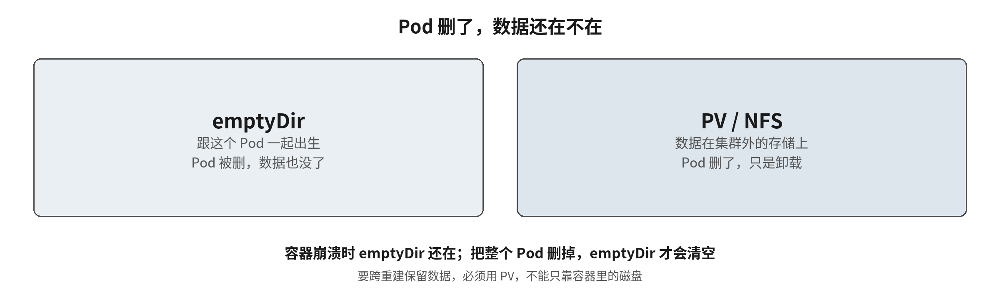
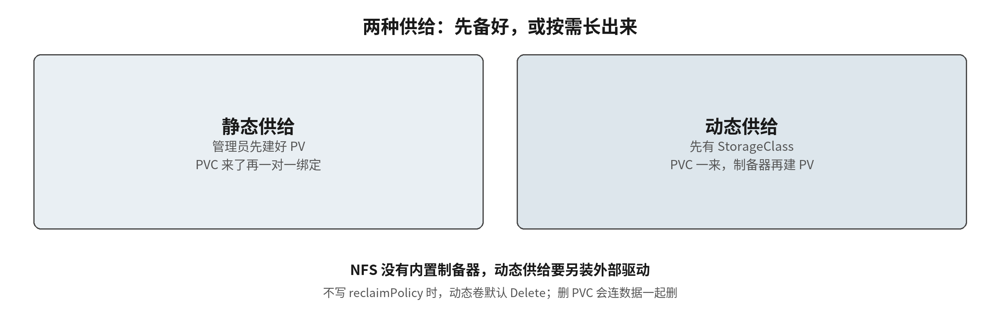
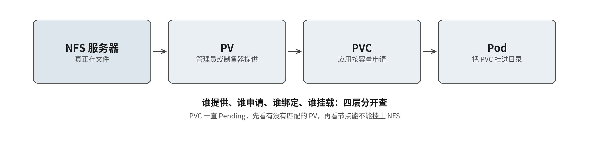
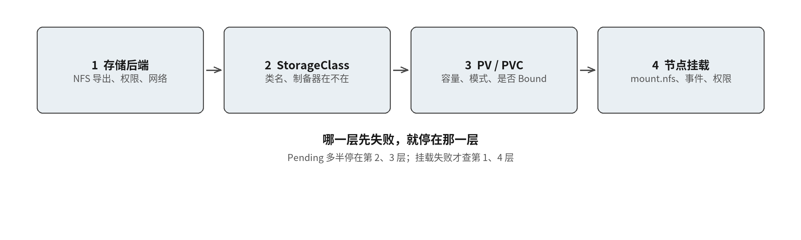

# 第21讲 存储

**本课程定位：** 面向自建智算中心运维。第 19 讲把工作负载跑起来，第 20 讲把入口打通。本讲解决下一件事：Pod 重建以后，数据还在不在。运维要分清谁提供存储、谁申请、谁挂载，还要把存储网和管理网分开。

推理服务把对话记录写在容器里。你删掉 Pod 再重建，页面空了。同事问四个问题：数据写在哪一层？怎么申请一块不会跟着 Pod 走的盘？NFS 怎么接到集群？删了重建怎么验证还在？本讲就练这四件事，以及 Pending、挂载失败时从哪一层查起。

## 本讲学习目标

学完后，你应能：

- 说清 emptyDir 和 PV 的寿命差别，知道删 Pod 时哪种数据会丢。
- 分清 PV、PVC、StorageClass 各自是谁提供、谁申请、谁绑定。
- 读出访问模式 RWO、ROX、RWX，按 NFS 的能力选，不把模式当成写保护。
- 给 NFS 写一份导出，建静态 PV 或指出动态供给还缺外部制备器。
- 用 StatefulSet 解释稳定身份：删 Pod 重建后，同一张 PVC 会再挂回去。
- 按存储后端、StorageClass、PV/PVC、节点挂载四层定位 Pending 和挂载失败。

## 21.1、为什么容器里的盘不够

第 19 讲的 Pod 重建以后，容器文件系统是干净的。容器里的文件是临时的。容器崩溃或被停掉，生命期内改过的文件都会丢。kubelet 会按干净状态再拉起容器。

emptyDir 是 Pod 级的临时盘。Pod 被分到节点时才创建，一开始是空的。同一个 Pod 里的容器可以共用。Pod 被从节点上删掉时，emptyDir 里的数据永久删除。注意：容器崩溃不等于 Pod 被删，崩溃期间 emptyDir 还在。把整个 Pod 删掉，这块盘才没。

要让数据活过 Pod，得用持久卷。临时卷跟着某个 Pod；持久卷可以比任何一个 Pod 活得长。Pod 没了，Kubernetes 会销毁临时卷，但不会销毁持久卷。

NFS 卷就是这种。删 Pod 时只卸载，文件还在 NFS 服务器上。数据可以预先放进去，也可以给多个 Pod 共享。前提是：你得先有一台 NFS 服务器，并且已经把共享导出来。

【关键区别】“容器还在跑”和“数据还在盘上”是两句话。emptyDir 只能熬过容器崩溃。要熬过删 Pod、换节点，必须用 PV。

## 21.2、认识 PV 与 PVC

存储怎么制备，和应用怎么使用，要分开。Kubernetes 为此准备了两个对象。

PV 是 PersistentVolume，集群里的一块存储。可以由管理员事先备好，也可以用存储类动态长出来。它是集群资源，和节点一样。寿命不跟某个 Pod 走。对象里写的是实现细节：NFS 服务器地址、导出路径，或云盘编号。

PVC 是 PersistentVolumeClaim，用户对存储的请求。概念上像 Pod。Pod 消耗节点上的 CPU 和内存，PVC 消耗 PV。PVC 要写容量，还要写访问模式。

绑定是一对一。控制面盯着新的 PVC，找匹配的 PV，用 ClaimRef 把两边锁上。找不到匹配的 PV，PVC 会一直停在未绑定。例如集群里全是 50 Gi 的 PV，申请 100 Gi 的 PVC 对不上。等有 100 Gi 的 PV 进来，才可能 Bound。

Pod 把 PVC 当卷来用。申领必须和 Pod 在同一个命名空间。集群按这个 PVC 找到绑定的 PV，再挂到节点、挂进容器。

表21-1、PV 与 PVC 各管什么

| 对象 | 谁来建 | 作用范围 | 主要字段 |
| --- | --- | --- | --- |
| PV | 管理员或制备器 | 整个集群 | 容量、访问模式、NFS 地址、回收策略 |
| PVC | 应用或运维 | 某个命名空间 | 申请容量、访问模式、存储类名 |

还在用的 PVC 和 PV，系统不会立刻删。这叫使用中保护。Pod 还在，你删 PVC，对象会变成 Terminating，等没有 Pod 再用才真正消失。不要把 Terminating 当成“已经清空”。

访问模式用来匹配，不是写保护。常用三种：RWO 是一个节点读写，同一节点上多个 Pod 仍可访问；ROX 是多节点只读；RWX 是多节点读写。NFS 这三种都支持。但某一块 NFS PV 可能在服务器上按只读导出。每个卷同一时刻只能按一种模式挂。PVC 写了 ROX，也不等于文件在服务器上被锁成只读。

**【例题】** 集群里有一块 50 Gi、RWO 的 PV。应用提交 PVC，申请 100 Gi、RWX。PVC 会怎样？

**解：** 容量对不上，访问模式也对不上，控制面找不到匹配的 PV。PVC 会一直 Pending，不会凑合绑上那块 50 Gi 的盘。要改申请，或另备一块够大、模式匹配的 PV。

【随堂思考】同事说“PVC 已经 Bound，数据一定在这台节点的本地盘上”。这句话漏掉了哪一层？

## 21.3、StorageClass 与两种供给

PV 可以事先备好，也可以按 PVC 现做。这是两种供给。

静态供给：管理员先创建若干 PV，里面写真实存储的细节。用户再提交 PVC，控制面做匹配。

动态供给：静态 PV 都配不上时，集群可以按 StorageClass 再做一个卷。PVC 必须请求某个存储类，管理员也必须先建好这个类。PVC 把存储类写成空字符串，等于自己关掉动态供给。

没有动态供给时，管理员得手工找存储、再写 PV 对象。有了 StorageClass，用户只要建 PVC。删除这份声明后，动态长出来的卷默认也会被销毁。

StorageClass 里最要紧的是制备器。这个字段必须写。NFS 没有内置制备器。要用动态供给，得另装外部驱动，参数里再写 server、path。本课程机房若没装这个驱动，就用静态 PV：管理员先把 NFS 路径写成 PV，再让 PVC 去绑。

回收策略写在 StorageClass 上，动态卷会继承。不写的话默认为 Delete。Delete 的意思是：用户删 PVC，动态卷连外部存储一起删。重要数据要把 reclaimPolicy 改成 Retain，或在 PV 上单独改。

扩容不是改 PV 数字。StorageClass 要把 allowVolumeExpansion 设为 true，再把 PVC 的申请容量改大。Kubernetes 不会为此新建 PV，而是把现有卷做大。不能往小改。文件系统扩容只支持 XFS、Ext3、Ext4。具体够不够扩、会不会中断业务，还要看后端和驱动。

**【例题】** 同事建了 StorageClass，provisioner 写成 kubernetes.io/nfs，reclaimPolicy 没写。PVC 用这个类申请 20 Gi。最可能看到什么？

**解：** Kubernetes 没有内置 NFS 制备器，这个类名无法真正长出 PV。PVC 会停在 Pending。即便以后换了外部制备器，不写 reclaimPolicy 时动态卷默认 Delete，删 PVC 会把数据一起删。课堂更稳妥的做法是静态 PV，回收策略写成 Retain。

## 21.4、把 NFS 接到集群

NFS 让远程主机把服务器上的目录当成本地盘来用。服务器在 `/etc/exports` 里列出导出点和允许挂载的客户端。

每一行是导出路径，后面跟客户端。客户端后面紧跟括号选项，中间不能有空格。改完执行 `exportfs -ra`，或重启 NFS 服务。用 `showmount -e 服务器地址` 核对实际导出。

表21-2、NFS 导出里本讲要认的选项

| 选项 | 含义 | 课堂注意 |
| --- | --- | --- |
| rw | 允许读写 | 不是默认；默认相当于只读 |
| ro | 只读导出 | 和 PVC 的 ROX 不是自动对应 |
| sync | 写完稳定存储再应答 | nfs-utils 1.0.0 之后的默认 |
| root squash | 把远程 uid 0 映射成匿名用户 | 默认开启，匿名 uid 常为 65534 |
| no root squash | 关掉 root 挤压 | 远程 root 能改共享上的任意文件 |

默认会把远程 root 变成 nobody，对应导出选项 root squash。容器里若以 root 写文件，落到 NFS 上可能变成 65534 号用户，表现为权限拒绝。这不是 Kubernetes 坏了，是导出策略。不要随手加 no root squash 来“好写一点”，那会让远程 root 改共享上的任何文件。

还有一个空格陷阱。`/data/nfs  10.20.0.0/16(rw)` 只给这个网段读写。主机名或网段后面多一个空格，再写 `(rw)`，可能把读写开放给所有人。改 exports 后必须 `showmount -e` 看实际结果。

NFS 服务器接存储网，不和管理网混用。存储网和管理网要物理隔离。第 5 讲的三张网在这里用得上。

Kubernetes 侧，NFS 类型的 PV 要写 server 和 path。节点上还要有 `/sbin/mount.nfs`，否则挂不上。挂载选项不要写在普通 Pod 的 nfs 卷里，写在 PV 的 mountOptions，例如 hard、nfsvers=4.1。选项不合法，挂载会失败，系统不做预检查。

【随堂思考】PVC 已经 Bound，Pod 事件里却报 mount.nfs 失败。你先查节点还是先查 StorageClass？依据是哪一层已经成功了？

## 21.5、有状态应用与数据还在

无状态服务用 Deployment 就够。副本可以互相替换。数据库、队列、必须认“我是几号副本”的应用，要用 StatefulSet。

StatefulSet 给每个 Pod 留一个粘性 ID。副本按同一份模板创建，但不能互换。名字是 `名称-序号`，例如 web-0、web-1。Pod 换到别的节点，这个 ID 还在。持久的标识让新 Pod 能对上原来那张卷。

存储来自 volumeClaimTemplates。每个副本得到一张自己的 PVC，常见名字是 `模板名-Pod名`，例如 www-web-0。没有指定存储类时，用默认类。Pod 被调度或重新调度时，volumeMounts 会把这张 PVC 对应的 PV 再挂回去。

课堂可以这样验：把主机名写进网页文件，再删光 Pod。重建以后，web-0 和 web-1 仍用原来的主机名对外服务，因为原来的 PV 又挂回原来的目录。它们被调度到哪台节点，那张卷都会跟过去。

删除或缩容 StatefulSet，默认不删关联存储卷。这是为了保数据，比自动清光更重要。缩到更少副本后，PVC 和 PV 都还在。要删存储，必须另外动手。不要把“StatefulSet 没了”理解成“盘也没了”。

**【例题】** 用 StatefulSet 跑两个副本，数据写在 PVC www-web-0 和 www-web-1 上。你删掉这两个 Pod。重建后如何证明数据还在？不要只看 Running。

**解：** 先确认新 Pod 仍叫 web-0、web-1。再看 PVC 还是 Bound 到原来的 PV。最后进容器读当初写入的文件，内容应与删除前一致。只看副本 Ready，证明不了卷跟对人。

## 21.6、验证数据寿命并按四层排查

课堂验收按这条线做。先写文件，再删 Pod，再重建，再读回来。NFS 静态供给时，还可以登上服务器看导出目录里是不是同一份文件。

表21-3、数据寿命的验证动作

| 步骤 | 做什么 | 通过的标志 |
| --- | --- | --- |
| 写入 | 在挂载目录写一个带主机名的文件 | 文件能读回 |
| 删除 | 删掉 Pod，不删 PVC | PVC 仍 Bound，PV 还在 |
| 重建 | 等新 Pod Ready | 名字仍是原来的序号 |
| 读回 | 再读那个文件 | 内容与删除前一致 |

回收策略要在删除 PVC 之前看清。动态卷默认 Delete，删 PVC 会把卷和数据一起删。Retain 时，删 PVC 后 PV 变成 Released，数据还在，只是不能直接给下一个 PVC 用。管理员要按文档手工清数据、或基于原存储再建 PV。重要数据先 `kubectl patch` 改成 Retain，再删 PVC。

扩容是改 PVC 的申请值，前提是类上允许扩展。不要去改 PV 的容量数字来“假装扩好了”。

排障按四层，哪层先失败就停在那里。

表21-4、常见故障与先查的一层

| 现象 | 先查 | 常见原因 |
| --- | --- | --- |
| PVC 一直 Pending | PV / PVC | 容量或访问模式不匹配；没有对应存储类 |
| 动态 PVC Pending，静态 PV 能绑 | StorageClass | NFS 内置制备器不存在，或外部驱动没跑 |
| Pod 事件 mount.nfs 失败 | 节点挂载 | 节点缺 mount.nfs，或到 NFS 的网络不通 |
| 挂得上，容器里 Permission denied | 存储后端 | root squash 把 root 写成 nobody |
| 删 PVC 后数据没了 | 回收策略 | 动态卷默认 Delete |
| 删 Pod 后数据没了 | 卷类型 | 用的是 emptyDir，不是 PV |

**【例题】** PVC 显示 Bound。Pod 起不来，事件是 `MountVolume.SetUp failed: mount.nfs`。按表 21-4 问题在哪一层？

**解：** 绑定已经成功，StorageClass 和 PV/PVC 匹配不是第一怀疑对象。失败发生在节点把 NFS 挂到本机这一步。先看节点能否访问 NFS 地址、是否安装 nfs-utils、`showmount -e` 是否列出这条导出。不要回头去扩 PVC 容量。

【关键区别】Pending 是还没绑上。挂载失败是绑上了但节点挂不上。权限拒绝是挂上了但用户映射不对。报障时把这三种分开说。

## 21.7、本讲回顾与自测

学习完本讲后，试着用自己的话回答四个问题：emptyDir 和 PV 谁活过删 Pod？PVC Pending 先对哪两个字段？NFS 默认为什么容器 root 可能写不进？StatefulSet 删了为什么盘还在？能说清条件，比背对象名更重要。

表21-5、本讲目标与对应判断

| 学习目标 | 应能做出的判断 |
| --- | --- |
| 分清寿命 | 说出 emptyDir 随 Pod 清空，PV/NFS 只卸载 |
| 分清角色 | 用提供、申请、绑定、挂载四句话描述 PV 与 PVC |
| 选访问模式 | NFS 可选 RWX；模式用于匹配，不是写保护 |
| 接 NFS | 写出 exports 行、检查空格、用 showmount 核对 |
| 看有状态 | 解释序号身份和 volumeClaimTemplates，知道默认不删卷 |
| 四层排查 | Pending、挂载失败、权限拒绝停在不同层 |

### 21.7.1、本讲自测

**1 寿命。** 应用把文件写在 emptyDir 的 `/cache`。你删掉这个 Pod。文件还在吗？如果改挂 PVC 呢？

**2 绑定。** 现有 PV 是 20 Gi、RWO、存储类 nfs-static。PVC 申请 20 Gi、RWX、同类。会 Bound 吗？为什么？

**3 动态供给。** 为什么“只建 StorageClass、类型写 NFS”常常不能自动长出 PV？缺的是哪一类组件？

**4 NFS 权限。** 容器以 root 写入，文件所有者变成 nobody 或 65534。导出里哪一项在起作用？不建议用哪一项来“快速修好”？

**5 StatefulSet。** 删掉 StatefulSet 本身，默认会不会删 PVC？要清数据还要做什么？

**6 场景描述。** 给推理日志挂 NFS。列出你要准备的后端、PV 或 StorageClass、PVC、以及一次“写入—删 Pod—读回”的验证。

**答：**

____________________________

____________________________

____________________________

____________________________

## 21.8、参考答案与解析

### 21.8.1、随堂思考解析

**思考 1（Bound 就在本地盘）：** Bound 只说明 PVC 对上了一块 PV。PV 背后可能是 NFS 服务器，文件在存储网那头，不在当前节点的本地盘。要看 PV 的 nfs.server 和 path。

**思考 2（mount.nfs 失败）：** PVC 已 Bound，说明供给和绑定过了。先查节点挂载：nfs-utils、到存储网的连通、导出是否包含这个网段。不必先怀疑 StorageClass 名字。

### 21.8.2、课后自测解析

**1** emptyDir 在 Pod 被删时数据永久删除，文件没了。改挂 PVC 且 PV 是 NFS 时，删 Pod 只卸载，文件还在服务器上，新 Pod 再挂仍能读到。

**2** 不会 Bound。容量相同，但访问模式 RWX 与 RWO 不匹配。控制面按模式和容量一起匹配，不会降级绑上。

**3** NFS 没有内置制备器。动态供给必须跑外部驱动。缺这个组件，PVC 会 Pending。静态 PV 不依赖制备器。

**4** 起作用的是默认的 root_squash，远程 root 被映射成匿名用户。不建议打开 no_root_squash 来图省事，那会让远程 root 改共享上的任意文件。应改容器用户，或在导出目录上给匿名 uid 写权限。

**5** 默认不删。删除或缩容 StatefulSet 是为了保数据。要清数据，需另外删 PVC，并确认 PV 的回收策略；Delete 会连后端一起删，Retain 则变成 Released。

**6** 后端：存储网上的 NFS 服务器，`/etc/exports` 给节点网段 rw，`exportfs -ra`，`showmount -e` 确认。集群：静态 PV 写 server/path，回收策略 Retain；PVC 申请同容量、匹配模式；Pod 或 StatefulSet 挂上。验证：写文件、删 Pod、重建后读回同一内容。

<!-- pagebreak -->

## 21.9、术语

表21-6、本讲术语

| 术语 | 本讲中的含义 |
| --- | --- |
| emptyDir | Pod 级临时盘。Pod 被删时数据没了。 |
| PV | 集群里的持久存储，寿命不跟单个 Pod 走。 |
| PVC | 用户申请。与 PV 一对一绑定，作用域是命名空间。 |
| StorageClass | 存储类。动态供给时指定制备器和回收策略。 |
| 静态 / 动态供给 | 先备 PV，或 PVC 到来时再由制备器创建。 |
| RWO / RWX | 单节点读写 / 多节点读写。用于匹配，不是写保护。 |
| Retain / Delete | 删 PVC 后保留 PV，或连后端一起删。动态卷默认 Delete。 |
| NFS | 网络文件系统。删 Pod 只卸载。使用前须自备服务器并导出。 |
| root squash | 把远程 root 映射成匿名用户，默认开启。 |
| StatefulSet | 给每个 Pod 稳定 ID 和对应 PVC。默认不删卷。 |

文中路径 `/data/nfs`、网段 10.20.0.0/16 与名称 web-0 均为教学示例。实际值以本单位存储规划和命名规范为准。

<!-- md-only -->

## 附：主要参考资料（仅 Markdown 保留，不印入 Word/PDF）

以下资料与课程资料中的编号一一对应。PDF 页码指本地 PDF 的文件页序；网页资料保存于 2026 年 11 月 9 日。

- 中国信通服务《2025 算力运维体系技术白皮书》（本地 PDF）。第 24 页用于 21.6 扩容定位；第 48 页用于 21.4 存储网与管理网隔离。摘录见《01_本地文档摘录.md》L1。
- Kubernetes 官方文档《持久卷》。用于 PV/PVC 定义、绑定、访问模式、回收、扩容、NFS 辅助程序。资料编号 W01。
- Kubernetes 官方文档《存储类》。用于制备器必填、NFS 无内部制备器、默认 Delete、扩容开关。资料编号 W02。
- Kubernetes 官方文档《动态卷制备》。用于“没有动态制备就要手工建 PV”、删声明会毁动态卷。资料编号 W03。
- Kubernetes 官方文档《卷》。用于 emptyDir 随 Pod 删除、NFS 只卸载、使用前必须自备服务器。资料编号 W04。
- Kubernetes 官方文档《StatefulSet》。用于稳定 ID、默认不删卷、volumeClaimTemplates。资料编号 W05。
- Kubernetes 官方教程《StatefulSet 基础》。用于删 Pod 重建后 PV 重新挂上、缩容不删 PVC。资料编号 W06。
- Kubernetes 官方任务《更改 PersistentVolume 的回收策略》。用于动态卷默认 Delete、Retain 后变为 Released。资料编号 W07。
- Linux 手册页 exports(5)。用于 `/etc/exports` 格式、客户端与选项之间不能有空格、root_squash 默认、`exportfs -ra`。资料编号 W08。
- RHEL 9《保护 NFS 服务》。用于 rw 风险、默认把 root 映射为 nobody、空格改变共享范围、`showmount -e`。资料编号 W09。
- Kubernetes 持久卷访问模式表（与 W01 同页）。用于 NFS 支持 RWX、容量不匹配会 Pending。资料编号 W10。

本讲引用的在线资料，其原始网址、获取时间与原文校验值记录在资料目录《01_讲义补充资料_20261109/README.md》与《来源元数据_20261109.json》中。

<!-- /md-only -->
