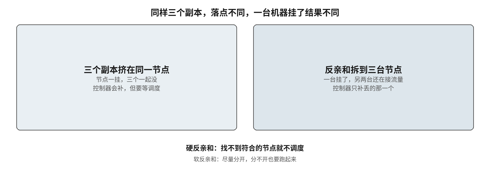
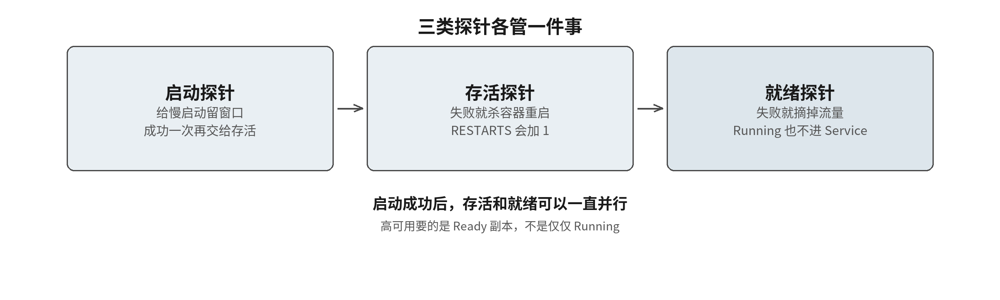
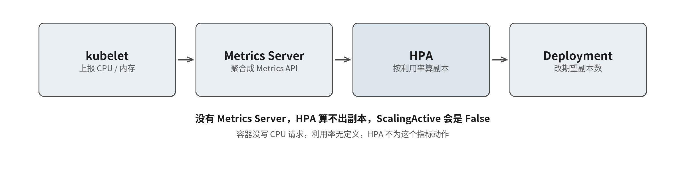
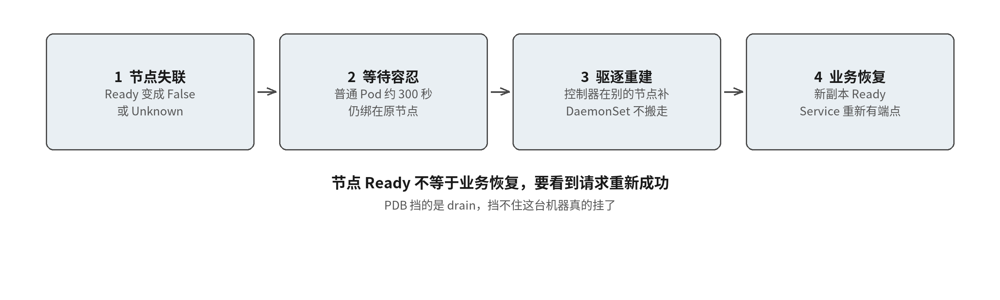

# 第22讲 容器高可用

**本课程定位：** 面向自建智算中心运维。第 19 讲把应用发上去，第 20 讲把入口打通，第 21 讲把数据留住。本讲解决下一件事：一台节点挂了，服务还在不在。运维要把副本拆开，把保底写清，还要按时间点验证自愈。

推理服务现在只有两个副本，还挤在同一台机器上。同事问四个问题：怎么避免一台机器带走全部实例？滚动维护时最少留几个？负载高了能不能自己加副本？停一台节点，业务要多久才回来？本讲就练这四件事，以及驱逐、PDB 卡住、HPA 没指标时从哪一层查起。

## 本讲学习目标

学完后，你应能：

- 给 Deployment 配多副本和反亲和，说出硬约束与软约束的差别。
- 分清三类探针：启动留窗口、存活重启、就绪摘流量。
- 给应用写 PDB，知道它只限制自愿干扰，挡不住节点真的挂了。
- 为 CPU 利用率配 HPA，并说出没有 Metrics Server 或没写请求时为什么不扩。
- 按节点失联、等待容忍、补副本、业务恢复四步记录一次宕机演练。
- 把 PDB 阻塞维护、反亲和无法调度、HPA 无指标、驱逐与 OOM 停在不同层。

## 22.1、为什么一个副本不够

第 19 讲的 Deployment 已经能补副本。删掉一个 Pod，控制器会再拉一个。这只解决了“进程没了”。如果三个副本都在同一台节点上，这台机器一断电，三个一起没。控制器会补，但新 Pod 要等调度、拉镜像、过探针。这段时间业务是空的。

高可用要同时做两件事。第一件是数量：同一时刻有足够多的相同副本。第二件是落点：这些副本不要挤在同一个故障域。对课堂的三节点集群，故障域先按节点来记。反亲和就是把“不要和自己人挤在同一台机器”写成调度规则。

多副本是保底。HPA 是按负载加或减。入口仍然走第 20 讲的 Service。没有就绪端点，副本再多也不接流量。

【关键区别】“有三个 Pod”不等于“一台机器挂了还能服务”。先看它们是不是 Ready，再看它们是不是落在不同节点。

## 22.2、副本与反亲和

ReplicaSet 的工作是：任意时刻都维持你写下的那份副本数。少了就按模板新建，多了就删。课堂不要直接管 ReplicaSet，用 Deployment。它会拥有 ReplicaSet，还能做第 19 讲的滚动更新。

不写 replicas 时，默认是 1。一个副本挂了，控制器会补，但补的时候服务是空窗。无状态服务至少写 2。课堂演练写 3，才能在停一台节点后还留下 Ready 副本。

调度器默认会尽量把 Pod 散开，也会躲开资源不够的节点。这不够当保证。要明确“不要和带同一标签的副本同节点”，写 Pod 反亲和。

### 22.2.1、硬约束和软约束

反亲和写在 Pod 模板的 affinity.podAntiAffinity 里。选择算符要对上自己的应用标签，例如 app=infer。topologyKey 写成 kubernetes.io/hostname，表示按节点分开。集群里每个节点都要有这个标签，调度才按你想的走。

硬约束（requiredDuringSchedulingIgnoredDuringExecution）只有一句意思：调度时必须满足。三节点、三副本、按 hostname 硬拆，结果是一节点一个。节点不够，或同标签副本已经占满符合条件的节点，新 Pod 会 Pending。名字里的 IgnoredDuringExecution 表示：调度之后节点标签变了，已经跑着的 Pod 不会被挪走。

软约束（preferredDuringSchedulingIgnoredDuringExecution）是尽量满足。找不到符合的节点，仍然会调度。课堂优先用硬约束把副本拆开。资源很紧、宁可挤在一起也不要 Pending 时，再用软约束。

表22-1、硬反亲和与软反亲和

| 类型 | 调度时 | 找不到匹配节点 | 课堂用法 |
| --- | --- | --- | --- |
| 硬约束 | 必须满足 | Pending，不调度 | 把副本拆到不同节点 |
| 软约束 | 尽量满足 | 仍然调度 | 资源紧时降低要求 |

**【例题】** 推理服务 replicas 写成 3，硬反亲和按 hostname 拆开，标签 app=infer。集群只有两台可调度工作节点。会看到什么？

**解：** 两台节点各能放一个同标签副本。第三个 Pod 找不到不含 app=infer 的节点，会一直 Pending。这不是镜像坏了，是硬约束把落点锁死了。要加节点，或把这条改成软约束，或把副本改成 2。

【随堂思考】同事把反亲和的 topologyKey 写成了机架标签，集群节点上没有这个键。调度可能和预期不同。你怎样核对节点标签，再决定改键还是改约束？

## 22.3、探针决定谁进流量

第 19 讲已经用过探针。本讲把它放进高可用：自愈要重启坏容器，入口只要 Ready 副本。

存活探针失败，kubelet 会杀掉这个容器并重启。事件里会出现 Unhealthy，然后是 Killing。RESTARTS 加 1。进程还在、接口已经死锁时，靠它把容器拉起来。

就绪探针失败，Pod 被标成未就绪，不接 Service 流量。应用在加载模型、等依赖时，不要杀它，也不要把请求打进去。就绪探针在容器整个生命期都会跑。

启动探针给慢启动留窗口。失败次数乘探测周期，就是最长等待。例如失败阈值 30、周期 10 秒，最多约 300 秒。成功一次后，存活探针接手。启动一直不成功，容器会被杀，再按 restartPolicy 处理。

三类探针可以一起用。存活和就绪彼此不等待对方成功。要先等启动完成，用启动探针，或把就绪的 initialDelaySeconds 留够。

【关键区别】Running 只说明容器进程在。Ready 才说明可以进流量。高可用演练里，恢复时间要记到“请求重新成功”，不要停在 Running。

## 22.4、PDB：自愿干扰时保底

Pod 消失有两类原因。非自愿干扰：机器硬件故障、节点失联、内存不够被 kubelet 赶走。自愿干扰：你 drain 节点做升级、滚动更新、人手删 Pod。

PDB 是 PodDisruptionBudget。它限制同一时刻因自愿干扰而宕掉的副本数。例如三个副本、minAvailable 写成 2，驱逐 API 同一时刻只允许再拿掉 1 个。kubectl drain 走这套 API。请求会被拒绝，命令会重试，直到腾空完成或超时。

PDB 挡不住非自愿干扰。节点真的断电，上面的 Pod 一样没。损失会计入预算：剩下的可用副本变少，下一次 drain 会更难通过。直接删除 Deployment 或直接删除 Pod，会跳过 PDB。滚动升级时，不可用副本会计入预算，但升级节奏由 Deployment 自己的策略管，不受 PDB 卡住。

同一份 PDB 只能写 minAvailable 或 maxUnavailable 其中一个。选择算符要和工作负载一致。推荐 maxUnavailable，因为它会随副本数变化。百分比会向上取整。7 个 Pod、minAvailable 写成 50%，必须留 4 个。maxUnavailable 写成 0，或 minAvailable 写成 100%，等于禁止全部自愿驱逐。这时 drain 一个相关节点会一直完不成。这是 PDB 的语义，不是命令坏了。

表22-2、PDB 保的是哪一类干扰

| 动作 | 是否自愿 | PDB 管不管 |
| --- | --- | --- |
| kubectl drain | 自愿 | 管。请求可能被拒绝后重试 |
| 滚动更新 | 自愿，但走工作负载自己的策略 | 计入预算，不卡住升级 |
| 直接删 Pod 或 Deployment | 自愿，但跳过检查 | 不管 |
| 节点断电、失联 | 非自愿 | 挡不住 |
| kubelet 因内存压力驱逐 | 非自愿 | 挡不住 |

ALLOWED DISRUPTIONS 大于 0，说明控制器已经统计到匹配的 Pod。健康按 Ready=True 算。默认不健康驱逐策略是 IfHealthyBudget：应用已经不够健康时，不健康的 Running Pod 也赶不走，drain 可能被一个 CrashLoop 拖住。维护窗口可以把策略改成 AlwaysAllow，让行为异常的 Pod 也能被腾空。

**【例题】** 三个副本都 Ready，PDB 要求至少 2 个可用。你 drain 第一台节点，替代 Pod 还没 Ready。这时再 drain 第二台，会发生什么？

**解：** 第一台腾空后只剩两个可用。PDB 要求 2，允许的干扰变成 0。第二台的 drain 会被阻塞，直到新副本 Ready，或者你改 PDB、加节点。不要把“命令卡住”理解成 kubelet 死了。

【随堂思考】有人把 maxUnavailable 写成 0，说“这样最安全，维护时一个都不会少”。节点要打补丁时，你会怎样向他说明后果？

## 22.5、HPA：按指标加减副本

HPA 是 HorizontalPodAutoscaler。它改的是工作负载的副本数，例如 Deployment。水平扩缩是加 Pod。垂直扩缩是给已经在跑的 Pod 加 CPU 或内存。本讲只练水平。DaemonSet 不能用 HPA 来扩缩。

HPA 不是连续盯着。kube-controller-manager 默认大约每 15 秒算一次。算法可以记成：期望副本 = 向上取整（当前副本 × 当前指标 / 期望指标）。当前是目标的两倍，副本大约翻倍。够接近 1.0 时，默认容差约 10%，这次就不改。

CPU 利用率是“当前用量 / 请求值”。容器没写 CPU 请求，这个利用率没有定义，HPA 不为该指标动作。多个指标会分别算，取最大的那个副本数。

指标从 Metrics API 来。课堂要先有 Metrics Server。它从各节点 kubelet 采集 CPU 和内存，再通过 API 交给 HPA。没有这个组件，`kubectl top` 也没有数据。ScalingActive 为 False，常见原因就是拿不到指标。

扩容通常马上做。缩容默认有约 5 分钟稳定窗口，避免指标抖一下就把副本砍掉。所以压测停下后，副本回落可能要几分钟。不要把运维目标里的秒数，当成集群默认保证。课堂以 `kubectl get hpa --watch` 看到的副本变化为准。

启用 HPA 后，建议从 Deployment 清单里去掉 spec.replicas。以后再 apply 这份 YAML，会把副本打回文件里的数字，和 HPA 抢。需要固定副本时，用 `kubectl scale`，或先停掉 HPA。

**【例题】** 已建 HPA，CPU 目标 50%，min=2，max=6。`kubectl get hpa` 里 TARGET 是 unknown，副本一直是 2。压测没有用。先查哪两样？

**解：** 先看 Metrics Server 是否在跑，`kubectl top pod` 有没有数。再看容器有没有写 CPU requests。缺指标或没写请求，HPA 算不出利用率，不会扩。不要先去改 max。

## 22.6、驱逐、污点与自愈

自愈分两层。容器进程坏了，kubelet 按探针和 restartPolicy 在本节点重启。整个 Pod 没了，或节点不能用了，Deployment 或 ReplicaSet 在别的节点补一个。不要把这两层说成一件事。

维护节点用 `kubectl drain --ignore-daemonsets`。它先把节点标成不可调度，再按 Eviction API 体面赶走 Pod，并遵守 PDB。DaemonSet 的 Pod 赶不走，控制器会立刻再造一个，所以要加这个参数。drain 成功返回后，才能关电源或做硬件操作。做完用 `kubectl uncordon`，节点才重新接新 Pod。

节点压力驱逐是另一条路。kubelet 看内存、磁盘、inode。硬阈值到了，立刻把 Pod 标成 Failed 并杀掉。默认硬条件包含 memory.available 小于 100Mi。这条路不理 PDB，也不理你在 Pod 里写的 terminationGracePeriodSeconds。Deployment 会再造替代 Pod。内存已经来不及回收时，内核 OOM killer 会先杀容器。被 OOM 杀掉的容器可以按 restartPolicy 重启，这和“整个 Pod 被驱逐”不同。

节点 NotReady（Ready 为 False）或 unreachable（Ready 为 Unknown）时，控制面会打上 NoExecute 污点。普通 Pod 会被自动加上约 300 秒的容忍。这 5 分钟里，Pod 还绑在原节点。超时后才驱逐，控制器再到别的节点补。DaemonSet 对这两类污点的容忍不设秒数，不会被搬走。

表22-3、三种“把 Pod 弄走”的差别

| 方式 | 谁发起 | 理不理 PDB | 之后谁补 |
| --- | --- | --- | --- |
| drain | 管理员，自愿 | 理 | 控制器在可调度节点补 |
| 节点压力驱逐 | kubelet | 不理 | 控制器补；Pod 阶段是 Failed |
| OOM 杀容器 | 内核 | 不适用 | 常在本节点按 restartPolicy 重启 |

【关键区别】drain 卡住，先看 PDB 和未就绪副本。Pod 突然 Failed 且节点有 MemoryPressure，先看驱逐和 OOM，不要先改 Ingress。

## 22.7、节点宕机演练与逐层排查

课堂验收按单节点故障做。集群至少三台工作节点。应用先配好多副本、hostname 硬反亲和、PDB、就绪探针。先记基线：各节点上的 Pod、Ready 数、一次成功请求。再停一台节点，或在可恢复窗口内 drain 后关机。按时间点记四件事，不要只截一张 Running 的图。

<!-- pagebreak -->

表22-4、宕机演练要记下的时间点

| 步骤 | 你看到什么 | 通过的标志 |
| --- | --- | --- |
| 故障 | 节点 Ready 变为 False 或 Unknown | 记下时刻，不要改别的对象 |
| 等待 | 原节点上的 Pod 还在 Terminating 或仍绑定 | 对照约 300 秒容忍，不要提前判失败 |
| 重建 | 其他节点出现新 Pod | 名字可以变，标签和副本数要对 |
| 恢复 | 新副本 Ready，请求成功 | 业务恢复时刻，不是节点重新 Ready |

课堂要写清口径：从节点 NotReady，到连续若干次请求成功，中间隔了多少秒。这个间隔不是 kubelet 的默认值，要按实测来记。节点后来又 Ready 了，如果请求还失败，恢复就不算完成。

排障按层停，不要跳着猜。

表22-5、常见故障与先查的一层

| 现象 | 先查 | 常见原因 |
| --- | --- | --- |
| 新 Pod Pending，报反亲和 | 调度约束 | 硬反亲和把节点占满，或节点上没有 topologyKey |
| drain 一直不结束 | PDB | 可用副本已到 minAvailable；或不健康策略拖住 CrashLoop |
| HPA 副本不动，TARGET 为 unknown | 指标管道 | 没有 Metrics Server，或没写 CPU 请求 |
| 副本变了，apply 后又变回去 | Deployment 清单 | spec.replicas 和 HPA 在抢 |
| Pod 突然 Failed，节点 MemoryPressure | 节点压力 | kubelet 驱逐，PDB 挡不住 |
| 容器 RESTARTS 增加，Pod 还在 | 探针或 OOM | 存活失败重启，或内核杀了容器 |
| 节点已恢复，请求仍失败 | 业务恢复 | 新副本未 Ready，或端点没回来 |

**【例题】** 停掉一台节点后，另两台节点上的副本一直 Ready，请求也成功。十分钟后故障节点回来了，上面没有新的推理 Pod。这算恢复不完整吗？

**解：** 不算。反亲和本来就不让同标签副本再挤回去。只要期望副本都在其他节点 Ready，请求成功，自愈就完成了。恢复不完整指的是：副本数不够、新 Pod Pending、或节点回来了请求仍失败。

## 22.8、本讲回顾与自测

学习完本讲后，试着用自己的话回答四个问题：三个副本为什么还要反亲和？PDB 为什么挡不住断电？HPA 为什么必须有请求值和 Metrics Server？节点 NotReady 之后，为什么不能把节点重新 Ready 当成业务恢复？能说清条件，比背字段名更重要。

表22-6、本讲目标与对应判断

| 学习目标 | 应能做出的判断 |
| --- | --- |
| 拆开副本 | 用硬反亲和按节点分开，解释 Pending 是约束过严 |
| 看探针 | 说出重启、摘流量、慢启动窗口分别是谁在管 |
| 写 PDB | 分清自愿与非自愿，解释 drain 卡住和 maxUnavailable 为 0 |
| 配 HPA | 指出无指标、无请求、稳定窗口三种“看起来没扩” |
| 做演练 | 按失联、等待、重建、请求成功记时间，并写口径 |
| 分层排查 | Pending、drain 卡住、无指标、Failed、请求失败停在不同层 |

### 22.8.1、本讲自测

**1 反亲和。** 三副本、两节点、硬反亲和按 hostname。第三个 Pod 会怎样？怎样改能跑满三个且尽量分开？

**2 探针。** 存活失败和就绪失败，对副本数和对 Service 流量各有什么影响？

**3 PDB。** 为什么节点断电后，PDB 不能保证还剩 minAvailable 个 Ready？这时 drain 另一台节点会怎样？

**4 HPA。** 列出 HPA 不扩容的两个常见原因。为什么启用后要从 Deployment 里去掉 replicas？

**5 容忍时间。** 节点变为 NotReady 后，普通 Pod 为什么可能还在原节点待几分钟？DaemonSet 会不会一起搬走？

**6 场景描述。** 给推理应用配高可用并做一次节点宕机演练。列出你要创建的对象，以及报告里必须出现的四个时间点。

**答：**

____________________________

____________________________

____________________________

____________________________

<!-- pagebreak -->

## 22.9、参考答案与解析

### 22.9.1、随堂思考解析

**思考 1（topologyKey 对不上）：** 先 `kubectl get nodes --show-labels`，确认有没有这条键。没有就不要硬写。课堂用 kubernetes.io/hostname。要按机架分，得先给节点打上机架标签，再改 topologyKey。键不存在时，调度结果可能和预期不同，表现为该散开的没散开，或一直 Pending。

**思考 2（maxUnavailable 为 0）：** 这样最安全的代价是：相关节点的 drain 永远完不成。补丁、换盘、内核升级都做不了。保底应写成还能接受的不可用数，例如 maxUnavailable 为 1。维护窗口也可以临时放宽 PDB，做完再改回来。

### 22.9.2、课后自测解析

**1** 第三个 Pod Pending，因为两台节点已经各有一个同标签副本，硬约束不允许再放。改成软约束，可以跑满三个，调度器仍会尽量分开。或者加第三台可调度节点，继续用硬约束。

**2** 存活失败：kubelet 重启容器，RESTARTS 加 1，副本对象还在，短暂中断后可能恢复。就绪失败：副本可以仍是 Running，但不进 Service，流量只打到其他 Ready 副本。高可用要盯 Ready，不只盯 Running。

**3** PDB 只限制自愿驱逐。断电是非自愿，预算挡不住。可用副本一旦掉到 minAvailable，允许的自愿干扰变成 0，再 drain 其他节点会被阻塞，直到有新的 Ready 副本。

**4** 常见原因：集群没有 Metrics Server，TARGET 为 unknown；容器没写 CPU 请求，利用率无定义。清单里留着 spec.replicas，之后 apply 会把副本打回这个值，和 HPA 对着改。启用 HPA 后去掉该字段。

**5** 控制面给 NotReady 和 unreachable 打 NoExecute 污点。普通 Pod 自带约 300 秒容忍，所以会再绑几分钟。DaemonSet 对这两类污点的容忍不设秒数，不会被驱逐，节点恢复后仍在原处。

**6** 对象至少包括：replicas 大于 1 的 Deployment、按 hostname 的反亲和、与选择算符一致的 PDB、就绪探针、ClusterIP Service；可选 HPA 和 Metrics Server。时间点：节点 NotReady、原 Pod 开始终止或仍绑定、其他节点出现新 Pod 并 Ready、请求重新成功。报告里写口径和改进项，例如硬反亲和是否导致 Pending、PDB 是否挡住后续维护。

<!-- pagebreak -->

## 22.10、术语

表22-7、本讲术语

| 术语 | 本讲中的含义 |
| --- | --- |
| ReplicaSet | 维持指定数量的相同 Pod。课堂用 Deployment 来管它。 |
| 反亲和 | 不要和指定标签的 Pod 落在同一拓扑域。硬约束不满足就不调度。 |
| topologyKey | 拓扑域用哪条节点标签。课堂用 hostname 表示按节点分开。 |
| 就绪 / 存活 / 启动探针 | 摘流量、重启容器、给慢启动留窗口。 |
| 自愿干扰 | drain、滚动更新、人手删除等主动操作。 |
| 非自愿干扰 | 硬件故障、失联、资源不足驱逐。 |
| PDB | 自愿干扰时的保底。挡不住断电。0 不可用会让 drain 完不成。 |
| HPA | 按指标改副本数。要 Metrics Server 和资源请求。 |
| Metrics Server | 从 kubelet 采集 CPU/内存，供 HPA 和 kubectl top 使用。 |
| drain / uncordon | 腾空并不可调度；维护后再允许调度。 |
| 节点压力驱逐 | kubelet 回收资源时把 Pod 标 Failed。不理 PDB。 |
| 容忍时间 | 普通 Pod 对 NotReady 约 300 秒。不是业务恢复时间。 |

文中标签 app=infer、三节点课堂和 300 秒容忍均为教学示例。实际副本、PDB 和演练口径以本单位可用性目标为准。

<!-- md-only -->

## 附：主要参考资料（仅 Markdown 保留，不印入 Word/PDF）

以下资料与课程资料中的编号一一对应。PDF 页码指本地 PDF 的文件页序；网页资料保存于 2026 年 11 月 9 日。

- 中国信通服务《2025 算力运维体系技术白皮书》（本地 PDF）。第 16 页用于开篇弹性扩缩定位；第 25 页用于演练要写 RTO 口径；第 26 页用于 HPA 的行业目标，正文不把 30 秒写成集群默认值；第 44 页用于把自动故障转移对应到控制器补副本。摘录见《01_本地文档摘录.md》L1。
- Kubernetes 官方文档《ReplicaSet》。用于 22.1–22.2：维持稳定副本、建议用 Deployment、节点故障时补副本。资料编号 W01。
- Kubernetes 官方文档《将 Pod 指派给节点》。用于 22.2：硬/软反亲和、hostname 拓扑、硬约束导致 Pending。资料编号 W02。
- Kubernetes 官方文档《干扰（Disruptions）》。用于 22.4：自愿与非自愿、PDB 边界、drain 走 Eviction API。资料编号 W03。
- Kubernetes 官方文档《为应用程序设置干扰预算》。用于 22.4：minAvailable/maxUnavailable、百分比向上取整、0 不可用挡住 drain。资料编号 W04。
- Kubernetes 官方文档《Pod 水平自动扩缩》。用于 22.5：15 秒同步、算法、缩容稳定窗口 5 分钟、必须有资源请求。资料编号 W05。
- Kubernetes 官方文档《HorizontalPodAutoscaler 演练》《自动扩缩工作负载》《资源指标管道》。用于 22.5：Metrics Server、ScalingActive。资料编号 W06。
- Kubernetes 官方文档《配置存活、就绪和启动探针》。用于 22.3：重启、摘流量、慢启动窗口。资料编号 W07。
- Kubernetes 官方文档《安全地清空一个节点》。用于 22.6–22.7：drain 尊重 PDB、uncordon。资料编号 W08。
- Kubernetes 官方文档《节点压力驱逐》。用于 22.6：kubelet 驱逐不理 PDB、OOM 与重启。资料编号 W09。
- Kubernetes 官方文档《污点和容忍度》。用于 22.6：NotReady 污点、普通 Pod 约 300 秒容忍。资料编号 W10。

本讲引用的在线资料，其原始网址、获取时间与原文校验值记录在资料目录《01_讲义补充资料_20261109/README.md》与《来源元数据_20261109.json》中。任务页 `horizontal-pod-autoscale`（非 walkthrough）本次 HTTP 404，未作为事实来源。

<!-- /md-only -->
