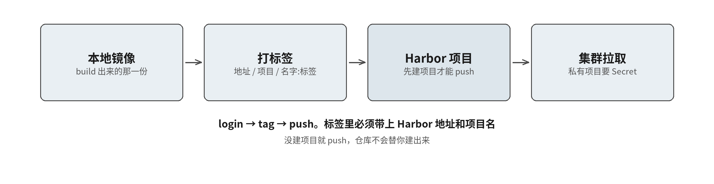
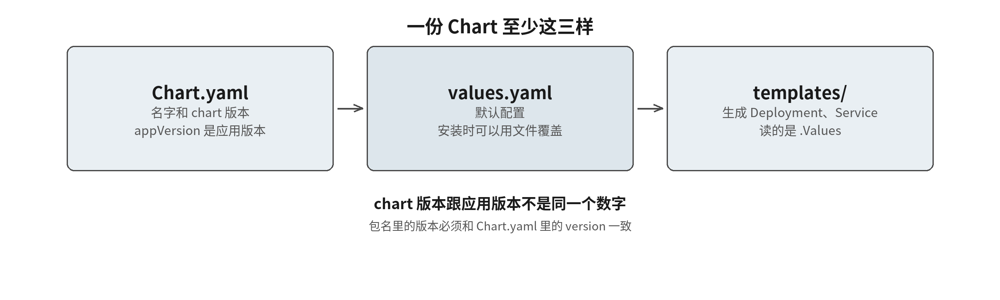
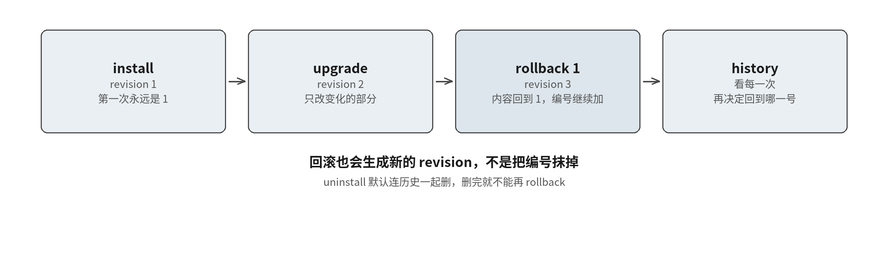
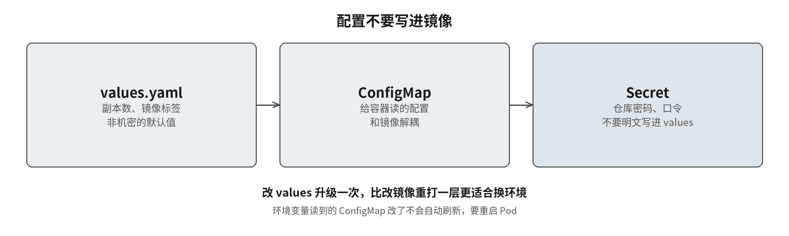

# 第23讲 Helm 与镜像仓库

**本课程定位：** 面向自建智算中心运维。第 19 讲把应用发上去，第 20 讲把入口打通。本讲解决下一件事：同一套应用怎么打包、换环境、升级，以及镜像从哪拉。运维要把镜像推进自己的仓库，再用 Chart 管版本，升级不对还能回得去。

同事把推理服务的 YAML 拷来拷去。测试环境改副本，生产环境改镜像地址，两份清单很快对不上。镜像还在个人电脑上，节点拉不到。本讲就练四件事：Harbor 里建项目并推拉镜像；把应用打成 Chart；install、upgrade、rollback；用 values 管配置，机密不要写进清单。

## 本讲学习目标

学完后，你应能：

- 说出 Harbor 项目、公开与私有的差别，并完成 login、tag、push、pull。
- 分清 Chart.yaml、values.yaml、templates 各自管什么，以及 chart 版本和应用版本不是同一个数字。
- 用 helm install 装一份 Chart，用 -f 或 --set 覆盖配置。
- 改 values 做一次 upgrade，再用 history 和 rollback 回到上一版。
- 把非机密配置放进 values 或 ConfigMap，把仓库密码放进 Secret，并给私有项目配 imagePullSecret。
- 把“没项目就 push”“标签没带地址”“升级后回不去”停在不同层。

## 23.1、为什么 YAML 拷来拷去不够

第 19 讲的 Deployment 能把应用跑起来。环境一多，同一份 YAML 就要改镜像地址、副本、端口。改漏一处，测试过了，生产起不来。镜像如果只在构建机上，工作节点也拉不到。

要分开两件事。第一件是镜像：构建结果放进仓库，集群按名字拉。第二件是应用清单：用 Chart 把 Deployment、Service 打成一份包，用 values 区分环境。安装一次叫一次发布。升级和回滚都记在这份发布的历史上。

【关键区别】镜像仓库存的是容器镜像。Chart 仓库存的是打包后的应用模板。Harbor 项目里推的是镜像。helm repo 加的是带 index.yaml 的 Chart 仓库。两者不要混成一个“仓库”。

## 23.2、Harbor：先有项目，再推镜像

Harbor 是私有镜像仓库。推之前必须先有项目。项目里才有这个应用的仓库。不建项目就 push，不会自动建出来。

项目分两种。Public：任何用户都能拉。Private：只有项目成员能拉。第一次装 Harbor 时，会自带一个公开项目，名字叫 library。课堂演示可以先用它。正式应用要单独建项目，不要把业务镜像都堆进 library。

公开和私有以后还能改。改成私有后，原来能匿名拉的人就拉不动了。集群里的 Pod 会变成 ImagePullBackOff。这不是镜像坏了，是权限变了。

### 23.2.1、打标签必须带地址和项目

推上去的名字要让 Docker 知道送到哪。格式是：`Harbor地址/项目名/镜像名:标签`。只打 `infer:1.0`，默认还是本地或 Docker Hub，不会进你的 Harbor。

课堂顺序可以记成四步。先 `docker login Harbor地址`。再 `docker tag 本地镜像 Harbor地址/项目/名字:标签`。然后 `docker push` 这个完整名字。最后在另一台机器或集群节点上 `docker pull` 同一个名字。私有项目不 login 就拉，会被拒绝。

Harbor 若走 HTTP，或证书是自签的，Docker 客户端会先走 HTTPS，报 connection refused。这要改客户端的 insecure 配置，或把 CA 放到指定目录。本讲不展开改 daemon.json 的细节，但排障时要能把“证书/HTTP”和“项目不存在”分开。

Kubernetes 拉私有项目，还要在同一命名空间建 Secret，并在 Pod 或 ServiceAccount 上写 imagePullSecrets。kubelet 用这份凭据替 Pod 拉镜像。只在自己电脑上 docker login，节点不会跟着登录。

**【例题】** 本地有镜像 infer:dev。Harbor 地址是 registry.lab.example，项目是 lab。要让集群拉到它，tag 应写成什么？只 docker login 够不够？

**解：** 应打成 `registry.lab.example/lab/infer:dev`，再 push。只 login 不够。集群节点自己不会用你笔记本上的登录态。私有项目还要在应用命名空间里建镜像拉取 Secret，并挂到工作负载上。

【随堂思考】同事把镜像推进了 library，生产项目却是 prod。Deployment 的 image 写成了 registry.lab.example/prod/infer:1.0。会看到什么？先改 tag 还是先改项目权限？

## 23.3、Chart：把应用打成一份包

Helm 把一组相关的 Kubernetes 资源打成 Chart。目录名就是 Chart 名。里面至少三样。

Chart.yaml 写这份包的信息。必需字段是 apiVersion、name、version。Helm 3 用 apiVersion v2。version 是 Chart 自己的版本，按它打包、按它识别。appVersion 是里面那个应用的版本，只是说明，不算进 Chart 版本。两个数字可以不一样。例如 Chart 1.2.0 里默认应用是 6.7.0。

values.yaml 是这份 Chart 的默认配置。副本、镜像仓库、标签，通常写在这里。templates/ 里是模板。安装时 Helm 用 values 把它们渲染成真正的 Deployment、Service。模板里用 `.Values` 读配置，也可用 `.Release.Name` 拿到这次发布的名字。

表23-1、Chart 里本讲要认的文件

| 文件 | 管什么 | 课堂注意 |
| --- | --- | --- |
| Chart.yaml | 包名和 Chart 版本 | version 必须和打出来的包名一致 |
| values.yaml | 默认配置 | 用户文件会覆盖这里的同名键 |
| templates/ | 生成清单 | 改镜像地址优先改 values，不要手改渲染结果 |

可用 `helm create 名字` 先长出这份目录，再改。改完用 `helm lint` 看格式。`helm package` 打成 `名字-版本.tgz`。包名里的版本必须等于 Chart.yaml 里的 version，对不上会报错。

Chart 还可以放到 Chart 仓库里，用 `helm repo add` 添加。那是带 index.yaml 的 HTTP 服务，用来分发 tgz。和 Harbor 里的镜像不是同一条路。课堂可以先从本地目录安装，不必先搭 Chart 仓库。

【关键区别】改应用镜像标签，通常改 values，再 upgrade。改 Chart 结构或模板，才升 Chart 的 version 并重新 package。

## 23.4、安装、升级、回滚

`helm install 发布名 Chart路径` 会创建一次发布。发布名是你起的，例如 infer。不写名字可用 `--generate-name`。装完用 `helm list` 看状态。用 `helm status 发布名` 看这次发布现在怎样。

Helm 装完就退出，默认不等所有 Pod Ready。镜像很大时，命令成功不等于页面已经能开。要等就绪，加 `--wait`，并清楚 `--timeout`，默认约 5 分钟。超时会标成 FAILED。

覆盖配置有两条路。`-f 文件` 传入 YAML，可写多次，最右边的文件优先。`--set 键=值` 写在命令行，也可多次，最右边优先。两条一起用时，`--set` 更高。`--set` 的值会记下来，可用 `helm get values 发布名` 查看。

升级用 `helm upgrade 发布名 Chart路径`。可以换一份 `-f`，也可以只 `--set replicaCount=3`。Helm 尽量只改有变化的部分。`--reuse-values` 表示在上次发布的值上再合并新覆盖。`--reset-values` 表示先回到 Chart 里的默认值。不要混用这两个开关还不看 `helm get values`。

每次 install、upgrade、rollback，修订号加 1。第一次永远是 1。`helm history 发布名` 列出每一次。回滚用 `helm rollback 发布名 修订号`。省略修订号或写成 0，回到上一次。回滚本身也会再加一号。例如从 2 回到 1，历史上会出现 3，内容是 1 那一版。不要以为编号会退回去。

`helm uninstall 发布名` 会删掉这次发布的资源。默认连历史一起删，之后不能再 rollback。要留记录，加 `--keep-history`。

表23-2、本讲要用的 Helm 命令

| 命令 | 作用 | 通过的标志 |
| --- | --- | --- |
| helm install | 创建发布，修订号 1 | helm list 里 STATUS 为 deployed |
| helm upgrade | 改配置或换 Chart | history 多一号，get values 是新值 |
| helm rollback | 回到某次修订 | 应用表现回到那一版，编号继续加 |
| helm history | 列出修订 | 能指认要回的那一号 |
| helm uninstall | 删除发布 | 默认历史也没了，不能再回 |

**【例题】** infer 已经 install。你用 `-f prod.yaml` upgrade，副本从 2 改成 3。发现地址写错。怎样回到升级前，又怎样证明回来了？

**解：** 先 `helm history infer`，确认升级前是修订 1、现在是 2。执行 `helm rollback infer 1`。再 history，应出现修订 3，描述是回滚。`helm get values infer` 不应再是 prod.yaml 那份。集群里副本应回到 2。只看 rollback 命令退出码不够，要看 values 和副本。

【随堂思考】有人每次升级都 `--reset-values`，又随手 `--set` 两三个键。下次再升级时，上次文件里的配置还在吗？你怎样核对？

## 23.5、values、ConfigMap 与 Secret

values 适合放随环境变的非机密项：副本、镜像仓库、标签、副本数。Chart 里的 templates 再把这些值写进 Deployment。测试和生产用两份 values 文件，不要改 templates 本身。

容器运行时要读的配置，还可以做成 ConfigMap。它把非机密配置和镜像分开。Pod 和 ConfigMap 必须在同一命名空间。用环境变量读到的 ConfigMap，更新后不会自动变，要重启 Pod。挂成卷时，kubelet 会周期性更新文件。ConfigMap 不加密，口令不要放这里。大小不要超过 1 MiB。

仓库密码、数据库口令放 Secret。不要把口令明文写进 values.yaml 再提交到 Git。Secret 默认在 etcd 里也不是加密存放。能读 API 的人就能读 Secret。课堂至少做到：清单里不出现明文口令，私有 Harbor 用 imagePullSecret。

表23-3、三种配置各放什么

| 放哪 | 适合 | 不适合 |
| --- | --- | --- |
| values.yaml | 副本、镜像标签、非机密默认值 | 仓库密码、证书私钥 |
| ConfigMap | 给容器读的普通配置 | 机密；超 1 MiB 的文件 |
| Secret | 拉取凭据、口令 | 当普通配置文件随便挂 |

私有 Harbor 的拉取 Secret 是给 kubelet 用的，不是给应用进程读的。应用自己的口令是另一份 Secret。不要把 imagePullSecret 理解成“所有机密都解决了”。

【关键区别】改 values 再 upgrade，发布历史能回。直接 kubectl edit 改出来的字段，Helm 下次 upgrade 可能盖回去。课堂以 Helm 为这一应用的发布入口。

## 23.6、交付一次并按层排查

课堂验收按这条线做。Harbor 已能登录。本地已有第 12 讲或等价的应用镜像。

表23-4、一次 Harbor 加 Helm 交付

| 步骤 | 做什么 | 通过的标志 |
| --- | --- | --- |
| 项目 | 新建项目，记下公开或私有 | 控制台能看到项目名 |
| 推镜像 | login、tag 带地址和项目、push | 另一端能 pull 同一名字 |
| 打包 | Chart.yaml、values、templates，lint 后 package | 包名版本与 Chart.yaml 一致 |
| 安装 | helm install，values 指向 Harbor 镜像 | 发布 deployed，Pod 能拉到镜像 |
| 升级 | 改 values 再 upgrade | history 多一号，配置已变 |
| 回滚 | rollback 到升级前 | 表现回到上一版，history 能对上 |

排障按层停。

表23-5、常见故障与先查的一层

| 现象 | 先查 | 常见原因 |
| --- | --- | --- |
| push 被拒绝，仓库里没有项目 | Harbor 项目 | 没建项目，或项目名和 tag 不一致 |
| push 报 connection refused | 客户端 TLS/HTTP | Harbor 走 HTTP 或自签证书，客户端仍走 HTTPS |
| 集群 ImagePullBackOff | 拉取凭据 | 私有项目没有 imagePullSecret，或 Secret 不在该命名空间 |
| install 成功，Pod 一直拉镜像 | values 里的 image | 地址、项目、标签和仓库里的不一致 |
| upgrade 后配置没变 | 覆盖方式 | 文件不是最右边那份，或没用 --reuse-values 却以为会保留 |
| rollback 报找不到历史 | 发布记录 | 已经 uninstall，默认历史被删 |

**【例题】** helm install 显示 deployed。Pod 是 ImagePullBackOff。Harbor 网页上能看到镜像。按表 23-5 先查哪一层？

**解：** 仓库里有镜像，问题多半在集群怎么拉。先对 values 里的 image 是否等于 `地址/项目/名字:标签`。对得上再看项目是不是私有、有没有 imagePullSecret。不要先改 Chart 的 version。

## 23.7、本讲回顾与自测

学习完本讲后，试着用自己的话回答四个问题：为什么 tag 必须带 Harbor 地址和项目名？Chart 版本和应用版本有什么差别？upgrade 之后怎样证明能回到上一版？口令为什么不能写进 values 再提交？能说清条件，比背命令更重要。

表23-6、本讲目标与对应判断

| 学习目标 | 应能做出的判断 |
| --- | --- |
| 推镜像 | 写出完整 tag，说明没项目就不能 push |
| 认 Chart | 分清 Chart.yaml、values、templates，以及两个版本号 |
| 安装覆盖 | 用 -f 或 --set，知道同时用时 --set 优先 |
| 升级回滚 | 用 history 选修订号，知道回滚会加新号 |
| 分配置 | values、ConfigMap、Secret 各放什么，私有仓库要拉取 Secret |
| 分层排查 | 项目、证书、凭据、values、历史五层停在第一处失败 |

### 23.7.1、本讲自测

**1 项目。** 为什么“Harbor 已经装好”仍可能 push 失败？公开项目和私有项目对 pull 有什么差别？

**2 标签。** 本地镜像叫 infer:dev，Harbor 在 registry.lab.example，项目是 lab。写出 tag 和 push 的完整名字。

**3 Chart。** Chart.yaml 里 version 是 0.1.0，appVersion 是 6.7.0。package 出来的文件名应带哪一个？应用镜像标签应跟哪一个更接近？

**4 覆盖。** `helm install -f a.yaml -f b.yaml --set replicaCount=3` 时，replicaCount 以谁为准？怎样查看最终生效的值？

**5 回滚。** 已经 uninstall 且没加 keep-history。还能 rollback 吗？为什么？

**6 场景描述。** 列出一次“推镜像—装 Chart—改 values 升级—回滚”的对象和记录，说明私有项目还要多哪一步。

**答：**

____________________________

____________________________

<!-- pagebreak -->

## 23.8、参考答案与解析

### 23.8.1、随堂思考解析

**思考 1（library 和 prod 对不上）：** 镜像在 library 下，Deployment 却拉 prod。仓库里没有这个名字，集群会 ImagePullBackOff。先改 tag 和 image 字段，让名字指向真正推上去的项目。不要先去改 prod 的成员权限，权限解决不了“这个仓库根本没有这张图”。

**思考 2（每次 --reset-values）：** 会先丢回 Chart 默认值，只留下这次命令行上的那几个 --set。上次文件里的仓库地址、副本，只要这次没再写，就没了。下次升级前先 `helm get values`，需要保留时用 `--reuse-values`，或继续带上那份 `-f`。

### 23.8.2、课后自测解析

**1** 没建项目，或 tag 里的项目名和界面上的不一致。公开项目任何人可拉；私有项目只有成员可拉，集群还要 imagePullSecret。

**2** `registry.lab.example/lab/infer:dev`。login 之后 push 这个名字，pull 也用这个名字。

**3** 包名带 0.1.0，也就是 Chart 的 version。镜像标签更接近 appVersion 或你在 values 里写的 tag，不是自动等于 version。

**4** `--set` 优先于两个文件，replicaCount 是 3。两个文件里其他同名键以 b.yaml 为准。用 `helm get values 发布名` 看最终值。

**5** 不能。uninstall 默认连发布记录一起删，没有历史就不能 rollback。需要留历史时加 `--keep-history`。

**6** 对象：Harbor 项目、完整 tag 的镜像、Chart 目录或 tgz、一次 release、可选 imagePullSecret。记录：push 成功、install 的修订 1、upgrade 的修订 2、rollback 后的新修订、get values 和 Pod 镜像。私有项目必须多创建并引用拉取 Secret。

<!-- pagebreak -->

## 23.9、术语

表23-7、本讲术语

| 术语 | 本讲中的含义 |
| --- | --- |
| Harbor | 私有镜像仓库。先建项目才能推镜像。 |
| 项目 | 一组镜像仓库的边界。分公开和私有。默认有 library。 |
| tag / push / pull | 打上地址和项目名再推；另一端按同一名字拉。 |
| Chart | 一组 Kubernetes 资源的包。含 Chart.yaml、values、templates。 |
| version / appVersion | Chart 版本 / 应用版本。打包认前者。 |
| release | 一次安装产生的发布。有名字和修订号。 |
| revision | 修订号。install、upgrade、rollback 都会加 1。 |
| helm upgrade | 升级已有发布。尽量只改变化部分。 |
| helm rollback | 回到某次修订。省略则回上一次。 |
| values | 安装和升级时的配置。-f 与 --set 可覆盖。 |
| ConfigMap | 非机密配置，和镜像解耦。环境变量不自动刷新。 |
| Secret / imagePullSecret | 机密数据；后者专门给 kubelet 拉私有镜像。 |

文中地址 registry.lab.example、项目 lab 与发布名 infer 均为教学示例。实际仓库地址、项目名和 Chart 版本以本单位规范为准。

<!-- md-only -->

## 附：主要参考资料（仅 Markdown 保留，不印入 Word/PDF）

以下资料与课程资料中的编号一一对应。PDF 页码指本地 PDF 的文件页序；网页资料保存于 2026 年 11 月 9 日。

- 中国信通服务《2025 算力运维体系技术白皮书》（本地 PDF）。第 25 页用于私有仓库与版本回滚定位；第 31 页用于镜像仓库支撑恢复。正文不点名该资料，也不采用其中的百分比和分钟级数字。摘录见《01_本地文档摘录.md》L1。
- Helm 文档《Using Helm》。用于 23.4：install 产生 release、-f/--set、upgrade、rollback、uninstall。资料编号 W01。
- Helm 文档《Charts》。用于 23.3：目录结构、version 与 appVersion。资料编号 W02。
- Helm 命令页 install / upgrade。用于覆盖优先级与 reuse-values。资料编号 W03。
- Helm 命令页 rollback / history。用于修订号与回滚。资料编号 W04。
- Harbor 文档 Create Projects。用于先建项目、Public/Private、library。资料编号 W05。
- Harbor 文档 Pulling and Pushing Images。用于 login/tag/push 与 imagePullSecret。资料编号 W06。
- Kubernetes 文档《ConfigMap》。用于非机密配置与环境变量不自动刷新。资料编号 W07。
- Kubernetes 文档《Secret》。用于机密与 imagePullSecrets。资料编号 W08。
- Helm Quickstart。用于 helm list 与 uninstall 清历史。资料编号 W09。
- Helm Charts 页中的 Chart Repositories。用于 Chart 仓库与镜像仓库分开。资料编号 W10。

本讲引用的在线资料，其原始网址、获取时间与原文校验值记录在资料目录《01_讲义补充资料_20261109/README.md》与《来源元数据_20261109.json》中。Docker 官方 tag/push 概念页本次 HTTP 404，推拉步骤以 W06 为准。

<!-- /md-only -->
