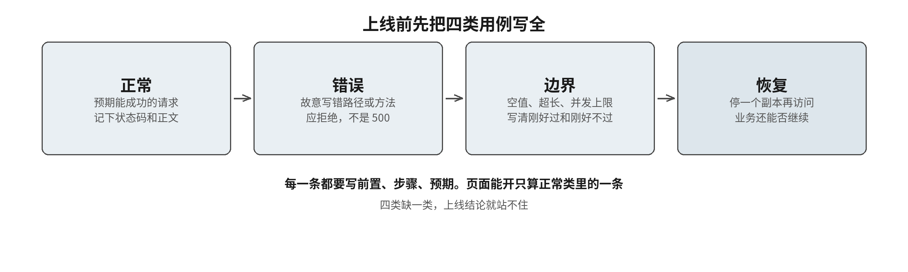
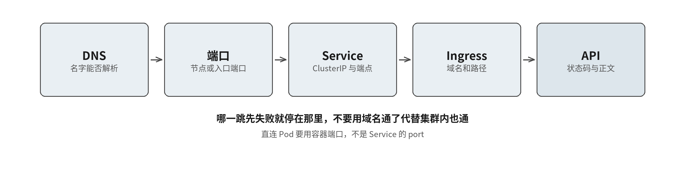
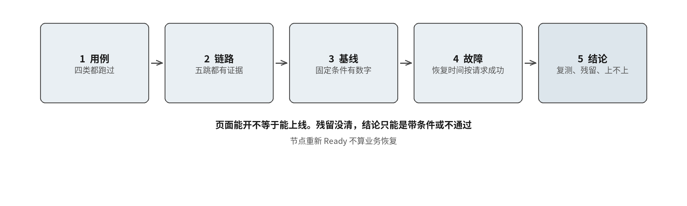

# 第24讲 功能验收与上线检查

**本课程定位：** 面向自建智算中心运维。第 19 到 23 讲把应用发上去、入口打通、数据留住、高可用配好、包也打好了。本讲解决下一件事：这套东西能不能上线。运维要会写用例、按跳核对、记下性能数字，还要在受控故障后给出结论。

同事说“页面能开，可以上了”。你问四个问题：错路径会怎样？空请求会怎样？固定并发下延迟是多少？停掉一个 Pod，业务要多久才回来？本讲就练这四件事，以及复测和残留检查。

## 本讲学习目标

学完后，你应能：

- 按正常、错误、边界、恢复四类写出用例，每条都有前置、步骤和预期。
- 沿 DNS、端口、Service、Ingress、API 逐跳核对，哪一跳失败就停在那里。
- 用固定并发、时长和同一入口跑一遍压测，记下吞吐、延迟和失败数当基线。
- 注入一次可恢复故障，记录从故障发生到请求重新成功的时间。
- 复测功能与性能，列出残留，给出通过、带条件或不通过的上线判断。

## 24.1、为什么页面能开还不够

第 20 讲三种访问都通，只说明当时那几条路是通的。上线要回答另一句话：在约定条件下，对的请求能成功，错的请求被拒绝，坏了一个副本还能恢复，并且数字可复测。

功能验收看行为对不对。性能基线看固定条件下有多快、失败多少。故障恢复看从坏到请求再成功用了多久。这三份证据不能互相代替。只截一张首页，给不出上线结论。

【关键区别】“能访问”是正常类里的一条。上线判断要四类用例都跑过，还要有基线和恢复时间。

<!-- pagebreak -->

## 24.2、先写四类用例

用例是一条可重复的检查。至少写三栏：前置条件、步骤、预期结果。预期要写成能对照的状态码、正文或页面字段，不要写“差不多就行”。

表24-1、四类用例各查什么

| 类型 | 你在测什么 | 预期怎么写 |
| --- | --- | --- |
| 正常 | 约定好的成功路径 | 200 或业务约定码，正文符合样例 |
| 错误 | 不该成功的输入 | 4xx 或约定拒绝，不是把后端打成 500 |
| 边界 | 刚好合法和刚好非法 | 空值、超长、上下限各有一条 |
| 恢复 | 坏了一个副本之后 | 请求仍成功，或在记下的时间内恢复 |

正常类：健康检查、模型列表、一条真实业务请求。入口用第 20 讲已经打通的那条，集群内、节点外、域名不要混着用一次成功代替另外两次。

错误类：错误 Host、错误路径、错误方法。预期是拒绝。Ingress 未匹配时常进默认后端，表现为 404。这不是 Pod 挂了。把状态码写进用例，报障时少走弯路。

边界类：空 body、缺字段、超长输入、并发刚好到你准备压的那个数。合法边界应成功，非法边界应拒绝。不要只测中间值。

恢复类：删一个 Pod，或在可恢复窗口内停一台节点。预期不是“控制器会补”，而是“请求重新成功”。Running 不等于 Ready。未就绪的副本不进 Service。

**【例题】** 推理接口约定 POST `/v1`，JSON 必须有 `prompt`。写出一条错误用例和一条边界用例的预期。

**解：** 错误：GET `/v1` 或 POST `/v2`，预期 404 或 405，后端日志不应出现推理失败栈。边界：`prompt` 为空字符串，按接口约定应 400 或返回明确拒答，不应 200 且空内容。两条都要写清用哪个入口测。

【随堂思考】测试同学只交了“打开域名能看到欢迎页”。缺了哪三类？上线会上你会怎么回应？

## 24.3、按五跳核对链路

不通时按跳走。哪一跳先失败就停在那里。不要用域名通了证明集群内也通。

表24-2、五跳核对

| 跳 | 从哪里测 | 怎么测 | 通过的标志 |
| --- | --- | --- | --- |
| DNS | 同命名空间调试 Pod | nslookup 服务名 | 解析到 ClusterIP |
| 端口 | 能连节点的机器 | 访问 节点IP:NodePort | 端口有响应 |
| Service | 调试 Pod | 访问 ClusterIP:port | 应用有正确响应 |
| Ingress | 机房电脑 | 访问域名和路径 | 打到预期后端，不是默认 404 |
| API | 与业务相同的客户端 | 按用例发请求 | 状态码和正文符合预期 |

先确认 Service 对象在。没有对象，名字一定解析不了。同命名空间用短名。跨命名空间要写全名。能解析却无响应，看 EndpointSlice。地址为空，先对选择算符和 Pod 标签，再看 Ready。端点有地址时，直连用 Pod 的容器端口，不是 Service 的 port。直连通、ClusterIP 不通，再查 kube-proxy。

域名失败、集群内 Service 却通，问题在 Ingress。只创建 Ingress 对象没有效果，必须有控制器在跑。host 或 path 对不上，请求进默认后端。证书报错是 TLS，不是后端挂了。

【关键区别】404 是规则没匹配。连接拒绝是端口或网络。超时可能是应用慢或没有就绪端点。报障时把跳数和状态码分开说。

## 24.4、固定条件记下性能基线

基线是一份可复测的数字，不是“感觉挺快”。先固定四件事：入口 URL、并发、时长或总请求数、同一份数据。改其中任何一项，数字就不能直接比。

课堂可用 hey。它向一个 URL 发固定次数或固定时长的 HTTP 请求。`-n` 是总请求数，默认 200。`-c` 是并发 worker 数，默认 50。总请求数不能小于并发。`-z` 是时长，例如 `10s`、`3m`。指定了时长，就忽略 `-n`。单请求超时默认 20 秒。输出默认是摘要，也可用 csv。

需要按用户行为编排多条请求时，用 Locust。它用并发用户模拟访问，看吞吐、响应时间和错误。无界面跑可加 `--headless`，`-u` 是峰值用户数，`-t` 是时长，时长从测试开始算，不是从加满用户算。默认 HTTP 状态码小于 400 算成功。可按失败率、平均延迟、P95 设是否通过。`--csv` 会写出统计和失败文件。Locust 不是浏览器，不会去加载页面里的静态资源。

表24-3、基线记录要写上的条件

| 字段 | 为什么要写 |
| --- | --- |
| URL 与方法 | 换入口数字会变 |
| 并发与时长 | 换了就不能和上次比 |
| 工具与参数 | hey 的 -c/-z 或 Locust 的 -u/-t |
| 吞吐、延迟、失败数 | 故障后和复测时对照 |
| 采样时刻 | 和故障时间线对齐 |

一次压测不能外推到所有负载。结论只能写：在这次固定条件下，吞吐和延迟是多少。偏离以后再调优，先要有这份数。

**【例题】** 有人跑 `hey -c 80 -n 50 https://infer.lab.example/v1`。命令会怎样？怎样改才像一份基线？

**解：** 总请求数小于并发，不符合工具约定。改成 `-c 20 -n 200`，或改成 `-c 20 -z 30s` 并写明忽略请求个数。同一 URL、同一方法，把摘要里的吞吐、延迟、失败数抄进基线表。

【随堂思考】压测时失败率升高。有人说“把并发再加大就能看出极限”。你先查哪两样，而不是先加并发？

## 24.5、受控故障与恢复时间

故障要可恢复、可记录。课堂两种做法：删一个应用 Pod；或在可恢复窗口内 drain 一台节点。不要直接断电生产机。drain 是自愿干扰，PDB 会管。节点真的失联是非自愿，PDB 挡不住。

先记基线时刻的 Ready 数和一次成功请求。再注入故障，记下时刻。控制器会按副本数补 Pod。普通 Pod 在节点 NotReady 后还可能绑大约 300 秒。不要把这段等待判成“自愈失败”。

恢复时间的口径要写死：从故障发生，到连续若干次业务请求成功，中间隔了多少秒。节点重新 Ready、新 Pod 变成 Running，都不算恢复完成。未就绪副本不进流量。

表24-4、故障演练要记下的时间点

| 步骤 | 你看到什么 | 通过的标志 |
| --- | --- | --- |
| 故障 | 副本少了或节点 NotReady | 记下时刻，不再改别的对象 |
| 补偿 | 新 Pod 出现 | 标签和副本数对得上 |
| 恢复 | 请求按正常用例成功 | 业务恢复时刻 |
| 复测 | 四类用例和基线再跑一遍 | 数字可对照，残留单另列 |

行业里会给核心业务写恢复时间目标。那是目标，不是集群默认保证。课堂以实测秒数为准。

【关键区别】删 Pod 测的是控制器补副本。停节点测的是跨节点调度。两种故障不要写成同一次演练。

## 24.6、复测、残留与上线结论

故障恢复后必须复测。功能按四类用例再跑。性能用同一组基线条件再跑。数字变差要写进报告，不要只说“已经恢复”。

残留是演练留下的东西：调试 Pod、临时 NodePort、错误镜像、drain 后未 uncordon 的节点、还在 Terminating 的对象。清单上每一条都要有处理人或计划。残留未清，不能给无条件通过。

表24-5、三种上线结论

| 结论 | 什么时候用 | 你还要写什么 |
| --- | --- | --- |
| 通过 | 四类用例、五跳、基线、恢复、复测都达标，残留已清 | 证据位置和责任人 |
| 带条件通过 | 次要项未过，不影响约定的成功路径 | 条件、补证时间和阻断项 |
| 不通过 | 正常请求失败，或恢复时间不可接受，或残留会伤生产 | 明确不上线 |

上线前还要看安全评估是否完成。带病上线会把不可控风险带进生产。本讲不展开安全扫描细节，但结论栏要能勾：该查的查了，该留的残留写了。

**【例题】** 四类用例都过。停 Pod 后 40 秒请求恢复。复测时基线延迟从 80 毫秒变成 300 毫秒。节点还在 SchedulingDisabled。结论怎么写？

**解：** 不能写通过。功能恢复了，但性能复测偏离基线，且有残留节点未 uncordon。至少是带条件：先 uncordon、再按同一条件压一遍，延迟回到约定范围才能过。若业务把延迟 300 毫秒视为不可接受，就写不通过。

<!-- pagebreak -->

## 24.7、本讲回顾与自测

学习完本讲后，试着用自己的话回答四个问题：四类用例各证明什么？五跳里第一跳失败说明什么？基线为什么必须写并发和时长？恢复时间为什么不能停在 Running？能说清条件，比交一叠截图更重要。

表24-6、本讲目标与对应判断

| 学习目标 | 应能做出的判断 |
| --- | --- |
| 写用例 | 正常、错误、边界、恢复都有前置和预期 |
| 核链路 | 按 DNS、端口、Service、Ingress、API 停在第一处失败 |
| 建基线 | 固定 URL、并发、时长，记下吞吐和延迟 |
| 做故障 | 分清删 Pod 和停节点，恢复看请求成功 |
| 给出结论 | 复测加残留，再选通过、带条件或不通过 |

### 24.7.1、本讲自测

**1 用例。** 只测了“域名打开是欢迎页”。补一条错误用例和一条恢复用例，写出预期。

**2 链路。** nslookup 成功，curl ClusterIP 失败，curl PodIP:容器端口成功。停在哪一跳？下一步看什么？

**3 基线。** 为什么指定 `-z 30s` 之后不要再拿 `-n 200` 当条件？并发 50、总请求 20 为什么不行？

**4 恢复。** 节点已经 Ready，请求仍 502。恢复完成了吗？还缺哪条证据？

**5 残留。** 列出演练后至少两项必须写进残留单的对象。

**6 场景描述。** 给已部署的推理服务做出上线判断。列出你要提交的用例表、五跳记录、基线数字、故障时间线和结论。

**答：**

____________________________

____________________________

## 24.8、参考答案与解析

### 24.8.1、随堂思考解析

**思考 1（只有欢迎页）：** 缺错误、边界、恢复。上线会只证明首页能开，不证明错路径被拒绝、空输入有约定行为、坏副本后还能服务。请对方补这三类，每条写预期状态码。

**思考 2（先加并发）：** 先看失败是 4xx 还是超时、是不是已经打到未就绪副本。再核对这次是否还用同一 URL 和同一时长。条件变了，数字不能当极限。先稳住基线，再按阶梯加并发。

### 24.8.2、课后自测解析

**1** 错误：访问错误 Host 或 `/wrong`，预期 404，集群内 Service 仍通。恢复：删一个副本，预期在记下的时间内请求再成功，Ready 数回到声明值。

**2** 停在 Service 到 Pod 的代理。先核 port 与 targetPort，再看 kube-proxy 和 EndpointSlice 端口列。不要先改镜像。

**3** `-z` 指定时长时忽略 `-n`，再写 200 次会误导复测。并发不能大于总请求数，50 大于 20，命令不成立。

**4** 没有完成。还缺按正常用例连续成功的请求记录。502 说明入口或后端仍未就绪。

**5** 例如：未 uncordon 的节点、临时调试 Pod、仍为 SchedulingDisabled 的污点、演练用的错误 Ingress 规则。每一条写处理人。

**6** 提交：四类用例表；五跳各一次命令和结果；hey 或 Locust 的条件与吞吐、延迟、失败数；故障时刻、补偿时刻、请求成功时刻；复测对比；残留单；结论三选一。

<!-- pagebreak -->

## 24.9、术语

表24-7、本讲术语

| 术语 | 本讲中的含义 |
| --- | --- |
| 用例 | 一条可重复检查，含前置、步骤、预期。 |
| 正常 / 错误 / 边界 / 恢复 | 四类验收。缺一类，上线结论不完整。 |
| 五跳 | DNS、端口、Service、Ingress、API。 |
| 基线 | 固定条件下的吞吐、延迟、失败数。 |
| hey | HTTP 压测工具。-c 并发，-n 次数，-z 时长。 |
| Locust | 按并发用户压测。可看失败率与百分位延迟。 |
| 恢复时间 | 从故障发生到业务请求重新成功的间隔。 |
| 残留 | 演练留下、上线前必须处理的对象。 |
| 上线结论 | 通过、带条件通过、不通过。 |

文中域名 infer.lab.example、路径 `/v1` 与工具参数均为教学示例。实际入口、并发和通过标准以本单位上线规范为准。

<!-- md-only -->

## 附：主要参考资料（仅 Markdown 保留，不印入 Word/PDF）

以下资料与课程资料中的编号一一对应。PDF 页码指本地 PDF 的文件页序；网页资料保存于 2026 年 11 月 9 日。

- 中国信通服务《2025 算力运维体系技术白皮书》（本地 PDF）。第 21 页用于性能基线；第 25 页用于恢复演练口径；第 54–56 页用于上线评估与压测并列。正文不点名，不把 15 分钟写成集群默认值。摘录见《01_本地文档摘录.md》L1。
- Kubernetes《调试 Service》。用于 24.3 逐跳顺序。资料编号 W01。
- Debian hey(1)。用于 24.4 的 -n、-c、-z 与默认超时。资料编号 W02。
- Locust What is Locust / Writing a locustfile / running without web UI / configuration。用于并发用户、时长、失败率、P95、csv。资料编号 W03–W05。
- Kubernetes Ingress、干扰与 PDB、ReplicaSet、Service、探针。用于链路、故障与 Ready。资料编号 W06–W10。

本讲引用的在线资料，其原始网址、获取时间与原文校验值记录在资料目录《01_讲义补充资料_20261109/README.md》与《来源元数据_20261109.json》中。ISTQB 词条页未取得可用定义，四类用例按课程大纲命名。hey GitHub README 本次 404，以 Debian 手册页为准。

<!-- /md-only -->
