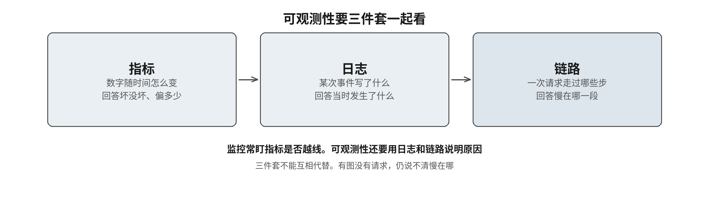
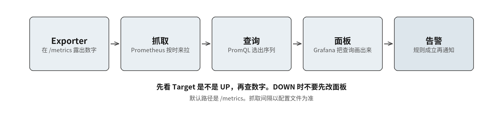
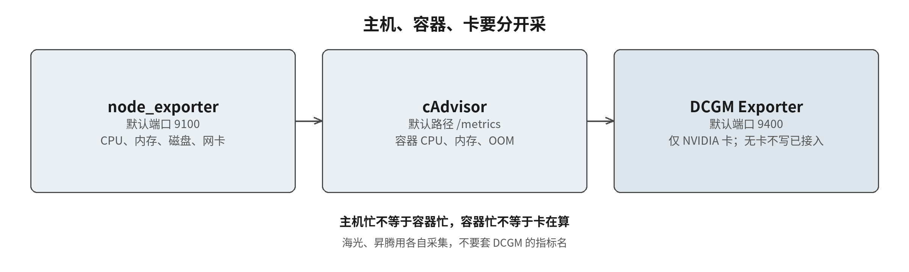
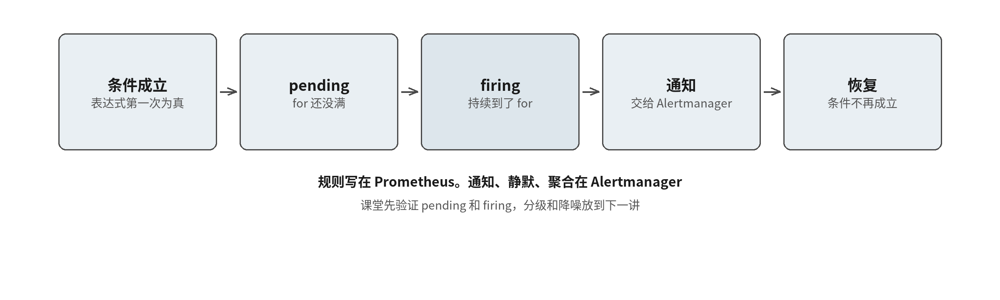

# 第25讲 监控与可观测性

**本课程定位：** 面向自建智算中心运维。第 24 讲证明功能能过、基线有数。本讲解决下一件事：坏了能不能看见、看见了能不能说明原因。运维要把指标拉起来，把日志和一次请求串起来，还要写出能触发的告警规则。

同事说“Grafana 已经有图了”。你问四个问题：Target 是不是 UP？这次请求有没有对应的日志？慢在哪一段？规则到没到 firing？本讲就练这四件事。分级、降噪和复盘放到下一讲。

## 本讲学习目标

学完后，你应能：

- 分清监控和可观测性：前者看坏没坏，后者还要能说明为什么。
- 说出 Prometheus 怎样抓取 `/metrics`，并能根据 Target 状态判断抓取是否成功。
- 为主机、容器分别接入采集；有 NVIDIA 卡时再接 GPU 指标，无卡不写已接入。
- 在 Grafana 用一条 PromQL 画出面板，并能用 Loki 按标签查日志。
- 写出一条带 `for` 的告警规则，区分 pending 和 firing。

## 25.1、为什么有图还不够

第 24 讲记下了吞吐和延迟。那是一次压测的结果。上线之后还要持续看见：机器忙不忙、容器有没有被杀、请求慢在哪一步。只截一张面板，回答不了“为什么慢”。

监控看约定指标有没有越线。可观测性还要能把一次异常说清楚：哪台机器、哪个容器、哪次请求、哪一段耗时。指标给出趋势。日志给出当时写了什么。链路给出请求走过的步骤。三件套不能互相代替。

智算现场组件多。主机、容器、加速卡、网络都可能先坏。只看一张主机 CPU 图，分不清是卡在算、容器在重启，还是入口在排队。

【关键区别】监控回答“坏没坏”。可观测性还要回答“为什么”。面板能开，只证明展示层通了。

## 25.2、Prometheus 按时来拉

Prometheus 把指标存成时间序列。每条样本有名字、时间戳，还可以带标签。标签是键值对，用来区分任务、实例、模式。它用 HTTP 去拉，不是应用把数字推过来。被抓的程序要在约定路径露出文本。默认路径是 `/metrics`。

抓取任务写在配置文件里。`job_name` 会变成标签 `job`。目标地址会变成标签 `instance`。全局抓取间隔在配置方案里默认 1 分钟，超时默认 10 秒，且超时不能长过间隔。入门示例常把间隔写成 15 秒。课堂以你这份配置文件为准，不要背成“系统一定是 15 秒”。

打开 Target 页，看每个目标是 UP 还是 DOWN。UP 表示这次抓到了。DOWN 表示这次没抓到。查询 `up == 0` 能列出当前抓失败的实例。先修抓取，再改面板。面板空白，经常是目标没 UP，不是 Grafana 坏了。

PromQL 分两种用法。表视图是即时查询，看某一个时刻。图视图是范围查询，看一段时间内的点。选序列可以写标签，`=` 是精确匹配。计数类指标要配时间窗再用 `rate()`，不要直接拿累计值当速度。查询回看默认大约 5 分钟。目标消失后，旧序列会被标成过期，图上会断。

表25-1、抓取这一层先核对什么

| 检查项 | 你在看什么 | 通过的标志 |
| --- | --- | --- |
| 路径 | 目标是否露出指标 | `/metrics` 能打开，有样本 |
| 配置 | job 和 targets 是否写对 | Target 页能看到该任务 |
| 状态 | 这次抓没抓到 | 状态为 UP |
| 查询 | 名字和标签是否对 | 表视图能出序列 |

**【例题】** Target 页里 `node` 任务是 DOWN。Grafana 主机面板是空的。先查哪一层？

**解：** 先查抓取。确认 9100 端口是否在听、`/metrics` 能否打开、配置里的地址是否写对。DOWN 时不要先改面板查询。目标恢复成 UP 之后，再到表视图跑 `node_cpu_seconds_total`，确认能出样本。

【随堂思考】有人把抓取间隔改成 5 秒，又把超时写成 15 秒。配置能不能生效？你怎么改？

## 25.3、主机、容器、卡要分开采

Exporter 是专门露出指标的程序。Prometheus 不登录机器算 CPU，它去拉 Exporter。主机、容器、加速卡不是同一套数字。不要用一张图代替三层。

node_exporter 采主机。默认端口 9100。指标名多以 `node_` 开头。常见的有 CPU 时间、可用磁盘、网卡收发。它回答的是这台机器忙不忙，不回答某个容器忙不忙。

cAdvisor 采容器。默认在 `/metrics` 露出样本。指标名多以 `container_` 开头。常见的有累计 CPU、工作集内存、文件系统用量、OOM 次数。容器被杀，应能在这里看到对应事件，而不是只看主机内存。

GPU 指标要另接。NVIDIA 环境用 DCGM Exporter。默认监听 9400，路径仍是 `/metrics`。采集间隔默认 30 秒。常见字段有温度、功耗、已用显存、Xid 错误。它按节点部署，有卡的节点才有这些序列。没有 NVIDIA 卡，就写“本环境未接入 GPU 指标”，不要把空图说成卡空闲。海光、昇腾用各自的采集命令和导出器，不要套 `DCGM_` 开头的名字。

表25-2、三类采集各看什么

| 采集 | 默认入口 | 主要前缀 | 它能证明什么 |
| --- | --- | --- | --- |
| node-exporter | 9100 /metrics | node_ | 这台主机的 CPU、内存、磁盘、网卡 |
| cAdvisor | /metrics | container_ | 这个容器的 CPU、内存、OOM |
| DCGM Exporter | 9400 /metrics | DCGM_ | 这张 NVIDIA 卡的温度、功耗、显存 |

【关键区别】主机忙不等于容器忙。容器忙不等于卡在算。缺哪一层，就不要对那一层下结论。

## 25.4、Grafana 把查询画成面板

Grafana 负责展示。它不代替 Prometheus 去抓。每个面板至少要有一条查询。没有查询，面板只是空框。

做法很短。新建仪表盘，添加可视化。选 Prometheus 数据源，写入 PromQL。刷新看预览，再保存。查询语言跟数据源走。Prometheus 面板写 PromQL。Loki 面板写 LogQL。不要把两种语句写进同一个查询框。

值班面板至少四类：请求是否成功、延迟、错误、资源。资源再按主机、容器、卡分开。时间范围要和一次真实请求对上。发一条请求，再把时间窗缩到那一两分钟，看曲线有没有动。曲线不动，先核对标签是不是选错实例。

变量可以按实例或任务筛选。课堂先固定一个实例跑通，再加变量。图能开，不等于查询对。要以表视图或 Explore 里能查出同一条序列为准。

**【例题】** 面板写了 `rate(node_cpu_seconds_total[1m])`，图是空的。Target 却是 UP。下一步看什么？

**解：** 先在 Prometheus 表视图跑同一条语句。若表视图有数、Grafana 没有，查数据源地址和时间范围。若表视图也空，再看指标名和标签是否写对，不要先改图的颜色。

【随堂思考】同事只交了一张全是绿色的截图。截图上没有查询语句、没有时间范围、没有实例名。你还要他补哪三样？

<!-- pagebreak -->

## 25.5、日志按流查，请求按链路串

表25-3、三件套各回答什么

| 信号 | 你拿到的是 | 适合问什么 | 不适合单独当什么 |
| --- | --- | --- | --- |
| 指标 | 带标签的数字序列 | 有没有越线、趋势如何 | 某一次请求的原文 |
| 日志 | 带标签的行 | 当时打印了什么 | 跨服务的先后顺序 |
| 链路 | 同一 trace_id 的一组 span | 慢在哪一步、哪一步失败 | 主机磁盘还有多少 |

Loki 存日志。它和 Prometheus 像，但管的是日志不是数字。采集端给日志打上标签，再推给 Loki。Loki 只索引这些标签，不把每一行正文做成全文索引。标签选得少而稳，查询才快。乱打高基数标签，查询会慢，存储也会胀。

查日志先写流选择器，例如 `{job="infer", namespace="lab"}`。再过滤行：`|= "error"` 表示行里要有这段文字。`!= "timeout"` 表示不要含 timeout。过滤尽量靠前，少解析无效行。课堂先按命名空间和 Pod 名缩小范围，再搜关键词。不要一上来全库搜 error。

EFK 是另一类做法：采集端加 Elasticsearch 再加 Kibana。大纲把 Loki 和 EFK 并列。本讲以 Loki 为主。机房若已有 Elasticsearch，查询入口会不同。“先缩小对象，再按时间窗搜”这一步不变。保留多久以本环境配置为准，不要把资料里的天数当成 Loki 默认值。

链路回答另两个问题：这次请求经过哪些服务，哪一段最慢。一条链路有一个 `trace_id`。每一步是一个 span，带自己的 `span_id`。子步骤记下父步骤的编号。同一条请求无论跨几个进程，只要把上下文传下去，就能拼回一棵树。根 span 没有父编号。某一步失败，可以把状态标成 Error。

后端可以选 Jaeger 或 Tempo。Jaeger 常用界面端口 16686，也收 OTLP。Tempo 和 Grafana、Loki 同一套展示更顺。课堂二选一即可。应用必须先埋点。只把后端起起来，没有探测数据，界面里查不到那次请求。把一次请求的时间窗、实例名、`trace_id` 记在同一张纸上。下一讲排障时，这三项就是入口。

## 25.6、先写出能触发的规则

告警分两层。Prometheus 负责判断“现在坏了没有”。Alertmanager 负责通知、合并、静默。本讲先把第一层写对。没有 firing，后面的通知渠道无从验证。

规则写在规则文件里，由 Prometheus 定时计算。表达式在某一组标签上成立，这条告警对这组标签就是 active。加了 `for`，刚成立时是 pending。持续到 `for` 时长仍成立，才变成 firing。没写 `for`，第一次计算就可以直接 active。课堂建议加上 `for`，避免一次空抓取就喊人。

可落地的第一条常用 `up == 0`，`for` 写成几分钟。含义是：这个抓取目标连续一段时间都没拉到。标签里写严重级别，注释里写实例名和任务名。到 Prometheus 的 Alerts 页，应能看到 pending 或 firing。还可以查 `ALERTS` 这条合成序列。

验证不要只看规则文件保存成功。要故意让目标挂一会儿，等到 pending，再等到 firing。然后把目标恢复，看告警是否结束。截图要带规则名、状态和时间。通知渠道、值班排班放到第 26 讲。

表25-4、一条规则要写清的字段

| 字段 | 作用 |
| --- | --- |
| alert | 规则名，排障时用来对记录 |
| expr | PromQL 条件，成立才进入 active |
| for | 持续多久才从 pending 变成 firing |
| labels | 额外标签，例如严重级别 |
| annotations | 给人看的说明，可引用实例名 |

**【例题】** 规则是 `up == 0`，`for: 5m`。你把 node_exporter 停了 1 分钟又拉起来。会不会收到 firing？

**解：** 不会。1 分钟短于 `for`。最多看到 pending，随后条件不再成立，告警结束。要验证 firing，目标 DOWN 的时间必须超过 5 分钟，并且计算周期里每次都成立。

【关键区别】规则文件能加载，只说明语法对。告警有没有用，要看 Alerts 页是否出现过 pending 和 firing。

<!-- pagebreak -->

## 25.7、本讲回顾与自测

学习完本讲后，试着用自己的话回答四个问题：监控和可观测性差在哪？Target DOWN 时为什么先不改面板？主机指标为什么不能代替容器指标？`for` 没满时告警处在什么状态？能说清条件，比交一叠绿图更重要。

表25-5、本讲目标与对应判断

| 学习目标 | 应能做出的判断 |
| --- | --- |
| 分清概念 | 有图只证明能展示；原因还要日志和链路 |
| 抓取 | 先看 `/metrics` 和 Target UP |
| 三类采集 | 主机、容器、卡分开，无卡不写已接入 |
| 面板与日志 | 面板有查询；日志先选流再过滤 |
| 告警 | 能指出 pending 和 firing 的差别 |

### 25.7.1、本讲自测

**1 概念。** 同事说“监控已经覆盖可观测性，因为面板有 CPU 图”。你怎么回应？

**2 抓取。** Grafana 空白，Target 页该任务是 DOWN。写出你的前两步。

**3 采集。** 只有 node_exporter 是 UP。有人说“GPU 利用率是 0，卡是空闲的”。这个结论成立吗？

**4 日志。** 为什么查询要先写 `{job="infer"}`，而不是先全库搜 error？

**5 告警。** `up == 0` 且 `for: 5m`。目标 DOWN 了 2 分钟。此时是 pending 还是 firing？

**6 场景描述。** 给已部署的推理服务接监控。列出你要提交的 Target 证据、三类采集各一条查询、面板截图要求和一条告警验证记录。

**答：**

____________________________

____________________________

## 25.8、参考答案与解析

### 25.8.1、随堂思考解析

**思考 1（间隔和超时）：** 不能这样配。超时不能长过抓取间隔。应把超时改到间隔以内，例如间隔 15 秒、超时 10 秒。改完要重载配置，再看 Target 页。

**思考 2（只有绿图）：** 补查询语句、时间范围、实例或 job 标签。还要有一条真实请求的时间点，证明图上的变化对得上这次请求。没有这三样，绿图不能当交接证据。

<!-- pagebreak -->

### 25.8.2、课后自测解析

**1** 覆盖不了。CPU 图只说明主机层有数字。还缺这次请求的日志、链路，以及规则是否 firing。可观测性要能说明为什么，不是多一张图。

**2** 先打开目标的 `/metrics`，确认进程和端口。再核对配置里的地址、路径、job 名。DOWN 未消除前，不改 Grafana 查询。

**3** 不成立。没有 GPU 采集，不能对卡下结论。应写“本环境未接入 GPU 指标”。有 NVIDIA 卡再接 DCGM Exporter，并确认 9400 为 UP。

**4** Loki 只索引标签。先用标签把流缩小，再过滤行。全库搜正文又慢又容易打偏。过滤尽量写在解析前面。

**5** pending。2 分钟不到 5 分钟。firing 要等条件持续满足 `for`。

**6** 提交 Target 页：node、容器、可选 GPU 为 UP，或写明未接入。再交 `node_`、`container_`、可选 `DCGM_` 各一条查询。Grafana 面板要有查询、时间窗和实例。还要有一条 `up == 0` 从 pending 到 firing 再恢复的记录。无卡环境必须写明 GPU 项未测。

<!-- pagebreak -->

## 25.9、术语

表25-6、本讲术语

| 术语 | 本讲中的含义 |
| --- | --- |
| 监控 | 看约定指标有没有越线。 |
| 可观测性 | 还能用指标、日志、链路说明为什么。 |
| 时间序列 | 带时间戳的数字，可附标签。 |
| 抓取 / scrape | Prometheus 用 HTTP 去拉 `/metrics`。 |
| Target UP | 这次抓取成功。DOWN 表示没抓到。 |
| PromQL | Prometheus 的查询语言。 |
| node-exporter | 主机指标。默认端口 9100。 |
| cAdvisor | 容器指标。默认路径 `/metrics`。 |
| DCGM Exporter | NVIDIA GPU 指标。默认端口 9400。 |
| Grafana | 把查询画成面板。每个面板至少一条查询。 |
| Loki / LogQL | 按标签存日志；先选流再过滤行。 |
| trace / span | 一次请求 / 请求中的一步。靠 trace_id 串。 |
| pending / firing | 告警已成立但未满 for / 已满 for。 |

文中 job 名 infer、命名空间 lab、端口 9100/9400 均为教学示例。实际地址、抓取间隔和告警阈值以本环境配置为准。

<!-- md-only -->

## 附：主要参考资料（仅 Markdown 保留，不印入 Word/PDF）

以下资料与课程资料中的编号一一对应。PDF 页码指本地 PDF 的文件页序；网页资料保存于 2026 年 11 月 9 日。

- 中国信通服务《2025 算力运维体系技术白皮书》（本地 PDF）。第 11 页用于全局可观测性不足；第 23、25–26 页用于 Prometheus、全链路与日志聚合；第 30、41、55–56 页用于告警触发与监控岗位。正文不点名，不把 20%、100 ms、90 天写成工具默认值。摘录见《01_本地文档摘录.md》L1。
- Prometheus Overview / First steps / Configuration。用于拉模型、抓取、Target。资料编号 W01、W02。
- Prometheus Querying basics。用于 PromQL 与 lookback。资料编号 W03。
- Node Exporter 指南；cAdvisor Prometheus 指标。用于主机与容器采集。资料编号 W04。
- NVIDIA DCGM Exporter。用于 GPU 采集。资料编号 W05。
- Grafana Create dashboards。用于面板至少一条查询。资料编号 W06。
- Prometheus Alerting overview / Alerting rules。用于规则与 pending/firing。资料编号 W07。
- Grafana Loki overview / LogQL。用于只索引标签、先选流。资料编号 W08。
- OpenTelemetry Traces；Jaeger Getting Started；Tempo Introduction。用于链路与后端二选一。资料编号 W09、W10。

本讲引用的在线资料，其原始网址、获取时间与原文校验值记录在资料目录《01_讲义补充资料_20261109/README.md》与《来源元数据_20261109.json》中。Grafana 独立数据源配置页未单抓，以面板创建页为准。EFK 不单独部署。

<!-- /md-only -->
