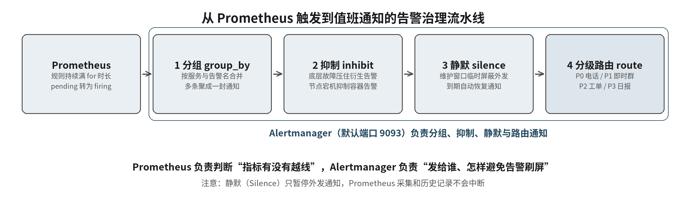
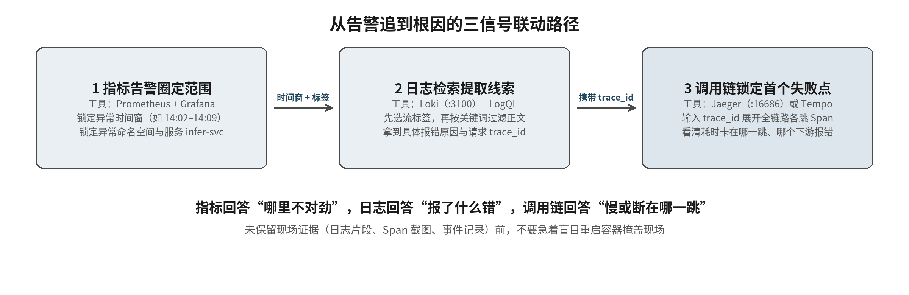
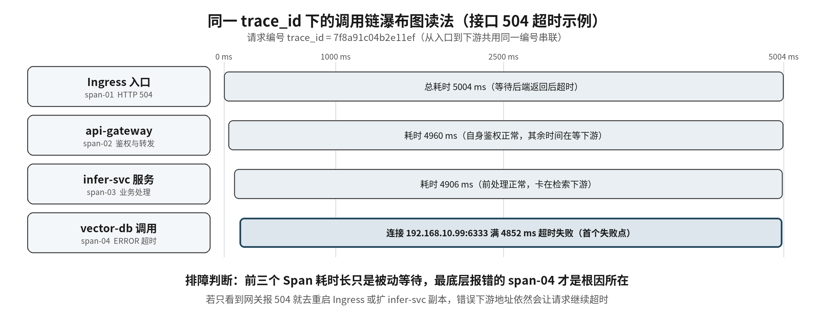
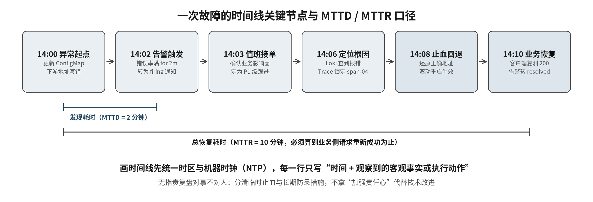

# 第26讲 告警、日志与故障定位

**本课程定位：** 第 25 讲已经搭建起 Prometheus 指标采集、Grafana 面板、Loki 日志流与链路追踪，并写出了能从 `pending` 转为 `firing` 的告警规则。本讲承接告警触发之后的下半场工作：怎样给告警分级降噪、怎样顺着时间窗把指标、日志与调用链串起来找到根因，以及怎样在恢复服务后还原时间线并写出复盘报告。本讲也是第五章《可观测性》的收官讲，学完的方法将直接用于后续 AI 推理服务的线上排障。

凌晨两点，值班手机在 1 分钟内连响 40 多声。同时，业务群反馈推理域名 `https://infer.lab.example/v1` 大面积返回 504 超时。面对刷屏的告警通知，先响应哪一条？怎样在几分钟内看清是网关挂了、推理容器重启了，还是下游依赖超时？服务恢复后又该怎样整理时间线，避免同类故障下周重演？本讲围绕这四个现场问题展开。

## 本讲学习目标

学完后，你应能：

- 按业务影响范围和紧迫程度划分 P0～P3 告警级别，并用 Alertmanager 的分组、抑制、静默、路由四项机制减少无效打扰。
- 根据告警触发时间窗，在 Loki 中按“流标签选择 + 正文过滤”快速提取报错日志与 `trace_id`。
- 在 Jaeger 或 Tempo 中读懂调用链瀑布图，区分“被动等待耗时”与“首个失败点”。
- 独立跑通一次服务故障模拟演练，完成从告警接单、证据留存、配置回退到客户端复测的完整处置。
- 按统一时钟还原故障六个关键时刻，算清发现耗时（MTTD）与恢复耗时（MTTR），写出对事不对人的复盘报告。

## 26.1、告警分级与降噪管理

如果把每一条指标越线都做成电话呼叫，值班工程师不出三天就会陷入“告警疲劳”，真正致命的核心故障反而会被淹没在刷屏消息里。管好告警的第一步是先定轻重缓急，再做合并降噪。

### 26.1.1、按业务影响程度给告警分级

告警级别不由单个硬件数字拍脑袋决定，而要看**外部用户或关键任务受到了多大影响、有没有冗余保护**。生产运维通常把告警分为四级。

<!-- pagebreak -->

表26-1、常见告警级别与响应要求

| 告警级别 | 业务影响判据 | 典型算力运维场景 | 通知渠道与响应要求 |
| --- | --- | --- | --- |
| P0 | 核心业务中断或大面积报错，无自动容灾切换 | 在线推理入口 `infer-svc` 5xx 错误率超 20%，整池算力不可调度 | 电话语音 + 即时通讯群，立即接手处置（如 5 分钟内响应） |
| P1 | 核心业务明显降级，或单点冗余已失效 | 推理延迟翻倍，服务器双路电源掉一路，某台算力节点失联但副本已迁移 | 即时通讯群 + 短信，值班时段内尽快介入（如 15 分钟内响应） |
| P2 | 非核心异常或容量预警，暂不影响当前请求 | 数据盘使用率超 80%，测试命名空间 `retail-dev` 单容器重启 | 工单系统或邮件，工作时间内排期处理 |
| P3 | 提示性信息或低优先级波动 | 批处理任务轻微排队，节点温度略升但未达降频线 | 仅记录面板或合并进每日巡检日报，不主动打断值班人员 |

【关键区别】“指标幅度大”不等于“告警级别高”。例如测试环境 `lab` 里某台容器 CPU 跑到 99%，由于不影响生产用户，顶多算 P2 或 P3；反过来，生产环境 `algo-prod` 的推理接口成功率从 99.9% 掉到 85%，数字只变了十几个百分点，却直接导致大批用户请求失败，必须按 P0 响应。

### 26.1.2、Alertmanager 的四项降噪与路由分工

第 25 讲讲过，Prometheus 负责周期性评估告警表达式：条件刚满足时进入 `pending` 观察期，持续满 `for` 设定时长（例如 `2m`）才转为 `firing`，避免瞬时毛刺误报。一旦状态变为 `firing`，Prometheus 就把告警事件推送给 **Alertmanager**（默认监听端口 `9093`），由 Alertmanager 负责后续的降噪和投递。



Alertmanager 主要靠四项机制把杂乱告警整理成清晰通知：

- **分组（Grouping）**：通过 `group_by` 把性质相同的多条告警合并成一封通知。例如同一服务 16 个 Pod 同时连不上数据库，按 `alertname`、`namespace`、`service` 分组后，值班群只收到 1 条汇总消息（内含 16 个实例明细），而不是连弹 16 次窗口。
- **抑制（Inhibition）**：通过 `inhibit_rules` 让底层根源告警压住上层衍生告警。例如工作节点 `k8s-node-02` 整机断网失联时，节点失联告警处于 `firing` 状态，就自动抑制这台节点上所有容器不可达、探针超时的衍生通知，让值班人员一眼盯住节点本身。
- **静默（Silences）**：在计划内变更或停机维护期间，按匹配标签（如 `node="gpu-node-01"`）设置带过期时间的临时屏蔽。静默生效期间，Prometheus 照常采集指标和评估规则，只是 Alertmanager 暂停向外发通知；到点后自动恢复，防止人工忘记重新开告警。
- **分级路由（Routing）**：按告警携带的标签（如 `severity="P0"` 或 `namespace="algo-prod"`）匹配树状路由表，把不同级别的事件分发给电话网关、值班群 Webhook 或工单接口。

下面是一份精简的 `/etc/alertmanager/alertmanager.yml` 核心配置示例，展示了分组节拍、分级路由与节点级抑制的写法：

```yaml
route:
  receiver: "ops-ticket"
  group_by: ["alertname", "namespace", "service"]
  group_wait: 30s
  group_interval: 5m
  repeat_interval: 2h
  routes:
    - matchers:
        - severity = "P0"
      receiver: "ops-oncall-phone"
    - matchers:
        - severity = "P1"
      receiver: "ops-im-webhook"

inhibit_rules:
  - source_matchers:
      - alertname = "NodeUnreachable"
    target_matchers:
      - severity =~ "P1|P2"
    equal: ["node"]
```

配置中的三个时间参数直接决定通知节奏：`group_wait: 30s` 表示同组第一条告警到达后先等 30 秒，把随后赶到的同批告警攒在一起发；`group_interval: 5m` 表示同一组告警若有新实例加入，每隔 5 分钟更新一次；`repeat_interval: 2h` 表示故障一直未恢复时，每隔 2 小时重复提醒一次。

【例题】机房工作节点 `k8s-node-02` 因网线松动离线，上面跑着 `infer-svc` 的 2 个副本和 `docs-svc` 的 3 个副本。集群同时触发了 1 条 `NodeUnreachable`（标签含 `node="k8s-node-02"`, `severity="P1"`）和 5 条 `PodNotReady`（标签含 `node="k8s-node-02"`, `severity="P2"`）。按上面的配置，值班人员会收到几条通知？为什么？

**解：** 只会收到 1 条关于 `NodeUnreachable` 的即时群通知。因为 `inhibit_rules` 规定：当存在 `alertname="NodeUnreachable"` 的源告警，且目标告警的 `node` 标签值相同时，同一节点上级别为 P1 或 P2 的衍生告警都会被抑制，所以 5 条 `PodNotReady` 不会单独外发刷屏。

【随堂思考】凌晨三点要对 `gpu-node-01` 做 30 分钟驱动升级。有同事提议“直接去 Prometheus 注释掉告警规则并 reload”，你认为改为在 Alertmanager 创建一条 30 分钟的 Silence（静默）好在哪里？请说出两点理由。

## 26.2、按时间窗与标签检索日志

收到告警后，指标只能告诉你“14:02 起 `infer-svc` 的 5xx 错误率升到了 35%”，但指标里没有报错堆栈，也没有下游返回的具体文字。下一步要带着**时间窗**和**实例标签**去查日志。

### 26.2.1、先框定告警时间窗，再用流标签缩小范围

第 25 讲介绍过，Loki（默认端口 `3100`）不会对日志全文建立庞大的倒排索引，而是只索引每条日志流的元数据标签（如 `namespace`、`app`、`pod`）。因此用 `LogQL` 检索日志时，必须严格遵循**先框时间、再选标签、最后搜正文**的顺序：

- **第一步：框定告警时间窗**。以告警触发时刻为基准，向前多看 5 分钟（捕捉异常酝酿或配置变更动作），向后覆盖到当前时刻。例如告警在 `14:02` 触发，先把 Grafana Explore 右上角的时间选择器固定在 `13:57:00` 至 `14:10:00`，不要直接拉最近 7 天全量扫描。
- **第二步：写流标签选择器**。用花括号写低基数标签，直接把查询范围缩窄到告警对应的命名空间和应用，例如 `{namespace="lab", app="infer"}`。
- **第三步：按关键词或结构化字段过滤正文**。在流选择器后面追加行过滤条件（如查找超时、拒绝连接或 HTTP 504），从命中的错误日志里提取请求唯一编号 `trace_id`。

下面是在 Grafana Explore（对接 Loki 数据源）或命令行 `logcli` 中常用的三条 `LogQL` 查询示例（依次为：①筛选错误与超时日志；②解析 JSON 过滤 5xx 状态码；③按 `trace_id` 跨服务反查同一次请求）：

```text
# 1) Filter ERROR and timeout logs of app="infer" in namespace="lab"
{namespace="lab", app="infer"} |= "ERROR" |= "timeout"

# 2) Parse JSON fields and filter HTTP status >= 500
{namespace="lab", app="infer"} | json | status >= 500

# 3) Search all logs across namespace="lab" by a single trace_id
{namespace="lab"} |= "7f8a91c04b2e11ef"
```

查到下面这样一条结构化应用日志时，你就拿到了承上启下的关键证据：

```json
{"ts":"2026-11-18T14:01:18Z","level":"ERROR","service":"infer-svc","pod":"infer-svc-6d8f9b-x7k2p","status":504,"trace_id":"7f8a91c04b2e11ef","msg":"upstream vector-db request failed: dial tcp 192.168.10.99:6333: i/o timeout"}
```

这条日志同时交出了三样线索：报错服务是 `infer-svc`，直接现象是连接 `192.168.10.99:6333` 发生 `i/o timeout`（输入输出超时），关联的全局调用编号是 `7f8a91c04b2e11ef`。

### 26.2.2、避免日志检索的两类常见误区

现场排障中，很多人在日志页面耽误十几分钟却一无所获，往往是因为检索姿势不对或被表象报错带偏。

表26-2、日志检索常见误区与改进做法

| 常见误区 | 导致的具体问题 | 正确做法 |
| --- | --- | --- |
| 不带时间窗和标签全文硬搜 | 扫描数十 GB 历史日志导致查询超时，甚至拖慢 Loki 查询节点 | 先把时间范围锁在告警前后 5～10 分钟，必写 `namespace` 与 `app` 标签 |
| 抓到第一条 ERROR 就当根因 | 网关层日志全是 `upstream timed out`，误以为网关坏了去重启网关 | 顺着报错里的下游地址或 Trace ID 继续往下游查，找到最先出错的服务 |
| 把 Trace ID 塞进 Loki 流标签 | 每次请求生成一个新标签值，高基数撑爆 Loki 索引内存 | Trace ID 一律打在日志正文或 JSON 字段里，查询时按正文过滤 |
| 先重启故障容器再看日志 | 容器重建后若未接入集中式日志，现场内存态线索直接丢失 | 先保存关键日志与 `kubectl describe` 事件，或用 `kubectl logs --previous` 补看上一实例日志 |

【关键区别】“看到哪个服务打出了 ERROR 日志”不等于“哪个服务写错了代码”。在微服务调用链上，下游数据库或向量库卡死时，上游的推理服务和入口网关都会因为等不到响应而疯狂打印超时错误。上游只是受害者，真正需要修的是最底层那个不响应的环节。

## 26.3、用调用链追踪定位首个失败点

当一次外部请求要依次穿过 `Ingress 入口 → API 网关 → infer-svc 推理服务 → 向量数据库/对象存储` 多跳组件时，单靠翻各个服务的日志既慢又容易看漏耗瓶颈。调用链追踪（Tracing）就是把这一次请求走过的每一跳串成一张时间轴地图。



### 26.3.1、trace_id 与 span_id 怎样串联跨服务请求

基于开源标准 **OpenTelemetry** 接入链路追踪后，请求在各组件之间传递两个核心标识：

- **trace_id（全局追踪编号）**：请求刚进入集群入口时生成的全局唯一编号。后续不管经过多少个 Pod、转发多少次 HTTP 或 gRPC 调用，所有环节都在请求头（如 `traceparent`）里原样往下传同一个 `trace_id`，并把它打印进各自的业务日志。
- **span_id（单跳工作单元编号）**：请求每经过一个组件或内部关键步骤（如网关鉴权、读取缓存、调用下游接口），当前组件就生成一个独立的 `span_id`，记录本跳的开始时间、持续耗时、状态（正常或 `ERROR`），同时记下调用自己的上一跳 `parent_span_id`。

追踪后端（如 **Jaeger** 默认 Web 端口 `16686`，或与 Grafana 原生集成的 **Tempo**）收集全部 Span 后，按同一个 `trace_id` 和父子关系拼装还原，就得到了直观的调用链瀑布图。

### 26.3.2、读懂调用链瀑布图

打开 Jaeger（`http://192.168.10.21:16686`）或 Grafana Tempo 面板，粘贴刚才从错误日志里拿到的 `trace_id`，就能看到请求在每一跳的时间分布。



读瀑布图时，重点看三件事：

- **看横向条块的长度与嵌套关系**：上层父 Span 的总长度包含了等待下层子 Span 返回的时间。如果父 Span 耗时 5000 ms，而嵌套在里面的子 Span 占了 4900 ms，说明父服务自身只花了约 100 ms，绝大部分时间都在等子服务响应。
- **看阶梯断层与串行累加**：如果父服务依次串行调了 A、B、C 三个下游，每个花 800 ms，总耗时就会垒到 2400 ms；这种属于慢调用累加，而非单点断开。
- **找最深层带 ERROR 标记的首个失败点**：沿着嵌套层级往下看，最底层最先出现连接拒绝、超时或 500 报错的那个 Span，才是引发整条链路雪崩的源头。

【例题】结合上面的调用链瀑布图示意：客户端访问 `infer-svc` 返回 HTTP 504，总耗时 5004 ms。其中 `Ingress` 耗时 5004 ms，`api-gateway` 耗时 4960 ms，`infer-svc` 耗时 4906 ms，最底层的 `vector-db 调用（span-04）` 连接 `192.168.10.99:6333` 耗时 4852 ms 并标记 `ERROR`。此时把 `infer-svc` 从 2 个副本扩容到 8 个副本能解决问题吗？下一步应该查什么？

**解：** 扩容 `infer-svc` 不能解决问题。瀑布图已经证明 `infer-svc` 自身前置逻辑只花了不到 60 ms，剩下 4852 ms 全卡在连接 `192.168.10.99:6333` 上。扩再多副本，新副本依然会去连同一个不通的下游地址并继续超时。下一步应当核对两点：一是 `192.168.10.99:6333` 是不是最近变更把向量库地址写错了；二是如果地址没写错，去查向量库 Pod 是否存活、网络策略是否拦截了 `6333` 端口。

【随堂思考】排查跨服务超时故障时，你在网关日志里看到了 504，在后端日志里也看到了零星报错，但日志里都没有打印 `trace_id`。这会给定位造成什么麻烦？以后应用上线前应提什么可观测性要求？

## 26.4、梳理故障时间线与无指责复盘

把故障修好、让业务恢复访问，只完成了排障的一半。如果不把这次故障的来龙去脉理清楚并补上技术防线，同样的配置失误下个月换个人值班还会再犯一次。

### 26.4.1、六个关键时刻还原客观时间线

梳理故障时间线前，先确认涉及的主机、Kubernetes 节点与日志系统都已通过 NTP 对齐时钟并换算到同一时区（注意区分日志里的 `Z` 即 UTC 零时区与东八区 `UTC+8` 相差 8 小时）。一条合格的故障时间线至少要标清以下六个关键时刻：



- **异常或变更起点（T0）**：触发异常的那次配置发布、流量突增或硬件掉线发生的准确时刻（查 Git/Helm 变更记录或最早指标拐点）。
- **告警触发时刻（T1）**：Prometheus 规则持续越线满 `for` 时长、状态转为 `firing` 并由 Alertmanager 发出通知的时刻。**T1 - T0 即发现耗时（MTTD，平均故障发现时间）**，反映监控规则灵敏度。
- **值班接单时刻（T2）**：值班工程师确认收到告警、核实业务影响面并拉起响应的时刻。
- **根因定位时刻（T3）**：通过指标、日志与调用链证据锁定首个失败点的时刻。
- **止血处置时刻（T4）**：执行配置回退、版本回滚、隔离故障节点或扩容切换的时刻。
- **业务恢复时刻（T5）**：**回到客户端视角复测业务接口重新返回正常结果**、错误率回落且告警转为 `resolved` 的时刻。**T5 - T0 即总恢复耗时（MTTR，平均故障恢复时间）**。呼应第 22 讲和第 24 讲的要求，绝不能把敲下回滚命令的 T4 当作恢复时刻。

编写时间线时，每一行只写**精确到分钟（必要时到秒）的时间戳 + 客观事实或执行动作**，例如写“14:06 在 Jaeger 查 `trace_id=7f8a91c04b2e11ef`，确认 `span-04` 连 `192.168.10.99:6333` 超时”，不写“大家觉得可能是网络抖了一下”这类主观臆测。

### 26.4.2、区分触发原因与根因，落地可执行改进项

运维团队做故障复盘普遍采用**无指责复盘（Blameless Postmortem）**原则：对事不对人，不把复盘会开成批斗某位操作员的追责会。因为但凡一个人随手敲错一行字就能直接把生产环境搞瘫痪，说明系统本身缺少校验、缺少灰度验证或缺少就绪保护。

写复盘报告时，必须严格区分四组概念，不能混成一团：

表26-3、复盘报告核心要素与常见错写对照

| 复盘要素 | 要回答的问题 | 错误写法（空泛或追人） | 合格写法（具体可检验） |
| --- | --- | --- | --- |
| 故障现象与影响 | 用户看到了什么？持续多久？影响了多少请求？ | 今天下午推理服务挂了一会儿 | 14:00–14:10 期间，`infer-svc` 返回 HTTP 504 占比 38%，影响约 1200 次调用 |
| 直接触发原因 | 哪一个具体变化点引爆了本次异常？ | 同事小张改配置粗心写错了 IP | 14:00 变更工单 OPS-2601 更新 `ConfigMap` 时，向量库地址参数被误填为不存在的 `192.168.10.99` |
| 根本原因（根因） | 为什么错误能一路放行并扩大成线上事故？ | 操作人员责任心不强 | 1. 配置变更未经过预发环境冒烟验证直推线上；2. 下游调用超时设为 5s 且无快速失败降级 |
| 改进项（短期 vs 长期） | 靠什么技术或流程手段防再犯？谁在何时前完成？ | 加强培训，下次改配置仔细核对 | 1. CI 增加地址连通性预检脚本（运维组，11月22日前）；2. 发布流程强制先发 1 副本金丝雀验证（应用组，11月25日前） |

【关键区别】“回退了错误配置、重启了挂掉的容器”只是**临时止血动作**，让系统回到故障前的状态；**长期改进项**必须改变系统结构或检查机制，让同一种人为失误下次在上线前就被自动拦住，或者发生时自动隔离降级。

## 26.5、端到端实训：一次服务故障的告警、定位、回退与复盘

本节结合第 17～25 讲搭建的 Kubernetes 集群（`lab` 命名空间）与可观测性组件（Prometheus `:9090`、Alertmanager `:9093`、Grafana + Loki `:3000`/`:3100`、Jaeger `:16686`），完整演练一次“下游地址错配引发接口超时”故障的发现、取证、回退与复盘。若你在单机虚拟机中练习，同样可用 Docker Compose 启动对应的两个轻量 HTTP 容器复现同等调用链。

### 26.5.1、前置检查与正常基线留存

在控制节点 `k8s-cp-01`（以 `opsadmin` 账号操作）依次执行三步前置准备：①核对实验服务与监控组件状态；②备份当前正常的 `ConfigMap` 作为回退底稿；③发送一次正常请求记录基线状态码与耗时：

```bash
# 1) Verify pods in lab and monitoring namespaces
kubectl get pods -n lab
kubectl get pods -n monitoring

# 2) Backup current ConfigMap before injecting fault
kubectl get configmap infer-config -n lab -o yaml > ~/lab/infer-config-backup.yaml

# 3) Record baseline HTTP status and response latency
curl -i -w "\nTotal-Time: %{time_total}s\n" \
  -H "X-Request-ID: baseline-001" \
  http://192.168.10.21:30080/v1/query
```

正常基线预期输出 `HTTP/1.1 200 OK`，响应体包含 `trace_id` 字段，`Total-Time` 约 `0.03s`。同时确认 Prometheus 中已加载以下错误率告警规则（当 1 分钟窗口内 5xx 比例超过 10% 且持续满 `1m` 时触发 `P1` 告警）：

```yaml
groups:
  - name: infer-slo-alerts
    rules:
      - alert: InferHighErrorRate
        expr: |
          sum(rate(http_requests_total{namespace="lab",service="infer-svc",status=~"5.."}[1m]))
          /
          clamp_min(sum(rate(http_requests_total{namespace="lab",service="infer-svc"}[1m])), 1) > 0.10
        for: 1m
        labels:
          severity: P1
          namespace: lab
          service: infer-svc
        annotations:
          summary: "infer-svc HTTP 5xx error ratio > 10%"
```

### 26.5.2、注入故障并验证告警触发

模拟一次错误配置变更（先用 `date -u` 记录当前时刻作为 `T0`）：把 `infer-config` 中的下游地址从正常的 `http://mock-vectordb.lab.svc.cluster.local:6333` 改为不可达地址 `http://192.168.10.99:6333`，触发滚动更新并用 `hey` 发起持续 90 秒、并发 5 的测试请求：

```bash
# 1) Record T0 and patch ConfigMap with unreachable upstream IP (lab only)
date -u +"%Y-%m-%dT%H:%M:%SZ"
kubectl patch configmap infer-config -n lab \
  --type merge -p '{"data":{"VECTOR_URL":"http://192.168.10.99:6333"}}'
kubectl rollout restart deployment/infer-svc -n lab
kubectl rollout status deployment/infer-svc -n lab

# 2) Send 90s test load (concurrency=5) to trigger 504 timeouts
hey -z 90s -c 5 http://192.168.10.21:30080/v1/query
```

等待约 1～2 分钟后，查询 Alertmanager HTTP 接口核对活跃告警分组，并记录告警触发时刻 `T1`：

```bash
# Query active alerts from Alertmanager API
curl -s http://192.168.10.21:9093/api/v2/alerts | python3 -m json.tool | head -n 28
```

预期在返回的 JSON 中看到 `"alertname": "InferHighErrorRate"`、`"severity": "P1"` 以及 `"state": "active"`。

### 26.5.3、联动日志与链路取证定位

不要急着直接还原配置，先按标准排障顺序留存三份现场证据（记录定位完成时刻 `T3`）：

1. **看指标定时间窗**：打开 Grafana 面板确认 5xx 曲线从哪一分钟陡升（如 `14:00`），将探索窗口锁定在最近 15 分钟。
2. **查 Loki 日志拿报错与 trace_id**：在 Grafana Explore 选择 Loki 数据源，输入查询：

```text
{namespace="lab", app="infer"} |= "504"
```

从返回的错误日志行中复制一条具体的 `trace_id`（如 `7f8a91c04b2e11ef`），并确认日志正文提示 `dial tcp 192.168.10.99:6333: i/o timeout`。

3. **查 Jaeger 瀑布图定首个失败点**：打开 `http://192.168.10.21:16686`，在右上角 `Search -> Lookup by Trace ID` 输入复制的 `trace_id`。展开瀑布图核实：`infer-svc` 自身入口处理正常，全部耗时停在调用 `192.168.10.99:6333` 的子 Span 上。结合 `kubectl describe configmap infer-config -n lab` 核实地址配置错误，锁定根因。

### 26.5.4、回退止血、客户端复测与常见障碍排查

证据留存完毕后，依次执行三步恢复动作：①将 `ConfigMap` 还原为正确下游地址并滚动重启 Pod（记录时刻 `T4`）；②回到客户端发 20 次请求确认全部返回 200（记录时刻 `T5`）；③等待 1～2 分钟后复查 Alertmanager 确认活跃告警清空：

```bash
# 1) Restore upstream URL and rollout restart infer-svc
kubectl patch configmap infer-config -n lab \
  --type merge -p '{"data":{"VECTOR_URL":"http://mock-vectordb.lab.svc.cluster.local:6333"}}'
kubectl rollout restart deployment/infer-svc -n lab
kubectl rollout status deployment/infer-svc -n lab

# 2) Re-verify from client side (expect all 20 responses to be HTTP 200)
hey -n 20 -c 2 http://192.168.10.21:30080/v1/query

# 3) Confirm active alerts are cleared (resolved) in Alertmanager
curl -s http://192.168.10.21:9093/api/v2/alerts
date -u +"%Y-%m-%dT%H:%M:%SZ"
```

如果实训过程中遇到告警不触发、日志搜不到或链路断层，按下面顺序逐项排查：

表26-4、实训常见排障对照

| 常见现象 | 先查位置 | 根因与修复方法 |
| --- | --- | --- |
| 接口已报 504，但 Alertmanager 无告警 | Prometheus Alerts 页面 | 1. 压测时长不足 `for: 1m`，还在 `pending`；2. Prometheus 未配置 `--alertmanager.url` 或目标端口 `9093` 不通 |
| Loki 输入流标签返回空结果 | Grafana Explore 标签浏览器 | 标签键名与采集端不一致，先点 `Label browser` 查看真实已索引的流标签名 |
| 日志里有 Trace ID，Jaeger 却查不到 | 应用环境变量与采集端端口 | 应用未配置 OpenTelemetry 导出端点地址，或 OTLP 接收端口（`4317`/`4318`）未连通 |
| 改回 `ConfigMap` 后请求仍然报 504 | `infer-svc` Pod 启动时间 | 以环境变量方式注入的 `ConfigMap` 不会自动热更新，必须执行 `rollout restart` 让新 Pod 重新读取 |

**实训交付物验收清单**：① Alertmanager 活跃告警记录截图或 JSON 输出；② Loki 报错行与 Jaeger 瀑布图对照截图；③ 客户端恢复 `200 OK` 复测记录；④ 按文末附录模板填写的《故障时间线与复盘记录卡》。

## 26.6、本讲回顾与自测

学习完本讲后，试着用自己的话回答四个问题：Prometheus 和 Alertmanager 各自管哪一段？查 Loki 日志为什么要先锁时间窗和流标签？调用链瀑布图里怎么一眼认出谁是受害者、谁是根因？算故障恢复时间（MTTR）为什么不能停在敲完回滚命令那一秒？

表26-5、本讲目标与对应判断

| 学习目标 | 应能做出的判断 |
| --- | --- |
| 告警分级与降噪 | 按业务影响定 P0～P3，说清分组、抑制、静默、路由各自解决什么问题 |
| 日志检索 | 先框告警前后时间窗、先写低基数流标签，不把高基数 Trace ID 塞进流标签 |
| 调用链定位 | 用 Trace ID 串联跨组件调用，从瀑布图中分清等待耗时与最底层首个失败点 |
| 故障时间线与复盘 | 统一时钟记录 T0～T5 算清 MTTD 与 MTTR，写出区分临时止血和长期防呆的无指责复盘 |

### 26.6.1、本讲自测

**1 职责边界。** 一条告警规则已经满足阈值条件，但在 Prometheus 页面显示为 `pending`，Alertmanager 里什么都没收到。这是故障吗？为什么？

**2 降噪机制。** 机房整台宿主机掉电时，既会产生“节点宕机”告警，也会产生这台机器上十几个容器的“探针失败”告警。想只发“节点宕机”通知而压住后面的容器告警，应配置 Alertmanager 的哪项功能？若机房计划今晚 23:00–23:30 升级某台交换机，想临时暂停通知又该用哪项功能？

**3 日志检索。** 值班同事为了方便按请求号查日志，提议把每次请求的 `trace_id` 配置成 Loki 的索引标签（Stream Label）。你会同意吗？写出技术后果和替代查法。

**4 瀑布图判读。** 一次请求总耗时 3200 ms 并报错：入口网关 Span 耗时 3200 ms，业务服务 A 耗时 3180 ms，模型服务 B 耗时 45 ms（状态 OK），数据库服务 C 耗时 3120 ms（状态 ERROR：连接池耗尽）。真正需要优先排查哪个服务？为什么不先重启入口网关？

**5 计时口径。** 10:00 配置发布引入故障，10:03 告警触发，10:05 工程师接单，10:09 查明根因，10:11 执行回滚命令，10:14 新副本就绪且客户端 `curl` 复测恢复 200。请算出本次故障的 MTTD 和 MTTR 各是多少分钟。

**6 复盘改进。** 一份复盘报告在“长期改进项”一栏只写了“要求全体运维人员今后修改 YAML 时认真检查三次”。按本讲标准，这条改进项有什么缺陷？请针对“改错下游地址导致线上 504”写出两条合格的技术或流程改进项。

**答：**

____________________________

____________________________

____________________________

____________________________

## 26.7、参考答案与解析

### 26.7.1、随堂思考解析

**思考 1（维护窗口用静默而非改规则停采集）：** 第一，在 Alertmanager 设置带截止时间的静默（Silence），到期会自动恢复通知，而手动注释 Prometheus 规则极易因忙完忘记改回而留下长期监控盲区；第二，静默期间 Prometheus 仍然正常采集指标并记录规则状态变化，维护过程中如果出现了意料之外的指标异常，事后依然有完整曲线可查。

**思考 2（日志缺少 trace_id 的后果与上线要求）：** 高并发下同一秒有成百上千条请求同时经过网关和后端，没有 `trace_id` 就无法确认网关的某次 504 究竟对应后端的哪一条日志，只能在时间接近的成堆日志里靠猜。应用接入平台前，应要求统一透传 HTTP 追踪请求头（如 `traceparent` 或 `X-Request-ID`），并把 `trace_id` 固定写入结构化日志字段。

### 26.7.2、课后自测解析

**1** 不是故障。规则设定了 `for` 持续时长（例如 `for: 2m`），条件刚成立但尚未持续满规定时间前会停在 `pending` 观察期，用来过滤瞬时抖动；只有持续满 `for` 时长转为 `firing` 后，Prometheus 才会推给 Alertmanager。

**2** 用底层故障压住同节点衍生告警，应配置 **抑制（Inhibition，即 inhibit_rules）**；计划内变更窗口临时屏蔽外发通知，应使用 **静默（Silence）** 并设好 23:00–23:30 的起止时间。

**3** 不同意。`trace_id` 是每次请求都变化的高基数值，放进 Loki 流标签会产生海量独立日志流，迅速撑爆 Loki 索引内存并拖垮查询性能。正确做法是只把 `namespace`、`app` 等少量固定维度做流标签，把 `trace_id` 留在日志正文或 JSON 字段中，查询时先锁时间窗与流标签，再用行过滤匹配这条 `trace_id`。

**4** 优先排查 **数据库服务 C**。瀑布图表明模型服务 B 仅花 45 ms 已正常返回，而入口网关（3200 ms）和服务 A（3180 ms）之所以耗时长，都是因为卡在等待数据库服务 C（3120 ms，连接池耗尽报错）。重启入口网关只会打断当前连接，解决不了数据库 C 连接池耗尽的根源。

**5** 发现耗时 **MTTD = 10:03 - 10:00 = 3 分钟**；总恢复耗时 **MTTR = 10:14 - 10:00 = 14 分钟**。注意恢复终点必须取 10:14（新副本就绪且客户端复测业务请求恢复正常），不能取 10:11 刚敲下命令的时刻。

**6** 缺陷在于依赖人的注意力承诺，没有改变系统防错机制，也缺少责任人与完成期限，换人或熬夜时仍会重演。合格改进示例：① 在配置仓库 CI 流水线中增加配置格式与下游域名/端口连通性预检脚本（运维工具组负责，两周内上线）；② 生产 Deployment 变更强制采用先发单副本灰度验证并配置就绪探针，确认请求 200 后再全量滚动（平台组负责，本周五前生效）。

### 26.7.3、复习时再问自己

如果你遇到告警刷屏分不清抑制和静默该用哪个，回看 26.1.2 节；如果你看到哪个服务日志报超时就习惯性先重启哪个服务，回看 26.3.2 节的瀑布图读法。

## 26.8、术语与疑问

表26-6、本讲术语

| 术语 | 本讲中的含义 |
| --- | --- |
| Alertmanager | 接收 Prometheus 所推 `firing` 告警的组件（默认端口 `9093`），负责分组、抑制、静默和路由通知 |
| 分组（Grouping） | 按指定标签把多条同类告警合并成一条汇总通知，减少刷屏打扰 |
| 抑制（Inhibition） | 当底层根源告警触发时，自动压住同一故障引发的上层衍生告警通知 |
| 静默（Silence） | 在计划维护时间窗内按标签临时暂停外发通知，不停止底层采集，到期自动失效 |
| Trace ID | 一次外部请求贯穿网关、微服务与下游组件时共用的全局唯一追踪编号（日志字段常写 `trace-id` 或带下划线同名键） |
| Span ID | 调用链中单个组件或步骤执行一次操作的工作单元编号，记录本跳起止时刻、耗时与状态 |
| MTTD / MTTR | 平均故障发现时间（异常发生到告警触发）与平均故障恢复时间（异常发生到客户端业务恢复正常） |
| 无指责复盘 | 对事不对人的故障总结方法，聚焦还原客观时间线、深挖机制根因并落实可检验的技术改进项 |

文中 IP、域名、路径与参数为教学示例，生产环境以本单位规划为准。

**我的疑问（记下一条本讲最想在实操中验证的问题）：**

____________________________

## 附录、故障处理与复盘记录卡

表26-7、故障时间线与复盘记录卡

| 记录项 | 填写说明与客观证据要求（提交前对真实密钥或内部姓名脱敏） |
| --- | --- |
| 基本信息 | 工单号：`OPS-＿＿＿＿` ；故障级别：`P0 / P1 / P2` ；受影响服务与命名空间：＿＿＿＿＿＿＿＿ |
| 用户侧影响 | 受影响时间段：＿＿＿＿＿＿ ；报错表现（如 504 比例 / 影响请求数）：＿＿＿＿＿＿＿＿＿＿ |
| 六点时间线 | T0 起点：＿＿＿ ；T1 告警：＿＿＿ ；T2 接单：＿＿＿ ；T3 定根因：＿＿＿ ；T4 止血：＿＿＿ ；T5 恢复：＿＿＿ |
| 耗时核算 | 发现耗时 MTTD（T1 - T0）：＿＿＿＿ 分钟 ；总恢复耗时 MTTR（T5 - T0）：＿＿＿＿ 分钟 |
| 三信号证据 | 指标异常曲线：＿＿＿＿＿＿ ；关键错误日志行：＿＿＿＿＿＿ ；调用链 Trace ID 与首个失败 Span：＿＿＿＿＿＿ |
| 原因剖析 | 直接触发原因：＿＿＿＿＿＿＿＿＿＿＿＿ ；系统机制根因：＿＿＿＿＿＿＿＿＿＿＿＿ |
| 临时止血动作 | 本次用什么动作恢复了业务（如配置回退 / 版本回滚 / 节点摘除）：＿＿＿＿＿＿＿＿＿＿＿＿ |
| 长期改进项 | 动作 1（含责任角色与截止日期）：＿＿＿＿＿＿＿＿ ；动作 2（含责任角色与截止日期）：＿＿＿＿＿＿＿＿ |

<!-- md-only -->

## 附：主要参考资料（仅 Markdown 保留，不印入 Word/PDF）

- 中国信通服务《2025 算力运维体系技术白皮书》（本地资料库 PDF）。参阅第 1.1.3 节面向 MTTR 目标的工具协同、第 2.6.2 节应急响应流程，以及第 4.2 节运维指标分层与分级模型。
- Prometheus 官方文档《Alerting Overview》与《Alertmanager Configuration》。用于核对 `pending` 到 `firing` 状态流转、`group_by`、`group_wait`、`group_interval`、`repeat_interval`、`inhibit_rules` 与 `silences` 机制。网址：https://prometheus.io/docs/alerting/latest/configuration/
- Grafana Loki 官方文档《LogQL: Log query language》。用于核对流标签选择器、行过滤表达式、JSON 解析以及高基数标签避坑规范。网址：https://grafana.com/docs/loki/latest/query/
- OpenTelemetry 官方文档《Traces（Spans, Context Propagation）》与 Jaeger 官方文档。用于核对 `trace_id`、`span_id`、`traceparent` 上下文传递及瀑布图耗时分析口径。网址：https://opentelemetry.io/docs/concepts/signals/traces/
- Google《Site Reliability Engineering（SRE）》“Postmortem Culture: Learning from Failure” 章节。用于对齐无指责复盘（Blameless Postmortem）、时间线梳理及可执行改进项标准。网址：https://sre.google/sre-book/postmortem-culture/

<!-- /md-only -->
