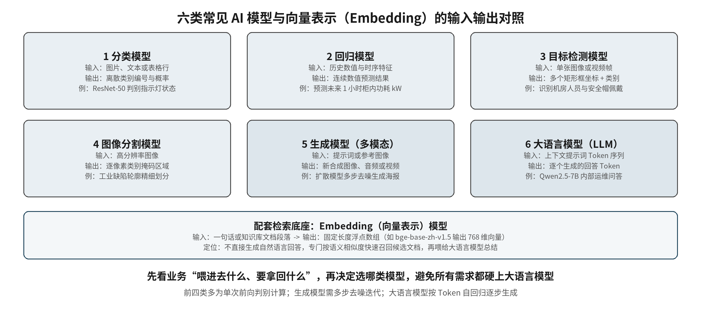
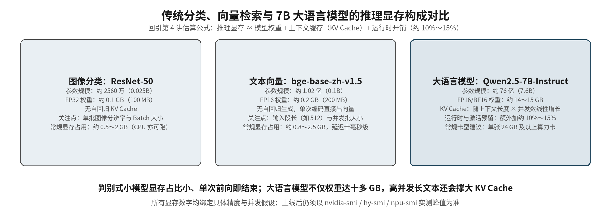
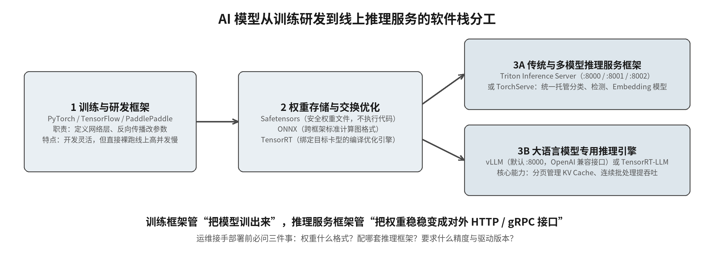
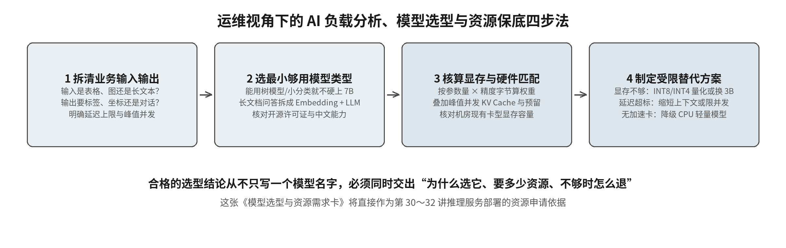

# 第27讲 认识AI模型类型

**本课程定位：** 前五章已经把服务器、网络、操作系统、Kubernetes 集群与可观测性底座搭齐。从本讲进入第六章《AI 模型与算力》。在动手构建算力资源池（第 28 讲）和部署推理服务（第 30～32 讲）之前，运维工程师必须先看懂手上要承载的 AI 负载究竟长什么样——不同模型吃什么输入、吐什么输出、占多大显存、用哪套软件框架跑。只有先把负载账算明白，后面分卡、选框架和压测验收才不会盲目配错资源。

业务部门一次性提来三张资源申请单：第一张要根据机房历史温湿度和电流数据预测未来 1 小时柜内功耗，开口申请 2 张 64 GB 算力卡；第二张要从 5 万篇运维手册里按语义搜出最相关的 3 段文字；第三张要基于搜出来的段落生成排障步骤对话。这三件事都该上大语言模型吗？各自到底要多少显存和什么样的算力卡？当机房只剩 1 张 16 GB 显存卡时又该给出什么替代方案？本讲围绕这四个问题展开。

## 本讲学习目标

学完后，你应能：

- 区分分类、回归、目标检测、图像分割、多模态生成、大语言模型六类常见模型及 Embedding 向量模型的输入、输出与适用场景。
- 说明表格特征、图像分辨率、文本上下文长度（Token 数）三类输入形态怎样影响延迟和显存消耗。
- 运用第 4 讲的推理显存三块估算模型，核算传统小模型与 `Qwen2.5-7B-Instruct` 等大语言模型的显存需求并匹配卡型。
- 分清训练框架（如 PyTorch）、模型交换格式（如 ONNX、Safetensors）与推理服务框架（如 Triton、vLLM）的各自职责。
- 针对一个具体业务项目完成负载拆解、模型类型比选、Python 显存核算与受限替代方案设计，输出《模型选型与资源需求卡》。

## 27.1、认识六类常见 AI 模型与检索底座

日常沟通里常有人把所有人工智能应用统称为“上个大模型”。实际上，不同业务任务需要的模型结构相差百倍。运维接需求的第一原则是：**先看业务喂进去什么数据、要求拿回什么格式的结果，再对号入座选模型类型**。



表27-1、六类常见 AI 模型与 Embedding 检索底座对比

| 模型类型 | 典型输入数据 | 典型输出结果 | 常见代表模型或算法 | 典型运维与行业场景 |
| --- | --- | --- | --- | --- |
| 分类模型 | 单张图像、短文本或表格行 | 有限集合里的类别标签与置信度 | `ResNet-50`、RoBERTa、逻辑回归 | 机房巡检照片判别指示灯正常或告警、工单紧急度四分类 |
| 回归模型 | 历史数值指标、时序统计特征 | 连续变化的实数预测值 | XGBoost、LightGBM、线性回归 | 根据室温与负载预测未来 1 小时柜内功耗（kW）或磁盘写满天数 |
| 目标检测 | 单张监控图像或视频帧 | 多个目标的矩形框坐标 + 类别 + 置信度 | YOLO 系列、Faster R-CNN | 识别机房通道画面里有几个人、在什么位置、是否佩戴安全帽 |
| 图像分割 | 高分辨率图像（医学或工业图） | 逐像素归属掩码（精确描出物体轮廓） | U-Net、Mask R-CNN、SAM | 晶圆表面缺陷边缘精准测量、遥感或医疗影像病灶区域勾画 |
| 生成模型 | 文本提示词、参考图或音频片段 | 新合成的图像、语音或视频流 | Stable Diffusion、语音合成模型 | 根据文字描述合成宣传配图、把告警播报文字转成自然语音 |
| 大语言模型 | 提示词与对话历史（Token 序列） | 按上下文逐词生成的自然语言或代码 | `Qwen2.5-7B-Instruct`、DeepSeek | 内部运维知识库问答、报警日志摘要提炼、辅助编写配置草稿 |
| 向量模型 | 短句、问题或切分后的文档段落 | 固定维度的浮点数组（如 768 维向量） | `BAAI/bge-base-zh-v1.5` | 语义检索底座：把文本转成向量计算相似度，快速召回相关手册段落 |

围绕上表，现场选型最容易踩两个坑：

- **能用传统回归或小分类解决的结构化任务，不要硬套大语言模型**。例如基于十几个监控指标做功耗回归预测或异常二分类，树模型（XGBoost、LightGBM）或几千万参数的小模型在普通 CPU 或入门卡上几毫秒就能算完，结果稳定且可解释；换成 70 亿参数的大语言模型不仅耗掉十几 GB 显存，还可能算错加减法。
- **海量文档问答要用“Embedding 检索 + 大语言模型生成”组合（常称 RAG 检索增强生成）**。5 万篇运维手册塞不进单次请求的上下文窗口；正确做法是先用轻量的 `bge-base-zh-v1.5` 向量模型在几十毫秒内搜出最相关的 3～5 个段落，再把这几段连同用户问题一起交给 `Qwen2.5-7B-Instruct` 总结作答。

【关键区别】**Embedding 向量模型不负责“开口说话”，大语言模型不适合“全库大海捞针”**。Embedding 模型吃进一段文字，只吐出一串固定长度的数字坐标（向量），用来算两段话意思近不近，参数量通常只有 1 亿～5 亿，占显存不到 2 GB；大语言模型负责理解上下文并逐词组织通顺回答，参数量动辄数十亿到数百亿，两者配合才能兼顾准确率、速度与显存成本。

【例题】回看开篇业务部门提来的三张资源申请单：① 基于历史温湿度与电流表数据预测未来 1 小时柜内功耗数值；② 从 5 万篇历史排障手册中按问题语义找出最相近的 3 段原文；③ 结合找出的手册段落向值班员输出分步排障建议。请依次判断三项任务各自对应的模型类型，并指出哪一张申请单没必要配 64 GB 算力卡。

**解：** 任务①输入结构化时序数值、输出连续功耗值（单位 kW），属于**回归模型**（用传统机器学习树模型在通用 CPU 节点即可运行，完全没必要配 2 张 64 GB 算力卡）；任务②输入查询句、需要按语义相似度召回文档段落，属于 **Embedding 向量模型**（如 `BAAI/bge-base-zh-v1.5`）；任务③基于给定参考段落生成自然语言建议，属于**大语言模型**（如 `Qwen2.5-7B-Instruct`）。

## 27.2、理解输入输出形态与运行特征

选定模型大类后，运维还要追问输入输出的具体尺寸。同样一个模型，喂进去的图片分辨率翻倍，或者对话上下文拉长 8 倍，算力与显存开销会完全变样。

### 27.2.1、三类常见输入数据的度量口径

- **结构化表格特征**：按“每次请求行数 × 特征列数”计量。单条请求通常只有几十个浮点数，网络传输与内存开销极小，瓶颈多在特征读取而非矩阵乘加。
- **图像与视频流**：按“批大小（Batch Size）× 通道数 × 高 × 宽”计量（视频还要乘每秒抽帧数 FPS）。注意图像宽高各放大 2 倍（如从 `512 × 512` 升到 `1024 × 1024`），像素总数和中间特征图显存会放大 **4 倍**。图像分割因需保留高分辨率像素特征，比同尺寸图像分类更吃显存。
- **文本 Token 序列**：第 2 讲提过，大语言模型不按“字节”读文本，而是先经分词器（Tokenizer）切成 **Token**。常见中文环境下，1 个 Token 大约对应 0.6～0.8 个汉字或约四分之三个英文单词（不同分词器略有差异，上线按实际分词结果统计）。一次请求的上下文总长度等于 **输入 prompt_tokens ＋ 输出 completion_tokens**。

### 27.2.2、一次算完与逐步生成的延迟差异

运维看推理服务快不快，必须区分两类截然不同的计算模式：

- **单次前向判别模型（分类、回归、检测、分割、Embedding）**：输入数据进入网络从头到尾跑完一遍前向计算，立刻拿到全部输出。运维只需要盯**单次端到端响应时延（如 P95 延迟 25 ms）**和**每秒处理样本吞吐量（img/s 或 req/s）**。
- **多步迭代与自回归生成模型（扩散生图、大语言模型）**：
  - 文生图扩散模型要在潜空间连续迭代 20～50 步去噪，单张图耗时常在 1～10 秒量级，计算单元（GPU/DCU 核心）持续满载。
  - 大语言模型生成回答分两步走：**预填充阶段（Prefill）**一次性并行算完所有输入提示词，决定用户等多久才看到第一个字，对应**首 Token 延迟（TTFT）**；**解码阶段（Decode）**每算一步只吐出 1 个新 Token，并把它拼回末尾继续算下一个，对应**每输出 Token 耗时（TPOT）**。用户感知的完整回答总耗时近似等于 `TTFT + TPOT × 输出 Token 数`。

【随堂思考】两个用户同时调同一个 `Qwen2.5-7B-Instruct` 接口：甲用户贴了一篇 6000 字日志，只要求回答“正常”或“异常”两个字；乙用户只输入 20 个字，要求模型写一篇 1500 字的巡检总结。请问甲、乙两次请求分别主要压在哪个阶段（TTFT 还是总生成时长）？

## 27.3、估算模型推理资源需求

算法同事问“机房那台带 24 GB 显存卡的机器能不能跑这个模型”时，运维不能靠猜，要先用统一公式做纸面初算，留够余量后再上机实测。

### 27.3.1、回引推理显存三块估算模型

第 4 讲确立了加速卡推理显存的三块组成关系，在模型选型阶段直接沿用：

> **推理显存总需求 ≈ 模型权重占用 ＋ 上下文缓存（KV Cache） ＋ 运行时其他开销（约 10%～15%）**



三块开销在选型表里按下面规则核算（统一明确十进制 GB 与二进制 GiB 差约 7%，工程估算常先按 10 亿参数 × 每参数字节数做快速换算并留安全余量）：

**第一块：模型权重占用 ＝ 参数量 × 单参数精度字节数**

- `FP32` 占 4 字节；`FP16` / `BF16` 占 2 字节；`INT8` / `FP8` 占 1 字节；`INT4` 占 0.5 字节。
- 例如 `ResNet-50` 约 0.0256B（2560 万）参数，FP32 权重仅约 `0.1 GB`；`bge-base-zh-v1.5` 约 0.102B（1.02 亿）参数，FP16 权重仅约 `0.2 GB`；而 `Qwen2.5-7B-Instruct` 总参数约 7.6B，FP16 权重约 `7.6 × 2 ≈ 15.2 GB`（约 `14.2 GiB`）。

**第二块：上下文缓存（KV Cache，大语言模型特有开销）**

- 大语言模型逐步生成 Token 时，为了不重复计算前文每个词的注意力键值矩阵，会把历史 Key 和 Value 缓存在显存里。
- 精确单 Token KV 字节数由模型结构决定：`2（K 和 V）× 层数 × KV 注意力头数 × 单头维度 × 精度字节数`，随 **并发请求数 × 单请求上下文长度** 线性增长。采用分组查询注意力（GQA）的新一代 7B 模型（如 `Qwen2.5-7B` 共 28 层、4 个 KV 头、单头维度 128），FP16 下每 1000 个 Token 约占 `0.055 GB`；若早期未用 GQA 的 7B 模型（32 层、32 个 KV 头），每 1000 个 Token 可高达约 `0.5 GB`。

**第三块：运行时其他开销（约 10%～15%，通常至少预留 1.5～3 GB）**

- 包含 CUDA / DTK / CANN 运行时上下文、推理框架中间激活张量及显存碎片缓冲。

表27-2、常见代表模型的参数规模与单实例推理资源参考（教学估算口径）

| 代表模型 | 模型类别 | 参数规模 | 默认精度与权重约占 | 典型延迟量级 | 推荐单实例承载硬件（含常规并发余量） |
| --- | --- | --- | --- | --- | --- |
| XGBoost 功耗预测 | 回归模型 | 数万～百万级 | FP32，数 MB～数十 MB | 1～10 ms | 通用 CPU（2～4 vCPU，4 GB 内存） |
| `ResNet-50` | 图像分类 | 约 0.026B | FP32 约 0.1 GB | 5～20 ms | 入门推理卡（4 GB+ 显存）或 多核 CPU |
| `bge-base-zh-v1.5` | 向量模型 | 约 0.10B | FP16 约 0.2 GB | 10～30 ms | 入门推理卡或共享切分实例（2～4 GB 显存） |
| `Qwen2.5-7B-Instruct` | 大语言模型 | 约 7.6B | BF16/FP16 约 14～15 GB | TTFT 百毫秒级，生成秒级 | 单张 24 GB 及以上推理卡（或 64 GB 算力卡） |
| `Qwen2.5-7B`（INT4 量化） | 大语言模型 | 约 7.6B | INT4 权重约 4～5 GB | 略快，复杂推理精度微降 | 单张 12～16 GB 显存卡（资源受限替代方案） |

【例题】项目组准备部署 `Qwen2.5-7B-Instruct`（参数量按 7.6B 计，28 层，4 个 KV 头，单头维度 128），采用 FP16 精度（2 字节），规划最大同时在线并发 `8 路`，每路最大上下文长度 `4096 Token`，框架与激活预留按 `2.5 GB` 计。请估算总显存需求，并判断单张 16 GB 显存卡和单张 24 GB 显存卡分别能否承载。

**解：**
第一步算模型权重：`7.6 × 10^9 × 2 字节 ≈ 15.2 GB`（十进制口径，约合 `14.2 GiB`）。
第二步算峰值 KV Cache：集群同时跑满 8 路 × 4096 Token ＝ `32768 Token`。每个 Token 的 KV 字节数为 `2 × 28 × 4 × 128 × 2 = 57344 字节`（约 `56 KB`）。`32768 × 57344 字节 ≈ 1.88 GB`。
第三步加运行时预留：`15.2 + 1.88 + 2.5 ≈ 19.58 GB`。
结论：单张 **16 GB 显存卡放不下**（光 FP16 权重就贴近 16 GB 上限，一接并发就会报 OOM）；单张 **24 GB 显存卡可以承载**，且留有约 4 GB 缓冲空间。以上为启动前估算，上线后以 `nvidia-smi`、`hy-smi` 或 `npu-smi` 在真实压测下的显存峰值为准。

【随堂思考】如果机房当前实在腾不出 24 GB 显存卡，手头只有一张 16 GB 显存卡，但业务明天就得把内部问答原型跑起来。按表 27-2 和上面的公式，你能给出哪两种可落地的替代方案？

## 27.4、认识从训练到推理的框架分工

拿到模型任务后，开发同学给你的交付物可能是 `.safetensors` 文件夹，也可能是一个 `.onnx` 文件。理清训练框架、交换格式和推理服务框架的分工，才能避免“拿训练代码直接顶上线”的事故。



表27-3、AI 软件栈四类工具的职责与运维关注点

| 软件层次 | 主流开源工具或格式 | 核心职责 | 运维接手关注重点 |
| --- | --- | --- | --- |
| 训练与研发框架 | `PyTorch`、`TensorFlow`、`PaddlePaddle` | 定义神经网络层、前向算误差、反向传播更新参数 | 版本与底层驱动/加速库（CUDA/ROCm/DTK/CANN）严格绑定 |
| 权重与交换格式 | `Safetensors`、`ONNX`、`TensorRT` 引擎 | 安全存权重、跨框架统一计算图、针对特定卡型做算子融合加速 | 优先选 `Safetensors`（纯数据不执行任意代码，比旧 `.bin` pickle 更安全）；注意 `TensorRT` 引擎文件换卡型需重编 |
| 传统推理服务框架 | `Triton Inference Server`、`TorchServe` | 把分类、检测、Embedding 等模型封装成高并发 HTTP/gRPC 接口并支持动态攒批 | Triton 默认开放 HTTP `:8000`、gRPC `:8001`、Prometheus 指标 `:8002`，要求标准模型仓库目录 |
| 大模型推理引擎 | `vLLM`、`TensorRT-LLM`、SGLang | 针对自回归生成做分页显存管理（PagedAttention）与连续批处理 | `vLLM` 默认监听 `:8000` 提供 OpenAI 兼容接口（`/v1/chat/completions`）与 `/metrics` 监控端点 |
| 模型社区与托管库 | Hugging Face、ModelScope（魔搭） | 集中存放开源模型权重分片、分词器配置与模型说明卡（Model Card） | 内网机房常无法直连公网，需提前校验哈希下载到共享存储或内部制品库 |

【关键区别】**不要把“研发测试脚本”直接当成“线上推理服务”**。算法同学在笔记本里用 `FastAPI + PyTorch model.generate()` 写十行代码就能跑通单次问答，但这种裸跑方式遇到 10 个人同时提问就会串行排队，还会因为事先静态划死大块显存而频繁触发 OOM。生产上线传统多模型优先交由 `Triton` 托管（第 30 讲实操），上线大语言模型优先交由 `vLLM` 或 `TensorRT-LLM` 托管（第 31～32 讲实操）。

## 27.5、端到端实训：AI 负载分析与模型选型需求卡

本实训不要求你手头立刻拥有大显存算力卡，只需在装有 `Python 3.11` 的常规 Linux 终端或虚拟机中运行配置核算脚本，结合开源“企业运维工单智能助手”项目的真实指标完成负载分析、四类候选模型对比、显存核算与替代方案制定。



### 27.5.1、实训背景与业务负载拆解

某团队准备上线一套开源“企业运维工单智能助手”，业务方给出的原始诉求如下：
- **子任务 A（工单自动分派）**：每当员工提交工单标题与故障类别字段（短文本 + 5 个下拉指标），系统需在 **100 ms 内** 判别工单属于“网络、存储、容器、算力卡”四类中的哪一类，峰值并发 `20 req/s`。
- **子任务 B（历史手册语义召回）**：从内部 2 万篇 Markdown 运维知识文档（切分为约 8 万个 500 字段落）中，按用户问题找出最相关的 4 个段落，单次检索延迟要求 **小于 80 ms**，峰值并发 `10 req/s`。
- **子任务 C（排障建议对话生成）**：结合召回的 4 个段落（连同系统提示词约 `2500 Token`）生成不超过 `1000 Token` 的排障步骤说明，要求首字响应 **TTFT 小于 1.5 s**，峰值同时在线生成会话 `8 路`。
- **机房可用硬件约束**：生产池有一台配单张 **24 GB 显存加速卡** 的推理节点 `gpu-node-01`（配 16 核 CPU、64 GB 内存）；灾备降级环境只有一台配单张 **16 GB 显存卡** 的备用机。

### 27.5.2、编写 Python 脚本自动核算模型权重与 KV Cache

在实验机创建工作目录 `~/lab/model-sizing/`，编写一个不依赖重型深度学习库、仅用 Python 3.11 标准库读取模型结构参数（与 Hugging Face `config.json` 字段一致）的显存核算脚本 `calc_vram.py`（依次输出权重、KV Cache、总计显存，并按安全水位对比 24 GB 卡上限 `22.0 GB`、16 GB 卡上限 `14.5 GB` 给出 `PASS` 或 `OVER` 判断）：

```bash
mkdir -p ~/lab/model-sizing && cd ~/lab/model-sizing
cat <<'EOF' > calc_vram.py
#!/usr/bin/env python3
# Estimate inference VRAM (decimal GB): Weights + KV Cache + Runtime overhead

MODELS = [
    {
        "name": "ResNet-50 (ONNX FP32)",
        "kind": "discriminative",
        "params_b": 0.0256,
        "bytes_per_param": 4.0,
        "runtime_gb": 0.6,
    },
    {
        "name": "BAAI/bge-base-zh-v1.5 (FP16)",
        "kind": "embedding",
        "params_b": 0.102,
        "bytes_per_param": 2.0,
        "runtime_gb": 0.8,
    },
    {
        "name": "Qwen2.5-7B-Instruct (FP16)",
        "kind": "llm",
        "params_b": 7.62,
        "bytes_per_param": 2.0,
        "num_hidden_layers": 28,
        "num_key_value_heads": 4,
        "head_dim": 128,
        "kv_bytes": 2.0,
        "concurrency": 8,
        "max_seq_len": 4096,
        "runtime_gb": 2.5,
    },
    {
        "name": "Qwen2.5-7B-Instruct (INT4)",
        "kind": "llm",
        "params_b": 7.62,
        "bytes_per_param": 0.55,
        "num_hidden_layers": 28,
        "num_key_value_heads": 4,
        "head_dim": 128,
        "kv_bytes": 2.0,
        "concurrency": 8,
        "max_seq_len": 4096,
        "runtime_gb": 2.0,
    },
]

for m in MODELS:
    weight_gb = m["params_b"] * m["bytes_per_param"]
    kv_gb = 0.0
    if m["kind"] == "llm":
        per_tok = 2 * m["num_hidden_layers"] * m["num_key_value_heads"] * m["head_dim"] * m["kv_bytes"]
        total_tokens = m["concurrency"] * m["max_seq_len"]
        kv_gb = (per_tok * total_tokens) / 1e9
    total_gb = weight_gb + kv_gb + m["runtime_gb"]
    fit_24g = "PASS" if total_gb <= 22.0 else "OVER"
    fit_16g = "PASS" if total_gb <= 14.5 else "OVER"
    print(
        f"{m['name']:<28} W={weight_gb:>5.2f}G "
        f"KV={kv_gb:>4.2f}G Total={total_gb:>5.2f}G "
        f"24G:{fit_24g} 16G:{fit_16g}"
    )
EOF

python3 calc_vram.py > sizing-report.txt
cat sizing-report.txt
```

运行脚本后，预期得到如下结构化核算输出（`PASS` 表示满足安全余量可承载，`OVER` 表示超出显存上限）：

```text
ResNet-50 (ONNX FP32)        W= 0.10G KV=0.00G Total= 0.70G 24G:PASS 16G:PASS
BAAI/bge-base-zh-v1.5 (FP16) W= 0.20G KV=0.00G Total= 1.00G 24G:PASS 16G:PASS
Qwen2.5-7B-Instruct (FP16)   W=15.24G KV=1.88G Total=19.62G 24G:PASS 16G:OVER
Qwen2.5-7B-Instruct (INT4)   W= 4.19G KV=1.88G Total= 8.07G 24G:PASS 16G:PASS
```

### 27.5.3、比选四类模型并形成最终资源方案

结合脚本读数与三个子任务的服务目标，验证能否把所有组件装进同一台单卡 24 GB 节点 `gpu-node-01`：

- 若把子任务 A（分类，可放 CPU 或占约 0.7 GB）、子任务 B（`bge-base-zh-v1.5`，占约 1.0 GB）与子任务 C（`Qwen2.5-7B-Instruct` FP16，占约 19.62 GB）全部塞进同一张 24 GB 卡，三者合计已达 `21.3 GB`，遇到长文本尖峰极易撞线 OOM。
- **工程优化选型**：子任务 A 为短文本加表格四分类，直接选用轻量文本分类或传统机器学习树模型部署在 **CPU** 上（0 显存占用，延迟小于 15 ms）；子任务 B 的 `bge-base-zh-v1.5` 同样可在 16 核 CPU（ONNX Runtime 加速）上跑进 50 ms 内，或仅在 24 GB 卡上限制固定显存配比；24 GB 算力卡优先保 `Qwen2.5-7B-Instruct`（`vLLM` 托管，设 `--max-model-len 4096` 控制 KV Cache 上界）。

表27-4、实训子任务模型比选与资源受限替代方案汇总

| 业务子任务 | 选定模型类型与代表 | 为什么不选其他模型 | 推荐部署方式（24 GB 主节点） | 灾备 16 GB 卡受限替代方案 |
| --- | --- | --- | --- | --- |
| A 工单四分类 | 轻量分类 / 树模型 | 用 7B 大模型延迟超 100 ms 且白占显存；生图模型与任务无关 | CPU 容器（ONNX Runtime），占 0 GB 显存 | 保持 CPU 运行不变 |
| B 手册段落召回 | Embedding（`bge-base-zh-v1.5`） | 传统关键词匹配搜不到同义表述；让 LLM 逐篇读 8 万段会严重超时 | CPU 推理或 Triton 轻量实例（约 1 GB 显存） | 移至 CPU 运行，把显存全留给生成模型 |
| C 排障对话生成 | 大语言模型（`Qwen2.5-7B-Instruct`） | 分类与 Embedding 模型均无法组织多步自然语言回答 | `vLLM` 独占算力卡（FP16，限长 4096，约 19.6 GB） | 切换 `Qwen2.5-7B` INT4 量化版（约 8.1 GB）或改用 `Qwen2.5-3B-Instruct` FP16（约 9 GB） |

**实训交付物验收清单**：① `calc_vram.py` 脚本与 `sizing-report.txt` 核算输出；② 四类模型（传统机器学习/分类、Embedding、大语言模型、生成式模型）适用边界判断记录；③ 按文末附录填写完整的《AI 负载选型与资源需求核对卡》。

## 27.6、本讲回顾与自测

学习完本讲后，试着用自己的话回答四个问题：六类 AI 模型和 Embedding 各自吃什么、吐什么？为什么不能拿分类模型的延迟经验去套大语言模型？估算推理显存要加哪三块？为什么不能拿算法同学的训练脚本直接顶到生产高并发入口？

表27-5、本讲目标与对应判断

| 学习目标 | 应能做出的判断 |
| --- | --- |
| 区分模型类型 | 按输入输出分清分类、回归、检测、分割、生成、大语言模型与 Embedding，不盲目全上大模型 |
| 读懂输入与延迟 | 知道图像分辨率翻倍特征开销增 4 倍，分清大语言模型的 TTFT 与 TPOT |
| 核算推理显存 | 按“权重 + KV Cache + 10%～15% 预留”算出资源量级，明确精度与上下文假设 |
| 理清软件栈分工 | 分清 PyTorch 训练、ONNX/Safetensors 存储交换与 Triton/vLLM 线上推理职责 |
| 制定选型与替代方案 | 输出带选型理由、卡型匹配结论及显存不足降级方案的需求卡 |

### 27.6.1、本讲自测

**1 类型判断。** 下面三项任务分别应选哪类模型：① 在机房红外摄像头画面里框出所有发热异常的电源模块位置；② 根据过去 30 天每日存储增长量预测磁盘还剩几天写满；③ 把 5000 条故障处理记录转成向量存入向量库供语义检索。

**2 概念辨析。** 业务同事问：“既然 `bge-base-zh-v1.5` 也是文本模型，占显存才不到 1 GB，能不能直接拿它代替 `Qwen2.5-7B-Instruct` 给用户生成排障方案？”你会怎么解释？

**3 显存估算。** 一个 14B（按 140 亿参数计）的大语言模型，若按 BF16 精度（每参数 2 字节）加载，仅模型权重本身大约占多少十进制 GB？单张 24 GB 显存卡在不量化、单机单卡的条件下能直接跑起来吗？

**4 延迟指标。** 用户反映大语言模型问答“点发送后等了 4 秒才蹦出第一个字，但蹦字之后每秒能出 30 个字很快”。这里慢的是 TTFT 还是 TPOT？最可能与输入提示词过长有关，还是与输出字数过多有关？

**5 框架选型。** 团队要在一台推理服务器上同时托管 1 个 ONNX 图像分类模型和 1 个 Embedding 向量模型，并提供 HTTP、gRPC 与 `/metrics` 监控接口。应优先选用 PyTorch 原生训练脚本、`Triton Inference Server`，还是只面向自回归文本生成的专用引擎？

**6 替代方案。** 算法申请在单张 16 GB 显存卡上以 FP16 精度部署 `Qwen2.5-7B-Instruct`（预计总显存需约 19.6 GB）。作为运维工程师，请给出两条能让业务在现有单张 16 GB 卡上先跑通的合理替代方案，并写明各自的代价。

**答：**

____________________________

____________________________

____________________________

____________________________

## 27.7、参考答案与解析

### 27.7.1、随堂思考解析

**思考 1（长输入短输出 vs 短输入长输出）：** 甲用户输入 6000 字日志、只输出 2 个字，压力集中在一次性并行处理长上下文的**预填充阶段（Prefill）**，表现为 **首 Token 延迟（TTFT）明显变长**，但解码很快结束；乙用户输入仅 20 字、要求写 1500 字总结，TTFT 很短，但需要循环上千步逐词解码，压力集中在 **TPOT × 输出 Token 数** 决定的总生成时长上。

**思考 2（16 GB 卡跑通内部问答原型的两种替代方案）：** 方案一：保持 `Qwen2.5-7B-Instruct` 模型不变，改用 **INT8 或 INT4 权重量化版本**（例如 AWQ/GPTQ INT4 权重降至约 4.2 GB，连同 KV Cache 与预留约 8 GB，16 GB 卡可稳妥装下，代价是复杂推理或极端边缘问题准确率可能轻微下降）；方案二：保持 FP16/BF16 精度不变，改换参数量更小的同系列模型如 **Qwen2.5-3B-Instruct**（权重约 6 GB，总占用约 9～10 GB，代价是复杂长逻辑归纳能力弱于 7B）。

### 27.7.2、课后自测解析

**1** ① 框出多个目标位置并识别类别，选 **目标检测模型**；② 根据历史数值预测连续天数，选 **回归模型**；③ 把文本段落编码成定长向量用于语义检索，选 **Embedding（向量表示）模型**。

**2** 不能代替。`bge-base-zh-v1.5` 是编码器结构的 Embedding 向量模型，输入文本后只输出一串固定长度的浮点数向量用于计算语义相似度，没有逐词生成自然语言句子的能力；生成分步排障回答仍需大语言模型完成。

**3** 仅模型权重约为 `140 亿 × 2 字节 = 280 亿字节 ≈ 28 GB`（二进制约 `26.1 GiB`）。单张 24 GB 显存卡连权重本身都装不下，还缺 KV Cache 和运行时空间，因此在不量化、不拆多卡的前提下**不能**直接运行。

**4** 慢的是 **TTFT（首 Token 延迟）**。点发送后等第一个字对应预填充阶段（Prefill），蹦字快说明解码阶段（TPOT）正常；最可能的原因是请求塞入了超长输入提示词（如大段原始日志或过多检索文档），或请求在队列中排队等待。

**5** 优先选 **Triton Inference Server**。Triton 原生支持 ONNX、PyTorch、TensorRT 等多种后端统一托管，支持动态批处理，并自带标准 HTTP（`:8000`）、gRPC（`:8001`）和 Prometheus 指标（`:8002`）端口，适合分类与 Embedding 等多模型生产服务。

**6** 方案一：改用 `Qwen2.5-7B-Instruct` 的 **INT4 或 INT8 量化权重** 并限制最大上下文长度（如 `--max-model-len 4096`），代价是极端细节或数学推理精度略有折损，上线前需跑业务样例集验收质量；方案二：降级选用参数规模更小的 **Qwen2.5-3B-Instruct（FP16）**，代价是模型知识容量与复杂指令遵循能力有所减弱。

### 27.7.3、复习时再问自己

如果你遇到任何 AI 需求都本能地想申请大显存卡装大语言模型，回看 27.1 节；如果你只按“参数量 × 2 字节”卡着显存上限选卡，回看 27.3.1 节的显存三块估算模型。

## 27.8、术语与疑问

表27-6、本讲术语

| 核心术语 | 本讲中的含义 |
| --- | --- |
| 判别式模型 | 对输入数据直接做分类、回归、检测或分割判断的模型，通常单次前向计算即可得出结果 |
| 生成式模型 | 学习数据分布并合成新文本、图像、音频或视频的模型，常需多步迭代或逐 Token 生成 |
| Embedding 模型 | 向量表示模型，将文本或图像编码成固定维度的浮点数组，用于按距离计算语义相似度与检索召回 |
| Token | 大语言模型切分和处理文本的基本计数单位，输入与输出总 Token 数直接决定上下文缓存开销 |
| KV Cache | 大语言模型自回归生成时缓存历史上下文注意力键值的显存区域，随并发数与序列长度线性增长 |
| TTFT / TPOT | 首 Token 延迟（发出请求到收到首个输出 Token 的耗时）与每输出 Token 耗时（解码阶段生成速度） |
| ONNX / Safetensors | 跨框架通用计算图交换格式（ONNX）与不执行任意代码的安全张量权重存储格式（Safetensors） |
| Triton / vLLM | 面向多模型托管的通用推理服务框架（Triton）与面向大语言模型分页显存管理的高吞吐引擎（vLLM） |

文中 IP、域名、路径与参数为教学示例，生产环境以本单位规划为准。

**我的疑问（记下一条本讲最想在后续模型部署课验证的问题）：**

____________________________

## 附录、AI 负载选型与资源需求核对卡

表27-7、AI 负载选型与资源需求核对卡

| 核对维度 | 填写内容与口径要求（数字须写明单位、精度与并发前提） |
| --- | --- |
| 项目与子任务 | 项目名称：＿＿＿＿＿＿＿＿ ；子任务名称与业务目标：＿＿＿＿＿＿＿＿＿＿＿＿＿＿＿＿ |
| 输入与输出契约 | 输入数据类型与规模（分辨率 / 最大 Token 数）：＿＿＿＿＿＿ ；输出格式：＿＿＿＿＿＿ |
| 服务级别目标 | 峰值并发（req/s 或同时在线路数）：＿＿＿＿ ；延迟上限（P95 或 TTFT / TPOT）：＿＿＿＿ |
| 模型类型比选 | 选定模型类型与开源代表：＿＿＿＿＿＿ ；不选其他类型（如传统树模型 / 大模型）的理由：＿＿＿＿＿＿ |
| 显存三块核算 | 精度：＿＿＿＿ ；①权重约 ＿＿ GB ＋ ②峰值 KV Cache 约 ＿＿ GB ＋ ③运行时预留 ＿＿ GB ＝ 总计约 ＿＿ GB |
| 框架与硬件匹配 | 拟用推理框架（CPU / Triton / vLLM）：＿＿＿＿＿＿ ；申请卡型、显存规格与张数：＿＿＿＿＿＿ |
| 资源受限替代方案 | 若目标算力卡库存不足或显存受限时，可切换的量化精度、小尺寸替代模型或上下文限流方案：＿＿＿＿＿＿ |
| 待上机验证项 | 许可证合规核对：＿＿＿＿ ；上线前需用真实样本实测核实的指标：＿＿＿＿＿＿＿＿＿＿＿＿ |

<!-- md-only -->

## 附：主要参考资料（仅 Markdown 保留，不印入 Word/PDF）

- 中国信通服务《2025 算力运维体系技术白皮书》（本地资料库 PDF）。参阅第 1.1.2 节智算算力应用场景、第 1.2.2 节异构芯片计算特征，以及第 3.4.4 节计算运维技术。
- Qwen 团队官方文档《Qwen2.5 Technical Report & Model Card》。用于核对 `Qwen2.5-7B-Instruct` 层数（28 层）、隐藏层与 GQA 注意力头参数（4 KV Heads）、参数规模及显存测算口径。网址：https://huggingface.co/Qwen/Qwen2.5-7B-Instruct
- BAAI（智源研究院）《bge-base-zh-v1.5 Model Card》。用于核对中文文本向量模型的参数规模（约 1.02 亿）、768 维输出向量与检索增强生成（RAG）定位。网址：https://huggingface.co/BAAI/bge-base-zh-v1.5
- ONNX Runtime 与 Safetensors 官方技术文档。用于核对跨框架模型中间表示及无任意代码执行风险的权重存储格式规范。网址：https://onnxruntime.ai/docs/ 与 https://huggingface.co/docs/safetensors/
- NVIDIA Triton Inference Server 官方文档与 vLLM 官方文档《PagedAttention & Engine Arguments》。用于核对传统多模型托管端口（`:8000`/`:8001`/`:8002`）与大语言模型推理引擎分工。网址：https://docs.vllm.ai/

<!-- /md-only -->
