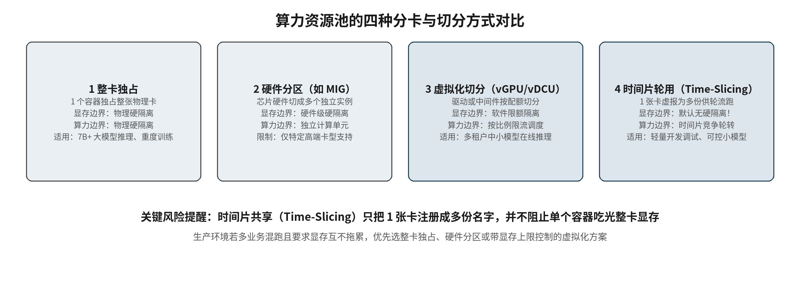
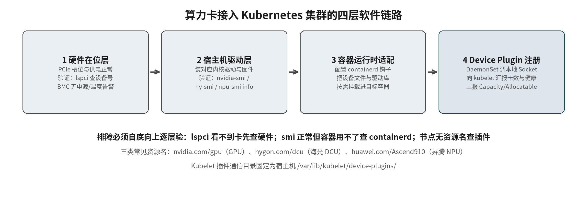
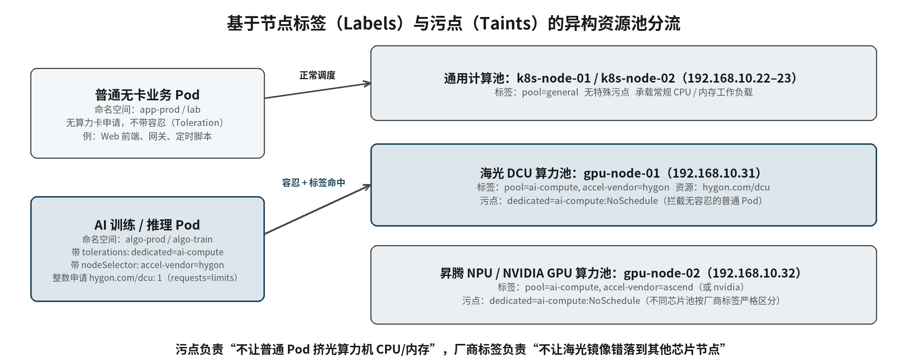
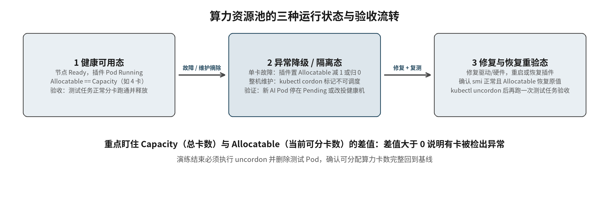

# 第28讲 AI算力资源池构建

**本课程定位：** 第 4 讲认识了单机算力卡的硬件参数与互联方式，第 17～18 讲搭建了 Kubernetes 集群与命名空间配额，第 27 讲算清了不同 AI 模型需要多少显存和什么样的卡。本讲负责把这三条线接通：把插着海光 DCU、华为昇腾 NPU 或 NVIDIA GPU 的物理服务器接入 Kubernetes 集群，按芯片类型和业务用途划分成受控的算力资源池，并跑通可用、不可用与故障恢复验收，为第 29 讲的排队抢占调度打好底座。

新到货的两台智算服务器 `gpu-node-01` 和 `gpu-node-02` 刚通过 `kubeadm join` 加入集群。算法同事兴冲冲提交了一个申请算力卡的推理 Pod，结果一直卡在 `Pending`，事件提示集群里没有任何节点认识 `hygon.com/dcu`；等你好不容易装好插件，又发现几十个普通前端小容器把算力节点的内存全占光了，真正要跑大模型的任务反而排不进去。为什么节点进了集群却看不见卡？不同厂家的国产算力卡怎么分开建池？单卡掉线或资源不释放时该从哪一层查起？本讲围绕这四个现场问题展开。

## 本讲学习目标

学完后，你应能：

- 对照说出 NVIDIA GPU、海光 DCU、华为昇腾 NPU 三类加速卡的宿主机管理工具、容器运行时组件与 Kubernetes 扩展资源名。
- 比较整卡独占、硬件分区、虚拟化切分（vGPU/vDCU）与时间片轮用四种分卡方式的隔离边界与适用场景。
- 沿着“PCIe 硬件识别 → 宿主机驱动 → containerd 运行时 → Device Plugin”四层链路将算力节点接入集群，读懂 `Capacity` 与 `Allocatable`。
- 组合使用节点标签（Labels）与节点污点（Taints）划分通用计算池和异构 AI 算力池，防止普通负载挤占与跨芯片错投。
- 排查驱动不匹配、插件不注册、可分配数为 0、设备掉卡与资源未释放五类障碍，独立完成算力资源池可用、隔离与恢复验收。

## 28.1、三类主流算力卡与接入前核验

自建智算中心往往同时存在多代际、多厂商的加速卡。第 4 讲从单机硬件角度介绍过常见加速卡，到了集群池化阶段，运维工程师必须把每类卡的**带内查看命令、底层软件栈、容器插件和集群资源名**一一对应清楚，绝不能把甲厂家的命令或镜像硬套到乙厂家的机器上。

表28-1、三类主流加速卡的软件栈与集群资源名对照

| 算力卡类别 | 常见代表型号 | 宿主机查看命令 | 驱动与计算软件栈 | 容器运行时与集群插件 | K8s 常见扩展资源名 |
| --- | --- | --- | --- | --- | --- |
| NVIDIA GPU | H100、H20、L40S | `nvidia-smi` | NVIDIA 内核驱动 + CUDA | NVIDIA Container Toolkit + `nvidia-device-plugin` | `nvidia.com/gpu` |
| 海光 DCU | 深算系列加速卡 | `hy-smi`（兼容 `dcu-smi`） | ROCK 内核驱动 + DTK 软件栈 | 海光容器运行时钩子 + `DCU-Device-Plugin` | `hygon.com/dcu` |
| 华为昇腾 NPU | Atlas 300I Duo、昇腾 910 | `npu-smi info` | NPU 驱动与固件 + CANN | Ascend Docker Runtime + `Ascend Device Plugin` | `huawei.com/Ascend910`（或 `Ascend310P`） |

把一台算力节点纳入 Kubernetes 之前，必须先在宿主机单机层面过完两道基础门槛：

- **第一道看物理总线在位**：在宿主机执行 `lspci`（配合 `grep` 过滤厂商关键字，如 `NVIDIA`、`Hygon` 或 `Processing accelerators`），核对操作系统认到的物理卡张数与服务器上架台账是否一致，同时核对带外 BMC 无电源模块掉电或 PCIe 降速告警。
- **第二道看内核驱动与固件匹配**：执行对应的 `nvidia-smi`、`hy-smi` 或 `npu-smi info`，确认能正常读出卡型号、驱动版本、单卡显存容量、温度与功耗。注意昇腾等国产加速卡同时包含**驱动（Driver）**和**芯片固件（Firmware）**两层包，安装升级时须严格遵守厂商配套版本矩阵与先后顺序（本讲聚焦通用入池流程，海光服务器硬件拆装与深度压测在海光专项课展开）。

【关键区别】**“宿主机敲 hy-smi 能看到 4 张卡”不等于“容器里能用上卡”，更不等于“Kubernetes 调度器知道这台机器有卡”**。宿主机命令正常只证明前两层（硬件 + 驱动）通了；要把算力卡变成集群可统一分配的池化资源，还必须打通容器运行时适配和 Kubelet 设备插件这两层。

## 28.2、理解算力卡的四种分配与切分方式

第 27 讲算过，`Qwen2.5-7B-Instruct` 在线推理要占近 20 GB 显存，而一个 `ResNet-50` 图像分类模型只占不到 1 GB 显存。如果一张 64 GB 显存的大卡每次只能给一个 1 GB 的小模型独占，剩下 98% 的显存就白白闲置了。资源池建设前，要先按业务特征选定分卡与切分策略。



表28-2、四种算力卡分配与切分方式权衡

| 切分方式 | 实现原理 | 显存隔离性 | 算力隔离性 | 适用业务场景与运维限制 |
| --- | --- | --- | --- | --- |
| 整卡独占 | 1 个容器绑定整张物理加速卡 | 物理硬隔离 | 物理硬隔离 | 7B 及以上大模型推理、分布式训练；稳定性最好但小负载浪费大 |
| 硬件级分区 | 芯片硬件把单卡切成独立物理实例（如 MIG） | 硬件硬隔离 | 硬件硬隔离 | 多租户高隔离在线推理；仅特定高端卡型支持，需预先固定分区规格 |
| 虚拟化切分 | 驱动或虚拟化层拦截调用，限制显存与算力配比（vGPU / vDCU） | 软件限额隔离 | 按配比调度 | 多团队共享推理池、教学实训平台；需额外维护虚拟化组件与驱动版本兼容 |
| 时间片轮用 | 插件把 1 张卡虚报成多份名字供多个 Pod 轮流用（Time-Slicing） | 默认无隔离 | 轮片竞争 | 内部开发调试、显存占用极小且固定的轻量服务；严禁混跑不可控高显存任务 |

【例题】某智算中心有一批 64 GB 显存加速卡，收到三类资源池需求：① 生产核心问答服务部署 `Qwen2.5-7B-Instruct` 高并发接口，要求延迟稳定、绝不受邻居容器干扰；② 四个内部小工具各自跑一个显存峰值 4 GB 的传统分类模型，希望共用一张卡但严格限制谁都不能超用显存；③ 实训室 6 名学员轮流调试百兆级小脚本，允许偶尔排队抖动。请分别为三类需求选出合适的分配方式。

**解：** 需求①对延迟稳定性和故障隔离要求最高，选**整卡独占**（若高端卡支持硬件级大分区也可按显存规格选**硬件级分区**）；需求②既要一卡多用，又要求单个容器显存超限不拖垮同卡邻居，选带显存配额控制的**虚拟化切分（vGPU / vDCU）**；需求③属于受控内部调试且追求部署简单，可选**时间片轮用（Time-Slicing）**。

【随堂思考】管理员用时间片轮用（Time-Slicing）把 1 张 24 GB 显存卡配置成 `replicas: 4`，分给了 4 个不同 Pod（每个 Pod 申请 1 份）。如果第 1 个 Pod 里的程序突然加载了一个 22 GB 的大模型权重，另外 3 个正在跑 2 GB 小模型的 Pod 会受到什么影响？为什么？

## 28.3、把算力卡接入 Kubernetes 集群

默认安装的 Kubernetes 只认识 `cpu`、`memory` 和 `ephemeral-storage` 三种基础资源，并不内置任何芯片厂商的驱动代码。Kubernetes 采用标准的 **Device Plugin（设备插件）框架**，让各家芯片厂商通过统一接口把加速卡注册成节点的**扩展资源（Extended Resource）**。



### 28.3.1、打通容器运行时与 Device Plugin

在已经装好宿主机驱动的算力节点（如 `gpu-node-01`，IP `192.168.10.31`）上，接入集群分两步完成：

**第一步：配置节点容器运行时（containerd）**。第 17 讲讲过，本课程 Kubernetes 节点统一采用 `containerd` 作为容器运行时。普通 `containerd` 启动容器时不会挂载 `/dev/nvidia0`、`/dev/dri` 或 `/dev/davinci0` 等设备节点，也不会挂载宿主机的底层驱动动态库。安装对应厂商的运行时工具（例如 NVIDIA 的 `nvidia-ctk runtime configure --runtime=containerd` 或海光 / 昇腾对应的运行时配置脚本）并重启 `containerd` 后，受控容器才能在启动时自动获得底层算力设备与驱动库视图。

**第二步：以 DaemonSet 方式部署对应厂商的 Device Plugin**。插件 Pod 启动后，通过挂载宿主机的 `/var/lib/kubelet/device-plugins/` 目录，使用 Unix Domain Socket（本地套接字）与本机 `kubelet` 建立 gRPC 连接，持续做两件事：
- **注册与汇报卡数**：发现本机有几张加速卡，就把资源名（如 `hygon.com/dcu: 4` 或 `nvidia.com/gpu: 2`）上报给 `kubelet`，再由 `kubelet` 写入 API Server 的 Node 状态。
- **周期健康监听**：一旦检测到某张卡掉线或出现致命硬件错误，立刻通知 `kubelet` 将这张故障卡从可分配名单里剔除。

下面是一份面向算力节点的海光 DCU Device Plugin `DaemonSet` 核心配置片段（NVIDIA 与昇腾插件结构高度一致，仅镜像、资源名与设备目录不同）：

```yaml
apiVersion: apps/v1
kind: DaemonSet
metadata:
  name: dcu-device-plugin
  namespace: kube-system
spec:
  selector:
    matchLabels:
      app: dcu-device-plugin
  template:
    metadata:
      labels:
        app: dcu-device-plugin
    spec:
      nodeSelector:
        accel-vendor: hygon
      tolerations:
        - key: "dedicated"
          operator: "Equal"
          value: "ai-compute"
          effect: "NoSchedule"
      containers:
        - name: dcu-plugin
          image: registry.lab.example/infra/dcu-device-plugin:v1.2.0
          volumeMounts:
            - name: device-plugin
              mountPath: /var/lib/kubelet/device-plugins
      volumes:
        - name: device-plugin
          hostPath:
            path: /var/lib/kubelet/device-plugins
```

阅读上面这份清单时，务必盯紧两处生产高频踩坑点：
1. **nodeSelector 指定 accel-vendor: hygon**：只在真正插了海光 DCU 的节点上启动海光插件，防止插件跑到纯 CPU 节点或 NVIDIA 节点上反复报错退出。
2. **tolerations 容忍算力节点污点**：算力节点通常会打上防普通任务挤占的污点；如果插件 DaemonSet 漏写了这段 `tolerations`，插件 Pod 自己就会被挡在算力节点门外，导致整台机器注册不上算力卡。

### 28.3.2、读懂 Capacity、Allocatable 与整数申请规则

插件注册成功后，执行 `kubectl describe node gpu-node-01`，重点核对 `Capacity`（节点总容量）和 `Allocatable`（当前可调度容量）两栏：

```text
Capacity:
  cpu:                32
  memory:             128Gi
  hygon.com/dcu:      4
Allocatable:
  cpu:                31800m
  memory:             124Gi
  hygon.com/dcu:      4
```

- **正常状态**：`Allocatable` 中的算力卡数量等于 `Capacity`（如均为 `4`）。
- **部分或全部异常**：若 `Capacity` 显示 `4`，而 `Allocatable` 变成了 `3` 或 `0`，说明硬件层曾认到 4 张卡，但插件健康检查判定有 1 张或全部卡处于不可用状态，调度器只会按 `Allocatable` 里的健康数量分卡。
- **Pod 申请铁律（回引第 18 讲）**：Kubernetes 扩展算力卡资源**只接受整数申请**（不能写 `0.5` 张物理卡；若用了虚拟化或时间片切分，就按切分后注册的新单位填整数 `1`、`2`），且必须在容器 `resources` 中同时满足 **requests == limits**（如果只写 `limits: 1` 漏写 `requests`，Kubernetes 默认自动把 `requests` 补成与 `limits` 相等；如果把 `requests: 1` 和 `limits: 2` 写成不等，API Server 会直接拒绝创建）。

## 28.4、构建异构算力资源池与隔离规则

机房里同时有通用 CPU 节点（`k8s-node-01`、`k8s-node-02`）、海光 DCU 节点（`gpu-node-01`）和昇腾或 NVIDIA 节点（`gpu-node-02`）时，绝不能让所有 Pod 随机混投。构建算力资源池的核心动作是用 **标签（Labels）引流**，用 **污点（Taints）防挤占**。



### 28.4.1、节点标签分池 + 节点污点防挤占

- **用节点标签标明“我是谁”**：给通用节点打 `pool=general`；给算力节点统一打 `pool=ai-compute`，并按芯片厂商加上精确标识（如 `accel-vendor=hygon`、`accel-vendor=ascend`、`accel-vendor=nvidia`）及显存规格标签（如 `accel-mem=64Gi`）。这样编译了海光 DTK 基础镜像的任务通过 `nodeSelector` 只会投向 `hygon` 池，绝不会误落到其他芯片节点上启动失败。
- **用节点污点守住“谁不许进”**：仅打标签只能“吸引”AI 任务过来，却拦不住没写 `nodeSelector` 的普通 Nginx、Redis 容器被默认调度器随机塞进算力节点。一旦普通容器吃光了算力节点的 128 GB 内存，哪怕 4 张算力卡全空着，AI 任务也会因为节点内存不足而 `Pending`。给算力节点加上 `dedicated=ai-compute:NoSchedule` 污点后，任何不带匹配 `tolerations` 的普通 Pod 都无法调度上来。

在控制面为通用池与海光算力池设置标签和污点的标准命令如下：

```bash
# 1) Label general worker nodes
kubectl label nodes k8s-node-01 k8s-node-02 pool=general --overwrite

# 2) Label AI worker node with pool and vendor metadata
kubectl label nodes gpu-node-01 \
  pool=ai-compute accel-vendor=hygon accel-mem=64Gi --overwrite

# 3) Taint AI worker node so general pods cannot occupy its CPU/RAM
kubectl taint nodes gpu-node-01 dedicated=ai-compute:NoSchedule --overwrite
```

对应的 AI 推理或训练任务（投放到 `algo-prod` 或 `algo-train` 命名空间）只需在 Pod 模板中同时带上**容忍**、**厂商选择器**和**整数算力卡申请**，就能精准入池：

```yaml
apiVersion: v1
kind: Pod
metadata:
  name: dcu-smoke-check
  namespace: algo-prod
spec:
  restartPolicy: Never
  nodeSelector:
    pool: ai-compute
    accel-vendor: hygon
  tolerations:
    - key: "dedicated"
      operator: "Equal"
      value: "ai-compute"
      effect: "NoSchedule"
  containers:
    - name: check
      image: registry.lab.example/lab/dcu-runtime:v1.0
      command: ["hy-smi"]
      resources:
        requests:
          cpu: "2"
          memory: "8Gi"
          hygon.com/dcu: "1"
        limits:
          cpu: "2"
          memory: "8Gi"
          hygon.com/dcu: "1"
```

【随堂思考】如果运维只给 `gpu-node-01` 打了污点 `dedicated=ai-compute:NoSchedule`，而 AI 任务 Pod 里也写了对应的 `tolerations`，却忘了写 `nodeSelector: accel-vendor: hygon`。请问当集群里还有普通无污点节点 `k8s-node-01` 时，如果某个测试 Pod 暂时没申请 `hygon.com/dcu` 扩展资源，它可能会跑到哪里？为什么污点不能代替 `nodeSelector`？

## 28.5、算力资源池五类常见障碍排查

算力节点涉及内核驱动、容器引擎、Kubelet 插件与物理板卡多层耦合，遇到排障时切忌上来就重装驱动或重启物理机。先看现象落在四层链路的哪一层，再对症取证。

表28-3、算力资源池五类高频障碍与分层排查方法

| 故障现象 | 所属层次 | 先查命令与位置 | 常见根因与处置方法 |
| --- | --- | --- | --- |
| 容器内找不到驱动库或创建沙箱报错 | 驱动与运行时层 | 宿主跑 `hy-smi` / `nvidia-smi`；查 `journalctl -u containerd` | 宿主机内核自动升级导致驱动模块失效，或 `containerd` 未配置算力运行时并重启 |
| 节点 `Capacity` 完全没有算力卡字段 | 插件注册层 | `kubectl get pods -n kube-system -o wide` 查插件 Pod | 1. 插件 DaemonSet 缺 `tolerations` 被算力污点拦住；2. 节点缺对应 `accel-vendor` 标签；3. Socket 目录挂载路径写错 |
| `Capacity` 为 4 但 `Allocatable` 为 0 | 设备健康层 | `kubectl logs` 看插件日志；宿主跑 `smi` 与 `dmesg` | 插件检出设备异常（如 ECC 双比特不可纠正错误、温度过热保护或驱动卡死），先 `cordon` 节点排障后再恢复 |
| 运行中突然掉卡，带内 `smi` 少卡或超时 | 物理与总线层 | 宿主 `lspci`、`dmesg`（查 PCIe / Xid）；登录带外 BMC | PCIe 金手指或辅助供电线松动、散热风道异常、单卡硬件故障；按带内日志 + 带外 BMC 传感器交叉定界 |
| 任务 Pod 已结束，但可用卡数迟迟不归还 | 进程与回收层 | 查 `kubectl get pods` 是否卡在 `Terminating`；宿主 `fuser -v /dev/dri/*` 或 `smi` 进程表 | 容器内子进程未响应停止信号变成残留进程占住设备句柄，清理残留进程并核对容器优雅退出逻辑 |

【例题】管理员把新装好驱动的 `gpu-node-02`（4 张昇腾 910 NPU）加入集群，在宿主机执行 `npu-smi info` 看到 4 张卡全部 `OK`。接着管理员给 `gpu-node-02` 打上了污点 `dedicated=ai-compute:NoSchedule`，随后部署了 `ascend-device-plugin` DaemonSet，但 5 分钟后执行 `kubectl describe node gpu-node-02`，`Capacity` 里依然没有 `huawei.com/Ascend910` 这一行。按表 28-3，第一步先查什么？最可能漏了哪项配置？

**解：** 宿主机 `npu-smi info` 正常，说明物理硬件与驱动层完好，断点出在**第 4 层 Device Plugin 注册**。第一步先执行 `kubectl get pods -n kube-system -o wide` 查看 `ascend-device-plugin` 有没有在 `gpu-node-02` 上生成并运行 Pod。最可能的原因有两个：一是先打了 `NoSchedule` 污点，而插件 DaemonSet 清单里漏写了匹配 `dedicated=ai-compute` 的 `tolerations`，导致插件 Pod 根本排不上这台节点；二是 DaemonSet 写了 `nodeSelector`（如要求 `accelerator=huawei-Ascend910`），而节点还没打上对应标签。

## 28.6、端到端实训：AI 算力资源池搭建、分流与恢复验收

本实训覆盖完整的资源池生命周期管理：节点核验、标签与污点规划、资源注册、普通任务与 AI 任务分流验证，以及节点异常隔离与恢复重验。
- **有物理加速卡的实验环境**：直接在 `gpu-node-01` 上核验真实 `hy-smi` / `nvidia-smi` / `npu-smi` 并部署对应厂商 Device Plugin。
- **无物理加速卡的常规虚拟机 K8s 环境**：Kubernetes 原生支持通过 Node Status 接口注册自定义扩展资源（如 `hygon.com/dcu`），这套资源的调度、配额、标签选择、污点拦截、`cordon` 隔离与回收逻辑与真实 Device Plugin 上报的资源**完全一致**，可在任意三节点实验集群 100% 独立复现全部验收步骤。



### 28.6.1、步骤一：准备命名空间、划分节点池并注册算力资源

在控制节点 `k8s-cp-01` 创建普通业务命名空间 `app-prod` 与 AI 生产命名空间 `algo-prod`，将 `k8s-node-01` 设为通用计算池，将工作节点 `k8s-node-02`（若有独立算力机可改用 `gpu-node-01`）规划为海光 DCU 算力池节点并打上污点：

```bash
# 1) Create namespaces for general workloads and AI workloads
kubectl create namespace app-prod --dry-run=client -o yaml | kubectl apply -f -
kubectl create namespace algo-prod --dry-run=client -o yaml | kubectl apply -f -

# 2) Configure general pool and AI pool labels + taint
AI_NODE="k8s-node-02"
kubectl label node k8s-node-01 pool=general --overwrite
kubectl label node "${AI_NODE}" pool=ai-compute accel-vendor=hygon --overwrite
kubectl taint node "${AI_NODE}" dedicated=ai-compute:NoSchedule --overwrite
```

若当前 `AI_NODE` 已安装真实海光 `DCU-Device-Plugin`，直接跳到下方 `kubectl get node` 核验；若在无物理卡的常规虚拟机中演练，开启后台 `kubectl proxy` 并向目标节点 `status` 子资源注册 `2` 张 `hygon.com/dcu` 扩展资源模拟插件上报：

```bash
# Optional for cardless VM lab: advertise 2 extended hygon.com/dcu resources
kubectl proxy --port=8001 &
PROXY_PID=$!
sleep 2
curl -s --header "Content-Type: application/json-patch+json" \
  --request PATCH \
  --data '[{"op": "add", "path": "/status/capacity/hygon.com~1dcu", "value": "2"}]' \
  "http://127.0.0.1:8001/api/v1/nodes/${AI_NODE}/status" > /dev/null
kill "${PROXY_PID}"

# Verify Capacity and Allocatable on AI_NODE
kubectl get node "${AI_NODE}" \
  -o custom-columns="NODE:.metadata.name,CAP_DCU:.status.capacity.hygon\.com/dcu,ALLOC_DCU:.status.allocatable.hygon\.com/dcu"
```

预期输出中 `CAP_DCU` 与 `ALLOC_DCU` 均显示为 `2`，证明节点扩展资源已就绪。

### 28.6.2、步骤二：验证普通任务与 AI 任务的分池隔离

分别向 `app-prod` 提交 2 个普通无卡副本，向 `algo-prod` 提交 1 个申请 `1` 张 `hygon.com/dcu` 的 AI 任务 Pod，验证调度结果是否严格分流：

```bash
# 1) Deploy 2 replicas of general web workload (no tolerations)
kubectl create deployment web-general -n app-prod --image=busybox:1.36 --replicas=2 \
  -- sh -c "sleep 3600"

# 2) Submit AI task pod requesting 1 hygon.com/dcu with toleration and nodeSelector
cat <<'EOF' | kubectl apply -f -
apiVersion: v1
kind: Pod
metadata:
  name: ai-infer-worker
  namespace: algo-prod
spec:
  restartPolicy: Never
  nodeSelector:
    pool: ai-compute
    accel-vendor: hygon
  tolerations:
    - key: "dedicated"
      operator: "Equal"
      value: "ai-compute"
      effect: "NoSchedule"
  containers:
    - name: worker
      image: busybox:1.36
      command: ["sh", "-c", "echo DCU_TASK_RUNNING && sleep 3600"]
      resources:
        requests:
          cpu: "200m"
          memory: "256Mi"
          hygon.com/dcu: "1"
        limits:
          cpu: "200m"
          memory: "256Mi"
          hygon.com/dcu: "1"
EOF

# 3) Check node placement of both workloads
kubectl get pods -n app-prod -o wide
kubectl get pods -n algo-prod -o wide
```

核对预期结果：`web-general` 的 2 个副本**全部落在通用节点 k8s-node-01**，没有一个闯进算力节点；`ai-infer-worker` **精准落在算力节点 AI_NODE** 并进入 `Running` 状态，此时已用掉 1 张卡，剩余可分配为 1 张。

### 28.6.3、步骤三：模拟资源池不可用、恢复重验与清理收尾

模拟算力节点发生单机硬件告警需要临时摘除维护（`kubectl cordon`），验证新提交的 AI 任务是否会被安全拦在 `Pending` 状态，随后解除封锁（`kubectl uncordon`）观察自动恢复调度，最后清理演练痕迹：

```bash
# 1) Cordon AI_NODE to simulate maintenance / unhealthy isolation
kubectl cordon "${AI_NODE}"
kubectl get node "${AI_NODE}"

# 2) Submit a second AI task requesting 1 hygon.com/dcu and observe Pending reason
sed 's/ai-infer-worker/ai-infer-worker-2/' <<'EOF' > ~/lab/ai-worker-2.yaml
apiVersion: v1
kind: Pod
metadata:
  name: ai-infer-worker
  namespace: algo-prod
spec:
  restartPolicy: Never
  nodeSelector:
    pool: ai-compute
    accel-vendor: hygon
  tolerations:
    - key: "dedicated"
      operator: "Equal"
      value: "ai-compute"
      effect: "NoSchedule"
  containers:
    - name: worker
      image: busybox:1.36
      command: ["sh", "-c", "echo RECOVERED_OK && sleep 60"]
      resources:
        requests:
          hygon.com/dcu: "1"
        limits:
          hygon.com/dcu: "1"
EOF
kubectl apply -f ~/lab/ai-worker-2.yaml
kubectl describe pod ai-infer-worker-2 -n algo-prod | tail -n 8

# 3) Uncordon AI_NODE to simulate recovery, then verify pod schedules to Running
kubectl uncordon "${AI_NODE}"
kubectl wait --for=condition=Ready pod/ai-infer-worker-2 -n algo-prod --timeout=60s
kubectl get pods -n algo-prod -o wide

# 4) Clean up test pods and verify resources return to baseline (keep cluster clean!)
kubectl delete pod ai-infer-worker ai-infer-worker-2 -n algo-prod
kubectl delete deployment web-general -n app-prod
kubectl taint node "${AI_NODE}" dedicated=ai-compute:NoSchedule-
```

在步骤 2 中，`kubectl describe` 的 Events 会明确给出 `0/3 nodes are available: 1 node(s) were unschedulable, 2 node(s) didn't match Pod's node affinity/selector`，清晰验证了故障隔离边界；在步骤 3 执行 `uncordon` 后，`ai-infer-worker-2` 自动收敛为 `Running`；在步骤 4 清理测试 Pod 并移除实验污点后，集群恢复初始干净状态（呼应第 24 讲“不留未 `uncordon` 节点和演练残留”的铁律）。

**实训交付物验收清单**：① 异构资源池分流架构草图（标出通用池与算力池标签、污点及资源名）；② 节点入池验收记录（`Capacity`、`Allocatable` 与分池调度 `get pods -o wide` 输出）；③ 不可用态 `FailedScheduling` 事件与恢复后 `Running` 的故障边界对照说明。

## 28.7、本讲回顾与自测

学习完本讲后，试着用自己的话回答四个问题：宿主机能敲出 `hy-smi` 或 `nvidia-smi` 后，为什么还要配 `containerd` 和部署 `Device Plugin`？时间片轮用（Time-Slicing）为什么防不住同卡邻居把显存吃爆？算力节点为什么要“标签 + 污点”成对使用？看到 `Capacity: 4` 而 `Allocatable: 0` 代表发生了什么？

表28-4、本讲目标与对应判断

| 学习目标 | 应能做出的判断 |
| --- | --- |
| 识别三类算力卡 | 对准 GPU（`nvidia-smi`）、海光 DCU（`hy-smi`）、昇腾 NPU（`npu-smi`）与各自 K8s 资源名 |
| 选择切分方式 | 按隔离要求区分整卡独占、硬件分区、vGPU/vDCU 虚拟化与时间片轮用，知晓时间片无显存硬隔离 |
| 打通四层接入链路 | 按“硬件 PCIe → 宿主驱动 → containerd → Device Plugin”定位断点，遵循整数且 `requests == limits` |
| 构建异构资源池 | 用 `nodeSelector` 按厂商引流，用 `NoSchedule` 污点挡住普通无卡 Pod 挤占算力机内存 |
| 排查故障与恢复验收 | 定位插件漏写容忍、`Allocatable` 归零、掉卡与句柄残留，演练后完成 `uncordon` 与资源回收确认 |

### 28.7.1、本讲自测

**1 工具与资源名对应。** 机房新进一台插有海光 DCU 的服务器和一台插有华为昇腾 910 NPU 的服务器。请分别写出在两台宿主机操作系统内查看算力卡健康状态的命令，以及它们接入 Kubernetes 后常见的扩展资源名称。

**2 切分边界。** 某团队想让 3 个不同业务线的在线推理服务共用 1 张 48 GB 算力卡，并且硬性要求“任何一个服务发生显存泄漏时绝不能把另外两个服务挤崩溃”。能直接选时间片轮用（Time-Slicing）吗？应改选哪类方式？

**3 申请语法。** 开发同学提交了一份 Pod YAML，在 `resources` 里写了 `requests: {nvidia.com/gpu: 1}` 和 `limits: {nvidia.com/gpu: 2}`，想着“平时占 1 张卡，忙的时候突发借用第 2 张卡”。Kubernetes API Server 会放行这份清单吗？为什么？

**4 池化隔离。** 算力节点 `gpu-node-01` 只打了标签 `accel-vendor=hygon`，没有打任何污点（Taint）。运行一周后发现这台节点上跑满了 30 个不申请算力卡的普通定时任务 Pod，导致新提交的 DCU 训练 Pod 因内存不足一直 `Pending`。怎样用一条节点策略挡住普通新 Pod，同时不影响正常 DCU 任务调度？

**5 读数排障。** 执行 `kubectl describe node gpu-node-01` 看到 `Capacity` 下 `hygon.com/dcu: 4`，但紧接着的 `Allocatable` 下却是 `hygon.com/dcu: 2`。这说明节点上最多能再调度几张卡？少掉的那 2 张卡到哪里去了？应该查哪两处证据？

**6 插件失踪。** 给算力节点打好 `dedicated=ai-compute:NoSchedule` 污点后，管理员部署了设备插件 DaemonSet，却发现插件 Pod 只在没打污点的节点上尝试启动，算力节点上连插件 Pod 的影子都没有。请指出 DaemonSet 配置漏掉了什么。

**答：**

____________________________

____________________________

____________________________

____________________________

## 28.8、参考答案与解析

### 28.8.1、随堂思考解析

**思考 1（Time-Slicing 下单容器吃满 22 GB 显存的后果）：** 另外 3 个正在运行的小模型 Pod（或后分配显存的进程）会在下一次申请显存时直接触发 **显存不足（Out of Memory，OOM）报错甚至异常退出**。因为时间片轮用只让多个容器分时轮流使用计算核心，底层看到的仍然是同一块完整的 24 GB 物理显存池，没有任何单容器显存硬上限拦截。

**思考 2（只打污点加容忍、漏写 nodeSelector 的后果）：** 污点（Taint）配容忍（Toleration）的作用只是“允许这个 Pod 进入带污点的节点”，**并不禁止这个 Pod 去其他没打污点的普通节点**，也**不能区分同批带同一污点的节点里哪台是海光 DCU、哪台是昇腾 NPU**。若测试 Pod 未申请特定扩展资源又没写 `nodeSelector`，调度器完全可能把它随机排到通用 CPU 节点 `k8s-node-01` 或另一厂家的算力节点上。所以必须“污点防外人进 + `nodeSelector` 定自己去哪”配合使用。

### 28.8.2、课后自测解析

**1** 海光 DCU 宿主机查看命令为 **hy-smi**（部分环境兼容 `dcu-smi`），K8s 常见资源名为 **hygon.com/dcu**；华为昇腾 910 NPU 宿主机查看命令为 **npu-smi info**，K8s 常见资源名为 **huawei.com/Ascend910**。

**2** 不能直接选时间片轮用。时间片轮用默认没有显存硬隔离，任一服务显存泄漏都会拖垮同卡其他容器。若芯片支持硬件切分可选**硬件级分区（如 MIG）**，否则应选用具备显存硬配额限制的**虚拟化切分方案（vGPU / vDCU / 昇腾虚拟化切分）**，或干脆按小卡型做整卡独占。

**3** 不会放行，API Server 会直接拒绝创建。Kubernetes 对扩展算力卡资源不支持像 CPU 那样的超卖突发借用，硬性规定只收整数，且当同时填写 `requests` 与 `limits` 时两者数值必须完全相等（`requests == limits`）。

**4** 给 `gpu-node-01` 打上 `NoSchedule` 污点（如 `kubectl taint node gpu-node-01 dedicated=ai-compute:NoSchedule`），同时在所有合法 DCU 训练/推理任务以及 `DCU-Device-Plugin` DaemonSet 的 Pod 模板中添加匹配这一键值的 `tolerations`。对已经占在上面的普通无状态 Pod，可在低峰期重建让它们迁回通用池。

**5** 调度器最多只能按 `Allocatable` 分配 **2 张卡**（减去当前运行 Pod 已占用的卡数）。`Capacity` 为 4 而 `Allocatable` 为 2，说明另外 2 张物理卡被 Device Plugin 的健康探针判定为不健康并从可调度池中摘除了（注意：正常被业务 Pod 占用的卡不会减少节点 `Allocatable` 总数，而是增加 `Allocated resources` 已分配计数！）。应先查对应 `device-plugin` Pod 日志，再登录宿主机执行 `hy-smi` 和 `dmesg`（并核对带外 BMC）定位哪两张槽位卡异常。

**6** 设备插件 `DaemonSet` 的 `spec.template.spec` 中漏写了容忍 `dedicated=ai-compute:NoSchedule` 的 **tolerations** 字段，导致插件自身也被算力节点的污点挡在了门外。

### 28.8.3、复习时再问自己

如果你把“节点 `Allocatable` 变小”误以为是“有业务 Pod 把卡借走了”，请重点回看 28.3.2 节与自测第 5 题解析；如果你给算力节点打完污点后发现节点扩展资源突然消失了，回看 28.3.1 节插件 DaemonSet 的容忍配置。

## 28.9、术语与疑问

表28-5、本讲术语

| 核心术语 | 本讲中的含义 |
| --- | --- |
| Device Plugin | Kubernetes 设备插件机制，以 DaemonSet 运行在算力节点上，通过本地 Socket 向 kubelet 注册加速卡并上报健康状态 |
| 扩展资源 | K8s 在内置 CPU、内存之外接入的自定义硬件资源（如 `nvidia.com/gpu`、`hygon.com/dcu`），只支持整数且 `requests == limits` |
| Capacity / Allocatable | 节点识别上报的硬件资源总量（Capacity）与当前健康可供调度器分配的容量（Allocatable） |
| 硬件级分区（MIG） | 将单张物理加速卡从芯片硬件层面切分成多个显存与计算单元彼此硬隔离的独立实例 |
| 时间片轮用 | 将单张卡虚报为多份供多个轻量容器分时轮流使用的共享方式，默认不提供显存硬隔离 |
| 节点污点（Taint） | 打在节点上的排斥标记（如 `NoSchedule`），阻止未声明对应容忍（Toleration）的普通 Pod 调度上来 |
| `cordon` / `uncordon` | 将节点标记为不可调度以隔离排障（不影响已在跑的存量 Pod），修复验证后再解除标记恢复入池 |

文中 IP、域名、路径与参数为教学示例，生产环境以本单位规划为准。

**我的疑问（记下一条本讲最想在第 29 讲调度实验里继续验证的问题）：**

____________________________

## 附录、AI 算力节点入池与健康验收卡

表28-6、AI 算力节点入池与健康验收卡

| 验收项目 | 核查命令与客观记录要求（提交前对真实序列号与内部地址脱敏） |
| --- | --- |
| 节点与资产对齐 | 主机名：＿＿＿＿＿＿ ；管理网 IP：＿＿＿＿＿＿ ；机柜 U 位与卡型张数：＿＿＿＿＿＿＿＿ |
| 硬件与带外基线 | `lspci` 识别张数：＿＿ 张 ；带外 BMC 电源 / 风扇 / PCIe 传感器告警数：＿＿ 条 |
| 宿主机驱动层 | 执行命令（`nvidia-smi` / `hy-smi` / `npu-smi info`）：＿＿＿＿ ；驱动版本：＿＿＿＿ ；单卡显存：＿＿＿＿ |
| 容器运行时层 | `containerd` 算力运行时配置状态：＿＿＿＿ ；单机测试容器内能否正常读出算力卡：`是 / 否` |
| 插件与资源注册 | 插件 DaemonSet Pod 状态：＿＿＿＿ ；节点扩展资源名：＿＿＿＿ ；`Capacity`：＿＿ ；`Allocatable`：＿＿ |
| 池化标签与污点 | 节点标签（`pool` / `accel-vendor`）：＿＿＿＿＿＿＿＿ ；防挤占污点键值：＿＿＿＿＿＿＿＿ |
| 分流与恢复演练 | 普通无卡 Pod 是否被拦回通用池：`是 / 否` ；`cordon` 隔离与 `uncordon` 恢复后测试任务跑通：`是 / 否` |
| 清理与验收结论 | 演练测试 Pod 已清理、可分配卡数回到基线：`是 / 否` ；入池结论：`通过 / 带条件通过 / 不通过` |

<!-- md-only -->

## 附：主要参考资料（仅 Markdown 保留，不印入 Word/PDF）

- 中国信通服务《2025 算力运维体系技术白皮书》（本地资料库 PDF）。参阅第 1.2.2 节算力芯片异构架构、第 2.2.2 节虚拟化与容器化支持，以及第 3.4.4 节计算资源池化运维技术。
- Kubernetes 官方文档《Schedule GPUs》与《Device Plugins》。用于核对 `/var/lib/kubelet/device-plugins/` 注册机制、扩展资源整数与 `requests == limits` 规则，以及 `Capacity` 与 `Allocatable` 边界。网址：https://kubernetes.io/docs/tasks/manage-gpus/scheduling-gpus/
- Kubernetes 官方文档《Taints and Tolerations》与《Assigning Pods to Nodes》。用于核对异构算力资源池的标签引流与 `NoSchedule` 污点防挤占机制。网址：https://kubernetes.io/docs/concepts/scheduling-eviction/taint-and-toleration/
- NVIDIA 官方文档《NVIDIA k8s-device-plugin & Time-Slicing / MIG Support》。用于核对 `nvidia-ctk` 配置 `containerd`、硬件分区 MIG 与时间片共享无显存硬隔离边界。网址：https://docs.nvidia.com/datacenter/cloud-native/gpu-operator/latest/gpu-sharing.html
- 海光开放生态社区文档（DTK 与 `DCU-Device-Plugin`）及华为昇腾社区文档《Ascend Device Plugin 用户指南》（本地 `./资料/` 参考手册对标）。用于核对 `hy-smi`、`hygon.com/dcu`、`npu-smi info` 与 `huawei.com/Ascend910` 接入流程。

<!-- /md-only -->
