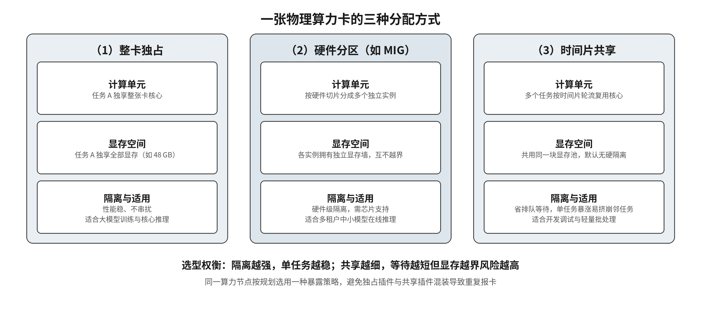
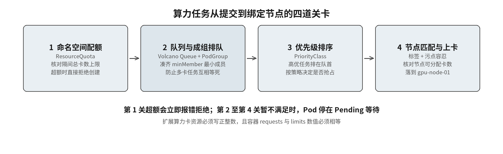
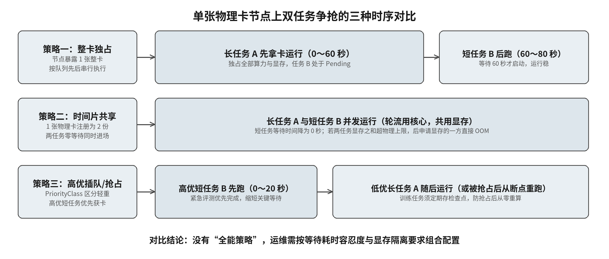
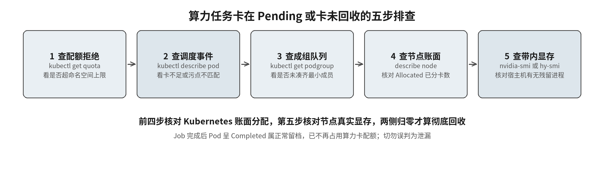

# 第29讲 算力卡资源调度

**本课程定位：** 第 28 讲已经将算力节点接入 Kubernetes 集群，完成了驱动核验、Device Plugin 注册与节点标签污点划分。集群认出了算力卡，不代表多团队共用时秩序井然。本讲解决算力池投产后的核心运行问题：多任务争抢有限算力卡时，如何按业务特点配置独占、共享、配额、排队与抢占策略，并在任务结束后确认算力与显存干净回收。

周三上午，训练命名空间 `algo-train` 里的 `gpu-node-01`（单卡 48 GB 显存）被一个耗时 2 小时的批处理任务占满。算法同事临时提交一个只需 3 分钟、显存占用仅 6 GB 的模型验证任务，一直卡在 `Pending`。另一位同事提议把这张卡改成 4 人共享，结果下午其中一个脚本显存暴涨，把同卡另外三个任务全部挤崩。本讲围绕这组现场矛盾解决四件事：算力卡怎么分、任务怎么提、资源不够时怎么排、卡住或未释放时怎么查。

## 本讲学习目标

学完后，你应能：

- 区分整卡独占、硬件分区、时间片共享与软件虚拟切分的隔离边界及适用场景。
- 编写规范的算力任务清单，配齐扩展资源整数声明、节点选择、污点容忍与命名空间配额。
- 使用 PriorityClass 与 Volcano 队列配置任务排队、成组调度与优先级策略。
- 完成双任务争抢与共享对比实验，从集群账面与宿主机带内两侧核验资源回收。
- 按配额、污点标签、可分配卡数、成组等待与残留进程五步排查调度及回收故障。

## 29.1、为什么算力卡需要专门的调度策略

在 Kubernetes 默认机制里，CPU 属于可压缩资源（超用时限流变慢），内存属于不可压缩资源（超用时触发 OOM 终止进程）。算力卡通过 Device Plugin 以扩展资源（如 `nvidia.com/gpu`、海光 `hygon.com/dcu`、昇腾 `huawei.com/Ascend910`）接入集群，默认只能按**正整数张**分配。哪怕一个轻量推理进程只用 4 GB 显存，只要申请 `1` 张卡，整张 48 GB 物理卡在编排账面上就不再分给别的 Pod。

为了在“利用率”和“稳定性”之间取得平衡，运维通常在四种分配方式中做选择。



表29-1、四类算力卡分配方式与隔离边界对比

| 方式 | 计算核心隔离 | 显存空间隔离 | 优点与风险边界 | 典型适用场景 |
| --- | --- | --- | --- | --- |
| 独占 | 单任务独享整卡 | 单任务独享全卡显存 | 性能最稳、无邻卡任务串扰。轻负载时显存与算力闲置多 | 大模型预训练、微调、核心生产推理 |
| 分区 | 芯片级独立计算实例 | 硬件级显存墙与带宽隔离 | 多实例互不挤占显存。仅特定型号支持（如 A100 或 H100 的 MIG），重划分需停任务 | 多租户中小模型在线推理、高隔离评测 |
| 时间片 | 多任务按时间片轮流用 | 共用整卡显存池，无硬墙 | 配置简单、减少排队等待。任一任务显存暴涨都会触发同卡其他任务报 OOM | 代码调试、教学实验、显存恒定的轻推理 |
| 虚拟化 | 驱动或拦截层限制算力百分比 | 软件配额限制可用显存上限 | 支持按显存与算力比例细粒度切分（如 vGPU 或 vDCU）。需额外部署对应组件或商业许可 | 企业研发云共享桌面、细粒度算力池 |

### 29.1.1、硬件分区与时间片共享的取舍

硬件分区以 NVIDIA MIG（Multi-Instance GPU，多实例 GPU）为代表。开启 MIG 后，一张物理大卡在硬件层面被切成若干固定规格的独立实例，每个实例拥有独立的流处理器、显存容量和显存控制器。实例 A 写满自己的显存，不会挤占实例 B 的空间。不过整张物理卡如果遭遇掉卡或断电，上面的全部实例仍会同时受影响。

时间片共享（Time-Slicing）不改动硬件结构。管理员在 Device Plugin 配置里把 1 张物理卡虚报为 `N` 份（例如 `replicas: 2` 或 `replicas: 4`）。Kubernetes 调度器看到节点上有 `2` 个可分配名额，就会放两个各自申请 `1` 份资源的 Pod 进同一张卡。GPU 驱动在底层让两个进程交替使用计算核心，但显存池完全打通。

【关键区别】节点状态里看到 `Allocatable` 显示 `4`，不代表机器真插了 4 张物理卡，也不代表每份都有独立显存墙。接手集群时，必须结合宿主机带内 `nvidia-smi`（海光用 `hy-smi`，昇腾用 `npu-smi`）核对真实物理卡张数，再看插件配置是整卡暴露、MIG 分区还是时间片复用。同一台算力节点在同一时刻只能启用一种资源暴露口径，不能把独占插件和共享插件混装在同一节点上重复报卡。

**【例题】** 算力节点 `gpu-node-01` 配有 1 张 48 GB 显存的算力卡，管理员开启时间片共享将这张卡注册为 `4` 份。4 名算法工程师各启动一个开发容器申请 `1` 份卡，前 3 个容器各占用了 12 GB 显存。第 4 个容器启动后尝试加载 16 GB 的模型权重，会发生什么现象？

**解：** 前 3 个容器已合计占用 `3 × 12 GB = 36 GB` 显存，物理卡剩余可用显存不足 12 GB。时间片共享只在调度账面上把 1 张卡拆成 4 个准入名额，底层并不限制单个容器的显存上限。第 4 个容器申请 16 GB 显存时会直接触发显存不足（`CUDA out of memory`）报错退出；若其他容器在运行中继续动态申请 KV Cache 或中间激活显存，同样可能连带崩溃。

【随堂思考】团队准备上线一个面向外部客户的合同审核在线推理服务（稳态占 22 GB 显存），同时内部还有不定期运行的算法调试脚本。如果只有 1 张 48 GB 算力卡，为什么不建议用时间片共享把在线推理和调试脚本混跑在同一张卡上？

## 29.2、提交算力任务与多维准入规则

理解切分方式后，下一步是把算力需求准确写进 Kubernetes 清单。一个批处理算力任务通常使用 `Job` 控制器（而非无限重启的 `Deployment`），并在落到节点前依次经过命名空间配额、队列、优先级和节点筛选四道关卡。



### 29.2.1、扩展资源整数声明与专卡专用

回顾第 18 讲与第 28 讲的约束，容器申请算力卡时必须遵守三条硬规则：

1. **正整数且上下限相等：** 扩展资源不支持写 `0.5` 这类小数，且 `resources.limits` 与 `resources.requests` 必须填写相同整数（只写 `limits` 时，Kubernetes 默认把 `requests` 自动补成与 `limits` 相等）。
2. **携带节点选择与污点容忍：** 第 28 讲为算力节点打了标签 `accelerator=nvidia-gpu` 和污点 `dedicated=gpu:NoSchedule`，防止普通 Web 容器误占算力节点内存与 CPU。算力任务必须显式带上对应的 `nodeSelector` 与 `tolerations` 才能进场。
3. **批作业退出策略：** `Job` 下的 Pod 必须将 `restartPolicy` 设为 `Never` 或 `OnFailure`。跑完正常退出后状态变为 `Completed`，kubelet 随即释放这个 Pod 占用的算力卡额度。

下面是一份在 `algo-train` 命名空间提交单卡计算任务的最小标准清单：

```yaml
# 文件路径：~/lab/l29/job-eval-short.yaml（在控制面 k8s-cp-01 执行）
apiVersion: batch/v1
kind: Job
metadata:
  name: job-eval-short
  namespace: algo-train
spec:
  backoffLimit: 1
  template:
    metadata:
      labels:
        app: gpu-eval
    spec:
      restartPolicy: Never
      nodeSelector:
        accelerator: nvidia-gpu
      tolerations:
        - key: "dedicated"
          operator: "Equal"
          value: "gpu"
          effect: "NoSchedule"
      containers:
        - name: worker
          image: registry.lab.example/lab/pytorch-ops:2.3-cuda12.1
          command: ["python3", "-c"]
          args:
            - |
              import time, torch
              assert torch.cuda.is_available(), "未检测到可用 GPU"
              x = torch.randn((8192, 8192), device="cuda")
              y = torch.matmul(x, x)
              torch.cuda.synchronize()
              print("显存峰值(MB):", round(torch.cuda.max_memory_allocated() / 1048576, 1))
              time.sleep(20)
          resources:
            requests:
              cpu: "2"
              memory: "4Gi"
              nvidia.com/gpu: "1"
            limits:
              cpu: "4"
              memory: "8Gi"
              nvidia.com/gpu: "1"
```

在海光 DCU 或华为昇腾集群中，清单结构完全一致，只需把资源键名分别替换为 `hygon.com/dcu: "1"` 或 `huawei.com/Ascend910: "1"`，并对齐对应节点的标签值与基础镜像。

### 29.2.2、用 ResourceQuota 限制多租户总配额

如果不对命名空间设限，某一个项目组一次性提交 20 个单卡训练 Job，就会把整个集群的算力卡瞬间占满。通过 `ResourceQuota` 可以在命名空间级别锁死算力卡申请总量：

```yaml
# 文件路径：~/lab/l29/quota-algo-train.yaml
apiVersion: v1
kind: ResourceQuota
metadata:
  name: gpu-quota
  namespace: algo-train
spec:
  hard:
    requests.cpu: "16"
    requests.memory: "64Gi"
    requests.nvidia.com/gpu: "2"
```

需要注意 `ResourceQuota` 与节点容量的行为差异：当节点暂时没空卡但命名空间配额未满时，Job 可以成功创建 Pod，Pod 停在 `Pending` 排队；一旦命名空间已用卡数达到 `2` 张，新提交的 Job 在创建 Pod 阶段就会被 API Server 直接拦截报错 `exceeded quota`，控制器事件里能看到明确的拒绝记录。

## 29.3、排队、成组调度与优先级配置

默认调度器（`kube-scheduler`）按单个 Pod 逐个调度。面对多团队批作业和分布式多卡训练时，逐个调度会遇到两个典型难题：一是**多卡成组死锁**，例如集群只剩 2 张空闲卡，两个各需 2 张卡的分布式训练任务同时启动，各抢到 1 张卡后都在等第 2 张卡，结果谁也跑不起来，白白占着卡空转；二是**缺乏队列公平性与批作业排队控制**。生产算力池通常引入 CNCF 开源批调度器 **Volcano** 配合 Kubernetes 原生 **PriorityClass** 解决这两类问题。

表29-2、排队、成组调度与优先级核心配置对象

| 对象 | 作用层次 | 关键字段 | 解决的具体问题 |
| --- | --- | --- | --- |
| 配额 | 命名空间级 | `requests.nvidia.com/gpu` | 限制单个团队同时持有的最大卡数，防单租户独占全池 |
| 优先级 | 集群全局级 | `value`、`preemptionPolicy` | 区分紧急任务与普通任务，决定排队先后与是否驱逐低优任务 |
| 队列 | Volcano 队列级 | `weight`、`capability` | 按部门或业务线划分队列权重与队列最大可用卡上限 |
| 任务组 | 作业成组级 | `minMember`、`minResources` | 保证多卡任务“要么一次凑齐全部卡启动，要么一张卡都不占” |

### 29.3.1、PriorityClass：插队等待还是主动抢占

`PriorityClass` 用整数 `value` 表示重要程度，数值越大优先级越高。配置时最关键的决策是 `preemptionPolicy`（抢占策略）：

- **允许抢占**（`PreemptLowerPriority`，默认）：高优 Pod 无卡可用时，调度器会驱逐节点上正在运行的低优先级 Pod 腾出算力卡。在线推理服务（`algo-prod`）扩容救急时适合开启，但被驱逐的训练任务如果没写定时保存检查点（Checkpoint）逻辑，之前的训练进度就会丢失。
- **只插队不抢占**（`Never`）：高优任务排在所有等待队列的最前面，只要前序任务跑完释放算力卡，高优任务第一个接手，但绝不强行杀掉正在运行的低优任务。日常紧急评测与短时验证优先推荐这种温和模式。

### 29.3.2、Volcano Queue 与 PodGroup 成组调度

安装了 Volcano 组件的集群中，只需将工作负载的 `schedulerName` 指定为 `volcano`，并关联 `PodGroup`（或直接使用 Volcano Job），就能启用队列与成组调度（Gang Scheduling）。

当一个分布式任务需要 4 个 Worker Pod 各占 1 张卡协同通信时，将 `PodGroup` 的 `minMember` 设为 `4`。Volcano 检查目标队列与节点余量：凑不够 4 张卡时，这组任务全部留在队列里等待，不零星占用任何一张物理卡；凑够 4 张卡时，一次性完成全部 4 个 Pod 的绑定。

**【例题】** 集群剩余 2 张空闲算力卡。团队甲提交需要 4 张卡的分布式训练任务 M，团队乙随后提交只需 1 张卡的模型评估任务 N。分别说明使用默认调度器逐个调度，与使用 Volcano 配置 `minMember: 4` 时的运行结果。

**解：** 使用默认调度器时，任务 M 先创建 4 个 Pod，前 2 个抢走仅剩的 2 张空闲卡进入容器启动，后 2 个卡在 `Pending`。任务 M 因凑不齐 4 卡通信组无法开始训练，任务 N 也因为 2 张卡已被占走而一起卡在 `Pending`，形成资源死锁。使用 Volcano 并设 `minMember: 4` 时，调度器发现集群空闲卡不足 4 张，不为任务 M 绑定任何节点，2 张卡保持空闲。随后提交的单卡任务 N 可顺利拿到 1 张卡跑完退出。

【随堂思考】如果把所有离线训练任务的 `PriorityClass` 都配成允许抢占（`PreemptLowerPriority`），且不同工程师各自随意填写 `value` 数值，算力池会出现什么混乱后果？运维应当怎样从权限上收口？

<!-- pagebreak -->

## 29.4、上机实训：双任务争抢、共享与回收实验

本节对应实训「算力卡调度策略与隔离实验」。我们在 `Kubernetes v1.30` 集群的 `algo-train` 命名空间中，针对算力节点 `gpu-node-01`（`192.168.10.31`，1 张物理卡）提交两个资源耗时不同的 AI 任务，依次验证**整卡独占排队、时间片共享并发、高优插队**与**结束后双侧资源回收**。

> 实验环境说明：若练习集群配备真实 GPU/DCU 卡，按下方命令实测；若在无物理加速卡的纯虚拟机集群复现调度逻辑，可由节点 Mock 插件或节点扩展资源补丁上报 `example.com/gpu: 1`（或测试环境中配置好的 `nvidia.com/gpu` 模拟设备），排障与队列行为完全一致，只需跳过容器内 `torch.cuda` 矩阵乘步骤改用 `sleep` 模拟运行时长，并在实验记录中如实注明“模拟扩展资源环境”。

### 29.4.1、步骤一：准备命名空间、配额与优先级类

在控制面节点 `k8s-cp-01` 上创建实验目录、命名空间、上限为 `2` 张卡的 `ResourceQuota`，以及高低两个 `PriorityClass`（均采用“只插队不强杀”的 `preemptionPolicy: Never`，保护在途训练任务）：

```bash
# 执行位置：k8s-cp-01（opsadmin 账号）
mkdir -p ~/lab/l29 && cd ~/lab/l29
kubectl create namespace algo-train --dry-run=client -o yaml | kubectl apply -f -

cat <<'EOF' > ~/lab/l29/prio-and-quota.yaml
apiVersion: scheduling.k8s.io/v1
kind: PriorityClass
metadata:
  name: ai-high-prio
value: 10000
preemptionPolicy: Never
globalDefault: false
description: "高优评测与紧急推理队列，排在队首但不强行中断在途任务"
---
apiVersion: scheduling.k8s.io/v1
kind: PriorityClass
metadata:
  name: ai-low-prio
value: 1000
preemptionPolicy: Never
globalDefault: false
description: "普通离线批训练任务优先级"
---
apiVersion: v1
kind: ResourceQuota
metadata:
  name: gpu-quota
  namespace: algo-train
spec:
  hard:
    requests.cpu: "16"
    requests.memory: "64Gi"
    requests.nvidia.com/gpu: "2"
EOF

kubectl apply -f ~/lab/l29/prio-and-quota.yaml
kubectl get resourcequota -n algo-train
```

若集群已部署 Volcano，同步核对队列状态（如默认或新建 `train-queue`）：

```bash
# 查看 Volcano 队列状态（STATE 为 Open 表示可正常接单）
kubectl get queue
```

### 29.4.2、步骤二：整卡独占模式下的双任务争抢与排队

确认 `gpu-node-01` 当前按**整卡独占**暴露 `1` 张卡（`kubectl describe node gpu-node-01` 中 `Allocatable` 的 `nvidia.com/gpu` 为 `1`）。准备长耗时训练模拟任务 `job-train-long`（运行 60 秒，申请 1 卡）与短耗时评测任务 `job-eval-short`（运行 20 秒，申请 1 卡）：

```bash
# 生成长任务与短任务清单并连续提交
cat <<'EOF' > ~/lab/l29/two-jobs-exclusive.yaml
apiVersion: batch/v1
kind: Job
metadata:
  name: job-train-long
  namespace: algo-train
spec:
  template:
    spec:
      priorityClassName: ai-low-prio
      restartPolicy: Never
      nodeSelector:
        accelerator: nvidia-gpu
      tolerations:
        - key: "dedicated"
          operator: "Equal"
          value: "gpu"
          effect: "NoSchedule"
      containers:
        - name: trainer
          image: registry.lab.example/lab/pytorch-ops:2.3-cuda12.1
          command: ["sh", "-c", "echo start-long && sleep 60 && echo done-long"]
          resources:
            requests:
              cpu: "2"
              memory: "4Gi"
              nvidia.com/gpu: "1"
            limits:
              cpu: "2"
              memory: "4Gi"
              nvidia.com/gpu: "1"
---
apiVersion: batch/v1
kind: Job
metadata:
  name: job-eval-short
  namespace: algo-train
spec:
  template:
    spec:
      priorityClassName: ai-low-prio
      restartPolicy: Never
      nodeSelector:
        accelerator: nvidia-gpu
      tolerations:
        - key: "dedicated"
          operator: "Equal"
          value: "gpu"
          effect: "NoSchedule"
      containers:
        - name: evaluator
          image: registry.lab.example/lab/pytorch-ops:2.3-cuda12.1
          command: ["sh", "-c", "echo start-short && sleep 20 && echo done-short"]
          resources:
            requests:
              cpu: "1"
              memory: "2Gi"
              nvidia.com/gpu: "1"
            limits:
              cpu: "1"
              memory: "2Gi"
              nvidia.com/gpu: "1"
EOF

kubectl apply -f ~/lab/l29/two-jobs-exclusive.yaml
kubectl get pods -n algo-train -o wide
```

提交后立即查看状态与事件，预期输出如下：

```text
NAME                   READY   STATUS    RESTARTS   AGE   NODE
job-train-long-7xk2p   1/1     Running   0          6s    gpu-node-01
job-eval-short-9m4qv   0/1     Pending   0          5s    <none>
```

查看 `Pending` Pod 的调度原因：

```bash
kubectl describe pod -n algo-train -l job-name=job-eval-short
# 预期 Events 关键行：
# Warning  FailedScheduling  default-scheduler  0/3 nodes are available:
# 1 Insufficient nvidia.com/gpu, 2 node(s) didn't match Pod's node affinity/selector.
```

继续观察约 60 秒：当 `job-train-long` 状态变为 `Completed` 后，`job-eval-short` 自动从 `Pending` 转为 `Running`，20 秒后一并完成。再补测一次**配额拦截**：当两个任务都在队列中占满 `2/2` 配额时，尝试提交第 3 个申请 1 卡的任务 `job-third`，执行 `kubectl describe job job-third -n algo-train` 可观察到 `FailedCreate` 与 `exceeded quota: gpu-quota` 证据。



### 29.4.3、步骤三：切换时间片共享与优先级插队对比

清理上一轮任务后，验证**优先级插队**：在单卡已被占满期间，同时提交低优任务 `job-low-wait`（`ai-low-prio`）与高优任务 `job-high-urgent`（`ai-high-prio`）。即使高优任务晚几秒提交，前序任务释放卡的瞬间，`job-high-urgent` 也会先于 `job-low-wait` 获得调度。

接着测试**时间片共享**（通过 NVIDIA Device Plugin 的 ConfigMap 将 1 张物理卡配置为 `replicas: 2`）：

```yaml
# 文件路径：~/lab/l29/dp-time-slicing.yaml（Device Plugin 时间片配置片段）
version: v1
sharing:
  timeSlicing:
    resources:
      - name: nvidia.com/gpu
        replicas: 2
```

加载配置并重启 `kube-system` 下的 Device Plugin Pod 后，核对节点可分配数变为 `nvidia.com/gpu: 2`。此时重新执行 `kubectl apply -f ~/lab/l29/two-jobs-exclusive.yaml`，两个 Pod 会**同时进入运行态**（`Running`），短任务等待时间从 60 秒降为 0 秒。登录 `gpu-node-01` 执行 `nvidia-smi` 可见同一张物理卡（GPU 0）下方同时列出两个容器进程 PID，共享同一块 48 GB 显存池。

### 29.4.4、步骤四：双侧验证资源回收与环境清理

等全部实验任务变为 `Completed` 后，按“集群账面 + 节点带内”双侧交叉核验算力是否真正归零：

```bash
# 1. 在 k8s-cp-01 核对集群账面已分配资源（Allocated resources 应回到 0）
kubectl describe node gpu-node-01 | grep -A 8 "Allocated resources"

# 2. 在算力节点 gpu-node-01 核对物理显存与计算进程（海光节点用 hy-smi）
ssh opsadmin@192.168.10.31 "nvidia-smi"
# 预期：Processes 列表显示 No running processes found，显存占用回落至基础底噪

# 3. 归档实验结果后清理本讲实验 Job，并将 Device Plugin 还原为默认整卡模式
kubectl delete job --all -n algo-train
```

实训完成后，将实测数据整理为下方对比记录表存档交付：

表29-3、四种调度策略实训观测结果对比汇总

| 场景 | 节点报卡数 | 短任务等待耗时 | 显存与故障隔离效果 | 适用结论 |
| --- | --- | --- | --- | --- |
| 独占 | 1 张整卡 | 约 60 秒（等前序跑完） | 单任务独占全卡，无邻任务显存串扰 | 核心训练与生产稳态推理首选 |
| 共享 | 1 卡切 2 份 | 0 秒（并发立即运行） | 共用显存池，总和超物理显存时触发 OOM | 适合显存可控的开发调试与轻推理 |
| 限额 | 配额上限 2 | 第 3 个任务立即被拒 | 将超额请求挡在创建阶段，保护其他命名空间 | 多团队共用集群必配的账面防线 |
| 高优 | 1 张整卡 | 前序释放后优先上卡 | `Never` 模式插队不杀在途任务，兼顾时效与安全 | 紧急评测与高优短作业推荐策略 |

## 29.5、常见调度与回收故障排查

算力池日常值班中，工程师报障最集中的两句话是：“我的任务一直 Pending 上不去卡”和“明明删了任务，卡怎么还显示占满”。遇到这两类问题，严禁盲目重启 kubelet 或宿主机，应按五步顺序逐层定界。



表29-4、算力调度与回收常见故障及首查动作

| 现象 | 所属层次 | 首查命令 | 高频根因与处置方法 |
| --- | --- | --- | --- |
| 被拒 | 命名空间配额 | `kubectl describe job <名> -n <空间>` | 触发 `exceeded quota`。清理已完成且占额的对象，或评估上调 `ResourceQuota` |
| 缺卡 | 节点资源余量 | `kubectl describe pod <名> -n <空间>` | 事件报 `Insufficient nvidia.com/gpu`。核对在途任务，按队列排队等待或改投空闲池 |
| 污点 | 节点亲和与污点 | `kubectl get nodes --show-labels` | 事件报 `untolerated taint` 或标签不匹配。补齐清单 `tolerations` 与 `nodeSelector` |
| 组等 | Volcano 批调度 | `kubectl describe podgroup -n <空间>` | 多卡作业未凑齐 `minMember` 所需空闲卡。等待整组空闲卡释放，排查死锁队列 |
| 残留 | 容器进程与带内 | 节点执行 `nvidia-smi` 与 `ps -ef` | 训练框架拉起的多进程子进程残留，或误用 `Deployment` 挂 `sleep infinity` 占卡不退 |

**【例题】** 算法同事反馈：`algo-train` 里已经没有任何 `Running` 的训练任务，`kubectl describe node gpu-node-01` 显示 `Allocated resources` 中 `nvidia.com/gpu` 确实是 `0`。但新启动的推理任务一上卡就报显存只剩 4 GB。问题出在哪里，要怎样排查？

**解：** Kubernetes 账面显示 `0`，说明编排层已经完成了解绑；显存只剩 4 GB，说明宿主机物理卡上仍有进程占着约 44 GB 显存。登录 `gpu-node-01` 执行 `nvidia-smi`（海光节点用 `hy-smi`）查看进程表：常见原因有两种，一是有人绕过 Kubernetes 直接用宿主机 Docker 或裸机 Python 启动了占卡脚本；二是前一个容器退出时留下了脱离父进程的异常设备句柄。核实进程属主和业务影响后，在授权范围内终止违规或残留进程，复查显存回落后再重跑新任务。

【关键区别】`Pod` 处于 `Completed` 状态不等于泄漏算力卡。Kubernetes 保留 `Completed` 的 Pod 是为了方便你用 `kubectl logs` 查看训练最终输出，此时算力卡配额已经归还给节点。真正的泄漏分为“账面泄漏”（误用 `Deployment` 跑一次性脚本，脚本结束后无限拉起或挂 `sleep` 长期占卡）与“物理显存残留”（账面已归零但带内显存仍被占满），两类现象必须用 `describe node` 加 `nvidia-smi` 双侧对照区分。

<!-- pagebreak -->

## 29.6、本讲回顾与自测

学习完本讲后，试着用自己的话回答四个问题：整卡独占、MIG 硬件分区与时间片共享在显存隔离上差在哪里？算力任务清单比普通 CPU 任务多哪三项必填配置？Volcano 的 `minMember` 怎样避免多卡死锁？核验一张卡是否真正回收为什么要同时看集群和宿主机两侧？

表29-5、本讲目标与对应判断

| 学习目标 | 应能做出的判断 |
| --- | --- |
| 区分分配方式 | 说清整卡独占、硬件分区与时间片共享的计算及显存边界，不把虚报份数当成硬件显存隔离 |
| 编写算力任务 | 检查扩展资源是否为相等正整数，是否配齐 `nodeSelector`、`tolerations` 与批作业退出策略 |
| 配置排队抢占 | 用 `ResourceQuota` 控总额、`PriorityClass` 定先后、Volcano `PodGroup` 保多卡同进同退 |
| 核验资源回收 | 同时查 `describe node` 已分配数与带内 `nvidia-smi` / `hy-smi` 显存，确认双侧归零 |
| 排查调度卡阻 | 遇 `Pending` 先读 Events 区分卡不足、污点不匹配与成组等待，不盲目重启节点服务 |

### 29.6.1、本讲自测

**1 切分选型。** 一台配有 1 张 80 GB 显存支持 MIG 的算力服务器，要同时承载 3 个互不信任业务部门的小模型在线推理，要求任一部门流量暴涨都不能挤占其他部门显存。应选时间片共享还是硬件分区？说明理由。

**2 清单挑错。** 同事提交的 GPU Job 清单里写了 `requests.nvidia.com/gpu: "0.5"` 且漏写了算力节点的 `tolerations`。提交后会遇到哪两重阻碍？怎样修改？

**3 抢占风险。** 为什么针对未实现断点保存（Checkpoint）的长周期训练任务，不建议随意被高优任务以 `PreemptLowerPriority` 方式抢占？如果要让紧急短任务优先拿卡又不杀在途任务，应当怎样配置？

**4 多卡死锁。** 集群剩 4 张空卡，两个各需 4 张卡但分拆成 4 个 Pod 的分布式任务几乎同时提交。用 Volcano 的哪个机制能防止“各拿 2 张卡互相等死”？

**5 故障定位。** 新提交的 Job 没有生成任何 Pod，`kubectl get pods -n algo-train` 看不到新记录。你第一步要查 Job 的什么信息，最可能触发了哪道限制？

**6 回收核验。** 批处理训练 Job 显示 `COMPLETIONS 1/1`，同事担心保留 `Completed` Pod 会一直占着算力卡。你会用哪两条命令向同事证明卡已经释放干净？

**答：**

____________________________

____________________________

____________________________

____________________________

## 29.7、参考答案与解析

### 29.7.1、随堂思考解析

**思考 1（在线推理与调试脚本混跑时间片共享）：** 时间片共享没有硬件显存墙，计算核心也是轮流复用。调试脚本经常出现批大小写错或死循环暴涨显存的情况，一旦把整张 48 GB 显存吃满，同卡运行的合同审核在线推理服务会在处理客户请求时直接报 OOM 崩溃，即使不崩也会因核心争抢导致响应延迟大幅抖动。核心生产在线推理应坚持整卡独占或硬件分区隔离。

**思考 2（随意配置抢占优先级与权限收口）：** 如果人人都能自建或随意绑定高数值且带 `PreemptLowerPriority` 的优先级类，就会演变成“全员填最高优先级互相驱逐”，导致长训练任务反复中断重算、集群有效产出归零。收口方法：将 `PriorityClass` 创建权限收归集群管理员（ClusterRole 管控），并通过命名空间的 `ResourceQuota` 配合 `scopeSelector` 限制普通训练命名空间只允许使用指定的低优或只插队优先级类。

### 29.7.2、课后自测解析

**1** 应选硬件分区（MIG）。时间片共享共用整卡显存池，无法阻止单一部门超用显存波及其他部门；MIG 在芯片层面划分独立计算单元和独立显存地址空间，能满足强显存隔离诉求。

**2** 第一重阻碍是 API Server 校验拒绝：默认扩展资源不支持小数 `"0.5"`，必须改为正整数（如 `"1"`）且 `requests` 与 `limits` 相等（若需共享，应在节点侧配置时间片或分区插件，Pod 侧仍申请整数份）。第二重阻碍是即使过了格式校验，Pod 也会因缺少对应 `tolerations` 被算力节点的 `dedicated=gpu:NoSchedule` 污点挡在 `Pending`。

**3** `PreemptLowerPriority` 会直接终止并驱逐低优先级 Pod。没有保存检查点的训练任务一旦被杀，之前数小时甚至数天的迭代进度全部作废，重启后只能从头算起。只需将高优 `PriorityClass` 的 `preemptionPolicy` 设为 `Never`，就能让紧急短任务排在等待队列最前面，等当前在途任务一结束立刻第一个接手。

**4** 使用 Volcano 的成组调度（Gang Scheduling）机制，在 `PodGroup`（或 Volcano Job 的 `minAvailable`）中将 `minMember` 设为 `4`。调度器会按整组 4 张卡原子评估，保证其中一个任务拿满 4 卡先跑，另一个任务整组在队列等待，不会出现各占 2 卡的死锁。

**5** 第一步执行 `kubectl describe job <Job名称> -n algo-train` 查看控制器 Events。Pod 根本没被创建出来，最可能是触发了 `algo-train` 命名空间的 `ResourceQuota` 上限（事件中出现 `FailedCreate` 与 `exceeded quota`）。

**6** 第一条命令在控制面执行 `kubectl describe node gpu-node-01`，指出 `Allocated resources` 栏下 `nvidia.com/gpu` 已回落为 `0`（证明 `Completed` 态 Pod 不再占集群配额）；第二条命令登录 `gpu-node-01` 执行 `nvidia-smi`（或 `hy-smi`），展示 `Processes` 列表无残留计算进程且显存占用回到空载基线。

## 29.8、术语

表29-6、本讲术语

| 术语 | 本讲中的含义 |
| --- | --- |
| 整卡独占 | 单个容器独享整张物理算力卡的计算核心与全部显存，隔离性最强。 |
| MIG | 多实例 GPU（Multi-Instance GPU），支持在硬件层面把单张大卡切分为多个计算与显存互不越界的独立实例。 |
| 时间片共享 | 把单张物理卡在调度层注册为多份名额，多容器轮流使用计算核心并共用同一块显存池。 |
| ResourceQuota | 命名空间级资源总额限制器，防止单个租户超额占满集群算力卡。 |
| PriorityClass | Kubernetes 优先级定义对象，决定等待队列排序及是否允许驱逐低优先级 Pod。 |
| Volcano | 面向 AI 训练与高性能计算的 Kubernetes 批调度器，支持队列权重与成组调度。 |
| PodGroup | Volcano 中描述一组协同 Pod 的资源对象，通过 `minMember` 规定最小同时启动副本数。 |
| 成组调度 | 一组关联 Pod 要么全部凑齐资源同时绑定节点，要么全部留在队列等待，避免分布式任务半数占卡死锁。 |

文中节点 IP `192.168.10.31`、命名空间 `algo-train`、镜像仓库 `registry.lab.example` 与资源配额数值均为教学示例，生产环境以本单位集群规划为准。

## 附录、算力调度策略与隔离验收核对单

表29-7、算力调度策略上线与排障核对单

| 核对项 | 核对内容与操作动作 | 合格判据 |
| --- | --- | --- |
| 暴露 | 核对节点 Device Plugin 模式与物理卡张数 | 独占或共享口径清晰，同节点未混装冲突插件 |
| 声明 | 检查任务清单 `resources.requests` 与 `limits` | 算力卡数量为相等正整数，批作业配 `Never` 或 `OnFailure` |
| 准入 | 检查算力节点污点及任务清单 `nodeSelector`、`tolerations` | 普通无卡业务不误落算力节点，AI 任务可正常匹配 |
| 配额 | 执行 `kubectl get quota -n <空间>` 核对团队配额 | 已配置最大卡数硬上限，超额提交能被及时拦截 |
| 抢占 | 核对各 `PriorityClass` 的 `preemptionPolicy` 与使用权限 | 未存检查点的长训练不被随意强杀，高优权限已收口 |
| 回收 | 任务结束后核对 `describe node` 与宿主机 `nvidia-smi` / `hy-smi` | 集群账面已分配卡数与节点带内计算进程双侧归零 |

<!-- md-only -->

## 附：主要参考资料（仅 Markdown 保留，不印入 Word/PDF）

- 中国信通服务《2025 算力运维体系技术白皮书》（本地 PDF，`./资料/中国信通服务：2025算力运维体系技术白皮书-71页.pdf`），用于算力平台容器化统一调度、MIG 硬件内存安全隔离与批作业故障恢复背景说明。
- Kubernetes 官方文档《Schedule GPUs》（`https://kubernetes.io/docs/tasks/manage-gpus/scheduling-gpus/`），用于扩展资源正整数声明、`requests` 与 `limits` 约束及 Device Plugin 调度规则。
- Kubernetes 官方文档《Pod Priority and Preemption》与《Resource Quotas》，用于 `PriorityClass` 的 `preemptionPolicy: Never` / `PreemptLowerPriority` 行为及命名空间硬件配额核查。
- NVIDIA GPU Operator / k8s-device-plugin 官方文档《Time-Slicing GPUs in Kubernetes》与《MIG Support in Kubernetes》，用于时间片共享无硬显存隔离边界及 MIG 硬件分区对比。
- Volcano 官方文档《Queue》《PodGroup & Gang Scheduling》（`https://volcano.sh/zh/docs/`），用于多卡任务成组调度防死锁机制与队列管理说明。

<!-- /md-only -->
