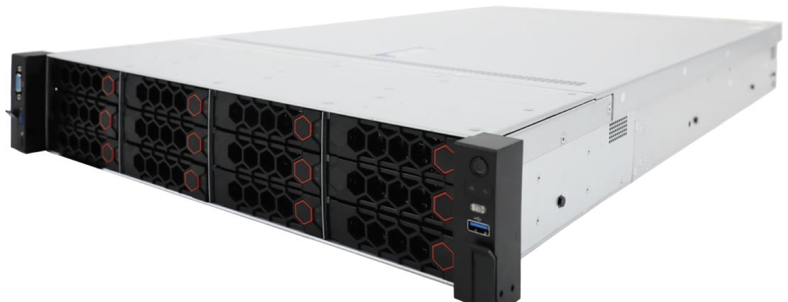
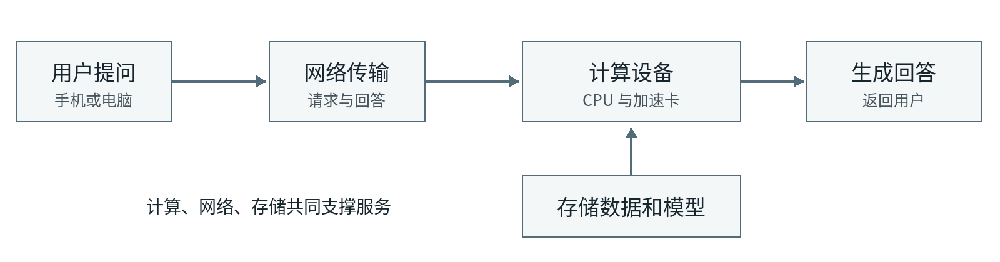
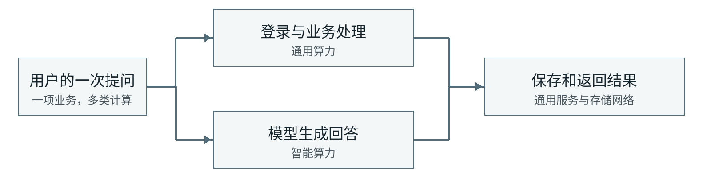
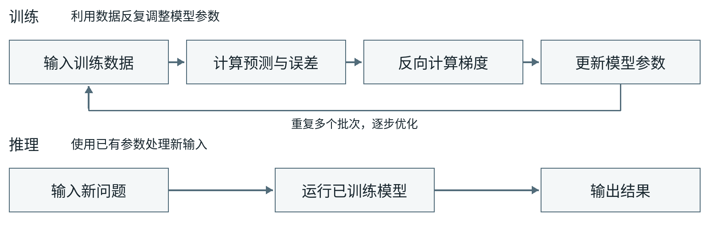

# 第2讲 认识算力

**本课程定位：** 面向前面的课程之后，本讲先认识“算力”是什么、有多少、怎么分、从哪来。后面几讲再去看承载算力的机房、服务器和算力卡。

你向 AI 助手提一个问题，几秒后它给出回答。这个过程背后有计算设备在跑模型，有网络在传数据，有存储在保存模型和对话。算力运维工程师要做的，就是让这些设备和系统一直能正常工作。这一讲先把“算力”讲清楚。

## 本讲学习目标

学完后，你应能：

- 说清算力和数据、算法是什么关系，三者各起什么作用。
- 看懂算力数字的单位和精度，知道为什么不能只看一个数。
- 分清通用、智能、超算三类算力，也分清训练和推理。
- 从成本、弹性、数据安全、运维责任四个方面，比较自建和云算力。
- 遇到一条算力指标，能说出它是在什么条件下测出来的。

## 2.1、算力是什么

**算力就是计算设备干活的能力。** 这个“活”包括算数、判断、处理业务，也包括跑人工智能模型。

算力不是一台设备单独就能提供的。它要“算、传、存”配合：计算设备负责算，网络负责把请求和数据送进来，存储负责保存模型和资料。哪一环不够，整个服务都会变慢。所以只看芯片跑得多快，解释不了用户为什么等得久。

<!-- pagebreak -->

这些计算最终跑在服务器上。CPU、内存、硬盘、网卡、电源都装在一个机箱里，就是下面这样一台机器。

### 2.1.1、数据、算法与算力各做什么

以训练一个“认猫和狗”的模型为例：

- **数据**：大量带标签的猫狗图片。图片和标签决定了模型能看到什么。
- **算法**：模型的结构和学习方法。它决定了这些图片怎么被使用。
- **算力**：运行训练程序的服务器和加速卡。它让这些计算真正跑起来。

三者缺一不可。数据错了，模型学不对；算法不合适，效果上不去；算力不够，训练要跑很久。但反过来，加机器不能修好错误的数据，也不能保证模型更准。

【随堂思考】AI 回答很慢，一定是加速卡算得不够快吗？结合上面的服务链示意，说出另外两种可能。

## 2.2、算力有多少

### 2.2.1、先读单位，再看数量级

描述算力，最常见的是 **FLOPS**，意思是“每秒做多少次浮点运算”。浮点数可以理解成带小数点的数，计算机用它表示很大或很小的数值。FLOPS 说的是计算速度，不等于模型回答的速度。

数字太大不好念，就在前面加字母表示数量级。这里的换算按十进制，每上一级，数值大 1000 倍。

表2-1、算力单位的换算关系

| 单位 | 每秒多少次运算 | 与上一级的关系 |
| --- | --- | --- |
| GFLOPS | 10 亿次 | 起点 |
| TFLOPS | 1 万亿次 | 1 TFLOPS = 1000 GFLOPS |
| PFLOPS | 1000 万亿次 | 1 PFLOPS = 1000 TFLOPS |
| EFLOPS | 100 亿亿次 | 1 EFLOPS = 1000 PFLOPS |

还有一个常见单位 **TOPS**，指每秒多少万亿次“操作”，多用在整数计算上。“操作”具体指什么，要看厂商怎么定义、怎么测。所以不能看到同样是 T，就把 TOPS 和 TFLOPS 直接比大小。

**【例题】** 一份资料写“2 PFLOPS”，另一份写“1500 TFLOPS”。如果两者精度、运算类型和测法都一样，哪个数值大？

**解：** 1 PFLOPS = 1000 TFLOPS，所以 2 PFLOPS = 2000 TFLOPS。2000 ÷ 1500 ≈ 1.33，前者的指标数值约是后者的 1.33 倍。但这只说明这组数字的差别，不代表所有任务都快要 1.33 倍。

【关键区别】T、P、E 是数量级，可以互相换算；FP16、FP32 是数据格式，不是一回事。算力数字后面跟着的精度条件，才是后面要读的重点。

【随堂思考】一张资料卡写“80 TOPS”，另一张写“60 TFLOPS”。现在能判断哪张卡快吗？还要向提供资料的人问什么？

### 2.2.2、计算精度会改变算力数字

计算机存一个数，位数是有限的。格式不同，能表示的范围、精度和占用的空间就不同。同一台设备，换了格式，能跑的计算和速度也可能跟着变。所以一条算力指标，至少要说明用的是哪种格式。

表2-2、常见数值格式的占用与用途

| 格式 | 每个数占几个字节 | 怎么理解、常用在哪 |
| --- | --- | --- |
| FP64 | 8 | 双精度浮点，算得慢但更精细，多用于科学计算。 |
| FP32 | 4 | 单精度浮点，通用数值计算和模型的一部分计算会用到。 |
| FP16 | 2 | 半精度浮点，深度学习里常见，常和更高精度混着用。 |
| BF16 | 2 | 和 FP16 一样占 2 字节，但范围和精细程度不同，也常用于深度学习。 |
| INT8 | 1 | 8 位整数，多用于量化后的推理，需要配合量化方法。 |

**字节一样多，性质也可能不同。** BF16 和 FP16 都占 2 字节，但 BF16 的范围接近 FP32，小数更粗；不能当成同一种格式。

混合精度是指一次计算里用多种格式：适合的步骤交给低精度，需要稳的步骤用高精度。入门记住“同一件事可以用不同精度做”就够了。

**【例题】** 一个模型有 10 亿个参数，每个参数按 FP16 存，只算权重本身，要占多大空间？

**解：** 10 亿 × 2 字节 = 20 亿字节，约 2 GB（约 1.86 GiB）。如果按 FP32 存，约 4 GB。这里 GB 按十进制算，GiB 按二进制算。

**权重只是运行空间的一部分。** 程序运行时还要临时空间；训练要存梯度和优化器状态；生成式模型推理还可能存上下文缓存。不能因为“权重约 2 GB”，就说“2 GB 显存够用”。

### 2.2.3、记参数时要把条件带上

看到“200 TFLOPS”，要记成一整句：哪台设备、什么精度（如 FP16）、什么运算路径、稠密还是稀疏、是理论峰值还是实测、软件是什么版本。条件缺了，比较就先别下结论。

稠密和稀疏，说的是计算时有没有利用数据里大量的零。不了解细节时，先确认两条指标是不是同一种条件，再比数字。

<!-- pagebreak -->

### 2.2.4、理论峰值、实测性能、业务表现

这三个数经常被混着说，其实不是一回事：

- **理论峰值**：按硬件参数和规定条件算出来的上限，回答“最多能算多少”。
- **实测性能**：在明确的任务和环境里测出来的结果，回答“实际跑出多少”。
- **业务表现**：用户的任务完成得怎么样，比如回答快不快、能不能用。

**【例题】** 用简化条件估一个理论峰值：一颗 CPU 有 32 个核，每个核都以 2.0 GHz 运行；在指定精度和指令条件下，每个核每周期做 32 次浮点运算。

**解：** 2.0 GHz 就是每秒 20 亿次。32 核 × 32 次/周期 × 20 亿次 ≈ 20500 亿次/秒，约 2.05 TFLOPS。

这个结果依赖题目的全部假设。真实设备还会受频率变化、指令支持、数据供给影响，不能把这个简化关系套到所有 GPU 和所有精度上。

TOP500 榜单用的 HPL 测试，是让超级计算机解一个很大的线性方程组。榜单上的 **Rpeak** 是理论峰值，**Rmax** 是这个测试跑出来的最好成绩。两者之比，不代表所有程序的效率，更不是 AI 回答的速度。

### 2.2.5、把指标和任务对上

表2-3、运维观察对象与典型指标

| 观察对象 | 典型指标 | 它能回答什么 |
| --- | --- | --- |
| 设备 | 温度、功耗、设备忙碌率 | 设备在不在工作，有没有异常？ |
| 训练任务 | 每秒处理多少样本、每步多久 | 这次训练还要多久？ |
| 推理服务 | 响应时延、吞吐量、错误率 | 用户等多久，服务能接多少请求？ |

**设备忙碌率不等于有效算力利用率。** 忙碌率是监控工具按自己的定义算的，只看采样那段时间忙不忙；有效利用率还要看真正干了多少有用的计算。显存占用高，也不等于计算单元在忙。看监控图前，先弄清指标名字、算法和采样窗口。

比如训练时每一步都在等数据读进来，卡再快也用不上。多机训练还可能卡在机器之间的通信上。这时要同时看读数据、通信和计算各花多久，再判断慢在哪。

【随堂思考】某设备理论峰值 200 TFLOPS，某项测试实测 120 TFLOPS，比值 60%。能把这个 60% 写成“这台设备所有业务的利用率”吗？为什么？

<!-- pagebreak -->

## 2.3、算力怎么分

### 2.3.1、按用途分三类

按主要任务，算力常分三类：通用算力、智能算力、超算算力。分类是为了理解业务，不是说一类任务只能用一种芯片。

表2-4、三类算力的用途与资源特点

| 类别 | 主要用途 | 典型例子 | 常见资源特点 |
| --- | --- | --- | --- |
| 通用算力 | 业务逻辑和日常数据处理 | 办公系统、交易记录、用户登录 | 以 CPU 为主，内存、存储、网络也要跟上。 |
| 智能算力 | AI 训练和推理 | 图像识别、语音识别、AI 问答 | 常用 GPU、NPU 等加速设备，和 CPU 配合。 |
| 超算算力 | 大规模科学计算和工程仿真 | 天气预报、流体仿真 | 常用高性能集群做并行计算，也可能用加速设备。 |

**先看任务在干什么。** 同一张加速卡，既能跑 AI，也能做科学计算；一台服务器也可能同时跑业务系统和 AI 服务。“装了 GPU”推不出“只做智能计算”。

**【例题】** 一次 AI 问答属于哪类？用户登录、查权限、存对话，主要是通用业务；模型根据问题生成回答，是智能计算。整个服务还要网络和存储。给系统归类时，要说清讨论的是哪个环节。

### 2.3.2、先认业务，再看资源

接到任务先问三句：它主要在处理业务记录、跑 AI 模型，还是做数值模拟？数据多大、要多快完成、用什么软件？光看芯片名字就定资源类型，很容易忽略任务真正需要的东西。

【随堂思考】处理一笔转账、训练猫狗分类模型、用数值模型模拟台风，分别主要对应哪类算力？如果台风预测改用 AI 模型，该按什么重新判断？

<!-- pagebreak -->

### 2.3.3、训练和推理是两件事

**训练**是用数据不断调整模型参数，让模型学会干活。**推理**是拿训练好的参数去处理新输入。

以认猫狗为例：训练时反复看带标签的图片、调参数；推理时给一张新图，直接输出“猫”或“狗”。

表2-5、训练与推理的对比

| 对比项 | 训练 | 推理 |
| --- | --- | --- |
| 参数变不变 | 训练过程中不断更新。 | 一般不再更新。 |
| 怎么干 | 一批一批处理数据，算误差，改参数。 | 对新输入做计算，给出预测或生成结果。 |
| 主要看什么 | 训练要多久、稳不稳、显存够不够、多机通信顺不顺。 | 响应快不快、能接多少请求、服务稳不稳。 |

文本生成类模型推理时，通常一个 token 一个 token 地往外蹦。token 是模型处理文本的基本单位，可能是一个字、半个词或一小段。图片分类这类推理不一定这样，别把生成文本的过程当成所有推理的样子。

### 2.3.4、训练和推理，运维关注点不同

训练可能跑很久，中途断了，前面算的都白费，所以要定期存检查点；多机训练还要盯通信会不会拖慢整体。

在线推理直接面对用户，要看排队、响应速度和报错。并发一多、输入一长，资源压力就上来了。**推理并不天然省资源**：大模型、高并发、长上下文，同样可能吃满显存、要用多台机器。

<!-- pagebreak -->

## 2.4、算力从哪来

### 2.4.1、自建和云，怎么选

**自建算力**是自己买设备、自己管，可以放在自有机房，也可以托管在别人的机房。**云算力**是按约定用云厂商的资源。这一讲拿 GPU 云服务器这类基础服务来比较。

表2-6、自建与云算力的比较

| 维度 | 自建算力 | 云算力 |
| --- | --- | --- |
| 成本 | 买设备、折旧、机房、供电、网络、人员都要算。用得满，长期总成本可能更低。 | 按服务付费；除计算外，存储、网络、快照也要算钱。用得久，同样要算总成本。 |
| 弹性 | 扩容要采购、到货、上架、配置，受现有设备限制。 | 按产品能力申请和释放；但受库存、配额、地域和开通时间限制。 |
| 数据安全 | 部署位置、访问策略自己定，相应责任也自己担。 | 要核对数据放在哪、谁能访问、合同和合规要求；安全由双方共担。 |
| 运维责任 | 从机房、硬件到系统、应用都要有人管，部分可以外包。 | 云厂商管约定的基础设施；客户仍要管系统、应用、数据和配置。 |

两种方式都要做安全管理。自建不等于一定安全，上云也不等于一定合规。选之前，把业务要求、部署要求和责任边界一条条对清楚。

### 2.4.2、云算力怎么计费

常见三种：**包年包月**、**按量付费**、**抢占式实例**。

- 包年包月：适合用量稳定、能预估的长期业务。
- 按量付费：适合短期试用、用量忽高忽低的情况。
- 抢占式实例：便宜，但可能被回收，任务要能接受中断、能恢复。

计费规则要看清楚。“关闭系统”和“释放资源”不一定一样；计算停了，留着的磁盘还可能继续计费。不能只拿“每小时卡价 × 小时数”估算全部费用。

<!-- pagebreak -->

### 2.4.3、上云后，责任怎么分

以常见的 IaaS 云服务器为例：云厂商管底层设施和平台，客户管实例里的操作系统、自己装的软件和配置。托管数据库、模型 API 这类服务，边界可能不一样，下面的分工不能套到所有云产品上。

表2-7、常见 IaaS 场景下的责任划分

| 工作事项 | 谁负责 | 说明 |
| --- | --- | --- |
| 修物理服务器和机房设施 | 云厂商 | 底层硬件和设施问题。 |
| 维护虚拟化等基础平台 | 云厂商 | 按所买服务的约定提供和维护。 |
| 更新实例里的系统和应用 | 客户 | 包括补丁和软件配置。 |
| 配账号权限和安全组 | 客户 | 决定谁能进、哪些连接放行。 |
| 保护业务数据、确认服务可用 | 客户 | 做数据保护，确认用户能正常用。 |

**【例题】** 某单位有两项任务：甲是全年运行的内部问答服务，用量稳定，部分数据要求留在规定环境；乙是两周的模型试验，用公开数据，后面用多少还不确定。该怎么选？

**分析甲：** 先确认数据要求、实际负载和现有机房能力，再比较自建、专有环境或满足要求的云服务。稳定需求适合算长期成本，但人员、电费、维护、更新都要算进去，不能只看买卡的钱。

**分析乙：** 短期、用量不定，可以优先看按量云资源。先确认要的卡型和软件有没有，再设费用上限，安排好试验结束后的资源释放和数据保留。用抢占式资源，还要想好中断了怎么恢复。

如果甲平时用自建、高峰时再调云资源，就是混合使用。它仍要解决传输、软件兼容、权限和成本管理，不能以为两边资源能随便互换。

### 2.4.4、把选择理由写清楚

选资源从业务要求出发。先说清任务类型、用多久、数据有什么限制、服务要达到什么水平，再比较方案。结论要能回答“为什么这个方案适合这个任务”，并写明还有哪些条件要核实。

<!-- pagebreak -->

## 2.5、本讲回顾与自测

学习完本讲后，试着用自己的话回答四个问题：算力是什么，怎么读算力数字，算力怎么分，算力从哪来。能说出理由，比背下术语更重要。

表2-8、本讲目标与对应判断

| 问题 | 应能做出的判断 |
| --- | --- |
| 算力是什么 | 计算任务靠软硬件配合完成，服务还依赖网络和存储。 |
| 算力有多少 | 先看单位、精度、运算条件和测法，再比数值。 |
| 算力怎么分 | 按用途分通用、智能、超算；按阶段分训练和推理。 |
| 算力从哪来 | 从成本、弹性、数据安全、责任边界比较自建和云。 |

### 2.5.1、本讲自测

**1 数量级。** 其他条件一致时，0.8 PFLOPS 等于多少 TFLOPS？

A. 8　　B. 80　　C. 800　　D. 8000

**2 比较条件。** 甲卡 100 TFLOPS（FP16），乙卡 60 TFLOPS（FP32）。能判断甲卡跑你的任务一定更快吗？写出理由。

**答：**

____________________________

**3 任务分类。** 用大量带标签图片更新参数；把一张新图片交给已部署模型识别。这两件事分别属于什么阶段？

**4 运行空间。** 某模型权重约 2 GB，是否说明 2 GB 显存一定跑得起来？至少再说出一项要占空间的东西。

**5 责任边界。** 用普通 IaaS 云服务器时，下面哪些工作通常仍由客户负责？

A. 更换物理硬盘　 B. 更新实例里的系统　 C. 配安全组　 D. 确认业务能用

**6 情景判断。** 某试验每月只跑几天，用公开数据，规模还不稳定。请给出一个可以先试的算力方案，并写出两项要核实的条件。

**方案与条件**

____________________________

<!-- pagebreak -->

## 2.6、参考答案与解析

### 2.6.1、随堂思考解析

**思考 1：不一定。** 可能是网络慢、数据或模型读得慢，也可能是请求排队、软件没配好、模型本身的问题。沿着“算、传、存”这条链找，别只盯着加速卡。

**思考 2：暂时不能判断。** 要问清楚：数据是什么格式、具体做什么运算、是理论峰值还是实测、稠密还是稀疏、测的时候什么软件和任务。TOPS 和 TFLOPS 不能只看数字大小。最后还要在自己的任务上测一遍。

**思考 3：不能。** 120 ÷ 200 = 60%，只说明这项测试相对所选理论峰值达到了六成。换个程序、输入或设置，结果就不一样；它也不是监控里那个“设备忙碌率”。

**思考 4：** 转账记录主要靠通用算力；训练猫狗分类模型靠智能算力；传统的数值台风模拟一般属于超算。如果台风预测改用 AI 模型，就按它实际在算什么来判，不能因为“跟天气有关”就归到超算。

### 2.6.2、课后自测解析

**1 选 C。** 1 PFLOPS = 1000 TFLOPS，0.8 × 1000 = 800。题目已经假定其他条件一致。

**2 不能直接判断。** 两张卡的精度不同，指标没有统一。还要看运算路径、稀疏条件、测法，并在自己的任务上实测。FP16 和 FP32 之间没有固定的换算倍数。

**3 分别是训练和推理。** 训练会改参数；推理用已有的参数算。模型聊天时接收新上下文，不等于又训练了一次。

**4 不能。** 权重只是开销的一部分，还要临时计算空间；生成式模型可能要存上下文缓存；训练还有梯度和优化器状态。要按具体任务估，再实测。

**5 选 B、C、D。** 常见 IaaS 场景下，云厂商管物理硬件，客户管实例里的系统、配置，并确认业务能用。其他托管服务要重新核对边界。

**6 示例：先试按量云算力。** 理由是用得少、需求不稳，先验证资源需求更划算。要核实的条件包括：卡型有没有货、配额够不够、软件兼不兼容、总费用多少、数据怎么访问、任务能不能中断、资源怎么释放。只写“用云”没理由、没条件，答案不完整。

### 2.6.3、复习时再问自己

如果你会换算单位，却解释不了“设备忙着却跑得慢”，回看 2.2.5 节；如果你觉得“上云就不用运维了”，回看 2.4.3 节。

<!-- pagebreak -->

## 2.7、术语与疑问

### 2.7.1、术语

表2-9、本讲术语

| 术语 | 本讲中的含义 |
| --- | --- |
| 算力 | 计算设备干活的能力，包括算数、判断、处理业务和跑 AI 模型。它需要“算、传、存”配合，不是单看芯片。 |
| FLOPS | 每秒做多少次浮点运算，用来描述计算速度。前面加 G、T、P、E 表示数量级，每级相差 1000 倍。 |
| TOPS | 每秒多少万亿次“操作”，多用于整数计算。具体指什么要看厂商定义，不能和 TFLOPS 直接比大小。 |
| 精度 | 一个数用多少位来存，如 FP64、FP32、FP16、BF16、INT8。精度越低，占的空间越小、速度可能越快，但结果也更粗。 |
| TFLOPS / PFLOPS | 每秒 1 万亿次、每秒 1000 万亿次浮点运算。1 PFLOPS = 1000 TFLOPS。 |
| CPU | 中央处理器，通用计算的主力，也负责带加速卡、跑操作系统。 |
| GPU | 图形处理器，因为擅长并行计算，也广泛用于 AI 和科学计算。 |
| NPU | 专门为神经网络设计的处理器。具体能力看产品说明，不能一概而论。 |
| 显存 | 加速卡上用来放模型、数据和中间结果的内存。模型越大、上下文越长，占得越多。 |
| 训练与推理 | 训练是用数据改参数，让模型学会干活；推理是拿已有参数处理新输入。 |
| 时延与吞吐量 | 时延是一次请求要等多久；吞吐量是单位时间能处理多少请求。两者经常要取舍。 |
| IaaS | 基础设施即服务，比如按约定提供计算、存储、网络的云服务器。客户管实例里的系统和应用。 |
| 抢占式实例 | 云上便宜但可能被回收的资源。适合能中断、能恢复的任务。 |

### 2.7.2、我的疑问

**写下一项希望在后续课程中进一步理解的问题**

____________________________

<!-- md-only -->

## 附：主要参考资料（仅 Markdown 保留，不印入 Word/PDF）

- 《算力运维体系技术白皮书》。参阅第 1.1 节算力概念与分类、第 1.2 节资源特征、第 1.3.2 节有效算力以及第 2.6 节相关运维内容。课程资料库已提供 PDF。
- NVIDIA. Mixed Precision Training。用于理解浮点格式、存储占用与混合精度。网址：https://docs.nvidia.com/deeplearning/performance/mixed-precision-training/index.html
- TOP500. Linpack Benchmark。用于理解 HPL、Rpeak 与 Rmax 的含义和测试边界。网址：https://www.top500.org/project/linpack/
- AWS. Shared Responsibility Model。用于理解常见 IaaS 云服务器的责任分工；其他服务以具体说明为准。网址：https://aws.amazon.com/compliance/shared-responsibility-model/
- 阿里云 GPU 云服务器产品文档。用于理解计算、存储、网络等计费项目以及不同计费方式。网址：https://help.aliyun.com/zh/egs/billing-2

插图：服务器外观取自新华三《H3C UniServer R4930 G7 系列服务器用户指南》图 2-1（PDF 第 20 页）；其余为本讲义绘制。

资料查阅日期：2026 年 11 月 4 日。本文算力换算、模型空间与业务场景例题使用教学假设；实际产品能力、价格与服务责任以对应资料和协议为准。

<!-- /md-only -->
