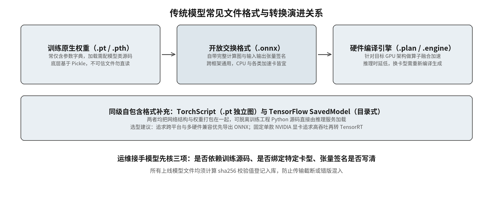
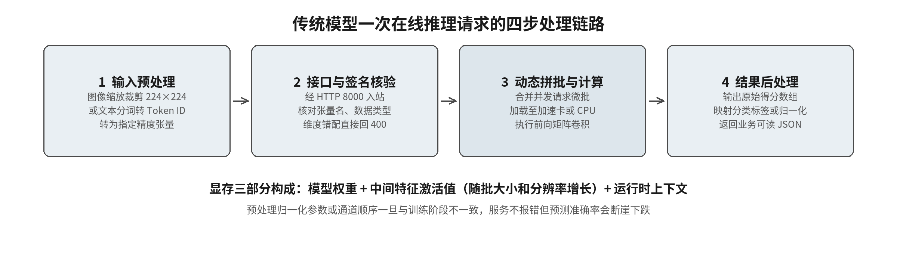
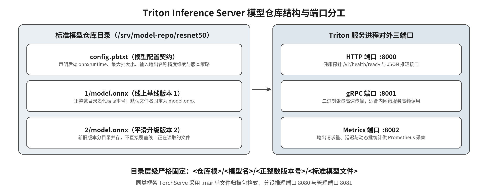
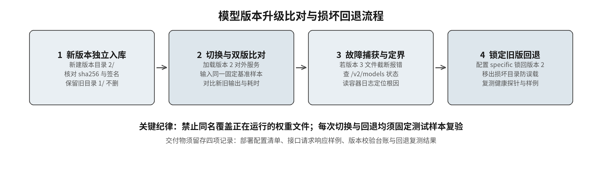

# 第30讲 传统模型部署方法

**本课程定位：** 第 27 讲梳理了分类、检测、分割与向量（Embedding）等模型的输入输出特征，第 28～29 讲搭好了算力资源池与调度队列。从本讲开始进入“把模型真正跑成线上服务”的交付阶段：先掌握参数规模适中、结构固定的传统模型与专用小模型标准部署方法，为第 31 讲部署百亿级参数的大语言模型打牢工程底子。

算法团队发来一个名为 `resnet50_cls.pth` 的图像分类权重文件，要求今晚发布成 HTTP 接口供质检系统调用。你拿到文件后立刻遇到四连问：只有 `.pth` 文件没有训练代码能不能直接加载？单张卡能抗多少并发、会不会爆显存？下周换新版权重时怎么做到不覆盖旧文件？万一新文件损坏怎么在 1 分钟内切回上一版？本讲逐一解决这四个问题。

## 本讲学习目标

学完后，你应能：

- 区分 PyTorch 原生权重、ONNX、TensorRT 引擎与 SavedModel 的源码依赖及硬件绑定边界。
- 根据参数量、数据精度、计算量（FLOPs）与批大小估算传统模型的显存及吞吐约束。
- 按 Triton Inference Server 标准仓库规范组织模型配置与数字版本目录，暴露并验证推理接口。
- 独立完成开源分类模型的服务启动、正常与异常请求核验、版本平滑切换及损坏回退演练。
- 快速定界目录错位、签名不匹配、算子或驱动不兼容、推理 OOM 等常见部署故障。

## 30.1、认识传统模型格式与输入输出签名

训练刚结束产出的文件，往往还不是最适合生产上线的交付形态。运维接手模型制品时，第一步是看清文件后缀背后的依赖关系。



表30-1、四类常见传统模型文件格式与运维边界对比

| 格式类别 | 典型代表与后缀 | 源码依赖 | 硬件绑定程度 | 运维交付优缺点 |
| --- | --- | --- | --- | --- |
| 原生权重 | PyTorch（`.pt`、`.pth`） | 常需配 Python 模型类定义 | 低（CPU 与多类卡可读） | 训练保存方便。仅存参数字典时缺源码无法加载，底层 Pickle 禁读不可信文件 |
| 开放图 | ONNX（`.onnx`） | 不依赖训练源码 | 低（跨框架、跨芯片通用） | 自带算子图与张量签名，支持 NVIDIA、海光、昇腾与 CPU，是最常用的标准交付格式 |
| 编译引擎 | TensorRT（`.plan`） | 不依赖训练源码 | 极高（绑卡型与工具链版本） | 算子融合后延迟低、吞吐高。换不同架构显卡或升级 TensorRT 后必须重新编译 |
| 目录归档 | TF SavedModel 目录 | 不依赖训练源码 | 低（TensorFlow 生态标准） | 目录内含计算图与权重子目录，可直接由 Triton 或 TF Serving 加载 |

### 30.1.1、读懂输入输出张量签名

传统模型不像对话大模型那样直接收发自然语言字符串，推理引擎内部只认规整的多维数值数组（Tensor，张量）。每个模型的输入和输出都由三要素组成，统称**模型签名（Signature）**：

1. **张量名称（Name）：** 调用接口时必须严格对齐的字段名，差一个大小写字母都会被拒收。
2. **数据类型（Data Type）：** 如 32 位浮点 `FP32`、16 位浮点 `FP16` 或 64 位整数 `INT64`。
3. **维度形状（Shape）：** 例如图像分类模型 `ResNet-50` 的输入形状为 `(batch, 3, 224, 224)`，依次代表“批大小、RGB 三通道、高 224 像素、宽 224 像素”，输出形状为 `(batch, 1000)`，代表 1000 个类别的原始得分；而中文文本向量模型 `BAAI/bge-base-zh-v1.5` 的输入是分词后的整数序列 `input_ids` 与 `attention_mask`，形状为 `(batch, seq_len)`（`INT64`），输出是归一化的句向量 `(batch, 768)`（`FP32`）。

【关键区别】接口返回 HTTP `200` 只证明输入张量的“名字、类型、形状”符合签名，不证明业务结果正确。如果算法训练时用 RGB 通道顺序且做了均值方差归一化，而线上客户端直接把 `0～255` 的原始 BGR 像素塞进张量，推理服务照样返回 1000 个浮点数，但分类准确率会跌到接近随机乱猜。部署清单必须同时固化预处理与后处理参数。

## 30.2、算力换算、显存构成与服务框架

拿到合规模型文件后，需要评估目标算力卡能承载多大并发，并选择合适的服务框架对外暴露端口。

### 30.2.1、前向计算量换算与显存三部分估算

模型说明文档常标注单次前向推理的乘加运算次数 **MACs**（Multiply-Accumulate Operations）或浮点运算次数 **FLOPs**。工程换算中，1 次乘加包含 1 次乘法与 1 次加法，即 `1 MAC ≈ 2 FLOPs`。以 `ResNet-50` 处理单张 `224×224` 图片为例，计算量约为 `4.1 GMac`，折合 **8.2 GFLOPs**。

结合第 2 讲的算力读数四条件，切忌直接用“显卡标称 FP32 峰值算力 ÷ 单图 8.2 GFLOPs”算线上最大吞吐。单张图片（`batch=1`）逐个到达时，算力卡大部分时间花在核函数启动和显存读写上，实际算力利用率往往不到理论峰值的 15%。生产中普遍开启推理框架的**动态批处理（Dynamic Batching）**，在几毫秒窗口内把多个并发请求拼成一个微批（如 `batch=16`）一次性送入算力卡计算，大幅拉升吞吐。

传统模型的显存占用结构与大语言模型不同（传统分类检测模型没有自回归 KV Cache），按以下三部分估算：

- **模型权重显存** ＝ 参数量 × 单参数字节数（`FP32` 占 4 字节，`FP16` 占 2 字节，`INT8` 占 1 字节）。
- **中间特征激活值（Activations）** ＝ 前向传播各层特征图暂存空间，随**最大批大小**（`max_batch_size`）和**输入图像分辨率**成倍增长。
- **推理运行时开销** ＝ CUDA 上下文、ONNX Runtime 或 TensorRT 工作区缓存（通常预留 `0.5～1.5 GB`）。

**【例题】** `ResNet-50` 参数量约为 `25.6M`（2560 万），导出为 `FP32` 精度的 ONNX 文件。计算权重本身占多少空间？如果换成另一个参数量同样只有 `30M`、但输入分辨率高达 `1920×1080` 的工业瑕疵分割模型，将 `max_batch_size` 盲目设为 `64` 时为什么会在 16 GB 算力卡上触发推理 OOM？

**解：** `ResNet-50` 的 `FP32` 权重体积约为 `25.6 × 10^6 × 4 字节 ≈ 102.4 MB`（约 98 MiB），权重本身很小。但在高分辨率（`1920×1080` 比 `224×224` 像素面积大 41 倍）分割模型中，卷积网络浅层会保留多通道高分辨率特征图，单张图的中间激活值就可能达到数百 MB；当 `max_batch_size` 设为 `64` 时，64 张图的中间激活值叠加会瞬间突破十几个 GB，直接撑爆 16 GB 显存。运维上线前必须将 `max_batch_size` 限制在实测安全水位内（例如 `4` 或 `8`）。

### 30.2.2、为什么用专业推理框架替代手写脚本

很多初学者习惯用 Flask 或 FastAPI 包一层 `onnxruntime` 直接上线。单进程 Python Web 脚本受限于全局解释器锁（GIL），既没有请求自动拼批，也缺少标准的模型多版本热切换和 Prometheus 指标暴露。生产环境主流选用专用推理服务框架。



表30-2、三种传统模型服务化方案对比

| 方案类型 | 代表框架与打包形态 | 默认端口分工 | 动态批处理 | 典型适用边界 |
| --- | --- | --- | --- | --- |
| 手写脚本 | Flask 或 FastAPI 脚本 | 单端口（如 `:8000`） | 无（需自行手写队列） | 仅适合内部功能验证或极低并发原型测试 |
| 归档托管 | TorchServe（`.mar` 包） | 推理 `:8080`、管理 `:8081`、指标 `:8082` | 原生支持 | 纯 PyTorch 生态团队，需将预处理代码打包进 Handler |
| 统一引擎 | Triton（多级版本目录） | HTTP `:8000`、gRPC `:8001`、指标 `:8002` | 原生支持且可配延迟窗 | 企业生产主力，统一托管 ONNX、TensorRT、PyTorch 等多后端 |

【随堂思考】某园区考勤闸机场景要求单次人脸比对端到端延迟不超过 15 毫秒。如果运维为了追求高吞吐，把 Triton 动态批处理的等待窗口（`max_queue_delay_microseconds`）设成了 `50000`（50 毫秒），低峰期只有单人刷脸时会出现什么问题？

## 30.3、模型仓库目录与多版本管理

本讲实训以通用性最强的 **Triton Inference Server** 为主例。Triton 对磁盘上的模型目录层级有严格约定，不按约定摆放就会在启动阶段直接报错退出。



### 30.3.1、标准目录契约与 config.pbtxt

假设宿主机模型仓库根目录为 `/srv/model-repo`，托管名为 `resnet50` 的 ONNX 模型时，目录结构必须满足三层规则：

1. 一级子目录名即对外暴露的**模型名**（如 `/srv/model-repo/resnet50/`）。
2. 模型目录下放置配置文件 `config.pbtxt`，声明运行后端、批大小上限、输入输出签名及设备实例组。
3. 模型目录下以**正整数命名的子文件夹**（如 `1/`、`2/`）代表版本号，非数字目录会被忽略。ONNX 后端默认在版本目录内寻找固定文件名 `model.onnx`。

一份清晰可读的 `config.pbtxt` 核心字段如下（注意方括号内外留空格，符合 Protobuf 文本规范）：

```protobuf
# 文件路径：/srv/model-repo/resnet50/config.pbtxt
name: "resnet50"
backend: "onnxruntime"
max_batch_size: 16

input [
  {
    name: "data"
    data_type: TYPE_FP32
    dims: [ 3, 224, 224 ]
  }
]
output [
  {
    name: "resnetv24_dense0_fwd"
    data_type: TYPE_FP32
    dims: [ 1000 ]
  }
]

dynamic_batching {
  preferred_batch_size: [ 4, 8, 16 ]
  max_queue_delay_microseconds: 2000
}

instance_group [
  {
    count: 1
    kind: KIND_GPU
  }
]

version_policy: { latest: { num_versions: 1 } }
```

在没有独立 NVIDIA 显卡的通用实验虚拟机中演练时，只需把 `kind: KIND_GPU` 改为 `kind: KIND_CPU`，同一套模型目录与客户端请求代码可原样运行。

### 30.3.2、版本策略与防覆盖纪律

`version_policy` 控制哪个版本对外生效：默认 `latest: { num_versions: 1 }` 表示自动加载数字最大的单个版本目录；配置为 `specific: { versions: [ 1 ] }` 时表示强制锁定指定版本。

运维管理模型版本的两条铁律：一是**严禁同名覆盖线上正在服务的权重文件**（如直接替换 `1/model.onnx`），升级一律新建 `2/` 目录并写入版本台账（含导出时间、对应训练提交号、ONNX opset 版本与 `sha256sum`）；二是保留至少一个经验证可用的历史版本目录，以便新版本异常时秒级锁回旧版。

【随堂思考】为什么模型权重文件（动辄几百 MB 到数 GB）不直接塞进第 13 讲的普通 Git 代码仓库，而是只把 `config.pbtxt` 和记录了 `sha256sum` 的版本清单放进 Git，权重本体存放在共享存储或制品库？

<!-- pagebreak -->

## 30.4、上机实训：传统模型服务部署、版本替换与回退

本节对应实训「传统模型服务部署」。我们在算力节点 `gpu-node-01`（`192.168.10.31`，无卡实验机可在任意装有 Docker Engine 26 的 `Ubuntu 22.04` 节点上把 `KIND_GPU` 改为 `KIND_CPU` 完成）完整走通**环境固定 → 模型导出与签名核验 → Triton 启动与接口验证 → 版本 2 升级比对 → 版本 3 损坏定位与回退**全流程。

### 30.4.1、步骤一：固定依赖环境并准备双版本 ONNX 模型

创建独立的 Python 3.11 虚拟环境并固定依赖版本，生成标准 `ResNet-50`（或轻量分类网络）版本 `1` 与调整输出缩放系数后的版本 `2` 模型文件，同时用 `onnxruntime` 打印真实输入输出签名与 `sha256sum`：

```bash
# 执行位置：gpu-node-01（opsadmin 账号）
sudo mkdir -p /srv/model-repo/resnet50/1 /srv/model-repo/resnet50/2
sudo chown -R opsadmin:opsadmin /srv/model-repo

python3 -m venv ~/lab/l30-venv
source ~/lab/l30-venv/bin/activate
cat <<'EOF' > ~/lab/l30-requirements.txt
torch==2.3.1
torchvision==0.18.1
onnx==1.16.1
onnxruntime==1.18.1
numpy==1.26.4
EOF
pip install -r ~/lab/l30-requirements.txt
```

执行导出与签名核对脚本（若实验机处于离线内网，可加载预置权重或设 `weights=None` 验证完整工程结构）：

```python
# 文件路径：~/lab/export_and_inspect.py
import hashlib, torch, torchvision.models as models, onnxruntime as ort

model_v1 = models.resnet50(weights=None).eval()
dummy = torch.randn(1, 3, 224, 224)

path_v1 = "/srv/model-repo/resnet50/1/model.onnx"
torch.onnx.export(
    model_v1, dummy, path_v1,
    input_names=["input"], output_names=["logits"],
    dynamic_axes={"input": {0: "batch"}, "logits": {0: "batch"}},
    opset_version=17,
)

# 构造带温度缩放层的新版模型作为版本 2，用于比对升级前后输出差异
class ScaledModel(torch.nn.Module):
    def __init__(self, base):
        super().__init__()
        self.base = base
    def forward(self, x):
        return self.base(x) * 0.5

path_v2 = "/srv/model-repo/resnet50/2_staged/model.onnx"
import os; os.makedirs(os.path.dirname(path_v2), exist_ok=True)
torch.onnx.export(
    ScaledModel(model_v1).eval(), dummy, path_v2,
    input_names=["input"], output_names=["logits"],
    dynamic_axes={"input": {0: "batch"}, "logits": {0: "batch"}},
    opset_version=17,
)

# 用 onnxruntime 读取版本 1 签名与文件校验和
sess = ort.InferenceSession(path_v1, providers=["CPUExecutionProvider"])
for item in sess.get_inputs():
    print("输入签名:", item.name, item.type, item.shape)
for item in sess.get_outputs():
    print("输出签名:", item.name, item.type, item.shape)
print("v1 sha256:", hashlib.sha256(open(path_v1, "rb").read()).hexdigest())
```

运行 `python3 ~/lab/export_and_inspect.py`，确认打印出输入名 `input`、输出名 `logits` 及维度 `['batch', 3, 224, 224]`、`['batch', 1000]`，把校验值记入版本记录表。注意此时版本 2 先暂存在 `2_staged/`（非纯数字目录），Triton 启动时只会加载 `1/`。

### 30.4.2、步骤二：编写配置并启动 Triton 推理服务

严格对齐刚才实测出的张量名 `input` 与 `logits` 编写 `/srv/model-repo/resnet50/config.pbtxt`，设置 `--model-control-mode=poll` 让服务定期扫描目录变化：

```bash
cat <<'EOF' > /srv/model-repo/resnet50/config.pbtxt
name: "resnet50"
backend: "onnxruntime"
max_batch_size: 16
input [
  {
    name: "input"
    data_type: TYPE_FP32
    dims: [ 3, 224, 224 ]
  }
]
output [
  {
    name: "logits"
    data_type: TYPE_FP32
    dims: [ 1000 ]
  }
]
instance_group [
  {
    count: 1
    kind: KIND_GPU
  }
]
version_policy: { latest: { num_versions: 1 } }
EOF

# 启动前先确认 8000/8001/8002 端口未被占用
ss -tulnp | grep -E "8000|8001|8002" || true

# 有 NVIDIA GPU 节点加 --gpus all；纯 CPU 节点去掉 --gpus all 并将上文 KIND_GPU 改为 KIND_CPU
docker run -d --name triton-resnet --gpus all \
  -p 8000:8000 -p 8001:8001 -p 8002:8002 \
  -v /srv/model-repo:/models \
  registry.lab.example/lab/tritonserver:24.05-py3 \
  tritonserver --model-repository=/models --model-control-mode=poll --repository-poll-secs=5
```

等待约 10 秒后，核验服务就绪状态与模型元数据：

```bash
curl -i http://127.0.0.1:8000/v2/health/ready
# 预期返回：HTTP/1.1 200 OK

curl -s http://127.0.0.1:8000/v2/models/resnet50 | python3 -m json.tool
# 预期返回 JSON 中包含 "name": "resnet50", "versions": [ "1" ]
```

### 30.4.3、步骤三：验证正常张量请求与错误输入拦截

编写客户端测试脚本，用固定随机种子构造可复现的 `(1, 3, 224, 224)` 输入样本验证正常返回，再故意发送 `(1, 3, 128, 128)` 错误尺寸验证边界报错：

```python
# 文件路径：~/lab/verify_infer.py
import json, urllib.request, urllib.error, numpy as np

np.random.seed(42)
sample = np.random.randn(1, 3, 224, 224).astype(np.float32)

def call_triton(arr):
    payload = {
        "inputs": [{
            "name": "input",
            "shape": list(arr.shape),
            "datatype": "FP32",
            "data": arr.flatten().tolist(),
        }]
    }
    req = urllib.request.Request(
        "http://127.0.0.1:8000/v2/models/resnet50/infer",
        data=json.dumps(payload).encode("utf-8"),
        headers={"Content-Type": "application/json"},
    )
    with urllib.request.urlopen(req, timeout=10) as resp:
        return resp.status, json.loads(resp.read().decode("utf-8"))

status, body = call_triton(sample)
out_item = next(iter(body["outputs"]))
head_vals = [round(v, 4) for v in out_item["data"][:3]]
print("正常请求状态:", status, "生效版本:", body["model_version"], "前3维得分:", head_vals)

# 构造错误形状 (1, 3, 128, 128) 验证签名拦截
bad_sample = np.zeros((1, 3, 128, 128), dtype=np.float32)
try:
    call_triton(bad_sample)
except urllib.error.HTTPError as e:
    print("异常输入拦截状态码:", e.code, "报错摘要:", e.read().decode("utf-8"))
```

正常请求应返回 `status=200`、`生效版本: 1` 及固定前 3 维浮点得分；异常输入应返回 HTTP `400`，报错信息明确指出输入期待 `[ -1, 3, 224, 224 ]` 而收到 `[ 1, 3, 128, 128 ]`，同时 `curl http://127.0.0.1:8000/v2/health/ready` 依然保持 `200 OK`。

### 30.4.4、步骤四：版本平滑升级、故障注入与秒级回退



**1. 切换上线版本 2 并比对输出：** 将暂存好的 `2_staged/model.onnx` 移入正式版本目录 `2/`，等待 5 秒轮询生效后重跑验证脚本：

```bash
mv /srv/model-repo/resnet50/2_staged/model.onnx /srv/model-repo/resnet50/2/model.onnx
rmdir /srv/model-repo/resnet50/2_staged
sleep 6
python3 ~/lab/verify_infer.py
# 预期：生效版本变为 "2"，前 3 维得分恰好为版本 1 得分的 0.5 倍，证明新模型已平滑接管
```

**2. 注入版本 3 模型文件损坏故障并回退：** 模拟传输中断产生截断损坏的 `3/model.onnx`，观察报错并执行回退：

```bash
mkdir -p /srv/model-repo/resnet50/3
head -c 256 /srv/model-repo/resnet50/2/model.onnx > /srv/model-repo/resnet50/3/model.onnx
sleep 6

# 1) 查看日志定位故障根因
docker logs --tail 20 triton-resnet
# 预期日志出现：failed to load 'resnet50' version 3: Internal: onnx runtime error ... Protobuf parsing failed

# 2) 将 config.pbtxt 的 version_policy 显式锁定到已验证健康的特定版本 2，并移出损坏目录
sed -i 's/latest: { num_versions: 1 }/specific: { versions: [ 2 ] }/' /srv/model-repo/resnet50/config.pbtxt
mv /srv/model-repo/resnet50/3 /srv/model-repo/resnet50/3_broken_quarantine
sleep 6

# 3) 复测健康探针与业务样例确认恢复
curl -i http://127.0.0.1:8000/v2/health/ready
python3 ~/lab/verify_infer.py
```

实训验收归档部署清单、接口请求响应样例、版本校验记录与回退复测输出后，若无需保留给后续联调，可执行 `docker rm -f triton-resnet` 释放容器与显存。

## 30.5、传统模型部署常见故障排查

当传统模型起不来或调用报错时，先区分故障发生在“服务启动加载期”还是“客户端请求期”。

表30-3、传统模型部署五类高频故障定界与处置

| 故障现象 | 发生阶段 | 首查证据 | 高频根因与处置方法 |
| --- | --- | --- | --- |
| 漏载模型 | 启动加载 | 目录树与容器挂载路径 | 宿主机目录挂错、版本文件夹不是正整数、或文件名未命名为 `model.onnx` |
| 解析报错 | 启动加载 | `docker logs` 与 `sha256sum` | 文件下载截断损坏、ONNX opset 高于运行时版本、或 `.plan` 引擎跨显卡型号搬运 |
| 返回 400 | 请求调用 | 响应体 JSON 与 `config.pbtxt` | 输入张量名称拼错、`FP32` 与 `INT64` 类型错、或图像宽高通道维度顺序写反 |
| 推理 OOM | 高并发期 | `nvidia-smi` 与配置批大小上限 | 最大批大小设得过大或高分辨率特征激活值暴涨。调小最大批大小并压测核定上限 |
| 精度骤降 | 业务运行 | 预处理代码与固定基准样本 | 线上缩放插值、RGB 与 BGR 顺序或归一化均值方差与训练脚本不一致，逐项对齐预处理 |

**【例题】** 运维同事把在测试环境 NVIDIA A10 显卡上编译好的 TensorRT 引擎文件 `detector.plan` 直接拷贝到生产环境 NVIDIA H20 服务器上启动 Triton，日志报 `deserializeCudaEngine failed` 加载失败。这是文件传输损坏吗？应当怎样处理？

**解：** 首先核对两端 `sha256sum` 排除传输损坏；若校验值一致，根因是 TensorRT 编译引擎强绑定目标 GPU 的硬件计算架构（SM 版本）以及构建时的 TensorRT 和 CUDA 小版本，不能跨型号显卡直接通用。标准做法是交付跨平台的 `detector.onnx` 源文件与 `sha256` 清单，在目标 H20 服务器（或同卡型同镜像构建容器）上用 `trtexec` 现场生成适配当前硬件的 `.plan` 引擎后再加载。

【关键区别】 **模型加载失败**会让 `/v2/models/<模型名>/ready` 返回非 200，属于服务端部署或模型制品问题；**单次请求返回 HTTP 400** 时服务端本身仍然健康在线，属于调用方传入的张量结构违背了接口签名契约，排障时不要误重启线上推理容器。

<!-- pagebreak -->

## 30.6、本讲回顾与自测

学习完本讲后，试着用自己的话回答四个问题：为什么跨环境交付传统模型优先选 ONNX 而不是裸 `.pth` 或跨卡搬运 `.plan`？传统模型推理显存除了权重还要算哪两大块？Triton 仓库目录靠什么规则识别模型版本？发现新上线版本报错时怎样快速回退？

表30-4、本讲目标与对应判断

| 学习目标 | 应能做出的判断 |
| --- | --- |
| 选准模型格式 | 说清 `.pth`、`.onnx`、`.plan` 对训练源码和显卡型号的依赖差异 |
| 核算算力显存 | 知道 `1 MAC ≈ 2 FLOPs`，明白大分辨率模型设过大最大批大小会因激活值撑爆显存 |
| 组织标准仓库 | 按 `<模型名>/<正整数版本>/model.onnx` 与 `config.pbtxt` 规范摆放制品并记录校验和 |
| 验证接口契约 | 分别用正常张量与错误维度张量测试 `/v2/models/<名>/infer`，核对返回维度与 400 拦截 |
| 平滑切换回退 | 不覆盖线上文件，用独立数字目录配合版本策略完成版本升级比对与故障回退 |

### 30.6.1、本讲自测

**1 格式判断。** 算法团队要把同一个图像分类模型同时发往 NVIDIA GPU 集群和海光 DCU 集群运行。在裸 `state_dict`（`.pth`）、`ONNX`（`.onnx`）和 `TensorRT`（`.plan`）三者中应选哪一种作为标准交付物？为什么另外两种不合适？

**2 签名核对。** 文本向量模型 `bge-base-zh-v1.5` 的 `config.pbtxt` 声明输入 `input_ids` 类型为 `TYPE_INT64`。客户端误把分词数组转成了 `FP32` 浮点数组发往 `/infer` 接口，会发生什么现象？这说明服务端挂了吗？

**3 显存排障。** 一个权重文件只有 120 MB 的工业缺陷检测模型部署在 16 GB 显存卡上，空闲时只占 1.2 GB 显存，一到业务高峰并发打满就触发容器显存 OOM 重启。写出最可能的原因和配置修改项。

**4 目录规范。** 同事在 `/srv/model-repo/resnet50/` 下建了文件夹 `v1/`，把模型命名为 `resnet50.onnx` 放进去，启动 Triton 报找不到可用版本。指出其中的两处违规并给出正确路径。

**5 回退操作。** 线上 `resnet50` 原本运行版本 `2` 正常。放入 `3/model.onnx` 后日志报 Protobuf 解析失败。写出隔离故障目录并锁定回版本 `2` 的关键配置与复测命令。

**6 准确率异常。** 模型服务 `/v2/health/ready` 返回 200，`/infer` 耗时正常且无报错，但质检业务方反馈所有图片都被判成同一个错误类别。运维应优先联同算法核查哪一环节？

**答：**

____________________________

____________________________

____________________________

____________________________

## 30.7、参考答案与解析

### 30.7.1、随堂思考解析

**思考 1（动态批处理等待窗设 50 毫秒与 15 毫秒延迟红线冲突）：** `max_queue_delay_microseconds` 设为 `50000`（50 毫秒）意味着低峰期只有 1 个人刷脸时，Triton 为了凑够首选批大小，会让这单请求在队列里白等最高 50 毫秒才送去推理，直接突破 15 毫秒业务上限。实时低延迟场景应将排队等待窗控制在 `1000～2000` 微秒（1～2 毫秒）以内，在延迟红线内适度拼批。

**思考 2（为什么权重本体不直接进普通 Git 仓库）：** 普通 Git 会把每次提交的大体积二进制权重完整保存在 `.git` 历史里，几次迭代后仓库体积就会膨胀到几十 GB，导致克隆缓慢甚至推拉超时。工程规范是 Git 只存轻量的 `config.pbtxt`、部署脚本及包含 `sha256sum` 与存储路径的版本元数据清单，大体积模型文件存放在专用对象存储、NFS 模型库或制品库中，上线时按校验和拉取核对。

### 30.7.2、课后自测解析

**1** 应选 `ONNX`（`.onnx`）。裸 `state_dict`（`.pth`）缺少网络结构计算图，强依赖训练 Python 源码；`TensorRT`（`.plan`）强绑定特定型号 NVIDIA GPU，无法在海光 DCU 上运行；ONNX 自带计算图与张量签名，两端均可通过各自适配的 ONNX Runtime 后端加载。

**2** 接口会立即返回 HTTP `400 Bad Request`，提示输入数据类型与签名的 `INT64` 不匹配。服务端本身完全健康，无需重启服务，只需修正客户端发送的数据类型即可。

**3** 根因是高并发下触发大微批（如 `max_batch_size` 设得过大），导致前向传播过程中的**中间特征激活值显存**随批大小成倍暴涨，超出 16 GB 上限。应在 `config.pbtxt` 中调小 `max_batch_size`（如降到 `4` 或 `8`），并通过压测确认峰值显存留有安全余量。

**4** 第一处违规：版本目录名不能带字母 `v`（`v1/` 会被忽略），必须是纯正整数 `1/`；第二处违规：未在 `config.pbtxt` 另行指定 `default_model_filename` 时，ONNX 模型文件名必须固定叫 `model.onnx`。正确完整路径为 `/srv/model-repo/resnet50/1/model.onnx`。

**5** 将 `config.pbtxt` 中的版本策略改为 `version_policy: { specific: { versions: [ 2 ] } }`，并将损坏的 `3/` 移出模型目录（如移至隔离目录）；随后依次执行 `curl -i http://127.0.0.1:8000/v2/health/ready`、`curl -s http://127.0.0.1:8000/v2/models/resnet50` 与固定样本推理脚本，确认生效版本锁回 `"2"` 且输出数值与基线完全一致。

**6** 优先核查**输入预处理与输出后处理参数**是否与训练阶段一致，重点核对图像缩放尺寸、RGB 与 BGR 通道顺序、像素归一化均值与标准差（例如训练除了 255 而线上漏除），以及输出类别索引映射字典是否错位。

## 30.8、术语

表30-5、本讲术语

| 术语 | 本讲中的含义 |
| --- | --- |
| ONNX | 开放神经网络交换格式（Open Neural Network Exchange），自带计算图与签名，便于跨框架跨硬件部署。 |
| TensorRT | NVIDIA 高性能推理优化器与运行时，生成的 `.plan` 引擎算子融合度高但绑定目标显卡架构。 |
| 模型签名 | 规定模型每个输入输出张量的名称、数据类型与维度形状的接口契约。 |
| MACs / FLOPs | 乘加运算次数与浮点运算次数，单次乘加通常折合 `1 MAC ≈ 2 FLOPs`。 |
| 中间激活值 | 模型前向计算过程中各层特征图暂存数据，占用的显存随批大小与输入分辨率增长。 |
| 动态批处理 | 推理框架在极短时间窗内把多个独立请求合并为一个批次送入算力卡计算，用于提升吞吐。 |
| Triton | 开源生产级推理服务框架，按标准多级版本目录托管多后端模型并暴露 HTTP、gRPC 与监控端口。 |
| 版本策略 | Triton `config.pbtxt` 中的版本加载规则配置，决定自动加载最新数字版本还是锁定指定版本。 |

文中节点地址 `192.168.10.31`、宿主机目录 `/srv/model-repo`、镜像地址 `registry.lab.example` 与端口号均为教学示例，生产环境以本单位规范为准。

## 附录、传统模型服务上线与版本切换核对卡

表30-6、传统模型部署与回退核对单

| 核对项 | 核对内容与操作动作 | 合格判据 |
| --- | --- | --- |
| 制品 | 核对模型格式、`opset` 版本并计算 `sha256sum` | 格式与目标硬件匹配，校验值与移交清单一致 |
| 签名 | 用 `onnxruntime` 读取模型真实输入输出并与 `config.pbtxt` 逐字核对 | 张量名、精度类型、各维尺寸及预处理说明完全一致 |
| 显存 | 核对最大批大小与排队等待窗并在目标卡压测显存峰值 | 满载并发不触发显存 OOM，单请求延迟不超业务红线 |
| 探针 | 核验 `:8000/v2/health/ready`、`:8001` 与 `:8002/metrics` | 健康检查返回 200，正常样本通过，错误维度返回 400 |
| 回退 | 确认新版本放入独立正整数目录，保留上一版健康目录与固定基准样本 | 模拟异常时可在 1 分钟内锁回旧版并通过基准样本复测 |

<!-- md-only -->

## 附：主要参考资料（仅 Markdown 保留，不印入 Word/PDF）

- 中国信通服务《2025 算力运维体系技术白皮书》（本地 PDF，`./资料/中国信通服务：2025算力运维体系技术白皮书-71页.pdf`），用于推理服务快速重建、模型参数版本备份与算力平台容器化运行背景说明。
- NVIDIA Triton Inference Server 官方文档《Model Repository》《Model Configuration》《Dynamic Batcher》（`https://docs.nvidia.com/deeplearning/triton-inference-server/user-guide/docs/`），用于标准目录层级、`config.pbtxt` 签名字段、三端口分工及 `version_policy` 版本控制机制。
- ONNX 与 ONNX Runtime 官方文档（`https://onnxruntime.ai/docs/`），用于开放计算图跨平台部署及输入输出签名读取方法。
- PyTorch 官方文档《TorchScript》《Saving and Loading Models》与 TorchServe 官方文档（`https://pytorch.org/serve/`），用于 `.pt`/`.pth` Pickle 安全边界说明及 `.mar` 归档部署对比。

<!-- /md-only -->
