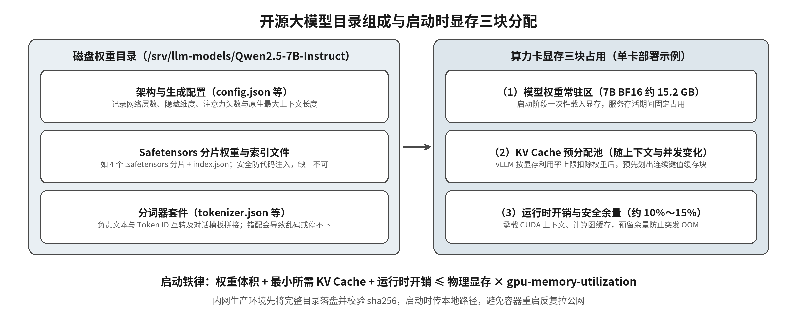
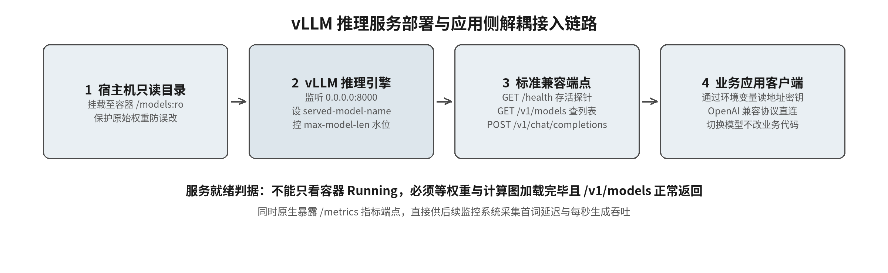
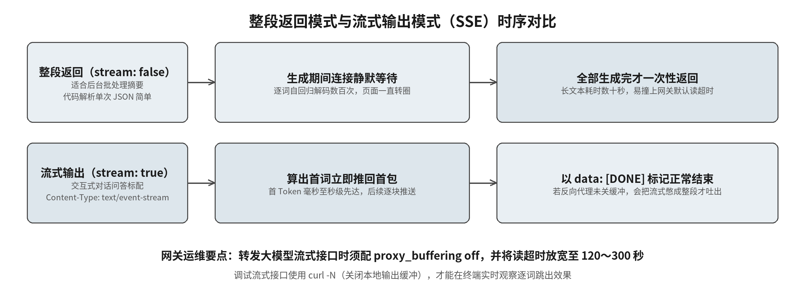
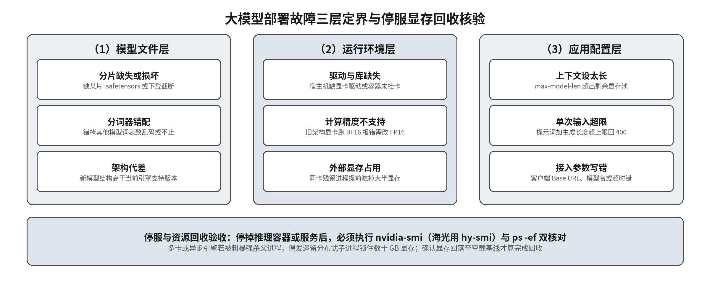

# 第31讲 大模型与生成式AI部署

**本课程定位：** 第 30 讲完成了百兆级传统单文件模型的服务化发布。从传统模型跨入生成式 AI 与大语言模型（LLM），运维面对的对象发生了三个质变：模型文件变成十几个 GB 的多文件分片目录，显存预算必须精算动态 KV Cache 水位，客户端交互从毫秒级单次返回变成持续数十秒的流式推送。本讲以开源主例 `Qwen2.5-7B-Instruct` 配合主流推理引擎 `vLLM` 跑通生产级部署、应用接入、三层故障归因与停服显存回收，为第 32～34 讲性能优化、令牌网关与评测上线铺路。

研发部门申请在算力节点 `gpu-node-01`（单卡 24 GB 显存）上部署 `Qwen2.5-7B-Instruct` 支撑内部知识库问答。同事第一次启动漏拷了第 4 个权重分片报错退出；补齐文件后按默认 32K 上下文直接启动，又卡在 KV Cache 初始化阶段报显存不足；好不容易调通后，前端页面提问却要干等 20 秒才一次性蹦出整段文字；最后停服务时随手敲了 `kill -9`，结果 21 GB 显存一直挂在卡上释放不掉。本讲围绕这四处真实痛点逐一拆解。

## 本讲学习目标

学完后，你应能：

- 核验开源大模型目录中的架构配置、Safetensors 分片权重与分词器套件完整性。
- 结合显存三块估算模型，合理设定 `vLLM` 的显存利用率上限与最大上下文长度并启动服务。
- 分别验证元数据、整段对话、SSE 流式输出与超长异常请求，并通过环境变量完成应用接入。
- 将显存不足、加载失败、依赖缺失、流式断连等异常准确归因到模型、运行环境或应用配置层。
- 规范停止大模型推理服务，通过带内工具与进程表核验显存彻底释放。

## 31.1、准备模型权重与分词器套件

与第 30 讲单个 `model.onnx` 文件不同，开源大语言模型、视觉语言模型（VLM）及文生图生成式模型在磁盘上都是一个**完整的资产目录**。少拷一个配置文件或拷错词表，服务就无法正常工作。



表31-1、开源大模型目录核心文件组成与缺失后果

| 类别 | 典型文件示例（以 Qwen2.5-7B 为例） | 核心作用 | 缺失或错配时的现象 |
| --- | --- | --- | --- |
| 架构 | `config.json` 与默认生成配置 | 定义网络层数、隐藏维度、注意力头数及默认生成参数 | 启动直接报错，无法识别模型架构或精度 |
| 索引 | `model.safetensors.index.json` | 记录每层参数落在哪一个分片文件及总字节数 | 无法定位分片权重，报找不到权重文件 |
| 分片 | `model-00001-of-00004.safetensors` 等 | 按每片 3～5 GB 拆分存储模型权重张量 | 缺片或截断时在加载阶段报文件缺失或解析错误 |
| 分词 | `tokenizer.json`、`vocab.json` 与模板配置 | 负责文本与 Token ID 互转，定义对话角色拼接模板 | 答非所问、输出乱码，或忘记结束符一直生成到上限 |
| 视觉 | 视觉预处理器配置（仅多模态模型包含） | 定义图像缩放尺寸、归一化与视觉编码输入规则 | 视觉语言模型处理图片输入时报缺预处理器 |

除上表列出的核心文件外，常见目录还附带默认采样配置 `generation_config.json`、分词模板配置 `tokenizer_config.json`，视觉语言模型另含 `preprocessor_config.json`，拷贝目录时应整目录同步。

### 31.1.1、为什么主流采用 Safetensors 分片与本地只读挂载

当前开源社区普遍用 `.safetensors` 替代早期的 PyTorch `.bin` 格式，原因有两条：一是**安全**，`.bin` 底层使用 Python Pickle，加载来路不明的权重可能执行恶意代码，而 `Safetensors` 只存纯张量头信息与原始字节；二是**加载快**，支持操作系统内存映射（mmap）零拷贝直接读入显存，避免主机内存翻倍占用。

自建机房的算力节点通常禁止直连公网。运维标准做法是：提前在受控下载机将完整模型目录拉取至共享存储或节点本地目录（如 `/srv/llm-models/Qwen2.5-7B-Instruct`），对照 `model.safetensors.index.json` 核齐分片数量并记录 `sha256sum`；启动容器时以**只读方式**（`:ro`）挂载进容器，并把本地挂载路径传给推理引擎，防止容器重启时反复尝试连公网拉取权重。

【关键区别】 **磁盘权重文件大小不等于启动所需最小显存。** `Qwen2.5-7B-Instruct`（实际约 76 亿参数）以 `BF16`（每参数 2 字节）存储时，磁盘分片总和约为 `15.2 GB`。如果拿一张 16 GB 显存卡直接加载原生 `BF16` 权重，扣除约 15.2 GB 权重与 1 GB 运行时上下文后，连最基本的 KV Cache 空间都分不出来，启动必然失败。16 GB 卡要么换用 `INT4`/`INT8` 量化权重，要么改选 `Qwen2.5-3B` 或 `1.5B` 规格。

## 31.2、显存水位规划与 vLLM 服务启动

回顾第 4 讲确立的推理显存三块估算公式：**推理总显存 ≈ 模型权重 + KV Cache + 运行时及其他开销（约 10%～15%）**。在 `vLLM` 启动过程中，引擎会先加载模型权重，再跑一次模拟前向计算测量剩余可用显存，最后按你设定的水位上限把剩余显存一次性预划为 **KV Cache 块池**。因此，刚启动完哪怕还没有任何用户提问，`nvidia-smi` 看到的显存占用就已经接近设定的利用率比例——这是正常的池化预留，不是显存泄漏。

**【例题】** 算力节点 `gpu-node-01` 配有 1 张 24 GB 显存卡，准备部署原生 `BF16` 精度的 `Qwen2.5-7B-Instruct`（权重约占 `15.2 GB`，CUDA 与计算图运行时开销约 `1.8 GB`）。若将 `vLLM` 的 `--gpu-memory-utilization` 设为 `0.90`，可用于 KV Cache 预分配池的显存大约剩多少？为什么此时必须显式调小 `--max-model-len`？

**解：** 可用显存上限为 `24 GB × 0.90 = 21.6 GB`。扣除权重 `15.2 GB` 和运行时开销 `1.8 GB` 后，留给 KV Cache 池的显存约为 `21.6 - 15.2 - 1.8 = 4.6 GB`。`Qwen2.5-7B-Instruct` 的 `config.json` 默认声明最大上下文长度高达 `32768`（32K Token），单条 32K 序列所需的 KV Cache 就会逼近甚至超过剩余池容量，导致启动阶段直接报缓存空间不足退出。业务若只需单轮知识库问答，启动时显式加上 `--max-model-len 8192`（或 `4096`），即可在 24 GB 卡上稳妥留出多并发余量。

### 31.2.1、vLLM 核心启动参数精讲



表31-2、vLLM 生产启动核心参数与运维作用

| 参数类别 | 启动参数写法 | 典型取值示例 | 运维控制目的与踩坑提示 |
| --- | --- | --- | --- |
| 模型路径 | `--model` | `/models/Qwen2.5-7B-Instruct` | 指向容器内挂载的本地权重目录，避免启动时访问公网仓库 |
| 服务别名 | `--served-model-name` | `qwen2.5-7b` | 对外暴露简洁固定的模型名，隐藏宿主机目录路径细节 |
| 网络监听 | `--host` 与 `--port` | `0.0.0.0` 与 `8000` | 供容器外或同集群 Service 访问；仅本机调试可绑 `127.0.0.1` |
| 计算精度 | `--dtype` | `bfloat16` 或 `float16` | 新架构卡优先选 `bfloat16` 防数值溢出；不支持 BF16 的旧卡改 `float16` |
| 显存水位 | `--gpu-memory-utilization` | `0.85`（默认 `0.90`） | 限制引擎最多占整卡显存的比例。同机跑监控代理时建议收紧至 `0.85` |
| 上下文墙 | `--max-model-len` | `8192` | 限制单次请求“输入加输出”最大 Token 数，防止超长请求撑爆 KV Cache |
| 多卡并行 | `--tensor-parallel-size` | `1`（多卡可设 `2`、`4`） | 单卡显存装不下大参数模型时，将每层矩阵横切到同机多张算力卡协同推理 |

【随堂思考】如果一台服务器插了 2 张 24 GB 算力卡，要部署权重约 `62 GB`（BF16）的 `32B` 模型，把 `--tensor-parallel-size` 设为 `2` 能不能启动成功？为什么？

## 31.3、四类请求验证与应用侧接入

大模型容器进程刚显示 `Running` 时，后台还在逐片读取十几 GB 权重并捕获计算图，耗时通常在 20～90 秒之间。判断服务真正就绪的唯一标准是 `GET /health` 返回 `200` 且 `GET /v1/models` 能列出模型别名。

### 31.3.1、整段返回与流式输出（SSE）的运维差异

大语言模型按自回归方式逐个 Token 生成回答。生成 500 个字往往需要几秒到十几秒，由此衍生出两种调用模式。



当请求体不传 `stream` 或设为 `false` 时，服务端算完最后一个词才把整包 JSON 发回，适合后台异步批处理；当请求体设置 `"stream": true` 时，服务端采用 HTTP **SSE（Server-Sent Events，服务端推送事件）** 协议，每算出一个新词就推送一行 `data: {...}`，生成完毕最后推送一行 `data: [DONE]` 关闭流。

如果前端经过第 20 讲的 NGINX Ingress 或反向代理转发流式接口，必须检查两项代理配置：一是配置 `proxy_buffering off`（否则代理会把流式分块全部攒在内存里，等模型算完才一次性吐给浏览器，“假流式”会让用户以为卡死）；二是将 `proxy_read_timeout` 从默认的 60 秒调大至 `120s～300s`，防止长思考或长文生成中途被网关主动掐断连接。

### 31.3.2、上线四类必测用例与应用侧解耦接入

推理服务启动后，运维至少按下方四类请求逐一实测留证，不能只问一句“你好”就签字交付。

表31-3、大模型推理服务四类必测验证请求

| 类别 | 请求路径与关键参数 | 预期正常响应 | 验证目的 |
| --- | --- | --- | --- |
| 元数据 | `GET /v1/models` 与 `/health` | HTTP `200`，返回 `qwen2.5-7b` | 确认权重加载完毕且对外服务别名准确 |
| 非流式 | `POST /v1/chat/completions`（`stream: false`） | HTTP `200`，含完整回答与 `usage` 计数 | 确认分词对话模板、正向生成与 Token 计量正常 |
| 流式 | 同上，设 `stream: true`，客户端加 `curl -N` | `text/event-stream` 逐块实时跳字并以 `[DONE]` 结束 | 确认流式通道无缓冲阻塞、无半截断流 |
| 边界 | 传不存在的模型名，或申请生成长度超上限 | 返回 HTTP `404` 或 `400` 清晰提示，进程不崩 | 确认边界防御生效，错误请求不会拖垮在线引擎 |

完成验证后，上层业务应用（如知识库系统或第 40 讲的智能体框架）一律通过**环境变量**解耦接入：只需注入服务入口 `OPENAI_BASE_URL`（如 `http://192.168.10.31:8000/v1`）、调用密钥 `OPENAI_API_KEY` 与模型名 `MODEL_NAME=qwen2.5-7b`。日后底层从单卡升级多卡，或把引擎换到另一台算力节点，业务侧只需改配置即可平滑切换，无需改动业务代码。

【随堂思考】用户在网页端使用流式问答时，每次回答进行到整整第 60 秒就会突然中断，而后端 `vLLM` 容器日志没有任何崩溃重启记录。你优先怀疑哪一层的什么参数？

## 31.4、上机实训：开源大模型部署、应用接入与异常定界

本节对应实训「开源大模型与生成式 AI 应用部署」。我们在算力节点 `gpu-node-01`（`192.168.10.31`）上部署 `Qwen2.5-7B-Instruct` 并接入 Python 应用客户端，随后演练一次显存配置越界异常的定界恢复，最后完成停服与显存归零核验。

> 硬件规格适配说明：单张 24 GB 及以上显存卡直接按下方 `Qwen2.5-7B-Instruct` 参数执行；若实验环境为 8～16 GB 入门显卡，将模型目录替换为同系列的 `Qwen2.5-1.5B-Instruct`（BF16 权重约 `3.1 GB`）或 `Qwen2.5-0.5B-Instruct`（约 `1.0 GB`），命令、接口与排障步骤完全相同，只需在交付部署记录中如实写明所选参数量级与实测显存读数；海光 DCU 节点使用对应 DTK 版 `vllm` 镜像并以 `hy-smi` 观测显存。

### 31.4.1、步骤一：核验本地权重目录与空载显存基线

登录 `gpu-node-01`，检查预置模型目录完整性与算力卡空载状态：

```bash
# 执行位置：gpu-node-01（opsadmin 账号）
MODEL_DIR="/srv/llm-models/Qwen2.5-7B-Instruct"
ls -lh "$MODEL_DIR"

# 1. 核对关键配置文件与分词器文件是否齐全
for f in config.json generation_config.json tokenizer.json tokenizer_config.json; do
  test -f "$MODEL_DIR/$f" && echo "OK: $f" || echo "MISSING: $f"
done

# 2. 统计磁盘上的 .safetensors 分片数，确认与索引文件声明一致且无 0 字节空文件
ls -lh "$MODEL_DIR"/*.safetensors
sha256sum "$MODEL_DIR"/config.json "$MODEL_DIR"/tokenizer.json > ~/lab/l31-HashCheck.txt

# 3. 记录启动前算力卡空载显存基线（海光节点执行 hy-smi）
nvidia-smi
```

确认 4 个 `.safetensors` 分片总大小约 `15 GB`、配置文件齐全，且当前算力卡无其他无关占卡进程。

### 31.4.2、步骤二：启动 vLLM 推理服务并观测显存水位

使用容器方式启动 `vLLM`，只读挂载模型目录，添加 `--ipc=host`（保障共享内存通信），将显存利用率控制在 `0.85`、最大上下文限制为 `8192`：

```bash
mkdir -p ~/lab/l31 && cd ~/lab/l31
ss -tulnp | grep 8000 || true

docker run -d --name vllm-qwen --gpus all --ipc=host \
  -p 8000:8000 \
  -v /srv/llm-models/Qwen2.5-7B-Instruct:/models/Qwen2.5-7B-Instruct:ro \
  registry.lab.example/lab/vllm-openai:v0.6.3 \
  --model /models/Qwen2.5-7B-Instruct \
  --served-model-name qwen2.5-7b \
  --host 0.0.0.0 \
  --port 8000 \
  --dtype bfloat16 \
  --gpu-memory-utilization 0.85 \
  --max-model-len 8192
```

持续跟踪启动日志，观察权重加载耗时与 KV Cache 池分配情况：

```bash
docker logs -f vllm-qwen
# 预期看到关键里程碑日志（按 Ctrl+C 退出日志跟踪，不影响后台容器）：
# INFO: Loading model weights took 14.2385 GB
# INFO: Available KV cache memory: 3.82 GiB (24GB 卡示例；48GB 卡约 23 GiB)
# INFO: Uvicorn running on http://0.0.0.0:8000
```

待看到 `Uvicorn running` 后，核对 `/health`、`/v1/models` 与带内显存占用（记录至部署记录单）：

```bash
curl -i http://127.0.0.1:8000/health
curl -s http://127.0.0.1:8000/v1/models | python3 -m json.tool
nvidia-smi
```

### 31.4.3、步骤三：验证四类请求并完成应用客户端接入

依次执行常规对话、SSE 流式输出与超长参数边界验证：

```bash
# 1. 常规非流式对话请求
curl -s http://127.0.0.1:8000/v1/chat/completions \
  -H "Content-Type: application/json" \
  -d '{
    "model": "qwen2.5-7b",
    "messages": [{"role": "user", "content": "用两句话解释什么是服务器带外管理。"}],
    "temperature": 0.2,
    "max_tokens": 128
  }' | python3 -m json.tool

# 2. 流式输出请求（注意加 -N 关闭 curl 缓冲，观察终端逐词实时打印至 data: [DONE]）
curl -N http://127.0.0.1:8000/v1/chat/completions \
  -H "Content-Type: application/json" \
  -d '{
    "model": "qwen2.5-7b",
    "messages": [{"role": "user", "content": "列出三条机房日常巡检要点。"}],
    "stream": true,
    "max_tokens": 128
  }'

# 3. 超长上下文边界请求（故意申请 max_tokens=9000 超过 --max-model-len 8192）
curl -i http://127.0.0.1:8000/v1/chat/completions \
  -H "Content-Type: application/json" \
  -d '{
    "model": "qwen2.5-7b",
    "messages": [{"role": "user", "content": "测试超长上限"}],
    "max_tokens": 9000
  }'
# 预期返回 HTTP/1.1 400 Bad Request，提示 maximum context length is 8192 tokens；再测 /health 仍为 200
```

接着编写一个最小业务接入客户端 `~/lab/l31/app_client.py`，完全通过环境变量读取服务地址与模型名完成连接验收（不硬编码 IP，无需额外第三方库即可运行）：

```python
# 文件路径：~/lab/l31/app_client.py
import json, os, urllib.request

base_url = os.environ.get("OPENAI_BASE_URL", "http://127.0.0.1:8000/v1")
api_key = os.environ.get("OPENAI_API_KEY", "EMPTY")
model_name = os.environ.get("MODEL_NAME", "qwen2.5-7b")

payload = {
    "model": model_name,
    "messages": [
        {"role": "system", "content": "你是算力中心值班运维助手，回答简洁准确。"},
        {"role": "user", "content": "GPU 批任务结束后应当核查哪两处确认显存已释放？"},
    ],
    "temperature": 0.1,
    "max_tokens": 150,
}
req = urllib.request.Request(
    f"{base_url}/chat/completions",
    data=json.dumps(payload).encode("utf-8"),
    headers={
        "Content-Type": "application/json",
        "Authorization": f"Bearer {api_key}",
    },
)
with urllib.request.urlopen(req, timeout=30) as resp:
    body = json.loads(resp.read().decode("utf-8"))

first_choice = next(iter(body["choices"]))
print("模型回复:", first_choice["message"]["content"])
print("Token 统计:", body["usage"])
```

通过环境变量注入方式运行验证：

```bash
OPENAI_BASE_URL="http://127.0.0.1:8000/v1" MODEL_NAME="qwen2.5-7b" python3 ~/lab/l31/app_client.py
```

### 31.4.4、步骤四：模拟显存配置越界异常与停服显存回收

**1. 制造并定界一次显存不足场景：** 先停掉正常容器，故意将 `--gpu-memory-utilization` 压低到 `0.40`（24 GB 卡仅允许用 9.6 GB，低于 15.2 GB 权重体积；48 GB 卡可设为 `0.25`）启动失败测试容器 `vllm-oom-test`：

```bash
docker stop vllm-qwen

docker run --name vllm-oom-test --gpus all --ipc=host \
  -v /srv/llm-models/Qwen2.5-7B-Instruct:/models/Qwen2.5-7B-Instruct:ro \
  registry.lab.example/lab/vllm-openai:v0.6.3 \
  --model /models/Qwen2.5-7B-Instruct \
  --dtype bfloat16 \
  --gpu-memory-utilization 0.40 \
  --max-model-len 8192 || true

docker logs --tail 25 vllm-oom-test
docker rm vllm-oom-test
```

观察日志中的 `OutOfMemoryError` 或 `No available memory for the cache blocks` 报错，在异常处理说明中完成三层定界：模型文件本身未损坏（排除模型层），驱动与 GPU 正常可见（排除运行环境层），根因属于**应用配置层**显存配额上限与模型体量不匹配。

**2. 停服与资源回收终验：** 清理实验容器后，执行双命令确认显存彻底归零并留存输出：

```bash
docker rm -f vllm-qwen
nvidia-smi
ps -ef | grep -E "vllm|ray" | grep -v grep || echo "无残留推理子进程"
# 预期：nvidia-smi 显存占用回落至步骤一记录的空载基线，无残留 Python 或 Ray 工作进程
```

## 31.5、三层故障定界与停服显存残留排查

大模型跑不起来时，报错堆栈往往长达上百行。运维排障的关键不是逐行读框架源码，而是抓住末尾异常类型，先把问题装进**模型文件层、运行环境层、应用配置层**三个抽屉之一。



表31-4、大模型部署常见故障现象与三层归因处置

| 归属层 | 典型现象或报错特征 | 首查证据 | 根因与标准处置动作 |
| --- | --- | --- | --- |
| 模型层 | 报缺分片文件或 `SafetensorError` | 模型目录 `ls -lh` 与校验值 | 下载中断或漏拷分片。对照 `index.json` 补齐并复核 `sha256sum` |
| 模型层 | 回复乱码、胡言乱语或停不下来 | `tokenizer.json` 与模板配置 | 混用了基础版或其他模型的分词器与对话模板。换回同版本官方原配词表 |
| 环境层 | 报 `BFloat16 is only supported on GPUs...` | `nvidia-smi` 查显卡型号架构 | 旧架构显卡不支持硬件 BF16。启动参数添加 `--dtype float16` |
| 环境层 | 未加载完就报 `CUDA out of memory` | 启动前执行 `nvidia-smi` | 同卡被别的未清理容器或裸机进程提前占去显存，或显卡总显存小于权重 |
| 配置层 | 权重已加载，卡在缓存评估报内存不足 | 启动参数 `--max-model-len` | 默认最大上下文过长导致最小 KV Cache 超限。按业务调小 `--max-model-len` |
| 配置层 | 流式对话憋到最后才出字或满 60 秒断流 | 反向代理或网关配置 | 代理未关响应缓冲或读超时过短。关闭代理缓冲并调大上游读超时 |

**【例题】** 运维同事在裸机终端直接用 `python3 -m vllm.entrypoints.openai.api_server` 启动了一个双卡张量并行（`--tensor-parallel-size 2`）推理服务。测试完后同事对主进程 PID 执行了强制杀死命令 `kill -9 <主PID>`，随后新容器启动报显存只剩 2 GB。为什么 `kill -9` 后显存没释放，应当怎样规范处理？

**解：** 多卡张量并行推理启动时，主进程会拉起多个独立的 GPU 工作子进程分别绑定各张显卡。对父进程直接发 `SIGKILL`（`kill -9`）时，父进程没有机会向子进程转发退出信号，导致脱离父控制的工作子进程仍持有 CUDA 上下文锁住数十 GB 显存。规范做法：日常优先用容器（`docker stop`）或 `systemd` 管理服务发送温和的 `SIGTERM` 优雅停机；一旦出现孤儿工作进程残留，用 `nvidia-smi`（海光用 `hy-smi`）查出占卡进程 PID，核对 `ps -ef` 确认无误后逐一清理，复查显存归零。

【关键区别】 **启动期显存不足（Engine OOM）** 与 **请求期上下文超限（HTTP 400）** 完全不同：启动期显存不足是配置的总水位装不下“权重 + 最小 KV Cache”，整个服务根本起不来；而服务正常启动后，单个用户发来超过 `--max-model-len` 的超长文本时，`vLLM` 会在入口直接返回 HTTP `400` 拒绝这单超标请求，在线推理进程和其他正常并发用户完全不受影响。

<!-- pagebreak -->

## 31.6、本讲回顾与自测

学习完本讲后，试着用自己的话回答四个问题：开源大模型目录少了分词器配置文件会发生什么？为什么刚启动完没有用户访问时 `vLLM` 就占满了 85% 显存？流式输出经过反向代理为什么要关缓冲？遇到报错时怎样区分是模型文件坏了、环境不兼容还是启动参数设错了？

表31-5、本讲目标与对应判断

| 学习目标 | 应能做出的判断 |
| --- | --- |
| 核验模型资产 | 对照 `index.json` 检查 `.safetensors` 分片数、`config.json` 与分词器套件完整性 |
| 规划显存启动 | 结合权重与剩余显存调配 `--gpu-memory-utilization` 和 `--max-model-len`，看懂缓存预留日志 |
| 验证四类请求 | 实测 `/v1/models`、非流式、SSE 流式（`curl -N`）与超长 400 拦截，用环境变量解耦接入应用 |
| 三层故障定界 | 准确把报错归入模型文件层、运行环境层或应用配置层，不盲目重装驱动或重下权重 |
| 验收显存回收 | 优雅停止容器后通过 `nvidia-smi` / `hy-smi` 与 `ps -ef` 核实无残留子进程锁显存 |

### 31.6.1、本讲自测

**1 资产核对。** 同事把 `Qwen2.5-7B-Instruct` 的 4 个 `.safetensors` 分片拷到了内网服务器，为了省事借用了另一个旧开源模型的 `tokenizer.json` 放进同一目录。服务启动后最可能出现什么异常？这属于哪一层问题？

**2 显存计算。** 在单张 24 GB 显存卡上启动约 `15.2 GB` 权重的 7B 模型，`--gpu-memory-utilization` 设为 `0.85`。估算总可用显存上限是多少？如果启动日志提示 `No available memory for the cache blocks`，不换显卡的前提下优先调整哪个启动参数？

**3 就绪判断。** 执行 `docker run` 后 `docker ps` 立即显示 `vllm-qwen` 状态为 `Up 5 seconds`，但业务应用连 `:8000/v1/chat/completions` 报连接被拒绝。解释原因并写出判断服务真正就绪的检查方法。

**4 流式排障。** 后端节点本机执行 `curl -N http://127.0.0.1:8000/v1/chat/completions`（`stream: true`）能看到文字逐个流畅蹦出，但外部浏览器经 NGINX 网关访问同一接口却要等 15 秒才一次性显示全文。写出网关层最可能漏掉的配置。

**5 环境兼容。** 在一台插有较早期架构显卡的测试机上启动 `vLLM`，日志报错提示当前 GPU 计算能力不支持 `bfloat16`。这属于模型、运行环境还是应用配置问题？写出最快验证跑通的参数改动。

**6 停服回收。** 写出下线大模型推理容器并验证算力卡资源彻底回收的标准三步命令。

**答：**

____________________________

____________________________

____________________________

____________________________

## 31.7、参考答案与解析

### 31.7.1、随堂思考解析

**思考 1（2 张 24 GB 卡用张量并行跑 62 GB 权重的 32B 模型）：** 不能启动成功。2 张 24 GB 物理卡合计总显存只有 `48 GB`，小于原生 `BF16` 模型仅权重本身所需的 `62 GB`，更没有空间容纳 KV Cache 和通信运行时开销。要在 2 张 24 GB 卡上运行 32B 模型，必须改用 `INT4`（如 AWQ 或 GPTQ，权重压至约 18～20 GB）量化版本，或扩容至 4 张 24 GB 卡（`--tensor-parallel-size 4`，总显存 96 GB）。

**思考 2（流式问答固定在第 60 秒中断且 vLLM 无报错）：** 优先怀疑中间反向代理（如 NGINX Ingress 或企业 API 网关）的**上游读取超时参数**（例如 NGINX 默认 `proxy_read_timeout` 恰好为 `60s`）或负载均衡器的连接空闲超时配置，到达 60 秒阈值后网关主动断开了长连接。

### 31.7.2、课后自测解析

**1** 最可能出现输出乱码、答非所问，或因结束特殊标记（EOS Token ID）对不上而一直生成到最大长度才停。这属于**模型文件层**（分词器与模型权重词表错配）问题。

**2** 总可用显存上限约为 `24 GB × 0.85 = 20.4 GB`。扣除 15.2 GB 权重与运行时开销后剩余缓存池较小，报无可用缓存块时，不换卡的前提下应优先调小 `--max-model-len`（例如从默认 32768 调低为 `4096` 或 `8192`）；若同机无其他 GPU 进程，也可适度将 `--gpu-memory-utilization` 调回 `0.90`。

**3** 容器刚启动 5 秒时，`vLLM` 还在从磁盘加载十几 GB 的 `.safetensors` 分片、评估 KV Cache 并初始化计算图，HTTP 监听端口尚未就绪对外服务。应查看 `docker logs vllm-qwen` 确认出现 `Uvicorn running`，并执行 `curl -i http://127.0.0.1:8000/health` 与 `curl http://127.0.0.1:8000/v1/models` 均返回 HTTP `200` 后再放行流量（在 Kubernetes 中必须为其配置充足窗口的 `startupProbe` 与 `readinessProbe`）。

**4** 网关层开启了默认的代理响应缓冲（`proxy_buffering on`），把后端发来的 SSE 数据块攒满缓冲区或等流结束才一并转发。应在对应路由配置 `proxy_buffering off` 并同步核查读超时上限。

**5** 根因在于硬件显卡架构代际限制，属于**运行环境层**硬件能力边界，通过**应用配置层**参数适配解决：在启动命令中显式指定 `--dtype float16` 即可在旧架构显卡上加载运行。

**6** 第一步优雅停止并移除容器：`docker stop vllm-qwen && docker rm vllm-qwen`；第二步查带内显存与计算进程：`nvidia-smi`（海光节点用 `hy-smi`），确认显存回落至空载基线且进程列表为空；第三步查宿主进程表兜底：`ps -ef` 配合 `grep` 检查 `vllm` 或 `ray`，确认无孤儿工作子进程残留。

## 31.8、术语

表31-6、本讲术语

| 术语 | 本讲中的含义 |
| --- | --- |
| Safetensors | 专为安全高速加载张量设计的模型权重格式，支持零拷贝映射且不含可执行代码风险。 |
| 分词器 | Tokenizer，负责将人类自然语言文本切分转换为模型可识别的整数 Token ID 序列及反向解码。 |
| KV Cache | 大语言模型自回归生成期间缓存历史 Token 注意力键值张量的显存池，随上下文长度与并发数增长。 |
| vLLM | 主流高吞吐开源大模型推理引擎，原生支持预分配缓存块管理与 OpenAI 兼容接口。 |
| 张量并行 | Tensor Parallelism，将单层大模型权重切分到同机多张算力卡上协同计算的并行方式。 |
| SSE 流式输出 | 基于 `text/event-stream` 的服务端持续推送机制，每生成新词即刻推回前端，降低首字等待体感。 |
| 上下文上限 | `--max-model-len`，单次请求“输入提示词加最大生成输出”允许占用的总 Token 数量硬边界。 |

文中服务器地址 `192.168.10.31`、模型路径 `/srv/llm-models`、镜像地址 `registry.lab.example` 与配置数值均为教学示例，生产环境以本单位规划为准。

## 附录、开源大模型部署与回收验收记录单

表31-7、大模型推理服务部署与资源回收核对单

| 核对项 | 核对内容与操作动作 | 合格判据 |
| --- | --- | --- |
| 资产 | 核对 `config.json`、`.safetensors` 分片数、分词器文件及 `sha256sum` | 分片齐全无截断，分词器与模型版本严格同源，容器只读挂载 |
| 水位 | 记录空载显存、启动后稳态显存、`--gpu-memory-utilization` 与 `--max-model-len` | 稳态显存符合预期比例，留有安全余量，不触发启动 OOM |
| 接口 | 依次执行 `/v1/models`、非流式、SSE 流式（`curl -N`）及超长请求测试 | 前三项正常响应且流式逐词输出，超长请求返回 400 且服务存活 |
| 接入 | 验证客户端通过环境变量注入服务地址与模型名并发起真实问答 | 返回内容合理、`usage` 计数准确，代码中无硬编码 IP 与密钥 |
| 回收 | 停止服务后复查 `nvidia-smi` / `hy-smi` 与宿主进程列表 | 算力卡显存回落至空载基线，无残留分布式工作子进程 |

<!-- md-only -->

## 附：主要参考资料（仅 Markdown 保留，不印入 Word/PDF）

- 中国信通服务《2025 算力运维体系技术白皮书》（本地 PDF，`./资料/中国信通服务：2025算力运维体系技术白皮书-71页.pdf`），用于大模型算力承载、模型 API 调用管控与推理环境运维规范背景说明。
- vLLM 官方文档《OpenAI-Compatible Server》《Engine Arguments》《Conserving Memory》（`https://docs.vllm.ai/`），用于 `--gpu-memory-utilization`、`--max-model-len`、`--dtype`、`--tensor-parallel-size` 参数机制及 KV Cache 预分配行为说明。
- Qwen2.5 官方技术文档与部署指南（`https://qwen.readthedocs.io/`），用于 `Qwen2.5-7B-Instruct` 权重体量、分片结构、分词器配置与 vLLM 部署推荐做法。
- Hugging Face Safetensors 与 Tokenizers 官方文档（`https://huggingface.co/docs/safetensors/`），用于零拷贝安全权重加载机制及分词器文件组成说明。

<!-- /md-only -->
