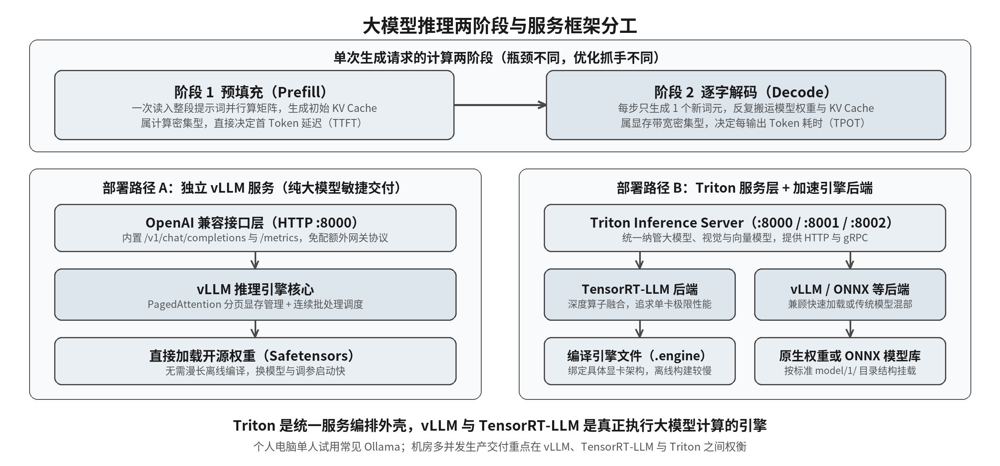
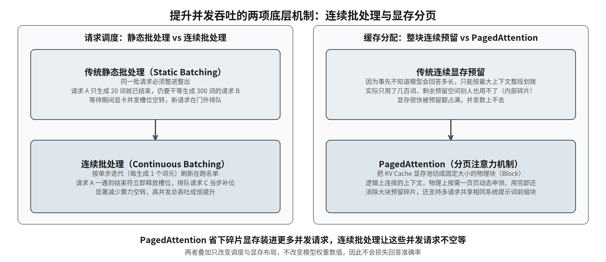
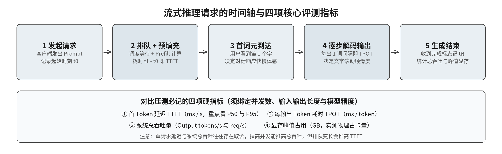
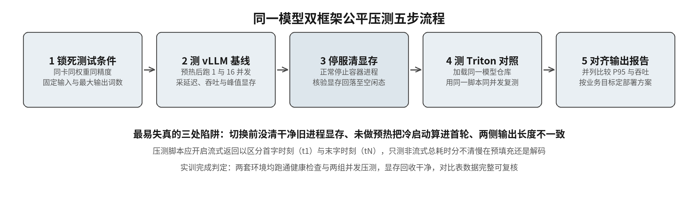

# 第32讲 推理框架与性能优化

**本课程定位：** 本讲承接第 30 讲的传统模型服务与第 31 讲的大模型首次启动。把模型跑起来只是第一步。上线前还要选对推理框架、压低响应耗时、控住算力成本。本讲的结果会直接作为第 33 讲接口网关接入与第 34 讲上线前稳定验收的性能依据。

第 31 讲已经把 `Qwen2.5-7B-Instruct` 跑在了 `gpu-node-01` 上。单人提问时几乎秒回。可业务方一开 16 路并发测试，首个字要等 4 秒多。算法同事提议换成 Triton 挂载 TensorRT-LLM，或者开启 INT4 量化。到底要选哪个框架？常见的四类优化手段各有什么代价？单卡多副本和多卡并行怎么选？两套框架怎么测才算公平对比？本讲就逐一解决这四个问题。

## 本讲学习目标

学完后，你应能：

- 按业务场景区分 vLLM、TensorRT-LLM、Triton 与 Ollama 的定位及选型边界。
- 用预填充和逐字解码两阶段解释 PagedAttention、连续批处理、模型量化与张量并行的作用和代价。
- 结合显存容量、延迟目标与并发规模，在单卡多副本与多卡并行之间确定部署形态。
- 在同一模型和固定输入输出条件下，部署两套推理方案并实测首 Token 延迟、每输出 Token 耗时、系统吞吐量与显存峰值。
- 根据压测数据排查失真干扰，编写条件清晰的双框架性能对比报告。

## 32.1、推理慢在哪里与常用框架分工

要看懂不同推理框架的差别，先要拆开大模型处理一条生成请求的两个阶段。这两个阶段消耗的硬件资源完全不同。

第一阶段叫**预填充（Prefill）**。引擎把用户发来的整段提示词一次性读入显卡，并行完成矩阵乘法，算出初始的键值缓存（KV Cache），并吐出第 1 个输出词元（Token）。这一步要集中做大量浮点运算，属于**计算密集型**阶段，直接决定用户等待首个字出现的耗时。

第二阶段叫**逐字解码（Decode）**。模型每算一步只能生成 1 个新词元，再把这个新词元拼回上下文去算下一个词。每吐出 1 个词，显卡都要把十几 GB 的模型权重和不断变长的 KV Cache 从显存搬到计算单元一次。这一步算力经常喂不饱，卡在显存读写速度上，属于**显存带宽密集型**阶段，决定后续文字滚动的快慢。

### 32.1.1、执行引擎与服务外壳的分层

日常讨论里常把 vLLM、TensorRT-LLM、Triton 和 Ollama 混在一起比。从架构层次看，需要先分清谁是真正算矩阵的**推理执行引擎**，谁是对外收发请求的**统一服务层**。



- **vLLM（开源大模型原生推理引擎）：** 直接读取 Hugging Face 标准权重（如 Safetensors 格式），无需漫长的离线编译。内部自带 PagedAttention 显存分页与连续批处理调度，启动即暴露 OpenAI 兼容 HTTP 接口（默认端口 `8000`）。新开源模型适配快，适合纯大模型服务的敏捷上线。
- **TensorRT-LLM（NVIDIA 编译型加速引擎）：** 面向 NVIDIA 显卡深度定制的高性能推理库。上线前必须先执行离线编译（`trtllm-build`），把开源权重连同目标显卡架构、最大批大小、张量并行数一起固化成 `.engine` 引擎文件。深度的算子融合让高并发预填充和解码速度上限更高，但每次换卡型或改并行规格都要重新编译。
- **Triton Inference Server（统一多模型服务层）：** 第 30 讲介绍过的生产级服务外壳，默认提供 HTTP（`:8000`）、gRPC（`:8001`）和监控指标（`:8002`）三个端口。Triton 自身不负责底层大模型矩阵计算，而是按模型仓库目录挂载不同后端：既能挂 ONNX 或 TensorRT 跑图像分类与向量模型，也能挂 **TensorRT-LLM 后端**或 **vLLM 后端**跑大语言模型。
- **Ollama（本地轻量体验工具）：** 把权重拉取与量化运行封装成一条单机命令，适合工程师在个人笔记本上单人验证提示词。高并发批调度、多卡细粒度并行与集群监控能力较弱，不作为机房生产高并发底座。

表32-1、常用推理框架与服务层的定位对比

| 工具 | 所属层次 | 权重准备方式 | 典型优势 | 局限与适用边界 |
| --- | --- | --- | --- | --- |
| vLLM | 执行引擎兼接口层 | 直接加载原生或量化权重 | 启动快、支持主流GPU与国产卡生态、自带OpenAI接口 | 不负责托管传统视觉或树模型 |
| TensorRT-LLM | 编译型执行引擎 | 离线编译为绑定卡型的引擎文件 | 算子融合深，同代NVIDIA卡上延迟与吞吐上限高 | 编译耗时十余分钟，跨卡型不可直接搬运 |
| Triton | 统一多模型服务层 | 按标准模型目录挂载对应后端 | 同一集群统一纳管视觉、向量与大模型，原生支持gRPC | 目录与 `config.pbtxt` 配置项较多 |
| Ollama | 桌面与单机工具 | 自动拉取GGUF等打包格式 | 个人开发机几分钟跑通，命令行简洁 | 不适合多租户高并发线上生产集群 |

【关键区别】Triton 是服务编排外壳，vLLM 和 TensorRT-LLM 是底层执行引擎。直接问“Triton 和 vLLM 谁更快”层次不对等。工程上真实的选型对比，是“独立部署 vLLM”对比“用 Triton 挂载 TensorRT-LLM 后端（或 vLLM 后端）”。只跑大语言模型且追求快速迭代时优先选独立 vLLM；需要把视觉、向量与大模型放进同一套网关和监控体系，或要在 NVIDIA 卡上压榨 TensorRT-LLM 极限性能时，选 Triton 组合方案。

## 32.2、四类核心性能优化手段与适用边界

第 4 讲确立过推理显存三块估算模型：**推理显存 ≈ 模型权重 + KV Cache + 其他运行时开销（约 10%～15%）**。线上并发一高就变慢甚至报显存不足（OOM），根源往往就在权重搬运太重、KV Cache 碎片太多或请求排队空等。主流推理框架主要靠四类手段化解这些瓶颈。

### 32.2.1、PagedAttention 与连续批处理：不掉精度的吞吐倍增器

早期静态批处理（Static Batching）要求同一批进入显卡的请求整进整出。假设 4 条请求一起进卡，其中 3 条只生成 30 个词就结束了，第 4 条要生成 400 个词，前 3 个并发槽位只能一直空等最长那条算完，门外的新请求也进不来。**连续批处理（Continuous Batching）** 改为按单步解码刷新名单：只要某条请求吐出结束符，当前这一步立刻释放槽位，把等待队列里的新请求插进来一起算，让显卡持续保持有效负载。

要把更多并发请求同时塞进显卡，还得管好 KV Cache。模型生成前无法预知回答有多长，传统做法只能按最大上下文长度（如 4096 词元）给每条请求预先划出一整块连续显存，没用完的部分别人也借不走，形成大量内部碎片。**PagedAttention（分页注意力机制）** 借鉴操作系统虚拟内存分页思路，把空闲显存切成固定大小的物理块（例如每块存 16 个词元），请求生成到多长就按需申领几块，用完立刻归还显存池。



这两项机制只改变请求调度时机和显存存放布局，不改动模型权重精度，因此**不会降低模型回答质量**，是现代大模型推理服务的标配底座。

### 32.2.2、模型量化与多卡并行：算清收益与工程代价

当单卡显存仍然吃紧，或者单请求算得不够快时，就需要动用**模型量化（Quantization）**与**并行切分**。这两项手段都有明确的前提和副作用。

- **模型量化（用低位宽换显存和带宽）：** 把原本占 2 字节的 FP16/BF16 权重压缩为 1 字节的 INT8/FP8，甚至 0.5 字节的 INT4（常见算法有 AWQ、GPTQ）。一方面，7B 模型权重可从约 14～15 GB 降到约 4～8 GB，腾出的显存全都能变成 KV Cache 并发槽位；另一方面，Decode 阶段每步搬运权重的数据量减半甚至减至四分之一，吐字速度明显加快。代价是数值舍入可能削弱复杂推理、长代码或精确抽取能力，且 FP8/W8A8 等计算加速强依赖显卡硬件单元支持。
- **张量并行（TP，Tensor Parallelism）与多副本数据并行（DP）：** 张量并行把同一层矩阵拆到多张卡上同时算，每算完一层都要在卡间做一次全归约（All-Reduce）通信同步。机内有高速互联（如第 4 讲讲过的 NVLink 或昇腾 HCCS）时，TP 能装下超大模型并有效压低单请求延迟；若只有普通 PCIe 甚至跨机网络，频繁同步反而会拖慢每步耗时。单张卡本来就装得下模型时，想提高整体并发吞吐，优先起**多个独立单卡副本（TP=1 × 多实例）**，比把两张卡捆成一个 `TP=2` 实例更省跨卡通信开销，单卡故障也不会拖垮整个实例。

表32-2、四类推理优化手段的收益与适用边界

| 优化手段 | 主要改善指标 | 质量影响 | 启用前提与风险边界 |
| --- | --- | --- | --- |
| 连续批处理 | 系统总吞吐量（tokens/s） | 无损 | 高并发下短请求多时收益极大，单并发无明显差异 |
| PagedAttention | 最大并发数与显存有效利用率 | 无损 | 消除预留碎片，多请求共用系统提示词时还能共享前缀块 |
| 权重量化 | 显存占用、TPOT 与并发上限 | 可能轻微下降 | 须使用对应量化权重并做业务题集回归，关注硬件算子兼容性 |
| 张量并行（TP） | 超大模型装载与单请求延迟 | 无损 | 强依赖机内高速卡间互联，卡数一般取 2、4、8 等偶数倍 |

**【例题】** 算力节点 `gpu-node-01` 装有 2 张 24 GB 推理卡，两卡仅通过主板 PCIe 槽位通信，未配高速桥接器。现需部署 `Qwen2.5-7B-Instruct`（BF16 权重约 15 GB，4096 上下文与预留并发约需 4 GB KV Cache，运行时开销约 2 GB，单实例合计约 21 GB）。业务目标是支撑尽可能高的总并发吞吐，且允许单卡维护时不中断服务。应在“方案一：1 个双卡 `TP=2` 实例”和“方案二：2 个独立单卡 `TP=1` 实例加 Service 负载均衡”之间选哪一个？

**解：** 选方案二（2 个独立单卡 `TP=1` 实例）。首先核对显存：单实例约需 21 GB，单张 24 GB 卡在设好显存利用率上限（如 `0.88`）后完全装得下，不需要靠拆卡才能启动。其次看互联与吞吐：两卡走普通 PCIe，`TP=2` 每生成 1 个词都要跨 PCIe 同步几十次激活值，通信损耗会让两卡合跑的总吞吐低于两张单卡各自独立跑的总和。最后看可用性：`TP=2` 只要坏一张卡，整个实例就停服；两个 `TP=1` 副本挂在 `infer-svc` 后面，坏一张卡仍有另一张继续响应。

【随堂思考】把 `Qwen2.5-7B-Instruct` 从 BF16（权重约 15 GB）换成 INT4 AWQ 量化版（权重约 4.5 GB），仍跑在同一张 24 GB 显卡上。除了“更容易装下模型”之外，为什么空出来的约 10.5 GB 显存还能大幅提高 32 路并发下的总吞吐量？上线前还必须补做哪一步验证？

## 32.3、确定部署形态与四项对比指标

不同业务对“快”和“省”的排序不一样，不能拿同一套参数应付所有需求。确定部署形态时，先把业务归入下面三类常见场景，再反推框架和资源配置。

表32-3、三类典型业务场景的部署形态选型参考

| 业务场景 | 首要目标 | 推荐部署形态 | 参数配置侧重 |
| --- | --- | --- | --- |
| 在线对话助手 | 低首字延迟、流式吐字连贯 | 独立 vLLM 或 Triton+TRT-LLM，单实例限流配合多副本扩容 | 控制单实例并发上限，开启前缀缓存，必要时机内开 TP 降延迟 |
| 离线批量处理 | 高总吞吐、低单万词算力成本 | 单卡独立多副本，结合受控量化（如 FP8 或 INT8） | 拉大批处理词元上限与并发队列，让显卡算力跑满 |
| 多模型统一网关 | 视觉、向量与大模型共用算力池 | Triton Inference Server 统一承载多后端 | 按目录版本管理多模型，统一由 `:8002` 输出监控指标 |

### 32.3.1、性能对比必锁的四项指标与五条公平前提

第 2 讲强调过不同条件下的算力数字不能直接比大小。第 24 讲也要求压测基线必须绑定固定并发与时长。到了大模型推理框架对比，必须同时采集以下**四项核心指标**，缺一项都会掩盖短板：

1. **首 Token 延迟（TTFT，Time To First Token）：** 从客户端发出请求到收到第 1 个输出词元的耗时（常用毫秒 `ms` 或秒 `s`）。平均值容易被少数极快请求拉低，报告必须同时列出中位数 **P50** 与尾部 **P95**（即 95% 的请求都在这一耗时内拿到首字）。
2. **每输出 Token 耗时（TPOT，Time Per Output Token，也称词间延迟 ITL）：** 首字出来后，后续每生成 1 个词元的平均间隔（`ms/token`）。成年人快速阅读速度约为每秒 8～12 个汉字，TPOT 控制在 `50 ms` 以内时用户体感流畅。
3. **系统总吞吐量（Output Throughput）：** 服务端每秒向所有并发客户端合计输出的词元总数（`tokens/s`）及每秒完成的请求数（`req/s`），直接衡量一张卡能扛多少业务量。
4. **显存峰值占用（Peak VRAM Usage）：** 压测满载期间通过带内工具（如 `nvidia-smi`、海光 `hy-smi` 或昇腾 `npu-smi`）实测的物理显存最高占用（`GB`），用于核对离整卡上限还剩多少安全余量。



要让 vLLM 和 Triton 的对比结果站得住脚，测试全程必须锁死**五条公平前提**：

- **同硬件与空载环境：** 在同一台算力节点、同一张卡型上顺序测试，测第二套框架前必须停掉第一套服务并确认显存彻底清零。
- **同模型与同精度：** 两套框架加载同一版本的权重文件与同一数值精度（例如统一用 `Qwen2.5-7B-Instruct` BF16，不拿一边的 INT4 去比另一边的 BF16）。
- **同输入与同输出长度：** 使用同一批提示词（如固定约 256 词元输入），固定最大生成长度 `max_tokens: 128`，并在压测参数中忽略提前结束符（`ignore_eos: true`）或采用确定性贪婪解码（`temperature: 0`），避免某一方提前结束短答导致请求完成速度虚高。
- **同显存预留上限：** 两边对齐最大上下文长度（如 `4096`）与显存池比例（如 `85%`）。
- **先预热再正式计时：** 框架刚启动的前 1～3 条请求往往包含 CUDA 图捕获或缓存初始化开销，必须先跑 3 条预热请求丢弃不计，再启动正式并发计时。

## 32.4、上机实训：同一模型在 vLLM 与 Triton 上的部署与压测对比

本节在算力节点 `gpu-node-01`（`192.168.10.31`，操作账号 `opsadmin`）上完成双框架对比实训。教学主例采用单张 24 GB 及以上显存加速卡与 `/data/models/Qwen2.5-7B-Instruct`（BF16 精度）。如果你的实验环境显存为 8～16 GB，可将命令中的模型路径替换为 `/data/models/Qwen2.5-1.5B-Instruct`，操作步骤与验收口径完全相同，只需在对比报告首行如实注明所用卡型与模型参数量。



### 32.4.1、步骤一：环境核查与流式压测脚本准备

登录 `gpu-node-01`（`opsadmin` 账号；海光 DCU 节点将 `nvidia-smi` 改为 `hy-smi`，昇腾节点改为 `npu-smi info`），先确认加速卡处于空闲状态、`8000～8002` 端口未被旧进程占用，并确认模型权重目录完整：

```bash
# Node: gpu-node-01 (user: opsadmin)
nvidia-smi --query-gpu=index,name,memory.used,memory.total --format=csv
ss -tulnp | grep -E ':8000|:8001|:8002' || echo "ports 8000-8002 free"
ls -lh /data/models/Qwen2.5-7B-Instruct/config.json
mkdir -p ~/lab/bench && cd ~/lab/bench
```

普通 HTTP 压测工具（如 `hey`）只能测整包返回的总耗时，分不出首字延迟（TTFT）和解码步长（TPOT）。我们在 `~/lab/bench/bench_stream.py` 中编写一个纯 Python 标准库流式压测脚本（使用 `/opt/ops/venv/bin/python` 运行），先预热 3 次排除图编译冷启动抖动，再并发采集 OpenAI 或 Triton 流式接口指标（为兼容最小化无中文字体容器终端，脚本注释与测试提示词采用英文短句）：

```python
#!/usr/bin/env python3
# File: ~/lab/bench/bench_stream.py
import argparse, json, statistics, time, urllib.request
from concurrent.futures import ThreadPoolExecutor

PROMPT = (
    "Explain four daily server inspection metrics in a compute center: "
    "hardware status, inlet temperature, redundant PSU, and BMC event logs."
)

def one_request(mode, url, model, max_tokens):
    if mode == "openai":
        payload = {
            "model": model,
            "messages": [{"role": "user", "content": PROMPT}],
            "max_tokens": max_tokens,
            "temperature": 0.0,
            "ignore_eos": True,
            "stream": True,
        }
    else:
        payload = {
            "text_input": PROMPT,
            "parameters": {"max_tokens": max_tokens, "temperature": 0.0, "ignore_eos": True, "stream": True},
        }
    req = urllib.request.Request(
        url, data=json.dumps(payload).encode("utf-8"),
        headers={"Content-Type": "application/json"}, method="POST"
    )
    t0 = time.perf_counter()
    t_first = None
    chunks = 0
    with urllib.request.urlopen(req, timeout=120) as resp:
        for raw in resp:
            line = raw.decode("utf-8").strip()
            if not line.startswith("data:"):
                continue
            body = line.removeprefix("data:").strip()
            if body == "[DONE]" or not body:
                continue
            if t_first is None:
                t_first = time.perf_counter()
            chunks += 1
    t_end = time.perf_counter()
    if t_first is None:
        t_first = t_end
    ttft = (t_first - t0) * 1000.0
    tpot = ((t_end - t_first) * 1000.0 / max(chunks - 1, 1)) if chunks > 1 else 0.0
    return ttft, tpot, max(chunks, 1)

def pct(vals, q):
    s = sorted(vals)
    pos = min(int(len(s) * q), len(s) - 1)
    return s[pos]

def main():
    ap = argparse.ArgumentParser()
    ap.add_argument("--mode", choices=["openai", "triton"], required=True)
    ap.add_argument("--url", required=True)
    ap.add_argument("--model", default="qwen25-7b")
    ap.add_argument("--concurrency", type=int, default=1)
    ap.add_argument("--requests", type=int, default=16)
    ap.add_argument("--max-tokens", type=int, default=128)
    args = ap.parse_args()

    # Warmup 3 requests before formal timing
    for _ in range(3):
        one_request(args.mode, args.url, args.model, 32)

    t_start = time.perf_counter()
    with ThreadPoolExecutor(max_workers=args.concurrency) as pool:
        futs = [pool.submit(one_request, args.mode, args.url, args.model, args.max_tokens) for _ in range(args.requests)]
        results = [f.result() for f in futs]
    elapsed = time.perf_counter() - t_start

    ttfts = [ttft for ttft, _, _ in results]
    tpots = [tpot for _, tpot, _ in results]
    total_tok = sum(tok for _, _, tok in results)
    print(f"concurrency={args.concurrency} requests={args.requests} elapsed={elapsed:.2f}s")
    print(f"TTFT_P50={statistics.median(ttfts):.1f}ms TTFT_P95={pct(ttfts, 0.95):.1f}ms")
    print(f"TPOT_P50={statistics.median(tpots):.1f}ms throughput={total_tok / elapsed:.1f} tokens/s")

if __name__ == "__main__":
    main()
```

### 32.4.2、步骤二：部署方案 A（独立 vLLM）并采集基线数据

在 `gpu-node-01` 上使用容器启动独立 vLLM 服务，显式锁定模型服务名 `qwen25-7b`、最大上下文长度 `4096`、数据类型 `bfloat16` 与显存池上限 `0.85`；待 `/health` 返回 `200` 后，依次跑 `1` 并发与 `16` 并发并记录显存峰值：

```bash
# Start standalone vLLM on gpu-node-01
docker run -d --name bench-vllm --gpus '"device=0"' \
  --ipc=host -p 8000:8000 \
  -v /data/models/Qwen2.5-7B-Instruct:/models/Qwen2.5-7B-Instruct:ro \
  registry.lab.example/prod/vllm-openai:v0.6.3 \
  --model /models/Qwen2.5-7B-Instruct \
  --served-model-name qwen25-7b \
  --dtype bfloat16 \
  --max-model-len 4096 \
  --gpu-memory-utilization 0.85 \
  --port 8000

# Verify health=200, then run concurrency=1 and concurrency=16 benchmarks
curl -s -o /dev/null -w "%{http_code}\n" http://127.0.0.1:8000/health
python3 ~/lab/bench/bench_stream.py --mode openai \
  --url http://127.0.0.1:8000/v1/chat/completions --concurrency 1 --requests 8 --max-tokens 128
python3 ~/lab/bench/bench_stream.py --mode openai \
  --url http://127.0.0.1:8000/v1/chat/completions --concurrency 16 --requests 32 --max-tokens 128
nvidia-smi --query-gpu=memory.used --format=csv,noheader
```

记录完两组压测读数与显存峰值后，**必须立即停止并删除 bench-vllm 容器，核验显存回落到接近 0 MiB**，绝不能带着残留显存启动第二套框架：

```bash
# Stop bench-vllm and verify GPU memory returns to idle
docker stop bench-vllm && docker rm bench-vllm
nvidia-smi --query-gpu=memory.used --format=csv,noheader
```

### 32.4.3、步骤三：部署方案 B（Triton 推理服务）并执行同条件对照

Triton 要求按 `<模型仓库>/<模型名>/<正整数版本号>/` 目录结构组织文件。生产中有两种后端挂法：一是在 NVIDIA 显卡上先执行 `trtllm-build` 把权重编译为 `.engine` 文件并挂载 `tensorrt_llm` 后端，适合固定卡型追求极致延迟；二是挂载 Triton 内置的 `vllm` 后端直接读取同一份权重，适合多模型混部且免除漫长编译。下面在 `gpu-node-01` 上构建标准模型仓库目录（若机房已预编译好 TensorRT-LLM 引擎目录，只需把 `backend` 改为 `"tensorrt_llm"` 并指向引擎目录即可）：

```bash
# Prepare Triton model repository on gpu-node-01
mkdir -p ~/lab/triton_repo/qwen25-7b/1

cat > ~/lab/triton_repo/qwen25-7b/config.pbtxt <<'EOF'
name: "qwen25-7b"
backend: "vllm"
max_batch_size: 0
model_transaction_policy {
  decoupled: true
}
EOF

cat > ~/lab/triton_repo/qwen25-7b/1/model.json <<'EOF'
{
  "model": "/models/Qwen2.5-7B-Instruct",
  "dtype": "bfloat16",
  "max_model_len": 4096,
  "gpu_memory_utilization": 0.85,
  "disable_log_requests": true
}
EOF
```

注意 `config.pbtxt` 中的 `decoupled: true`（解耦事务模式）：大模型流式输出属于“1 次请求对应多次增量响应包”，不开启解耦模式将无法支持流式推送。接着启动 Triton 服务容器并执行完全相同并发与长度的压测：

```bash
# Start Triton Inference Server (8000 HTTP / 8001 gRPC / 8002 Metrics)
docker run -d --name bench-triton --gpus '"device=0"' \
  --shm-size=2g -p 8000:8000 -p 8001:8001 -p 8002:8002 \
  -v ~/lab/triton_repo:/models_repo:ro \
  -v /data/models/Qwen2.5-7B-Instruct:/models/Qwen2.5-7B-Instruct:ro \
  registry.lab.example/prod/tritonserver:24.08-vllm-py3 \
  tritonserver --model-repository=/models_repo

# Verify Triton ready=200, then run identical benchmarks
curl -i http://127.0.0.1:8000/v2/health/ready
python3 ~/lab/bench/bench_stream.py --mode triton \
  --url http://127.0.0.1:8000/v2/models/qwen25-7b/generate_stream --concurrency 1 --requests 8 --max-tokens 128
python3 ~/lab/bench/bench_stream.py --mode triton \
  --url http://127.0.0.1:8000/v2/models/qwen25-7b/generate_stream --concurrency 16 --requests 32 --max-tokens 128
nvidia-smi --query-gpu=memory.used --format=csv,noheader

# Clean up Triton container and confirm GPU memory release
docker stop bench-triton && docker rm bench-triton
nvidia-smi --query-gpu=memory.used --format=csv,noheader
```

### 32.4.4、步骤四：实训常见异常排查与对比报告解读

实训中遇到启动报错或压测读数反常时，按下方排查表逐层核对，不要盲目重启服务器。

表32-4、双框架对比实训常见异常与排查动作

| 异常现象 | 优先核查项 | 具体原因与处置方法 |
| --- | --- | --- |
| 第二套框架报显存不足 | `nvidia-smi` 与容器列表 | 前一套框架容器未停止或僵尸进程占着显存，停止旧容器确认归零后再起 |
| Triton 启动报目录无效 | 模型仓库层级 | 缺少正整数版本子目录 `1/`，或 `config.pbtxt` 的 `name` 与外层目录名不一致 |
| 流式接口报不支持流推送 | `config.pbtxt` 解耦项 | 漏配 `decoupled: true`，补齐后重启 `tritonserver` |
| TRT-LLM 引擎加载失败 | 显卡架构与驱动版本 | `.engine` 文件是在其他型号显卡上编译的，必须在目标同款卡型上重新编译 |
| 两套框架吞吐相差悬殊 | 预热与结束符配置 | 某一方未忽略提前结束符导致输出变短，或把首轮冷启动算进了正式计时 |

完成两组实测后，把结果汇总为结构化对比报告。下表给出在单张 24 GB 推理卡（BF16 精度，输入约 60 tokens、固定输出 128 tokens）下，独立 vLLM、Triton（vLLM 后端）与 Triton（TensorRT-LLM 编译后端）三组典型实测参考值，供对照读数规律：

表32-5、同一模型不同框架部署方案实测对比样例（单张 24 GB 卡，Qwen2.5-7B BF16）

| 部署方案 | 1并发 TTFT P95 | 16并发 TTFT P95 | 16并发 TPOT P50 | 16并发吞吐 | 显存峰值 |
| --- | --- | --- | --- | --- | --- |
| 独立 vLLM | 58 ms | 390 ms | 19.5 ms | 745 tokens/s | 20.6 GB |
| Triton（vLLM 后端） | 63 ms | 412 ms | 20.1 ms | 728 tokens/s | 20.9 GB |
| Triton（TRT-LLM 后端） | 42 ms | 275 ms | 15.8 ms | 930 tokens/s | 19.8 GB |

**【例题】** 观察表 32-5 的实测样例数据：业务团队下周要上线内部客服问答助手，后续每周都会微调替换一次新模型权重，要求 16 并发下 P95 TTFT 小于 600 ms，且集群里没有其他传统视觉模型。结合性能余量与日常运维工作量，你会推荐哪套方案写进对比报告结论？

**解：** 推荐**独立 vLLM 方案**。从指标看，独立 vLLM 在 16 并发下的 P95 TTFT 为 390 ms，充裕满足小于 600 ms 的业务目标，且直接提供客服前端所需的 OpenAI 兼容接口。虽然 Triton 加 TensorRT-LLM 吞吐更高（930 tokens/s），但业务每周都要更新一次微调权重，每次重跑离线引擎编译既增加发布耗时又容易因编译参数不一致出错；当前也没有多模型混部需求，不必额外维护一层 Triton 转发开销。若后续并发翻倍逼近单卡上限且模型版本趋于稳定，再切入 TensorRT-LLM 编译流水线。

【随堂思考】在表 32-5 中，为什么所有方案从 1 并发升到 16 并发时，总输出吞吐大幅上升，但单次请求的 TTFT P95 却从几十毫秒涨到了几百毫秒？这说明报性能数据时绝对不能漏写什么条件？

## 32.5、本讲回顾与自测

学习完本讲后，试着用自己的话回答四个问题：vLLM、TensorRT-LLM 和 Triton 在架构层次上各管哪一段？连续批处理和 PagedAttention 为什么能在不损失精度的前提下大幅提高并发吞吐？单卡能装下模型时为什么要慎用跨 PCIe 的张量并行？对比两套框架性能时怎样保证测试条件公平？

表32-6、本讲目标与对应判断

| 学习目标 | 应能做出的判断 |
| --- | --- |
| 框架选型 | 分清 Triton 服务外壳与底层执行引擎，按迭代频率、硬件生态和混部需求选型 |
| 优化手段判读 | 区分无损调度优化（PagedAttention、连续批处理）与有损数值压缩（量化）的边界 |
| 部署形态规划 | 单卡装得下且无高速卡间互联时，优先用多副本扩容吞吐，不盲目拆卡做 TP |
| 公平对比压测 | 锁死同卡、同模型精度、同输入输出长度并先做预热，切换前彻底清空显存 |
| 指标综合解读 | 同时报告 TTFT（含 P95）、TPOT、总吞吐与峰值显存，不拿单并发延迟替代高并发表现 |

### 32.5.1、本讲自测

**1 架构分层。** 某团队需要在一组 GPU 节点上同时对外提供 `ResNet-50` 图像分类（gRPC 接口）和 `Qwen2.5-7B-Instruct` 文本生成，并统一采集监控指标。在独立 vLLM、Ollama 和 Triton 组合方案中应选哪一种？说明理由。

**2 阶段与瓶颈。** 用户反馈：“发一段 3000 字长文档让模型总结，等了 5 秒才蹦出第 1 个字，但出字之后滚动挺快。”这说明耗时主要卡在推理的哪一个阶段？对应哪一项指标偏高？

**3 优化原理。** 简述 PagedAttention 相比传统连续预留 KV Cache 解决了什么问题，以及这项技术会不会导致模型回答变笨。

**4 并行决策。** 单张 48 GB 算力卡运行 7B BF16 模型仅占约 21 GB 显存。现有 2 张同款卡（无 NVLink，仅走 PCIe），目标是支撑最高并发请求数。应部署 1 个 `TP=2` 实例，还是部署 2 个 `TP=1` 独立实例？为什么？

**5 压测排错。** 某同学测完 vLLM 后直接执行 `docker run` 启动 Triton，结果 Triton 日志立刻报 `CUDA out of memory` 退出。最可能漏掉了哪一步标准操作？用哪两条命令核实并修复？

**6 报告判读。** 同事提交对比结论写着：“框架甲平均响应 1.2 秒，框架乙平均响应 2.1 秒，所以框架甲全面胜出。”作为审校工程师，请指出这份记录至少缺失了哪三项关键前提或指标。

**答：**

____________________________

____________________________

____________________________

____________________________

## 32.6、参考答案与解析

### 32.6.1、随堂思考解析

**思考 1（INT4 量化为何提升高并发吞吐及必做验证）：** 24 GB 显卡跑 BF16 权重（约 15 GB）时，扣除运行时开销后只剩约 6～7 GB 显存留给 KV Cache，并发一多缓存池就满，后续请求只能排队。换成 INT4 权重（约 4.5 GB）后，多腾出约 10.5 GB 显存给 KV Cache，能同时装进显卡做连续批处理的并发请求数成倍增加，加上每步解码搬运权重字节数减少，高并发总吞吐随之显著提升。上线前必须用业务黄金测试集补做**回答正确性与格式合规验证**，确认低位宽量化没有引入不可接受的精度退化。

**思考 2（16 并发下吞吐升而 TTFT 变长的原因）：** 1 并发时显卡计算单元远未吃满，请求零排队立刻算完，TTFT 极低但总吞吐也低；16 并发同时涌入时，连续批处理把多条计算合并跑满显卡，系统每秒产出的总词元数大幅上升，但并发请求需要分批竞争预填充算力甚至短暂排队，单条请求的等待加预填充时间拉长，导致 TTFT P95 升高。这说明任何延迟和吞吐数字都**必须绑定并发度（以及输入输出词元长度）**才可比。

### 32.6.2、课后自测解析

**1** 选 **Triton Inference Server 组合方案**（例如挂载 ONNX 后端跑 `ResNet-50`，同时挂载 vLLM 或 TensorRT-LLM 后端跑 `Qwen2.5-7B-Instruct`）。独立 vLLM 专注于大语言模型，不托管传统视觉模型；Ollama 面向个人本地试用；Triton 原生支持多模型仓库统一编排、gRPC 高性能调用以及 `:8002/metrics` 统一监控输出。

**2** 卡在**预填充（Prefill）阶段**，对应 **首 Token 延迟（TTFT）** 偏高。3000 字长提示词在预填充阶段需要做大规模注意力矩阵计算，计算量随输入长度增长明显；进入逐字解码（Decode）阶段后每步只需处理 1 个新词元，因此 TPOT 正常、后续出字滚动顺滑。可重点检查是否能启用前缀缓存或升级预填充算力。

**3** 传统方式按最大长度预先划拨大块连续显存，未用满的预留空间无法给其他请求使用，造成严重显存碎片。PagedAttention 将 KV Cache 拆成固定大小的块按需动态分配与回收，大幅减少碎片并提升单卡可承载的并发数。它只改变显存管理方式，不改变任何权重与计算精度，**不会让模型回答变差**。

**4** 应部署 **2 个 TP=1 独立实例**（每卡 1 个，前置负载均衡）。单张 48 GB 卡完全装得下 7B 模型且留有充足 KV Cache 空间；走 PCIe 做 `TP=2` 会在每步生成中引入跨卡同步通信损耗，且任一显卡异常会导致整个双卡实例不可用；双独立实例无跨卡同步开销，总吞吐更高且具备单卡故障容错能力。

**5** 漏掉了**停止前一套 vLLM 容器并确认显存归零**的步骤，旧容器仍占着约 85% 的物理显存，导致新容器初始化失败。先用 `docker ps` 与 `nvidia-smi` 核实占用进程，再执行 `docker stop bench-vllm && docker rm bench-vllm`，复查 `nvidia-smi` 显存回落后再启动 Triton。

**6** 至少缺失三项：① **测试负载前提**（并发数是多少、输入提示词长度与固定输出 `max_tokens` 是否一致、模型精度是否相同）；② **流式分阶段与分位值指标**（未拆分 TTFT P95 与 TPOT，只看总平均耗时掩盖了排队抖动和长短答差异）；③ **系统总吞吐量（tokens/s）与显存峰值占用（GB）**。

## 32.7、术语

表32-7、本讲术语

| 术语 | 本讲中的含义 |
| --- | --- |
| Prefill（预填充） | 大模型读入整段输入提示词、并行计算初始 KV Cache 并产出首个词元的阶段，属计算密集型。 |
| Decode（逐字解码） | 首词元产出后，逐步循环生成后续词元的阶段，每步需读取权重与缓存，属显存带宽密集型。 |
| TTFT | 首 Token 延迟（Time To First Token），从发出请求到收到第 1 个输出词元的耗时。 |
| TPOT | 每输出 Token 耗时（Time Per Output Token），解码阶段相邻两个输出词元之间的平均间隔。 |
| PagedAttention | 把 KV Cache 显存池切成固定大小物理块按需分配的机制，用于消除连续预留碎片。 |
| 连续批处理 | 按单步解码动态移出已完成请求、插入新到达请求的调度机制，减少并发槽位空等。 |
| 模型量化 | 将权重或激活值从 FP16/BF16 转为 FP8/INT8/INT4 等低位宽表示，降低显存与带宽占用。 |
| 张量并行（TP） | 将模型单层矩阵拆分到多张加速卡协同计算并实时通信同步的并行方式，依赖高速卡间互联。 |
| Triton 解耦模式 | `config.pbtxt` 中 `decoupled: true` 配置，允许单次推理请求分多次流式返回增量数据包。 |

文中节点 IP（`192.168.10.31`）、私有镜像地址（`registry.lab.example`）、路径与参数均为教学示例，生产环境以本单位规划为准。

<!-- md-only -->

## 附：主要参考资料（仅 Markdown 保留，不印入 Word/PDF）

- 中国信通服务《2025 算力运维体系技术白皮书》（本地 PDF `./资料/中国信通服务：2025算力运维体系技术白皮书-71页.pdf`），应用性能监控、AI 推理时延监控与算力适配调优章节。
- Kwon et al., *Efficient Memory Management for Large Language Model Serving with PagedAttention* (SOSP 2023) 及 vLLM 官方文档（Engine Arguments、OpenAI-Compatible Server 与 Performance Benchmarking 指南）。
- NVIDIA Triton Inference Server 官方文档（Model Repository、Decoupled Models、vLLM Backend 与 TensorRT-LLM Backend 部署规范）。
- NVIDIA TensorRT-LLM 官方文档（Model Build Workflow、In-flight Batching、Quantization 与 Tensor Parallelism 最佳实践）。

<!-- /md-only -->
