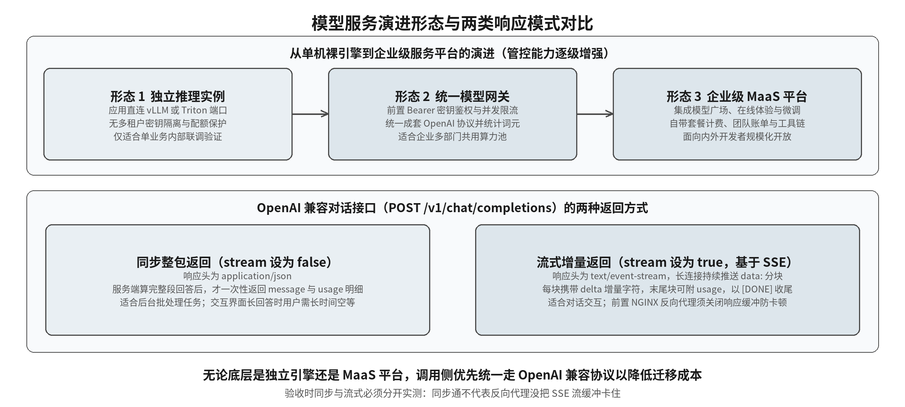
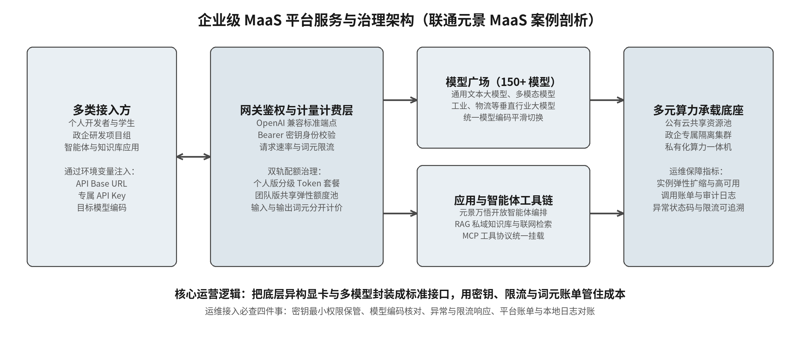
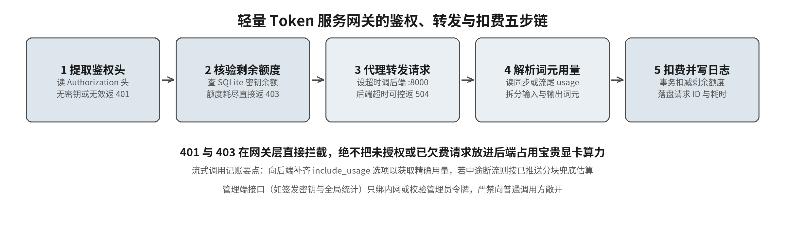
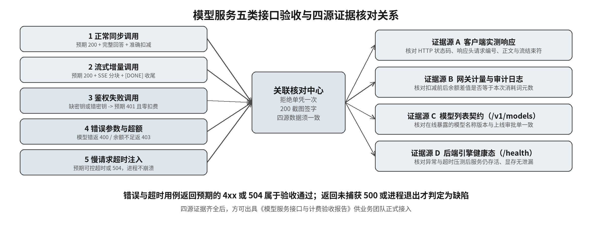

# 第33讲 模型服务形态与接口验收

**本课程定位：** 第 31、32 讲解决了怎么把大模型高效跑在算力卡上。但在真实企业里，不能把底层 `8000` 端口直接裸露给十几个业务组随便调。本讲在推理引擎与业务应用之间补齐接口契约、令牌鉴权、词元计量与服务验收，并为第 34 讲上线前稳定验收和第 40 讲智能体接入提供标准网关入口。

客服问答、知识库检索和代码助手三个项目组同时申请调用 `gpu-node-01` 上的 `Qwen2.5-7B-Instruct`。一旦没有统一接口规范和令牌管控，谁调了多少算力根本算不清，某组写错一段死循环脚本就能把全公司显卡拖慢，出了报错也分不清是客户端参数写错还是推理实例挂了。模型服务有哪些交付形态？OpenAI 兼容接口和流式返回怎么核对？Token 额度账怎么算？怎样搭一套轻量计费网关并参照企业级 MaaS 平台完成验收？本讲围绕这四个问题展开。

## 本讲学习目标

学完后，你应能：

- 区分独立推理实例、统一模型网关与企业级 MaaS 平台三种服务形态的适用场景。
- 按端点、请求字段、SSE 流式返回与 HTTP 状态码契约，核验一个 OpenAI 兼容模型服务。
- 解释分词计量原理，算清多轮对话与输入输出不同权重下的 Token 折算账单。
- 剖析联通元景 MaaS 平台的模型纳管、密钥配额治理与接入对账方法。
- 搭建具备密钥签发、额度扣减和调用统计能力的轻量 Token 服务网关，执行五类验收测试并输出四源关联的验收结论。

## 33.1、模型服务的三种形态与 OpenAI 兼容协议

同样一个大模型，对外提供服务时通常有三种递进形态。团队规模和安全边界不同，选用的形态也不同。

- **形态一：独立推理实例（裸引擎直连）。** 业务程序直接访问单机或集群内的 vLLM、Triton 端口。部署最省事，但引擎自身只有基础口令或完全无鉴权，没有分部门配额扣减与审计账单，只适合单一内部项目早期联调。
- **形态二：统一模型网关（API Gateway）。** 在推理实例前面加一层API网关，统一收口 `Authorization: Bearer <API_KEY>` 鉴权、按部门限流、模型名路由与词元（Token）用量统计。后端扩缩容或替换引擎时，前端业务无需改动调用地址。
- **形态三：企业级 MaaS 平台（Model-as-a-Service，模型即服务）。** 在统一网关之上进一步整合百余种模型广场、在线体验台、套餐计费账单、微调任务与知识库智能体工具链，面向集团多租户或外部客户规模化运营。



### 33.1.1、OpenAI 兼容协议的核心端点与字段契约

为了避免每换一个模型就重写一遍客户端代码，目前开源推理引擎（如 vLLM）与主流商业 MaaS 平台普遍对齐 **OpenAI 兼容 HTTP 接口协议**。日常验收至少要核对以下四个端点与核心字段：

- **健康探活端点（GET /health）：** 不带业务负载，返回状态码 `200` 代表推理进程存活且已完成模型加载，常用于第 19 讲学过的 Kubernetes 就绪探针。
- **模型契约端点（GET /v1/models）：** 返回当前实例在线暴露的模型标识（`id` 字段）。验收第一步就是核对这里的模型名与变更单批准的版本是否一致，防止挂错权重目录。
- **对话生成端点（POST /v1/chat/completions）：** 核心请求头包含 `Content-Type: application/json` 与 `Authorization: Bearer <API_KEY>`。请求体必填 `model`（目标模型名）与 `messages`（由 `system`、`user`、`assistant` 角色组成的消息数组），常配 `max_tokens`（单次最大输出上限）、`temperature`（采样随机度，验收复现时常设为 `0`）以及 `stream`（是否开启流式返回）。
- **文本向量端点（POST /v1/embeddings）：** 把文本转为浮点数向量数组，供检索增强生成（RAG）知识库调用。

当 `stream` 设为 `true` 时，响应从一次性 JSON 变为 **SSE（Server-Sent Events，服务端推送事件）** 流：响应头变为 `Content-Type: text/event-stream`，服务端每算出几个词元就推一行 `data: {...}`（增量内容在 `delta.content` 字段），全部发完后推一行固定的 `data: [DONE]` 收尾。如果需要在流式模式下拿到精确词元账单，请求体还需附带 `stream_options: {"include_usage": true}`。

表33-1、OpenAI 兼容接口常见状态码与责任定界

| 状态码 | 协议含义 | 典型触发场景 | 运维定界方向 |
| --- | --- | --- | --- |
| 200 | 请求成功 | 同步返回完整 JSON，或流式正常推送至结束标志 | 核对响应模型名与词元统计是否非零 |
| 400 | 客户端参数错误 | 模型名写错、上下文超限、必填字段缺失或类型不符 | 检查调用方请求体，后端引擎本身无故障 |
| 401 | 身份鉴权失败 | 未带鉴权请求头、密钥拼写错误或密钥已被吊销 | 拦截在网关层，核对调用方环境变量配置 |
| 403 | 权限或额度拒绝 | 当前密钥无权访问目标模型，或分配的词元额度已耗尽 | 核查网关配额表或租户模型授权关系 |
| 429 | 请求触发限流 | 单位时间内请求数或词元速率超出网关阈值 | 保护后端不被打垮，引导调用方做退避重试 |
| 502 / 503 | 后端服务不可达 | 推理容器重启中、EndpointSlice 为空或排队满载拒收 | 立即排查网关到推理实例的网络与存活状态 |
| 504 | 网关等待超时 | 超长输入或高并发排队导致后端迟迟未回包 | 结合引擎队列监控调优超时阈值或扩容副本 |

【关键区别】验收接口时，不能把所有非 `200` 响应都当成服务故障。测试错误参数拿到 `400`、测试假密钥拿到 `401`、测试欠费账号拿到 `403`，恰恰证明网关的校验逻辑工作正常；反过来，传一个非法参数却引起服务端崩溃返回 `500` 或直接断开连接，才是必须修复的线上隐患。另外，前置 NGINX Ingress 转发流式接口时必须关闭响应缓冲（配置 `proxy_buffering off`），否则前端会一直卡到整段话全部算完才一次性跳出文字。

## 33.2、Token 计量原理与额度折算账

模型服务为什么普遍按 **Token（词元）** 计量，而不简单按“调用次数”算钱？因为一条只有 10 个字的闲聊请求，与一条塞进 8000 字合同全文并要求写出 2000 字审查意见的请求，占用的显卡计算时间和 KV Cache 显存相差上百倍。按词元计量才能真实反映算力消耗。

### 33.2.1、分词器差异与三项用量字段

词元是分词器（Tokenizer）按模型词表把文本切开后的最小编码单元。中文常见环境下，1 个汉字大致对应 `0.6～1` 个词元，1 个常见英文单词大致对应 `1.3` 个词元。不同模型家族使用的词表不同，同一段话用不同分词器切出来的词元数量会有 `10%～30%` 的出入，因此**计费与配额扣减一律以服务端响应体 usage 对象返回的实测数字为准**：

- `prompt_tokens`：本次请求输入侧消耗的词元总数，包含系统提示词、历史对话记录与当前用户提问。
- `completion_tokens`：模型本次新生成的输出词元总数。
- `total_tokens`：输入与输出词元之和（`prompt_tokens + completion_tokens`）。

### 33.2.2、输入输出差价与多轮对话叠加效应

第 32 讲拆解过：输入词元走预填充（Prefill）阶段，可以整段并行做矩阵计算，算力利用率高；输出词元走逐字解码（Decode）阶段，每生成 1 个词都要串行搬运一次模型权重，占卡时间长得多。因此企业级平台和内部成本核算通常采用**输入与输出分开计价（或按倍率折算点数）**，输出单价往往是输入单价的 2～4 倍。

另一个常见超支原因是**多轮对话无状态重发**。HTTP 接口本身不替客户端保存聊天上下文。用户在界面上聊到第 5 轮时，前端程序其实把前 4 轮的一问一答连同系统提示词全部拼进 `messages` 数组重新发了一遍，`prompt_tokens` 会像滚雪球一样逐轮变大。

表33-2、Token 计量三项指标与算力消耗特征

| 计量项 | 涵盖内容 | 对应推理阶段 | 计费与成本特征 |
| --- | --- | --- | --- |
| 输入词元数 | 系统设定、多轮历史问答与本轮提问 | 预填充阶段 | 并行计算快，但多轮不裁剪历史会导致每轮重复计费 |
| 输出词元数 | 模型本轮新生成的全部词元 | 逐字解码阶段 | 串行访存占卡久，单词元折算单价通常高于输入侧 |
| 总词元数 | 本次调用输入与输出词元之和 | 全程占用缓存 | 决定本次请求对上下文上限与固定总额度包的消耗 |

**【例题】** 某企业内部模型网关为 `Qwen2.5-7B-Instruct` 设定折算规则：每消耗 1 个输入词元扣减 `1` 点算力额度，每消耗 1 个输出词元扣减 `3` 点算力额度。某研发助手应用带有固定的 `200` 词元系统提示词，一名工程师连续进行了 3 轮对话（未裁剪历史），每轮用户提问均为 `100` 词元，模型每轮回答均为 `300` 词元。请分别算出第 1、2、3 轮的输入词元数，以及这 3 轮对话累计扣减的总算力点数。

**解：** 逐轮拆解输入词元（每轮输入 ＝ 系统提示词 ＋ 之前所有轮次的提问与回答 ＋ 本轮提问）：
- 第 1 轮：`prompt_tokens = 200 + 100 = 300`，`completion_tokens = 300`；
- 第 2 轮：带上第 1 轮问答（`100 + 300 = 400`），`prompt_tokens = 200 + 400 + 100 = 700`，`completion_tokens = 300`；
- 第 3 轮：带上前两轮问答（`800`），`prompt_tokens = 200 + 800 + 100 = 1100`，`completion_tokens = 300`。
三轮累计输入词元 ＝ `300 + 700 + 1100 = 2100`；三轮累计输出词元 ＝ `300 × 3 = 900`（实耗 `total_tokens = 3000`）。
按折算规则累计扣减点数 ＝ `2100 × 1 + 900 × 3 = 2100 + 2700 = 4800` 点。可以看到，不限制历史轮数时，输入词元每一轮都在加速膨胀。

【随堂思考】当调用方发起流式请求（`stream: true`）让模型写一篇 1500 字长文，生成到第 800 字时调用方主动断开了网络连接。如果网关只在收到末尾 `[DONE]` 块时才记账扣费，会出现什么漏洞？工程上应当怎样防范？

## 33.3、平台案例分析：联通元景 MaaS 平台的服务开放与治理

在自建网关之前，先看成熟的企业级平台怎样把模型变成可运营的公共服务。以**中国联通元景 MaaS 平台**（及配套的“元景万悟”智能体开放体系）为例，平台围绕“算力底座 ＋ 模型广场 ＋ 工具链与计费治理”构建了完整的服务交付体系。



从算力运维与平台运营视角看，联通元景 MaaS 平台的做法体现在四个核心环节：

1. **多模型统一纳管与标准协议暴露：** 平台模型广场集中纳管超过 150 个模型，涵盖通用大语言模型、多模态视觉语言模型以及工业、港口、物流等垂直行业大模型，底层兼容公有云资源池、政企专享集群与私有化一体机。对外统一提供兼容 OpenAI 规范的 HTTP 接口，业务系统只需修改配置中的接口地址（Base URL）、专属 API Key 与 `model` 模型编码，即可在不同参数规格的模型间切换。
2. **个人与团队双轨配额体系（Token Plan）：** 针对不同用量的接入主体划分双轨套餐——面向独立开发者和教学实训场景提供透明的个人分级 Token 额度包；面向企业研发与政企部门采用团队共享的弹性额度（Credits）池，支持多成员协同调用与项目级成本归集，并严格区分输入词元（Prompt Token）与输出词元（Completion Token）单价。
3. **密钥生命周期与多维限流保护：** 每个应用或子项目独立签发 API Key，支持随时禁用、轮换与设置有效期；网关层同时按每分钟请求数（RPM/QPS）和每分钟词元数（TPM）实施双维速率限制，防止单一异常任务挤占公共推理算力池。
4. **工具链衔接与双向对账验收：** 平台向上衔接元景万悟低代码智能体编排、RAG 知识库与 MCP 服务接入；向下记录每次调用的请求编号、模型版本、响应耗时、状态码与词元明细。运维工程师接入平台模型时，不仅要调通一次对话，还要核对本地调用日志与平台消费明细表在笔数和词元数上完全一致。

表33-3、单机裸引擎、自建轻量网关与企业级 MaaS 平台的能力对比

| 对比维度 | 单机裸推理实例 | 自建轻量 Token 网关 | 企业级 MaaS 平台（如联通元景） |
| --- | --- | --- | --- |
| 身份与权限 | 无隔离或共用单一静态口令 | 按业务组签发独立 Bearer 密钥 | 多租户组织架构、项目级密钥与细粒度授权 |
| 计量与扣费 | 仅输出引擎级累计总指标 | 记录单次输入输出词元并扣减配额 | 输入输出差价、个人套餐包与团队共享弹性额度 |
| 模型丰富度 | 单实例通常只绑一个模型 | 按路由规则转发至内部有限几个实例 | 纳管百余种通用、多模态与垂直行业模型 |
| 周边工具链 | 需业务自行搭建全部外围组件 | 聚焦协议代理、限流与调用统计 | 内置在线调试台、微调流水线与智能体知识库编排 |

## 33.4、上机实训：模型服务五类接口验收与轻量 Token 平台搭建

本节在管理或算力节点（以 `gpu-node-01`，`192.168.10.31` 为例）完成端到端实训：假设后端 `127.0.0.1:8000` 已经按第 31、32 讲启动了 vLLM 模型服务（模型标识 `qwen25-7b`；若在无加速卡的普通电脑终端练习协议与网关逻辑，也可在 `8000` 端口起一个返回标准 OpenAI 格式的轻量模拟后端，网关代码与验收步骤完全一致）。我们在 `8080` 端口搭建一套基于 `FastAPI + SQLite` 的轻量 Token 服务平台，并执行五类接口验收。



### 33.4.1、第一阶段：编写并启动轻量 Token 服务平台

登录 `gpu-node-01`（`opsadmin` 账号），创建工作目录 `/opt/ops/token-gateway`（属主 `opsadmin:opsadmin`），在 Python 3.11 虚拟环境中安装 `fastapi`、`uvicorn` 和异步客户端 `httpx`：

```bash
# Node: gpu-node-01 (user: opsadmin)
sudo mkdir -p /opt/ops/token-gateway && sudo chown opsadmin:opsadmin /opt/ops/token-gateway
cd /opt/ops/token-gateway
/opt/ops/venv/bin/pip install -q "fastapi>=0.110" "uvicorn>=0.29" "httpx>=0.27"
```

编写 `/opt/ops/token-gateway/gateway.py`。代码使用内置 `sqlite3` 持久化密钥额度表（`api_keys`）与调用审计表（`call_logs`），同时支持同步 JSON 与 `stream: true` 流式代理、流中断兜底按块计费以及管理端统计查询：

```python
#!/usr/bin/env python3
# File: /opt/ops/token-gateway/gateway.py
import json, os, secrets, sqlite3, time, uuid
import httpx
from fastapi import FastAPI, Header, HTTPException, Request
from fastapi.responses import JSONResponse, StreamingResponse

UPSTREAM = os.environ.get("UPSTREAM_URL", "http://127.0.0.1:8000")
TIMEOUT_SEC = float(os.environ.get("UPSTREAM_TIMEOUT", "30.0"))
ADMIN_TOKEN = os.environ.get("ADMIN_TOKEN", "ops-admin-secret")
DB_PATH = "/opt/ops/token-gateway/token_ledger.db"

app = FastAPI(title="Ops-Token-Gateway", version="1.0.0")

def db_conn():
    conn = sqlite3.connect(DB_PATH)
    conn.row_factory = sqlite3.Row
    return conn

@app.on_event("startup")
def init_db():
    with db_conn() as conn:
        conn.execute("""CREATE TABLE IF NOT EXISTS api_keys (
            api_key TEXT PRIMARY KEY, tenant TEXT, quota_left INTEGER, used_tokens INTEGER DEFAULT 0
        )""")
        conn.execute("""CREATE TABLE IF NOT EXISTS call_logs (
            req_id TEXT PRIMARY KEY, tenant TEXT, model TEXT, status INTEGER,
            prompt_tok INTEGER, comp_tok INTEGER, total_tok INTEGER, latency_ms REAL, ts INTEGER
        )""")

def verify_bearer(auth_header: str):
    if not auth_header or not auth_header.startswith("Bearer "):
        raise HTTPException(status_code=401, detail="Missing Bearer API Key")
    token = auth_header.removeprefix("Bearer ").strip()
    with db_conn() as conn:
        row = conn.execute("SELECT tenant, quota_left FROM api_keys WHERE api_key = ?", (token,)).fetchone()
    if row is None:
        raise HTTPException(status_code=401, detail="Invalid API Key")
    if row["quota_left"] <= 0:
        raise HTTPException(status_code=403, detail="Token quota exhausted")
    return token, row["tenant"]

def record_usage(api_key, req_id, tenant, model, status, p_tok, c_tok, latency_ms):
    total = p_tok + c_tok
    with db_conn() as conn:
        if total > 0:
            conn.execute(
                "UPDATE api_keys SET quota_left = quota_left - ?, used_tokens = used_tokens + ? WHERE api_key = ?",
                (total, total, api_key),
            )
        conn.execute(
            "INSERT INTO call_logs VALUES (?, ?, ?, ?, ?, ?, ?, ?, ?)",
            (req_id, tenant, model, status, p_tok, c_tok, total, round(latency_ms, 1), int(time.time())),
        )

@app.post("/admin/keys")
def issue_key(body: dict, x_admin_token: str = Header(default="")):
    if x_admin_token != ADMIN_TOKEN:
        raise HTTPException(status_code=401, detail="Admin token required")
    tenant = body.get("tenant", "default-team")
    quota = int(body.get("quota", 1000))
    new_key = "sk-ops-" + secrets.token_hex(8)
    with db_conn() as conn:
        conn.execute("INSERT INTO api_keys VALUES (?, ?, ?, 0)", (new_key, tenant, quota))
    return {"api_key": new_key, "tenant": tenant, "quota_left": quota}

@app.get("/admin/stats")
def get_stats(x_admin_token: str = Header(default="")):
    if x_admin_token != ADMIN_TOKEN:
        raise HTTPException(status_code=401, detail="Admin token required")
    with db_conn() as conn:
        keys = [dict(r) for r in conn.execute("SELECT tenant, quota_left, used_tokens FROM api_keys")]
        logs = [dict(r) for r in conn.execute("SELECT * FROM call_logs ORDER BY ts DESC LIMIT 10")]
    return {"keys": keys, "recent_logs": logs}

@app.get("/v1/models")
async def list_models(authorization: str = Header(default="")):
    verify_bearer(authorization)
    async with httpx.AsyncClient(timeout=TIMEOUT_SEC) as client:
        r = await client.get(f"{UPSTREAM}/v1/models")
    return JSONResponse(status_code=r.status_code, content=r.json())

@app.post("/v1/chat/completions")
async def chat_proxy(request: Request, authorization: str = Header(default="")):
    api_key, tenant = verify_bearer(authorization)
    req_id = "req-" + uuid.uuid4().hex[:10]
    payload = await request.json()
    model = payload.get("model", "unknown")
    t0 = time.perf_counter()

    if not payload.get("stream", False):
        try:
            async with httpx.AsyncClient(timeout=TIMEOUT_SEC) as client:
                r = await client.post(f"{UPSTREAM}/v1/chat/completions", json=payload)
        except httpx.TimeoutException:
            record_usage(api_key, req_id, tenant, model, 504, 0, 0, (time.perf_counter() - t0) * 1000)
            raise HTTPException(status_code=504, detail="Upstream inference timeout")
        data = r.json()
        usage = data.get("usage") or {}
        p_tok = int(usage.get("prompt_tokens", 0))
        c_tok = int(usage.get("completion_tokens", 0))
        record_usage(api_key, req_id, tenant, model, r.status_code, p_tok, c_tok, (time.perf_counter() - t0) * 1000)
        return JSONResponse(status_code=r.status_code, content=data, headers={"X-Request-Id": req_id})

    # Stream mode: request include_usage; fallback to chunk count if interrupted
    payload["stream_options"] = {"include_usage": True}
    async def event_gen():
        p_tok, c_tok, chunks = 0, 0, 0
        status_code = 200
        try:
            async with httpx.AsyncClient(timeout=TIMEOUT_SEC) as client:
                async with client.stream("POST", f"{UPSTREAM}/v1/chat/completions", json=payload) as r:
                    status_code = r.status_code
                    async for line in r.aiter_lines():
                        if not line:
                            continue
                        if line.startswith("data:") and line.removeprefix("data:").strip() != "[DONE]":
                            obj = json.loads(line.removeprefix("data:").strip())
                            if obj.get("usage"):
                                p_tok = int(obj["usage"].get("prompt_tokens", 0))
                                c_tok = int(obj["usage"].get("completion_tokens", 0))
                            else:
                                chunks += 1
                        yield line + "\n\n"
        except httpx.TimeoutException:
            status_code = 504
            yield 'data: {"error": "Upstream inference timeout"}\n\n'
        finally:
            if c_tok == 0 and chunks > 0:
                c_tok = chunks
            record_usage(api_key, req_id, tenant, model, status_code, p_tok, c_tok, (time.perf_counter() - t0) * 1000)

    return StreamingResponse(event_gen(), media_type="text/event-stream", headers={"X-Request-Id": req_id})
```

后台启动网关服务（监听 `127.0.0.1:8080`），并为 `retail-cs` 客服组签发一把初始额度为 `120` 词元的测试密钥：

```bash
# Start gateway on 127.0.0.1:8080 and issue a test API key (quota=120)
nohup /opt/ops/venv/bin/uvicorn gateway:app --host 127.0.0.1 --port 8080 \
  > /var/log/opsadmin/token-gateway.log 2>&1 &

KEY_JSON=$(curl -s -X POST http://127.0.0.1:8080/admin/keys \
  -H "X-Admin-Token: ops-admin-secret" -H "Content-Type: application/json" \
  -d '{"tenant": "retail-cs", "quota": 120}')
echo "$KEY_JSON"
API_KEY=$(python3 -c "import json,sys; print(json.loads(sys.stdin.read())['api_key'])" <<< "$KEY_JSON")
```

### 33.4.2、第二阶段：逐项执行五类接口验收请求



按照第 24 讲确立的完整验收思路，依次执行以下六组验证命令（1 核对健康态与模型契约；2 正常同步对话；3 加 `-N` 禁用缓冲测 SSE 流式增量返回；4 伪造密钥测 `401` 拦截；5 传错误模型名测 `400` 及超额后测 `403`；6 用 `--max-time 0.02` 或设 `UPSTREAM_TIMEOUT=0.05` 测慢响应超时），逐条记录状态码与响应摘要（测试提示词用简短英文以兼容纯 ASCII 终端）：

```bash
# Case 1: check backend health and /v1/models contract
curl -i http://127.0.0.1:8000/health
curl -s http://127.0.0.1:8080/v1/models -H "Authorization: Bearer $API_KEY"

# Case 2: normal non-streaming request (expect 200 + X-Request-Id + usage)
curl -i -X POST http://127.0.0.1:8080/v1/chat/completions \
  -H "Authorization: Bearer $API_KEY" -H "Content-Type: application/json" \
  -d '{"model": "qwen25-7b", "messages": [{"role": "user", "content": "Define compute ops in one sentence."}], "max_tokens": 40, "temperature": 0}'

# Case 3: SSE streaming request with curl -N (expect data: chunks + [DONE])
curl -N -X POST http://127.0.0.1:8080/v1/chat/completions \
  -H "Authorization: Bearer $API_KEY" -H "Content-Type: application/json" \
  -d '{"model": "qwen25-7b", "messages": [{"role": "user", "content": "List three server inspection rules."}], "max_tokens": 60, "stream": true}'

# Case 4: auth failure with invalid key (expect 401 and zero token usage)
curl -i -X POST http://127.0.0.1:8080/v1/chat/completions \
  -H "Authorization: Bearer sk-ops-wrongkey" -H "Content-Type: application/json" \
  -d '{"model": "qwen25-7b", "messages": [{"role": "user", "content": "ping"}]}'

# Case 5: invalid model name (expect 400); repeat normal call past 120 tokens to verify 403
curl -i -X POST http://127.0.0.1:8080/v1/chat/completions \
  -H "Authorization: Bearer $API_KEY" -H "Content-Type: application/json" \
  -d '{"model": "non-existent-model", "messages": [{"role": "user", "content": "ping"}]}'

# Case 6: timeout verification (client --max-time 0.02 or gateway UPSTREAM_TIMEOUT=0.05 -> 504)
curl -i --max-time 0.02 -X POST http://127.0.0.1:8080/v1/chat/completions \
  -H "Authorization: Bearer $API_KEY" -H "Content-Type: application/json" \
  -d '{"model": "qwen25-7b", "messages": [{"role": "user", "content": "Write a 200-word troubleshooting guide."}], "max_tokens": 200}'
```

表33-4、模型服务接口验收必测用例与通过标准

| 用例类别 | 构造方式 | 预期状态码 | 关联核对要点 |
| --- | --- | --- | --- |
| 契约与健康 | 调 `/health` 与 `/v1/models` | 200 | 模型标识与变更单完全一致，引擎进程就绪 |
| 正常同步 | 合法密钥发非流式短对话 | 200 | 返回完整文本与非零词元用量，余额准确扣减 |
| 流式输出 | 设 `stream: true` 配合 `curl -N` | 200 | 逐块实时打印增量内容，含结束标志且完成扣费 |
| 鉴权失败 | 缺省请求头或传伪造密钥 | 401 | 网关直接拦截，密钥余额不变，后端无推理日志 |
| 参数与超额 | 传错误模型名；耗尽 120 词元后再调 | 400 与 403 | 错误信息明确可读，欠费请求在网关层被拒止 |
| 超时场景 | 收紧网关上游超时或客户端超时 | 504 或超时码 | 审计表留有 504 记录，网关与后端引擎均未崩溃 |

### 33.4.3、第三阶段：四源对账出结论与实验清理

全部用例跑完后，查询管理端统计接口核对密钥剩余额度、累计已用词元与最近 10 笔审计日志，复查后端健康状态完成四源对账；演练结束后可按需停止网关进程并清理测试账本：

```bash
# Reconcile token ledger and verify backend health
curl -s http://127.0.0.1:8080/admin/stats -H "X-Admin-Token: ops-admin-secret" | python3 -m json.tool
curl -i http://127.0.0.1:8000/health

# Optional cleanup after lab verification
pkill -f "uvicorn gateway:app"
rm -f /opt/ops/token-gateway/token_ledger.db
```

**【例题】** 验收对账时发现：正常同步调用响应体显示 `total_tokens: 52`，流式调用响应末尾显示 `total_tokens: 74`，随后第 3 次调用直接收到 `403 Token quota exhausted`。查询 `/admin/stats` 看到 `retail-cs` 的初始额度 `120` 变为 `quota_left: -6`、`used_tokens: 126`，之后连续两次 `403` 调用期间 `used_tokens` 保持 `126` 不变，`/health` 仍返回 `200`。请判断这套网关计费逻辑是否正常，并说明为什么 `quota_left` 会变成 `-6` 而不是停在 `0`。

**解：** 计费与拦截逻辑**正常（可通过验收）**。前两笔成功调用分别消耗 52 和 74 词元，合计 `52 + 74 = 126` 词元，与 `used_tokens: 126` 完全吻合。之所以余额变成 `-6`，是因为发起第 2 笔流式请求前剩余额度为 `120 - 52 = 68`（大于 0，准予放行），而模型实际生成完共消耗了 74 词元，事后实扣使余额落到 `68 - 74 = -6`。关键在于余额一旦小于或等于 `0`，后续第 3、4 次调用都在网关入口被 `403` 拒止，`used_tokens` 不再增长。若业务要求“绝不允许单笔透支”，可在放行前增加一条判断：要求 `quota_left >= max_tokens + 预估输入上限`。

【随堂思考】如果某业务团队为了省事，把网关签发的 `sk-ops-...` 密钥直接写进了前端网页的 JavaScript 代码里上线，会带来什么后果？正确的放置位置在哪里？

## 33.5、本讲回顾与自测

学习完本讲后，试着用自己的话回答四个问题：为什么多部门共用模型时不能直接裸露底层推理端口？OpenAI 兼容接口的同步调用和 SSE 流式调用在报文格式与反向代理配置上有什么区别？多轮对话和输出词元为什么更容易拉高账单？接口验收时为什么要把客户端响应、网关日志、模型版本和实例健康关联起来看？

表33-5、本讲目标与对应判断

| 学习目标 | 应能做出的判断 |
| --- | --- |
| 服务形态选型 | 分清裸实例、统一网关与企业级 MaaS 平台的管控边界，多团队共享必过网关 |
| 协议与状态码 | 熟记 `/v1/models` 与 `/v1/chat/completions` 契约，分清 4xx 调用方问题与 5xx 服务端异常 |
| 词元计量核算 | 按服务端 `usage` 结算，算清多轮历史重复计入输入与输出高倍率折算的成本 |
| 平台案例借鉴 | 理解联通元景 MaaS 的统一协议、个人与团队双轨配额、双维限流及双向对账机制 |
| 网关搭建验收 | 跑通五类必测请求并核对四源证据一致，不凭单次 200 正常截图仓促签字 |

### 33.5.1、本讲自测

**1 状态码定界。** 业务方报障说“模型服务挂了”。你抓包看到网关在 3 毫秒内返回了 `HTTP 401 Unauthorized`。后端推理实例真的挂了吗？你第一步让业务方核查什么？

**2 流式卡顿排查。** 在算力节点本机用 `curl -N http://127.0.0.1:8000/v1/chat/completions` 测流式输出是一字一字顺滑蹦出来的；可挂上 NGINX 反向代理走域名访问后，页面要白屏等 8 秒才把整段话一次性全刷出来。问题出在哪一层？需要调整什么配置？

**3 词元成本计算。** 某接口规定输入每千词元 1 元、输出每千词元 4 元。某批处理任务共调用 1000 次，每次输入 `800` 词元、输出 `500` 词元。请算出总输入词元、总输出词元及总费用。

**4 平台治理机制。** 参照联通元景 MaaS 平台的运营实践，说明平台为什么要同时配置“词元总额度包”和“每分钟请求或词元速率限制（RPM/TPM）”这两道控制，只留总额度包行不行？

**5 网关防穿透。** 在 33.4 节搭建的轻量 Token 网关中，如果把 `verify_bearer` 鉴权函数放到 `httpx` 请求后端推理实例之后再执行，会造成什么实质性的资源损失？

**6 验收结论起草。** 某次接口验收中，正常、流式、鉴权失败与超时用例均符合预期，但调用 `POST /v1/chat/completions` 传入负数 `max_tokens: -10` 时，网关抛未捕获异常返回 `500 Internal Server Error`。按第 24 讲确立的三档上线结论（通过、带条件通过、不通过），应给出哪一档结论并写明整改条件？

**答：**

____________________________

____________________________

____________________________

____________________________

## 33.6、参考答案与解析

### 33.6.1、随堂思考解析

**思考 1（流式调用中途断连的计费漏洞与防范）：** 如果网关只在读到流末尾 `[DONE]` 或末尾 `usage` 块时才扣费，恶意或写错超时的客户端就可以在拿到前 90% 的回答文字后主动断开 TCP 连接，白白消耗显卡算力却实现“零扣费”。工程防范方法是在流式生成器的 `finally` 块中强制落账：优先采用引擎返回的精确 `usage`；若流提前中断未拿到汇总块，按网关已实际向客户端发出的增量数据块（chunk）数量做保底估算扣减，并记录中断状态码供审计排查。

**思考 2（API Key 写进前端网页脚本的后果与正确位置）：** 浏览器打开网页时，任何人按 F12 查看源码或网络请求都能直接拷走明文 `sk-ops-...` 密钥，几分钟内就能把团队配额盗刷耗尽。正确做法是：模型 API Key 严禁下发到浏览器或手机客户端，只保存在受控的后端应用服务器环境变量或 Kubernetes `Secret` 中，由业务后端验证用户登录身份后再代为调用模型网关。

### 33.6.2、课后自测解析

**1** 后端推理实例**没有挂**。`401` 在 3 毫秒内由网关直接返回，说明请求连鉴权关都没过，根本没转发到显卡节点。第一步让业务方核查请求头是否带了 `Authorization: Bearer <API_KEY>`、环境变量名是否拼错、密钥前后是否混入了多余空格或换行符。

**2** 问题出在 **NGINX 反向代理层的响应缓冲**，不在底层推理引擎。NGINX 默认会把后端小分块攒够一定缓冲区大小再一并发给客户端，破坏了 SSE 实时推送效果。在对应路由或 Ingress 注解中关闭代理缓冲（如设置 `proxy_buffering off`）并适当放宽读取超时（`proxy_read_timeout`）即可恢复逐字流式体验。

**3** 总输入词元 ＝ `1000 × 800 = 800,000`（即 800 千词元），输入费用 ＝ `800 × 1 = 800` 元；总输出词元 ＝ `1000 × 500 = 500,000`（即 500 千词元），输出费用 ＝ `500 × 4 = 2000` 元；合计总费用 ＝ `800 + 2000 = 2800` 元。

**4** 只设总额度包不够。总额度包管的是“一个月或一个周期总共能花多少”，管不住“一秒钟内瞬间涌入多少”。如果某租户总额度还很充足，但代码并发失控在一秒内打入上千条长请求，没有 RPM/TPM 速率限制就会把共享显卡池瞬间塞满，拖垮同平台其他正常租户的响应延迟。总额度管预算边界，速率限制保实时服务稳定。

**5** 会导致未授权请求和已欠费请求仍然穿透打进后端 vLLM 引擎，白白挤占宝贵的显卡预填充与解码算力、污染 KV Cache，甚至被外部无效流量打成拒绝服务。身份与余额拦截必须在网关最外层完成，不合格请求零成本拒之门外。

**6** 若网关仍在内网受控接入阶段且后端引擎未受影响，可给**带条件通过**（若直接面向外部不可信调用方开放，应给**不通过**）。整改条件明确写清：在网关或协议校验层补齐入参范围检查，对负数 `max_tokens` 规范返回 `400 Bad Request` 而非 `500`，限期修复并复测错误用例通过后方可放开生产流量。

## 33.7、术语

表33-6、本讲术语

| 术语 | 本讲中的含义 |
| --- | --- |
| MaaS | 模型即服务（Model-as-a-Service），把托管好的模型通过标准接口、配额与工具链对外开放的服务形态。 |
| OpenAI 兼容协议 | 以 `/v1/models`、`/v1/chat/completions` 等端点和统一 JSON 字段为核心的事实标准模型调用契约。 |
| SSE（服务端推送） | 基于 `text/event-stream` 的单向长连接流式传输机制，用于实时逐块返回大模型增量输出。 |
| Token（词元） | 分词器切分文本后的最小计量与计算单元，服务端在 `usage` 中分别统计输入、输出与总词元数。 |
| Bearer 鉴权 | 在 HTTP 请求头通过 `Authorization: Bearer <密钥>` 传递访问凭证的标准身份验证方式。 |
| TPM / RPM | 每分钟消耗词元数上限（Tokens Per Minute）与每分钟请求数上限（Requests Per Minute），用于网关限流。 |

## 附录、模型服务接口与计费验收记录卡

表33-7、模型服务接口与计费验收记录卡（脱敏模板）

| 核验项目 | 记录内容样例 | 实测读数或结果 | 单项判定 |
| --- | --- | --- | --- |
| 变更单与接入网关 | 工单 `OPS-3302`，网关 `http://192.168.10.31:8080` | 进程运行正常 | 通过 |
| 模型契约核对 | 调 `/v1/models` 核对 `id` 字段 | 返回 `qwen25-7b`，与审批一致 | 通过 |
| 正常与流式调用 | 同步返 `200`；流式返增量块与 `[DONE]` | 请求编号可查，流式无缓冲卡顿 | 通过 |
| 异常与鉴权拦截 | 错密钥返 `401`、错模型返 `400`、超额返 `403` | 非法请求均未穿透消耗后端算力 | 通过 |
| 超时与恢复核验 | 注入超时后返 `504`，复查 `/health` | 引擎存活 `200`，显存无异常驻留 | 通过 |
| 词元账单对账 | 初始额度减剩余额度等于审计日志累计值 | 账实差值为 `0` | 通过 |

文中节点地址（`192.168.10.31`）、管理员口令、租户名与测试密钥格式均为教学示例，生产环境须通过受控凭据管理系统下发并定期轮换。

<!-- md-only -->

## 附：主要参考资料（仅 Markdown 保留，不印入 Word/PDF）

- 中国信通服务《2025 算力运维体系技术白皮书》（本地 PDF `./资料/中国信通服务：2025算力运维体系技术白皮书-71页.pdf`），应用全链路支撑、用户账单结算管理与 API 监控章节。
- 课程配套《附件：技术规范书.docx》（本地参考文档 `./资料/附件：技术规范书.docx`），模型 API 统一配置、个人算力 Key/Token 权限管理与消费记录对账规范。
- 中国联通云与联通元景大模型 MaaS 开放平台及“元景万悟”开源智能体平台公开技术文档（模型广场服务接入、OpenAI 兼容接口规范与个人/团队 Token Plan 计量体系）。
- OpenAI API Reference（Chat Completions、Streaming SSE、`stream_options.include_usage` 及错误状态码规范）与 vLLM OpenAI-Compatible Server 官方文档。
- W3C Server-Sent Events 规范与 FastAPI / HTTPX 异步流式代理官方文档。

<!-- /md-only -->
