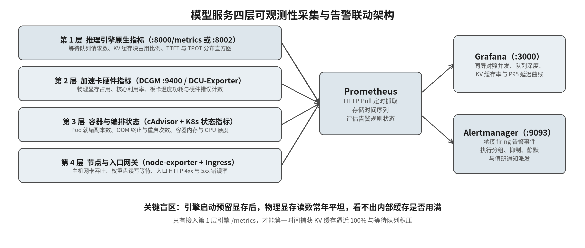
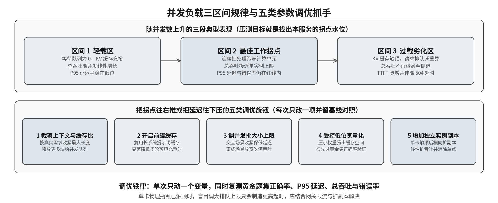
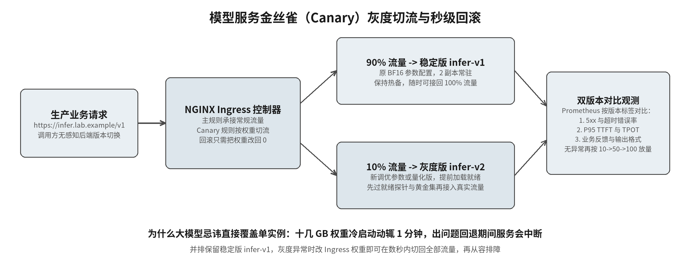
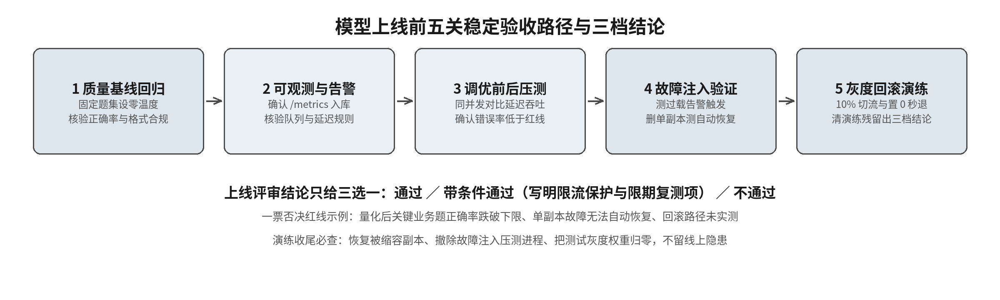

# 第34讲 模型评测与上线运维

**本课程定位：** 本讲是第六章模型推理链（第 30～34 讲）的上线收口课，同时把第四章 Kubernetes 探针与 Ingress、第 24 讲上线检查以及第五章 Prometheus 可观测性串联到一起。模型跑通接口只是具备了候选资格，通过本讲的质量性能双维评测、参数调优、故障注入与灰度回滚演练后，才能正式承载生产流量，并移交第 35 讲算力平台整体交付。

算法团队交来一版 INT4 量化的 `Qwen2.5-7B-Instruct`，说单卡吞吐翻了一倍，催着今晚全量替换 `algo-prod` 命名空间里的线上服务。只听一句“变快了”敢直接全量切流吗？低精度量化有没有把业务抽取准确率压坏？高峰期请求排队有多深？挂掉一个副本能不能自动恢复并触发告警？万一新版本上线后表现反常，能不能在十秒内无损退回旧版本？本讲逐一落实这四个上线前必答问题。

## 本讲学习目标

学完后，你应能：

- 定义并测量模型上线前的输出质量指标（正确性、一致性）与服务工程指标（延迟、吞吐、并发上限、错误率）。
- 将推理引擎原生 `/metrics` 接入 Prometheus 与 Grafana，联合监控显存缓存率、等待队列与分位响应时间。
- 围绕上下文长度、前缀缓存、批处理并发、量化精度与实例副本数开展单变量调优，并量化对比调优前后效果。
- 执行受控过载与单副本故障注入，核验告警触发状态与自动恢复耗时。
- 实施基于权重的金丝雀灰度发布与秒级回滚演练，依据实测证据给出三档上线验收结论。

## 34.1、确定双维评测指标：质量与性能缺一不可

传统 Web 服务升级代码时，接口输入和返回逻辑是确定的；但大模型一旦改动量化精度、切换推理引擎或裁剪最大上下文长度，输出内容本身就可能发生变化。吞吐再高、延迟再低，只要模型开始漏填 JSON 字段或算错金额，放到线上就是业务事故。因此模型上线评测必须同时考核**业务输出质量**与**服务工程性能**两个维度。

### 34.1.1、质量维度：正确性与一致性怎么测

算力运维工程师不需要替代算法工程师设计学术榜单，但必须在上线流程中执行一套固定的**业务黄金验证集**（通常由业务与算法共同沉淀 30～100 道真实代表题，涵盖知识问答、结构化 JSON 提取与边界拒答）：

- **正确性（Accuracy / Pass Rate）：** 将黄金验证集逐题发给待测服务，核对返回内容是否命中标准答案或必含关键事实，计算通过题数占总题数的百分比。量化或换引擎后，正确率相比基线版本跌落超过约定幅度（例如下降超过 `2%`）即触发拦截。
- **一致性与格式合规率（Consistency）：** 把采样参数锁死为确定性解码（`temperature: 0`），对同一批结构化提取请求连续调用多次，检查每次返回结果是否前后一致、JSON 语法能否 100% 解析成功，且不出现乱码或死循环复读。

### 34.1.2、工程维度：延迟、吞吐、并发与错误率红线

在输出质量过关的前提下，结合第 32 讲的延迟拆解与第 24 讲的基线规范，固定输入输出长度测量四项工程指标：

- **分位延迟（P95 TTFT 与 P95 TPOT）：** 生产验收重点盯 P95 或 P99 尾部延迟，防止被平均值掩盖排队毛刺。
- **有效吞吐量（req/s 与 tokens/s）：** 只统计状态码为 `200` 且正常完成的请求产出，超时与报错请求剔除在外。
- **安全并发上限（Max Safe Concurrency）：** 在不突破 P95 延迟上限和错误率红线的前提下，当前部署规模能够持续稳定承载的最大并发请求数。
- **请求错误率（Error Rate）：** 压测周期内 `5xx` 服务端报错与客户端超时请求之和占总请求数的比例。在线生产服务通常要求常规水位下错误率低于 `0.1%`（峰值压测下不高于 `0.5%`）。

表34-1、模型服务上线前双维评测指标与判定方法

| 指标维度 | 指标名称 | 测量条件与统计口径 | 常见上线红线示例 |
| --- | --- | --- | --- |
| 输出质量 | 黄金集正确率 | 固定业务题集、`temperature: 0` 逐题比对关键事实 | 相比原基线下降不超过 2% |
| 输出质量 | 格式与输出一致性 | 同批 JSON 提取题重复运行 3 轮核验可解析率 | JSON 解析成功率 100%，无乱码复读 |
| 工程性能 | 首字与解码分位延迟 | 流式压测统计 TTFT P95 与 TPOT P95 | 在线交互 TTFT P95 小于等于 1.0 秒 |
| 工程性能 | 系统总吞吐量 | 固定并发与输出词元下每秒有效输出词元数 | 达到目标业务峰值预算且留 20% 余量 |
| 可靠稳定 | 安全并发与错误率 | 持续压测 5 分钟以上统计 5xx 加超时占比 | 峰值并发下错误率低于 0.5% |

【关键区别】做量化或引擎升级前后对比时，必须坚持“先过质量题集，再跑性能压测”。如果新量化版本把黄金集正确率从 96% 跌到了 84%，哪怕吞吐高出两倍，也不能直接推向生产，而应回退精度（如从 INT4 退回 INT8/FP8 或保留 BF16 改用扩副本提吞吐）。

## 34.2、建立模型服务可观测性：看清显存缓存与内部队列

第 25 讲部署过主机、容器和加速卡三层 Exporter。但在大模型运维现场，光看显卡物理显存经常会误判病情：vLLM 和 Triton 启动时会按 `gpu-memory-utilization`（如 `0.85`）一次性把物理显存预先圈走作为显存池。从 `nvidia-smi` 或 `DCGM` 看过去，不管有没有用户访问，显存占用永远是一条平直的 `20.5 GB`，根本看不出池子里的 KV Cache 到底空着还是早就塞爆了。



要看透引擎内部真实水位，必须把**推理引擎原生指标端点**（vLLM 默认暴露在 `:8000/metrics`，Triton 默认暴露在 `:8002/metrics`）接入 Prometheus，重点盯住以下四组核心时间序列：

- **运行与等待队列深度：** `vllm:num_requests_running` 表示当前正在显卡上参与连续批处理的请求数；`vllm:num_requests_waiting` 表示因并发槽位或缓存不足而卡在调度器门外排队的请求数（Triton 对应观察 `nv_inference_queue_duration_us` 排队耗时）。空闲或健康状态下等待队列应接近 `0`；一旦持续大于 `0` 且不断爬升，说明请求到达速度已超过引擎消化能力。
- **KV Cache 物理块实际使用率：** `vllm:gpu_cache_usage_perc`（新版引擎亦写作 `vllm:kv_cache_usage_perc`）取值 `0.0～1.0`。当数值逼近 `1.0`（即 100% 占满）时，新请求进不来，正在生成的长请求甚至会被迫触发抢占重算（`vllm:num_preemptions_total` 计数上涨），导致延迟成倍恶化。
- **端内分位响应时间：** `vllm:time_to_first_token_seconds_bucket` 与 `vllm:time_per_output_token_seconds_bucket` 直方图。在 Grafana 中使用 `histogram_quantile(0.95, sum(rate(...[5m])) by (le))` 即可绘出实时 P95 TTFT 与 TPOT 曲线。
- **入口状态码与异常计数：** 结合第 33 讲网关或 Ingress 采集的 HTTP `429`/`502`/`504` 速率，快速分清是客户端请求暴涨还是后端引擎卡死。

表34-2、模型服务核心监控指标与瓶颈判读

| 观测位置 | 监控指标含义 | 异常读数信号 | 指向的根因方向 |
| --- | --- | --- | --- |
| 引擎队列 | 调度器等待请求数 | 持续大于 5 且随时间递增 | 并发超单实例拐点，或长输入堵住预填充 |
| 引擎缓存 | KV 缓存块占用比例 | 持续高于 95% 且抢占计数增加 | 上下文过长或并发过高撑满缓存池 |
| 引擎延迟 | 首字延迟 P95 直方图 | P95 突破 1.5 秒而 TPOT 正常 | 慢在排队等待或长提示词预填充阶段 |
| 加速卡层 | 物理显存与板卡温度 | 温度超 83℃ 降频，或报硬件错误计数 | 机柜散热风道异常或显卡硬件故障 |

**【例题】** 下午业务高峰期，值班面板报出 `infer-svc` 的 P95 TTFT 从 `0.35 s` 飙升至 `5.8 s`。新来的同事登录 `gpu-node-01` 敲了一次 `nvidia-smi`，看到显存固定在 `20600 MiB / 24576 MiB` 没变化、GPU 利用率 `92%`，于是判断“显存还剩近 4 GB，肯定不是显存缓存不够”。你打开 Grafana 看到 `vllm:gpu_cache_usage_perc` 停在 `0.995`、`vllm:num_requests_waiting` 积压了 `31` 条。请指出同事判断错在哪里，并说明真实瓶颈。

**解：** 同事混淆了**进程预留物理显存**与**引擎内部 KV Cache 实际占用率**。那近 4 GB 剩余物理显存是 `--gpu-memory-utilization 0.85` 刻意留给 CUDA 上下文和系统驱动的安全垫，vLLM 不会动用那部分空间。真正分配给 KV Cache 池的显存块已经用到了 `99.5%`，导致后续 31 条请求全部堵在 `waiting` 队列里干等前面的请求释放缓存块，排队时间直接把 P95 TTFT 推高到了 5.8 秒。真实瓶颈正是单实例 KV Cache 并发容量见顶。

## 34.3、参数调优方法：找准并发拐点与五类旋钮

压测一个模型服务时，随着并发数从小到大递增，性能曲线普遍呈现“轻载线性区 → 最佳工作拐点 → 过载劣化区”三段变化。调优的目标不是追求脱离延迟约束的极限数字，而是把最佳工作拐点推高，满足业务峰值并发与延迟红线。



工程调优遵循**“先留基线、单次只改一个参数、改后双测质量与性能”**的纪律，常用五类抓手按风险从低到高排列如下：

1. **按需裁剪最大上下文与调优显存缓存比：** 很多开源模型默认 `max_model_len` 高达 `32768`，而内部问答业务最长只用 `4096`。把 `--max-model-len` 收紧到真实上限（如 `4096`），并在确认无其他进程争抢同卡的前提下把 `--gpu-memory-utilization` 从默认保守值微调至 `0.88～0.90`，能直接扩充可用 KV Cache 块数且无任何精度损失。
2. **开启前缀缓存复用（Prefix Caching）：** 当所有请求都带着同一段上千字的系统角色设定、工具定义或公共知识背景时，开启 `--enable-prefix-caching` 可直接复用公共前缀的 KV Cache 块，省去重复预填充计算，显著压低 TTFT。
3. **调节单步并发序列数与批词元上限：** `--max-num-seqs` 控制单次迭代最多同时解码多少条请求（默认常为 `256` 或 `128`）。在线对话若发现高并发下 TPOT 卡顿，可适当调小（如设为 `32` 或 `64`）并配合网关限流保护在跑用户的吐字速度；离线批处理可以放宽并发与 `--max-num-batched-tokens` 以吃满算力。
4. **切换受控量化权重（BF16 → FP8 / INT8 / INT4）：** 单卡 KV Cache 空间严重不足时，改用 INT8 或 AWQ INT4 量化权重能把 7B 权重体积压小一半到四分之三，释放出大量显存承载并发，但必须重新跑通 34.1 节黄金验证集。
5. **水平扩充独立实例副本数（replicas: 1 → 2+）：** 当单张显卡的算力与显存缓存都已调到拐点上限、队列仍然积压时，不再硬抠单实例参数，而是在 Kubernetes 中增加副本数（配合第 22 讲的节点反亲和规则把副本分散到 `gpu-node-01` 和 `gpu-node-02`），实现总吞吐翻倍与单节点容灾。

表34-3、五类推理调优旋钮的作用方向与副作用对照

| 调优旋钮 | 代表参数或动作 | 主要收益 | 潜在副作用或边界 |
| --- | --- | --- | --- |
| 裁剪长度与缓存比 | 收紧最大上下文、微调显存占比 | 无损增加可用缓存块与并发槽 | 超出裁剪长度的异常长请求会直接返 400 |
| 前缀缓存复用 | 启用 `--enable-prefix-caching` | 同前缀或多轮场景大幅降 TTFT | 每次提示词完全随机无公共前缀时无明显收益 |
| 批处理并发上限 | 调整 `--max-num-seqs` | 平衡单流吐字速度与系统总吞吐 | 设太大拉高 TPOT，设太小提前触发外部排队 |
| 低位宽量化 | 切换 INT8、FP8 或 AWQ INT4 | 大幅省权重显存并加快解码访存 | 复杂推理或严格格式抽取正确率可能下滑 |
| 实例水平扩容 | 增加 Deployment 副本与算力卡 | 线性扩展并发承载力并消除单点 | 成倍消耗算力卡配额，需核对集群空闲卡数 |

【随堂思考】压测单实例 `infer-v1` 发现：16 并发时 P95 TTFT 为 `0.6 s`、错误率 `0%`；升到 32 并发时 KV 缓存率顶满 `100%`、P95 TTFT 涨到 `4.9 s`、超时错误率 `6%`。业务上线硬指标是支撑 30 并发且 P95 TTFT 小于等于 `1.0 s`，此时 `gpu-node-02` 恰好还有一张同款空闲算力卡。在不降低模型精度的前提下，最稳妥的达标动作是什么？

## 34.4、稳定验收：受控故障注入与金丝雀灰度回滚

性能调达标后，上线前还要证明两件事：**出了异常监控真能响、服务真能自愈**；**新版本切流万一不稳，真能秒级退回来**。

### 34.4.1、受控故障注入演练

遵循第 1 讲“授权边界内操作”与第 24 讲恢复验证规范，在上线维护窗口内执行两项受控故障注入：

- **过载积压告警注入：** 用压测工具人为打入超出拐点的并发流量持续 2 分钟，核验 Prometheus 告警规则是否按预期从 `pending` 转为 `firing` 并推送至 Alertmanager，再停止压测观察队列归零与延迟自动回落。
- **单实例故障自愈注入：** 在双副本（`replicas: 2`）部署下，手动删除其中一个 Pod 模拟进程崩溃，同时保持中等并发请求不断流。核验 Kubernetes 就绪探针与 `EndpointSlice` 是否将流量平滑切向存活副本、请求错误率是否受控，并掐表记录新 Pod 从被调度、重新加载十几 GB 模型权重直到重新变为 `Ready` 的完整恢复耗时（RTO）。

### 34.4.2、金丝雀（Canary）灰度发布与秒级回滚

普通几十 MB 的无状态微服务做 `kubectl rollout undo` 只需两三秒；但大模型容器每次启动都要从存储读取十几 GB 权重并初始化显卡上下文，冷启动往往要 30～90 秒。如果线上只有一套 Deployment 直接原地滚动替换，一旦新版本上量后报隐蔽错误，回退重拉期间很容易造成线上拥塞甚至断流。



生产推荐采用**双版本并排部署 ＋ Ingress 权重灰度（Canary）**：

1. 保持线上原稳定版 `infer-v1`（及对应 `infer-v1-svc`、主 Ingress）满血运行不动。
2. 独立创建新版本 `infer-v2`（及 `infer-v2-svc`），等所有副本完全加载好权重、`/health` 就绪并通过黄金集冒烟测试后，创建一条带 `nginx.ingress.kubernetes.io/canary: "true"` 与 `canary-weight: "10"` 注解的金丝雀 Ingress，先分流 **10%** 生产请求试跑。
3. 在 Grafana 同屏对比 `v1` 与 `v2` 的错误率、P95 TTFT/TPOT 及业务侧反馈 15～30 分钟：若各项指标优于或持平基线，按 `10% → 50% → 100%` 阶梯放量；一旦发现异常，**立即将 canary-weight 改为 "0"（或删除金丝雀 Ingress）**，流量在数秒内 100% 切回一直热备的 `infer-v1`，业务几乎零中断。

## 34.5、上机实训：模型服务评测、调优、故障注入与灰度验收

本节在 Kubernetes 集群 `algo-prod` 命名空间（算力节点 `gpu-node-01`、`gpu-node-02`，主入口域名 `https://infer.lab.example/v1`）对 `Qwen2.5-7B-Instruct` 服务执行完整五关验收演练。



### 34.5.1、步骤一：接入 Prometheus 指标与队列告警规则

先验证推理服务的 `/metrics` 端点可正常输出 `vllm:` 指标，再将抓取任务与两条核心告警规则（等待队列积压、P95 首字延迟超限）写入 Prometheus 配置目录并热加载：

```yaml
# File: /etc/prometheus/rules/llm-alerts.yml
groups:
  - name: llm-inference-slo
    rules:
      - alert: LLMRequestQueueBacklog
        expr: max by (namespace, pod) (vllm:num_requests_waiting) > 10
        for: 1m
        labels:
          severity: warning
        annotations:
          summary: "vLLM waiting queue > 10 for 1m"
      - alert: LLMHighTTFTP95
        expr: |
          histogram_quantile(0.95,
            sum by (le, namespace) (rate(vllm:time_to_first_token_seconds_bucket[5m]))
          ) > 1.5
        for: 2m
        labels:
          severity: critical
        annotations:
          summary: "vLLM P95 TTFT > 1.5s for 2m"
```

在监控节点使用 `promtool` 校验规则语法无误后通知 Prometheus 重新加载，并确认抓取目标状态为 `UP`：

```bash
# Validate alert rules and reload Prometheus
promtool check rules /etc/prometheus/rules/llm-alerts.yml
curl -X POST http://127.0.0.1:9090/-/reload
curl -s http://127.0.0.1:9090/api/v1/targets | grep -o '"health":"up"' | head -n 3
```

### 34.5.2、步骤二：质量基线回归与参数调优前后压测对比

在测试机 `~/lab/eval/` 下准备黄金题集校验脚本 `eval_quality.py`（锁死 `temperature: 0` 检查关键事实与 JSON 解析率）以及 `Locust` 压测脚本 `locustfile.py`（模拟携带固定 600 词元系统规范提示词的多用户并发对话）：

```python
# File: ~/lab/eval/locustfile.py
from locust import HttpUser, between, task

SYS_PROMPT = (
    "You are an enterprise compute operations assistant. "
    "Always follow change control, backup before edit, and verify service health. "
) * 12

class InferenceUser(HttpUser):
    wait_time = between(0.1, 0.3)

    @task
    def chat_completion(self):
        payload = {
            "model": "qwen25-7b",
            "messages": [
                {"role": "system", "content": SYS_PROMPT},
                {"role": "user", "content": "Give two steps to check a Linux service failure."},
            ],
            "max_tokens": 96,
            "temperature": 0.0,
        }
        with self.client.post("/v1/chat/completions", json=payload, timeout=15, catch_response=True) as r:
            if r.status_code != 200:
                r.failure(f"HTTP {r.status_code}")
```

先对调优前的默认配置 `infer-v1`（单副本、默认长上下文 `16384`、未开前缀缓存）跑一次 `24` 并发、持续 `60` 秒的无头压测；随后创建调优版本 `infer-v2`（收紧 `--max-model-len 4096`、开启 `--enable-prefix-caching`、双副本跨 `gpu-node-01` 与 `gpu-node-02` 反亲和部署），在跑过黄金集正确率验证后执行同条件复测：

```bash
# Run headless Locust load test (24 concurrent users, 60s) against v1 baseline
/opt/ops/venv/bin/locust -f ~/lab/eval/locustfile.py \
  --headless -u 24 -r 8 -t 60s --host https://infer.lab.example \
  --csv ~/lab/eval/baseline_v1

# After deploying tuned v2 and passing quality check, run identical load test
/opt/ops/venv/bin/locust -f ~/lab/eval/locustfile.py \
  --headless -u 24 -r 8 -t 60s --host https://infer.lab.example \
  --csv ~/lab/eval/tuned_v2
```

下表汇总了一组典型的调优与量化多方案对照实测数据（含同时测试的一版激进 INT4 量化候选方案），直观展示双维指标怎样共同决定取舍：

表34-4、模型服务参数调优与量化候选方案实测对比样例（24 并发，持续 60 秒）

| 候选方案 | 黄金集正确率 | JSON 合规率 | P95 TTFT | 总输出吞吐 | 请求错误率 |
| --- | --- | --- | --- | --- | --- |
| 基线版（1副本 BF16，默认长上下文） | 96.0% | 100% | 2.85 s | 610 tokens/s | 4.2%（超时） |
| 候选甲（1副本 INT4 量化，开前缀缓存） | 88.0% | 92.0% | 0.42 s | 1320 tokens/s | 0.0% |
| 候选乙（2副本 BF16，裁4096+前缀缓存） | 96.0% | 100% | 0.48 s | 1490 tokens/s | 0.0% |

### 34.5.3、步骤三：故障注入验证告警触发与副本自愈

针对选定的双副本候选乙方案，执行两项稳定性验证并记录时间点：

1. **过载告警演练：** 临时用 `-u 80` 高并发压测单副本服务 90 秒，在 Prometheus `/alerts` 接口确认 `LLMRequestQueueBacklog` 由 `pending` 进入 `firing`；停止压测后确认 1 分钟内告警自动解除。
2. **单副本崩溃自愈演练：** 保持 `-u 16` 正常并发流量，手动删除其中一个推理 Pod 并测量新副本恢复就绪耗时：

```bash
# Inject single-pod failure in algo-prod while traffic is running, measure recovery to Ready
TARGET_POD=$(kubectl -n algo-prod get pod -l app=infer,version=v2 -o name | head -n 1)
date -u +"%H:%M:%S inject pod deletion: $TARGET_POD"
kubectl -n algo-prod delete "$TARGET_POD" --wait=false
kubectl -n algo-prod wait --for=condition=Ready pod -l app=infer,version=v2 --timeout=180s
date -u +"%H:%M:%S all replicas Ready again"
```

### 34.5.4、步骤四：执行 10% 金丝雀灰度发布与秒级回滚演练

确认 `infer-v1-svc` 主入口在线稳定后，提交金丝雀 Ingress 清单将 `10%` 流量导入 `infer-v2-svc`，用循环请求核验分流比例；接着模拟灰度应急回退，将权重置为 `"0"` 核验秒级切回，演练完成后清理测试残留：

```yaml
# File: ~/lab/eval/infer-canary-ingress.yaml
apiVersion: networking.k8s.io/v1
kind: Ingress
metadata:
  name: infer-canary
  namespace: algo-prod
  annotations:
    nginx.ingress.kubernetes.io/canary: "true"
    nginx.ingress.kubernetes.io/canary-weight: "10"
    nginx.ingress.kubernetes.io/proxy-buffering: "off"
spec:
  ingressClassName: nginx
  tls:
    - hosts:
        - infer.lab.example
      secretName: infer-tls
  rules:
    - host: infer.lab.example
      http:
        paths:
          - path: /v1
            pathType: Prefix
            backend:
              service:
                name: infer-v2-svc
                port:
                  number: 80
```

在控制节点应用灰度规则、抽样 20 次请求验证约 10% 命中灰度后端，随后执行一条 `annotate` 命令完成秒级零流量回滚：

```bash
# Apply 10% canary traffic split
kubectl apply -f ~/lab/eval/infer-canary-ingress.yaml
kubectl -n algo-prod get ingress

# Emergency rollback drill: set canary-weight to 0 immediately (takes effect in seconds)
kubectl -n algo-prod annotate ingress infer-canary \
  nginx.ingress.kubernetes.io/canary-weight="0" --overwrite

# Clean up canary object after drill or after full cutover to new primary
kubectl -n algo-prod delete ingress infer-canary
```

**【例题】** 结合表 34-4 的三组实测结果，以及上线硬性红线（黄金集正确率下降不超过 `2%`、JSON 合规率 `100%`、24 并发下 P95 TTFT 小于等于 `1.0 s`、错误率小于 `0.5%`），请分别对“候选甲（单卡 INT4 量化）”和“候选乙（双副本 BF16 调优版）”给出上线验收结论并说明理由。

**解：**
- **候选甲判定为“不通过”：** 虽然候选甲延迟低（0.42 s）、单卡吞吐翻倍且无超时报错，但黄金集正确率从 96.0% 大幅跌至 88.0%（跌落 8 个百分点，远超 2% 红线），JSON 合规率也降至 92.0%，上线后会直接导致下游业务解析报错。
- **候选乙判定为“通过”（按 10%→50%→100% 灰度放量上线）：** 候选乙保持 BF16 无损精度，黄金集正确率 96.0% 与 JSON 合规率 100% 全部达标；通过裁剪无用上下文长度、开启公共系统提示词前缀缓存并扩为双副本，24 并发下 P95 TTFT 从 2.85 s 降至 0.48 s，错误率降至 0.0%，且通过了单副本删除自愈与秒级灰度回滚验证。

【随堂思考】如果在步骤三的故障演练中，你为了制造过载临时把服务缩容到了 1 个副本，还加了一条临时压测定时任务，演练通过后直接去写验收报告忘了还原，会埋下什么线上风险？

## 34.6、本讲回顾与自测

学习完本讲后，试着用自己的话回答四个问题：为什么大模型调优或量化后不能只看延迟和吞吐就放行上线？为什么物理显存读数平稳不代表引擎内部 KV Cache 够用？单实例触及并发拐点后有哪些调优手段？为什么大模型服务优先采用并排金丝雀切流而不是直接覆盖单实例？

表34-5、本讲目标与对应判断

| 学习目标 | 应能做出的判断 |
| --- | --- |
| 双维指标评测 | 坚持质量黄金集与工程性能同测，拒绝用牺牲业务正确率换取虚假高吞吐 |
| 四层可观测性 | 接入引擎 `/metrics`，用等待队列和 KV 缓存使用率识别预留显存掩盖下的饱和瓶颈 |
| 受控参数调优 | 单次调整一个变量并留基线对照，按前缀特征、上下文需求与副本数推高安全拐点 |
| 故障注入验证 | 实测过载告警触发及单副本崩溃后的业务切换与模型重载恢复时间 |
| 灰度回滚决策 | 用 Ingress 金丝雀权重小步切流并验证置 0 秒退，清理残留后出具三档结论 |

### 34.6.1、本讲自测

**1 质量回归纪律。** 测试模型量化前后的输出一致性与黄金集正确率时，请求参数中的 `temperature` 应该设为多少？如果不固定这项参数会有什么干扰？

**2 监控指标判读。** Prometheus 中看到 `vllm:num_requests_waiting` 连续 5 分钟大于 `25`，同时 `vllm:gpu_cache_usage_perc` 维持在 `0.99`。请写出这两项指标共同说明的线上状态，以及两条可行的缓解措施。

**3 调优参数匹配。** 某企业内部规章问答机器人，每次请求都附带同一段 2000 词元的制度原文作为系统提示词，用户问题只有二三十个词。开启哪一项 vLLM 调优特性对降低首字延迟（TTFT）最直接有效？为什么？

**4 告警状态机。** 在 34.5.1 节的 `LLMRequestQueueBacklog` 规则中配置了 `for: 1m`。如果某次瞬时流量毛刺让等待队列冲到 `15`，但 20 秒后就降回了 `0`，Alertmanager 会向外发出告警通知吗？为什么这样设计？

**5 灰度回滚优势。** 说明大模型服务采用“保留 `infer-v1` 热备 ＋ Ingress `canary-weight` 灰度切流”相比“单实例原地替换镜像后靠重启回退”的核心优势。

**6 综合上线拍板。** 某次新模型上线验收：质量正确率达标，常规 20 并发下 P95 TTFT 为 `0.7 s`、错误率 `0%`，灰度回滚实测耗时 3 秒；但在 40 并发极限压测下错误率升至 `1.8%`，团队计划三天后补齐第 2 张算力卡扩容，期间先在网关配置 `25` 并发限流保护。请从“通过、带条件通过、不通过”中给出恰当结论，并写明必须附带的限制条件。

**答：**

____________________________

____________________________

____________________________

____________________________

## 34.7、参考答案与解析

### 34.7.1、随堂思考解析

**思考 1（无损满足 30 并发且 P95 TTFT 达标的稳妥动作）：** 单卡 16 并发表现健康（0.6 s），32 并发缓存满载劣化，说明单卡安全拐点在 16～20 并发左右。既然 `gpu-node-02` 有一张同款空闲卡且要求不降精度，最稳妥的组合动作是：**① 先检查并按需收紧 --max-model-len（如有公共系统提示词一并开启 --enable-prefix-caching）；② 将 Deployment 扩容为 replicas: 2 并配置反亲和调度到两台算力节点**。30 路并发均摊到两个独立副本后，每个副本仅承载约 15 并发，稳稳落在单卡轻载安全区内，同时具备单节点容灾能力。

**思考 2（演练后漏清残留的线上风险）：** 一是服务只剩单副本裸跑，丧失高可用冗余，夜间任一进程异常就会直接造成生产中断；二是未撤除的定时压测脚本会白白抢占线上真实用户的 KV Cache 与算力，触发虚假告警甚至把正常业务拖超时。所有故障注入与压测演练结束前，必须按核对单逐项还原副本数、摘除演练脚本与临时灰度规则。

### 34.7.2、课后自测解析

**1** 应设为 **temperature: 0**（贪婪确定性解码）。如果不固定而保留较高的随机采样温度（如 `0.7` 或 `0.8`），即使模型完全没改，同一次提问跑两遍也会抽到不同词元，无法分清某道题答错到底是量化引入的能力退化，还是随机采样碰巧抽偏了。

**2** 说明当前推理实例的 **KV Cache 显存块已接近 100% 耗尽，新到达请求无法进入批处理，已在调度器门外形成严重排队积压**。可行缓解措施：① 短期配置网关限流（返回受控 `429` 防止雪崩）或横向增加推理 Pod 副本分摊并发；② 参数层按实际业务调小 `--max-model-len`、开启 `--enable-prefix-caching`，或在验证正确率达标后采用 INT8/FP8 量化腾出缓存空间。

**3** 开启**前缀缓存（--enable-prefix-caching）**最直接有效。因为所有请求的头 2000 个词元完全相同，开启后引擎只需在首次请求时算一遍这 2000 词元的 KV Cache 块并驻留复用，后续请求只需计算末尾二三十词的用户新问题，可省掉绝大部分预填充计算耗时。

**4** **不会**向 Alertmanager 发出通知。回引第 25 讲告警状态机：表达式刚成立时规则先进入 `pending` 观察态，必须持续满足条件满 `for: 1m`（60 秒）才会转为 `firing` 并推送。20 秒毛刺自动恢复会直接退回正常态，这样设计正是为了过滤偶发瞬时抖动，避免值班人员被无效闪断告警淹没。

**5** 大模型权重动辄十几到几十 GB，容器重建加权重读盘与显存初始化通常需要几十秒甚至数分钟。单实例原地替换失败再回退期间，线上没有可用就绪副本；而并排保留 `infer-v1` 热备并通过 Ingress 权重切流，一旦 `infer-v2` 灰度表现异常，改回 `canary-weight: "0"` 仅修改网关转发比例，数秒内即可把 100% 流量无损切回已就绪的 `infer-v1`。

**6** 应给出**带条件通过**。必须书面附带三条约束条件：① 上线前在模型网关启用硬性并发/速率限流（单实例并发控制在安全水位 `25` 以内），防止突发 40 并发打穿错误率红线；② 保持队列积压与 P95 延迟告警在线生效；③ 明确责任人与期限（三天内完成第 2 张算力卡扩容并复测 40 并发达标后转为完全通过）。

## 34.8、术语

表34-6、本讲术语

| 术语 | 本讲中的含义 |
| --- | --- |
| 黄金验证集 | 由典型业务问答、结构化抽取与边界题目组成的固定评测集，用于核验模型变更后是否掉精度。 |
| 前缀缓存 | 推理引擎缓存并复用多条请求公共开头提示词 KV Cache 块的特性，用于加速预填充阶段。 |
| 性能拐点 | 随并发增加，系统总吞吐接近饱和上限且分位延迟尚未急剧恶化的最佳承载水位。 |
| 故障注入 | 在受控窗口内主动制造过载、超时或终止单副本，用于实测告警灵敏度与自动自愈能力。 |
| 金丝雀发布 | 并排保留稳定版服务，先将小比例（如 10%）真实流量切入新版本观察指标，稳妥后再逐步放量。 |

## 附录、模型服务上线前评测与稳定验收单

表34-7、模型服务上线前评测与稳定验收单（脱敏模板）

| 验收关卡 | 核验内容与测试条件 | 实测结果摘要 | 关卡结论 |
| --- | --- | --- | --- |
| 变更基础信息 | 工单 `OPS-3405`，命名空间 `algo-prod`，镜像版本 `v0.6.3` | 双副本跨节点反亲和就绪 | 通过 |
| 质量基线回归 | 50 题黄金集，`temperature: 0` | 正确率 `96.0%`，JSON 解析 `100%` | 通过 |
| 可观测与告警 | Prometheus 抓取 `:8000/metrics` 及两条规则校验 | Target `UP`，过载 1 分钟正常转 `firing` | 通过 |
| 调优前后压测 | Locust 24 并发持续 60 秒对比基线 | P95 TTFT `0.48 s`，错误率 `0.0%` | 通过 |
| 故障自愈演练 | 流量下删除单副本，测量业务切换与重载时间 | 存活副本接管无报错，新副本 `48 s` 恢复就绪 | 通过 |
| 灰度回滚与清场 | Ingress 10% 切流验证后执行权重置 0 秒退 | `3 s` 内切回稳定版，演练残留已全部清理 | 通过 |
| 综合评审意见 | 通过 ／ 带条件通过 ／ 不通过（三选一） | **通过**（准予按 10%-50%-100% 灰度放量） | 已签字 |

文中集群域名（`infer.lab.example`）、命名空间、阈值数字与工单号均为教学示例，生产上线红线须以本单位业务等级协议（SLA）为准。

<!-- md-only -->

## 附：主要参考资料（仅 Markdown 保留，不印入 Word/PDF）

- 中国信通服务《2025 算力运维体系技术白皮书》（本地 PDF `./资料/中国信通服务：2025算力运维体系技术白皮书-71页.pdf`），第 22～23 页金丝雀/灰度策略（先覆盖 10% 用户监控响应时间与错误率）、AI 推理时延监控与故障分级响应，以及第 54 页可用性、响应性、保障性评价指标体系。
- vLLM 官方文档（Production Metrics、Prefix Caching、Engine Arguments Tuning 与 Kubernetes Deployment 指南）。
- Prometheus 官方文档（Histogram & `histogram_quantile`、Alerting Rules `pending`/`firing` 生命周期与 `promtool` 校验规范）。
- Kubernetes NGINX Ingress Controller 官方文档（Canary Annotations `canary-weight` 与 `proxy-buffering` 流式配置指南）。
- Locust 官方文档（Headless Load Testing 与 Custom `HttpUser` 脚本编写指南）。

<!-- /md-only -->
