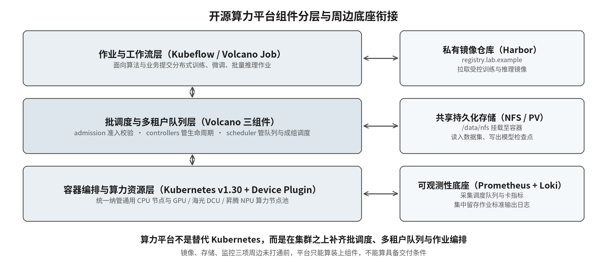
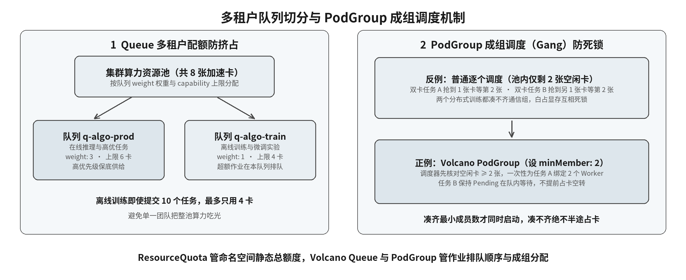
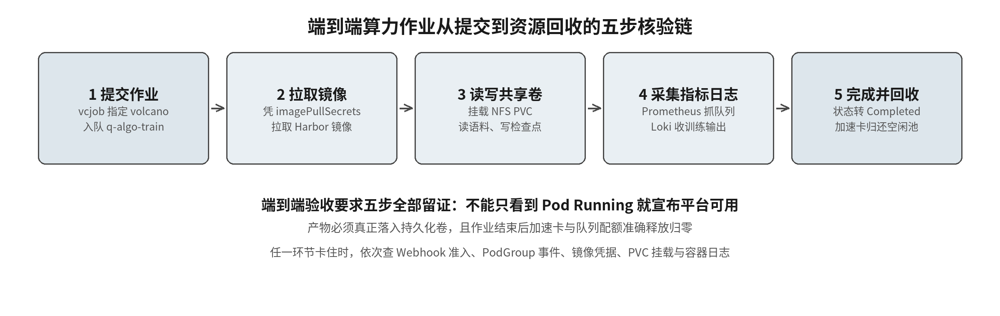
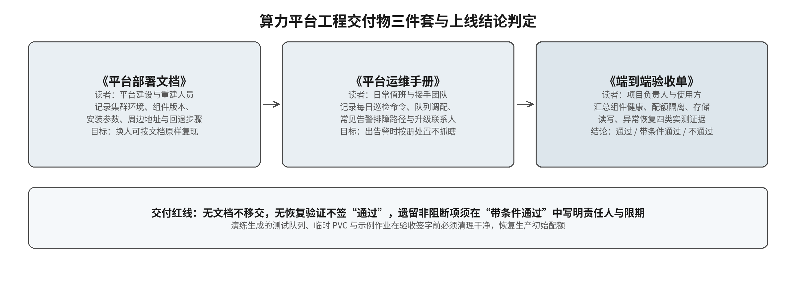

# 第35讲 算力平台部署与交付

**本课程定位：** 本讲是第六章“AI 模型与算力”的收官讲。前几讲依次解决了算力卡入池（第 28 讲）、排队调度（第 29 讲）与模型服务评测（第 30～34 讲）。到了真实项目现场，算法团队需要的不是零散命令，而是一套权限清楚、存储互通、监控到位的算力平台。本讲把这些环节串成一次完整的平台部署与工程交付。

新集群刚装好加速卡驱动和 Kubernetes v1.30。项目经理问你四件事：开源算力平台装哪套组件最合适？训练组和推理组怎么分队列才不会抢死？训练数据从哪里读、日志去哪里查？移交给值班组时要交哪几份文档？本讲逐一走通这四件事。

## 本讲学习目标

学完后，你应能：

- 说清 Volcano 与 Kubeflow 在 Kubernetes 之上的分层定位，不把平台等同于底层集群。
- 部署 Volcano 核心组件，配置多租户队列（Queue）、容量上限与成组调度（PodGroup）。
- 把私有镜像仓库、NFS 共享存储和 Prometheus、Loki 可观测底座接入算力作业链路。
- 提交一个端到端作业，按“入队—拉镜像—读写卷—查指标日志—释放资源”五步完成验收。
- 编写《平台部署文档》《平台运维手册》与《端到端验收单》，按证据给出三档验收结论。

## 35.1、算力平台要解决什么问题

只有原生 Kubernetes 时，算法人员每次跑分布式训练都要手写 Pod 清单、挂载卷和通信变量。原生默认调度器按单个 Pod 逐个找节点。遇到多机协同作业时，很容易出现“甲占一半卡等另一半，乙占另一半卡等甲释放”的死锁。

算力平台在 Kubernetes 与加速卡插件之上，补齐了**批作业调度、多租户队列、工作流编排与周边衔接**。运维交付算力平台，就是把零散硬件组装成可自助提任务、可管配额、可查监控的生产环境。



### 35.1.1、主流开源组件定位对比

常见开源方案不是非此即彼的互斥关系，而是按职责分层组合。超算中心偏重裸机并行队列，常用 Slurm。云原生智算中心基于 Kubernetes 构建，常以 Volcano 管底层批调度，再按需叠加 Kubeflow 提供上层开发界面与流水线。

表35-1、三类常见开源算力调度与平台组件对比

| 组件与所在层次 | 核心解决的问题 | 典型适用场景 |
| --- | --- | --- |
| Volcano（K8s 批调度层） | 补齐队列权重、成组调度（Gang）与作业生命周期管理 | 多团队共享 K8s 算力池跑分布式训练与批推理 |
| Kubeflow（AI 工作流层） | 提供交互式 Notebook、PyTorchJob 算子与训练流水线 | 需要统一开发入口与机器学习流水线的团队 |
| Slurm（Linux 裸机队列） | 不经容器编排，直接在节点分配 CPU/GPU 并拉起 MPI 任务 | 传统高性能科学计算（HPC）与纯裸机预训练 |

【关键区别】“装好 Kubernetes 和 Device Plugin”只代表集群认识了加速卡。“交付算力平台”还必须配齐多租户队列、共享存储、受控镜像、监控日志以及可交接的运维手册。

【随堂思考】某团队只有 4 台带卡服务器，核心需求是让两个小组按配额排队跑容器化 PyTorch 脚本，暂不需要网页端流水线。优先先装 Volcano 还是整套 Kubeflow？为什么？

## 35.2、部署算力平台与配置调度

本讲以云原生智算最常用的轻量组合——**Kubernetes v1.30 + Volcano** 为实操主线。上层若后续接入 Kubeflow 训练算子，同样可以把底层成组调度交给 Volcano。动手安装前，先核对底层四项前置条件。

表35-2、算力平台安装前四项环境核查清单

| 核查维度 | 检查命令或位置 | 通过判据 |
| --- | --- | --- |
| 集群控制面 | `kubectl get nodes` 与 `kube-system` 核心 Pod | 控制面 `k8s-cp-01` 与工作节点全部 `Ready`，CoreDNS 运行正常 |
| 算力卡资源 | `kubectl describe node gpu-node-01` 查看 `Allocatable` | 加速卡数量大于 0（如 `nvidia.com/gpu` 或 `hygon.com/dcu`）；无卡实验机注明走 CPU 队列 |
| 持久化存储 | `kubectl get pv,sc` 或核验 NFS 导出目录 `/data/nfs` | 存在可用 StorageClass 或静态 PV，工作节点已装 `nfs-common` 客户端 |
| 镜像与时间 | 各节点测 `registry.lab.example` 连通性与 `chronyc sources` | 私有仓库 HTTPS 可达，全集群节点时钟偏差小于 1 秒 |

### 35.2.1、Volcano 三大核心组件

Volcano 默认装在独立的 `volcano-system` 命名空间，由三个分工明确的组件配合运行：

- **准入控制（volcano-admission）**：通过 Webhook 拦截校验新提交的作业与队列，并自动补齐缺省值。准入组件未就绪或证书异常时，`kubectl apply` 会直接报连接拒绝。
- **控制器（volcano-controllers）**：持续监听 `Job`、`Queue` 与 `PodGroup` 资源。它按模板创建 Pod，并根据容器退出码更新作业完成或重试状态。
- **批调度器（volcano-scheduler）**：接管声明了 `schedulerName: volcano` 的 Pod。它综合队列权重、容量上限和最小成员数，一次性做出节点绑定决策。

### 35.2.2、多租户队列与成组调度配置

第 18 讲的 `ResourceQuota` 管命名空间的静态资源总账。第 29 讲引入的 Volcano `Queue` 管多团队作业在算力紧缺时的**排队顺序与硬性上限**。平台交付时把两者结合：一个团队对应一个命名空间（如 `algo-train`），并绑定专属队列（如 `q-algo-train`）。



配置调度时重点把握三个参数：

1. **队列权重（weight）**：决定空闲算力按什么比例分给不同队列。`q-algo-prod` 设权重 `3`、`q-algo-train` 设权重 `1` 时，争抢空闲资源按 3:1 倾向生产队列。
2. **队列容量上限（capability）**：规定队列最多能用多少 CPU、内存和加速卡。达到 `capability` 上限后，即使集群还有空闲卡，队列内新作业也必须排队。
3. **成组调度最小成员数（minAvailable / minMember）**：分布式训练要求多个 Worker 同时建立集合通信（如 NCCL 或 RCCL）。把双机训练的 `minAvailable` 设为 `2`，凑够 2 份算力才同时绑定。只剩 1 份算力时整组留在队列等待，避免半途占卡死锁。

【例题】集群算力池共有 8 张同型号加速卡。在线队列 `q-algo-prod` 设 `weight: 3`、上限 6 卡；离线队列 `q-algo-train` 设 `weight: 1`、上限 4 卡。当前 `q-algo-prod` 已占 6 卡，池内剩 2 张空闲卡。离线组连续提交甲、乙两个双卡微调作业（均配 2 副本、`minAvailable: 2`、每副本 1 卡）。判断甲、乙两个作业的状态。

解：先算可用余量。集群剩 `8 - 6 = 2` 张卡，`q-algo-train` 已用 0 卡，未超 4 卡上限，当前最多可拿 2 张卡。甲作业需要 2 张卡，满足 `minAvailable: 2`，2 个 Pod 同时被绑定运行，占满剩余 2 张卡。轮到乙作业时，空闲卡变为 0 张，凑不齐 2 张卡。乙作业的 `PodGroup` 保持等待状态，不会提前占卡空转。

## 35.3、接入周边底座：镜像、存储与可观测

平台组件跑起来只是第一步。算力作业要跑通代码、存下模型、看清状态，还必须接通三项周边底座。



### 35.3.1、镜像仓库与拉取凭据接入

训练与推理镜像动辄数 GB。生产环境严禁节点直接去公网拉取浮动标签镜像，统一从内网 Harbor 仓库 `registry.lab.example` 拉取固定版本或带 `sha256` 摘要的受控镜像。

交付新租户命名空间时，先用 Harbor 只读机器人账号创建 Secret（如 `harbor-regcred`）。随后把拉取凭据绑到命名空间的运行 `ServiceAccount`（如 `ai-runner`），免去算法人员在每份 YAML 里手写密码。

### 35.3.2、共享存储卷接入与权限核对

分布式训练的多个 Worker 要读同一份语料，还要把检查点（Checkpoint）写回共享目录。平台结合第 21 讲的 NFS（导出目录 `/data/nfs`）提供 `ReadWriteMany` 持久卷声明 `algo-shared-pvc`。

接入时必须对齐容器运行 UID 与 NFS 目录权限。NFS 默认开启 `root_squash`，会把容器内 UID 0 映射成匿名账号 `65534`，导致写文件报 `Permission denied`。交付时应按租户组规划目录数字属主（如 `1000:1000`），并在作业 `securityContext` 中显式指定。

### 35.3.3、监控与日志底座接入

平台可观测性分两层核验：

- **调度与资源指标（Prometheus + Grafana）**：确认 Prometheus 已抓取 `volcano-scheduler` 和 `volcano-controllers` 的 `:8080/metrics` 端点。面板需能查到队列等待作业数，并与第 25 讲的主机、容器、加速卡指标联动展示。
- **作业控制台日志（Loki）**：训练 Pod 退出后可能被自动清理。平台须把容器标准输出实时采入 Loki（`:3100`），用流选择器 `{namespace="algo-train"}` 即可回查损失值变化与报错堆栈。

【随堂思考】算法同事反馈：“我的训练作业跑了 2 小时显示 `Completed`，但去 NFS 共享目录里找不到保存的模型权重文件。”不看代码逻辑前，从存储挂载角度你最先核对哪两件事？

## 35.4、上机实训：部署 Volcano 平台并跑通端到端作业

本实训在已就绪的 Kubernetes v1.30 集群控制面主机 `k8s-cp-01`（`opsadmin` 账号）上独立完成。无物理加速卡的学员机可直接按下方默认 CPU/内存配额完整跑通调度、队列、共享存储落盘与资源回收全链路；具备 GPU 或海光 DCU 节点的环境，只需取消注释清单中对应的加速卡资源行。

### 35.4.1、步骤一：部署 Volcano 并核验平台核心组件

在 `k8s-cp-01`（`opsadmin` 账号）创建工作目录，应用 Volcano v1.9.0 发行清单（内网环境事先把清单内镜像地址替换为 `registry.lab.example/platform/` 同步镜像），并等待核心组件就绪：

```bash
mkdir -p ~/lab/l35-platform && cd ~/lab/l35-platform
kubectl apply -f volcano-v1.9.0.yaml
kubectl wait --for=condition=Ready pod --all -n volcano-system --timeout=180s
kubectl get pods -n volcano-system
```

预期看到三组核心 Pod 均为 `1/1 Running`：

```text
NAME                                   READY   STATUS    RESTARTS   AGE
volcano-admission-6b8d7f9c5d-x4k2p     1/1     Running   0          65s
volcano-controllers-59c7b8d47-m9n3q    1/1     Running   0          65s
volcano-scheduler-7f69c48d9b-r2t8w     1/1     Running   0          65s
```

再确认自定义资源定义（CRD）与默认队列已经注册成功：

```bash
kubectl get crd queues.scheduling.volcano.sh jobs.batch.volcano.sh podgroups.scheduling.volcano.sh
kubectl get queue
```

### 35.4.2、步骤二：创建多租户命名空间、共享存储与受限队列

创建离线训练命名空间 `algo-train`，绑定总配额、共享持久卷声明 `algo-shared-pvc`（对接第 21 讲准备好的 `/data/nfs` 静态 PV）以及容量受控的 `q-algo-train` 队列。有 GPU 节点的环境可在 `ResourceQuota` 与 `Queue` 中一并追加 `nvidia.com/gpu: "2"`（海光节点写 `hygon.com/dcu: "2"`）：

```bash
cat <<'EOF' > ~/lab/l35-platform/tenant-setup.yaml
apiVersion: v1
kind: Namespace
metadata:
  name: algo-train
---
apiVersion: v1
kind: ResourceQuota
metadata:
  name: algo-train-quota
  namespace: algo-train
spec:
  hard:
    requests.cpu: "4"
    requests.memory: 8Gi
    limits.cpu: "4"
    limits.memory: 8Gi
---
apiVersion: v1
kind: PersistentVolumeClaim
metadata:
  name: algo-shared-pvc
  namespace: algo-train
spec:
  accessModes:
    - ReadWriteMany
  resources:
    requests:
      storage: 5Gi
---
apiVersion: scheduling.volcano.sh/v1beta1
kind: Queue
metadata:
  name: q-algo-train
spec:
  weight: 1
  reclaimable: true
  capability:
    cpu: "4"
    memory: 8Gi
EOF

kubectl apply -f ~/lab/l35-platform/tenant-setup.yaml
kubectl get queue q-algo-train
kubectl get resourcequota,pvc -n algo-train
```

核验点：`q-algo-train` 的 `STATE` 列必须为 `Open`，`algo-shared-pvc` 的 `STATUS` 列必须为 `Bound`。若 PVC 停留在 `Pending`，须先按第 21 讲检查对应 5Gi `ReadWriteMany` 的 PV 是否可用，修好前不要往下提交作业。

### 35.4.3、步骤三：提交端到端成组作业并验证存储落盘

编写一份含 2 个协同 Worker 的 Volcano `Job`（`vcjob`），显式指定 `schedulerName: volcano`、归属队列 `q-algo-train` 与 `minAvailable: 2`。私有仓库开启鉴权时在 Pod `spec` 下补上 `imagePullSecrets: [{name: harbor-regcred}]`；有加速卡时在 `requests` 和 `limits` 中同时写入整数卡数（如 `nvidia.com/gpu: "1"`）：

```bash
cat <<'EOF' > ~/lab/l35-platform/demo-vcjob.yaml
apiVersion: batch.volcano.sh/v1alpha1
kind: Job
metadata:
  name: train-check-01
  namespace: algo-train
spec:
  minAvailable: 2
  schedulerName: volcano
  queue: q-algo-train
  policies:
    - event: PodEvicted
      action: RestartJob
  tasks:
    - replicas: 2
      name: worker
      template:
        spec:
          restartPolicy: Never
          securityContext:
            runAsUser: 1000
            runAsGroup: 1000
          containers:
            - name: trainer
              image: registry.lab.example/lab/python-runner:3.11-slim
              command:
                - /bin/sh
                - -c
                - |
                  set -eu
                  OUT_DIR="/workspace/output/train-check-01"
                  mkdir -p "${OUT_DIR}"
                  echo "worker=$(hostname) start_at=$(date -Iseconds)"
                  sleep 10
                  echo "{\"worker\":\"$(hostname)\",\"loss\":0.184,\"status\":\"ok\"}" \
                    > "${OUT_DIR}/$(hostname)-metrics.json"
                  ls -lh "${OUT_DIR}"
              resources:
                requests:
                  cpu: "1"
                  memory: "1Gi"
                limits:
                  cpu: "1"
                  memory: "1Gi"
              volumeMounts:
                - name: shared-data
                  mountPath: /workspace
          volumes:
            - name: shared-data
              persistentVolumeClaim:
                claimName: algo-shared-pvc
EOF

kubectl apply -f ~/lab/l35-platform/demo-vcjob.yaml
```

> 说明：若本机实验集群尚未向 `registry.lab.example` 推送 `python-runner:3.11-slim`，实训中可把镜像替换为节点已缓存的 `busybox`。Shell 验证命令保持不变，并在《部署文档》中如实记录镜像名与摘要。

### 35.4.4、步骤四：五步观测验收与资源回收确认

作业提交后，依次查作业与 `PodGroup` 状态、Worker 退出状态、标准输出日志、NFS 落盘文件以及队列已分配配额回收情况：

```bash
kubectl get vcjob,podgroup -n algo-train
kubectl get pods -n algo-train -o wide
kubectl logs -n algo-train -l volcano.sh/job-name=train-check-01
ls -lh /data/nfs/output/train-check-01/
kubectl describe queue q-algo-train | grep -A 6 "Allocated"
kubectl describe resourcequota algo-train-quota -n algo-train
```

通过判据：`vcjob` 最终状态为 `Completed`。共享存储目录下准确生成 2 个 Worker 的 `-metrics.json` 文件且内容非空。作业结束后，`q-algo-train` 的 `Allocated` 与 `ResourceQuota` 的 `Used` 均回落至 `0`（持久卷容量除外）。

### 35.4.5、常见平台故障排查与实验清理

作业未按预期完成时，不要盲目重装平台，按以下分层顺序定位：

表35-3、算力平台端到端验收常见异常与排查路径

| 异常类别 | 典型现场表现 | 定位命令与常见根因 |
| --- | --- | --- |
| 准入校验报错 | 提交时报 Webhook 连接拒绝 | `kubectl get pods,ep -n volcano-system`，常见为 `volcano-admission` 未 Ready 或证书缺失 |
| 作业长期排队 | 状态停在 `Pending` 或 `Inqueue` | `kubectl describe podgroup -n algo-train`，常见为队列未 `Open`、超 `capability` 或凑不齐 `minAvailable` |
| 容器创建卡住 | 状态停在 `ContainerCreating` | `kubectl describe pod` 看 Events，常见为节点缺 `nfs-common`、NFS 不通或缺 `imagePullSecrets` |
| 目录写入被拒 | 日志报 `Permission denied` | 核对容器 `runAsUser`（如 `1000`）对 NFS 子目录写权限，排查 NFS 默认 root 匿名映射限制 |
| 算力卡未释放 | 主进程结束但队列额度不归零 | 查是否有未退出的边车容器使 Pod 未进入 `Completed`，或节点 `hy-smi`/`nvidia-smi` 残留僵死进程 |

完成实训取证后，删除本次验收测试作业（保留 `volcano-system` 与 `algo-train` 供日常使用；若需整套回退，按逆序再执行后两条命令依次删除租户对象与平台组件）：

```bash
kubectl delete -f ~/lab/l35-platform/demo-vcjob.yaml
# Optional full rollback in reverse order:
# kubectl delete -f ~/lab/l35-platform/tenant-setup.yaml
# kubectl delete -f ~/lab/l35-platform/volcano-v1.9.0.yaml
```

## 35.5、编写交付物与上线移交验收

运维工程里，“我自己敲命令跑通了”只算做完一半。搭建人员一旦休假或转岗，没有文档的平台就会变成没人敢动的黑盒。算力平台正式移交时，必须同步交付三份核心文档。



表35-4、算力平台工程移交三份核心交付物要素清单

| 交付物名称 | 目标读者 | 必须写清的核心内容 | 验收合格标准 |
| --- | --- | --- | --- |
| 平台部署文档 | 平台建设与灾备重建工程师 | 节点 IP 与硬件基线、K8s 与驱动版本、Volcano 版本与镜像摘要、周边仓库/NFS/监控地址、安装命令与完整回退步骤 | 另一名工程师在同规格空白集群上按文档可独立复现，无需口头追问隐藏参数 |
| 平台运维手册 | 日常值班与一线运维团队 | 每日健康巡检命令、新增租户队列与配额调整步骤、常见告警（排队积压、掉卡、存储满）处置路径、升级联系人 | 值班人员面对常规队列调整与常见报错，能按手册定位处理且不越权误删数据 |
| 端到端验收单 | 项目负责人、安全与使用方代表 | 组件就绪截图或命令输出、多队列上限拦截实测、分布式作业读写共享卷证据、异常重启恢复记录、遗留问题与最终结论 | 每项检查均有带时间戳的命令输出支撑，明确勾选“通过 / 带条件通过 / 不通过” |

### 35.5.1、严格把关三档验收结论

延续第 24 讲确立的验收口径，平台验收单最终只能给出以下三种结论之一：

- **通过**：核心组件、多租户配额、镜像与共享存储读写、监控日志采集全部实测达标。部署文档与运维手册齐全，演练残留已清理完毕。
- **带条件通过**：核心调度与作业链路正常，仅剩不影响数据安全与租户隔离的次要瑕疵（如某张次级统计图待美化）。验收单必须写明**遗留项、责任人、临时应对办法与整改期限**。
- **不通过**：出现多租户配额失效、训练产物无法落盘、掉卡无感知或缺失部署与回退文档等任一核心缺陷，一律判定“不通过”。修复复测合格前，严禁开放生产使用。

【例题】某智算平台已跑通双机训练并写入 NFS。验收抽查发现两处问题：① Prometheus 未接入 `volcano-scheduler` 指标，值班员看不到队列积压告警；② 运维只交了一份历史命令截图，没有写回退步骤，也没有《平台运维手册》。此时应给出哪一档结论？说明理由。

解：应判定为**不通过**。第一，缺少调度器核心监控会导致生产队列死锁或积压时值班侧毫无感知。第二，截图不能替代包含版本基线、回退步骤和排障规程的《部署文档》与《运维手册》，值班接手后遇到准入故障将无法安全处置。必须补齐指标抓取、验证积压告警并提交正式文档后，再重新复测验收。

【关键区别】验收演练创建的测试队列、压测作业和临时目录，在签字移交前必须逐一清理。复查 `kubectl get vcjob -A` 与队列已用配额归零，不能把测试残留留在准生产集群里。

## 35.6、本讲回顾与自测

学习完本讲后，试着用自己的话回答五个问题：为什么有了 Kubernetes 还要装算力调度平台？Volcano 的三个组件各管哪一环？`Queue` 和 `PodGroup` 分别防什么故障？周边哪三样底座必须接通？移交平台要交哪三份文档？

表35-5、本讲目标与对应判断

| 学习目标 | 应能做出的判断 |
| --- | --- |
| 区分平台层次 | 分清 Kubernetes、Volcano、Kubeflow 与 Slurm 的职责边界，按团队规模与场景选型 |
| 配置批调度 | 检查 Volcano 三组件健康状态，用 `Queue` 控团队上限、用 `PodGroup` 防分布式训练死锁 |
| 联动周边底座 | 打通私有 Harbor 拉取凭据、NFS 多节点共享卷 UID 权限以及 Prometheus/Loki 指标日志 |
| 端到端排障验收 | 按“准入—排队—挂载—落盘—回收”五步取证，不在只看到 `Pod Running` 时草率签字 |
| 交付三件套 | 产出可复现的《部署文档》、可值班的《运维手册》与证据完整的三档结论《验收单》 |

### 35.6.1、本讲自测

**1 组件定位。** 执行 `kubectl apply -f demo-vcjob.yaml` 时终端立刻报错：`failed calling webhook "validatejob.volcano.sh": connect: connection refused`。最先去查 `volcano-system` 命名空间里的哪个组件？

**2 成组调度。** 算力池当前仅剩 1 张空闲 GPU。算法工程师提交了一个 4 卡分布式训练 Volcano Job（4 个 Worker，每个申请 1 张 GPU，`minAvailable: 4`）。此时这 4 个 Worker Pod 会占用那 1 张空闲 GPU 吗？为什么？

**3 配额协同。** 为什么在多租户算力平台里，既要给命名空间配 `ResourceQuota`，又要配 Volcano `Queue` 的 `weight` 和 `capability`？

**4 存储权限。** 训练作业以 `runAsUser: 0` 运行并挂载开启了默认 `root_squash` 的 NFS 共享卷，保存模型检查点时报 `Permission denied`。请说出原因与合规改法（不准直接把 NFS 改成全网不限权裸奔）。

**5 验收清理。** 端到端作业跑完变成 `Completed` 后，除了查看共享目录里有输出文件，为什么还必须执行 `kubectl describe queue` 检查 `Allocated` 字段？

**6 交付判断。** 同事把装平台的 `.sh` 脚本发到群里说：“脚本跑通了，平台交付完毕。”对照本讲要求，指出至少三项缺失的交付要素。

**答：**

____________________________

____________________________

____________________________

____________________________

## 35.7、参考答案与解析

### 35.7.1、随堂思考解析

**思考 1（先装 Volcano 还是整套 Kubeflow）：** 优先部署轻量的 Volcano。4 台带卡机器的核心需求是配额排队与多卡成组调度。Volcano 只有三个核心组件，资源开销小，足够承载容器化 PyTorch 批作业。整套 Kubeflow 含数十个微服务，暂不需要网页流水线时维护成本太高，后续可按需叠加。

**思考 2（显示 Completed 却找不到模型权重）：** 最先核对两处。第一，核对代码实际写出的容器内路径（如 `/tmp/output`）是否落在 `volumeMounts` 挂载目录（如 `/workspace`）下。写进容器可写层的文件，在容器退出后不会出现在共享盘上。第二，核对 PVC 是否真的绑到了预期的 NFS 导出卷，而不是节点本地 `emptyDir`。

### 35.7.2、课后自测解析

**1** 最先查 `volcano-admission`、对应 Service 的 EndpointSlice 就绪后端，以及 Webhook TLS 证书 Secret。它是负责准入校验的组件，未就绪时会直接拦截提交请求。

**2** 不会占用。`minAvailable: 4` 要求池内至少凑齐 4 个成员的资源才整组绑定。仅剩 1 张空闲 GPU 时不满足门槛，整组 `PodGroup` 留在队列等待，那 1 张空闲卡仍可分给单卡小作业。

**3** `ResourceQuota` 是 Kubernetes 命名空间的静态硬账本，防止命名空间内所有 Deployment、调试 Pod 越界。Volcano `Queue` 管批处理作业争抢资源时的排队顺序、`weight` 比例分配与 `capability` 并发上限。两者配合才能同时管住静态总额与动态排队秩序。

**4** 原因是 NFS 默认启用 `root_squash`，把容器内 UID 0 的写请求映射成了无写权限的匿名账号（`65534`）。合规改法是在 NFS 服务端把导出子目录属主设为非特权数字 UID/GID（如 `chown 1000:1000`、权限 `0775`），并在 Pod 的 `securityContext` 中指定 `runAsUser: 1000`、`runAsGroup: 1000`，严禁盲目开启 `no_root_squash`。

**5** 为了确认算力资源已经准确回收。若带有未退出的辅助容器或节点驱动层进程僵死，主任务看似跑完，加速卡与队列额度仍可能被死占，导致后续排队作业一直拿不到卡。

**6** 至少缺失三项。一是《平台部署文档》，缺少环境基线、镜像摘要、周边参数和失败回退步骤。二是《平台运维手册》，缺少日常巡检命令、队列调整流程与告警排障路径。三是《端到端验收单》，缺少配额拦截、存储读写、监控联动和残留清理的实测证据及三档结论。

## 35.8、术语与疑问

表35-6、本讲术语

| 术语 | 本讲中的含义 |
| --- | --- |
| 算力平台 | 架设在集群与硬件之上，统一提供多租户配额队列、分布式作业调度、开发工作流及存储监控衔接的系统层。 |
| Volcano | 面向 Kubernetes 的开源云原生批调度系统，核心提供队列管理、优先级与成组调度能力。 |
| Kubeflow | 面向 Kubernetes 的开源机器学习平台套件，涵盖交互式开发、分布式训练算子与流水线编排。 |
| Queue | Volcano 中的队列对象，通过 `weight`（相对权重）与 `capability`（资源上限）划分多租户算力配额。 |
| PodGroup | 成组调度的最小协同单元，只有空闲资源满足 `minMember`/`minAvailable` 数量时才整组启动。 |
| 成组调度 | 又称 Gang Scheduling，“要么全部成员同时拿到资源启动，要么整组等待”，防止分布式训练互锁占卡。 |
| 端到端验收 | 从用户提交作业开始，完整走通拉镜像、配额调度、挂载读写、指标日志采集到资源释放回收的全链路核验。 |

文中 IP、域名（如 `registry.lab.example`）、路径（如 `/data/nfs`）与参数为教学示例，生产环境以本单位规划为准。

**我的疑问（读完本讲后还有不清楚的地方，记在这里）：**

____________________________

## 附录、算力平台交付验收核对卡

表35-7、算力平台上线移交验收记录卡（工单脱敏模板）

| 验收类别 | 核对项目 | 验证命令或检查方法 | 实测结果摘要 | 是否达标 |
| --- | --- | --- | --- | --- |
| 底层环境 | K8s 节点与加速卡插件 | `kubectl get nodes`；核查 `Allocatable` 加速卡数 | 节点全 Ready，卡数与台账一致 | □是 □否 |
| 平台组件 | Volcano 三组件与 Webhook | `kubectl get pods -n volcano-system` | 3 个核心 Pod 均 `1/1 Running` | □是 □否 |
| 调度隔离 | 队列上限与成组防死锁 | 提交超额作业与双 Worker `vcjob` 查 `PodGroup` | 超上限排队，凑齐成员成组启动 | □是 □否 |
| 周边联动 | Harbor 镜像、NFS 卷与监控 | 查私有拉取、共享目录产物、Prometheus/Loki 记录 | 产物非空落盘，指标与日志可查 | □是 □否 |
| 回收清理 | 资源归还与测试残留清理 | 复查队列 `Allocated` 归零，删除验收测试作业 | 已用额度归零，无遗留测试对象 | □是 □否 |
| 文档移交 | 部署文档、运维手册、验收单 | 交叉审阅版本基线、回退步骤、排障手册与遗留项清单 | 三件套归档入库；结论：────── | □是 □否 |

<!-- md-only -->
## 附：主要参考资料（仅 Markdown 保留，不印入 Word/PDF）

- 中国信通服务《2025 算力运维体系技术白皮书》（本地 `./资料/中国信通服务：2025算力运维体系技术白皮书-71页.pdf`，文件第 30、52～56 页关于 Kubernetes 扩展算力调度、Kubeflow 编排、Slurm 对比及算力平台监控与验收管理要求）。
- Volcano 官方文档《Architecture》《Queue》《PodGroup》《Volcano Job (vcjob)》（CNCF 开源批调度项目技术文档，v1.9 系列）。
- Kubeflow 官方文档《Kubeflow Architecture》《Training Operator Overview》（云原生机器学习平台组件与分布式训练算子说明）。
- Kubernetes 官方文档《Resource Quotas》《Persistent Volumes》《Dynamic Admission Control》。
<!-- /md-only -->
