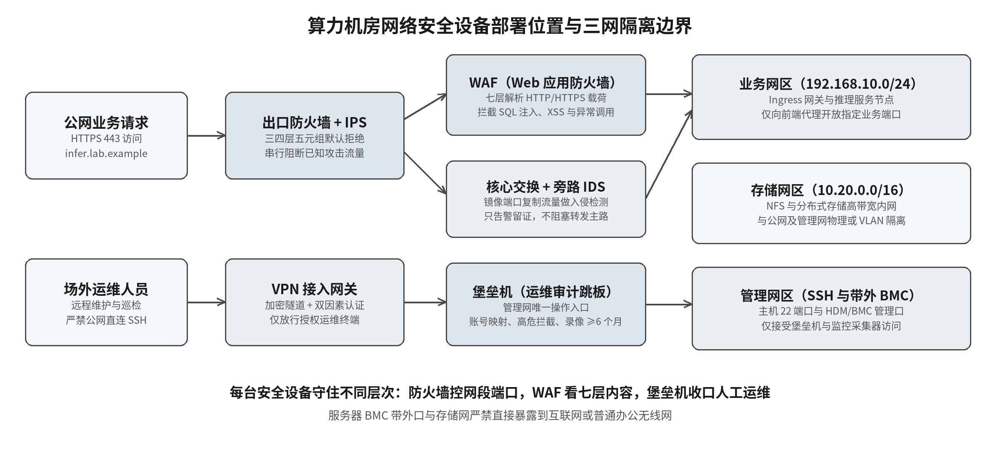
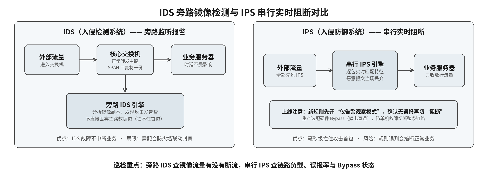
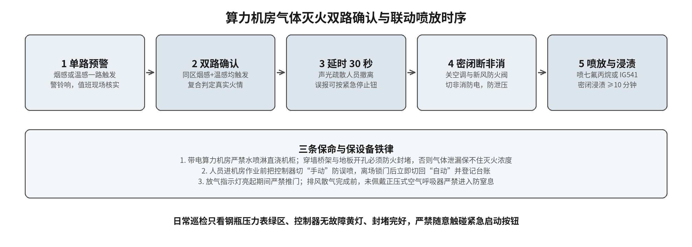
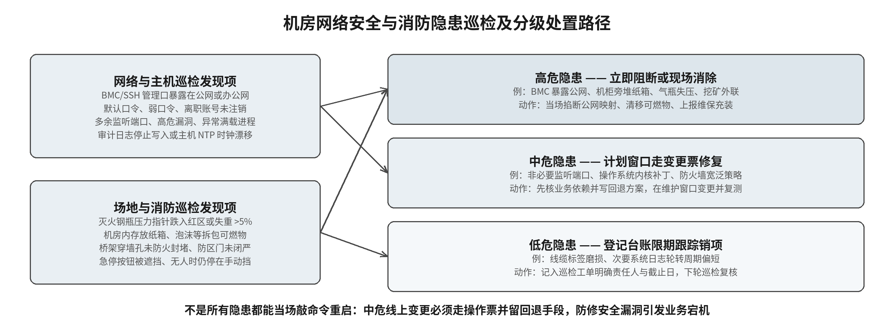

# 第36讲 机房网络安全与消防

**本课程定位：** 从本讲进入第七章“安全”。前六章已经把服务器、网络、Kubernetes 集群与算力平台搭了起来。智算中心单柜功率高、加速卡贵重、数据敏感。网络边界失守被植入挖矿木马，或消防联动失误引发停机伤人，都会毁掉整套服务。本讲聚焦机房网络边界设备、气体消防系统与日常安全巡检方法，建立架构对位与隐患判读能力。

周末值班巡检时，你同时遇到三件事：新上架服务器的 BMC 管理口能不能为了图省事映射到公网？机房走廊的气体灭火控制器停在“手动”还是“自动”才合规？一台空闲算力节点的 GPU 利用率突然飙到 99%，要先看哪几条证据、能不能直接拔网线重启？本讲围绕这三类现场问题展开。

## 本讲学习目标

学完后，你应能：

- 在机房三网拓扑上标出防火墙、IDS、IPS、WAF、VPN 与堡垒机的部署位置，说清各自拦截什么风险。
- 区分 IDS 旁路镜像检测与 IPS 串行实时阻断的接线差异，判断规则误报或设备故障时的业务影响。
- 说清智算机房气体灭火（七氟丙烷、IG541）的适用原因、烟温感双路确认联动时序与人员安全红线。
- 按巡检清单识别弱口令、BMC 暴露、多余端口、挖矿木马、封堵破损与气瓶失压等常见隐患。
- 将巡检发现的问题按高、中、低三级分流处置，区分“当场隔离”与“计划窗口变更”。

## 36.1、认识机房网络安全设备

第 5 讲与第 10 讲确立了机房**业务网（如 192.168.10.0/24）、存储网（如 10.20.0.0/16）、管理网（SSH 与带外 BMC）**三网隔离基线。安全设备不是随便买来堆在机柜里，而是按流量方向和协议层次卡在关键边界上。



### 36.1.1、五类核心边界与审计设备

不同安全设备看懂的报文深度不同，守住的入口也不同：

表36-1、算力机房常见网络安全设备职责与部署位置

| 设备名称 | 部署位置 | 工作层次与核心职责 | 管不住的盲区 |
| --- | --- | --- | --- |
| 边界防火墙 | 互联网出口及三网跨区边界 | 按源目 IP、端口、协议五元组与连接状态放行，默认拒绝未授权访问 | 已放行 443 端口后，看不懂正常 HTTPS 通道里夹带的恶意请求内容 |
| 入侵检测 IDS | 核心交换机旁路镜像口 | 复制一份流量离线比对攻击特征，发现异常发告警并留存证据 | 不在转发主路上，无法直接丢弃正在通过的首包攻击流量 |
| 入侵防御 IPS | 出口或核心跨区串行主路 | 报文逐个先过检测引擎，命中高危漏洞利用或恶意特征时当场丢包阻断 | 特征规则误判会拦断正常业务；未加密内部横向操作需配合主机审计 |
| 应用防护 WAF | 对外 Web 与推理网关入口前 | 解析七层 HTTP/HTTPS 请求体，拦截 SQL 注入、跨站脚本（XSS）与恶意爬虫 | 不负责非 HTTP 协议（如 SSH、数据库原生端口）的访问控制 |
| 运维堡垒机 | 管理网唯一运维跳板入口 | 集中管控 SSH、RDP 与 BMC 登录，做双因素认证、高危命令拦截与全程录像 | 若管理员绕过堡垒机开启了服务器直连路线，审计录像就会漏记 |

### 36.1.2、重点辨析：IDS 旁路检测与 IPS 串行阻断

初学者最容易混淆 IDS 和 IPS。两者的核心差别不在特征库长什么样，而在**怎么接进网络**以及**出故障时谁受影响**。



- **IDS（旁路监听）**：接在交换机的端口镜像口（SPAN）或分光器上，只拿走流量的复印件。即便 IDS 死机重启，主链路上的训练和推理流量照常通信。代价是攻击首包到达目标机后，IDS 才能发告警或通知防火墙补封。
- **IPS（串行阻断）**：像安检闸机一样串在网线中间，所有报文先过引擎再往后走。IPS 能毫秒级拦下攻击首包，但自身成了单点瓶颈。上线 IPS 有两条硬规矩。第一，新规则先开**仅告警观察模式**，确认不误杀正常长文本请求后再切阻断。第二，硬件选配 **Bypass（掉电或死机硬件直通）** 模块，防单机死机引发全网断连。

### 36.1.3、远程运维收口：VPN 加堡垒机

场外工程师需要远程排障时，严禁在出口防火墙上把服务器的 `22` 端口或 H3C HDM/BMC 带外口（如 `192.168.1.2`）直接做公网端口映射。合规路径分两跳：先拨入 **VPN 网关**（校验账号密码加动态口令双因素认证）进入受限接入区，再登录**堡垒机**跳转到目标服务器。所有敲击的命令和屏幕回显在堡垒机集中留存不少于 6 个月，做到“人走了账号即停、出了事有据可查”。

【例题】公司大模型推理接口 `https://infer.lab.example/v1` 对公网开放 443 端口，出口防火墙已配置“仅放行公网访问入口 IP 的 TCP 443 端口，拒绝其余全部端口”。近期日志显示有外部攻击者通过 HTTPS POST 请求体发送畸形超长参数和 SQL 注入试探语句。只改出口传统包过滤防火墙的端口规则能拦住这类请求吗？应该在哪一层加装或调整什么设备？

解：只改传统三四层防火墙的端口规则拦不住。因为正常业务本身就必须对外开放 TCP 443 端口，攻击报文正是伪装在合法的 443 端口连接里送进来的。应在七层入口处（TLS 证书解密位置或反向代理前方）部署并启用 **WAF（Web 应用防火墙）**，针对 HTTP 请求路径、包体大小上限及注入特征配置拦截策略。

【关键区别】防火墙放行了 443 端口，只代表“允许敲这扇门”；门里送进来的应用报文干不干净，要靠七层 WAF 和业务网关鉴权去审。

【随堂思考】网络组准备在核心业务链路上新串入一台 IPS 设备。为了避免上线瞬间误拦正常推理接口流量，你会要求先以什么模式试运行？还要核实设备具备什么硬件保护能力？

## 36.2、认识机房消防设施与安全红线

算力机房聚集了高功率服务器、加速卡整机柜、UPS 蓄电池组与密集线缆。机房消防与普通办公楼消防有一个根本区别：**核心主机房带电运行时，严禁使用普通水喷淋系统直接浇淋服务器机柜**。水体导电会导致配电母线、PDU 与主板大面积短路损毁，还会危及现场人员生命安全。

### 36.2.1、洁净气体灭火与现场器材选型

封闭算力主机房普遍采用不导电、灭火后无水渍残留的**洁净气体自动灭火系统**，常见药剂有两类：

表36-2、算力机房常用灭火药剂与手提器材对比

| 介质或器材 | 成分与灭火机理 | 算力机房适用位置 | 现场安全与维护要点 |
| --- | --- | --- | --- |
| 七氟丙烷气体 | HFC-227ea 洁净药剂，化学抑制链式燃烧反应为主并辅以降温 | 中小型封闭主机房、配电室钢瓶间 | 液化储存压力适中；高温分解会产生刺激性氟化氢，喷放后严禁裸身进入 |
| IG541 惰性气体 | 氮气 52%、氩气 40%、二氧化碳 8% 混合，物理降氧至不支持燃烧 | 大中型智算主机房、有人短暂停留区 | 纯物理降氧无毒无腐蚀、无残留；高压钢瓶储存，钢瓶间占地面略大 |
| 二氧化碳灭火器 | 局部喷射低温二氧化碳隔绝氧气并降温 | 机房门口与通道，处置单点初期小火苗 | 不留固体粉尘、不腐蚀主板；喷筒温度极低，握持防冻伤，密闭小空间防窒息 |
| 干粉手提灭火器 | 磷酸铵盐粉末覆盖阻断燃烧 | 机房外走廊、拆包间等非精密设备区 | **慎对精密算力柜喷射**——微细粉尘吸潮后会严重腐蚀服务器电路板与金手指 |

### 36.2.2、双路探测确认与联动喷放时序

气体灭火一旦误喷，不仅重新充装成本高昂，气浪冲击还可能震损硬盘，更会威胁机房内作业人员安全。因此火灾自动报警系统（FAS）与气体灭火控制器采用严密的**双路复合确认**逻辑：



1. **单路预警（只报警、不联动喷气）**：同一防区内仅有单个感烟探测器或单个感温探测器报警时，警铃鸣响、动环监控弹窗。值班员立即前往现场确认是真实冒烟，还是灰尘、加湿器水雾引起的误报。
2. **双路确认（进入联动倒计时）**：同一防区内**感烟探测器与感温探测器两路同时触发**，控制器判定为真实火情，声光报警器高频闪鸣并播放疏散语音。
3. **30 秒延时撤离窗口**：系统进入约 **30 秒**可调延时，供房内人员迅速撤离并随手关严防区门。若现场人员亲眼确认属于施工扬尘误报，可在倒计时结束前按下门口的**紧急停止按钮**中止喷放。
4. **密闭与断电联动**：正式喷放前，联动系统自动关闭精密空调、切断新风阀与排烟防火阀、切断非消防电源，防止气流带走灭火药剂或继续供电助燃。
5. **喷放与浸渍保持**：电磁阀开启释放灭火气体，门口上方**“放气勿入”指示灯**常亮。保护区须密闭保持不少于 **10 分钟**的浸渍时间以防复燃。排风散气彻底完成前，未佩戴正压式空气呼吸器的人员严禁推门进入。

### 36.2.3、防火封堵、手自动挡位与防静电要求

机房消防巡检中最容易漏看的不是灭火器，而是下面三项物理细节：

- **防火封堵完好性**：强弱电桥架穿墙孔、防静电地板下走线口必须用防火泥、阻火包严密封堵。封堵一旦破损脱落，一方面外部火烟会窜进机房，另一方面气体喷放时药剂会从孔洞大量漏走，导致室内灭火浓度达不到设计值而灭火失败。
- **手自动挡位切换规矩**：无人值守时，气体灭火控制器置于**“自动”**挡。人员刷卡进入主机房作业前，按规程切至**“手动”**挡防误喷。作业结束全员离场锁门后，必须立即切回**“自动”**挡并在登记本签字核对。
- **可燃物清零与防静电环境**：新服务器、算力卡拆箱必须在机房外的**拆包间**完成，严禁把瓦楞纸箱、泡沫塑料带进主机房堆积在冷热通道。主机房相对湿度一般控制在 **40%～65% RH**（以本机房规范为准），湿度过低易积聚静电击穿板卡芯片，湿度过高易结露短路。

【关键区别】门口的“紧急启动按钮”和“紧急停止按钮”通常并排加装防误触保护罩。日常巡检只用眼睛看封铅和保护罩是否完好、指示灯是否正常，绝对禁止动手按压测试。

## 36.3、排查常见问题与分级整改

算力运维工程师日常巡检要同时覆盖“线上主机网络”和“线下机房现场”两条线。发现隐患不能只拍照发群，要靠确定性证据定性，再按风险等级分流处理。



### 36.3.1、七类常见网络安全隐患与取证方法

在授权巡检节点（如 `gpu-node-01`，使用只读或日常运维账号）做安全排查时，重点核查以下七类高频问题：

表36-3、机房常见网络安全隐患表现与只读核查方法

| 隐患类别 | 典型违规表现 | 现场只读核查方法与判据 |
| --- | --- | --- |
| 管理口暴露 | BMC/HDM 带外口或 SSH 映射到公网或普通办公 Wi-Fi | 从非管理网网段尝试连通带外 IP（预期应被防火墙拒绝），核查出口 NAT 映射表 |
| 弱口令与残留号 | 保留出厂默认口令、`123456` 弱口令或离职人员账号仍可登录 | 核查堡垒机账号清单与主机 `/etc/passwd`、`/etc/sudoers` 及免密公钥文件 |
| 多余开放端口 | 调试留下的 Web 端口、数据库端口监听在 `0.0.0.0` 全地址 | 执行 `ss -tulnp` 对照《标准开放端口基线表》，排查未登记监听进程 |
| 高危补丁缺失 | OpenSSL、内核或容器运行时存在已公开远程执行高危漏洞 | 核对系统安全更新台账与周期性漏洞扫描报告，确认高危项未超期滞留 |
| 异常挖矿与外联 | 无平台作业时 GPU/CPU 长期满载，向陌生境外 IP 建立长连接 | 对照平台队列无任务，查 `nvidia-smi`/`hy-smi`、`top` 进程路径及 `ss -tnp` 外部连接 |
| 局域网欺骗私接 | 机柜内私插便携路由器、无线网卡，或同网段网关 MAC 地址跳变 | 现场目检机柜多余 USB/网口外设，主机侧用 `ip neigh` 核对网关 MAC 是否唯一固定 |
| 日志与时钟异常 | 审计服务停摆、磁盘满导致日志断写，或主机时钟偏差数分钟 | 查 `systemctl status rsyslog`、`df -h /var/log` 及 `timedatectl` 的 NTP 同步状态 |

下面是一组在算力节点上无副作用的只读安全基线快查命令（执行位置：`gpu-node-01`，`opsadmin` 账号）：

```bash
ss -tulnp
ss -tnp state established
ip neigh show
timedatectl status
sudo grep -E "Failed password|Accepted" /var/log/auth.log | tail -n 20
```

读数要点：若 `ss -tulnp` 出现 `0.0.0.0:6379`（Redis）或未登记的 `0.0.0.0:8888`（未设口令的调试 Notebook），说明内部端口越界暴露。若 `auth.log` 持续刷屏来自陌生网段的 `Failed password for root`，说明管理网隔离不严或存在横向爆破，应立即追查来源 IP。

### 36.3.2、消防与物理环境巡检必查点

线下走查机房与气瓶间时，按“看表计、看挡位、看通道、看封堵”四步执行：

- **看表计与钢瓶**：气体灭火钢瓶压力表指针必须指在**绿色正常区**（红区代表失压，高区代表过热超压）。查阅维保标签，每半年称重一次，药剂失重超过 **5%** 必须报专业消防维保单位充装。
- **看控制器与挡位**：火灾报警控制器无火警红灯、无屏蔽灯或故障黄灯常亮。核对当前手自动挡位是否与“房内是否有人”一致。
- **看通道与出入准入**：冷热通道、逃生门、灭火器箱与紧急停止按钮前方严禁堆放杂物。外来维保人员必须实名登记并由本单位人员全程陪同，严禁借用他人刷卡凭证尾随进入。
- **看封堵与温湿度**：抽查新布线后的桥架穿墙口、机柜底部走线孔防火泥是否回填严实。查看精密空调回风温湿度与漏水检测绳无告警。

### 36.3.3、隐患三级分流处置原则

巡检出问题后，不能把所有问题都拖到下个月，也不能不看业务影响就当场乱杀进程、乱封端口。工程上按危害紧迫度分三级处置：

1. **高危隐患（立即阻断与现场消除）**：一旦被利用或触发就会造成重大资产损失或人身风险。典型例子包括：**BMC 口或无密码 Notebook 暴露到公网、主机确认感染挖矿木马外联、机房通道堆放拆箱纸箱、灭火钢瓶指针掉入红区**。处置动作是立即在边界防火墙掐断公网暴露策略、隔离受控节点保留取证现场、当场把纸箱清出机房、立即上报设施负责人联系消防维保。
2. **中危隐患（计划窗口走变更票修复）**：存在潜在风险但当前处于内网受控边界内，直接在线改动可能误伤运行中的训练或推理业务。典型例子包括：**内网节点多开了非必要端口、操作系统内核补丁待升级、防火墙网段放行颗粒度偏粗**。处置动作是先查清端口或补丁关联的业务依赖，编写含验证与回退步骤的变更票，在约定维护窗口执行并回到业务侧复测。
3. **低危隐患（登记台账限期销项）**：不直接构成入侵或失火突破口，如网线标签字迹模糊、非关键历史日志归档周期偏短。记录进巡检台账，明确责任人与完成日期，下次巡检逐条复核。

【例题】周三上午巡检发现四条异常：① 2 号机柜后方堆着 5 个拆包大纸箱。② 在线推理节点 `infer-node-03` 多了一个监听 `0.0.0.0:9091` 的内部辅助进程，暂不确定网关是否调用。③ 1 号气瓶间有 1 支七氟丙烷钢瓶压力指针掉进红色低压区。④ 3 号机柜两根管理网线标签脱落。请把四条异常按高、中、低分级，并写出前三条的第一步动作。

解：分级结果——**高危**：① 机柜后方堆纸箱、③ 钢瓶压力掉入红区；**中危**：② 在线节点不明监听端口 `9091`；**低危**：④ 网线标签脱落。前三条第一步动作：① 当场把 5 个纸箱清移出主机房送至废料区，严禁过夜留存。② **严禁在业务高峰期直接 kill 这个进程**，先用 `ps -ef` 和 `lsof -i:9091` 查明所属服务与连接方，再提变更票在维护窗处理。③ 严禁私自拧动钢瓶阀门，立即拍照记下瓶号上报设施主管，联系消防维保厂家核查充装。

【随堂思考】巡检发现 `gpu-node-02` 在没有任何平台训练任务时，4 张加速卡全部满载。同时 `/tmp/.cache-kworker` 可疑进程正向陌生公网 IP 的 `4444` 端口持续传数据。为什么不能直接重装系统了事？断网隔离后还要保留哪两类关键证据？

## 36.4、本讲回顾与自测

学习完本讲后，试着用自己的话回答四个问题：防火墙、IDS、IPS、WAF 和堡垒机各自守在哪一关？为什么算力主机房用气体灭火而不用水喷淋？烟温感双路触发后系统按什么顺序动作？巡检扫出多余端口和纸箱堆积，为什么处置节奏不一样？

表36-4、本讲目标与对应判断

| 学习目标 | 应能做出的判断 |
| --- | --- |
| 对位安全设备 | 按流量入口选对防火墙（五元组）、WAF（七层 HTTP）与堡垒机（运维跳板审计） |
| 区分串旁路风险 | 分清 IDS 旁路只告警不阻断、IPS 串行能拦首包但须防误报断网并配 Bypass |
| 守住消防红线 | 解释七氟丙烷/IG541 双路确认、30 秒延时、防火封堵与进出场手自动切换规矩 |
| 排查主机隐患 | 用 `ss`、`ip neigh`、`timedatectl` 和认证日志核查暴露面、异常外联与时钟同步 |
| 分级稳妥整改 | 高危当场隔离清障，中危走计划窗口变更留回退，不在高峰期盲目杀线上进程 |

### 36.4.1、本讲自测

**1 设备选型。** 为了记录每一位外部合作工程师登录算力服务器后敲过的所有命令，并拦截高危删除指令，必须在管理网入口部署什么设备？

**2 串旁路判断。** 某安全设备接在核心交换机的 SPAN 镜像端口上。当这台安全设备断电关机时，正在跨节点通信的分布式训练任务会中断吗？为什么？

**3 消防联动。** 某气体灭火防区只有 1 个感烟探测器因施工灰尘触发报警，感温探测器正常。此时七氟丙烷钢瓶会立即喷气吗？现场值班员应怎么做？

**4 封堵作用。** 弱电施工队在机房墙上新打了一个穿线孔拉光纤，完工后没有用防火泥封堵。除了外部火烟容易窜入，这还会导致气体灭火系统出现什么严重后果？

**5 隐患定级。** 下面两项问题哪一项属于必须当场立即处置的高危项，哪一项属于走计划窗口变更的中危项？
甲：新上架服务器的 HDM/BMC 管理口（默认口令未改）被临时映射到了公网 IP；
乙：内网生产数据库节点的 SSH 服务仍使用默认 22 端口，计划改用自定义端口。

**6 场景问答。** 你准备独自进入封闭算力主机房更换一块故障热插拔硬盘，预计耗时 20 分钟。写出进门前和出门锁门后，你在门口气体灭火控制器及登记本上必须完成的操作。

**答：**

____________________________

____________________________

____________________________

____________________________

## 36.5、参考答案与解析

### 36.5.1、随堂思考解析

**思考 1（新串入 IPS 设备的上线保护）：** 上线初期必须先开启**仅告警（观察/旁路监听）模式**，对照正常推理峰值流量观察是否有误命中特征，调优白名单或阈值后再切换为实时阻断模式。硬件上必须核实设备具备并开启了 **硬件 Bypass（掉电/死机物理直通）** 功能（或采用双机主备高可用组网），防止 IPS 单点硬件故障切断整条业务链路。

**思考 2（疑似挖矿木马不能直接重装系统）：** 直接重装会毁掉入侵入口证据，攻击者明天还会从同一处漏洞再次打进来。断网隔离受控节点后，至少保留两类证据。第一，保留可疑进程信息、定时任务、异常公钥与外联 IP 记录，用于封禁并排查其他节点。第二，保留认证日志（`/var/log/auth.log`）、容器日志与文件修改时间，查清攻击来源并堵住漏洞后再重建。

### 36.5.2、课后自测解析

**1** 必须部署**堡垒机（运维安全审计系统）**，同时在服务器侧防火墙限制 SSH 22 端口仅允许堡垒机内网地址访问，堵住绕行直连路径。

**2** 不会中断。接在 SPAN 镜像端口上的是 **IDS（旁路部署）**，交换机只是把业务流量的复制件发给它，原始训练数据包仍走核心交换机背板正常转发，不经过 IDS 网卡。

**3** 不会立即喷气。自动联动需要同防区烟感与温感两路同时触发，再经过约 30 秒延时才会释放。单路烟感触发属于预警状态，值班员应立即到场查看有无真实焦糊味或烟雾。确认系施工扬尘后，令施工暂停除尘，待环境恢复洁净再复位控制器并记录原因。

**4** 灭火气体喷放后会从穿墙孔洞快速泄漏到防区外，导致机房内灭火剂浓度无法达到设计灭火标准，也无法维持 10 分钟浸渍时间，直接造成灭火失败或火情复燃。

**5** **甲属于高危隐患（立即处置）**：带默认口令的 BMC 口暴露公网，攻击者可在数分钟内扫到并直接远程接管服务器电源、挂载虚拟光驱重装或窃取系统，必须立即撤除公网映射并修改强口令。**乙属于中危/常规加固项（计划窗口变更）**：节点在内网受控边界内，直接改 SSH 端口若未同步改堡垒机与自动化巡检配置会导致运维失联，须开变更票在维护窗联动修改并复测。

**6** **进门前**：核对防区无火警异常，按规程将门口气体灭火控制器从“自动”切换至“手动”状态，并在机房出入与消防状态登记本上写明进场人、时间、事由及状态变更。**出门锁门后**：确认随身工具与包装垃圾全部带出、防区门闭严锁好，立即将控制器从“手动”切回“自动”状态，复核面板指示灯正常后在登记本补齐离场时间与恢复确认签字。

## 36.6、术语与疑问

表36-5、本讲术语

| 术语 | 本讲中的含义 |
| --- | --- |
| 防火墙 | 部署在网段边界，按 IP、端口、协议五元组与会话状态控制流量放行或拒绝的设备。 |
| IDS | 入侵检测系统，旁路接收交换机镜像流量做特征分析，发现攻击发出告警但不直接阻断主路。 |
| IPS | 入侵防御系统，串行接入通信链路，对命中攻击特征的数据包当场实时丢弃阻断。 |
| WAF | Web 应用防火墙，工作在 HTTP/HTTPS 七层，专门拦截 SQL 注入、跨站脚本与异常接口请求。 |
| 堡垒机 | 运维安全审计系统，作为进入管理网的唯一跳板，统一负责身份认证、权限控制与操作录像。 |
| 七氟丙烷 | 常用洁净气体灭火剂（HFC-227ea），以化学抑制反应为主灭火，不导电且不留水渍。 |
| IG541 | 氮气、氩气、二氧化碳按比例混合的惰性气体灭火剂，靠物理降低氧浓度灭火，洁净无残留。 |
| 防火封堵 | 用防火泥、阻火包封闭墙体与地板穿线孔洞，阻隔火烟蔓延并防止气体灭火剂泄压流失。 |

文中 IP（如 `192.168.10.0/24`、`192.168.1.2`）、域名（如 `infer.lab.example`）、路径与参数为教学示例，生产环境以本单位规划为准。

**我的疑问（读完本讲后还有不清楚的地方，记在这里）：**

____________________________

## 附录、机房网络安全与消防日常巡检核对卡

表36-6、算力机房网络安全与消防日常巡检记录卡（工单脱敏模板）

| 巡检分项 | 核查内容 | 合格判据 | 巡检结果记录 | 风险定级与处置 |
| --- | --- | --- | --- | --- |
| 边界暴露 | 出口 NAT 与 BMC/SSH 隔离 | 公网无直通 22 端口与带外管理口映射 | □正常 / □异常 | 异常按高危立即断连 |
| 审计与时间 | 堡垒机录像、主机日志与 NTP | 会话录像可查，日志未满，时钟偏差 <1 秒 | □正常 / □异常 | 异常排查采集与同步 |
| 端口与负载 | 节点 `ss -tulnp` 与卡忙碌率 | 无未登记全网监听端口，空闲节点无异常外联 | □正常 / □异常 | 可疑外联按高危隔离 |
| 灭火钢瓶 | 压力表绿区与半年称重签 | 指针在绿区，有效期内且药剂失重 ≤5% | □正常 / □异常 | 失压失重报维保充装 |
| 报警与挡位 | FAS 面板灯态与手自动挡位 | 无火警/故障灯；无人时自动、有人时手动 | □正常 / □异常 | 离场锁门必复核自动 |
| 封堵与现场 | 穿墙走线孔封堵与通道杂物 | 防火泥严实无破洞，机房内零纸箱泡沫堆积 | □正常 / □异常 | 可燃物当场清出机房 |

<!-- md-only -->
## 附：主要参考资料（仅 Markdown 保留，不印入 Word/PDF）

- 中国信通服务《2025 算力运维体系技术白皮书》（本地 `./资料/中国信通服务：2025算力运维体系技术白皮书-71页.pdf`，文件第 12、14、28、34、40、53～56 页关于机房火灾自动报警 FAS、七氟丙烷与 IG541 气体灭火、6 个月称重失重 5% 阈值、10 分钟浸渍时间、堡垒机操作日志留存不少于 6 个月及漏洞修复要求）。
- 中华人民共和国国家标准《数据中心设计规范》（GB 50174）关于主机房洁净气体灭火、温湿度防静电区间、防火封堵与自动/手动联动控制条款。
- 中华人民共和国国家标准《气体灭火系统设计规范》（GB 50370）关于两路探测复合确认、不大于 30 秒疏散延时、紧急启停装置与防护区泄压浸渍要求。
- 中华人民共和国国家标准《信息安全技术 网络安全等级保护基本要求》（GB/T 22239，等保 2.0）关于网络区域边界访问控制、入侵防范与集中运维审计条款。
<!-- /md-only -->
