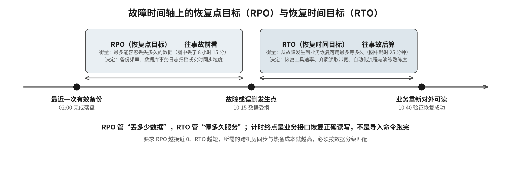
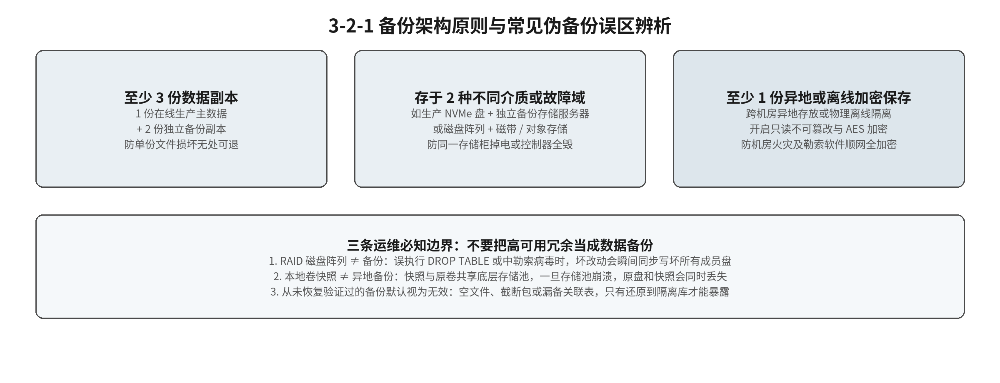
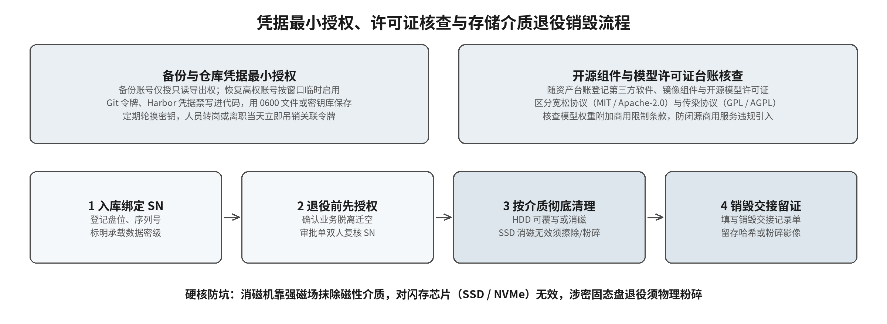
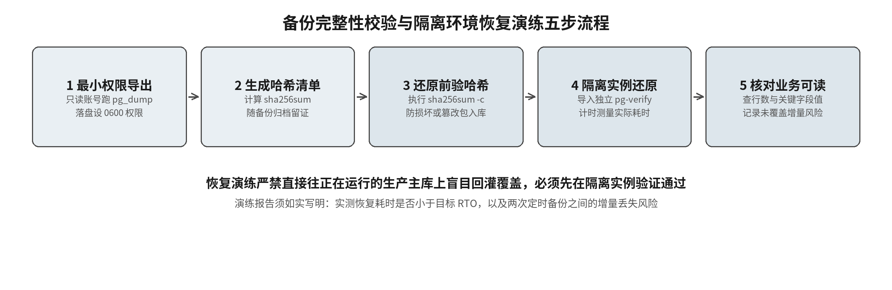

# 第37讲 数据安全、备份与介质治理

**本课程定位：** 第 36 讲守住了机房物理消防与网络边界，但边界防线挡不住内部误操作、硬盘阵列连环损坏或勒索软件加密。数据是算力中心最难重建的核心资产。本讲围绕数据从产生、日常备份、凭据与合规管控，一直到硬盘报废退役的全周期治理，通过一次真实的隔离恢复演练回答“备份到底能不能救命”。

值班时你遇到四个棘手场景：合作方问“平台数据库挂了最多丢几分钟账单、多久能恢复查询”，这两个指标怎么定？定时任务每天凌晨都在生成 `.dump` 文件，怎么证明文件没损坏、真出事时能导回去？离职同事留下的代码库令牌和 Harbor 凭据怎么清？机柜退下来的 4 块旧固态盘拿去消磁机走一遍能不能直接卖废品？本讲逐一给出工程做法。

## 本讲学习目标

学完后，你应能：

- 按机密、内部、公开三级对算力中心典型数据资产定级，匹配对应的加密、权限与备份要求。
- 分清恢复点目标（RPO）与恢复时间目标（RTO），结合 3-2-1 原则与全量、增量、差异方式制定备份策略。
- 落实备份账号与仓库凭据最小授权，核查开源组件许可证台账，按介质类型规范执行退役擦除与物理销毁。
- 对开源业务数据库独立完成一次最小权限导出、`sha256sum` 校验和核对与隔离实例恢复验证。
- 编写完整的备份清单、恢复计时记录、权限证据与未覆盖风险说明，不把未经验证的备份当成安全保障。

## 37.1、数据分级：不同资产不同保护强度

算力中心既存着几十 GB 的开源公开基础权重，也存着客户斥资微调的行业私有语料和 API 密钥。如果不分轻重把所有文件都按最高规格实时异地同步，存储与专线成本会立刻失控。反过来一律按普通文件粗放存放，一旦泄露又会引发严重合规事故。动手配备份前，第一步是给数据定级。

表37-1、算力中心常见数据资产三级分类与保护基线

| 安全级别 | 算力中心典型数据举例 | 泄露或丢失后果 | 访问、存储与备份基线要求 |
| --- | --- | --- | --- |
| 机密级 | 客户私有微调语料、自研核心模型权重、数据库主凭据、API 私钥 | 重大商业违约、核心资产流失或全平台沦陷 | 落盘与传输全程加密；严格审批最小授权；高频备份加异地离线防篡改副本；退役盘强制销毁 |
| 内部级 | 算力平台队列配置、令牌计量账单库、内部监控日志、拓扑与变更工单 | 计费对账混乱、内部架构暴露或排障线索中断 | 仅限内部受控角色访问；定期全量加增量异机备份；退役介质经审批后完整擦除覆写 |
| 公开级 | 官方开源基础模型权重、公开技术白皮书、外部公开测试数据集 | 无保密风险，仅影响重新下载耗时 | 校验官方发布哈希值防投毒即可；本地保留单份缓存或按需从可信源重拉，无需昂贵异地灾备 |

【关键区别】公开下载的基础模型（如原始开源 `Qwen2.5-7B-Instruct`）属于公开级，但用企业内部客服录音在这份模型上微调出来的 LoRA 权重与评测集，立刻上升为**机密级**，必须按机密级隔离权限和备份。

## 37.2、制定备份策略：RPO、RTO 与 3-2-1 原则

业务方说“我的数据一秒都不能丢、一秒都不能停”，运维不能盲目拍胸脯答应，而要用两个可量化的工程指标把恢复目标谈清楚。



### 37.2.1、读懂 RPO 与 RTO 两个硬指标

以故障发生时刻为分界点，一前一后看两个窗口：

- **RPO（Recovery Point Objective，恢复点目标）**：从故障点**往前回看**，衡量业务**最多能容忍丢失多久的数据**。比如每天凌晨 `02:00` 做一次备份，上午 `10:15` 磁盘全毁，还原后 `02:00` 到 `10:15` 之间的 8 小时 15 分钟新数据就丢了。若业务要求 `RPO <= 15 分钟`，每天只备一次绝对不达标，必须缩短备份间隔或开启数据库预写日志（WAL / Binlog）连续归档。
- **RTO（Recovery Time Objective，恢复时间目标）**：从故障点**往后计时**，衡量**从故障发生到业务重新对外正常读写最多允许停机多久**。计时终点不是数据库导入命令跑完那一刻，而是上游应用重新连上并验证读写成功的那一刻。RTO 决定了你要选逻辑导出文件慢速重灌，还是选物理快照挂载与主从热切换。

### 37.2.2、全量、增量与差异备份组合

数据量上来以后，每次都把整库重拷一遍既占带宽又耗空间，工程上常把三种备份方式搭配使用：

表37-2、全量、增量与差异三种备份方式权衡对比

| 备份方式 | 本次拷贝的数据范围 | 备份速度与空间占用 | 恢复时需要的备份包数量 |
| --- | --- | --- | --- |
| 全量备份 | 选定对象的全部完整数据 | 最慢，占用存储空间最大 | 最简单，只需最近 1 份全量包即可直接还原 |
| 增量备份 | 自**上一次任意备份**以来新变化的数据 | 最快，单次包体积最小 | 链条最长，须按顺序集齐“最近全量包 + 此后每一份增量包”，中间坏一环后续全废 |
| 差异备份 | 自**上一次全量备份**以来累计变化的数据 | 居中，随天数推移包体积逐日增大 | 折中稳妥，只需“最近 1 份全量包 + 最新 1 份差异包”两份即可还原 |

【例题】某模型资产元数据与账单库每周日 `02:00` 执行一次全量备份（耗时 40 分钟，包大小 80 GB），周一至周六每天 `02:00` 执行一次增量备份（每次约 5 GB）。周四上午 `09:30` 因人为误操作删空了核心表，立刻停服恢复。请回答：① 本次事故实际丢失了哪个时间段的数据？② 若规定目标 `RPO <= 24 小时`，当前频率是否满足？③ 运维还原时需要按顺序用到哪几份备份包？

解：① 最近一次有效备份是周四凌晨 `02:00` 的增量包，因此丢失了周四 `02:00` 至 `09:30` 共 **7 小时 30 分钟**的新写入数据。② 实际最大可能丢失窗口为两次备份间隔 24 小时，本次丢 7.5 小时，满足 `RPO <= 24 小时` 的指标上限（但若账单库要求零丢失，仍需补齐实时事务日志归档）。③ 增量备份依赖完整链条，必须依次准备**周日全量包 + 周一增量包 + 周二增量包 + 周三增量包 + 周四增量包**共 5 份文件按序恢复。

### 37.2.3、3-2-1 备份原则与常见伪备份误区

把备份文件存在原服务器同一个 `/data` 分区下，一旦服务器阵列卡烧毁或感染勒索病毒，生产库和备份包会一起报废。可靠策略遵循 **3-2-1 原则**：

- **3 份数据副本**：1 份在线生产数据，外加至少 2 份独立备份副本。
- **2 种不同存储介质或独立故障域**：例如生产跑在本地 NVMe 盘上，备份分别放入独立备份服务器的硬盘池与对象存储，不与生产共用同一套存储控制器。
- **1 份异地或离线加密副本**：至少 1 份副本存放在异地机房或物理离线（不可被在线网络直接改写删除）介质上，并对机密备份启用 `AES-256` 等强加密。



【随堂思考】有同事认为：“我们的存储服务器已经做了 RAID 10 双盘冗余，每晚还在本机存储池打一个 LVM 快照，所以不需要再往异机拷备份了。”请指出在“误删数据表”和“整柜断电烧毁”两种场景下，这套做法为什么救不了命？

## 37.3、管理凭据权限、开源许可证与存储介质退役

备份包里浓缩了整套业务的核心数据。如果生产库防得严严实实，备份目录却谁都能拷走、退役旧硬盘随便流向二手市场，备份本身就会变成最大的数据泄露源。



### 37.3.1、备份权限与仓库凭据最小授权

权限治理覆盖数据库、备份目录以及代码和镜像仓库三类凭据（一并收口第 13 讲与第 15 讲留下的凭据治理要求）：

- **采、备、恢账号分离**：日常定时备份脚本使用专用的**只读导出账号**（仅授予目标库 `SELECT` 权限，无 `DROP`、`DELETE`、`INSERT` 权限），即使备份脚本凭据泄露，攻击者也无法删改在线生产库。执行恢复所需的高权限账号平时封存，仅在演练或应急窗口临时启用。
- **备份落盘权限收紧**：宿主机与远端备份目录属主设为专用运维账号，目录权限设为 `0700`、备份文件与校验清单设为 `0600`，禁止同机普通业务账号翻阅。
- **代码库与制品库令牌治理**：Git 仓库个人访问令牌（PAT）、Harbor 镜像仓库机器人账号（Robot Account）以及对象存储密钥，严禁明文写进脚本代码或提交进版本库。统一存放在权限 `0600` 的受保护凭据文件（如 PostgreSQL 的 `~/.pgpass`）或外部密钥管理系统中，设置最长有效期（如 90 天轮换），人员转岗或离职当天立即吊销。

### 37.3.2、开源软件与模型组件许可证台账核查

算力平台和备份工具链大量使用开源软件、第三方容器镜像组件以及开源大模型权重。运维在建立软件与数据资产台账时，必须同步核查并登记**开源许可证（License）合规项**：

表37-3、常见开源软件与模型权重许可证类型核查要点

| 许可证类别 | 典型代表协议 | 核心合规边界 | 运维台账核查重点 |
| --- | --- | --- | --- |
| 宽松型开源协议 | MIT、Apache-2.0、BSD | 允许修改、闭源集成与商业部署，须保留原始版权声明与协议文本（Apache-2.0 还含专利授权条款） | 镜像与分发包内保留原项目 LICENSE 与 NOTICE 文件，不抹除原作者署名 |
| 强传染型协议 | GPL v2/v3、AGPL v3 | 修改或静态链接后对外分发（AGPL 含通过网络对外提供服务）时，衍生工程须按同协议开源源码 | 严禁在自研闭源商用平台代码中直接混入或修改 AGPL 组件而不履行开源义务 |
| 模型专项协议 | 各类社区权重自定义许可 | 虽公开可下载权重，但常附加“日活用户超限须商业授权”或“禁止用于特定竞争模型蒸馏”条款 | 上线前逐一登记模型名称、来源哈希与商用限制条款，经法务或负责人确认 |

### 37.3.3、存储介质交接与退役销毁规范

服务器硬盘、NVMe 闪存卡和备份磁带从拆封入库起就要绑定唯一物理序列号（SN）。遇到坏盘返修（RMA）或旧服务器下架退役时，严禁拔下硬盘直接交给快递或废品商，必须走完四步规程：

1. **退役前先授权与业务脱离**：提交介质退役或返修工单，确认盘上有效数据已迁移且备份校验通过，阵列重构完成或业务已停机脱离，经负责人审批签字后方可下架。
2. **双人现场复核盘位与 SN**：操作人与复核人对照工单核对服务器主机名、槽位号与硬盘标签上的物理 SN 号，防止误拔正常在线盘。
3. **按介质物理原理彻底清理数据**：普通内部级完好盘重用前，可执行多轮全盘随机覆写（如 `shred -v -n 3 -z`）或固件级安全擦除并核验不可读。故障无法通电盘或机密级退役盘必须做不可逆物理销毁。
4. **填写交接销毁单并留证**：详细记录介质类型、SN 号、原承载数据密级、清理/销毁方式、执行人与监销人签字及现场照片，归档备查。

【关键区别】**强磁消磁机对固态硬盘（SSD / NVMe）完全无效！** 机械硬盘（HDD）和磁带靠磁性颗粒记录数据，强磁场消磁可以瞬间破坏磁畴。SSD 和 U 盘靠闪存芯片里的电荷存数据，放进消磁机走十遍，插上电脑数据依然完好可读。机密级退役 SSD 若无法执行经认证的硬件加密擦除，唯一合规手段是送入粉碎机做**物理粉碎或穿孔销毁**。

【随堂思考】一块承载客户私有微调语料（机密级）的企业级 NVMe 固态盘还在三年质保期内，今天出现读写报错需要返厂换新。厂商售后要求把旧坏盘寄回检测。你能直接把这块坏盘寄给厂商吗？要怎么处理？

## 37.4、上机实训：开源数据库备份、完整性校验与隔离恢复演练

本实训以算力平台租户配额数据库为对象，选用开源 `PostgreSQL 16` 容器，在装有 Docker Engine 26 的 Linux 实验机上即可独立复现（使用 `MySQL 8` 的环境可将导出命令对应替换为 `mysqldump --single-transaction`）。演练完整走通“建最小权限备份号 → 导出加锁 → 生成 SHA-256 校验和 → 隔离实例还原 → 核对业务可读与计时”五步流程。



### 37.4.1、步骤一：准备实验业务库与最小权限备份账号

在实验机（`opsadmin` 账号）创建权限为 `0700` 的专属备份目录，启动模拟生产数据库容器 `pg-ops`，写入 3 条算力租户配额业务数据，并专门创建一个**只有只读查询权、没有删改权**的备份角色 `bkreader`：

```bash
mkdir -p ~/lab/l37-backup && chmod 700 ~/lab/l37-backup
cd ~/lab/l37-backup

docker run -d --name pg-ops \
  -e POSTGRES_USER=dbadmin \
  -e POSTGRES_PASSWORD=AdminPass_ChangeMe2026 \
  -e POSTGRES_DB=opsdb \
  postgres:16

sleep 6

docker exec -i pg-ops psql -U dbadmin -d opsdb <<'EOF'
CREATE TABLE tenant_quota (
    tenant_id   SERIAL PRIMARY KEY,
    tenant_name VARCHAR(64) NOT NULL,
    gpu_limit   INT NOT NULL,
    token_quota BIGINT NOT NULL,
    updated_at  TIMESTAMPTZ DEFAULT NOW()
);

INSERT INTO tenant_quota (tenant_name, gpu_limit, token_quota) VALUES
    ('algo-train-team', 4, 50000000),
    ('algo-prod-infer', 6, 200000000),
    ('retail-assistant', 2, 30000000);

CREATE ROLE bkreader WITH LOGIN PASSWORD 'ReadOnly_Bk2026';
GRANT CONNECT ON DATABASE opsdb TO bkreader;
GRANT USAGE ON SCHEMA public TO bkreader;
GRANT SELECT ON ALL TABLES IN SCHEMA public TO bkreader;
EOF
```

留存**最小权限证据**：验证备份角色 `bkreader` 能正常查询，但尝试执行 `DELETE` 删除生产数据时会立刻被数据库拒绝：

```bash
docker exec -e PGPASSWORD='ReadOnly_Bk2026' pg-ops \
  psql -U bkreader -d opsdb -c "DELETE FROM tenant_quota WHERE tenant_id = 1;"
```

预期输出 `ERROR: permission denied for table tenant_quota`，将此输出记入权限证据单。

### 37.4.2、步骤二：执行逻辑备份、收紧文件权限并生成哈希清单

本实验为内部级账单库 `opsdb` 设定恢复目标：**RPO <= 24 小时（每日定时备份），RTO <= 15 分钟**。现在以 `bkreader` 身份执行自定义压缩格式（`-Fc`）逻辑备份，立即将落盘文件权限锁为 `0600`，并生成 `sha256sum` 校验清单：

```bash
STAMP="20261118_0200"
BK_FILE="opsdb_${STAMP}.dump"

docker exec -e PGPASSWORD='ReadOnly_Bk2026' pg-ops \
  pg_dump -U bkreader -d opsdb -Fc > "${BK_FILE}"

chmod 600 "${BK_FILE}"
sha256sum "${BK_FILE}" > "${BK_FILE}.sha256"
chmod 600 "${BK_FILE}.sha256"

ls -lh "${BK_FILE}" "${BK_FILE}.sha256"
cat "${BK_FILE}.sha256"
```

核验点：备份包字节数非零（通常数 KB 以上），权限列准确显示 `-rw-------`（`0600`），且 `.sha256` 文件生成了 64 位十六进制摘要值。生产环境中，应紧接着通过加密通道将这组文件同步一份至异机或异地对象存储以满足 3-2-1 要求。

### 37.4.3、步骤三：在隔离实例执行哈希校验与计时还原

**演练红线：严禁在没有故障时直接往正在跑业务的 pg-ops 原库里强行导数据覆盖！** 正确做法是拉起一个互不干扰的隔离验证容器 `pg-verify`，先做文件完整性校验，再记录还原起止时间：

```bash
sha256sum -c "${BK_FILE}.sha256"

docker run -d --name pg-verify \
  -e POSTGRES_USER=restoreadmin \
  -e POSTGRES_PASSWORD=VerifyPass_2026 \
  -e POSTGRES_DB=opsdb_restored \
  postgres:16

sleep 6

START_TS=$(date +%s)
cat "${BK_FILE}" | docker exec -i -e PGPASSWORD='VerifyPass_2026' pg-verify \
  pg_restore -U restoreadmin -d opsdb_restored --no-owner --clean --if-exists
END_TS=$(date +%s)
echo "Restore elapsed seconds: $((END_TS - START_TS))s"
```

预期第一条命令输出 `opsdb_20261118_0200.dump: OK`。若有人篡改或网络传输出错截断了 1 个字节，`sha256sum -c` 会立刻报 `FAILED` 并返回非零退出码，此时应立即停止导入并切换备用副本。

### 37.4.4、步骤四：验证业务数据可读性与评估未覆盖风险

导入命令不报错不等于数据对得上。在隔离库 `pg-verify` 中执行业务级核对查询，比对记录行数、总算力卡限额及令牌总额是否与备份前一致：

```bash
docker exec -e PGPASSWORD='VerifyPass_2026' pg-verify \
  psql -U restoreadmin -d opsdb_restored \
  -c "SELECT COUNT(*) AS rows, SUM(gpu_limit) AS total_gpus, SUM(token_quota) AS total_tokens FROM tenant_quota;"

docker exec -e PGPASSWORD='VerifyPass_2026' pg-verify \
  psql -U restoreadmin -d opsdb_restored \
  -c "SELECT tenant_id, tenant_name, gpu_limit, token_quota FROM tenant_quota ORDER BY tenant_id;"
```

预期查出 `rows = 3`、`total_gpus = 12`、`total_tokens = 280000000`，三行租户记录清晰可读，实测恢复耗时仅数秒，远小于目标 `RTO <= 15 分钟`。

最后必须如实写明**未覆盖风险（Residual Risk）**：
1. 本次仅采用每日一次 `pg_dump` 逻辑快照，两次备份之间新增的额度扣减流水（最多 24 小时窗口）在灾难发生时仍会丢失。若业务后续要求 `RPO <= 5 分钟`，需增配 PostgreSQL WAL 连续归档做时间点恢复（PITR）。
2. 本次演练备份包暂存于同机目录，尚未完成跨物理机异地离线副本转存，整机掉盘风险需靠接入异机存储消除。

### 37.4.5、常见备份恢复故障排查与环境清理

演练遇到异常时，对照下表分层定位：

表37-4、数据库备份与恢复演练常见异常及排查方法

| 异常表现 | 常见根因 | 排查与修正方法 |
| --- | --- | --- |
| 导出的备份包大小为 0 字节 | 容器内命令报错（如密码错或库名错），但外层重定向仍创建了空文件 | 不要只看文件存在，脚本加管道失败检查并核对退出码与文件大小阈值 |
| 哈希校验报 FAILED | 传输中断截断、磁盘坏块损坏或文件被意外改动 | 严禁强行导入损坏包，立即调取异地第二副本重验 SHA-256 摘要 |
| 恢复时报角色不存在错误 | 原库表属主角色在隔离新库里未创建 | 跨环境演练还原时给恢复命令加上忽略原属主参数，再按需统一赋权 |
| 恢复成功但缺最新几小时数据 | 正常 RPO 窗口限制（定时逻辑备份不含此后增量） | 核对备份时间戳是否拿错旧包；要压低 RPO 须补建事务日志连续归档 |

实训取证并填妥演练记录卡后，清理实验容器（保留 `~/lab/l37-backup` 下的记录产物备查，或一并清理）：

```bash
docker rm -f pg-verify pg-ops
```

## 37.5、本讲回顾与自测

学习完本讲后，试着用自己的话回答四个问题：RPO 和 RTO 分别往事故点的哪一边算？为什么做了 RAID 阵列还要遵循 3-2-1 备份？为什么固态盘退役不能靠消磁机？恢复演练为什么要先验哈希、再往隔离实例里导？

表37-5、本讲目标与对应判断

| 学习目标 | 应能做出的判断 |
| --- | --- |
| 数据三级分类 | 区分机密、内部、公开数据，识别微调私有语料与密钥属于最高保护等级 |
| 定备份与目标 | 算清全量、增量、差异恢复链长度，用 RPO 定备份间隔、用 RTO 选恢复手段 |
| 管凭据与介质 | 备份号只授只读权、凭据锁 `0600` 并轮换；核查 AGPL 等开源协议；知晓 SSD 消磁无效 |
| 隔离演练留证 | 还原前必跑 `sha256sum -c`，在隔离实例查业务字段可读并如实披露未覆盖风险 |

### 37.5.1、本讲自测

**1 指标辨析。** 业务部门提出：“平台配置库万一故障，最多允许停服 30 分钟，且最多只能丢失最近 10 分钟内的变更。”请分别写出对应的 RPO 和 RTO 数值。

**2 备份链计算。** 系统每周日 `01:00` 做全量备份，周一至周六每天 `01:00` 做**差异备份**。周五中午需要做全库恢复，最少需要取哪几份备份文件？

**3 伪备份识别。** 判断正误并说明理由：“只要把数据库目录放在双盘镜像的 RAID 1 阵列上，开发同事误执行 `TRUNCATE TABLE` 清空表数据后，就能从另一块镜像盘里把数据找回来。”

**4 权限最小化。** 为什么要专门建一个只有 `SELECT` 权限的账号跑每晚的备份脚本，而不直接复用数据库超级管理员账号？

**5 介质退役。** 机房退役一批存有内部账单和客户微调数据的 SATA SSD 固态硬盘，兼职运维建议“全部送去强磁消磁机消磁后按二手配件处理”。这个建议有什么致命漏洞？正确做法是什么？

**6 演练红线。** 季度恢复演练时，能不能直接把昨晚的备份包导入当前正在对外提供服务的生产数据库来证明备份有效？写出正确做法和两项必查验证指标。

**答：**

____________________________

____________________________

____________________________

____________________________

## 37.6、参考答案与解析

### 37.6.1、随堂思考解析

**思考 1（RAID 10 加本地快照为什么救不了命）：** 在“误删数据表”场景下，RAID 10 会把删除指令毫秒级同步写到所有镜像盘上，无法回退。本地快照虽能回退时间点，但勒索软件拿到宿主机 root 权限后会一并删掉本地快照。在“整柜断电烧毁或存储控制器损坏”场景下，主卷和本地快照都在同一台物理存储池里，会同时损毁。必须按 3-2-1 原则保留独立异机与异地离线副本。

**思考 2（质保期内涉密坏 NVMe 盘能否直接寄回厂商）：** **绝对不能直接寄回！** 坏盘只是控制器或部分区块报错，闪存芯片内绝大部分客户私有语料仍可被专业设备读取，寄出即构成机密泄露。正确做法是先核对采购合同中的“涉密不返还硬盘”条款。确需处置旧盘时，走内部审批与双人复核 SN 后在本单位监督下做**物理粉碎销毁**，以销毁证明换取备件，绝不外流涉密介质。

### 37.6.2、课后自测解析

**1** **RPO <= 10 分钟**（衡量最多丢失多久的数据）。**RTO <= 30 分钟**（衡量最快多久恢复服务可用）。

**2** 最少只需 **2 份文件**：**周日 01:00 的全量备份包 + 周五 01:00 的最新一份差异备份包**。因为差异备份每次都包含自上次全量以来的全部累计变化，不需要再找周一至周四的中间差异包。

**3** **错误**。RAID 1 只解决“单块物理硬盘损坏不停机”的硬件冗余问题。`TRUNCATE TABLE` 属于合法通道下发的逻辑写操作，RAID 控制器会忠实地把两块镜像盘上的表数据同时清空，找回误删数据只能靠历史时间点的独立备份。

**4** 定时备份脚本通常需要把登录凭据存放在自动化节点上。若使用超级管理员账号，一旦凭据泄露，攻击者就能直接登录生产库删表或篡改账单。只给备份号 `SELECT` 只读权限，即便泄露也不会直接破坏在线生产库，还能防止脚本参数写错误改生产数据。

**5** 致命漏洞是**消磁机对 SSD 固态硬盘无效**（SSD 使用闪存电荷存储，消磁后数据仍在，卖二手会导致客户语料泄露）。正确做法是先走退役审批并双人核对硬盘 SN。承载客户机密语料的 SSD 一律禁售，执行**物理粉碎或穿孔销毁**并双人签字留证（仅承载一般内部数据且内部重用的完好固态盘，须执行固件级加密安全擦除并抽检不可恢复）。

**6** **严禁直接导入在线生产库**——既会用昨晚旧数据冲掉今天白天的新业务数据，又可能在备份包损坏时直接把生产库搞崩。正确做法是新建一台与生产隔离的临时实例（如 `pg-verify`）做还原演练。两项必查指标：一是还原前执行 `sha256sum -c` 确认文件哈希一致无损；二是还原后执行真实查询核对行数与汇总值，并记录实测恢复耗时是否满足目标 RTO。

## 37.7、术语与疑问

表37-6、本讲术语

| 术语 | 本讲中的含义 |
| --- | --- |
| 数据分级 | 按泄露或丢失影响把数据分为机密、内部、公开等级别，匹配差异化的加密、权限与备份投入。 |
| RPO | 恢复点目标，故障时业务最多能容忍丢失多久的数据，决定备份频率或日志同步方式。 |
| RTO | 恢复时间目标，故障发生后最快必须在多久内恢复业务正常读写，决定恢复技术与演练标准。 |
| 3-2-1 原则 | 至少保留 3 份数据副本、存于 2 种不同存储介质或故障域、至少 1 份异地或离线保存。 |
| 增量备份 | 仅备份自上一次任意类型备份以来新增或改动的数据，包最小但恢复依赖完整连续链条。 |
| 差异备份 | 备份自上一次全量备份以来累计改动的数据，恢复时只需“最近全量 + 最新差异”两份包。 |
| 校验和 | 通过 `sha256sum` 等哈希算法生成的固定长度文件指纹，用于核验备份文件传输或存放中是否损坏篡改。 |
| 介质消磁与粉碎 | 消磁用强磁场抹除 HDD/磁带磁性记录（对 SSD 无效）；粉碎通过物理破坏芯片彻底销毁涉密介质。 |

文中容器名、口令示例、目录路径（如 `~/lab/l37-backup`）与恢复时间参数为教学示例，生产环境以本单位规划为准，严禁在生产环境使用示例口令。

**我的疑问（读完本讲后还有不清楚的地方，记在这里）：**

____________________________

## 附录、数据备份恢复演练与介质退役交接卡

表37-7、开源业务数据恢复演练与退役介质交接记录卡（工单脱敏模板）

| 记录模块 | 核对要素 | 本次实测或交接填报示例 | 复核状态 |
| --- | --- | --- | --- |
| 备份对象与定级 | 系统名称、库表范围、数据密级 | 平台配额库 `opsdb`（内部级），含租户额度表 | □已核对 |
| 恢复目标与实测 | 设定 RPO / RTO 与本次实测还原耗时 | 目标 RPO ≤24h、RTO ≤15min；实测耗时 ──── 秒 | □达标 / □超标 |
| 最小权限证据 | 备份专用账号权限范围与越权拒绝验证 | 角色 `bkreader` 仅具查询权，删除测试返回拒绝 | □已留证 |
| 完整性与业务核验 | SHA-256 校验结果、隔离库行数与字段核对 | 哈希校验 `OK`；隔离库查得 3 行、总额度一致 | □通过 / □失败 |
| 未覆盖风险说明 | 当前方案尚未覆盖的数据窗口或单点缺陷 | 两次定时备份间增量未实时归档；待补异地副本 | □已登记跟进 |
| 退役介质交接 | 介质类型、物理 SN、清理/销毁方式与双人签字 | 例：NVMe SSD（SN: ──────），机密级，物理粉碎 | 执行/监销：──── |

<!-- md-only -->
## 附：主要参考资料（仅 Markdown 保留，不印入 Word/PDF）

- 中国信通服务《2025 算力运维体系技术白皮书》（本地 `./资料/中国信通服务：2025算力运维体系技术白皮书-71页.pdf`，文件第 19、25、28、30、40 页关于全量/增量/差异备份、3-2-1+1 备份加密原则、RTO/RPO 定义、季度恢复演练、哈希完整性校验及双人复核审计要求）。
- NIST Special Publication 800-88 Revision 1《Guidelines for Media Sanitization》（美国国家标准与技术研究院存储介质清理、覆写擦除、HDD 消磁限制及 SSD 物理粉碎销毁技术指南）。
- PostgreSQL 16 官方文档《Backup and Restore (`pg_dump` / `pg_restore` / Continuous Archiving and PITR)》与 MySQL 8.0 官方文档《`mysqldump` — A Database Backup Program》。
- 开放源代码促进会（OSI）许可证分类说明（MIT、Apache-2.0、GPL v3、AGPL v3 条款对比）及《中华人民共和国数据安全法》数据分类分级保护原则。
<!-- /md-only -->
