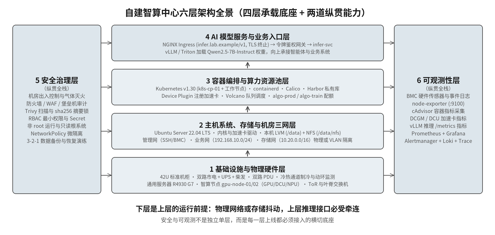
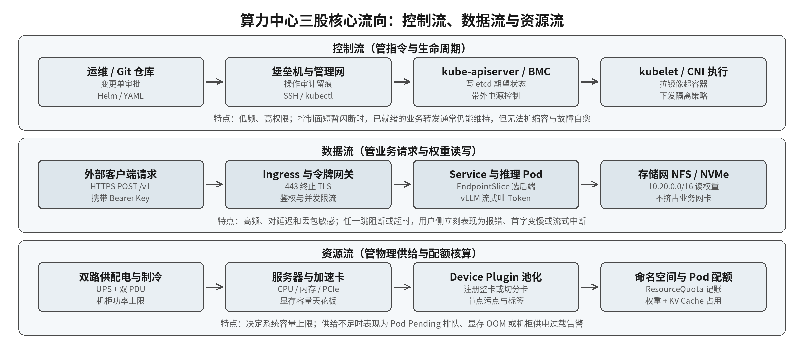
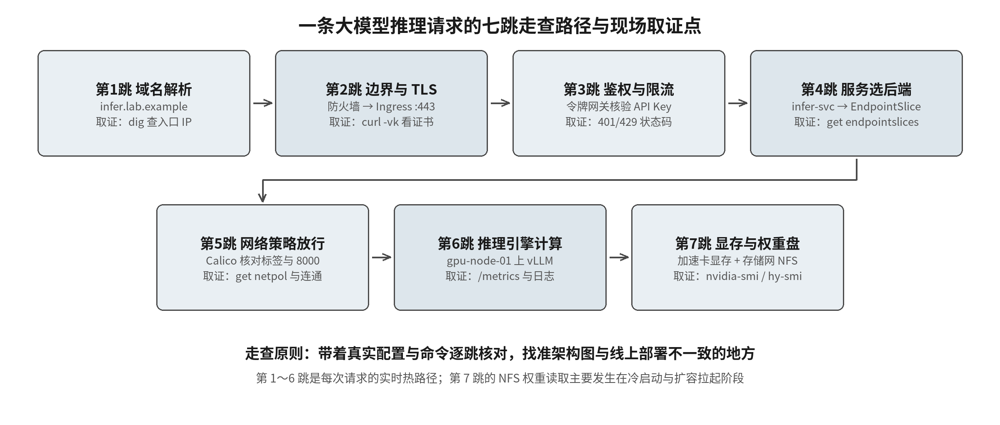
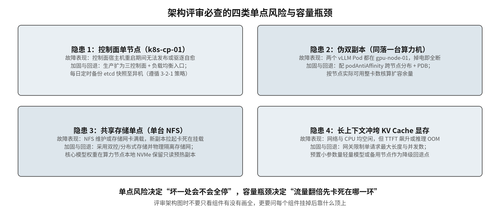

# 第39讲 算力中心架构设计

**本课程定位：** 面向自建智算中心运维。前七章分别走过了服务器与加速卡、操作系统与机房三网、自动化脚本、Kubernetes 编排、可观测性、AI 模型推理以及安全治理。进入第八章综合实战，第一件事是把零散组件串成一张全栈地图。本讲解决架构设计最实用的三个动作：画清六层结构、分清三股流向、带着真实命令把一条推理请求从入口走查到底。

线上交接时最怕拿到一张“只画了几个漂亮方框”的示意图：既看不出走哪张网、监听哪个端口，也看不出控制面挂了会不会断流、某台机器掉电后流量退到哪里。等到半夜推理接口报 `502` 或首字延迟飙升，值班人员只能在群里盲猜。一张合格的运维架构图，必须能直接指导容量规划、变更评估与逐跳排障。

## 本讲学习目标

学完后，你应能：

- 按“四层承载底座 + 两道纵贯能力”画出智算中心六层架构，准确归位前序各讲的硬件与开源软件组件。
- 区分同一套集群里的控制流、数据流与资源流，判断控制面闪断、业务断连与配额耗尽三类不同现象。
- 为核心架构对象补齐名称版本、网段位置、责任角色、上下游依赖、取证入口与回退点六项要素。
- 把一条大模型推理请求从外部域名逐跳走查到加速卡显存与权重存储，用实测命令核对架构图与线上实际部署的差异。
- 从真实拓扑中识别控制面、节点分布、共享存储与显存容量四类单点或瓶颈，输出可落地的风险清单与降级方案。

## 39.1、绘制智算中心六层架构

把几十个软硬件组件摆在同一张纸上，如果混在一起连线，很快就会变成一团乱麻。工程上常采用“**横向四层承载底座 + 纵向两道贯穿能力**”的六层画法，既符合第 1 讲确立的“设备—系统—平台—业务”观察顺序，又不会漏掉安全与监控。

1. **第 1 层：基础设施与物理硬件层。** 承载供电、散热与物理算力，包含 42U 机柜、双路市电配 UPS 与柴发、双路 PDU、冷热通道与动环传感器（第 10 讲），以及通用服务器 `H3C UniServer R4930 G7`、智算节点 `gpu-node-01/02`、GPU/DCU/NPU 加速卡、ToR 与叶脊交换机（第 3、4、6 讲）。
2. **第 2 层：主机系统、存储与机房三网层。** 在裸机之上提供系统内核、加速卡驱动、本机 LVM 逻辑卷 `/data` 与共享存储 NFS `/data/nfs`（第 7、8、21 讲），并按职责切开**管理网**（SSH、BMC 带外）、**业务网**（`192.168.10.0/24`）和**存储网**（`10.20.0.0/16`）（第 5 讲）。
3. **第 3 层：容器编排与算力资源池层。** 以 `Kubernetes v1.30` 为核心（控制面 `k8s-cp-01`、工作节点 `containerd` 与 `Calico`），配合 `Harbor` 私有镜像库（`registry.lab.example`）、`Device Plugin` 加速卡注册、`Volcano` 批调度队列以及 `algo-prod` / `algo-train` 命名空间配额（第 17～23、28、29 讲）。
4. **第 4 层：AI 模型服务与业务入口层。** 面向调用方提供推理能力，由 `NGINX Ingress Controller` 终止 `https://infer.lab.example/v1` 的 TLS 连接，经令牌鉴权网关核验 API Key 与额度，再通过 `infer-svc` 转发给 `vLLM` 或 `Triton` 推理实例（加载 `Qwen2.5-7B-Instruct` 等模型），向上支撑第 40 讲的智能体框架与业务前端（第 20、30～34 讲）。
5. **第 5 层：安全治理层（纵贯第 1～4 层）。** 从机房出入控制、气体灭火、防火墙/WAF/堡垒机，到镜像 `Trivy` 扫描与 `sha256` 摘要固定、RBAC、容器非 `root` 运行、`Secret` 凭据隔离、`NetworkPolicy` 微隔离以及 `3-2-1` 数据备份（第 36～38 讲）。
6. **第 6 层：可观测性层（纵贯第 1～4 层）。** 从带外 BMC 传感器、主机 `node-exporter`、容器 `cAdvisor`、加速卡 `DCGM/DCU-Exporter` 到推理引擎 `/metrics`，统一汇入 `Prometheus + Grafana + Alertmanager`，并联动 `Loki` 日志与 `trace_id` 链路追踪（第 25、26 讲）。



表39-1、六层架构组件归位与常见失效影响

| 架构层次 | 代表组件（课程基线） | 核心职责 | 本层异常时的典型现象 |
| --- | --- | --- | --- |
| 1 硬件机房 | R4930 G7、加速卡、UPS、叶脊交换 | 供电散热、算力执行与物理互联 | 带外告警、机器掉电、PCIe 降速或掉卡 |
| 2 系统网存 | Ubuntu 22.04、三张网、LVM、NFS | 驱动承载、网段隔离与权重存放 | 域名或路由不通、挂载超时、磁盘只读 |
| 3 编排池化 | K8s v1.30、Calico、Harbor、Volcano | 期望状态收敛、卡池分配与镜像分发 | Pod Pending、拉取镜像失败、跨节点不通 |
| 4 模型服务 | Ingress、令牌网关、vLLM、Triton | HTTPS 入口、鉴权计费与流式推理 | 401/404/502 状态码、TTFT 飙升、显存 OOM |
| 5 安全治理 | 堡垒机、Trivy、Secret、NetworkPolicy | 边界拦截、最小权限、微隔离与备份 | 越权报 Forbidden、未放行流量连接超时 |
| 6 可观测性 | Prometheus、Grafana、Loki、Alertmanager | 指标拉取、日志检索与分级告警通知 | 面板断点、Target Down、告警漏报或风暴 |

## 39.2、分清三股流向与标注六项要素

只把组件画进六层框里还不够。两台设备之间画一根箭头，如果不标明这根线跑的是管理指令还是用户请求，排障时就会把因果关系搞反。

### 39.2.1、控制流、数据流与资源流

在算力中心架构图上，建议用三种线型（或明确文字标签）区分三股性质完全不同的流向：

- **控制流（管指令与生命周期，低频、高权限）：** 运维人员通过 Git 提交配置、经堡垒机登录管理网执行 `kubectl apply` 或 `helm upgrade`，请求进入 `kube-apiserver` 写入 `etcd`，再由 `scheduler` 和节点上的 `kubelet` 拉起容器、配置 `NetworkPolicy`；或者通过管理网访问服务器 BMC 执行远程开机。**关键特征：** 控制面短暂重启或闪断时，只要工作节点上的 `kube-proxy`、CNI 规则和 `vLLM` 进程还在，**已经就绪的在线推理数据流通常不会立刻中断**，但此时无法发布新版本、无法自动扩容，节点宕机后也无法迁移 Pod。
- **数据流（管业务请求与模型读写，高频、延迟敏感）：** 一条是**南北向推理请求流**——外部应用发起 `HTTPS POST /v1/chat/completions`，经防火墙、Ingress（`443` 终止 TLS）、令牌网关、`infer-svc` 落到算力节点上的 `vLLM` 容器（`:8000`），流式返回生成的 Token；另一条是**东西向存储数据流**——Pod 冷启动时通过独立的存储网（`10.20.0.0/16`）从 NFS 或分布式存储顺序读取十几 GB 的 Safetensors 权重文件。存储大流量走存储网，正是为了不把业务网的推理响应挤慢。
- **资源流（管物理供给与配额记账，决定容量上限）：** 市电与 UPS 提供机柜功率预算 → 服务器主板供电与散热支撑加速卡满载运行 → 加速卡提供固定物理显存（如单卡 24 GB 或 64 GB） → `Device Plugin` 向集群汇报可用卡数 → `ResourceQuota` 与 Pod `requests/limits` 扣减额度 → 容器内按第 4 讲“模型权重 + KV Cache + 额外开销”切分显存。资源流在任意一环见底，都会直接卡住扩容上限。



【关键区别】监控和日志采集流量既不是主业务数据流，也不是集群控制流，而是独立的**观测采集流**（如 Prometheus 定期去拉各组件的 `/metrics`，采集代理把日志推给 Loki）。架构设计上必须让观测流保持“弱依赖”：即使 Loki 或 Grafana 短暂维护，绝不能反向阻塞 `vLLM` 正常处理用户推理请求。

### 39.2.2、架构对象六项标注规矩

画完图后要配一张结构化的**架构要素标注表**。凡是关键环节上的组件，不能只写一个名字，必须写清以下六项信息：

1. **名称与版本：** 写准软件版本或硬件型号（如 `Kubernetes v1.30`、`Qwen2.5-7B-Instruct BF16`），升级排障时才能核对兼容性。
2. **网段与部署位置：** 写明在哪个机柜/节点、哪个命名空间、走哪张网与哪个监听端口。
3. **责任角色：** 明确归基础设施组、平台运维组还是算法应用组负责，出问题十分钟内找对人。
4. **上下游强弱依赖：** 分清**强依赖**（断了业务立刻停摆，如网关强依赖下游推理 Pod 就绪）与**弱依赖**（断了只影响辅助功能或冷启动，如已加载进显存的推理实例对镜像仓库 Harbor 属运行期弱依赖）。
5. **故障取证入口：** 提前写好怀疑这个组件异常时第一条敲什么命令、看哪个指标或哪段日志。
6. **回退与降级点：** 变更失败或组件故障时怎样快速退回上一稳态（如 `helm rollback`、切换备用节点、降级到轻量模型）。

表39-2、核心架构对象六项要素标注示例

| 组件与规格 | 位置与端口 | 责任组 | 强依赖对象 | 首选取证入口 | 回退或降级手段 |
| --- | --- | --- | --- | --- | --- |
| NGINX Ingress | 业务网 `:443` | 平台组 | 证书 Secret、网关服务 | 控制器日志与状态码 | 回退规则 YAML |
| 令牌网关（OpenAI） | `algo-prod` `:8080` | 平台组 | 鉴权库、`infer-svc` | 网关响应码与延迟指标 | `rollout undo` 回退镜像 |
| vLLM（BF16） | 算力节点 `:8000` | 算法与平台 | 加速卡显存、权重持久卷 | `/metrics` 与 Pod 日志 | 退回稳定标签或切备卡 |
| NFS 静态持久卷 | 存储网 `10.20.0.0/16` | 系统组 | 存储网卡、导出目录权限 | `df -h`、`mount`、`iostat` | 切节点本地 NVMe 副本 |
| Harbor 镜像库 | 管理网 `:443` | 平台组 | 底层块存储、TLS 证书 | 核心组件状态与推送日志 | 暂用节点本地缓存镜像 |

【例题】某天中午 Harbor 镜像仓库所在虚拟机因磁盘维护暂停服务 20 分钟。请结合控制流、数据流与强弱依赖判断：①正在运行的 `vLLM` 在线推理请求会立刻报错中断吗？②这段时间如果 HPA 触发扩容把副本从 2 扩到 3，而新调度到的节点本地没有缓存对应镜像，会发生什么？

**解：** ①不会立刻中断。实时推理数据流走的是“客户端 → Ingress → 网关 → `infer-svc` → 已运行 `vLLM` Pod”，运行期不经过 Harbor；Harbor 对已启动容器属于运行期弱依赖。②扩容出的第 3 个 Pod 会卡在 `ErrImagePull` 或 `ImagePullBackOff` 状态无法就绪，因为拉起新容器的控制流执行阶段强依赖镜像仓库可达（除非目标节点 `containerd` 本地恰好已缓存同一 `@sha256` 摘要镜像且拉取策略不是 `Always`）。

【随堂思考】有同事在架构图上把存储网省掉，让 8 台算力节点冷启动拉取几十 GB 大模型权重时直接走业务网 `192.168.10.0/24`。当多台节点同时重启拉权重时，在线推理用户的首 Token 延迟（TTFT）会受什么影响？为什么？

## 39.3、走查一条真实请求并核对账实差异

架构图画得对不对，不能靠会议室里看图讨论，要抓一条真实的 AI 推理请求，从最外层入口一跳一跳走到最底层硬件，用命令行核对“图上画的”和“线上跑的”是不是一回事。

### 39.3.1、大模型推理请求的七跳走查

以客户端调用 `POST https://infer.lab.example/v1/chat/completions`（请求模型 `Qwen2.5-7B-Instruct`）为例，完整路径共经过七跳：

1. **第 1 跳（域名解析）：** 客户端向 DNS 查询 `infer.lab.example`，拿到机房对外入口或 Ingress 控制器暴露的业务网 IP。
2. **第 2 跳（边界防护与 TLS 终止）：** 流量穿过机房防火墙 `443` 端口到达 `NGINX Ingress Controller`，核对 TLS 证书，解密 HTTPS 后按主机名与路径 `/v1` 匹配路由规则（回顾第 20、36 讲）。
3. **第 3 跳（身份鉴权与配额限流）：** 请求进入令牌鉴权网关，校验 `Authorization: Bearer <API_KEY>` 是否有效、调用方剩余 Token 额度与并发数是否超限（回顾第 33 讲）。
4. **第 4 跳（服务发现与后端选路）：** 网关访问集群内 `infer-svc:8000`，节点上的 `kube-proxy` 依据 `EndpointSlice` 名单，挑出一个 `Ready` 状态的推理 Pod IP（回顾第 20 讲）。
5. **第 5 跳（网络策略微隔离检查）：** 目标算力节点上的 `Calico` 检查源 Pod 标签（如 `app=gateway`）与目标端口 `8000` 是否在 `algo-prod` 的 `NetworkPolicy` 白名单内，匹配后放行入站（回顾第 38 讲）。
6. **第 6 跳（推理引擎调度与逐字生成）：** 请求进入 `gpu-node-01` 上的非 `root` 容器 `vLLM`（`:8000`），分词器将文本转为 Token ID，连续批处理调度器分配 KV Cache 并调用加速卡算子，以 SSE 流式把生成的 Token 原路推回客户端（回顾第 31、32 讲）。
7. **第 7 跳（底层显存承载与冷启动权重读取）：** 热路径在加速卡高带宽显存内完成计算。若实例刚新建或扩容，就会在启动阶段通过存储网 `10.20.0.0/16` 从 `/data/nfs` 持久卷把约 15 GB 权重文件读入显存，同时 Prometheus 从 `:8000/metrics` 与 Exporter 持续拉取 TTFT、TPOT 和显存占用指标（回顾第 4、21、25、34 讲）。



### 39.3.2、识别账实偏差、单点故障与容量瓶颈

走查过程中最常抓出两类工程问题：**单点故障（Single Point of Failure，简称 SPOF，坏一个点就全局中断）** 和 **容量瓶颈（流量涨上去最先卡死的一环）**。同时还要重点比对“图纸承诺”与“线上实况”的账实偏差：

- **常见账实偏差 1（双副本挤在同一台物理机）：** 架构图画了两个 `vLLM` 副本分跨 `gpu-node-01` 和 `gpu-node-02`，现场敲 `kubectl get pod -n algo-prod -o wide` 却发现两个 Pod 全落在 `gpu-node-01`，原因是漏配了第 22 讲的 `podAntiAffinity` 反亲和规则。一旦 `gpu-node-01` 掉电，业务照样百分之百中断。
- **常见账实偏差 2（文档写的端口或标签已漂移）：** 架构图写推理端口 `8080`，线上临时排障改成了 `8000` 没更新文档，导致新配的监控抓取和 `NetworkPolicy` 全部写错端口。
- **单点风险与容量瓶颈：** 实验环境常用单台控制面 `k8s-cp-01` 和单台 NFS 服务器，上线生产前必须列入单点风险清单推动冗余改造；而在大模型推理链路里，千兆/万兆业务网卡往往远未跑满，**并发长文本请求最先撞上的容量天花板通常是加速卡的 KV Cache 显存余量**（显存打满后排队延迟陡增，直至触发 OOM）。



【例题】压测发现：单并发请求 `Qwen2.5-7B-Instruct`（BF16 精度，单张 24 GB 显存卡承载，权重约占 15 GB）时，首字延迟 TTFT 仅 `180 ms`；当并发升到 `32` 且每条输入长达 `8192` Token 时，节点 CPU 使用率不到 `25%`，业务网卡带宽不到 `50 Mbps`，但大量请求 TTFT 超过 `12 秒` 甚至报超时。瓶颈在哪一层？怎样从架构与参数两方面缓解？

**解：** CPU 和业务网都很空闲，瓶颈在第 4 层与第 1 层交界的**单卡 KV Cache 显存容量与算力饱和度**。24 GB 显存扣除约 15 GB 权重和 2～3 GB 运行开销后，留给动态 KV Cache 的空间只有约 6～7 GB；32 个 8K 长上下文请求同时进来，KV Cache 空间不足，超出的请求只能在 `vLLM` 等待队列里排队等前序请求释放显存块。缓解措施：①在入口网关限制单请求最大上下文长度与单实例最大并发阈值，防雪崩；②水平扩容至多张算力卡由 `Service` 分摊并发，或在满足精度验收前提下采用权重量化（如 INT8/AWQ）腾出更多 KV Cache 空间。

## 39.4、实训：开源算力中心架构绘制与请求路径走查

本节对应实训“开源算力中心架构与请求路径”。我们基于当前实验环境（Kubernetes 集群或单机模拟栈），先用只读命令采集线上真实组件证据，再用文本/绘图工具输出完整的六层架构图与七跳请求路径表，核查账实差异并产出一份可直接提交评审的风险清单。

### 39.4.1、步骤一：用只读命令采集全栈拓扑现状

画架构图前严禁凭记忆瞎编。在管理机以 `opsadmin` 执行以下只读盘点脚本，把节点网段、核心组件、入口路由、后端端点、安全策略与存储挂载一次性存盘核对：

```bash
mkdir -p ~/lab/arch-audit && cd ~/lab/arch-audit

kubectl get nodes -o wide > 01-nodes.txt
kubectl get pods -A -o wide > 02-all-pods.txt
kubectl get ingress,svc,endpointslices -A > 03-network-entry.txt
kubectl get netpol,resourcequota,pdb -A > 04-policy-ha.txt
kubectl get pv,pvc,sc -A > 05-storage.txt

ip -br addr show > 06-host-ip.txt
df -hT > 07-host-fs.txt
```

若节点装有加速卡，再在算力节点追加一条带内状态采集（NVIDIA 环境执行 `nvidia-smi -L`，海光环境执行 `hy-smi`，无卡实验环境如实记录 `no physical accelerator attached`），确保架构说明与硬件实情一致。

### 39.4.2、步骤二：绘制六层架构并输出结构化拓扑源码

实训支持使用 `draw.io`（保存 `.drawio` 原文件与导出的 `.png`）或编写 Mermaid 结构图源码留底归档。下面在 `~/lab/arch-audit/architecture.mmd` 编写一份清晰标注了控制流（虚线 `-.->`）与数据流（实线 `==>`）的架构源码，可直接导入支持 Mermaid 的文档或对照 `draw.io` 制图：

```text
flowchart TB
  subgraph L4["Layer 4: AI Service & Entry"]
    ING["NGINX Ingress :443 TLS"] ==> GW["Token Gateway :8080"]
    GW ==> SVC["Service: infer-svc :8000"]
    SVC ==> VLLM["vLLM Pod: Qwen2.5-7B-Instruct"]
  end
  subgraph L3["Layer 3: K8s v1.30 & Resource Pool"]
    API["kube-apiserver (k8s-cp-01)"]
    HARBOR["Harbor: registry.lab.example"]
    DP["Device Plugin & Volcano Queue"]
  end
  subgraph L2["Layer 2: OS, Storage & 3 Networks"]
    NET["Mgmt / Biz 192.168.10.0/24 / Storage 10.20.0.0/16"]
    NFS["NFS Shared Weights: /data/nfs"]
  end
  subgraph L1["Layer 1: Facility & Hardware"]
    HW["UPS + Dual PDU + R4930 G7 + GPU/DCU Nodes"]
  end

  CLIENT["External Client / Agent"] ==> ING
  VLLM ==> NFS
  OPS["Ops via Bastion / Git"] -.-> API
  API -.-> VLLM
  HARBOR -.-> VLLM
  HW --> NET --> DP --> VLLM
```

制图自检三项硬要求：①图例明确区分实线（实时数据流）、虚线（管理控制流）与底层支撑箭头（资源流）；②标清核心网段（如 `192.168.10.0/24`、`10.20.0.0/16`）和关键端口（`443`、`8080`、`8000`）；③不漏掉安全策略（`Secret`/`NetworkPolicy`）与可观测组件（`Prometheus`/`Loki`）的接入点。

### 39.4.3、步骤三：逐跳实测一条请求并比对账实差异

对照 39.3.1 节的七跳路径，在终端逐跳执行探测命令（若当前集群尚未拉起完整 `vLLM`，可用第 38 讲的模拟 `infer-svc` 或第 20 讲的服务入口完成同等链路核验），把每一跳的实测输出填入走查记录：

```bash
# Hop 1 & 2: Check DNS resolution and HTTPS/HTTP entry status
dig +short infer.lab.example
curl -skI https://infer.lab.example/v1/models | head -n 5

# Hop 4: Verify Service selector and ready EndpointSlice backends
kubectl get svc,endpointslices -n algo-prod -o wide

# Hop 5 & 6: Check Pod node placement, non-root UID, and NetworkPolicy
kubectl get pod -n algo-prod -o wide
kubectl get netpol -n algo-prod

# Hop 7: Check PVC binding and Prometheus metrics endpoint
kubectl get pvc -n algo-prod
```

把 `01-nodes.txt` ～ `05-storage.txt` 的真实输出与原架构设想逐条对账，重点排查四处高频差距：

1. 控制面节点数量是不是只有 1 台（`k8s-cp-01`），有无 etcd 异机备份记录？
2. 推理服务的多个 Pod 是否真正分散在不同工作节点，有没有配置 `podAntiAffinity` 和 `PodDisruptionBudget`？
3. `algo-prod` 命名空间是否真的落地了 `ResourceQuota` 与 `NetworkPolicy`，还是只停留在口头方案？
4. 模型权重持久卷是单台 NFS 导出还是具备冗余，节点重启时拉取镜像与挂载权重的预计恢复时间（RTO）是否在业务可接受范围内？

### 39.4.4、步骤四：整理风险清单与实训交付物

在 `~/lab/arch-audit/` 目录下汇总输出三份标准实训交付物（文末附录提供可直接填写的核对卡模板）：

1. **《智算中心六层架构图》：** 包含六层边界、组件名称与版本、网段端口，以及清晰区分的控制流、数据流和资源流图例。
2. **《单条推理请求逐跳路径说明》：** 按第 1 跳至第 7 跳列出经由组件、协议端口、强弱依赖、现场取证命令与实测状态。
3. **《账实差异与单点瓶颈风险清单》：** 至少列出 3 项当前环境真实存在的单点风险或容量瓶颈，每项写明“故障触发场景、影响范围、临时应急回退点、后续加固方案”。

## 39.5、本讲回顾与自测

学习完本讲后，试着用自己的话回答四个问题：智算中心哪两层能力需要纵贯其余四层？控制面 `kube-apiserver` 短暂重启为什么不等于在线推理流量立刻全断？标注一个架构组件为什么要分清强依赖和弱依赖？并发长上下文压测时为什么网卡没满却先触发推理超时？

表39-3、本讲目标与对应判断

| 学习目标 | 应能做出的判断 |
| --- | --- |
| 绘制六层架构 | 按硬件、系统网存、编排池化、模型入口加安全、可观测六层归位组件，不漏三网隔离 |
| 区分三股流向 | 分清控制流（管变更调度）、数据流（管业务读写）与资源流（管供电显存配额）的不同故障表现 |
| 标注六项要素 | 为关键组件补全版本、位置端口、责任方、强弱依赖、取证命令与回退点 |
| 逐跳走查请求 | 从 DNS、Ingress、网关、Service/EndpointSlice、NetworkPolicy 到推理引擎与存储逐跳取证 |
| 识别单点瓶颈 | 用线上实测输出找准单控制面、同节点伪多副本、单点 NFS 与 KV Cache 显存瓶颈并给出回退预案 |

### 39.5.1、本讲自测

**1 架构分层。** 请写出 `Calico`、`vLLM`、`H3C R4930 G7`、`Prometheus`、`NetworkPolicy`、`Ubuntu 22.04 LTS` 这六个对象分别归属六层架构中的哪一层。

**2 流向判断。** ①运维在堡垒机执行 `kubectl scale deploy infer-app --replicas=4`；②用户调用 `POST /v1/chat/completions` 流式获取回答；③Pod 启动时从 `10.20.0.0/16` 的 NFS 读取 15 GB 模型权重。这三件事分别属于哪股流？

**3 强弱依赖。** 在线推理服务已经稳定运行且全部副本 `Ready`。此时 `Prometheus` 采集端重启 5 分钟，以及 `EndpointSlice` 中所有后端变成 `NotReady`，哪种情况会立刻中断外部用户请求？为什么？

**4 账实核对。** 架构图上写着“推理服务双副本高可用”，你用哪条 `kubectl` 命令能在 5 秒内验证这两个副本是不是落在了同一台物理节点上？若确实在同一节点，应补什么配置？

**5 逐跳定界。** 走查一条请求时：`dig infer.lab.example` 正常，`curl -vk https://infer.lab.example/v1/models` 完成 TLS 握手后收到网关返回的 `502 Bad Gateway`。按七跳顺序，哪几跳已经证明正常，接下来优先查哪两跳？

**6 风险识别。** 某团队准备把实验环境的架构原样搬上生产：1 台 `k8s-cp-01`、2 台各插 1 张 24 GB 加速卡的工作节点、1 台导出 `/data/nfs` 的普通存储虚机。请指出其中至少两处单点风险，并各给出一项加固或回退措施。

**答：**

____________________________

____________________________

____________________________

____________________________

## 39.6、参考答案与解析

### 39.6.1、随堂思考解析

**思考 1（模型权重冷启动共用业务网的影响）：** 多台算力节点同时拉取十几 GB 权重文件会瞬间打满业务网链路带宽并推高交换机队列延迟，导致同一张业务网上的实时推理 HTTP 请求和流式 SSE 响应包发生排队甚至丢包重传，用户侧首 Token 延迟（TTFT）与每字间隔（TPOT）明显抖动变慢。这也是第 5 讲要求把大吞吐存储网（`10.20.0.0/16`）与低延迟业务网（`192.168.10.0/24`）隔离的直接原因。

### 39.6.2、课后自测解析

**1** `H3C R4930 G7` 属第 1 层（基础设施与物理硬件层）；`Ubuntu 22.04 LTS` 属第 2 层（主机系统、存储与机房三网层）；`Calico` 属第 3 层（容器编排与算力资源池层）；`vLLM` 属第 4 层（AI 模型服务与业务入口层）；`NetworkPolicy` 属第 5 层（安全治理纵贯层）；`Prometheus` 属第 6 层（可观测性纵贯层）。

**2** ①执行 `kubectl scale` 改期望副本数属于**控制流**；②用户发起 `POST /v1/chat/completions` 获取流式输出属于**南北向业务数据流**；③Pod 启动从存储网 NFS 读取 15 GB 权重文件属于**东西向存储数据流**（同时受底层磁盘与网卡带宽资源流约束）。

**3** `EndpointSlice` 后端全部变成 `NotReady` 会立刻中断用户请求，因为实时推理数据流强依赖就绪后端处理请求，空端点时 `Service` 无法转发流量。而 `Prometheus` 采用外部拉取（Pull）模式，属于可观测弱依赖，停机 5 分钟只会导致监控面板出现短暂断点与告警延迟，不会阻塞正在运行的推理请求。

**4** 执行 `kubectl get pod -n algo-prod -l app=infer -o wide`，直接看输出中的 `NODE` 列。如果两个 Pod 的 `NODE` 列都是同一台主机名（如 `gpu-node-01`），说明未实现跨机容灾；应在 Deployment 的 Pod 模板中补齐按主机名拓扑键（`kubernetes.io/hostname`）打散的 `podAntiAffinity` 反亲和配置，并配合 `PodDisruptionBudget` 防止维护误驱逐。

**5** `dig` 成功且 TLS 握手完成，证明**第 1 跳（域名解析）和第 2 跳（防火墙与 Ingress TLS 入口）**已经走通，请求也已到达网关层。收到 `502 Bad Gateway` 说明网关向后转发失败，接下来优先查**第 4 跳**（`infer-svc` 的 `EndpointSlice` 是否有就绪后端、端口映射是否对齐）与**第 5～6 跳**（`NetworkPolicy` 是否误拦了网关到推理 Pod 的 `8000` 端口，以及 `vLLM` 容器是否发生崩溃重启）。

**6** 单点风险一：**单台控制面节点**（`k8s-cp-01`），一旦宿主机硬件故障，集群无法调度自愈，etcd 损坏还会丢失集群状态。加固措施为生产部署三节点高可用控制面，并配置每日 etcd 异机快照备份与恢复验证。单点风险二：**单台 NFS 虚机存储**，虚机重启或磁盘故障会导致所有扩容或重建的推理 Pod 卡在挂载或拉取权重阶段。加固与回退措施为改用高可用共享存储，并在两台算力工作节点的本地 NVMe 盘保留核心模型权重的只读预热副本作为应急回退挂载源。

## 39.7、术语

表39-4、本讲术语

| 术语 | 本讲中的含义 |
| --- | --- |
| 六层架构 | 由硬件机房、系统网存、编排池化、AI 服务入口四层底座，加上安全治理与可观测两道纵贯能力组成的全栈视图。 |
| 控制流 | 传递配置变更、调度决策与带外开关机指令的管理通道，特点是低频但权限极高。 |
| 数据流 | 承载用户实时推理请求响应（南北向）及模型权重、业务库读写（东西向）的流量通道。 |
| 资源流 | 从机柜供电制冷、物理显存容量到集群配额与容器限额的供给与核算链条。 |
| 强依赖与弱依赖 | 下游中断导致核心业务立即不可用的关系称强依赖；仅影响监控、发版或冷启动而现网请求仍可继续的称弱依赖。 |
| 单点故障 | 简称 SPOF，指系统中缺乏冗余备份的单一组件，一旦失效就会拖垮整条业务链路。 |
| 容量瓶颈 | 当请求并发或输入长度增长时，整条链路中最先达到饱和并导致延迟陡增或报错的资源环节。 |
| 账实核对 | 用现场只读命令逐项比对设计架构图与线上真实运行拓扑，消除未生效配置与文档漂移。 |

文中网段 `192.168.10.0/24`、`10.20.0.0/16`、域名 `infer.lab.example` 及节点主机名均为教学示例，生产环境以本单位实际规划为准。

## 附录、算力中心架构走查与风险核对卡

表39-5、算力中心请求路径走查与单点风险登记单

| 走查跳序或层次 | 检查对象与预期状态 | 现场取证命令 | 账实是否一致 | 单点或瓶颈风险与回退点 |
| --- | --- | --- | --- | --- |
| 第 1～2 跳 入口 | 域名解析正确，`:443` 证书有效且 Ingress 副本 > 1 | `dig`、`curl -vkI`、`get deploy` |  |  |
| 第 3 跳 网关 | Bearer 鉴权与并发/长度限流开启，日志已脱敏 | 网关配置与 `401`/`429` 实测 |  |  |
| 第 4 跳 服务 | `infer-svc` 存在且 `EndpointSlice` 含多个就绪地址 | `kubectl get svc,endpointslices` |  |  |
| 第 5 跳 隔离 | `algo-prod` 启用 `NetworkPolicy` 且放行 `53` 与 `8000` | `kubectl get netpol` 与连通测试 |  |  |
| 第 6 跳 推理 | 多副本跨 `gpu-node` 反亲和分布，非 root 运行 | `kubectl get pod -o wide`、`id` |  |  |
| 第 7 跳 资存 | 显存余量充足，权重存储网独立，核心组件已接入监控备份 | `nvidia-smi`/`hy-smi`、`df -h`、Target 页 |  |  |

<!-- md-only -->

## 附：主要参考资料（仅 Markdown 保留，不印入 Word/PDF）

- 中国信通服务《2025 算力运维体系技术白皮书》（本地 `./资料/` PDF，文件第 10–11 页集群复杂性与全局可观测性、第 16–18 页基础设施与容器化运维体系、第 52–55 页算力调度与安全故障处置）。用于智算中心基础设施、系统平台、AI 服务、安全与监控协同架构划分及单点风险识别依据。
- 《附件：技术规范书.docx》（本地 `./资料/` 文档“3.2 总体架构”及初验/终验交付物要求）。用于系统架构说明书、接口清单、依赖边界与验收风险台账要素对齐。
- Kubernetes 官方文档《Cluster Architecture》与《Components》。用于控制面（`kube-apiserver`、`etcd`、`scheduler`、`controller-manager`）与工作节点数据面职责划分及控制面短暂中断对已运行负载的影响边界。
- vLLM 官方文档《Serving & OpenAI-Compatible Server》与《Production Metrics》。用于大模型推理热路径、KV Cache 显存容量瓶颈判读及 `/metrics` 观测接入。
- CNCF《Cloud Native Security Whitepaper》与《Observability Whitepaper》。用于安全治理与可观测性作为跨层次纵贯能力的架构设计表达。

<!-- /md-only -->
