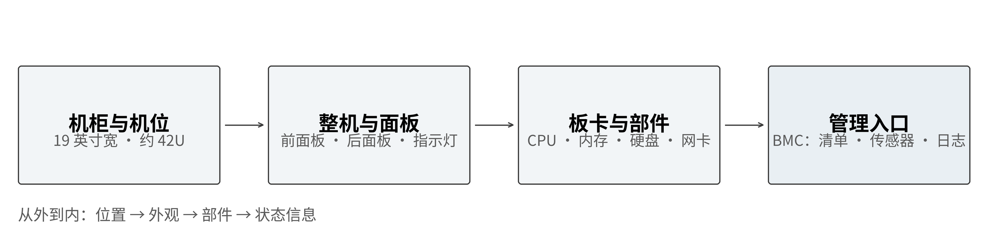
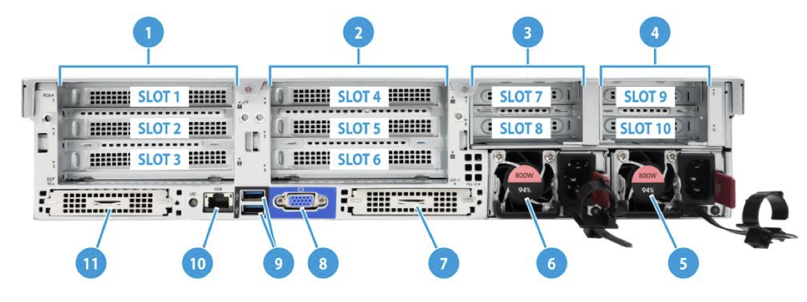
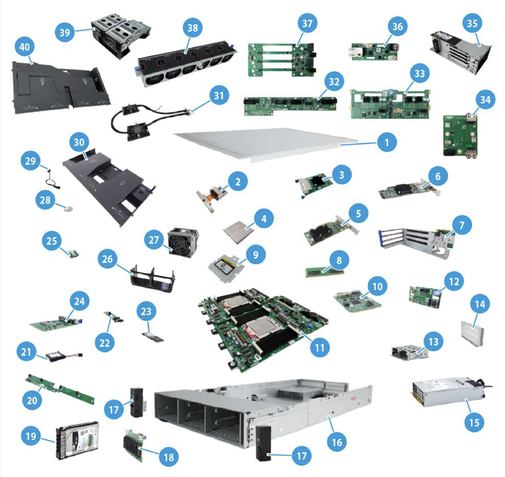
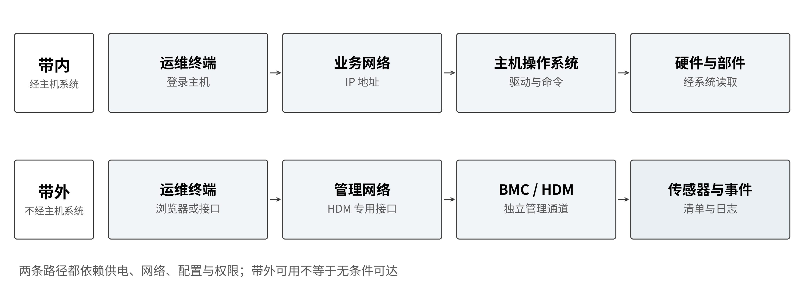

# 第3讲 认识服务器

**本课程定位：** 面向自建智算中心运维。上一讲认识了“算力”，这一讲把它落到一台机器上：机器由哪些部件组成，规格表怎么看，状态从哪里看。

值班表上写着一行字：“3 号机柜，第 12U，一台服务器 Health 灯橙色闪烁。”你走到机柜前，要回答四个问题：这是什么机器？装了什么？现在什么状态？下一步查什么？本讲就练这四个动作。

## 本讲学习目标

学完后，你应能：

- 分清“服务器软件”和“服务器硬件”，说出机架式、塔式、刀片、高密度四种形态的区别，会用“厂商—型号—手册”找资料。
- 从规格表里读出 CPU、内存、硬盘、网卡、电源五项参数，并记住“最多支持”“随配置变化”这类条件。
- 对着前面板、后面板和内部结构图，指出主要部件，说清风道和冗余的作用条件。
- 说清 BMC 是什么，带内、带外两条路怎么走，硬件清单、传感器、日志各能回答什么问题。
- 看到一条硬件告警，能写清“看到了什么、还不确定什么、下一步查什么”。

## 3.1、先认得这台机器

### 3.1.1、服务器是硬件，也是一种服务角色

“服务器”这个词有两种用法。一种指软件，比如处理网页请求的那个程序。另一种指硬件，也就是装着这个程序的那台机器。本讲讲的是硬件。

一台服务器要跑起来，至少需要四层配合。机箱里的部件负责供电和计算；主板上的固件（BIOS 或 UEFI）负责开机自检和基础设置；操作系统管理进程、内存和硬盘；应用在最上面提供服务。哪一层出问题，用户都可能“打不开网页”，但排查的位置不一样。

**先分清“机器”和“角色”。** 机器是眼前这台设备，型号、位置、装了什么，都是确定的。角色是它现在干的活：今天跑数据库，明天可以改跑推理。反过来，一个服务也能拆到多台机器上。所以看资料前，先确认手上是哪台机器。

<!-- pagebreak -->

### 3.1.2、形态不同，观察和运维方式也不同

服务器按外形和安装方式，通常分四类：机架式、刀片式、塔式、高密度。外形不只影响好不好看，还决定怎么上架、怎么散热、怎么维修。

表3-1、常见服务器形态与观察要点

| 形态 | 外观与安装 | 观察要点 | 常见使用场景 |
| --- | --- | --- | --- |
| 机架式 | 横着插进 19 英寸机柜，用 U 算高度，常见 1U、2U、4U | 前后接口、导轨、机柜还剩多少空位 | 机房和数据中心的主力 |
| 塔式 | 像台式机，立在地上 | 通风空间、放在哪、能加几张卡 | 办公室、小型业务 |
| 刀片式 | 多块“刀片”插进一个机箱，共用电源和风扇 | 整个机箱的状态、刀片对应哪个位置 | 密度高、统一管理 |
| 高密度与整机 | 一个机箱塞进更多计算单元，或按整机交付 | 供电、散热、内部怎么连 | 智算集群、AI 训练 |

**“高”不等于“强”。** 例如 H3C R4930 G7 是 2U 机架式服务器；NVIDIA DGX H100/H200 是 8U 的智算整机，里面装 8 颗 GPU。U 只说明占多高的机柜位置，快不快要看装了什么。8U 不等于比 2U 快四倍。

### 3.1.3、用型号定位资料：U、机柜与手册

机柜的高度用 U 表示。1U 等于 44.45 毫米，机柜宽 19 英寸，常见的整柜有 12U、24U、42U、48U。知道 U 数，才能算出机柜还剩多少空位。按 42U 粗算，能放 21 台 2U 设备；实际还要扣掉理线、配电、散热和承重。

**【例题】** 一台 2U 服务器占多高？机箱高度是 87.5 毫米，和 2U 对得上吗？

**解：** 2 × 44.45 = 88.9 毫米，也就是 2U 的位置有约 88.9 毫米高。机箱本身 87.5 毫米，比 88.9 小一点。差的那一点，是留给导轨、面板和安装间隙的。具体以该型号的规格为准。

**型号要连厂商和手册版本一起记。** 不同厂商的型号后缀，没有统一的“第几代”含义。可靠的做法分三步：看设备标签，确认厂商和型号；按型号找到对应手册；记下手册版本号和页码。看到“G7”“V3”这类写法，先查该厂商的说明，不要自己猜。

【随堂思考】同事说“G7 就是第七代，肯定比 G6 新”。没有厂商资料，这句话能当判断依据吗？你会先问他什么？

把 3.1 到 3.4 连起来看，就是一条从外到内的路线：先找机位，再看面板，然后认部件，最后找管理入口。

## 3.2、读懂关键参数

读规格表，可以先问五个问题：谁负责算？算的时候数据放哪？要存的数据放哪？数据怎么进出？谁来供电和散热？规格表大体也按这几类列。

表3-2、五项关键参数的读法与常见误读

| 部件 | 先看什么 | 还要看什么 | 常见误读示例 |
| --- | --- | --- | --- |
| CPU | 型号、几路、几核、主频 | 最多支持几路、功耗、PCIe 通道 | 规格表写“最多支持 2 路”，记录时写成“本机装了 2 颗 CPU”；实际要查硬件清单。 |
| 内存 | 容量、类型、速率 | 最多几根、跟 CPU 型号有关 | 把“24 根、4800 MT/s”和“16 根、5200 MT/s”两条不同条件下的上限，拼成“24 根、5200 MT/s”。 |
| 硬盘 | 介质、容量、接口 | 盘位数量、背板和控制卡 | 规格写“25SFF 盘位”，记录成“装了 25 块盘”。 |
| 网卡 | 端口数量、速率 | 用途（业务或管理）、插槽类型 | 看到“1 Gb/s HDM 专用”，把它当成整机的网络带宽。 |
| 电源与风扇 | 数量、冗余方式 | 配置差异、热插拔条件 | 数到 2 个电源模块，就认定“随便拔一个也不会断电”。 |

### 3.2.1、CPU：几路、几核、主频

CPU 是中央处理器，程序里的指令由它执行。

读 CPU 参数，先看型号，再看三个数：几路、几核、主频。

“路”是整机装几颗 CPU，常见单路、双路。“核”是一颗 CPU 里面的处理单元。所以“双路”不是“双核”，说的是两件事。主频是时钟的快慢，单位 GHz，可以理解成 CPU 的心跳。

以 R4930 G7 为例：最多支持 2 路海光 C86-4G CPU，单颗最大功耗 400 W，最高主频 2.7 GHz。三个数字都带条件：2 路是上限，400 W 是单颗上限，2.7 GHz 是“最高支持”。

【关键区别】“最多支持 2 路”是这个型号的能力，“这台装了 2 颗”是眼前的配置。前者查规格表就有，后者要查设备清单、开机自检信息或管理界面。把两者混在一起，是读规格表最常见的错。

### 3.2.2、内存：容量、类型、速率，还要看条件

内存是 CPU 干活时摊开的“桌面”，硬盘是存资料的“柜子”。桌面越大，能同时摊开的资料越多。这个比喻只帮助理解用途，数据怎么流动仍由操作系统和程序决定。

读内存先看三件事：容量（GB）、类型（DDR5）、速率（MT/s）。MT/s 是每秒百万次传输，不要当成同数字的时钟频率。

示例：R4930 G7 的内存规格分两种情况写。配海光 7490/7470，最多 24 根 DDR5，最高 4800 MT/s；配海光 7480，最多 16 根，最高 5200 MT/s。这两句不能拼成“最多 24 根、最高 5200 MT/s”，因为条数和速率都跟 CPU 型号绑定。

服务器内存一般带 ECC，也就是错误检查与纠正。内存错误分两类：可纠正错误、不可纠正错误。可纠正错误攒到设定的次数，HDM 才会告警；不可纠正错误可能让系统重启或卡死。

**【例题】** 一份规格表写“支持 DDR5，最多 24 根，最高 4800 MT/s”，另一份写“支持 16 根，最高 5200 MT/s”。应该如何记录这个配置？

**解：** 两句话来自不同 CPU 型号对应的配置。正确的记录方式是：型号、CPU 条件、条数、速率一起写。例如“配 7490/7470 时最多 24 根、4800 MT/s；配 7480 时最多 16 根、5200 MT/s”。只抄数字、丢掉条件，后面扩容和采购都会出错。

### 3.2.3、硬盘与存储控制卡：四个维度分开看

存储最容易乱，因为很多名字说的不是同一件事：介质（用什么存）、接口或协议（怎么连）、形态与盘位（多大、装哪）、容量（能存多少）。

表3-3、存储相关名称分别在描述什么

| 名称 | 说的是 | 不能推出 |
| --- | --- | --- |
| HDD | 介质：机械硬盘，靠盘片和磁头读写 | 一定比固态盘慢 |
| SSD | 介质：固态硬盘，用闪存 | 一定是 NVMe 接口 |
| SATA、SAS | 接口和协议：怎么连、怎么通信 | 一定是机械盘 |
| NVMe | 面向闪存的协议和连接方式 | 一定是 2.5 英寸盘 |
| LFF、SFF | 盘位大小：大尺寸、小尺寸 | 已经装了几块盘 |
| 背板 | 给硬盘供电、传数据的部件 | 一定带 RAID 功能 |
| 存储控制卡 | 管硬盘和阵列的部件 | 所有盘都得经过它 |

所以“HDD、SSD、NVMe”不是三种互斥的盘，实际配置里会出现“NVMe SSD”。看到“25SFF”也别理解成装了 25 块盘，它说的是盘位数量。

RAID 是把几块盘组织起来用的一种方式。不同级别在速度、容量、容错上取舍不同。R4930 G7 的存储控制卡，可以给 SAS/SATA 盘做 RAID。

表3-4、RAID 0、1、5 的定位与容错

| 级别与做法 | 坏一块盘会怎样 | 要注意 |
| --- | --- | --- |
| RAID 0：把数据分散写到多块盘 | 没有备份，坏一块整组都用不了 | 图快，不适合存不能丢的数据 |
| RAID 1：几块盘写一样的内容（镜像） | 坏一块，还有一份 | 容量利用率低，成本高 |
| RAID 5：数据加校验分散存 | 多数情况能扛住坏一块 | 重建期间又慢又危险 |

**RAID 不等于“永不丢数据”。** RAID 0 里任意一块盘坏，逻辑盘就变成 Offline，数据无法恢复。其他带冗余的级别，坏盘数量超过容错范围才会失效。RAID 6、RAID 10 也会出现，容量怎么算留到后面的课。

### 3.2.4、网卡与接口：速率不等于用途

网卡负责服务器和其他设备之间传数据。先看有几个口、标称速率多少，再看它干什么：业务、存储，还是管理。

R4930 G7 有两类网络接口。一类是“1 个 1 Gb/s HDM 专用网络接口”。另一类是 OCP 3.0 网卡插槽，2 个加 1 个选配，最多 3 个。1 Gb/s 只说明管理口自己的速率，不代表整台机器的网络能力。OCP 插槽说的是能扩几张卡，也不等于已经装了 3 张。

**长得一样，用处不同。** 管理口和业务口都可能是 RJ45。后面板图上，HDM 专用网络接口用来登录管理界面。只看接口形状就判断用途，很容易把管理线插到业务口。

### 3.2.5、电源与风扇：冗余有条件

电源模块把市电变成服务器要的电，风扇把热气吹走。

规格表常写数量和冗余方式。R4930 G7 的 LFF/SFF 机型是 2 个热插拔电源，1+1 冗余；前维护机型是 4 个，PSU1/2、PSU3/4 各自 1+1。风扇方面，LFF/SFF 最多 4 个热插拔风扇，N+1 冗余。

冗余就是“多备一份”，不等于“永远不会断电”。有几个模块，说明不了两路电是不是分开的，更说明不了业务一定不中断。要看具体配置和现场接线。

**【例题】** 一台机器有两个电源模块，是否意味着拔掉一个不会影响业务？

**解：** 不能这样判断。第一，“支持 1+1 冗余”是型号的能力，实际有没有接在两路电上、当前是不是冗余状态，要看现场接线和管理界面。第二，热插拔是“在规定条件下可以带电插拔”，不是“任何时候谁都能拔”。

## 3.3、看懂机箱结构

### 3.3.1、前面板：先找位置，再读灯

前面板能看到硬盘托架、开机/待机按钮、指示灯和几个接口。

看到一个灯亮，别急着下结论，先确认三件事：哪台设备、哪个灯、什么状态。

以R4930 G7 为例，把 Health（健康状态）和 UID（定位）两盏灯分开讲。Health 绿灯常亮，表示正常或有轻微告警；绿灯 4 Hz 闪，表示 HDM 正在启动；橙灯 1 Hz 闪，表示严重告警；红灯 1 Hz 闪，表示紧急告警。UID 蓝灯常亮，表示有人在找这台机器；蓝灯 1 Hz 闪，表示正在被远程管理或带外升级，这时不要下电。

表3-5、R4930 G7 常用指示灯的读法

| 指示灯 | 状态 | 含义 | 判读要点 |
| --- | --- | --- | --- |
| Health | 绿灯常亮 | 正常或有轻微告警 | 绿灯不等于完全没告警，要查管理界面 |
| Health | 橙灯 1 Hz 闪 | 严重错误告警 | 记下现象，再查 HDM 系统状态 |
| Health | 红灯 1 Hz 闪 | 紧急错误告警 | 先按流程上报，不要现场试错 |
| UID | 蓝灯常亮 | 设备被定位 | 用来找机器，不是故障标志 |
| UID | 蓝灯 1 Hz 闪 | 远程管理或带外升级中 | 不要下电 |
| 电源模块 | 绿灯常亮 | 模块工作正常 | 只说明这个模块的状态 |
| 电源模块 | 橙灯常亮 | 模块严重故障，或这个模块没电、另一个正常 | 要分清是模块问题还是外部供电 |
| 硬盘 | 橙灯常亮 | 硬盘出故障 | 结合盘位、阵列状态和备份再决定 |

**这张表只代表 R4930 G7。** 不同厂商、不同型号，灯色和闪烁频率都可能不一样。不能把“绿灯正常、橙灯故障”当成通用规则。

<!-- pagebreak -->

### 3.3.2、后面板：电源、网口与管理口

后面板是供电和对外连接的地方。以 LFF/SFF 机型为例，能看到 PCIe 插槽（1～4）、电源模块（5、6）、可选 OCP 网卡（7、11）、VGA（8）、USB（9）和 HDM 专用网络接口（10）。

看图不用背编号，先指出三类：电源模块在哪、业务网口在哪、管理口在哪。两个电源模块（5、6）各有一个状态灯：绿灯常亮是正常；绿灯 0.33 Hz 闪是备用状态、没有输出；橙灯常亮，可能是模块坏了，也可能是这个模块没电、另一个正常。

### 3.3.3、内部布局：主板把部件连起来

打开机箱盖（只在实验或按流程维护时），能看到主板、CPU 和散热器、内存插槽、扩展卡、硬盘背板和风扇。主板上装着 BIOS 芯片、PCIe 插槽，CPU 和内存都插在主板上。

结构图里，几个位置要记住：

- CPU（4）上面盖着散热器（2），看见金属块不等于看见 CPU 芯片。认图要看标注，不要靠形状猜。
- 内存（8）插在主板插槽里，插错位置会告警。
- 硬盘（19）通过背板（18）供电、传数据。背板和控制卡（5）是两个部件。
- 扩展卡一般通过 Riser（7）转接安装。没装 Riser 要放假面板（14），不然风道会漏。
- 服务器管理模块（10）提供 I/O 接口和 HDM 带外管理。它是一块独立的板卡，不是操作系统里的程序。

### 3.3.4、供电与散热：条件比外观更重要

风扇把冷风抽进来、热风排出去，导风罩把风引到 CPU 和内存。机箱盖、导风罩、Riser 假面板、空槽位挡板，都是风道的一部分。这些部件必须在位，不是为了整齐：缺了，风就从缺口跑掉，有的部件会过热。

环境条件也要看。R4930 G7 的工作温度是 5 到 40 ℃，但有些配置会降低上限；海拔超过 900 米，每升高 100 米，最高温度降 0.33 ℃。这些数字都有前提，不能单独拿出来用。

“开机/待机”按钮不能彻底断电。按下去以后，部分电源和电路还在工作。要完全断电，按规定的顺序做，不要按一下按钮就去拆不能带电拔的部件。

【随堂思考】有同事为了“散热更好”，在运行中打开机箱盖。请从风道和人身安全两个角度，各说一条不能这样做的理由。

## 3.4、BMC 与带外管理

### 3.4.1、两条观察路径

操作系统进不去了，还能不能知道机器有没有电、温度高不高、风扇转不转？这时要看管理入口。

BMC 是基板管理控制器。它盯着各种传感器，还能看硬件清单、日志，做远程控制。

从操作系统里用命令、驱动看信息，叫带内管理。BMC 走另一条路，不依赖操作系统，叫带外管理。不同厂商叫法不同，做的事是一样的。

【关键区别】“带外”不是“不用网络”，也不是“随时都能进”。它照样要供电、要连管理网、要有账号权限。操作系统坏了，BMC 可能还能用；管理网断了，管理页面一样打不开。

### 3.4.2、三类信息：清单、传感器、事件

BMC 信息比较多，在入门阶段先看下面三类信息。

表3-6、BMC 三类信息各回答什么问题

| 类别 | 常见名称 | 回答的问题 | 使用注意 |
| --- | --- | --- | --- |
| 硬件清单 | 系统信息、硬件清单、Inventory | 这台机器报告装了哪些 CPU、内存、硬盘、网卡 | 是管理系统报告的信息，要核对设备身份和采集时间 |
| 传感器 | 传感器信息、Sensor | 现在的电源、温度、风扇、电压是什么状态 | 注意对象、位置、单位和阈值，不要跟别的设备比 |
| 事件日志 | 事件日志、Event Log、SEL | 过去发生过什么，什么时候，涉及哪个部件 | 日志记录事件，不等于已经找到根因 |

三类信息要互相核对。清单说明“报告装了什么”，传感器说明“现在怎么样”，日志说明“曾经发生过什么”。只看一屏就下结论，容易把旧事件当成现在的故障。

### 3.4.3、带外能力的条件

带外管理想要正常使用，至少需要满足下面四个条件：

- 供电：设备没通电，BMC 也没法工作。HDM 启动也需要相应的供电条件。
- 管理网络：管理口要连到能访问的网络，地址、网关、VLAN 都要配对。
- 权限：要有能用的账号，能做什么还受授权范围限制。
- 固件与许可：部分远程功能要看固件版本和授权。有的厂商把远程控制台、虚拟介质放在付费许可里，不能假设所有 BMC 默认都有。

【随堂思考】操作系统登录不上，同事说“那就上 BMC 重启一下”。在按重启之前，至少要先确认哪两件事？

### 3.4.4、名称与协议不是一回事

不同厂商的管理产品名字不同：H3C 叫 HDM，戴尔叫 iDRAC，联想叫 XCC2。它们干的是同一类活，但菜单、字段和授权各不相同，不能背一套菜单套所有机器。

协议是另一个层次。IPMI 是较早的管理协议，已经不再更新，更建议现代的管理接口，比如 Redfish。Redfish 是面向融合与混合 IT 的管理标准，人和程序都能读。

**工具也不等于 BMC。** iFIST 是部署维护工具，管 RAID 配置、装系统、诊断、刷固件，不替代 BMC 的健康状态和日志。BIOS/UEFI 管开机和硬件配置，操作系统管运行环境。三者分工不同，不是同一个东西。

## 3.5、根据证据判断常见异常

### 3.5.1、先记录，再判断

处理故障的一般流程是：准备工具 → 收集信息 → 诊断定位 → 处理。核心一句话：先按现象列出可能原因，再用日志和测试排除，最后找到根因。

记录时写三栏：

- 看到了什么：告警文字、对象、时间、当前指示灯状态。
- 还不能确定什么：原因、影响范围、有没有影响业务。
- 下一步查什么：看哪个页面的哪个字段、哪条日志、哪次测试。

### 3.5.2、样例一：电源冗余丢失

先看一个例子：传感器页面上，PSU Redundancy 状态显示“严重”，读数是 Power Redundancy Lost。

可能原因有五个：外部供电或线缆有问题；模块没插好；模块坏了；HDM 固件太旧或配置不对；电源槽位坏了。

处理顺序是：先看模块状态灯，橙灯常亮或闪烁，就查外部供电、重新接线缆；再看模块有没有插好；再看是不是没满配，没满配就升级 HDM 固件；然后换模块；还不行，联系技术支持查主板。

**【例题】** 收到“Power Redundancy Lost”，下面哪句话更适合写进交接记录？

A：电源模块坏了，需要更换。

B：传感器报告电源冗余丢失，要核对对应模块的输入状态、安装情况和相关事件，暂不能确认是模块故障。

**解：** 选B。A把“冗余丢失”直接当成“模块损坏”，跳过了其他可能原因。B留下了现象、对象和待核查项，接手的人能接着查。这条告警说的是供电保障状态，不直接说明主机已经停机。

### 3.5.3、样例二：内存可纠正错误

运行中单个内存出现可纠正错误，不会马上告警；攒到设定的阈值，HDM 才报警。这一情况的处理建议是“不影响操作系统正常运行，无需处理”。

另一种是不可纠正错误：告警能定位到具体的内存条（DIMM）。系统会按 CPU 的设定处理，可能重启，也可能卡死。

【关键区别】可纠正和不可纠正，是两件事。前者在一般情况下不影响业务；后者可能让机器重启或卡死。所以既不能见一条记录就换内存，也不能把所有内存告警都当成没事。

### 3.5.4、再看两条常见线索

**风扇声音变大。** 风扇声音变大有好几种情形：多个风扇噪音大、单个风扇接近全速、所有风扇全速。转速变高，可能是负载高、环境温度高、风道被挡，也可能是部件有问题。只听声音，判断不了风扇坏没坏。

**磁盘告警、离线或认不到。** 磁盘问题要分开看：盘故障、逻辑盘 Offline、认不到盘、寿命、控制卡，原因各不相同。看到一块盘亮橙灯，先确认盘位、阵列状态、有没有备份，再决定做什么。如果这组盘是 RAID 0，任意一块盘坏，整组数据都读不了，处理顺序和带冗余的阵列不一样。

【随堂思考】巡检时看到一台服务器硬盘橙灯常亮，业务还正常。你能直接拔这块盘吗？请写出至少两项要先确认的信息。

<!-- pagebreak -->

## 3.6、本讲回顾与自测

学习完本讲后，试着用自己的话回答五个问题：这台机器是什么、装了什么、部件在哪、状态从哪看、异常怎么描述。能说出理由，比记住型号更重要。

表3-7、本讲目标与对应判断

| 学习目标 | 应能做出的判断 |
| --- | --- |
| 认机器 | 说出形态和厂商型号，并用型号找到对应手册和版本 |
| 读参数 | 读出五项关键参数，同时保留“最多支持”“随配置变化”等条件 |
| 看结构 | 在前后面板和结构图上指出主要部件，说清风道和冗余的作用条件 |
| 找入口 | 分清带内和带外两条路径，说明清单、传感器、日志各回答什么问题 |
| 判异常 | 把现象、待核查证据、还不能确定的原因分开写 |

### 3.6.1、本讲自测

**1 单位换算。** 1U 等于多少毫米？一台 4U 设备占多高的机柜空间？

**2 参数条件。** 规格表写“最多支持 2 路 CPU”，能不能据此判断眼前这台机器装了两颗 CPU？为什么？

**3 存储概念。** 判断对错并说明理由：“这台机器用的是 NVMe，所以它的硬盘一定是固态盘。”

**4 管理路径。** 操作系统无法登录时，下面哪一项最可能还能提供硬件信息？说明它的使用条件。

A. 主机内的命令　　B. BMC 管理页面　　C. 业务应用的日志

**5 告警判断。** 传感器显示“Power Redundancy Lost”，写出“看到了什么”和一项“下一步查什么”，不要写你还不确定的原因。

**6 场景描述。** 你在机柜前看到一台服务器 Health 灯橙色闪烁、UID 蓝灯常亮。用三句话向值班同事描述：设备位置、你看到的两个状态、下一步查什么。

**答：**

____________________________

____________________________

<!-- pagebreak -->

## 3.7、参考答案与解析

### 3.7.1、随堂思考解析

**思考 1（型号与代际）：** 不能。不同厂商的型号后缀，没有统一的代际标准。没有厂商资料时，“G7 比 G6 新”只是猜测。应先问：这是哪个厂商的哪个系列，对应哪份手册，手册版本是什么。

**思考 2（开盖散热）：** 风道方面：机箱盖、导风罩和假面板是风道的一部分，打开后风从缺口跑掉，CPU、内存可能过热，风扇也会被迫提速。安全方面：运行中的设备里有高速旋转部件和带电部分，维护热插拔部件时要尽量少开盖，维护不能带电拔的部件要先断电。

**思考 3（BMC 重启）：** 至少先确认两件事：管理入口能不能访问、账号有没有权限；业务是不是在运行、重启会造成什么影响。带外管理是另一条观察路径，不是随时能用的操作通道。

**思考 4（拔盘）：** 不能直接拔。先确认：这块盘的位置和状态；它属于哪个阵列；阵列是不是已经降级；有没有可用备份；这个型号的硬盘热插拔流程是什么。业务正常，不代表阵列还有余量。

### 3.7.2、课后自测解析

**1** 1U = 44.45 毫米，4U 约为 177.8 毫米，也就是 4 × 44.45。实际安装还要算导轨、面板和间隙，以机柜和设备的规格为准。

**2** 不能。“最多支持 2 路”是型号的能力。实际装了几颗，要看设备清单、开机自检信息或管理界面。

**3** 错误。NVMe 说的是协议和连接方式；硬盘是固态还是机械，由介质决定。用 NVMe 的通常是固态盘，但不能从接口反推介质。要查具体型号和规格。

**4** 选 B。BMC 有一条不依赖操作系统的管理通道。前提是：设备有电、管理网通、账号有权限，而且相关功能没有被固件或许可限制。

**5** 示例：看到了什么——“传感器页面 PSU Redundancy 状态为严重，读数是 Power Redundancy Lost”。下一步查什么——“看对应电源模块状态灯的颜色和闪烁状态”，或者“看这个模块的输入状态和相关事件记录”。写成“电源模块已损坏”，就超出了现有证据。

**6** 示例：“3 号机柜 12U 一台服务器，前面板 Health 灯橙色 1 Hz 闪烁，UID 蓝灯常亮。我下一步进 HDM 看系统状态和事件日志，确认告警对象和发生时间，再按值班流程上报。”三句话分别是位置、现象、下一步，没有替同事下结论。

<!-- pagebreak -->

## 3.8、术语与疑问

### 3.8.1、术语

表3-8、本讲术语

| 术语 | 本讲中的含义 |
| --- | --- |
| BMC | 基板管理控制器。它是服务器上一块独立的管理部件，不经过操作系统，直接读硬件传感器；能看硬件清单、温度、电压、风扇状态和事件日志，还能远程控制。服务器断电或系统崩溃时，它仍可能工作，但要满足供电、管理网和权限条件。 |
| HDM、iDRAC、XCC2 | 三家厂商给自家 BMC 管理功能起的商品名：新华三是 HDM，戴尔是 iDRAC，联想是 XCC2。功能同类，但菜单、字段、授权不同，换品牌要重新熟悉界面。 |
| 带内、带外 | 带内：从操作系统里用命令、驱动看信息。带外：走 BMC 的独立通道，不依赖操作系统。两条路都要网络和权限，带外不等于随时都能进。 |
| U | 机柜高度单位，1U 等于 44.45 毫米。设备常写成 1U、2U、4U，2U 就是占两个 U。42U 整柜理论上能放 21 台 2U 设备，实际还要扣掉理线、配电、散热和承重。 |
| LFF、SFF | 硬盘盘位的尺寸：LFF 是大尺寸（约 3.5 英寸），SFF 是小尺寸（约 2.5 英寸）。它说的是盘位大小，不代表已经装了几块盘。 |
| RAID | 把多块硬盘组织成一个逻辑盘的方式。不同级别在速度、容量、容错上取舍不同：RAID 0 没有冗余，RAID 1 是镜像，RAID 5 带校验。级别选错，坏一块盘的后果完全不同。 |
| ECC | 内存的错误检查与纠正。它能发现并纠正部分错误，分“可纠正”和“不可纠正”两类；前者一般不影响业务，后者可能导致重启或卡死。 |
| 冗余 | “多备一份”的设计，如 1+1 电源、N+1 风扇。冗余说明有备份能力，不等于任何时候拔掉一个都不影响业务，还要看接线和当前状态。 |
| 热插拔 | 在规定条件下可以带电插拔部件。需要满足部件、状态和操作流程的要求，不是任何人都能随时拔。 |
| DIMM | 内存条。一条内存就是一个 DIMM，内存告警通常能定位到具体是哪一条。 |

文中机型参数属于该型号的支持能力，不代表现场设备的实际配置。

### 3.8.2、我的疑问

**写下一项希望在后续课程中进一步理解的问题**

<!-- pagebreak -->

## 附录、服务器观察卡

这张卡可以在课堂或课后填。只记经允许公开的信息，不抄账号、管理地址、序列号和资产编号。没有提供的信息写“未提供”，不要用猜测补。

一、我观察的对象

选择：官方资料中的设备／经教师确认的现场设备。

厂商与型号：________________________________________________

资料编号与页码，或配置记录名称：________________________________

二、我认出的部件

在图上指出 CPU、内存、硬盘、网卡、电源模块、风扇，并选一个写出用途。

部件：____________　用途：____________________________________

三、我找到的三项参数

第 1 项　项目与内容：________________　条件与出处：____________________

第 2 项　项目与内容：________________　条件与出处：____________________

第 3 项　项目与内容：________________　条件与出处：____________________

以上信息属于：型号支持能力／设备报告的配置（请分别标注）。

尚未提供、不能据此推断的信息：________________________________

四、我知道的管理信息

我可以在________________页面，查看____________________________。

这项访问需要的条件是：________________________________________

五、我的一条异常记录

告警来源与对象：______________________________________________

已知现象：__________________________________________________

待核查证据：________________________________________________

目前不能确认的原因或影响：____________________________________

填写提示：现象写你看到的或资料里写明的；原因写你还不确定的；证据写你下一步准备去看的。三者分开，记录才对别人有用。

<!-- md-only -->

## 附：主要参考资料（仅 Markdown 保留，不印入 Word/PDF）

以下资料与课程资料库中的编号一一对应。页码指本地 PDF 的文件页序，不是印刷页码；网页资料保存于 2026 年 11 月 5 日。

- 新华三《H3C UniServer R4930 G7 系列服务器用户指南》，版本 6W111-20260730。用于产品规格、部件说明、前后面板、指示灯与本讲结构图，对应 PDF 第 20 至 25 页、第 29 至 37 页、第 124 至 129 页。资料库编号 L01。
- 新华三《H3C 服务器故障处理手册》，版本 6W126-20260618。用于故障处理流程、电源冗余丢失、内存可纠正与不可纠正错误、风扇与磁盘问题，对应 PDF 第 18 至 19 页、第 167 至 168 页、第 212 至 213 页、第 236 页。资料库编号 L02。
- 新华三《H3C iFIST 配置指导》，版本 6W108-20251120。用于说明部署维护工具与 BMC 的边界，对应 PDF 第 3、10 页。资料库编号 L03。
- NVIDIA《DGX H100/H200 User Guide》的 Introduction、BMC、Safety、Redfish APIs Support 章节。用于高密度智算整机对照、BMC 职责、气流要求与管理接口示例。资料库编号 W03、W13、W26、W27。
- Lenovo Press《ThinkSystem SR650 V3 Server Product Guide》，LP1601。用于内存与存储规格的组织方式、XCC2 管理功能与许可条件的交叉核对。资料库编号 W02。
- Dell《PowerEdge R750 Technical Guide》，2022 年 11 月 Rev. A03。用于 iDRAC 等厂商命名对照，不作为新款设备推荐。资料库编号 W20。
- MDN Web Docs 的 Server 词条。用于区分提供服务的软件与承载服务的硬件。资料库编号 W31。
- 新华三 Computing 产品概览页。用于服务器形态分类。资料库编号 W16。
- Amazon Web Services《What is a CPU?》。用于核心与时钟的基本释义。资料库编号 W34。
- 施耐德电机（台湾）的机架与机柜页面。用于 1U = 44.45 毫米、19 英寸宽度与常见整柜高度。资料库编号 W35。
- Intel 的 IPMI 页面，含 IPMI 推动方 2020 年 6 月的联合说明。用于说明 IPMI 规范的维护状态与向 Redfish 的过渡。资料库编号 W36。
- DMTF 的 Redfish 标准页。用于 Redfish 的定位与规范版本。资料库编号 W37。
- Microsoft Learn 的 RAID 词条。用于 RAID 的基本定位与 RAID 0、1、5 的容错差别。资料库编号 W38。

本讲引用的在线资料，其原始网址、获取时间与原文校验值记录在资料库的《06_讲义补充资料_20261105/README.md》与《来源元数据_20261105.json》中，可先按资料编号定位，再回查原网址。

<!-- /md-only -->
