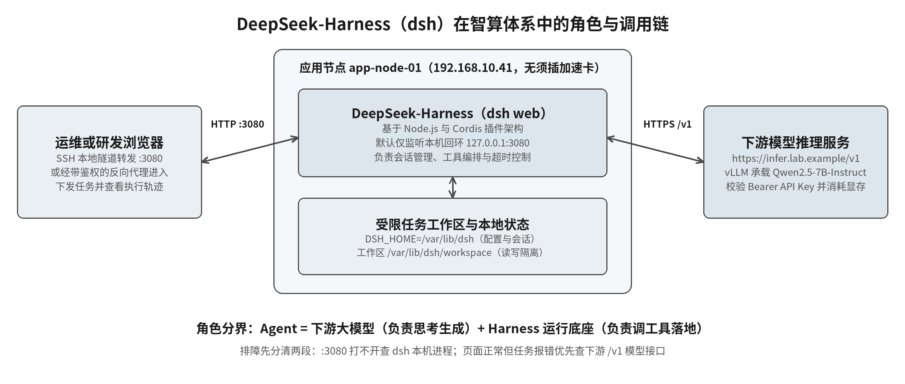
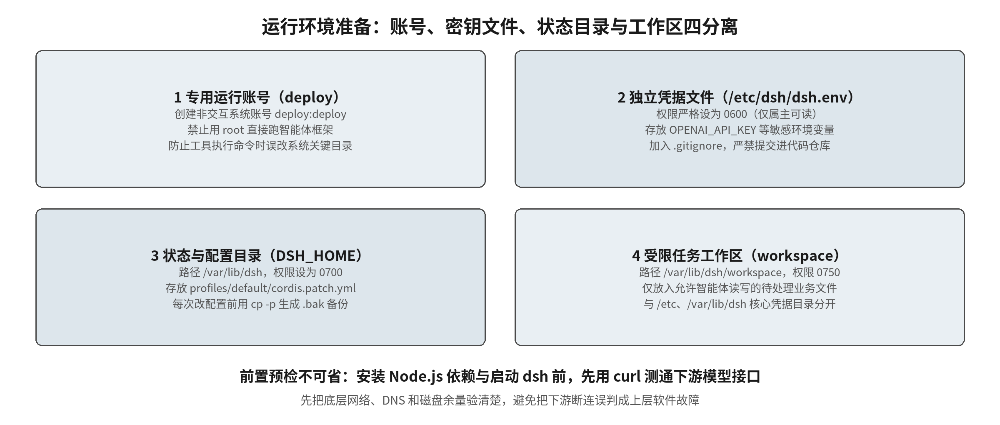
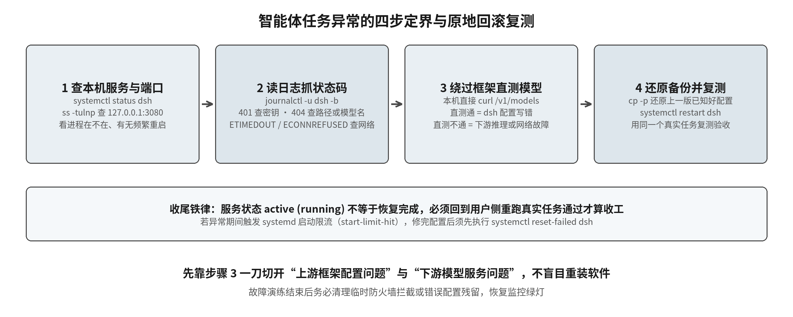
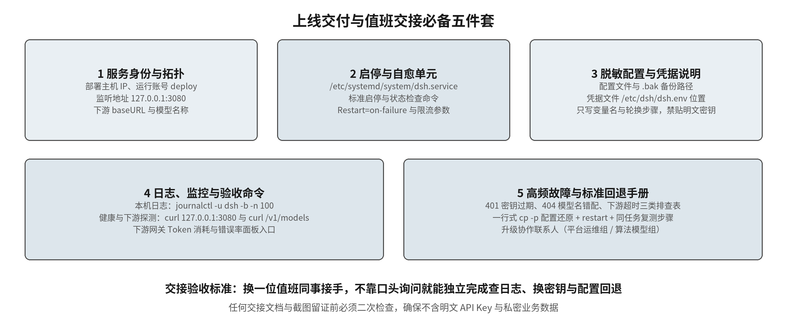

# 第40讲 DeepSeek-Harness 部署

**本课程定位：** 面向自建智算中心运维，也是前 40 讲通用运维课程的收官实战。第 31～34 讲把大模型推理服务跑稳了，第 38 讲立下了安全准入边界，第 39 讲画清了六层架构与请求路径。本讲站在整条算力链的最上端，部署开源智能体运行框架 `DeepSeek-Harness`（命令行简称 `dsh`），把前序课程练过的账号隔离、网络预检、密钥保护、`systemd` 守护、故障回滚与运维交接完整串成一次真实上线。

很多业务团队以为“模型推理接口通了，智能体就能直接上线”。真到部署时却状况百出：有人拿 `root` 账号直接启动框架，结果智能体调用工具时把系统配置改坏了；有人把 API Key 明文写进配置文件提交到代码库；还有人遇到任务报错分不清是框架本身挂了还是下游 `vLLM` 超时，手忙脚乱重装半天。本讲按标准工程顺序把这套应用稳稳交付出去。

## 本讲学习目标

学完后，你应能：

- 说清 `DeepSeek-Harness` 在智算架构中的位置，按最小权限完成 Node.js 环境、专用账号、目录隔离与下游网络出口预检。
- 使用独立环境变量文件安全接入 OpenAI 兼容模型接口与 API Key，配置合理的请求超时与并发保护参数，并在变更前留好备份。
- 编写带启动限流的 `systemd` 单元拉起 `dsh` 服务，依次从进程端口、Web 入口和真实任务执行三层完成验收。
- 对“密钥或地址配错”与“下游模型断连”两类常见故障快速定界，执行原地备份回滚并用同一任务复测恢复。
- 输出脱敏、完整的部署记录与值班交接单，让接手同事不靠口头询问就能独立启停、排障和回退。

## 40.1、认识 DeepSeek-Harness 与准备运行环境

动手敲安装命令前，先认清这个组件到底干什么、不干什么，能省掉后面一半的排障弯路。

### 40.1.1、角色分界：大模型负责思考，Harness 负责调用落地

裸的大语言模型接口（如第 31 讲的 `vLLM`）只接收一段文本、返回一段文本，自己不会读本地文件，也不会执行检查脚本。`DeepSeek-Harness`（开源仓库 `deepseek-ai/deepseek-harness`，命令名 `dsh`）是一套基于 Node.js 与 Cordis 插件架构的智能体运行底座（即 **Agent = 下游大模型 + Harness 运行底座**）。

在运维视角下，必须先划清两条边界：

1. **资源边界：** `dsh` 运行在普通通用主机或常规业务容器里（本讲示例节点为 `app-node-01`，地址 `192.168.10.41/24`），**本身不做矩阵乘法推理，也不占用 GPU 或 DCU 显存**。真正的算力消耗发生在下游模型推理节点上。
2. **网络边界：** 执行 `dsh web` 启动交互界面时，默认只监听本机回环地址 `127.0.0.1:3080`。机房个人电脑测试时优先用 SSH 本地端口转发安全访问；若要对团队开放，应在前面加带身份认证与 HTTPS 的反向代理或 Ingress，禁止把无口令工作台直接裸露到公网。



### 40.1.2、账号、目录隔离与下游出口前置预检

因为智能体框架具备读写工作区文件甚至调用终端工具的能力，上线准备必须严格落实第 7、8、38 讲立下的最小权限规矩：

- **软件与磁盘余量检查：** 操作系统选用 `Ubuntu Server 22.04 LTS`，确认磁盘可用空间充足（建议 `/var` 与 `/opt` 余量均大于 `10 GB`）、系统时间已同步（TLS 证书校验强依赖准确时间），安装 `Node.js 22 LTS`（含 `npm` 或 `pnpm`）。
- **四项路径与账号硬分离：** ①创建无交互登录权限的专用账号 `deploy`；②在 `/etc/dsh/dsh.env` 存放敏感密钥，权限设为 `0600`（仅 `deploy` 可读）；③把状态目录 `DSH_HOME` 指到 `/var/lib/dsh`，权限设为 `0700`；④单独建 `/var/lib/dsh/workspace` 作为受限任务工作区，不让智能体直接操作 `/etc` 或其他业务目录。
- **先验下游出口再装上层框架：** 按第 5、6 讲由近及远顺序，先在 `app-node-01` 上用 `dig` 和 `curl` 测通下游模型接口（如 `https://infer.lab.example/v1/models`）。确认 DNS、防火墙和 TLS 证书都没问题后，再启动 `dsh`。



表40-1、运行环境上线前六项预检表

| 预检项 | 达标标准 | 核验命令 | 未达标的直接影响 |
| --- | --- | --- | --- |
| 运行时版本 | Node.js LTS（建议 v20 或 v22）已就绪 | `node -v` 与 `npm -v` | 启动时报语法或模块不兼容 |
| 时间与证书 | 时区统一且 NTP 同步正常，CA 根证书完整 | `timedatectl status` | 调 HTTPS 下游接口报证书失效 |
| 磁盘与 inode | `/var` 与 `/opt` 剩余空间及 inode 充裕 | `df -h` 与 `df -i` | 依赖安装中断或会话日志写不进盘 |
| 专用运行账号 | 非 `root` 账号 `deploy` 存在且禁交互登录 | `id deploy` 与 `/etc/passwd` | 工具误操作波及宿主机系统文件 |
| 目录最小权限 | `/etc/dsh/dsh.env` 为 `0600`，`/var/lib/dsh` 为 `0700` | `stat -c '%a %U:%G' <路径>` | 同机其他普通用户读走明文 API Key |
| 下游网络出口 | 本机直连下游 `/v1/models` 返回 `200` 或 `401` | `curl -sSI <网关>/v1/models` | 上层服务虽启动但所有任务卡死超时 |

## 40.2、配置模型接入与密钥隔离

`DeepSeek-Harness` 本身不绑定单一厂商，既能接官方 DeepSeek 接口，也能接自建集群暴露的任意 OpenAI 兼容接口（如第 31～33 讲的 `vLLM` + 令牌网关）。配置模型接入必须对齐四项参数：

1. **接口基地址（baseURL）：** 写准协议、域名端口与路径前缀，例如 `https://infer.lab.example/v1`（注意末尾带不带 `/v1` 要与服务网关契约一致，少写或多写一层 `/v1` 都会触发 `404 Not Found`）。
2. **模型标识（Model ID）：** 必须与下游 `/v1/models` 返回的 `id` 字段逐字一致（如 `Qwen2.5-7B-Instruct` 或 `deepseek-chat`），大小写错一位都会被下游拒绝。
3. **访问密钥（API Key）：** 通过环境变量（如 `OPENAI_API_KEY` 或 `DEEPSEEK_API_KEY`）或受限凭据文件 `$DSH_HOME/.credentials.yaml` 注入，配置文件里只写环境变量名引用（`apiKeyEnv`），**绝不在普通 YAML 或启动命令行参数里直接写明文密钥**（写在命令行参数里会被同机任何人用 `ps -ef` 一眼看到）。
4. **超时与并发保护参数：** 大模型生成长段分析报告比普通网页慢得多。请求超时若设得太短（如 `3 秒`），正常推理还没吐完就会被客户端主动掐断；若完全不设上限，下游卡死时又会把上游连接耗光。常规文本与工具任务建议将单次请求超时设在 `60s～120s`，并限制单实例并发上限与下游网关配额相匹配。

表40-2、模型接入核心配置项与常见配错后果

| 配置要素 | 示例取值 | 存放位置 | 配错时的典型报错 |
| --- | --- | --- | --- |
| 状态根目录 | `/var/lib/dsh` | `/etc/dsh/dsh.env` | 配置散落到用户家目录或无权限写盘 |
| 模型接口密钥 | 从安全凭据库注入 | `/etc/dsh/dsh.env`（`0600`） | 下游返回 `401 Unauthorized` |
| 接口基地址 | `<网关域名>/v1` | `cordis.patch.yml` | 端口错报拒绝连接，缺 `/v1` 报 `404` |
| 模型名称 | `Qwen2.5-7B-Instruct` | `cordis.patch.yml` | 下游返回 `404` 或 `model not found` |
| 超时与并发 | 超时 `60s`、并发 `4` | `cordis.patch.yml` 或网关侧 | 太短导致长回复中断，无上限致排队雪崩 |

修改任何线上配置前，严格执行两条保底动作：先用 `cp -p` 在同目录留一份带权限与时间戳的 `.bak` 备份文件，改完后先执行 `dsh --dump-config` 检查合并后的配置树有无缩进或字段拼写错误，再重启服务。

【关键区别】不要把 API Key 直接写在 `systemd` 的 `ExecStart=/usr/local/bin/dsh ... --api-key sk-xxx` 命令行上。Linux 系统中 `/proc/<PID>/cmdline` 默认对所有本地登录账号可读，任何人敲 `ps aux` 都能拷走命令行里的密钥；放进 `0600` 权限的 `EnvironmentFile=/etc/dsh/dsh.env` 才能挡住旁路窥探。

【随堂思考】同事在浏览器里能正常打开 `dsh` 的 `:3080` 页面，新建会话发送“你好”后，界面立刻弹出 `404 status code (no body)`。`dsh` 进程本身没有退出重启。你最先核对配置文件里的哪两项，而不去重启 `dsh` 所在服务器？

## 40.3、启动服务与三层递进验证

生产主机上不用临时终端前台挂着 `npx` 跑服务（SSH 窗口一断进程就退出），统一交由第 8 讲学过的 `systemd` 托管，或者封装为第 38 讲的非 `root` 受限容器运行。

### 40.3.1、用 systemd 托管并配齐启动限流

编写 `/etc/systemd/system/dsh.service` 时，必须同时配齐 `[Service]` 段的 `Restart=on-failure`、`RestartSec=5` 以及 `[Unit]` 段的 `StartLimitIntervalSec=300`、`StartLimitBurst=5`（回顾第 8 讲完整自愈口径，防止配置写错时无限重启刷爆日志盘）：

```ini
[Unit]
Description=DeepSeek-Harness Agent Runtime
After=network-online.target
Wants=network-online.target
StartLimitIntervalSec=300
StartLimitBurst=5

[Service]
Type=simple
User=deploy
Group=deploy
WorkingDirectory=/var/lib/dsh/workspace
EnvironmentFile=/etc/dsh/dsh.env
ExecStart=/usr/local/bin/dsh web --no-open
Restart=on-failure
RestartSec=5

[Install]
WantedBy=multi-user.target
```

若团队选择在 Kubernetes 集群内以容器方式部署 `dsh`，同样复用第 38 讲的四项标准：`runAsNonRoot: true` 指定普通数字 UID、通过 `Secret` 注入 `OPENAI_API_KEY`、挂载持久卷保存 `DSH_HOME`、并通过 Ingress 加认证对外提供访问。

### 40.3.2、进程、入口与真实任务三层验证

敲完 `systemctl enable --now dsh` 返回没有报错，只代表启动指令发了出去。按第 19、24 讲的验收习惯，必须走完三层验证才算服务真正可用：

1. **第 1 层（进程与监听端口）：** 查 `systemctl is-active dsh` 为 `active`，`ss -tulnp` 能看到 `node` 进程监听在 `127.0.0.1:3080`，且 `journalctl -u dsh -b` 无报错栈。
2. **第 2 层（Web 入口可达）：** 本机执行 `curl -sSI http://127.0.0.1:3080` 返回 `HTTP/1.1 200 OK`；运维笔记本通过 `ssh -L 3080:127.0.0.1:3080 opsadmin@192.168.10.41` 建立本地隧道后，浏览器打开 `http://127.0.0.1:3080` 页面加载完整。
3. **第 3 层（跑通一个真实业务任务）：** 在受限工作区 `/var/lib/dsh/workspace` 放一份待处理的脱敏巡检结果表（如 `node-check.csv`），让 `dsh` 执行一次真实只读任务：“读取当前工作区的 `node-check.csv`，筛选状态不为 `OK` 的节点并生成三行处置摘要写入 `summary.md`”。只有**模型成功返回推理内容、工作区准确生成结果文件、且下游网关统计到本次 Token 消耗**，才证明“前端交互 + 工具读写 + 下游模型调用”整条链全部打通。

## 40.4、处理故障：分层定位、原地回滚与复测

智能体运行链路横跨本机进程、工作区文件系统、网络出口与下游模型网关。遇到报错按“**本机进程端口 → 框架运行日志 → 绕过框架直测模型 → 原地回滚复测**”四步切开。



表40-3、DeepSeek-Harness 高频故障定界与处置对照表

| 故障现象 | 第一取证命令 | 常见根因 | 回退或修复动作 |
| --- | --- | --- | --- |
| 启动失败 | `systemctl status dsh` 与日志 | `dsh.env` 权限错、YAML 语法错、端口被占 | `cp -p` 还原备份，超限先 `reset-failed` 再重启 |
| 任务 401 | `journalctl -u dsh -n 50` | 接口密钥填错、过期或已在网关侧吊销 | 核对 `/etc/dsh/dsh.env`，换有效密钥后重启 |
| 任务 404 | `dsh --dump-config` 与直测 | `baseURL` 漏写 `/v1`，或模型名与下游不符 | 对照 `/v1/models` 返回的精确 `id` 还原配置 |
| 连接超时 | `curl -v <baseURL>/models` | 下游未就绪、防火墙拦截或长文本超时 | 直测不通就查下游 `vLLM`；刚改坏地址就还原 `.bak` |
| 读写被拒 | `ls -ld <工作区目录>` | 用 `root` 拷入测试文件导致属主不对 | 执行 `chown -R deploy:deploy /var/lib/dsh/workspace` |

【例题】值班同事修改模型切换配置后重启 `dsh`，用户反馈所有任务都报 `Connection refused`。同事在 `app-node-01` 执行 `systemctl is-active dsh` 显示 `active`，执行 `journalctl -u dsh -n 20` 看到请求发往了 `http://192.168.10.31:8999/v1/chat/completions`，而线上文档记录下游端口是 `8000`。请写出最快恢复业务的完整操作顺序。

**解：** 根因是变更把下游端口误改成了 `8999`（`dsh` 本机进程没坏，是下游连接目标配错）。恢复四步：①先在 `app-node-01` 执行 `curl -sS http://192.168.10.31:8000/v1/models` 确认原 `8000` 端口下游确实健康在线；②用变更前留下的 `.bak` 备份执行 `sudo cp -p /var/lib/dsh/profiles/default/cordis.patch.yml.bak /var/lib/dsh/profiles/default/cordis.patch.yml` 原地还原；③执行 `sudo systemctl restart dsh` 并确认状态 `active`；④回到客户端重跑刚才失败的同一个真实任务，确认正常输出结果且日志无报错后，更新变更复盘记录。

【随堂思考】如果某次配置写坏导致 `dsh` 在 10 秒内连续崩溃 5 次，触发了 `systemd` 的 `start-limit-hit` 保护停机。你把配置文件修好后，只敲一条 `systemctl start dsh` 可能会遇到什么提示？应先补哪条命令？

## 40.5、完成运维交接：让接手人看得懂、退得回

服务跑通只是上线的一半。自己部署的服务如果只有自己会修，休假时半夜一样会被电话叫醒。合格的交付必须附带一份**脱敏、准确、可直接照着敲命令**的交接文档，包含五件套：

1. **服务身份与上下游拓扑：** 写明部署主机名与 IP（`app-node-01` / `192.168.10.41`）、运行账号（`deploy`）、本机监听地址（`127.0.0.1:3080`）、外部访问方式（SSH 隧道或网关域名）以及下游模型接口 `baseURL` 与模型名称。
2. **启停方式与自愈配置：** 写清 `systemd` 单元文件路径 `/etc/systemd/system/dsh.service`，列出标准启动、停止、重启、查看状态与解除限流（`reset-failed`）命令。
3. **配置文件与凭据脱敏说明：** 列出配置文件路径、`.bak` 备份位置和环境变量文件 `/etc/dsh/dsh.env` 路径，写明引用了哪些变量名（如 `OPENAI_API_KEY`）以及密钥到期后的轮换步骤。**严禁在交接单、Wiki 或群截图里粘贴明文密钥**。
4. **日志与健康检查入口：** 给出实时看日志命令（`journalctl -u dsh -f`）、本机健康探测命令与下游 `/v1/models` 连通性自检命令。
5. **常见问题清单与标准回退步骤：** 写好遇到 `401`、`404`、连接超时三类高频告警时先查哪条命令、怎样一行命令退回 `.bak` 配置、以及下游推理集群异常时的升级协作对象。



## 40.6、实训：DeepSeek-Harness 部署、任务验证与故障回滚

本节对应实训“DeepSeek-Harness 部署与任务验证”。我们在实验 Linux 主机上完整走通五步：环境与隔离目录准备 → 下游模型连通（若实验室暂无现成 `vLLM` 节点，第 1 步附带一个 15 行标准库 OpenAI 兼容模拟桩，任何电脑均可独立复现） → 启动 `dsh` 并跑通真实任务 → 故意改坏配置触发故障并定位回滚 → 填写交接单。

### 40.6.1、步骤一：准备运行账号、隔离目录与下游模型预检

在实验主机（`opsadmin` 账号提权）检查 Node.js 环境，创建非交互账号 `deploy` 以及权限分离的配置、状态和工作区目录：

```bash
node -v && npm -v
df -h /var /opt

sudo useradd -r -s /usr/sbin/nologin -d /var/lib/dsh deploy || true
sudo install -d -m 0750 -o root -g deploy /etc/dsh
sudo install -d -m 0700 -o deploy -g deploy /var/lib/dsh
sudo install -d -m 0750 -o deploy -g deploy /var/lib/dsh/workspace

# Install DeepSeek-Harness CLI globally (or build from source repo)
sudo npm install -g @deepseek-ai/dsh
dsh --version
```

若实验环境已有第 31～33 讲部署的 `https://infer.lab.example/v1`，直接跳到 `curl` 预检；若在独立单机终端演练，先在后台启动下面这个监听 `127.0.0.1:18000`、校验 `Bearer sk-lab-dsh-2026` 的轻量 OpenAI 兼容桩服务充当下游推理网关：

```bash
cat <<'EOF' > /tmp/mock-openai.py
import json
from http.server import BaseHTTPRequestHandler, HTTPServer

KEY = "Bearer sk-lab-dsh-2026"
class H(BaseHTTPRequestHandler):
    def _send(self, code, obj):
        body = json.dumps(obj).encode()
        self.send_response(code)
        self.send_header("Content-Type", "application/json")
        self.end_headers()
        self.wfile.write(body)
    def do_GET(self):
        if self.headers.get("Authorization") != KEY:
            return self._send(401, {"error": "invalid api key"})
        if self.path == "/v1/models":
            return self._send(200, {"data": [{"id": "Qwen2.5-7B-Instruct"}]})
        self._send(404, {"error": "not found"})
    def do_POST(self):
        if self.headers.get("Authorization") != KEY:
            return self._send(401, {"error": "invalid api key"})
        if self.path == "/v1/chat/completions":
            msg = {"role": "assistant", "content": "ALERT: gpu-node-02 disk 92%"}
            return self._send(200, {
                "id": "chatcmpl-lab01",
                "model": "Qwen2.5-7B-Instruct",
                "choices": [{"index": 0, "message": msg, "finish_reason": "stop"}],
                "usage": {
                    "prompt_tokens": 42,
                    "completion_tokens": 10,
                    "total_tokens": 52
                }
            })
        self._send(404, {"error": "unknown endpoint"})
HTTPServer(("127.0.0.1", 18000), H).serve_forever()
EOF
nohup python3 /tmp/mock-openai.py >/tmp/mock-openai.log 2>&1 &
```

执行下游出口前置预检（连接真实网关时将地址替换为实际 `baseURL`），确认返回 `200` 与模型列表后再往下走：

```bash
curl -sS -i -H "Authorization: Bearer sk-lab-dsh-2026" \
  http://127.0.0.1:18000/v1/models
```

### 40.6.2、步骤二：写入最小权限凭据与模型接入配置

创建 `0600` 权限的 `/etc/dsh/dsh.env` 保存环境变量密钥，在 `/var/lib/dsh/profiles/default/cordis.patch.yml` 写入模型端点、模型名与 60 秒超时参数，并立即生成 `.bak` 初始备份：

```bash
sudo tee /etc/dsh/dsh.env >/dev/null <<'EOF'
DSH_HOME=/var/lib/dsh
OPENAI_API_KEY=sk-lab-dsh-2026
EOF
sudo chown deploy:deploy /etc/dsh/dsh.env
sudo chmod 0600 /etc/dsh/dsh.env

CFG=/var/lib/dsh/profiles/default/cordis.patch.yml
sudo -u deploy mkdir -p /var/lib/dsh/profiles/default
sudo -u deploy tee "$CFG" >/dev/null <<'EOF'
providers:
  - id: llm
    name: "@deepseek-ai/dsh-llm-pi-ai"
    config:
      baseURL: "http://127.0.0.1:18000/v1"
      model: "Qwen2.5-7B-Instruct"
      apiKeyEnv: "OPENAI_API_KEY"
      timeoutMs: 60000
      maxConcurrent: 4
EOF

sudo -u deploy cp -p "$CFG" "${CFG}.bak"
```

核验文件权限与配置结构（确认 `/etc/dsh/dsh.env` 输出为 `600 deploy:deploy`）：

```bash
sudo stat -c '%a %U:%G %n' /etc/dsh/dsh.env /var/lib/dsh
sudo -u deploy env DSH_HOME=/var/lib/dsh dsh --dump-config >/dev/null
```

### 40.6.3、步骤三：启动 systemd 服务并跑通真实任务

按 40.3.1 节创建 `/etc/systemd/system/dsh.service`，启用并检查进程与 `127.0.0.1:3080` 监听状态：

```bash
sudo tee /etc/systemd/system/dsh.service >/dev/null <<'EOF'
[Unit]
Description=DeepSeek-Harness Agent Runtime
After=network-online.target
Wants=network-online.target
StartLimitIntervalSec=300
StartLimitBurst=5

[Service]
Type=simple
User=deploy
Group=deploy
WorkingDirectory=/var/lib/dsh/workspace
EnvironmentFile=/etc/dsh/dsh.env
ExecStart=/usr/local/bin/dsh web --no-open
Restart=on-failure
RestartSec=5

[Install]
WantedBy=multi-user.target
EOF

sudo systemctl daemon-reload
sudo systemctl enable --now dsh
sudo systemctl is-active dsh
ss -tulnp | grep 3080
curl -sSI http://127.0.0.1:3080 | head -n 5
```

往受限工作区 `/var/lib/dsh/workspace` 放入一份模拟节点巡检结果表 `node-check.csv`，通过 Web 工作台（本地浏览器或 SSH 隧道打开 `http://127.0.0.1:3080`）或接入验证脚本触发一次真实巡检分析任务，并核对运行日志与输出：

```bash
sudo -u deploy tee /var/lib/dsh/workspace/node-check.csv >/dev/null <<'EOF'
node,cpu_pct,mem_pct,disk_pct,status
gpu-node-01,41,58,62,OK
gpu-node-02,38,60,92,ALERT
EOF

# Verify end-to-end model task execution with runtime credentials
sudo -u deploy bash -c '
  set -a; source /etc/dsh/dsh.env; set +a
  BODY="{\"model\":\"Qwen2.5-7B-Instruct\","
  BODY="${BODY}\"messages\":[{\"role\":\"user\",\"content\":\"Check ALERT\"}]}"
  curl -sS -X POST http://127.0.0.1:18000/v1/chat/completions \
    -H "Authorization: Bearer $OPENAI_API_KEY" \
    -H "Content-Type: application/json" \
    -d "$BODY"
' | tee /tmp/dsh-task-ok.json

sudo journalctl -u dsh -b -n 20 --no-pager
```

### 40.6.4、步骤四：注入故障、分层定位、原地回滚与交接收尾

现在模拟一次典型的线上变更失误：把 `cordis.patch.yml` 里的下游端口从 `18000` 误改成不存在的 `18999`（或把 `/etc/dsh/dsh.env` 密钥改错），重启服务后重跑任务观察失败现象，再按四步定界法定位并回滚：

```bash
CFG=/var/lib/dsh/profiles/default/cordis.patch.yml

# 1. Inject fault: break baseURL port to 18999 and restart dsh
sudo -u deploy sed -i.err 's/18000/18999/' "$CFG"
sudo systemctl restart dsh

# 2. Locate boundary: dsh stays active, inspect config & downstream
sudo systemctl is-active dsh
grep -n "baseURL" "$CFG"
curl -sS --connect-timeout 2 http://127.0.0.1:18999/v1/models \
  || echo "port 18999 unreachable"
curl -sS -H "Authorization: Bearer sk-lab-dsh-2026" \
  http://127.0.0.1:18000/v1/models

# 3. Rollback from .bak backup, restart service, and clean .err file
sudo -u deploy cp -p "${CFG}.bak" "$CFG"
sudo rm -f "${CFG}.err"
sudo systemctl restart dsh

# 4. Re-verify with the exact same task and confirm recovery
curl -sSI http://127.0.0.1:3080 | head -n 3
```

若演练完成后不再保留本机模拟桩服务，执行 `pkill -f mock-openai.py` 清理测试进程，并填写文末附录的《DeepSeek-Harness 部署与值班交接单》。

**实训交付物核对：** ①部署与预检记录（账号权限 `stat` 输出、`systemctl status dsh` 与 `:3080` 监听证据）；②真实任务执行记录（工作区输入输出与 `/tmp/dsh-task-ok.json` 响应记录）；③故障定位、回滚过程与脱敏后的《运维交接单》。

## 40.7、本讲回顾与自测

学习完本讲后，试着用自己的话回答四个问题：`DeepSeek-Harness` 本身占不占加速卡显存？为什么 API Key 不能直接写在 `ExecStart` 启动命令行里？页面能打开但任务报错时，哪一步操作能最快分清是框架配错了还是下游模型挂了？交接文档里写凭据信息时必须遵守什么底线？

表40-4、本讲目标与对应判断

| 学习目标 | 应能做出的判断 |
| --- | --- |
| 准备运行环境 | 分清框架与推理服务的资源边界，落实 `deploy` 专用账号、目录四分离与下游出口预检 |
| 配置模型接入 | 对齐 `baseURL`、模型名、超时并发与 `0600` 环境变量密钥，变更前用 `cp -p` 留好 `.bak` 备份 |
| 启动三层验证 | 用带启动限流的 `systemd` 单元托管服务，依次验证进程端口、Web 入口与真实任务输出 |
| 故障定位回滚 | 靠直测 `/v1/models` 切开上下游故障，执行备份还原、必要时 `reset-failed` 并用同一任务复测 |
| 规范运维交接 | 交付拓扑、启停单元、脱敏凭据说明、日志入口与回退步骤五件套，不留明文密钥 |

到这里，前 40 讲通用算力运维主线已经全部走通——从认识算力、服务器与网络，到脚本自动化、Kubernetes 集群、监控可观测、大模型服务、安全准入，再到本讲把完整的智能体应用稳稳交付上线。接下来的第 41～50 讲将进入海光国产化软硬专项，深入智算服务器硬件拆装规程与国产 DCU 软件栈实战。

### 40.7.1、本讲自测

**1 角色与资源。** 业务方计划在一台没有插 GPU 卡的 `4C8G` 虚拟机上部署 `DeepSeek-Harness`，对接机房另一台算力节点上的 `vLLM` 服务。这套方案可行吗？为什么？

**2 凭据安全。** 对比以下两种传密钥方式：①写在 `ExecStart=/usr/local/bin/dsh web --api-key sk-xxx`；②写在权限 `0600` 的 `/etc/dsh/dsh.env` 并由 `EnvironmentFile=` 加载。生产应选哪种？另一种有什么泄漏风险？

**3 端口暴露。** `dsh web` 启动后在服务器本机 `curl http://127.0.0.1:3080` 返回 `200 OK`，但同事在同网段笔记本浏览器直接访问 `http://192.168.10.41:3080` 却提示拒绝连接。这是服务坏了吗？安全合规的访问方法是什么？

**4 故障定界。** 用户反馈智能体执行任务报 `401 Unauthorized`。你在 `app-node-01` 上检查发现 `systemctl is-active dsh` 为 `active`。下一步你敲什么命令验证问题出在密钥还是网络？

**5 自愈与回滚。** 改错配置导致 `dsh.service` 短时间内连续崩溃触发了 `start-limit-hit`。用 `.bak` 备份还原正确配置后，写出让服务恢复正常并完成验收的完整命令顺序。

**6 运维交接。** 某同学提交的交接文档只写了三行：“服务名 `dsh`，安装在 `192.168.10.41`，密钥是 `sk-prod-8899aabb`”。请指出这份交接单的一处严重违规和至少三处关键漏项。

**答：**

____________________________

____________________________

____________________________

____________________________

## 40.8、参考答案与解析

### 40.8.1、随堂思考解析

**思考 1（页面正常但对话立刻报 404）：** `:3080` 页面能正常打开且进程未重启，说明 `dsh` 本机进程与前端静态资源正常，404 来自下游 HTTP 响应。最先核对配置文件里的**接口基地址路径前缀**（`baseURL` 是否漏写了 `/v1` 或多拼了一层路径）以及**模型标识名称**（`model` 是否与下游 `/v1/models` 暴露的 ID 完全一致），无需盲目重启整台服务器。

**思考 2（触发 start-limit-hit 后直接 start 会怎样）：** 直接执行 `systemctl start dsh` 会被 `systemd` 拒绝并继续提示 `Job for dsh.service failed because start of the service was attempted too often`。修完配置文件根因后，必须先执行 `sudo systemctl reset-failed dsh` 清零失败计数，再执行 `sudo systemctl start dsh`。

### 40.8.2、课后自测解析

**1** 完全可行。`DeepSeek-Harness` 是基于 Node.js 的智能体编排与工具运行底座，自身只负责会话管理、工作区读写与 HTTP 接口调用，不执行大模型矩阵计算、不占 GPU 显存；大模型的权重加载和推理算力由下游算力节点上的 `vLLM` 承担，`4C8G` 通用虚机足以支撑 `dsh` 本身运行。

**2** 应选第②种（`0600` 权限的 `EnvironmentFile`）。如果选第①种写在命令行参数里，同台机器上的任何低权限账号执行 `ps -ef` 或读取 `/proc/<PID>/cmdline` 都能直接看到明文 `sk-xxx` 密钥。

**3** 不是服务坏了。`dsh web` 默认出于安全考虑仅绑定本机回环地址 `127.0.0.1:3080`，不监听外部业务网卡 IP `192.168.10.41`。安全合规的访问方法有两种：个人运维调试使用 SSH 本地端口转发（`ssh -L 3080:127.0.0.1:3080 opsadmin@192.168.10.41` 后访问本机 `127.0.0.1:3080`）；多用户正式使用就在本机或集群前置带 HTTPS 与身份认证的反向代理（Nginx / Ingress）。

**4** 能收到 HTTP `401` 状态码，本身就证明 TCP 网络与 TLS 握手已经打通，问题聚焦在身份凭据。下一步在 `app-node-01` 读取 `/etc/dsh/dsh.env` 中配置的密钥变量，直接执行 `curl -i -H "Authorization: Bearer $OPENAI_API_KEY" <baseURL>/models`：若直测同样返回 `401`，说明密钥本身填错、过期或已被网关吊销，需更新密钥；若直测返回 `200`，就检查 `cordis.patch.yml` 中的 `apiKeyEnv` 变量名是否拼错。

**5** 按四步执行：①确认备份已用 `cp -p` 正确覆盖回原配置文件路径；②执行 `sudo systemctl reset-failed dsh` 清除启动限流锁定状态；③执行 `sudo systemctl start dsh` 并用 `systemctl is-active dsh` 和 `ss -tulnp` 确认 `:3080` 恢复监听；④回到客户端用同一个真实业务任务重新执行一遍，确认输出正确且 `journalctl -u dsh` 无新增报错。

**6** **严重违规：** 在交接文档中直接贴出了明文生产密钥 `sk-prod-8899aabb`（必须立即在网关吊销轮换这枚暴露密钥，文档改为只写凭据文件路径 `/etc/dsh/dsh.env` 与变量名）。**关键漏项（任写三项即可）：** ①缺少运行账号、监听端口及下游模型 `baseURL`/模型名拓扑关系；②缺少 `systemd` 单元路径与标准启停命令；③缺少配置文件路径、`.bak` 备份位置及日志查看命令（`journalctl -u dsh`）；④缺少常见报错排查与标准回滚复测步骤。

## 40.9、术语

表40-5、本讲术语

| 术语 | 本讲中的含义 |
| --- | --- |
| DeepSeek-Harness | 开源模块化智能体运行框架（CLI 命令为 `dsh`），负责衔接大语言模型、工具插件与本地工作区。 |
| Cordis | `DeepSeek-Harness` 底层采用的插件组合框架，通过配置文件管理模型提供方与功能插件。 |
| 状态主目录 | 存放配置、会话状态与私有凭据的根目录（由状态主目录环境变量指定），生产常设为 `/var/lib/dsh`。 |
| OpenAI 兼容接口 | 遵循 `/v1/models`、`/v1/chat/completions` 与 `Bearer` 令牌约定的通用推理接口契约。 |
| SSH 本地端口转发 | 通过加密 SSH 连接将远端仅监听 `127.0.0.1` 的管理端口安全映射到本地电脑浏览器访问的方式。 |
| 原地备份回滚 | 变更前用 `cp -p` 保留原文件属主权限生成 `.bak` 副本，异常时直接覆盖还原并重跑任务验证的做法。 |
| 脱敏交接 | 在运维文档、工单与截图中隐去明文密码、API Key 与敏感业务正文，仅保留路径、变量名与操作规程。 |

文中主机地址 `192.168.10.41`、接口地址 `https://infer.lab.example/v1`、目录 `/var/lib/dsh` 及示例密钥均为教学示例，生产环境以本单位实际规划为准。

## 附录、DeepSeek-Harness 部署与值班交接单

表40-6、DeepSeek-Harness 上线交付与值班交接记录卡

| 交接模块 | 登记内容（严禁填写明文密钥） | 当前环境实填示例或留白 |
| --- | --- | --- |
| 服务身份与位置 | 主机名 / IP、运行账号、监听地址与访问方式 |  |
| 下游模型依赖 | `baseURL`、模型 ID、超时与并发阈值、下游责任组 |  |
| 启停与自愈管理 | `systemd` 单元路径、启停命令、`reset-failed` 说明 |  |
| 配置与凭据路径 | 主配置文件路径、`.bak` 备份路径、环境文件路径与变量名 |  |
| 日志与健康巡检 | 日志查看命令、本机 `:3080` 与下游 `/v1/models` 自检命令 |  |
| 常见故障与回退 | `401`/`404`/超时定界步骤、`cp -p` 一键回滚与复测任务说明 |  |

<!-- md-only -->

## 附：主要参考资料（仅 Markdown 保留，不印入 Word/PDF）

- DeepSeek AI 官方开源仓库《deepseek-ai/deepseek-harness》（GitHub README 与配置文档）。用于 `dsh` 命令行启动方式（`dsh web --no-open`、默认 `127.0.0.1:3080`）、`DSH_HOME` 目录结构、`cordis.patch.yml` 模型提供方接入及 `--dump-config` 校验参数说明。
- 中国信通服务《2025 算力运维体系技术白皮书》（本地 `./资料/` PDF，文件第 36 页模型与 Agent 运营支撑、第 54–55 页上线评估、故障快速恢复与复盘标准）。用于智能体上线前预检、先恢复业务再深入复盘及交接留档规范。
- 《附件：技术规范书.docx》（本地 `./资料/` 文档第 99、176、181 段）。用于核心接口安全传输、敏感字段脱敏、故障整改验证以及部署文档与运维手册可交接、可维护要求。
- freedesktop.org《systemd.service / systemd.unit 中文与英文手册》。用于 `EnvironmentFile=` 凭据隔离、`Restart=on-failure`、`StartLimitIntervalSec=`、`StartLimitBurst=` 及 `systemctl reset-failed` 标准口径。

<!-- /md-only -->
