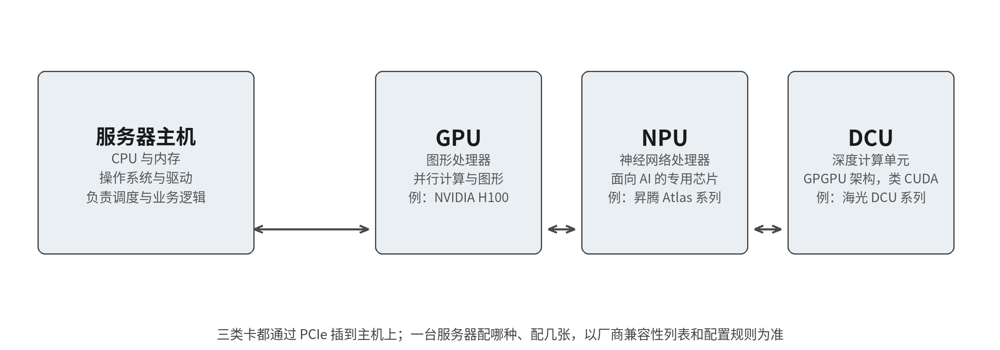
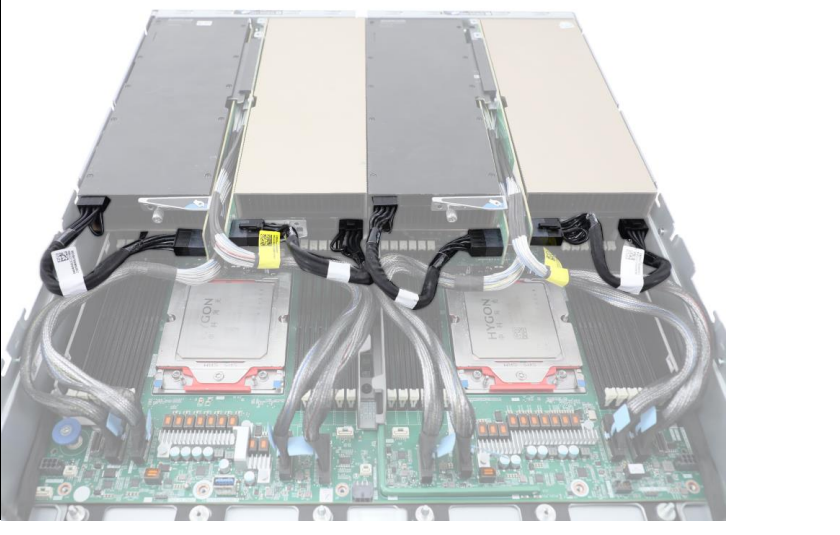
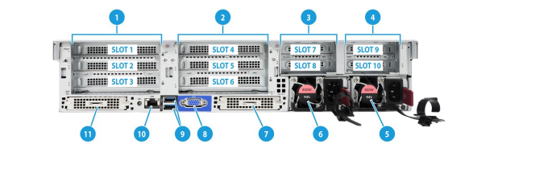
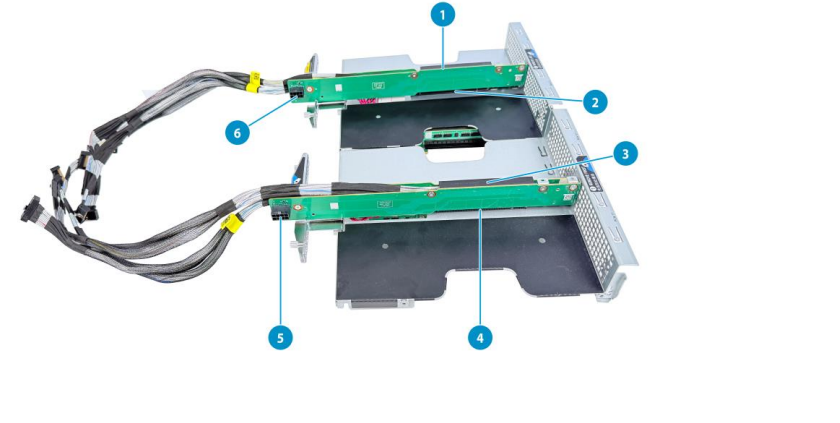
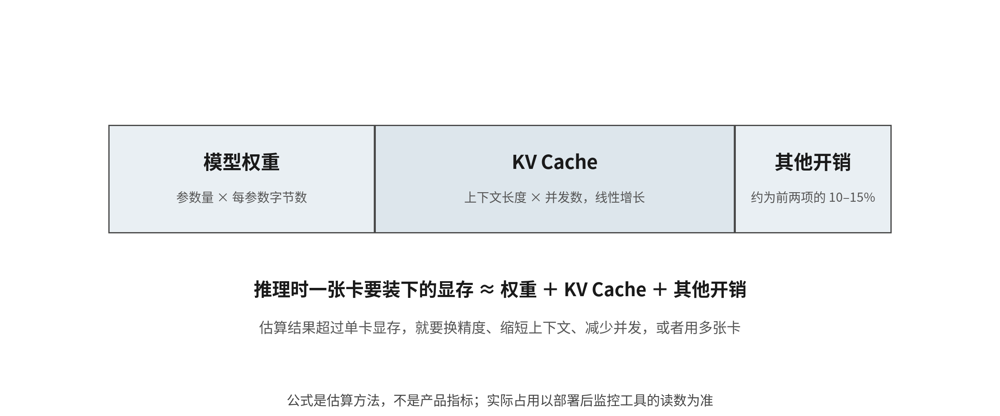
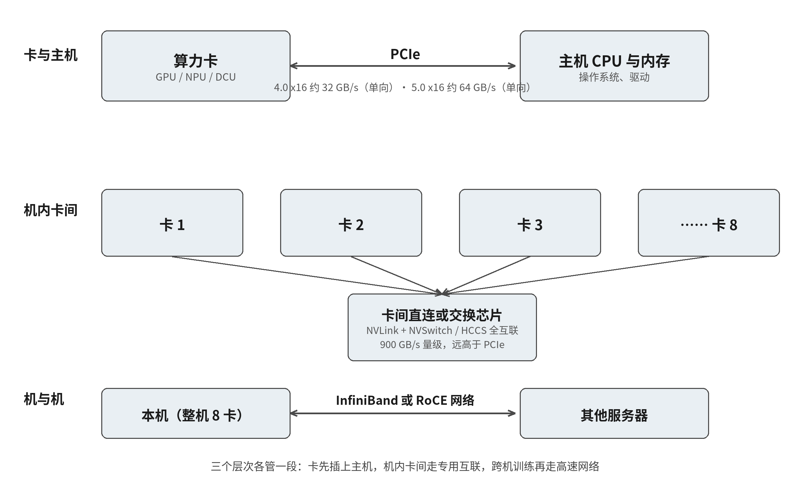
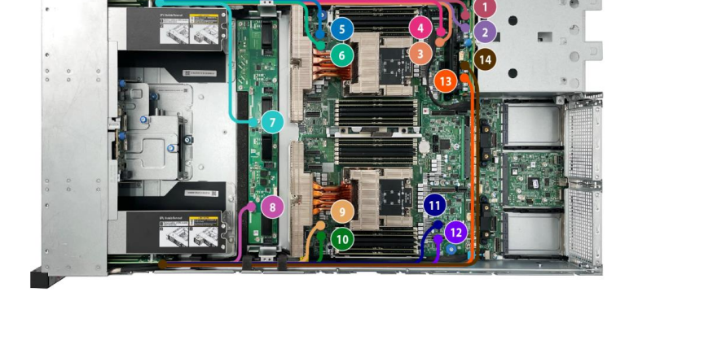
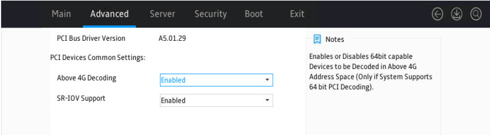
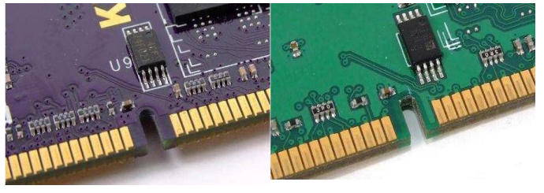

# 第4讲 认识算力卡

**本课程定位：** 面向自建智算中心运维。上一讲认识了服务器整机，这一讲打开机箱看里面最贵的一块部件：算力卡。它是什么类型，规格表怎么读，卡和卡之间怎么连，状态从哪里看。

入职第一周，主管交给你一份到货清单，上面写着“双宽 GPU 卡 4 张，配套 Riser 卡和电源线”。你要回答四个问题：这是什么类型的卡？装到哪个槽位？通电后怎么确认它正常？出故障先看哪里？本讲就练这四件事。

## 本讲学习目标

学完后，你应能：

- 说出 GPU、NPU、DCU 三类算力卡各自的基本定位，知道一台服务器可以配哪种卡要查什么。
- 从一张规格表里读出算力、显存、接口、功耗、形态五类参数，并保留“按精度分档”“稀疏或稠密”这类条件。
- 用“权重＋KV Cache＋其他开销”的结构，粗算一个推理场景需要多少显存。
- 说清卡与主机、机内卡间、机与机三个层次的互联方式，知道 PCIe、NVLink、HCCS、InfiniBand 各在哪一层。
- 用监控命令、带外管理和日志三条路径检查一张卡的健康状态，看到 Xid 报错能说出它是什么、下一步做什么。

## 4.1、认识不同类型的算力卡

### 4.1.1、为什么需要算力卡

第二讲讲过，CPU 适合串行的复杂逻辑和业务调度。AI 任务的特点是同样的计算要在海量数据上同时做很多遍，这恰好不是 CPU 的强项。

算力卡就是为这类并行计算设计的加速部件。它插在服务器的 PCIe 插槽里，由主机的 CPU 和操作系统调度。主机负责业务逻辑和数据准备，算力卡负责批量运算。第二讲讲过，算力中心通常采用芯片异构计算架构，把 CPU、GPU、NPU、TPU 等多种芯片组合起来用。

【关键区别】“这台服务器有算力卡”和“这台服务器的算力来自算力卡”是两句话。卡装上还要装驱动、配框架，业务才真正跑在卡上。巡检时看到卡在位，不等于它在干活，要看利用率。

### 4.1.2、三类常见算力卡

GPU 是图形处理器，最初为图形渲染设计，后来成为并行计算的主力，AI 训练和推理都大量使用。NPU 是神经网络处理器，为 AI 计算专门设计，常见于推理场景。DCU 是海光推出的深度计算单元，以 GPGPU 架构为基础，兼容“类 CUDA”环境，训练与推理都能用。

表4-1、三类算力卡的基本定位与示例

| 类型 | 基本定位 | 常见用途 | 示例 |
| --- | --- | --- | --- |
| GPU | 通用并行计算与图形 | AI 训练、推理、图形与科学计算 | NVIDIA H100 |
| NPU | AI 专用芯片 | AI 推理、视频分析 | 华为 Atlas 300I Duo |
| DCU | GPGPU 架构，兼容类 CUDA 环境 | AI 训练、推理与科学计算 | 海光 DCU 系列 |

这张表只说明基本定位，不代表某张卡只能干一件事。例如 Atlas 300I Duo 也标注支持训练；海光 DCU 的官方报道明确说“兼顾推理与训练需求”。判断一张卡适合什么活，要回到它的规格书和软件支持列表。

【随堂思考】同事说“GPU 是玩游戏用的，机房里的才叫算力卡”。这句话错在哪？你会怎么向他解释 GPU 的三个字母？

### 4.1.3、卡不是插上就能用：槽位与配置规则

第三讲讲过，扩展卡一般通过 Riser 卡转接安装。算力卡的安装比普通扩展卡更讲究，厂商手册里有明确的配置规则。

以 H3C 服务器用户指南中的规则为例，能读出三条普遍信息：

- 算力卡要插在 x16 总线带宽的 PCIe 插槽上，并且要和 Riser 卡配合使用。
- 不同数量、不同形态的卡，推荐槽位不同。例如全高全长双宽卡装 1 张推荐 slot 5，装 2 张推荐 slot 2 和 slot 5，装 4 张要配后置 4GPU 模块。
- 功率超过 75 W 的卡要连接 GPU 卡电源线缆。双宽卡需要外加电源线，线缆和卡型号不匹配可能烧毁转接板上的保险丝。

表4-2、某机型全高全长双宽 GPU 卡的推荐槽位（节选自厂商配置规则）

| GPU 数量 | 推荐安装槽位 |
| --- | --- |
| 1 张 | slot 5 |
| 2 张 | slot 2/5 |
| 3 张 | slot 2/5/9 |
| 4 张 | slot 11/12/13/14（后置 4GPU 模块） |

**这张表只代表该机型的规则。** 换机型、换卡形态，推荐槽位都要重查手册。装机前的正确动作是：按服务器型号找到用户指南，按卡的形态查到对应的槽位表，再核对 Riser 卡和电源线的配套关系。

也有按整机交付的形态。例如昇腾 Atlas 800T A2 是一台 4U 机架服务器，内部装 8 张昇腾 910 NPU，配 4 颗鲲鹏 920 CPU，8 张卡之间全互联。这种整机的卡位和互联是出厂固定的，运维时不需要自己规划槽位，但要知道它内部的结构。

<!-- pagebreak -->

## 4.2、读懂关键参数

读算力卡的规格表，可以先问五个问题：算多少（算力）？数据放哪（显存）？怎么连（接口与互联）？吃多少电（功耗）？长什么样（形态）？规格表大体按这几类列。

### 4.2.1、算力：按精度分档读

第二讲讲过，算力数字必须带精度条件。算力卡的规格表把这个原则体现得最彻底：同一张卡，会同时列出好几行不同精度的算力。

以华为 Atlas 300I Duo 推理卡为例，规格写“280 TOPS INT8，140 TFLOPS FP16”。两行说的是同一张卡在两种精度下的能力，整数精度的数字大，浮点精度的数字小。记录时要把精度和单位一起抄下来，不能只写“280”。

【关键区别】TOPS 是每秒万亿次操作，常用于整数指标；TFLOPS 是每秒万亿次浮点运算。同样带 T，不能直接比较大小。280 TOPS INT8 和 140 TFLOPS FP16 说的不是同一种运算。

整机的规格也按精度分档。Atlas 800T A2 标注 AI 算力为 0.79 PFLOPS FP32、3.0 PFLOPS FP16、6.0 POPS INT8。从 FP32 到 INT8 数字变大约 7.6 倍，这不是整机变快了，是不同精度下走了不同的运算路径。

**【例题】** 一张卡的规格表写“FP16 算力 148 TFLOPS”，另一张写“INT8 算力 296 TOPS”。能直接说第二张快一倍吗？

**解：** 不能。第一，两条指标的精度不同，运算类型也不同，不是同一口径。第二，TFLOPS 和 TOPS 的“操作”定义要按厂商说明理解。正确做法是：分别记录两张卡在相同精度下的指标，再比较；规格表里没有同一精度的，就先不比较。

### 4.2.2、同一芯片，形态不同，参数也不同

规格表里还经常出现“同一型号、两种形态”。NVIDIA H100 就是例子：同一颗 GH100 芯片，有 SXM 和 PCIe 两种形态的卡，参数并不一样。

表4-3、H100 两种形态的部分参数对照

| 项目 | H100 SXM | H100 PCIe |
| --- | --- | --- |
| FP32 | 67 TFLOPS | 51 TFLOPS |
| FP16 Tensor Core | 1 979 TFLOPS（稀疏值） | 1 513 TFLOPS（稀疏值） |
| 显存 | 80 GB HBM3 | 80 GB HBM2e |
| 显存带宽 | 3.35 TB/s | 2 TB/s |
| 最大功耗 | 最高 700 W（可配置） | 300–350 W（可配置） |
| 形态 | SXM 模组 | PCIe 双槽、风冷 |
| 互联 | NVLink 900 GB/s | NVLink 600 GB/s |

读这张表能得到三个教训。第一，看到型号先问形态，“H100”三个字不能确定参数。第二，表里的 FP16 算力带星号，原表注明是“稀疏值”，不带稀疏的稠密值要减半。第二讲讲过稠密与稀疏的区别，读规格书时要先确认用的是哪种口径。第三，PCIe 形态的功耗低，但算力、带宽、互联全面低一档。形态选择是性能与供电散热之间的取舍，不是白送的。

【随堂思考】采购同事问：“同样叫 H100，为什么报价差很多？”结合上表，你能给出哪两个可能的原因？

### 4.2.3、显存：容量、类型、带宽分开读

显存是算力卡上的专用内存。模型和计算中的数据放在显存里，卡的计算单元直接取用，不用每次都回主机内存搬。

读显存要看三个数：容量（多少 GB）、类型（HBM、LPDDR 等）、带宽（每秒能搬运多少数据）。三个数各管一件事：容量决定装不装得下，带宽决定喂不喂得饱。

**显存大不等于算力高。** NVIDIA H20 有 96 GB HBM3 显存、4.0 TB/s 带宽，比 H100 的 80 GB 还大；但 H20 的 FP32 算力约 44 TFLOPS，明显低于 H100 的 67 TFLOPS。显存和算力是两组参数，要分开读。

### 4.2.4、显存够不够，可以先粗算

部署一个推理服务前，运维常被问“要配几张卡”。粗算显存有一个常用的结构：把要用的显存分成模型权重、KV Cache、其他开销三块。

模型权重是训练好的参数，必须装进显存。估算公式是：参数量 × 每个参数占的字节数。FP16 一个参数占 2 字节，INT8 占 1 字节，INT4 占 0.5 字节。

KV Cache 是生成过程中的缓存。大模型一个一个词地生成，为了不复算，会把之前的中间结果缓存起来。它随上下文长度和并发用户数线性增长：上下文越长、同时服务的人越多，KV Cache 越大。长上下文、高并发的场景里，KV Cache 经常是显存的大头。

其他开销包括计算中间结果、缓冲区和碎片，通常按权重与 KV Cache 总和的 10% 到 15% 估算。

**【例题】** 估算一个推理场景的显存：模型 70 亿参数，按 FP16 加载；假设该模型在 8K 上下文、每个并发下 KV Cache 约 20 GB（题目给定的假设值）；计划支持 5 个并发。其他开销按 15% 估算。一共约需多少显存？

**解：** 权重 = 70 亿 × 2 字节 = 140 亿字节，约 14 GB。KV Cache = 20 GB × 5 = 100 GB。其他开销 =（14 ＋ 100）× 15% ≈ 17 GB。合计约 131 GB。一张 80 GB 显存的卡装不下，需要 2 张 80 GB 的卡，或者改用 INT8 量化把权重降到约 7 GB 再重算。这是估算，不是承诺；实际占用要以部署后监控工具的读数为准。

**估算公式有前提。** 上面的 KV Cache 取值是题目假设，真实数值取决于模型结构和推理框架。公开教程里的示例数字也不一定可靠：有的文章把某模型的隐藏层维度写错，有的没考虑模型结构对缓存的压缩。拿到别人的计算结果，先看假设，再看数字。

<!-- pagebreak -->

### 4.2.5、功耗、温度与形态：决定能不能装进机房

算力卡是服务器里最耗电的部件之一。Atlas 300I Duo 功耗 150 W，H100 PCIe 是 300 到 350 W，H100 SXM 最高 700 W。卡的功耗决定三件事：电源模块够不够、散热压不压得住、要不要外接电源线。

形态决定能不能装进机箱。常见写法有全高全长（FHFL）、半高半长（HHHL）、单宽、双宽。双宽卡占两个槽位的宽度，还要配对应的 Riser 卡和导风罩。规格表还会给工作环境温度，例如 Atlas 300I Duo 是 0 到 55 ℃。这些数字都有适用条件，不能单独拿出来用。

表4-4、五类关键参数各回答什么问题

| 参数类别 | 典型写法 | 回答的问题 | 常见误读 |
| --- | --- | --- | --- |
| 算力 | 140 TFLOPS FP16 | 算得多快 | 只抄数字，丢掉精度和稀疏条件 |
| 显存 | 80 GB HBM3，3.35 TB/s | 装不装得下、喂不喂得饱 | 把显存容量当成算力 |
| 接口与互联 | PCIe Gen5 x16、NVLink 900 GB/s | 怎么和主机、别的卡连接 | 把互联带宽当成对主机的带宽 |
| 功耗 | TDP 300–350 W（可配置） | 电源和散热要什么条件 | 忘了 75 W 以上要接电源线 |
| 形态 | 单槽位全高全长 | 装不装得进机箱 | 不看槽位规则就上架 |

## 4.3、了解互联方式

### 4.3.1、三个层次，各管一段

一张算力卡不会单独工作。把连接关系按距离分，可以看三个层次：卡与主机之间、同一台机器内卡与卡之间、机器与机器之间。三个层次用不同的技术，带宽差着数量级。

### 4.3.2、卡与主机：PCIe 是基础通道

卡插在 PCIe 插槽上，经 Riser 卡与主板连接。PCIe 的带宽按代际翻倍：PCIe 4.0 x16 单向约 32 GB/s，PCIe 5.0 x16 单向约 64 GB/s。x16 指 16 条通道，这也是手册要求算力卡插 x16 槽位的原因：通道少一半，带宽就少一半。

PCIe 各代之间互相兼容，但混插时按较低一代的速度跑。H3C 排障手册里有一类故障叫“协商速率降速”：原因可能是槽位带宽不够、BIOS 里 Link Speed 设置不对，或者固件驱动版本过旧。排查时先在 BIOS 里看链路的协商速率和带宽，再对照卡的规格。

【关键区别】规格表上的“PCIe Gen5 x16”是卡和槽位的能力，实际协商出来多少要看两端和设置。看到“协商速率低于预期”不是马上换卡，先查槽位带宽、BIOS 设置和固件版本。

### 4.3.3、机内卡间：NVLink 与 HCCS

训练大模型时，8 张卡要频繁交换数据。如果都走 PCIe 经 CPU 中转，带宽不够用。于是有了卡间的专用高速互联。

NVIDIA 的方案是 NVLink，配合 NVSwitch 交换芯片，让整机 8 张卡两两直达。第四代 NVLink 的速度高达 900 GB/s，是 PCIe 5.0 带宽的 7 倍多。昇腾的方案叫 HCCS，在 8 卡整机上做全互联，每两张卡之间都有专用链路直连。

对运维来说，机内互联要注意两件事。第一，它决定了多卡训练的效率上限，但只在支持的整机形态里存在，普通 PCIe 卡之间没有这条路。第二，互联本身也会出故障。NVIDIA 的 Xid 74 就是 NVLink 连接异常的报错；昇腾平台可以用 npu-smi 查看卡间拓扑和 HCCS 链路状态。

### 4.3.4、机与机：InfiniBand 与 RoCE

跨机器的训练要走网络。这条网络和业务网不是一回事，常见两种技术：InfiniBand（简称 IB），以及 RoCE，也就是在以太网上承载 RDMA 的技术。

RDMA 是远程直接内存访问，允许一台机器直接读写另一台机器的内存，绕过对端的操作系统开销。Atlas 800T A2 的网络配置就是 8 个 200GE 接口直出、跑 RoCE 协议，正好对应 8 张卡。布线时这类接口接的是智算专用网络，不要插到业务交换机上。

【随堂思考】一台 8 卡训练服务器上有三段“路”：卡到主机、卡到卡、机到机。如果训练变慢，你会按什么顺序检查这三段？每段先看什么？

## 4.4、判断健康状态

### 4.4.1、三条检查路径

第三讲讲过带内与带外两条观察路径，算力卡同样适用，再加一条日志路径，一共三条：

- 带内命令：在操作系统里用厂商的工具直接查卡。NVIDIA 用 nvidia-smi，昇腾用 npu-smi，海光 DCU 用 hy-smi（部分资料写作 dcu-smi，以实训环境实际安装的版本为准）。
- 带外管理：通过 BMC（H3C 叫 HDM）看 PCIe 设备状态、GPU 功率和事件日志，不依赖操作系统。
- 系统日志：在内核日志里找驱动打印的错误报告。

三条路径互为备份。操作系统进不去时还能走带外；命令读数正常但有报错记录时，要看日志。

### 4.4.2、监控命令读什么

三条命令长得像，读法也相通。以昇腾 npu-smi 的概览输出为例，要读的字段是：Health（健康状态）、Power（实时功耗）、Temp（芯片温度）、AICore 利用率、HBM 用量。海光 hy-smi 能输出边缘温度、结点温度、显存温度、核心温度、使用率和电压，还支持 JSON 格式，方便接监控系统。NVIDIA 的 nvidia-smi 可以查 ECC 错误计数和温度。

表4-5、三类监控命令的共同点

| 命令 | 适用卡 | 能读到什么 | 备注 |
| --- | --- | --- | --- |
| nvidia-smi | NVIDIA GPU | 利用率、显存、温度、功耗、ECC 计数 | 基于 NVIDIA 的管理库 |
| npu-smi | 昇腾 NPU | Health、功耗、温度、AI Core 利用率、HBM 用量、卡间拓扑 | 不依赖上层软件栈也能工作 |
| hy-smi（或 dcu-smi） | 海光 DCU | 温度、使用率、显存、电压，支持 JSON 输出 | 名称与路径以实际安装的工具包为准 |

读数要有参照。空闲的卡利用率接近 0、功耗明显低于满载，是正常的；利用率长期为 0 但任务在排队，可能是任务没调度到这张卡。判断前先搞清楚这张卡“应该”在干什么。

### 4.4.3、看懂 Xid 报错

在 NVIDIA 显卡的服务器上，驱动会把 GPU 错误写进内核日志，叫 Xid 消息。查询命令是 `dmesg | grep -i xid`。没有输出，说明没有 Xid 记录。

表4-6、常见 Xid 编号的含义与处理方向

| 编号 | 含义 | 入门处理方向 |
| --- | --- | --- |
| Xid 48 | 不可纠正的 ECC 错误（双比特） | 通常要重置 GPU 或重启机器；对业务敏感的可以申请换卡 |
| Xid 79 | GPU has fallen off the bus，表现为掉卡 | 重启尝试恢复；反复出现联系技术支持 |
| Xid 74 | NVLink 连接错误 | 检查卡间互联，可能是本卡或对端卡异常 |
| Xid 92 | 单比特 ECC 错误率高 | 可能是硬件或驱动故障，联系技术支持 |
| Xid 94/95 | 包含/未包含的 ECC 错误，相关应用会停止 | 重启应用验证；不恢复则重启机器 |
| Xid 119 | GSP RPC 超时 | 与驱动版本相关，可通过更新驱动解决 |

**Xid 是错误报告，不是判决书。** 它说明驱动观察到了什么，不直接说明根因。看到 Xid 的正确动作是：记下编号和时间，对照含义表，按本单位流程处理或上报。完整的编号说明以 NVIDIA 官方文档为准。

### 4.4.4、卡“认不到”怎么查

H3C 排障手册把“GPU 卡无法识别”的可能原因列成了一张清单，照着查就行：电源线缆与卡不匹配；卡与 Riser 卡不匹配；Riser 卡或插槽故障；BIOS 参数配置错误；BIOS 固件版本太旧；卡本身故障；交换芯片固件版本不匹配。

有两条值得记住。一是 NVIDIA 卡要在 BIOS 里把 Above 4G Decoding 设为 Enabled，否则带外管理和操作系统都可能认不到卡。二是排查用交叉验证：把卡换到正常的槽位、把正常的卡换过来，一次只换一个变量，才能定位是卡、Riser 卡还是槽位的问题。

物理接触也要查。卡靠一排金色触点（金手指）插进插槽通电。金手指氧化、插槽进灰都会造成接触不良，表现和“卡坏了”很像。手册的办法很朴素：用橡皮擦拭金手指，清除槽位里的灰尘和异物。

**【例题】** 一台服务器新装了一张 GPU 卡，操作系统认不到。同事直接判断“卡坏了，换卡”。这个结论跳过了哪些步骤？

**解：** 至少跳过了四步：查电源线缆与卡是否匹配、查卡与 Riser 卡是否配套、查 BIOS 的 Above 4G Decoding 设置、查 BIOS 固件版本。这些都排除了，再用交叉验证区分卡、Riser 卡和槽位。直接换卡可能换来一张同样认不到的好卡。

### 4.4.5、收集日志与联系技术支持

自己查完还解决不了，就要把现场信息收集齐，交给技术支持。厂商手册列出了 GPU 故障的信息收集方式，入门阶段记住五样：故障现象的照片或截图；带外管理收集的 SDS 日志；系统日志（sosreport 命令，或 /var/log 下的 messages 和 dmesg）；NVIDIA 卡执行 nvidia-bug-report.sh 生成的报告；以及 nvidia-smi 等监控命令的输出存档。

换卡本身也有规矩。先做好防静电措施（防静电服、腕带、摘下首饰），服务器下电后拆机箱盖，连 Riser 卡一起取出再拔卡。装回时对准 PCIe 插槽插到底，扣好固定盖，按需接电源线。这些步骤写在厂商的更换指导里，动手前要对照具体型号的那一份。

<!-- pagebreak -->

## 4.5、本讲回顾与自测

学习完本讲后，试着用自己的话回答五个问题：这张卡是什么类型、规格表怎么读、装在哪里、怎么和别的部件连、健康状态从哪里看。能说清条件，比记住型号更重要。

表4-7、本讲目标与对应判断

| 学习目标 | 应能做出的判断 |
| --- | --- |
| 认类型 | 说出 GPU、NPU、DCU 的定位，知道选型要查兼容性列表和规格书 |
| 读参数 | 读出算力、显存、接口、功耗、形态五类参数，保留精度与稀疏等条件 |
| 估算显存 | 用权重、KV Cache、其他开销三块粗算，并说清假设 |
| 看互联 | 分清卡与主机、机内卡间、机与机三个层次各用什么技术 |
| 判健康 | 用带内命令、带外管理、系统日志三条路径检查，读懂常见 Xid |

### 4.5.1、本讲自测

**1 类型定位。** 用一句话分别说出 GPU、NPU、DCU 的基本定位，并各举一个例子。

**2 精度条件。** 规格表写“FP16 Tensor Core 1 979 TFLOPS（稀疏值）”。记录这条参数时，至少要保留哪两个条件？

**3 显存估算。** 模型 140 亿参数，按 FP16 加载；假设 4K 上下文下每个并发的 KV Cache 约 5 GB，支持 8 个并发；其他开销按 10% 估算。约需多少显存？一张 48 GB 显存的卡够不够？

**4 互联层次。** 把 PCIe、NVLink、RoCE 分别归到“卡与主机”“机内卡间”“机与机”三个层次，并各说一句它的作用。

**5 告警判断。** 内核日志里出现 Xid 79。写出“看到了什么”和一项“下一步查什么”，不要写你还不确定的原因。

**6 场景描述。** 到货 4 张双宽 GPU 卡，要装进一台 2U 服务器。动手前你要查哪三份资料或哪三类信息？

**答：**

____________________________

____________________________

<!-- pagebreak -->

## 4.6、参考答案与解析

### 4.6.1、随堂思考解析

**思考 1（GPU 的用途）：** GPU 的三个字母是图形处理器，最初确实为图形渲染设计。但并行计算能力让它成为 AI 训练和推理的主力，机房里的算力卡很多都是 GPU。“玩游戏用的”只说了它的历史，没说它的现在。

**思考 2（同名不同价）：** 两个可能原因：形态不同（SXM 与 PCIe 的算力、带宽、互联都不同）；口径不同（报价单上的算力可能是稀疏值，稠密值要减半）。还可能有显存版本、供货渠道等因素，都要回到规格书核对。

**思考 3（训练变慢）：** 建议从近到远：先用监控命令看每张卡的利用率和温度，确认卡到主机这段正常；再看卡间互联的状态，例如 NVLink 报错或 HCCS 链路异常；最后查机间网络的连通性和带宽。每段都有对应的工具，不要一上来就怀疑卡坏了。

### 4.6.2、课后自测解析

**1** 示例：GPU 是通用并行计算与图形处理器，例 NVIDIA H100；NPU 是 AI 专用芯片，例昇腾 Atlas 系列；DCU 是 GPGPU 架构、兼容类 CUDA 环境的深度计算单元，例海光 DCU。

**2** 至少保留：精度（FP16）、运算路径（Tensor Core）、稀疏或稠密口径。少了这些，数字没法和别人比较。

**3** 权重 = 140 亿 × 2 字节 ≈ 28 GB；KV Cache = 5 GB × 8 = 40 GB；其他开销 =（28 ＋ 40）× 10% ≈ 7 GB。合计约 75 GB。一张 48 GB 的卡不够，需要 2 张，或者量化后重算。

**4** PCIe 在“卡与主机”层，是卡连接主机的基本通道；NVLink 在“机内卡间”层，让一台机器里的卡两两高速直达；RoCE 在“机与机”层，在以太网上承载 RDMA，用于跨机训练。

**5** 示例：看到了什么——“dmesg 中出现 Xid 79，含义是 GPU has fallen off the bus，时间是某时某分”。下一步查什么——“用监控命令确认这张卡当前是否在列、能否读出温度和利用率”，或者“查带外管理的事件日志里同一时间有没有 PCIe 报错”。写成“卡已损坏”，就超出了现有证据。

**6** 三类信息：该机型的用户指南（双宽卡的槽位规则和 Riser 卡配套关系）；电源线缆与卡型号的匹配关系；服务器的供电与散热条件（电源模块配置、功耗预算）。查完再动手，不按经验猜槽位。

<!-- pagebreak -->

## 4.7、术语与疑问

### 4.7.1、术语

表4-8、本讲术语

| 术语 | 本讲中的含义 |
| --- | --- |
| GPU | 图形处理器。最初为图形渲染设计，并行计算能力强，现在是 AI 训练和推理的主力算力卡。 |
| NPU | 神经网络处理器。为 AI 计算专门设计的芯片，常见于推理场景，如昇腾 Atlas 系列。 |
| DCU | 深度计算单元，海光的算力卡产品。以 GPGPU 架构为基础，兼容“类 CUDA”环境，训练与推理兼顾。 |
| 显存 | 算力卡上的专用内存。读法分容量、类型、带宽三项：容量决定装不装得下，带宽决定喂不喂得饱。 |
| KV Cache | 生成式模型推理时的中间结果缓存。随上下文长度和并发用户数线性增长，常是显存占用的大头。 |
| 稀疏与稠密 | 计算中是否利用特定的零值结构。规格表带“稀疏”标注的算力值，稠密口径要减半，比较前先统一口径。 |
| TDP | 热设计功耗，可以理解成卡的耗电与散热指标。超过 75 W 的卡一般要外接电源线。 |
| FHFL、HHHL | 卡的形态：全高全长、半高半长。形态决定能装进哪种槽位和 Riser 卡。 |
| PCIe | 卡与主机之间的基础通道。按代际翻倍：4.0 x16 单向约 32 GB/s，5.0 x16 约 64 GB/s。x16 指 16 条通道。 |
| NVLink、NVSwitch | NVIDIA 的机内卡间高速互联与交换芯片。第四代 NVLink 高达 900 GB/s，约为 PCIe 5.0 的 7 倍多。 |
| HCCS | 昇腾的卡间互联技术，8 卡整机上每两张卡都有专用链路直连（全互联）。 |
| RDMA、IB、RoCE | 跨机训练网络技术。RDMA 是远程直接内存访问；InfiniBand（IB）和 RoCE 是承载它的两种网络。 |
| Xid | NVIDIA 驱动写进内核日志的 GPU 错误报告。用 dmesg 查询；是线索不是判决书，要对照含义表按流程处理。 |
| Riser 卡 | 服务器里的转接卡，扩展卡和算力卡常经它转接安装。算力卡、Riser 卡、槽位三者要配套。 |

文中型号参数属于该型号的支持能力，不代表现场设备的实际配置；国产算力卡的具体指标以厂商官方规格书为准。

### 4.7.2、我的疑问

**写下一项希望在后续课程中进一步理解的问题**

<!-- pagebreak -->

## 附录、算力卡观察卡

这张卡可以在课堂或课后填。只记经允许公开的信息，不抄账号、管理地址、序列号和资产编号。没有提供的信息写“未提供”，不要用猜测补。

一、我观察的对象

选择：官方规格书中的算力卡／经教师确认的实训设备。

厂商与型号：________________________________________________

资料名称与页码，或配置记录名称：____________________________

二、我读出的五类参数

算力（含精度条件）：________________　出处：____________________

显存（容量、类型、带宽）：__________　出处：____________________

接口与互联：________________________　出处：____________________

功耗与供电要求：____________________　出处：____________________

形态与槽位规则：____________________　出处：____________________

以上信息属于：型号支持能力／设备报告的配置（请分别标注）。

三、我估算的一个场景

模型参数量与精度：__________________　并发与上下文：____________

权重约：________　KV Cache 约：________　其他开销约：________

合计约：________　我的假设写在这里：____________________________

四、我知道的三条检查路径

我可以用________________命令，查看这张卡的____________________。

我可以在________________页面，查看____________________________。

我可以在________________日志里，查找__________________________。

五、我的一条异常记录

告警来源与对象：______________________________________________

已知现象：__________________________________________________

待核查证据：________________________________________________

目前不能确认的原因或影响：____________________________________

填写提示：现象写你看到的或资料里写明的；原因写你还不确定的；证据写你下一步准备去看的。三者分开，记录才对别人有用。

<!-- md-only -->

## 附：主要参考资料（仅 Markdown 保留，不印入 Word/PDF）

以下资料与课程资料中的编号一一对应。PDF 页码指本地 PDF 的文件页序，不是印刷页码；网页资料保存于 2026 年 11 月 6 日。

- 新华三《H3C 服务器用户指南》2.17.12 节与 6.16 节。用于算力卡槽位配置规则、FHFL 双宽卡推荐槽位表、75 W 电源线规则与更换算力卡的步骤，对应 PDF 第 102 至 104 页、第 148 至 149 页。摘录见资料目录《01_本地文档摘录.md》L1、L2。
- 新华三《H3C 服务器用户指南》图 2-12（后面板槽位）、图 2-59（后置 4GPU 模块）、图 7-47（已装卡电源线）、图 7-48（整机内部走线）。裁切后分别存为 assets/photo-rear-slots.png、photo-4gpu-riser.png、photo-4gpu-cables.png、photo-chassis-cables.png。
- 新华三《H3C 服务器排障手册》5.10、7.21、7.26 节。用于 GPU 故障信息收集方式、GPU 卡无法识别的原因清单与 Above 4G Decoding 设置、协商速率降速的排查、交叉验证方法，对应 PDF 第 95 至 96 页、第 266 至 271 页、第 300 至 311 页。摘录见资料目录《01_本地文档摘录.md》L3、L4 与《01_本地DCU资料摘录.md》。配图取自该手册：图 282（金手指正常与氧化的对比，PDF 第 301 页）、图 241（Above 4G Decoding 设置，PDF 第 267 页），分别存为 assets/vendor-l02-fig282.png、vendor-l02-fig241.png。
- 图宾根大学 ML Cloud 用户手册的 NVIDIA H100 规格页（转录自 NVIDIA 官方规格，页面更新于 2026-08-24）。用于 H100 SXM 与 PCIe 两种形态的参数对照与“稀疏值减半”的口径。资料编号 W01。
- NVIDIA 中国官方博客《什么是 NVLink?》（2023-03）。用于 NVLink 定位、第四代 900 GB/s、与 PCIe 5.0 的倍数关系、NVSwitch 8 卡互联。资料编号 W02。
- 华为企业业务官网 Atlas 300I Duo 推理卡产品页。用于 NPU 推理卡示例与规格书读法（280 TOPS INT8、140 TFLOPS FP16、LPDDR4X、150 W、单槽位全高全长）。资料编号 W03。
- 腾讯云文档《常见 Xid 事件的处理方法》（更新于 2026-01-20）。用于 Xid 消息的定义、查询命令与常见编号的含义。资料编号 W04。
- 阿里云开发者社区《大模型部署算力账本：手把手教你算清GPU显存这笔账》（2026-01-22）。用于显存估算的公式结构；其示例数字未采用，理由见《03_讲义补充资料_20261106/README.md》。资料编号 W05。
- 科技日报《聚焦“海光芯” 2025光合组织领导人大会举行》（2025-08-15）。用于海光 DCU 的定位表述。资料编号 W06。
- 夜莺监控 categraf 项目 inputs/hy_smi 插件 README（GitHub）。用于海光 DCU 监控命令 hy-smi 的字段与 JSON 输出示例。资料编号 W07。
- GitHub ForceInjection/AI-fundamentals 笔记《npu-smi 使用参考》。用于 npu-smi 概览字段、健康与 ECC 查询、8 卡 HCCS 全互联拓扑示例。资料编号 W08。
- iBUYPOWER 技术博客《PCIe 4.0 vs 5.0》。用于 PCIe 代际带宽的换算口径，与 W01 中“PCIe Gen5 128 GB/s”互核。资料编号 W09。
- 昇腾社区 Atlas 800T A2 服务器产品页。用于 NPU 训练整机示例、按精度分档的整机算力、8 卡 Fullmesh 与 200GE RoCE 网络。资料编号 W10。
- 电子产品世界转载超能网《英伟达H20现身基准测试》（2024-07）。用于“显存大不等于算力高”的对照（H20 96 GB HBM3、4.0 TB/s，FP32 约 44 TFLOPS）。摘录见《02_网络资料摘录.md》B3，课堂使用前以官方规格书复核。

本讲引用的在线资料，其原始网址、获取时间与原文校验值记录在资料目录《03_讲义补充资料_20261106/README.md》与《来源元数据_20261106.json》中，可先按资料编号定位，再回查原网址。

<!-- /md-only -->
