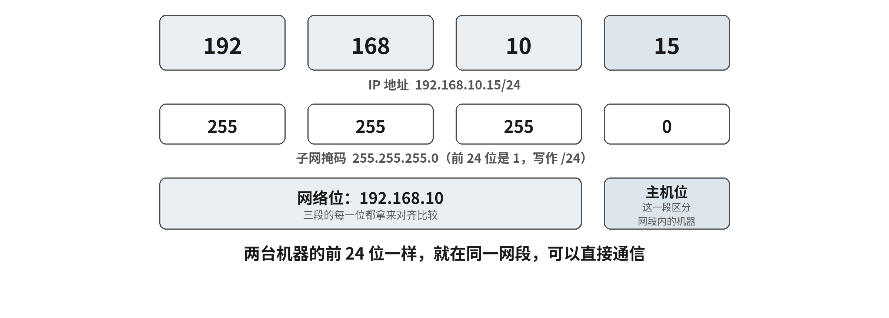
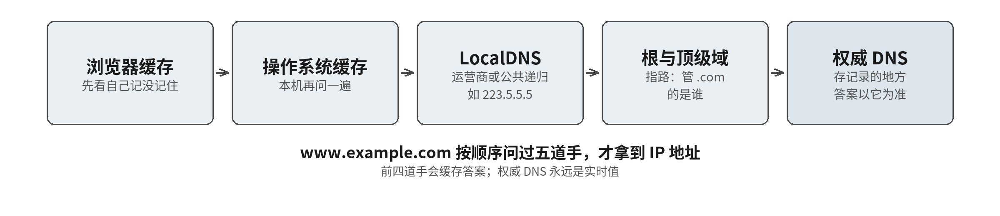
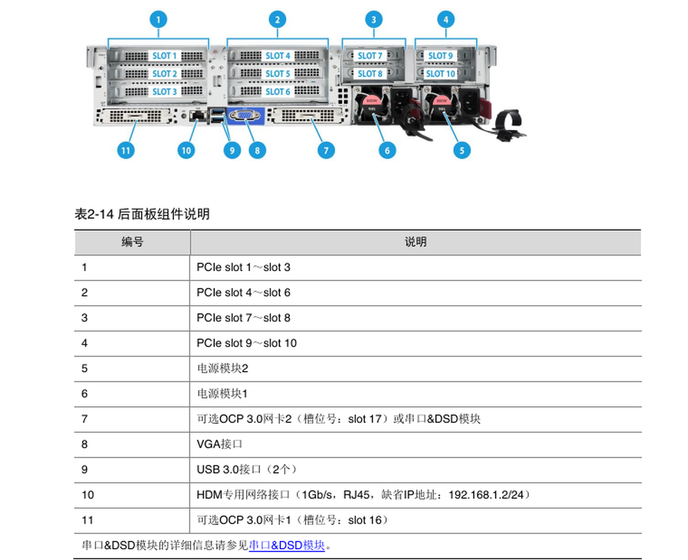
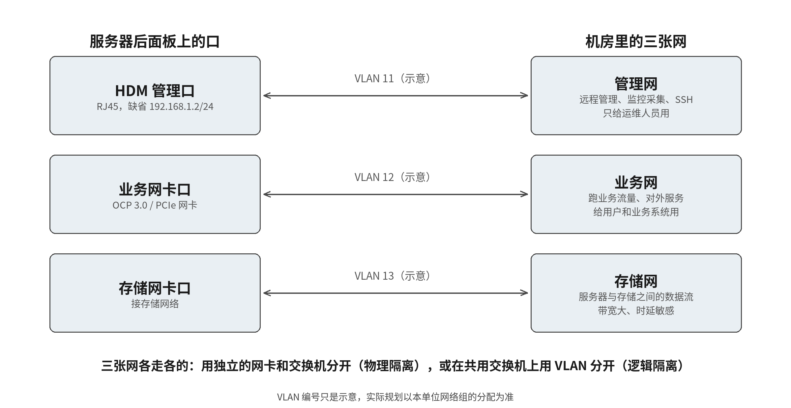

# 第5讲 网络基础

**本课程定位：** 面向自建智算中心运维。前面四讲在第一章认识了岗位、算力、服务器和算力卡。从本讲开始进入第二章，学机房里的日常运维基本功。网络是第一课：后面的操作系统装机、K8s 集群、算力资源池，每一步都要先打通网络。

新服务器上架，网络组发来一张地址规划表，上面写着：管理口 192.168.10.15/24，网关 192.168.10.1，DNS 223.5.5.5。你要回答四个问题：/24 是什么意思？这台机器和隔壁 192.168.20.8 的机器通不通？这三项各配到系统的哪里？配完怎么确认网络是好的？本讲就练这四件事。

## 本讲学习目标

学完后，你应能：

- 读出一个 IP 地址的网络位和主机位，用子网掩码判断两台机器是否在同一网段。
- 说清网关和 DNS 各自管什么，说出配错之后各自是什么表现。
- 说清 VLAN 的作用，知道机房里管理网、业务网、存储网为什么要分开。
- 给一台服务器配好 IP、网关、DNS，并用命令分层验证连通性。

## 5.1、看懂 IP 地址与子网

### 5.1.1、IP 地址是什么

IP 地址是网络里标识一台设备的一组数字。常见的 IPv4 地址由 32 位二进制数组成。为了好读，把它分成 4 段，每段 8 位，写成 4 个十进制数，中间用点分开。这叫点分十进制。例如二进制的 00001010 00000001 00000001 00000010，写出来就是 10.1.1.2。

一个 IP 地址分两部分：网络号和主机号。网络号标识这个地址属于哪个网段，主机号标识网段里的哪台机器。网络号相同的设备，不管物理位置在哪里，都在同一个网络里。

网络号占多少位，不是固定的，由子网掩码决定。这就是地址后面那个 /24 的来历。

### 5.1.2、子网掩码与 /24 写法

子网掩码也是 32 位，前面一段全是 1，后面一段全是 0。1 盖住的部分是网络位，0 盖住的部分是主机位。掩码 255.255.255.0 就是前 24 位为 1，所以也可以直接写成 /24。

判断两台机器是否同网段，方法是一样的：把各自的 IP 地址和自己的掩码做逐位与运算，得到网络号。两个网络号相同，就在同一网段，可以直接通信；不同，就要经过网关转发。/24 的掩码下，前三段相同就是同网段，口算就能判断。

一个 /24 网段里有两个地址不能分给机器：主机位全 0 的 192.168.10.0 是网络地址，代表这个网段本身；主机位全 1 的 192.168.10.255 是广播地址，发给网段里所有机器。所以一个 /24 网段能分给机器用的地址是 1 到 254，共 254 个。

**【例题】** 服务器 A 是 192.168.10.15/24，服务器 B 是 192.168.10.200/24，服务器 C 是 192.168.20.15/24。A 和 B 通不通？A 和 C 呢？

**解：** A 和 B 的掩码都是 /24，网络号分别是 192.168.10.0 和 192.168.10.0，相同，同网段，可以直接通信。C 的网络号是 192.168.20.0，和 A 不同，两台机器分属两个网段，必须经过网关才能互访。注意判断要带掩码：如果 A 和 C 的掩码都改成 /16，网络号都变成 192.168.0.0，结论就反过来。脱离掩码只看 IP 前三段，是不严谨的。

### 5.1.3、机房里用的是私有地址

IP 地址分公网和私有两种。有三段地址被保留给内部网络使用，叫私有地址。私有地址只在自己单位的网络里有效，不会出现在公网上，不同单位可以重复使用。

表5-1、三段私有 IPv4 地址

| 段 | 地址范围 | 常见用法 |
| --- | --- | --- |
| 10.0.0.0/8 | 10.0.0.0 ～ 10.255.255.255 | 大型内网、云厂商虚拟网络 |
| 172.16.0.0/12 | 172.16.0.0 ～ 172.31.255.255 | 中型内网 |
| 192.168.0.0/16 | 192.168.0.0 ～ 192.168.255.255 | 小型内网、设备缺省地址 |

机房服务器的管理网、业务网、存储网一般都用私有地址，由网络组统一规划分配。拿到地址规划表照表配置即可，不要自己编一个地址用：同一个网段里两台机器撞了同一个地址，两台都会出故障，而且故障表现时好时坏，很难查。

另外记住一个特殊地址：127 开头的是环回地址，数据只在本机内部打转。ping 127.0.0.1 是验证本机协议栈是否正常，和网线、交换机都无关。

【随堂思考】地址规划表上写着“管理网 192.168.10.0/24，计划装 300 台服务器”。这个网段够用吗？你会怎么向网络组反馈？

## 5.2、认识网关与 DNS

地址规划表上除了 IP，还有两项：网关和 DNS。它们管的事情完全不同，但都是“出网段”和“找名字”的必经之路。

### 5.2.1、网关是出网段的门

同网段的机器直接通信，不需要任何人转发。要去别的网段，本机自己到不了，要把数据包交给本网段的网关，由网关帮忙转发。网关一般是这个网段里的一台路由设备，地址常取网段的第一个或最后一个可用地址，例如 192.168.10.1。

在系统里，这项配置体现为一条缺省路由。缺省路由是路由表里没有更精确的匹配时才使用的路由，目的地址和掩码都是全 0，写作 0.0.0.0/0。没有配缺省路由，而目的地又不在本网段，数据包会直接被丢弃，系统回报“网络不可达”。

### 5.2.2、DNS 把名字翻译成地址

人记名字，机器认地址。访问 www.example.com 这样的域名时，要先查出它对应的 IP 地址，这个翻译服务叫 DNS（域名系统）。配置里的 DNS 服务器地址，例如 223.5.5.5，指的是一台帮你代查域名的递归服务器。

一次域名解析要经过好几道手。先看浏览器缓存，再看操作系统缓存，再问递归服务器，递归服务器再去问根服务器、顶级域服务器，最后问到存着这条记录的权威 DNS。前四道手都会把答案缓存一段时间，缓存多久由记录的 TTL 决定。

这个结构解释了一个常见现象：域名换了新地址，有的机器立刻能看到，有的机器还访问旧的。原因多半不是配置错了，而是某一层的旧缓存还没过期。排查的方向是“谁还拿着旧答案”，而不是反复改配置。

### 5.2.3、网关和 DNS 配错，表现不一样

这两项经常一起出现在配置里，但配错后的故障现象完全不同，正好用来练习分层判断。

表5-2、网关与 DNS 配错的不同表现

| 配置项 | 管什么 | 配错或缺失的表现 |
| --- | --- | --- |
| 网关（缺省路由） | 出本网段 | 同网段互访正常，访问其他网段和外网失败，报网络不可达 |
| DNS 服务器 | 域名翻译成地址 | ping IP 地址正常，访问域名失败，报无法解析 |

【关键区别】“ping 不通 223.5.5.5”和“ping 不通某个域名”是两回事。前者是网络通不通的问题，查地址和网关；后者可能只是名字查不出来，查 DNS。报障时说清楚是哪一种，能省一半排查时间。

## 5.3、理解 VLAN 与网络分区

### 5.3.1、VLAN 是什么

VLAN 是虚拟局域网。它把一台物理交换机逻辑上划分成几个互不相通的小网络，每个小网络是一个独立的广播域。同一个 VLAN 里的机器可以直接通信；不同 VLAN 之间的机器，即使插在同一台交换机上，也必须经过路由器或三层交换机才能通信。

为什么要这样划分？一是控制广播的范围，广播只在一个 VLAN 里传播，节省带宽。二是安全，不同 VLAN 的报文天然分开。三是健壮，一个 VLAN 里出故障不影响其他 VLAN。四是灵活，机器搬了位置，只要端口划进同一个 VLAN，逻辑上就还在原来的网络里。

### 5.3.2、机房为什么要分成三张网

智算中心的服务器，网络不是一张大网，而是按用途分成几张网。最常见的分法是管理网、业务网、存储网三张。

表5-3、机房三张网的用途与隔离方式

| 网络 | 跑什么流量 | 谁来用 | 常见隔离方式 |
| --- | --- | --- | --- |
| 管理网 | 远程管理、监控采集、SSH 登录 | 运维人员 | 独立交换机（物理隔离），或独立 VLAN |
| 业务网 | 业务流量、对外提供服务 | 用户和业务系统 | 独立 VLAN 或独立交换机 |
| 存储网 | 服务器与存储之间的数据流 | 服务器和存储设备 | 带宽大、时延敏感，通常物理隔离 |

分开的原因有两条。一条是性能：存储流量很大，和别的流量混在一起会互相挤占带宽。另一条是安全：管理网承载 SSH 登录和监控采集，一旦被业务侧的攻击波及，运维通道就断了，所以行业白皮书明确要求存储网络与管理网络物理隔离。厂商的集群软件也有同样要求，例如 H3C 的虚拟化平台要求管理网、业务网、存储网三网相互独立，可以用 VLAN 隔离，也可以用独立的物理网络。

这张网的分法，在服务器的后面板上就能看到。下图是 H3C R4930 G7 的后面板（截取自该机型的用户指南）：编号 10 是 HDM 专用网络接口，RJ45 规格，缺省 IP 地址 192.168.1.2/24，这个口接管理网；编号 7 和 11 是可选的 OCP 3.0 网卡，这类网卡的口接业务网或存储网。

注意这个缺省地址 192.168.1.2/24：它属于 192.168 开头的私有地址段，掩码 /24。第三讲讲过，HDM 就是 H3C 服务器的 BMC 带外管理系统。新机第一次上架，就是先把笔记本接到这个口，按缺省地址登录 HDM，再把管理口改成地址规划表分配的地址。

【随堂思考】有同事提议：三张网合成一张大网，交换机少买一半，布线也省。从性能和安全两个角度，你会怎么回应？

<!-- pagebreak -->

## 5.4、配置主机网络并验证

### 5.4.1、配置三要素：地址、网关、DNS

给一台服务器配网络，核心就是按地址规划表填三样：IP 地址（带掩码）、网关、DNS。不同 Linux 发行版的配置方式不同，这里以 Ubuntu 的 netplan 为例。netplan 把网络配置写在 /etc/netplan 目录下的 YAML 文件里，改完用命令生效。

表5-4、netplan 配置与地址规划表的对应关系

| 地址规划表 | netplan 里的字段 | 示例写法 |
| --- | --- | --- |
| IP 地址与掩码 | addresses | 192.168.10.15/24 |
| 网关 | routes 中 to: default 的那条 | via 192.168.10.1 |
| DNS 服务器 | nameservers 下的 addresses | 223.5.5.5 |

YAML 文件靠缩进表达层级，缩进错一格，配置就解析不了。改配置文件前先留一份原文件的备份，改坏了能马上恢复。

### 5.4.2、生效与读数

改完配置文件，执行 `netplan apply` 让它生效。然后用两条命令读数核对：

- `ip address show` 看接口上有没有出现刚配的地址，掩码对不对。
- `ip route show` 看有没有一条 default via 网关 的缺省路由。

读数和规划表一致，说明配置已经落在系统里。但配置对了不代表网络通了，还要实际验证。

### 5.4.3、分层验证连通性

验证按从近到远的顺序做三步，每步排除一层：

1. ping 网关，例如 `ping 192.168.10.1`。通，说明本机地址、网线、到交换机的链路正常。
2. ping 一个外网或另一网段的 IP，例如 `ping 223.5.5.5`。通，说明网关和缺省路由工作正常。
3. 用 dig 查一个域名，例如 `dig www.example.com`。能拿到 IP，说明 DNS 配置正常。

**【例题】** 一台新服务器配好网络后，ping 网关通，ping 223.5.5.5 通，但 ping 域名不通。问题最可能出在哪？

**解：** 前两步通，说明地址和网关都没问题，网络层是通的。域名不通，问题在 DNS 这一层：查 DNS 服务器地址有没有配、有没有写错。按表 5-2 的对照，这正是“DNS 配错”的典型表现。修完 DNS 再重跑第三步验证。

【关键区别】ping 不通，先别急着怪对端机器。按从近到远的顺序，先查本机地址和掩码，再查网关，最后才怀疑对端或中间的防火墙。防火墙拦 ping 也是常见原因：ping 不通不等于机器不在，只说明这一路没有应答。

## 5.5、本讲回顾与自测

学习完本讲后，试着用自己的话回答四个问题：/24 是什么意思？怎么判断两台机器同不同网段？网关和 DNS 各管什么？配好网络后按什么顺序验证？能说清条件，比背下命令更重要。

表5-5、本讲目标与对应判断

| 学习目标 | 应能做出的判断 |
| --- | --- |
| 看懂 IP 与子网 | 读出网络位和主机位，用掩码判断同网段，知道 254 个可用主机怎么来的 |
| 认识网关与 DNS | 说清两者各管什么，按“ping IP 通不通、域名通不通”区分是哪一项配错 |
| 理解 VLAN 与分区 | 说清 VLAN 隔离广播域的作用，说出三张网各自的用途和分开的原因 |
| 配置并验证 | 按规划表填好地址、网关、DNS，用 ping 网关、ping 外网、dig 域名分层验证 |

### 5.5.1、本讲自测

**1 同网段判断。** 服务器 A 是 10.20.1.15/24，服务器 B 是 10.20.2.15/24。两台机器在同一网段吗？如果把掩码都改成 /16 呢？

**2 可用地址。** 192.168.30.0/24 这个网段，网络地址、广播地址、可用主机地址各是什么？

**3 故障定位。** 一台服务器 ping 同网段的机器通，ping 其他网段全部不通，报“网络不可达”。最可能是哪一项配置有问题？

**4 故障定位。** 一台服务器 ping 网关通、ping 223.5.5.5 通、ping 域名不通。按什么思路查？

**5 网络分区。** 说出管理网、业务网、存储网各自跑什么流量，以及把它们分开的两条理由。

**6 场景描述。** 新到一台服务器，地址规划表给了管理口和业务口两个地址。上架接线时，这两个地址分别该配在后面板的哪些口上？依据是什么？

**答：**

____________________________

____________________________

____________________________

____________________________

<!-- pagebreak -->

## 5.6、参考答案与解析

### 5.6.1、随堂思考解析

**思考 1（网段规划）：** /24 网段可用主机地址只有 254 个，装 300 台不够。正确动作是带着数字反馈给网络组：要么换一个更短的掩码（例如 /23，可用地址翻倍），要么拆成两个网段。这是运维和网络组之间很典型的一次协作。

**思考 2（三网合一）：** 性能上，存储流量大，会与业务流量、管理流量互相挤占带宽，存储一忙，管理通道都可能卡住。安全上，管理网承载 SSH 和监控，和业务混在一张网里，等于把运维通道暴露在业务侧的攻击面上。省下的交换机和布线成本，抵不过一次故障的代价。

### 5.6.2、课后自测解析

**1** /24 掩码下，A 的网络号是 10.20.1.0，B 的是 10.20.2.0，不同网段，要经网关。掩码改成 /16 后，两者的网络号都是 10.20.0.0，同网段，可以直接通信。判断同网段必须连掩码一起看。

**2** 网络地址 192.168.30.0（主机位全 0），广播地址 192.168.30.255（主机位全 1），可用主机地址 192.168.30.1 到 192.168.30.254。

**3** 最可能是网关（缺省路由）没配或配错。同网段通信不需要网关，所以同网段正常；出网段全靠缺省路由，没有它就直接报网络不可达。用 `ip route show` 确认有没有 default 那条。

**4** 网络层已验证是通的，问题在 DNS。查 DNS 服务器地址是否配置、是否写错，可用 `dig www.example.com @223.5.5.5` 绕过本机配置直接问公共递归服务器，区分是本机配置错还是递归服务器侧的问题。

**5** 管理网跑远程管理、监控采集、SSH，给运维人员用；业务网跑业务流量，给用户和业务系统用；存储网跑服务器与存储之间的数据流。分开的理由：性能上避免大流量互相挤占；安全上保护管理通道不被业务侧波及。

**6** 管理口地址配在 HDM 专用网络接口上（后面板有明确标识，缺省地址 192.168.1.2/24），接管理网；业务口地址配在操作系统里对应 OCP 网卡或板载网卡的接口上，接业务网。依据是机型用户指南的后面板组件说明和本单位的地址规划表，两份资料对照着用，不按经验猜。

<!-- pagebreak -->

## 5.7、术语与疑问

### 5.7.1、术语

表5-6、本讲术语

| 术语 | 本讲中的含义 |
| --- | --- |
| IP 地址 | 网络里标识一台设备的一组数字。IPv4 地址 32 位，写成 4 段十进制数，由网络号和主机号两部分组成。 |
| 子网掩码 | 32 位的一串 1 接一串 0，用来划分 IP 地址的网络位和主机位。255.255.255.0 也可写作 /24。 |
| 网段 | 网络号相同的一组地址。同网段的机器直接通信，不同网段要经网关。 |
| 网络地址与广播地址 | 主机位全 0 的地址代表网段本身，全 1 的地址发给网段所有机器。两者都不能分给机器。 |
| 私有地址 | 只在内网使用的三段保留地址：10.0.0.0/8、172.16.0.0/12、192.168.0.0/16。机房网络一般用私有地址。 |
| 环回地址 | 127 开头的地址，数据只在本机内部打转。ping 127.0.0.1 验证本机协议栈。 |
| 网关 | 本网段通往其他网段的出口，在系统里体现为缺省路由（0.0.0.0/0）。 |
| DNS | 域名系统，把域名翻译成 IP 地址。配置里写的是帮你代查的递归服务器，如 223.5.5.5。 |
| TTL | DNS 记录被缓存的时间长度。域名改了别人还看到旧地址，多半是某层缓存的 TTL 没过期。 |
| VLAN | 虚拟局域网。把一台物理交换机逻辑上划分成多个独立的广播域，跨 VLAN 通信要经路由。 |
| 管理网、业务网、存储网 | 机房按用途划分的三张网，分别跑管理流量、业务流量、存储流量，用物理隔离或 VLAN 隔离。 |
| netplan | Ubuntu 的网络配置工具。配置写在 /etc/netplan 的 YAML 文件里，`netplan apply` 生效。 |

文中示例地址均为教学用私有地址；实际配置以本单位网络组的地址规划表为准。

### 5.7.2、我的疑问

**写下一项希望在后续课程中进一步理解的问题**

____________________________

____________________________

<!-- pagebreak -->

## 附录、服务器网络配置核对卡

这张卡可以在课堂或课后填。只记经允许公开的信息，不抄账号、口令和真实生产地址。没有提供的信息写“未提供”，不要用猜测补。

一、我拿到的地址规划

地址规划表名称与来源：________________________________________

IP 地址与掩码：________________　网关：______________________

DNS 服务器：____________________　所属网络：管理网／业务网／存储网

这个掩码下，本网段的网络地址：__________　广播地址：__________

可用主机地址范围：________________ 到 ________________________

二、我的同网段判断

对端机器地址与掩码：__________________________________________

我的网络号：________________　对方的网络号：________________

结论：同网段（直连）／不同网段（经网关），判断依据：____________

三、我的配置记录

配置文件位置与备份文件名：____________________________________

写入的地址、网关、DNS：______________________________________

生效命令：`netplan apply`　执行时间：________________________

四、我的分层验证

`ip address show` 读数与规划表一致：是／否

`ip route show` 有 default via 网关：是／否

ping 网关：通／不通　ping 外网 IP：通／否　dig 域名：通／不通

哪一步失败，我怀疑的层是：__________________________________

五、我的一条疑问或异常记录

现象：______________________________________________________

已排除的层：________________________________________________

待核查的证据：______________________________________________

填写提示：现象写你看到的；已排除的层写你验证过的；证据写你下一步准备去看的。三者分开，记录才对别人有用。

<!-- md-only -->

## 附：主要参考资料（仅 Markdown 保留，不印入 Word/PDF）

以下资料与课程资料中的编号一一对应。PDF 页码指本地 PDF 的文件页序，不是印刷页码；网页资料保存于 2026 年 11 月 6 日。

- 华为《eKitEngine AR580/AR680 配置指南-IP地址与服务配置》之“IPv4地址”。用于 5.1 的地址组成、掩码与运算、网络号/主机号、地址分类、特殊地址与三段私有地址，页面标注更新于 2026-04-16。资料编号 W01。
- Huawei《S5700/S6700 Configuration Guide - Ethernet Switching》之“Overview of VLANs”（英文）。用于 5.3 的 VLAN 定义、隔离广播域、跨 VLAN 需经路由与四点好处，页面标注更新于 2026-03-18。资料编号 W02。
- Netplan 官方文档《How to use static IP addresses》。用于 5.4 的静态地址 YAML 字段（addresses、routes、nameservers）与验证命令（netplan apply、ip address show、ip route show）。资料编号 W03。
- 阿里云开发者社区《域名解析不生效怎么查：NS、记录类型、TTL 三层的完整排查清单》（2026-11-04）。用于 5.2 的 DNS 解析五道手结构与 dig 验证思路；TTL 版本规格与计费内容未采用。资料编号 W04。
- H3C 知了社区《CAS+UniStor X10516H》问答案例。用于 5.3 的管理网、业务网、存储网三网独立原则（VLAN 或物理隔离）与混用风险；示例 VLAN ID 未采用。资料编号 W05。
- 华为《CloudEngine S8700 配置指南-IP路由》之“配置缺省IPv4静态路由”（2026-04-09）。用于 5.2 缺省路由的定义：目的与掩码全 0、无匹配时使用、无匹配且无缺省路由时丢弃并报不可达。资料编号 W06。
- 中国信通院《2025 算力运维体系技术白皮书》（本地 PDF）。第 47–49 页用于 5.3：网络运维的高带宽低延迟要求，以及“存储网络与管理网络（SSH、监控采集）物理隔离”的原文。摘录见资料目录《01_本地文档摘录.md》L1。
- 新华三《H3C 服务器用户指南》（本地 PDF，R4930 G7）。第 32 页图 2-12 与表 2-14 用于 5.3 的后面板实物插图：HDM 专用网络接口（1Gb/s，RJ45，缺省 IP 192.168.1.2/24）与可选 OCP 3.0 网卡。原图为第三讲资料库整页渲染 L01-032.png，本讲按图与表区域裁剪，脚本见 `_工作文件/prepare_photo.py`。摘录见《01_本地文档摘录.md》L2。

本讲引用的在线资料，其原始网址、获取时间与原文校验值记录在资料目录《02_讲义补充资料_20261106/README.md》与《来源元数据_20261106.json》中，可先按资料编号定位，再回查原网址。

<!-- /md-only -->
