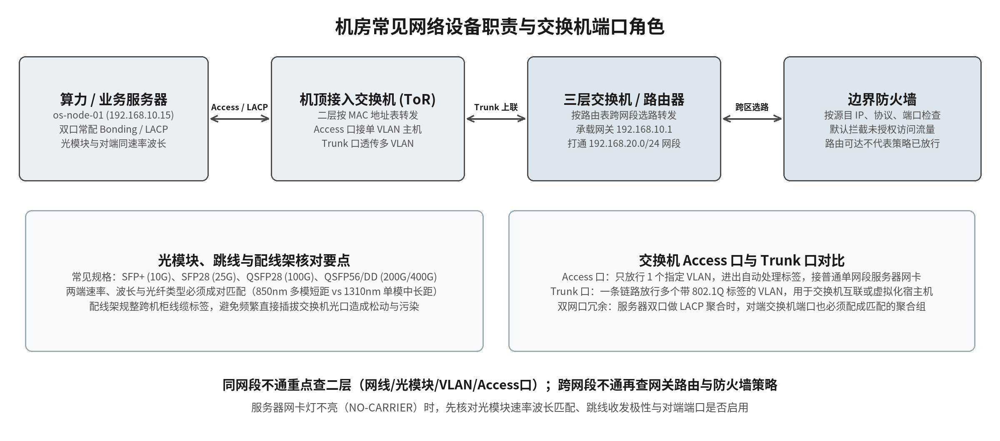
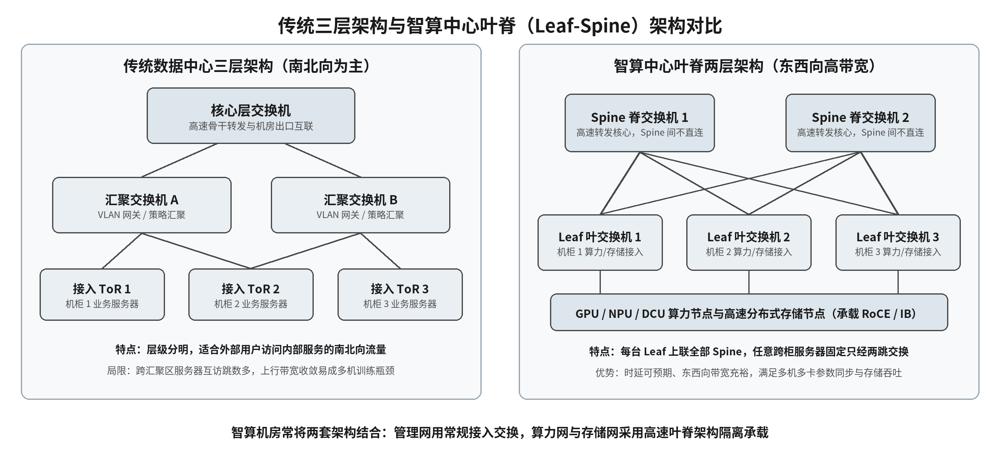
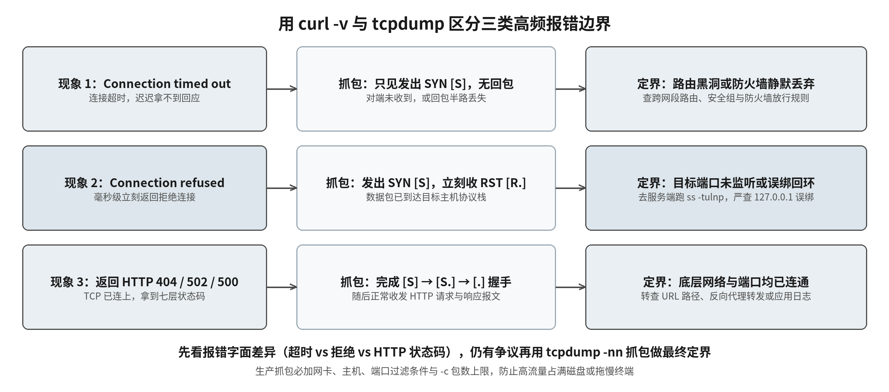
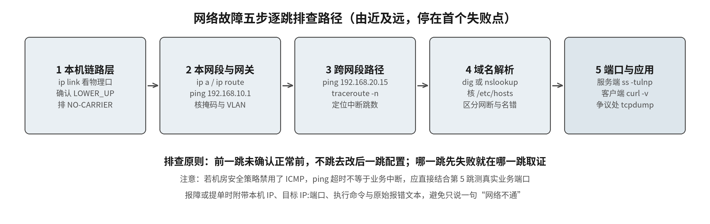

# 第6讲 网络进阶

**本课程定位：** 第 5 讲解决了单机怎么配 IP 地址、子网掩码、网关和 DNS，也分清了管理网、业务网和存储网。本讲顺着网线往机柜外走，认识机房里的网络设备、分层架构和逐跳排障方法，为第 7～8 讲操作系统交付打基础。

你在值班时收到报障：业务节点 `os-node-01`（`192.168.10.15`）连不上推理节点 `infer-node-03`（`192.168.20.15:8000`）。开发同事只说了一句“网络断了”。网线插在哪类设备上？数据包经过了几层设备？第一条取证命令敲什么？报错里的“超时”和“拒绝连接”是一回事吗？本讲逐个解决这四个问题。

## 本讲学习目标

学完后，你应能：

- 说清交换机、三层交换机、路由器、防火墙、光模块和配线架各自的职责边界。
- 区分交换机 Access 口与 Trunk 口、双口链路聚合，以及传统三层与叶脊架构。
- 用 `ip link`、`ping`、`traceroute`、`dig`、`ss`、`curl` 和 `tcpdump` 采集客观证据。
- 分清 `NO-CARRIER`、`Connection timed out` 与 `Connection refused` 对应的故障位置。
- 遇到网络不通时，按由近及远的五步逐跳顺序停在首个失败点，不靠猜改配置。

## 6.1、机房里的网络设备各管哪一段

服务器网卡发出的信号不会直接跳到远端机器。数据包要依次经过机柜顶部的交换机、跨网段的路由设备和安全边界的防火墙。每类设备只管自己那一层的活。认清设备分工，排障时才知道往哪一处查。



表6-1、机房常见网络设备与连接部件职责对比

| 设备或部件 | 工作层次与依据 | 核心职责 | 运维排障关注点 |
| --- | --- | --- | --- |
| 二层交换机 | 数据链路层，看 MAC 地址和 VLAN | 同网段机器高速互访，按 VLAN 隔离广播域 | 端口是否启用，Access 或 Trunk 模式是否配对 |
| 三层交换机 | 兼具二层转发与三层 IP 路由 | 充当机房内各 VLAN 的默认网关，做跨网段转发 | VLAN 虚接口网关是否正常，内部路由表是否完整 |
| 路由器 | 网络层，看目的 IP 地址与路由表 | 连接不同网络区域或运营商出口，负责广域选路 | 缺省路由与回程路由是否存在，下一跳是否可达 |
| 防火墙 | 网络层至传输层或更高，看五元组策略 | 按源目 IP、协议、端口做放行或阻断 | 路由可达不等于放行，核查安全策略是否丢包 |
| 光模块与跳线 | 物理层，完成光电转换与信号传输 | 把端口电信号转为光纤里的光信号传输 | 两端速率、波长与单多模光纤必须成对匹配 |
| 配线架 | 物理层，规整机柜间固定布线 | 汇接跨机柜光缆或网线，用短跳线连设备端口 | 核对线缆两端标签，排查跳线松动或收发插反 |

### 6.1.1、交换机：同网段转发、Access/Trunk 与双口聚合

机柜顶部通常装有一到两台接入交换机，工程上叫 **ToR（Top of Rack，机柜顶交换机）**。二层交换机记住每个端口连着哪个 **MAC 地址**（网卡硬件地址）。同网段、同 **VLAN（虚拟局域网）** 的机器互访，直接由二层交换机转发。

第 5 讲提到机房用 VLAN 隔离网段。落到交换机端口上，要分清 **Access 口** 和 **Trunk 口**：

- **Access 口（接入端口）**：一个端口只放行 1 个指定的 VLAN。普通单网段服务器接上来时，网卡不用识别 VLAN 标签，由交换机在进出端口时自动处理。如果服务器配了 VLAN 10 的地址 `192.168.10.15/24`，交换机端口却错划进 VLAN 20，本机连默认网关 `192.168.10.1` 都通不了。
- **Trunk 口（干道端口）**：一条物理线允许多个带 `802.1Q` 标签的 VLAN 同时通过。交换机与上层交换机互联的端口常用 Trunk 口。需要承载多个网段的虚拟化宿主机网口，也常接 Trunk 口。

生产服务器很少只插一根网线。为防单口或单线故障，服务器常把两个网口绑成一个逻辑口，Linux 下叫 **Bonding**。机房常用 **LACP（链路聚合控制协议，IEEE 802.3ad，对应 Linux mode=4）**，兼顾故障切换与多连接带宽分担。配 LACP 有一条硬规矩：服务器与对端交换机必须同时配好匹配的聚合组。只改服务器一端，聚合口无法正常协商。若要防单台机顶交换机断电，两根线还应分别接入两台做了跨设备聚合的交换机。

### 6.1.2、三层交换机、路由器与防火墙：跨网段选路与策略边界

当 `192.168.10.15/24` 要访问 `192.168.20.15/24` 时，二层交换机无法直接跨网段送达。主机先把包发给本网段网关 `192.168.10.1`。

在机房内部，各网段网关大多设在**三层交换机**的 VLAN 虚接口上。三层交换机靠硬件芯片高速查路由表，把 VLAN 10 的包转往 VLAN 20。连接外部专线、互联网出口或异地机房时，再交给边界**路由器**做广域选路与地址转换。

**防火墙**守在不同安全区域的交界处，比如外网入口，或管理网与业务网之间。防火墙按“源 IP、目的 IP、协议、源端口、目的端口”这五项（常称**五元组**）匹配规则。生产环境普遍采用“默认拒绝、按白名单放行”。

【关键区别】“路由通”只说明设备知道包往哪条路走。“防火墙放行”才说明安全规则允许这个端口通过。现场常遇到 `ping` 能通、连 `8000` 端口却超时。反过来，也有业务 `443` 端口正常、防火墙却禁掉 `ping`（ICMP 协议）的情况。路由和策略必须分开核对。更多安全设备会在第 36 讲展开。

### 6.1.3、光模块、光纤跳线与配线架：物理连接核对

算力机房的业务网和存储网普遍使用 `10 Gbps`、`25 Gbps`、`100 Gbps` 乃至 `200 Gbps` / `400 Gbps` 光口。端口里要先插**光模块**，再插**光纤跳线**。

现场核对物理连接件，抓住四条硬条件：

- **封装与速率一致**：`SFP+` 对应 `10 Gbps`，`SFP28` 对应 `25 Gbps`，`QSFP28` 对应 `100 Gbps`，`QSFP56` 或 `QSFP-DD` 对应 `200 Gbps` / `400 Gbps`。链路两端速率与拆分模式必须配对，不能把 `25G` 模块硬插进仅支持 `10G` 的旧端口。
- **波长与单多模一致**：柜内或邻柜短距常用 **多模模块（如 850 nm 波长，标 SR）** 配水蓝色或橙色多模跳线（OM3/OM4）。跨机房长距常用 **单模模块（如 1310 nm 波长，标 LR）** 配黄色单模跳线。单多模混接会导致光衰过大或端口不亮。
- **收发对准与防尘**：双芯光纤一芯发（TX）、一芯收（RX），本端发要对准对端收。闲置光口和光纤头必须盖好防尘帽，灰尘污染端面会引发误码（CRC 错误）。
- **配线架按标查线**：跨机柜光缆常先固定在柜顶**配线架**，再用短跳线接交换机。查线时核对两端吊牌，禁止硬拽线束。

**【例题】** 运维人员给 `H3C UniServer R4930 G7` 服务器网卡插上 `25G SFP28 SR（850 nm 多模）` 光模块，拿一根黄色单模跳线连到交换机的 `10G SFP+ LR（1310 nm 单模）` 模块上。网口灯不亮。这里错了哪三处？

**解：** 一是速率不匹配，本端 `25 Gbps`、对端 `10 Gbps`。二是波长与模式不匹配，本端 `850 nm` 多模、对端 `1310 nm` 单模。三是黄色单模跳线与多模模块不匹配。处理时应按规划把两端统一换成同速率、同模式的光模块与对应跳线（如两端均用 `25G SFP28 SR` 配 OM4 多模跳线，并确认交换机口支持 `25 Gbps`）。

## 6.2、机房网络怎么分层：传统三层与叶脊架构

看懂单台设备后，再看几百台机器怎么连成整网。机房流量分两个方向：外部客户端进出机房，叫**南北向流量**。机房内部服务器之间、服务器与存储之间互传数据，叫**东西向流量**。主流量不同，组网结构也不同。



### 6.2.1、传统接入—汇聚—核心三层架构

常规业务机房多用**接入层—汇聚层—核心层**树状结构：

- **接入层（Access）**：机柜顶 ToR 交换机，就近接柜内服务器。
- **汇聚层（Aggregation）**：汇总一排机柜的上行流量，常兼做 VLAN 网关与访问控制点。
- **核心层（Core）**：机房高速交换骨干，连接各汇聚区与外部出口。

树状结构边界清晰，适合南北向 Web 与办公业务。但越往上走，上行带宽常小于下联总带宽（存在收敛比）。跨汇聚区的服务器互访要上下绕多跳，大批量并发传数据时容易在汇聚上行口排队。

### 6.2.2、智算中心叶脊（Leaf-Spine）两层架构

第 2 讲和第 4 讲提过，多机 AI 训练每一步都要在大量加速卡间同步参数，还要从存储网高速读数据。这类流量主要是机房内部的**东西向流量**，要求高带宽、低时延、零丢包。第 4 讲讲的 RoCE v2 或 InfiniBand 就跑在这张网上。

为此，智算中心的算力网与高速存储网普遍采用扁平的**叶脊（Leaf-Spine）两层架构**：

- **Leaf（叶交换机）**：机柜接入交换机，下接服务器与存储节点，上联**每一台** Spine 交换机。
- **Spine（脊交换机）**：高速转发核心，只在各台 Leaf 之间转包。Spine 与 Spine 之间不连线，也不接服务器。

在叶脊网络里，任意两台跨机柜服务器通信，路径固定是 `源服务器 → 源 Leaf → Spine → 目的 Leaf → 目的服务器`。中间永远只经过两跳交换，时延稳定可预期。机柜增加时横向加 Leaf，跨柜带宽不够时横向加 Spine。实际智算机房常把两套结构配合用：管理网走常规交换，算力网与存储网走独立的叶脊网络。

【随堂思考】两台 8 卡训练服务器分别装在 1 号柜和 8 号柜，多机训练常卡在梯度同步上。为什么算力参数网优先选叶脊两层架构，而不复用传统办公三层网？

## 6.3、常规网络诊断工具箱：每把工具查什么

遇到网络报障，不要上来就重启网卡或乱改配置。Linux 自带一套只读诊断命令，每条命令对应网络栈的一层。先用只读命令拿证据，再定下一步动作。

表6-2、常规网络诊断工具的分工与高频用法

| 工具名 | 检查层次 | 典型只读命令示例 | 主要回答什么问题 |
| --- | --- | --- | --- |
| `ip link` | 物理与数据链路层 | `ip link show eth0` | 网口启用没有？网线或光纤有没有载波信号？ |
| `ip a` / `ip r` | 网络层本机配置 | `ip -4 a`、`ip route` | 本机 IP、掩码和默认网关 `0.0.0.0/0` 配对了吗？ |
| `ping` | 网络层 ICMP 可达性 | `ping -c 4 192.168.10.1` | 到目标 IP 能不能往返？丢包率和时延（ms）是多少？ |
| `traceroute` | 网络层跨网段路径 | `traceroute -n 192.168.20.15` | 跨网段包经过哪几跳路由，停在了哪一跳？ |
| `dig` / `nslookup` | 应用层域名解析 | `dig @223.5.5.5 infer.lab.example` | 域名能不能译出 IP？是默认 DNS 坏了还是记录缺失？ |
| `ss` | 传输层本机监听态 | `ss -tulnp` | 服务端目标端口有没有进程监听？绑在哪个地址上？ |
| `curl` | 传输层握手与七层 HTTP | `curl -v --connect-timeout 5 URL` | 握手通没通？报错是超时、拒绝连接还是 HTTP 404/502？ |
| `tcpdump` | 数据包收发底层抓包 | `tcpdump -nn -i eth0 port 8000 -c 20` | 网卡发出包没有？对端回包没有？回的是什么标志位？ |

### 6.3.1、链路、连通与逐跳路径：ip link、ping 与 traceroute

**第一步看链路状态。** 在业务节点 `os-node-01` 上执行 `ip link show`，盯紧网口尖括号里的标志词：

```text
opsadmin@os-node-01:~$ ip link show
2: eth0: <BROADCAST,MULTICAST,UP,LOWER_UP> mtu 1500 qdisc mq state UP mode DEFAULT qlen 1000
3: eth1: <NO-CARRIER,BROADCAST,MULTICAST,UP> mtu 1500 qdisc mq state DOWN mode DEFAULT qlen 1000
```

单独的 `UP` 只说明系统软件层启用了网口。**LOWER_UP** 才代表物理层有光信号或电信号（网口灯亮）。`eth1` 出现 **NO-CARRIER**，代表底层没有载波信号。常见原因是跳线松脱、光模块不匹配，或对端交换机口被关闭。看到 `NO-CARRIER` 先去查物理链路，改 IP 没用。

**第二步看连通与路径。** Linux 下敲 `ping` 记得带 `-c 4` 限制发包个数，重点读丢包率（`packet loss`）和往返时延（单位 `ms`，同机房内常低于 `1 ms`）。跨网段不通时，从 `os-node-01`（`192.168.10.15`）用 `traceroute -n`（加 `-n` 直接印数字 IP，省掉逐跳反查域名的等待）追踪目标 `infer-node-03`（`192.168.20.15`）：

```text
opsadmin@os-node-01:~$ traceroute -n 192.168.20.15
traceroute to 192.168.20.15 (192.168.20.15), 30 hops max, 60 byte packets
 1  192.168.10.1   0.421 ms  0.385 ms  0.362 ms
 2  * * *
 3  192.168.20.15  0.812 ms  0.765 ms  0.749 ms
```

【关键区别】第 2 跳印出 `* * *`，第 3 跳终点 `192.168.20.15` 却正常回了 `0.812 ms`。这不是链路断了，只是第 2 跳设备不回探测包。只有从某一跳往后全是 `* * *`，同时真实业务端口也连不上，才顺着那一跳往下查。

### 6.3.2、名字解析：dig、nslookup 与本机 hosts

若 `ping` IP 地址正常，用域名访问却报 `Could not resolve host`，问题就在名字解析。可用 `dig` 或 `nslookup` 把“本机默认 DNS”和“指定内网权威 DNS（如 `192.168.10.53`）”分开对比测试：

```text
opsadmin@os-node-01:~$ dig infer.lab.example +noall +answer +comments
;; Got answer:
;; ->>HEADER<<- opcode: QUERY, status: NXDOMAIN, id: 41208

opsadmin@os-node-01:~$ dig @192.168.10.53 infer.lab.example +short
192.168.20.15
```

读 `dig` 先看 `status`：`NOERROR` 且带 `ANSWER` 行是解析成功。`NXDOMAIN` 是所问的 DNS 里没这条记录。`SERVFAIL` 或超时是 DNS 服务异常或 `53` 端口不通。上面两步对比说明内网 DNS 有记录，只是本机默认 DNS 配错了，应回查 `/etc/resolv.conf` 与 Netplan 配置。动手前顺手 `cat /etc/hosts`，确认没有过期静态绑定干扰。

### 6.3.3、端口监听、七层探测与抓包定界：ss、curl 与 tcpdump

“网络说通了，业务说连不上”是现场最常见的拉锯。靠 `ss`、`curl` 和 `tcpdump` 三件套能把边界一锤敲定。



**1. 服务端看端口监听在哪个地址。** 登录目标机 `infer-node-03`（`192.168.20.15`）执行 `sudo ss -tulnp`（加 `sudo` 才能看到进程名 `-p`）：

```text
opsadmin@infer-node-03:~$ sudo ss -tulnp
Netid  State   Recv-Q  Send-Q   Local Address:Port   Peer Address:Port  Process
tcp    LISTEN  0       128      127.0.0.1:8000       0.0.0.0:*          users:(("python3",pid=4320,fd=6))
tcp    LISTEN  0       128      0.0.0.0:22           0.0.0.0:*          users:(("sshd",pid=912,fd=3))
```

参数含义：`-t` 看 TCP，`-u` 看 UDP，`-l` 只看监听态，`-n` 显示数字端口，`-p` 显示进程。注意第 1 行的 `Local Address` 是 **127.0.0.1:8000**（本地回环地址）。绑在 `127.0.0.1` 的服务只接待本机内部访问，外部机器连 `192.168.20.15:8000` 一律会被内核拒绝。对外服务必须绑在 `0.0.0.0:8000` 或业务网卡 IP 上。

**2. 客户端看握手停在哪一步。** 从 `os-node-01` 执行带超时上限的 `curl -v` 探测目标接口，防止终端一直挂死：

```text
opsadmin@os-node-01:~$ curl -v --connect-timeout 5 http://192.168.20.15:8000/healthz
```

紧盯 `Trying 192.168.20.15:8000...` 后面的报错字样：

- **Connection timed out**：等满 5 秒没回音。说明握手包在半路丢了，或被防火墙静默丢弃（DROP），先查路由与防火墙策略。
- **Connection refused**：毫秒级立刻报错。说明包**已经到达目标机器**，目标机器回了复位包（RST）拒绝连接。马上去目标机跑 `ss -tulnp` 查进程是否没起、端口是否写错，或是否误绑了 `127.0.0.1`。
- **印出 Connected 并返回 HTTP/1.1 404 或 502**：底层网络和端口都通了，转去查 URL 路径、反向代理或服务日志。

**3. 仍有争议时抓包定界。** 在服务端 `infer-node-03` 抓来自 `192.168.10.15` 访问 `8000` 端口的前 10 个包（`-nn` 不反解名字，`-i` 指定网卡，`-c 10` 抓够即停）：

```text
opsadmin@infer-node-03:~$ sudo tcpdump -nn -i eth0 host 192.168.10.15 and tcp port 8000 -c 10
14:20:01.105420 IP 192.168.10.15.51234 > 192.168.20.15.8000: Flags [S], seq 29014821, win 64240, length 0
14:20:01.105465 IP 192.168.20.15.8000 > 192.168.10.15.51234: Flags [R.], seq 0, ack 29014822, win 0, length 0
```

看 `Flags` 标志即可判读：`[S]` 是请求连接（SYN），`[S.]` 是同意连接（SYN-ACK），`[.]` 是确认（ACK），`[R]` 或 `[R.]` 是拒绝复位（RST）。客户端发出了 `[S]`、服务端网卡却没抓到任何包，证明包被中间网络或外部防火墙拦了。服务端抓到了 `[S]` 却没回 `[S.]`，问题就在服务端本机防火墙或监听进程。

【随堂思考】在 `100 Gbps` 高流量存储网卡上不写主机端口过滤条件、也不加 `-c` 包数上限，直接跑 `sudo tcpdump -w /tmp/all.pcap` 会闯什么祸？

## 6.4、五步逐跳排障法与现场实战推演

工具有了，排障顺序不能乱。标准做法是顺着数据包路径**由近及远逐跳核查**。排查记录分成三栏：**看到了什么现象、还不能确定什么、根因结论是什么**。



### 6.4.1、由近及远的五步逐跳顺序

把第 5 讲的主机自检延伸到机房跨网段场景，固定按下面五跳推进。哪一跳先失败，就停在哪一跳取证：

表6-3、网络故障五步逐跳排查对照表

| 跳数 | 核查目标 | 首选取证命令 | 失败时的典型根因方向 |
| --- | --- | --- | --- |
| 第 1 跳 | 本机物理口与链路层 | `ip link show` | 报 `NO-CARRIER`：跳线松脱、光模块不匹配、交换机口未开 |
| 第 2 跳 | 本网段地址与网关 | `ip -4 a`、`ip r`、`ping -c 4 网关` | 掩码配错、交换机 Access 口错划 VLAN、LACP 两端不一致 |
| 第 3 跳 | 跨网段路由可达性 | `ping -c 4 对端IP`、`traceroute -n 对端IP` | 三层交换机缺回程路由、下一跳不可达（留意禁 ping 策略） |
| 第 4 跳 | DNS 域名解析 | `dig 域名`、`cat /etc/hosts` | 默认 DNS 失效、内网 DNS 漏配记录、本地 hosts 误绑 |
| 第 5 跳 | 端口、防火墙与应用 | 服务端 `ss -tulnp`、客户端 `curl -v`、`tcpdump` | 防火墙丢包超时、服务未启动、误绑 `127.0.0.1`、路径 404 |

### 6.4.2、实战推演一：跨网段调用推理服务从超时到拒绝连接

回到开篇值班报障：客户端 `os-node-01`（`192.168.10.15/24`，网关 `192.168.10.1`）访问 `http://infer.lab.example:8000/v1/models`（指向 `infer-node-03`，`192.168.20.15/24`）不通。按五步逐跳推进：

**第一阶段（查出超时原因）：**

- **核第 1～2 跳**：在 `os-node-01` 跑 `ip link show eth0` 见 `LOWER_UP`。跑 `ping -c 4 192.168.10.1` 丢包 `0%`，时延 `0.35 ms`。本机与网关正常。
- **核第 3～4 跳**：跑 `dig infer.lab.example +short` 得到 `192.168.20.15`。跑 `ping -c 4 192.168.20.15` 丢包 `0%`，时延 `0.78 ms`。跨网段路由与域名正常。
- **核第 5 跳**：跑 `curl -v --connect-timeout 5 http://192.168.20.15:8000/v1/models`，卡满 5 秒报 `Connection timed out`。去 `infer-node-03` 跑 `sudo tcpdump -nn -i eth0 host 192.168.10.15 and tcp port 8000 -c 5`，客户端重发请求，服务端显示 `0 packets captured`。
- **协同处置**：ICMP 能到而 TCP `8000` 握手包未到服务端网卡，证明网段间防火墙只放了 ICMP、没放 TCP `8000`。附上抓包记录提策略工单，由网络管理员按最小源目范围放行这条规则。

**第二阶段（复测抓出第二处隐患）：**

防火墙改完后，不能没验证就关单。回到 `os-node-01` 复测 `curl -v`，报错瞬间变成了 **Connection refused**！

- **读变化**：超时变拒绝，说明防火墙已放通，包已进到 `infer-node-03` 系统里。
- **查监听**：登录 `infer-node-03` 跑 `sudo ss -tulnp`，看到进程只绑在 `127.0.0.1:8000`。难怪算法同事在本机测 `localhost:8000` 说“服务没问题”，外机却调不通。
- **修正与复验**：备份原启动配置后，在授权范围内把监听地址改为 `0.0.0.0:8000`（若异常可立即用备份还原）。重启服务并用 `ss -tulnp` 确认 `0.0.0.0:8000` 在听。最后回到 `os-node-01` 复测 `curl http://infer.lab.example:8000/v1/models`，返回 HTTP `200` 与模型列表，故障消除。

表6-4、跨网段推理调用故障推演三栏记录

| 阶段 | 看到了什么（客观现象） | 还不能确定什么（待查证据） | 根因结论与验证结果 |
| --- | --- | --- | --- |
| 阶段一 | `ping` 通、域名对，`curl` 8000 端口 5 秒超时 | 是服务端本机拦截，还是网段间防火墙丢包？ | 服务端网卡抓包为 0，确认为网段间防火墙未放行 TCP 8000 |
| 阶段二 | 防火墙放行后，`curl` 瞬间报 `Connection refused` | 服务是没启动、端口写错，还是监听绑错地址？ | `ss -tulnp` 查出仅绑 `127.0.0.1:8000`，改绑 `0.0.0.0` 后客户端返回 200 |

### 6.4.3、实战推演二：新上架服务器物理口不亮与网关不通

**【例题】** 新上架甲、乙两台机器接入同一台 ToR 交换机，都划在业务网 `192.168.10.0/24`（VLAN 10，网关 `192.168.10.1`）。甲机器 `ip link show eth0` 报 `NO-CARRIER ... state DOWN`。乙机器 `ip link show eth0` 有 `LOWER_UP`，IP 是 `192.168.10.16/24`，但 `ping -c 4 192.168.10.1` 全丢；同柜老机器 `192.168.10.15` 连网关正常。甲、乙各卡在第几跳？先查什么？

**解：** 甲机器卡在**第 1 跳（物理与链路层）**。有 `NO-CARRIER` 说明没光电信号，先查跳线松紧、收发极性、两端光模块速率与单多模是否一致，以及交换机端口是否未开启。乙机器过了第 1 跳，卡在**第 2 跳（本网段二层连通）**。同柜老机器正常说明网关没坏，最优先请网络侧核对乙机器所接交换机口是否漏划入 `VLAN 10`；若做了双口绑定，再核两端 LACP 配置是否配对。

<!-- pagebreak -->

## 6.5、本讲回顾与自测

学习完本讲后，试着用自己的话回答四个问题：交换机、路由器和防火墙各管哪一段？智算算力网为什么常用叶脊两层架构？`Connection timed out` 和 `Connection refused` 排查方向差在哪？网络不通时前五跳按什么顺序查？

表6-5、本讲目标与对应判断

| 学习目标 | 应能做出的判断 |
| --- | --- |
| 认准网络设备边界 | 同网段转发与 VLAN 找二层交换机，跨网段选路找三层交换机或路由器，端口放行找防火墙 |
| 核对物理件与端口 | 光模块两端速率、波长、单多模必一致；单网段主机接 Access 口，多 VLAN 干道走 Trunk 口 |
| 分辨机房组网架构 | 传统三层适合南北向常规流量；叶脊两层固定两跳、东西向高带宽，适合多机算力与存储网 |
| 选准只读诊断工具 | 链路看 `ip link`，路径看 `traceroute -n`，解析看 `dig`，监听看 `ss -tulnp`，握手抓包看 `curl -v` 与 `tcpdump` |
| 按五步逐跳定界 | 按链路→网关→跨网段→DNS→端口应用推进，分清超时与拒绝连接，变更后回客户端复测 |

### 6.5.1、本讲自测

**1 设备与端口。** 单网段服务器（`192.168.10.15/24`，系统内不打 VLAN 标签）连机顶交换机口；两台交换机上联线要同时透传 VLAN 10、20、30。这两处交换机口应分别配什么模式？

A. 都是 Access　　B. 都是 Trunk　　C. 前一处 Access、后一处 Trunk　　D. 前一处 Trunk、后一处 Access

**2 架构判断。** 智算中心 RoCE 算力网采用叶脊（Leaf-Spine）架构时，下列哪项连线方式正确？

A. Spine 与 Spine 互相直连成环　　B. 服务器网卡一半插 Leaf、一半直插 Spine

C. 每台 Leaf 上联全部 Spine，Spine 间不直连　　D. 跨机柜服务器互访至少经过四跳交换机

**3 状态读数。** `ip link show eth0` 显示 `<NO-CARRIER,BROADCAST,MULTICAST,UP> ... state DOWN`。这时去改 `/etc/netplan/` 里的网关并 `netplan apply` 有用吗？写出理由和下一步核查项。

**答：**

____________________________

____________________________

**4 报错定界。** 从 `192.168.10.15` 跑 `curl -v http://192.168.20.15:8080/healthz`，立刻返回 `Connection refused`。能断定“中间网线或路由器断了”吗？下一步去哪台机器敲什么命令？

**答：**

____________________________

____________________________

**5 路径与 DNS。** 服务器上 `ping -c 4 223.5.5.5` 正常，跑 `curl https://registry.lab.example` 却报 `Could not resolve host`。故障在第几跳？写出两条取证命令。

**答：**

____________________________

____________________________

**6 场景排障。** 请写出在服务端 `eth0` 网卡抓取客户端 `192.168.10.15` 访问 TCP `8000` 端口前 20 个包（不反解名字）的 `tcpdump` 命令，并说明服务端看到“只有 `[S]` 无回包”与“收 `[S]` 立刻回 `[R.]`”各代表什么。

**命令与说明：**

____________________________

____________________________

____________________________

<!-- pagebreak -->

## 6.6、参考答案与解析

### 6.6.1、随堂思考解析

**思考 1（多机训练为什么选叶脊架构）：** 多机 8 卡训练每一步都要跨柜同步大批量梯度，几乎全是东西向突发大流量。传统三层网跨汇聚区跳数多、上行有收敛比，一旦拥塞丢包就会让整组加速卡空等。叶脊架构让每台 Leaf 上联全部 Spine，跨柜固定两跳，东西向带宽充足、时延一致，适合承载 RoCE 或 InfiniBand。

**思考 2（高流量网卡裸跑 tcpdump 的风险）：** `100 Gbps` 网卡每秒包量极高。不加过滤条件和 `-c` 上限时，`/tmp/all.pcap` 会在短时间内写满磁盘，同时抢占大量 CPU 和磁盘 I/O，甚至把在线业务拖垮。生产抓包必须写清网卡、主机、端口过滤条件与 `-c` 包数上限。

### 6.6.2、课后自测解析

**1 选 C。** 单网段普通服务器不带标签，接交换机 **Access 口**。交换机互联线要透传多个 VLAN 标签，配 **Trunk 口**。

**2 选 C。** 叶脊两层架构中，服务器只接 Leaf，每台 Leaf 全互联所有 Spine，Spine 之间不直连。跨机柜服务器通信路径是 `Leaf → Spine → Leaf`，只经两跳交换。

**3 没用。** `NO-CARRIER` 说明第 1 跳物理与链路层没有光电信号，改三层网关发不出任何包。下一步应去核对网线或光纤跳线是否插紧、收发极性是否正确、两端光模块速率与单多模是否匹配，以及对端交换机口是否开启。

**4 不能断定网线或路由器断了，三层网络其实已经通到目标机了。** `Connection refused` 代表 `192.168.20.15` 收到了请求并回了 RST 拒绝包。下一步登录服务端 `192.168.20.15` 跑 `sudo ss -tulnp`，查 `8080` 进程是否未启动、端口写错，或误绑在了 `127.0.0.1:8080` 上。

**5 第 4 跳（DNS 域名解析）。** 外网 IP 能通说明前 3 跳链路和路由正常，只是域名译不出 IP。取证命令：`cat /etc/hosts`、`cat /etc/resolv.conf`，再用 `dig registry.lab.example` 与 `dig @内网DNS地址 registry.lab.example` 对比测试。

**6 命令：** `sudo tcpdump -nn -i eth0 host 192.168.10.15 and tcp port 8000 -c 20`。服务端网卡已抓到 `[S]` 却无回包，说明被服务端**本机防火墙静默丢弃（DROP）**。抓到 `[S]` 后本机立刻回 `[R.]`，说明本机 `8000` 端口**无进程对外监听**（未启动或仅绑 `127.0.0.1`），或本机防火墙配了显式拒绝。

### 6.6.3、复习时再问自己

如果你看到 `ping` 超时就一口咬定“机器死机了”，回看 6.1.2 节防火墙禁 ICMP 的情况。如果你分不清超时和拒绝连接各自先查哪头，回看 6.3.3 节与 6.4.2 节的两阶段推演。

## 6.7、术语与疑问

### 6.7.1、术语

表6-6、本讲术语

| 术语 | 本讲中的含义 |
| --- | --- |
| ToR 交换机 | 装在机柜顶部的接入交换机（Top of Rack），就近连接本机柜服务器，减少跨柜散乱走线。 |
| Access 口 / Trunk 口 | 交换机端口模式：Access 口只通 1 个 VLAN，接普通服务器；Trunk 口带标签通多个 VLAN，接上联交换机或虚拟化宿主机。 |
| LACP / Bonding | 把多张物理网卡聚合成一个逻辑口，兼顾断线切换与带宽分担，要求服务器和交换机两端配对。 |
| 三层交换机 | 兼具二层交换与三层路由能力的交换机，机房内常用来承载各 VLAN 的默认网关。 |
| 叶脊架构（Leaf-Spine） | 叶交换机与脊交换机两层全互联的扁平组网，跨柜固定两跳，适合智算中心东西向高带宽通信。 |
| 光模块 | 插在光口里做光电转换的器件；两端速率、波长与单多模光纤必须成对匹配。 |
| `NO-CARRIER` | `ip link` 中的无载波标志，代表底层无光信号或电信号，需查跳线、光模块和对端交换机口。 |
| `ss` | 查看套接字与监听端口的工具，常用 `ss -tulnp` 核查端口监听状态及是否误绑 `127.0.0.1`。 |
| `Connection timed out` | 连接请求发出后超时无响应，多见于路由不通或被防火墙静默丢弃。 |
| `Connection refused` | 目标机收到请求后回 RST 拒绝包，多见于端口未监听或服务仅绑在本地回环地址。 |
| `tcpdump` | 命令行抓包工具，靠观察网卡收发的 SYN、ACK、RST 报文为跨团队排障定界。 |

文中 IP、域名、路径与参数为教学示例，生产环境以本单位规划为准。

### 6.7.2、我的疑问

**写下一项你在机房网络设备或逐跳排障上还想弄清的问题**

____________________________

## 附录、网络故障逐跳取证记录卡

值班遇到“访问不通”需要跨组提单协作时，可按下方表格采齐前五跳证据，脱敏保存输出后再沟通。

表6-7、网络故障逐跳取证记录卡

| 记录项 | 现场填写要求与示例（脱敏记录，不贴明文密码或密钥） |
| --- | --- |
| 报障源与目标 | 源主机 `os-node-01`（`192.168.10.15`） → 目标 `infer-node-03`（`192.168.20.15:8000`，域名 `infer.lab.example`） |
| 发生时间与影响面 | 单台不通还是整柜、整网段不通？之前是否正常，近期有无变更或跳线调整？ |
| 第 1～2 跳（本机与网关） | `ip link` 物理口载波是否就绪（无 `NO-CARRIER`）？`ping -c 4 192.168.10.1` 丢包率与时延（ms）是多少？ |
| 第 3～4 跳（路由与 DNS） | `traceroute -n` 停在第几跳？`dig` 返回的 `status` 与目标 IP 是否符合规划？ |
| 第 5 跳（端口与抓包） | 客户端 `curl -v` 原始报错是什么？服务端 `ss -tulnp` 监听地址与 `tcpdump` 收发包结果如何？ |
| 初步定界与回退预案 | 当前锁定的首个失败跳数、拟调整项、操作前配置备份位置及异常回退步骤 |

<!-- md-only -->

## 附：主要参考资料（仅 Markdown 保留，不印入 Word/PDF）

- 中国信通服务《2025 算力运维体系技术白皮书》（课程资料库本地 PDF）。用于智算中心高速算力网络、东西向通信特征与运维分层背景对照。
- 新华三《H3C UniServer R4930 G7 系列服务器用户指南》。用于服务器板载与 OCP 业务网卡、带外管理网口及光模块选配规范核对。
- IEEE 802.1Q 标准与 IEEE 802.3ad（并入 IEEE 802.1AX）链路聚合规范。用于交换机 VLAN 标签（Access / Trunk）及 LACP 动态链路聚合两端匹配原理。
- IETF RFC 793 / RFC 9293（Transmission Control Protocol）。用于 TCP 三次握手标志位（SYN、SYN-ACK、ACK）及复位报文（RST）与 `Connection timed out` / `Connection refused` 的对应关系。
- Linux man-pages 项目：`ip(8)`、`ip-link(8)`、`ss(8)`、`ping(8)`、`traceroute(8)`、`dig(1)`、`curl(1)`、`tcpdump(8)` 官方手册页。用于核对各诊断命令选项、输出状态字段与安全过滤参数。

插图：本讲四张示意图均使用课程统一绘图脚本生成，供教学示意使用。

<!-- /md-only -->
