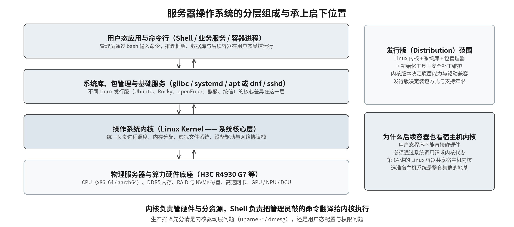
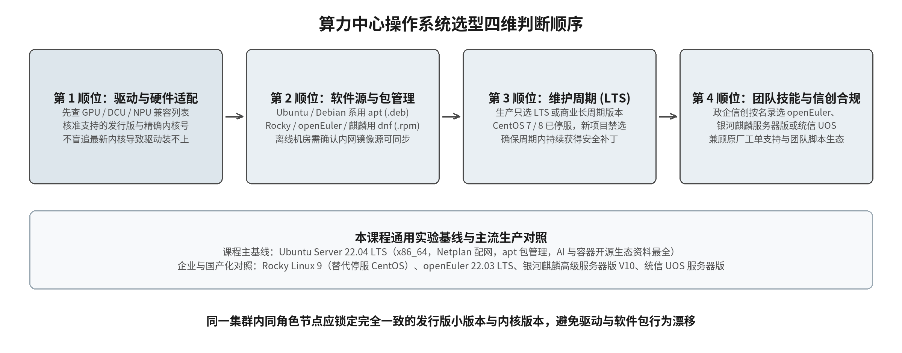
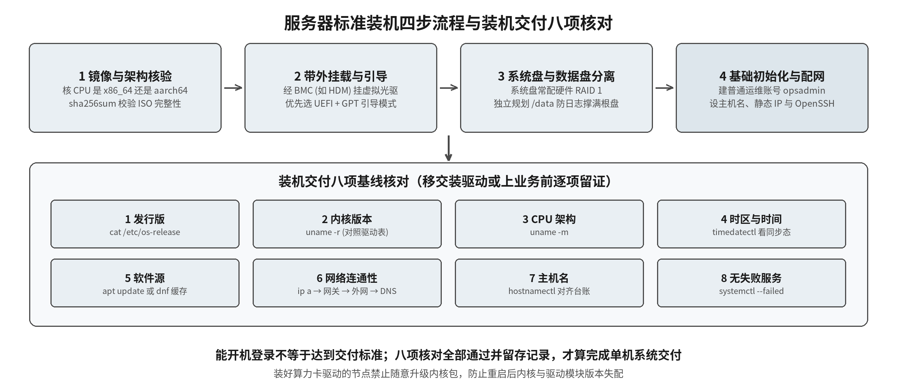
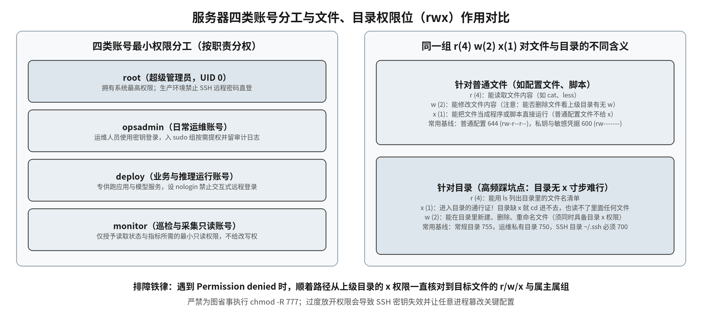

# 第7讲 操作系统基础

**本课程定位：** 第 3～6 讲把服务器硬件、算力卡和机房网络认清了。裸机上架插好网线后，还跑不了任何程序。本讲进入软件底座第一层——服务器操作系统，讲清系统组成、选型、装机核对与日常权限管理，为第 8 讲深度服务与存储管理和第 14 讲容器技术打地基。

机房刚到一台 `H3C UniServer R4930 G7` 服务器，准备装上加速卡跑推理服务。交给你初始化系统时，马上会碰到四个问题：操作系统到底管什么？老同事顺口说“装 CentOS 7”，现在还能听吗？装完能开机就算交活了吗？怎么分账号权限，又不会改错配置把自己锁在 SSH 外面？本讲逐一给出标准做法。

## 本讲学习目标

学完后，你应能：

- 说清操作系统内核、系统库与命令行 Shell 的分层关系，区分内核版本与发行版版本。
- 按“驱动适配、软件源、维护周期、团队与信创合规”四个维度为服务器选定发行版。
- 说出带外远程装机的关键步骤，并按八项交付核对清单验收一台新装服务器。
- 落实四类运维账号最小权限分工，分清 `rwx` 权限位对普通文件和目录的不同作用。
- 按防失联规程加固 SSH 远程登录，用包管理、进程与日志命令完成日常核查。

## 7.1、服务器操作系统管什么、由哪几层组成

服务器里的 CPU、内存、硬盘、网卡和加速卡都是硬件。业务程序不能直接去抢硬件，否则两个程序同时写同一块内存就会互相撞毁。**操作系统（OS）** 坐在硬件与业务程序正中间。操作系统向下统一纳管硬件驱动与资源分配，向上给所有程序提供标准、隔离的运行环境。



### 7.1.1、内核、系统库与命令行 Shell 的分工

Linux 服务器系统从下往上分三层看最清楚：

- **内核（Kernel）**：操作系统的最核心程序。内核直接管硬件，负责四件大事：进程调度（决定哪个程序用哪颗核）、内存分配（划清内存边界）、虚拟文件系统（把磁盘映射成目录文件）以及设备驱动与网络协议栈（驱动网卡、RAID 卡与加速卡）。
- **系统库与基础服务**：包括基础函数库 `glibc`、服务总管家 `systemd`、包管理器以及远程登录服务 `sshd`。普通程序靠调用系统库向内核申请资源。
- **Shell 与用户态应用**：管理员连上服务器后看到的命令行提示符，背后跑的就是 **Shell**（Linux 常用 `bash`）。Shell 像翻译官，把管理员敲的命令翻译给内核执行。

生产服务器一般不装耗资源的图形桌面。日常运维、自动化脚本和第 14 讲要学的容器，全都建立在命令行和 Linux 内核之上。提前记一条伏笔：Linux 容器没有独立内核，同一台机器上的容器共享宿主机内核。宿主机内核稳不稳，直接决定上面跑的容器稳不稳。

### 7.1.2、内核版本不等于发行版版本

现场沟通环境时，常有人把两个版本号混着说。必须把两层名字分开读：

- **Linux 内核版本**：底层内核代码的版本号，用 `uname -r` 查看，例如 `5.15.0-119-generic`。算力卡驱动模块直接加载进内核，对内核小版本号非常敏感。
- **Linux 发行版（Distribution）版本**：社区或厂商把特定内核、包管理器、管理工具和安全更新打包成的整套系统，用 `cat /etc/os-release` 查看，例如 `Ubuntu 22.04.4 LTS`。

机房里也有 Windows Server，多用于依赖微软生态或特定商业软件的办公业务。而在智算中心、容器集群和 AI 训推场景下，**Linux 服务器发行版**开销小、原生适合命令行自动化且全面适配主流加速卡驱动，是绝对主力。

【关键区别】两台机器都叫“Linux”，不代表装包命令一样，也不代表同一个驱动包能通用。汇报环境时，必须同时报出**发行版全称**、**内核版本**和 **CPU 架构**三项。

## 7.2、主流服务器发行版与四维选型方法

面对众多 Linux 发行版，运维选型不凭个人喜好，只看生态谱系和维护保障。

### 7.2.1、三大服务器 Linux 生态谱系与停服红线

按软件包格式与技术渊源，机房主流 Linux 发行版分三大谱系：

表7-1、主流服务器操作系统发行版生态对比

| 所属谱系 | 代表发行版 | 包格式与工具 | 算力与生产场景特点 |
| --- | --- | --- | --- |
| Debian 系 | Ubuntu Server LTS、Debian | deb 包，用 apt 与 dpkg | AI 开源框架、CUDA 与容器生态适配最快，为本课程实验主基线 |
| RHEL 兼容系 | RHEL、Rocky Linux、AlmaLinux | rpm 包，用 dnf 与 rpm | 企业传统业务积淀深；注意 CentOS 7 与 8 已停服，新项目禁选 |
| 国产服务器系 | openEuler、银河麒麟服务器版、统信 UOS 服务器版 | 多为 rpm 系（部分支持 deb），用 dnf 或 apt | 政企与信创智算主力，深度适配海光 C86、鲲鹏 CPU 及国产加速卡 |

这里有一条硬红线必须记牢：**CentOS Linux 8 已于 2021 年底停服，CentOS Linux 7 也已于 2024 年 6 月 30 日正式停止维护（EOL）**。停服后官方不再修补安全漏洞，默认软件源也已归档下线。新建算力集群严禁再按老习惯装 CentOS 7 或 8。若原有业务属于 RHEL 生态，应改选维护期内的 `Rocky Linux`、`openEuler` 或商业支持版本。

### 7.2.2、按四个维度定版本：驱动适配排第一

给一批新服务器定操作系统版本时，固定按四个顺位核对：



1. **驱动与硬件适配（第一顺位）**：先查加速卡（NVIDIA GPU、海光 DCU、昇腾 NPU）和高速网卡原厂发布的**软硬件兼容列表**。看清官方驱动支持哪几个发行版和哪几个精确内核号。绝不盲目追最新内核，否则装完系统会发现加速卡驱动编译不过。
2. **软件源与包管理生态**：确认软件栈用 `.deb`（`apt`）还是 `.rpm`（`dnf`）。离线内网机房还要确认本地镜像站能否同步对应版本的软件仓库。
3. **维护周期（只选 LTS）**：生产环境只选带 **LTS（长期支持）** 标识或商业长周期维护的版本（通常提供 5～10 年安全更新），不选半年就停服的短期尝鲜版。
4. **团队技能与信创合规**：政企、金融、运营商等信创项目按合规名录选型（如 `openEuler`、银河麒麟服务器版、统信 UOS 服务器版），同时确认原厂工单支持范围。

**【例题】** 实验室新到 4 台带加速卡的服务器，准备跑 `Qwen2.5-7B-Instruct` 推理服务。甲建议装刚发布的非 LTS 短期版 Ubuntu，理由是“内核最新”。乙建议翻出旧 CentOS 7.9 镜像装上。两个建议各错在哪？应该怎么选？

**解：** 甲错在非 LTS 短期版维护期仅 9 个月，且过新内核常不在加速卡稳定驱动列表里，极易装不上驱动。乙错在 CentOS 7.9 已停服无安全补丁，且 `glibc` 等基础库太旧，跑新版 `vLLM` 会报底层库缺失。正确做法是先查加速卡驱动兼容表，在受支持的长期支持版里选统一基线（通用环境如 `Ubuntu Server 22.04 LTS`，信创环境如受支持的 `openEuler 22.03 LTS` 或银河麒麟服务器版 V10），并在 4 台机器上锁定完全相同的小版本与内核号。

【随堂思考】同一集群的两台算力节点，一台是 `Ubuntu 22.04`（内核 `5.15`），另一台被随手全量升级成了内核 `6.8`。这会给后续批量装驱动和排障埋下什么雷？

## 7.3、服务器远程装机流程与八项交付核对

机房冷通道噪音大、进出审批严。现代运维装系统不用拎显示器和 U 盘进机房，直接走第 3 讲学过的带外管理网远程完成。



### 7.3.1、从带外挂载镜像到初始化配网

标准远程装机抓准四个环节：

- **第一步：核对架构并校验镜像**。下载官方 ISO 后先核 CPU 架构：Intel、AMD 和海光 C86 用 `x86_64`（常标 `amd64`），鲲鹏等 ARM 处理器用 `aarch64`（常标 `arm64`）。下错架构根本启动不了。装前必跑 `sha256sum` 核对官方校验值，防坏包半途卡死。
- **第二步：BMC 挂虚拟光驱与 UEFI 引导**。浏览器登录带外管理口（如 H3C HDM，出厂缺省 `192.168.1.2/24`），打开远程虚拟控制台挂载 ISO 并设下次从虚拟光驱引导。现代服务器统一用 **UEFI 引导 + GPT 分区表**。传统 BIOS + MBR 不支持大于 `2 TB` 的单盘，新装机不再选。
- **第三步：系统盘与数据盘分离**。两块小 SSD 常在硬件 RAID 卡上做成 `RAID 1` 专门装系统（挂 `/`、`/boot`、`/boot/efi`）。大容量数据盘单独挂到 `/data` 目录，防止后续镜像、模型权重或日志写满根分区 `/` 拖死系统（LVM 在线扩容留到第 8 讲实操）。
- **第四步：初始化主机名、账号与静态网络**。设好规范主机名（如 `os-node-01`），创建普通运维账号 `opsadmin`，按第 5 讲配好静态 IP（`192.168.10.15/24`、网关 `192.168.10.1`、DNS `223.5.5.5`），勾选开启 `OpenSSH server`。

### 7.3.2、装机交付八项核对：能开机不等于能交活

机器重启看到登录提示符，只算装完一半。移交装驱动或部署业务前，必须连上 SSH 逐项跑完**装机交付八项核对**：

表7-2、服务器操作系统装机交付八项核对清单

| 序号 | 核对项 | 标准只读核对命令 | 合格判据与失配后果 |
| --- | --- | --- | --- |
| 1 | 发行版版本 | `cat /etc/os-release` | 发行版名称与 LTS 小版本号与集群规划完全一致 |
| 2 | 内核版本 | `uname -r` | 内核号落在加速卡驱动兼容矩阵内；禁开无人值守自动升内核 |
| 3 | CPU 架构 | `uname -m` | 确认 64 位 x86 或 ARM 架构与后续安装包架构一致 |
| 4 | 时区与时间同步 | `timedatectl` | 时区为 `Asia/Shanghai`，且时钟同步为 `yes`（时间偏会导致证书失效） |
| 5 | 软件源可用性 | `sudo apt update` 或 `dnf makecache` | 能正常拉取仓库索引无报错，内网指向本单位合规镜像源 |
| 6 | 网络四步连通 | `ip a`、`ip r`、`ping`、`dig` | 按第 5 讲顺序确认本机地址、网关、外网 IP 与域名解析全通 |
| 7 | 主机名规范 | `hostnamectl` | 主机名如 `os-node-01`，与资产台账和监控标签三方一致 |
| 8 | 无失败系统服务 | `systemctl --failed` | 输出 `0 loaded units listed`，无开机崩溃的底层服务 |

下面是一台合格交付的 `os-node-01` 节点跑核心核对命令的输出示例：

```text
opsadmin@os-node-01:~$ uname -m && uname -r
x86_64
5.15.0-119-generic
opsadmin@os-node-01:~$ timedatectl | grep -E "Time zone|synchronized"
                Time zone: Asia/Shanghai (CST, +0800)
System clock synchronized: yes
opsadmin@os-node-01:~$ systemctl --failed
  UNIT LOAD ACTIVE SUB DESCRIPTION
0 loaded units listed.
```

<!-- pagebreak -->

## 7.4、日常管理核心操作：目录、账号权限、SSH 与软件包

机器投产后，最常做的四件事是管目录文件、管账号权限、管远程登录和装基础工具。人为误操作也最容易出在这四处。

### 7.4.1、标准目录树与安全文件操作习惯

Linux 没有 `C:`、`D:` 盘符，整机只有一棵从根目录 `/` 展开的目录树。不同磁盘挂载在不同目录路径下。

表7-3、Linux 服务器高频核心目录与运维用途

| 目录路径 | 存放什么内容 | 日常运维注意事项 |
| --- | --- | --- |
| `/etc` | 系统与服务的配置文件（如网络、SSH 配置） | 修改任何配置前，必先用 `cp -p` 原地留一份备份文件 |
| `/var/log` | 系统日志、登录审计日志与服务运行日志 | 查登录失败或异常重启常看此处；留意日志轮转防占满根盘 |
| `/opt` | 第三方软件与自研运维脚本目录（如 `/opt/ops`） | 按角色控制属主与权限，不把杂物堆进系统自带目录 |
| `/home` | 普通运维账号各自的家目录（如 `/home/opsadmin`） | 存放个人 SSH 公钥目录；不放长期对外服务的生产业务数据 |
| `/data` | 独立挂载的大容量业务数据与模型权重目录 | 上线前必跑 `df -h` 确认真挂上了独立大盘，没写进根分区 |

日常动文件养成三条习惯：先敲 `pwd` 看清当前目录，用 `ls -lh` 看大小与权限，改配置前先跑 `sudo cp -p /etc/ssh/sshd_config /etc/ssh/sshd_config.bak`（`-p` 保留原属主、权限与时间）。用 `rm` 删东西前必先 `ls` 核路径。写脚本时严禁在变量未判空前写 `rm -rf $DATA_DIR/*`，防止变量为空误删根目录。

### 7.4.2、四类账号最小权限分工与 rwx 权限位判读

生产严禁多人共用一个 `root` 密码直登。共用账号既没法追查某条命令是谁敲的，密码一漏整机也就失守了。全课程统一按职责拆成四类账号：

- **root**：超级管理员（`UID=0`），不受普通权限位约束。生产禁止 SSH 远程密码直登。
- **opsadmin**：运维人员个人登录账号，入 `sudo` 组。平时用普通权限做只读查看。确需改配置或重启服务时加 `sudo` 提权，认证日志会自动记下操作人与命令。修改提权配置必须用带语法检查的 `sudo visudo`，不裸改 `/etc/sudoers`。
- **deploy**：运行业务程序与推理服务的专用账号，Shell 设为 `/usr/sbin/nologin`（禁交互登录）。就算业务服务出漏洞，外部也拿不到管理员权限。
- **monitor**：巡检脚本与监控采集只读账号，只给读取状态所需的最小权限。



敲 `ls -ld` 看权限时，如 `-rw-r----- 1 opsadmin deploy 1024 ... app.conf` 开头共 10 位：第 1 位 `-` 代表普通文件（`d` 代表目录）。后面 9 位每 3 位一组，依次对应**属主（u）、属组（g）、其他人（o）**的读 `r(4)`、写 `w(2)`、执行 `x(1)` 权限。例如属主 `opsadmin` 是 `rw-`（`6`），属组 `deploy` 是 `r--`（`4`），其他人是 `---`（`0`），合起来就是 `640`。

【关键区别】同样是 `r`、`w`、`x`，在**普通文件**上和在**目录**上含义不同，尤其要盯紧目录的 `x`：

- **普通文件**：`r` 能读内容，`w` 能改内容，`x` 能当脚本或程序运行。注意：**能不能删除一个文件，不看文件自身有无 w，而看上级目录有无 w 和 x！**
- **目录**：`r` 能用 `ls` 列出文件名清单。**x 是进入目录的通行证：目录没有 x 权限，既 cd 进不去目录，也读不了里面任何文件（哪怕里面文件本身是 666 或 777）**。`w` 配合 `x` 才能在目录里新建、删除或改名文件。

**【例题】** 推理配置文件 `/opt/infer/config.yaml` 自身权限是 `-rw-r--r--`（`644`，人人可读）。上级目录 `/opt/infer` 权限却是 `drw-r--r--`（`644`，属主 `opsadmin:opsadmin`）。推理进程用 `deploy` 账号启动读配置时，为什么报 `Permission denied`？怎么按最小权限修好？

**解：** 根因是目录 `/opt/infer` 缺 `x` 权限。目录设成 `644` 时，属组和其他人只有 `r` 没有 `x`，`deploy` 账号连目录门都进不去，自然读不到里面的 `config.yaml`。修复时不要乱敲 `777`，应把目录改为属组 `deploy` 且权限 `750`（`drwxr-x---`），配置文件设为 `640`：

```text
opsadmin@os-node-01:~$ sudo chown opsadmin:deploy /opt/infer
opsadmin@os-node-01:~$ sudo chmod 750 /opt/infer
opsadmin@os-node-01:~$ sudo chown opsadmin:deploy /opt/infer/config.yaml
opsadmin@os-node-01:~$ sudo chmod 640 /opt/infer/config.yaml
```

这样 `opsadmin` 可读写、`deploy` 可进目录只读配置，无关账号完全隔离。

### 7.4.3、SSH 密钥登录、防失联规程与包管理日常快查

服务器接通管理网后，第一步安全加固是用 **SSH 密钥登录** 替代弱口令，并禁掉 `root` 远程直登。

客户端跑 `ssh-keygen -t ed25519` 生成密钥对：私钥留在本机严禁外传，公钥写入服务器 `/home/opsadmin/.ssh/authorized_keys`。这里有一处硬性权限要求：**家目录下的 .ssh 目录权限必须是 700，公钥文件权限必须是 600，且属主必须是 opsadmin 本人**。一旦有人误把 `.ssh` 改成 `777`，`sshd` 担心公钥被篡改，会直接拒绝密钥登录！

改 `/etc/ssh/sshd_config` 收紧登录（设 `PermitRootLogin no` 与 `PasswordAuthentication no`）时，严格按**防失联三步规程**做：

1. **先备份**：执行 `sudo cp -p /etc/ssh/sshd_config /etc/ssh/sshd_config.bak`。
2. **先验语法再重载**：执行 `sudo sshd -t` 确认无任何语法报错，再跑 `sudo systemctl reload ssh`（RHEL 与麒麟系服务名常为 `sshd`）。
3. **保旧窗开新窗实测**：**绝不关掉手头已连上的旧 SSH 窗口！** 另开一个新终端窗口，实测 `opsadmin` 密钥能登进、且 `sudo -i` 能正常提权后，才算变更完成。万一新窗登不上，立刻在没断的旧窗口还原 `.bak` 文件自救。

下面汇总日常包管理、查进程与看日志的基础命令（编写 `systemd` 服务单元、磁盘扩容与性能定位放在第 8 讲专项实操）：

表7-4、两类包管理体系与基础进程日志快查命令

| 日常场景 | Ubuntu / Debian 系（deb） | Rocky / openEuler / 麒麟系（rpm） | 运维操作要点 |
| --- | --- | --- | --- |
| 刷新源并装包 | `sudo apt update && sudo apt install curl` | `sudo dnf makecache && sudo dnf install curl` | 装包前看清连带升级列表，防止误升级内核包 |
| 查已装软件包 | `dpkg -l`（配合 grep 过滤包名） | `rpm -qa`（配合 grep 过滤包名） | 排障核对驱动或基础库精确版本时常用 |
| 查看运行进程 | `ps -ef` 或 `ps aux` | `ps -ef` 或 `ps aux` | 核对运行账号与实际启动命令行参数 |
| 停止异常进程 | 优先 `kill PID`（默认 15 号信号） | 优先 `kill PID`（默认 15 号信号） | 给进程收尾保存机会；仅僵死无响应时才谨慎用 `kill -9` |
| 查登录与服务日志 | `sudo journalctl -u ssh -n 50` 或查 `/var/log/auth.log` | `sudo journalctl -u sshd -n 50` 或查 `/var/log/secure` | 密钥登录失败或提权报错时，第一时间翻认证日志 |

【随堂思考】改完远端服务器 `/etc/ssh/sshd_config` 禁用密码登录后，如果敲完重启服务就直接关掉了唯一的 SSH 窗口，而刚才公钥文件权限误配成了 `666`，第二天会出什么问题？走哪条路自救？

## 7.5、本讲回顾与自测

学习完本讲后，试着用自己的话回答四个问题：Linux 内核和发行版是什么关系？给算力服务器选系统先看哪四条？新装系统要核对哪八项才算能交活？为什么目录没有 `x` 权限连里面的可读文件都打不开？

表7-5、本讲目标与对应判断

| 学习目标 | 应能做出的判断 |
| --- | --- |
| 分清系统层次与版本 | 内核管硬件调度与驱动（`uname -r`），发行版管软件打包与维护周期（`os-release`） |
| 按四维选定发行版 | 驱动与硬件兼容排第一，结合包管理、LTS 周期与信创合规；拒选已停服的 CentOS 7/8 |
| 验收新装服务器基线 | 经 BMC 远程挂载与 UEFI+GPT 装机，系统盘与数据盘分离，跑通装机交付八项核对 |
| 管好账号与目录权限 | 拆分 root / opsadmin / deploy / monitor；牢记目录无 `x` 进不去门，不乱敲 `chmod 777` |
| 安全执行远程维护 | 改前 `cp -p` 留备份，改 SSH 后跑 `sshd -t` 并保留旧窗口开新窗口实测防失联 |

### 7.5.1、本讲自测

**1 概念区分。** 加速卡原厂工程师问你当前服务器的“Linux 内核版本”和“CPU 架构”，应该敲哪两条命令查看？

A. `ls -l` 与 `pwd`　　B. `uname -r` 与 `uname -m`　　C. `df -h` 与 `ps aux`　　D. `ip a` 与 `ping`

**2 选型红线。** 新建一套企业智算中心服务器集群时，下列哪项系统选型方案必须直接否决？

A. 选用加速卡驱动兼容列表内的 Ubuntu Server 22.04 LTS

B. 信创合规集群统一选用受支持的银河麒麟高级服务器版或 openEuler LTS

C. 因为老脚本以前跑在 CentOS 7 上，新买的服务器继续统一新装 CentOS 7.9

D. 替代传统 RHEL 系环境时，选用处于维护期内的 Rocky Linux 验证版本

**3 权限判读。** 目录 `/opt/ops` 权限为 `drwxr-x---`（`750`），属主和属组都是 `opsadmin`。不在 `opsadmin` 组的账号 `monitor` 跑 `cd /opt/ops` 会怎样？若把目录改成 `drw-r--r--`（`644`），属主 `opsadmin` 自己还能 `cd /opt/ops` 进去吗？

**答：**

____________________________

____________________________

**4 账号分工。** 为什么线上推理服务不直接用 `root` 或个人 `opsadmin` 账号启动，而要专门建一个禁交互登录（`nologin`）的 `deploy` 账号来跑？

**答：**

____________________________

____________________________

**5 SSH 排障。** 同事把公钥填进 `/home/opsadmin/.ssh/authorized_keys` 后，顺手敲了 `chmod -R 777 /home/opsadmin/.ssh`。结果新开窗口用密钥登录失败并退回密码提示。写出原因和修复命令。

**答：**

____________________________

____________________________

**6 交付核对。** 新装好一台服务器准备移交装算力卡驱动，请从“装机交付八项核对”里写出至少五项检查内容和对应命令。

**核对项与命令：**

____________________________

____________________________

____________________________

<!-- pagebreak -->

## 7.6、参考答案与解析

### 7.6.1、随堂思考解析

**思考 1（同集群节点内核不一致的隐患）：** 算力卡内核驱动、高速网卡驱动和容器特性都依赖具体内核版本。一台 `5.15`、一台 `6.8` 会让同一套驱动包在 `6.8` 上可能装不上，批量脚本也得写分支兼容，出了偶发问题更难排除内核差异。同角色节点必须锁定一致的发行版与内核版本。

**思考 2（改错 SSH 且关掉唯一窗口的后果与自救）：** 公钥权限 `666` 会被 `sshd` 拒用，密码登录又刚被关掉，第二天所有人都会从业务网和管理网 SSH 失联。自救方法是走**带外管理网登录 BMC（如 HDM）打开远程虚拟控制台（KVM）**，从本地控制台登录系统，还原 `sshd_config.bak` 并把 `~/.ssh` 修回 `700`、`authorized_keys` 修回 `600`，重载 `ssh` 恢复访问。

### 7.6.2、课后自测解析

**1 选 B。** `uname -r` 查 Linux 内核版本，`uname -m` 查 CPU 架构（如 `x86_64` 或 `aarch64`）。再加 `cat /etc/os-release` 就能报全系统身份。

**2 选 C。** CentOS Linux 7 已于 2024 年 6 月底停服（EOL），无安全补丁且基础软件库陈旧，新项目严禁选用。应选驱动兼容列表内受长期维护的 LTS 版本。

**3 第一问：** `monitor` 会报 `Permission denied` 进不去，因为 `750` 对其他人是 `---`。**第二问：** 改成 `644` 后，连属主 `opsadmin` 自己也 `cd` 进不去了。因为 `644`（`drw-r--r--`）拿掉了属主的 `x` 位，目录只要缺 `x`，除 `root` 外谁都进不去。

**4 为了做最小权限隔离，缩小安全与误操作影响面。** 用 `root` 跑服务一旦代码有漏洞或删错路径会毁掉整套系统。用个人账号跑服务在人员变动时容易中断且难分清责任。专用 `deploy` 配 `nologin`，既限制服务只能动业务目录，又防止他人拿这个账号直接远程登录。

**5 原因：** `.ssh` 目录或公钥文件对组和其他人放开了写权限（如 `777`），`sshd` 判定公钥可能被篡改，出于安全保护直接拒绝密钥认证。修复命令：`chmod 700 /home/opsadmin/.ssh && chmod 600 /home/opsadmin/.ssh/authorized_keys && chown -R opsadmin:opsadmin /home/opsadmin/.ssh`。

**6 任写五项及以上即可（共八项）：** 一看发行版 `cat /etc/os-release`。二看内核版本 `uname -r`。三看 CPU 架构 `uname -m`。四看时区与时间同步 `timedatectl`。五看软件源 `sudo apt update`（或 `dnf makecache`）。六看网络连通性（`ip a`、`ip r`、`ping` 网关与外网、`dig` 域名）。七看主机名 `hostnamectl`。八看无失败服务 `systemctl --failed`。

### 7.6.3、复习时再问自己

如果你遇到 `Permission denied` 还想随手敲 `chmod -R 777`，回看 7.4.2 节例题和 7.4.3 节密钥失效案例。如果你怕改 SSH 把自己锁在门外，回看 7.4.3 节防失联三步规程。

## 7.7、术语与疑问

### 7.7.1、术语

表7-6、本讲术语

| 术语 | 本讲中的含义 |
| --- | --- |
| 内核（Kernel） | 操作系统的核心层，直接管理 CPU 调度、内存分配、文件系统、硬件驱动与网络协议栈。 |
| 发行版（Distribution） | 把 Linux 内核与包管理器、系统库、管理工具及维护周期打包发布的完整操作系统版本。 |
| Shell | 命令行解释器（常用 `bash`），接收管理员输入的命令并请求内核执行。 |
| LTS（长期支持版） | 提供多年安全补丁与稳定维护的版本（如 Ubuntu 22.04 LTS），是生产选型基准。 |
| UEFI 与 GPT | 现代服务器主流引导方式与分区表格式，支持大于 `2 TB` 的磁盘与更稳健的启动分区。 |
| `sudo` | 让受控普通运维账号按需临时提权执行命令，并自动留下可追溯的审计日志。 |
| `rwx` 权限位 | 读（`4`）、写（`2`）、执行或进入目录（`1`）三类基础权限，按属主、属组、其他人三组排列。 |
| SSH 密钥登录 | 用公私钥对验证身份的远程加密登录方式，要求家目录下 `.ssh` 为 `700`、公钥文件为 `600`。 |

文中 IP、域名、路径与参数为教学示例，生产环境以本单位规划为准。

### 7.7.2、我的疑问

**写下一项你在 Linux 发行版选型或权限管理上还想弄清的问题**

____________________________

<!-- pagebreak -->

## 附录、新装服务器基线核对与移交记录单

单机系统装好加固完毕、移交第 8 讲配业务服务或第 28 讲接入算力池前，可按下方表格留存交付基线。

表7-7、新装服务器系统基线与账号移交记录单

| 核对类别 | 交付记录填写要点与示例（脱敏留存，严禁填写明文密码或私钥） |
| --- | --- |
| 资产与主机标识 | 主机名 `os-node-01`；机柜位与设备序列号已对齐资产台账；64 位 CPU 架构已核实 |
| 系统与内核基线 | 发行版 `Ubuntu 22.04.4 LTS`；内核 `5.15.0-119-generic`（已核对加速卡驱动兼容矩阵） |
| 分区与挂载核对 | 系统盘硬件 RAID 1 正常；大容量数据盘独立挂载至 `/data`（`df -h` 确认未写进根盘） |
| 时间与软件源 | 时区 `Asia/Shanghai`，NTP 时钟同步正常；合规软件源索引更新无报错 |
| 网络与失败服务 | 静态 IP `192.168.10.15/24`、网关、DNS 四步验通；`systemctl --failed` 为 0 个失败单元 |
| 账号与 SSH 加固 | 已建 `opsadmin`（密钥登录加 sudo）、`deploy`（禁交互登录）、`monitor`；已禁 root 密码直登并新开窗口实测通过 |

<!-- md-only -->

## 附：主要参考资料（仅 Markdown 保留，不印入 Word/PDF）

- 中国信通服务《2025 算力运维体系技术白皮书》（课程资料库本地 PDF）。用于智算中心基础设施软件栈分层、国产软硬件适配及系统基线治理要求对照。
- 新华三《H3C UniServer R4930 G7 系列服务器用户指南》。用于 HDM 带外远程控制台挂载虚拟光驱、UEFI 引导模式及服务器操作系统兼容性说明。
- Ubuntu Server 22.04 LTS 官方安装与系统管理文档（Canonical）。用于 LTS 维护周期、Netplan 静态网络初始化、OpenSSH 服务配置及 `apt` 包管理规范。
- openEuler 官方文档与 Red Hat Enterprise Linux / Rocky Linux 系统管理指南。用于国产服务器操作系统与 `.rpm` / `dnf` 包管理体系对照，以及 CentOS Linux 停服（EOL）公告核实。
- Linux man-pages 与 OpenSSH 官方手册：`uname(1)`、`os-release(5)`、`timedatectl(1)`、`chmod(1)`、`chown(1)`、`sudoers(5)`、`sshd_config(5)`。用于核对文件与目录 `rwx` 权限语义及 `.ssh` 目录安全权限校验机制。

插图：本讲四张示意图均使用课程统一绘图脚本生成，供教学示意使用。

<!-- /md-only -->
