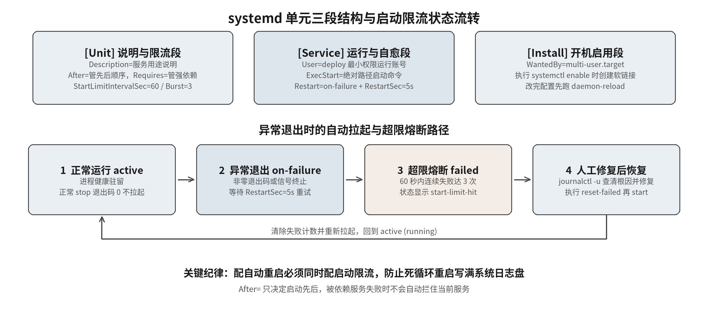
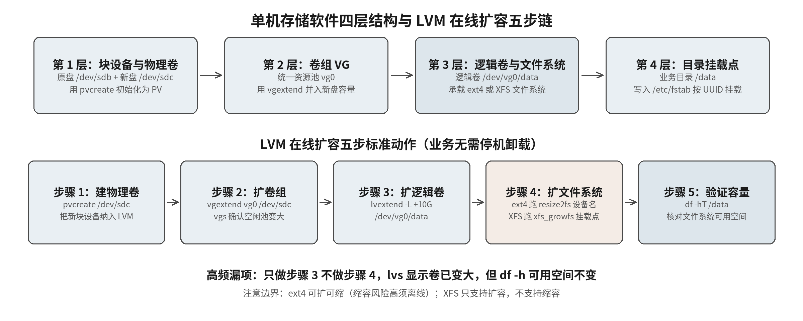
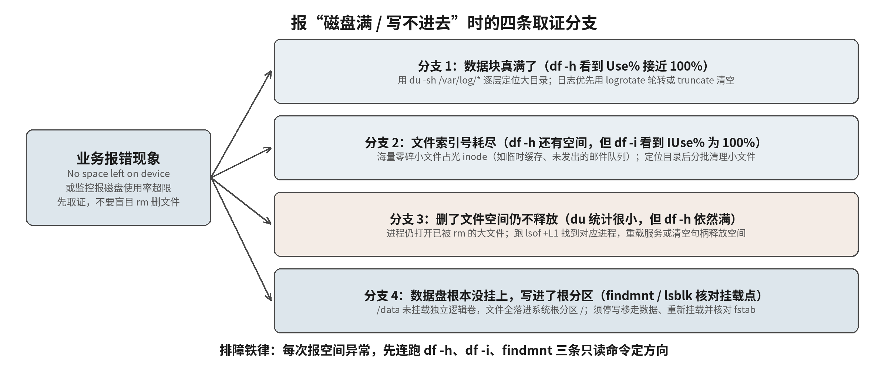
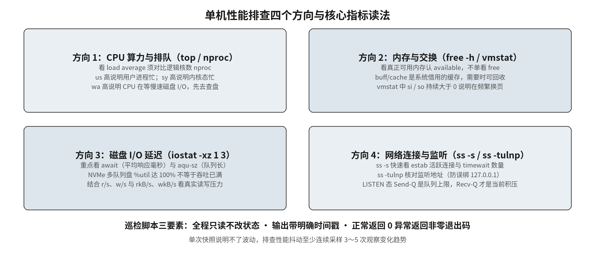

# 第8讲 操作系统管理

**本课程定位：** 第 7 讲完成了操作系统选型、安装和基础账号权限核对。机器交付上线后，真正的日常运维才刚刚开始。本讲聚焦单台 Linux 服务器长期运行最常遇到的四件事：后台服务怎么稳住、数据目录满了怎么在线扩容和排查、机器变慢从哪四个方向看指标、日常巡检脚本怎么定时跑起来。学好本讲，后面第 11、12 讲做多节点自动化巡检与第 25 讲建设可观测性体系才有扎实的单机功底。

凌晨两点，值班群弹出两条告警：一条报 `os-node-01` 上的采集代理进程反复退出，端口连不上；另一条报 `/data` 目录可用空间只剩 3%，业务日志快写不进去了。面对这类现场问题，不能靠重启整台服务器碰运气。本讲带你用标准命令先取证、再处理、最后验证恢复。

## 本讲学习目标

学完后，你应能：

- 编写包含三段结构的 `systemd` 服务单元文件，配好失败自动重启与启动限流，并用 `journalctl` 定位启动失败原因。
- 说清单机存储软件的四层关系，完成一次 LVM 在线扩容，并区分块空间耗尽、inode 耗尽、文件删后未释放和漏挂载四类空间异常。
- 使用 `top`、`free`、`vmstat`、`iostat`、`ss` 从 CPU、内存、磁盘、网络四个方向读取关键性能指标，避开常见读数误区。
- 运行符合“只读、带时间戳、返回退出码”三要素的 Shell 巡检脚本，并通过 `/etc/cron.d` 配置定时任务。
- 独立完成一次服务故障恢复、在线扩容与磁盘空间告警排查的端到端上机实验。

## 8.1、服务管理：systemd 单元、依赖与启动限流

在主流 Linux 服务器发行版（如 `Ubuntu Server 22.04 LTS`、Rocky Linux、openEuler）中，`systemd` 是开机后的第一个进程（PID 为 1），统一负责系统服务启动、停止、状态监控和日志收集。运维自建的后台程序（例如节点监控代理、模型推理守护进程）都应当写成自定义 `service` 单元文件，放在 `/etc/systemd/system/` 目录下统一纳管，不要在终端手工敲 `nohup` 后就放任不管。

<!-- pagebreak -->

### 8.1.1、单元文件三段结构与依赖区别

一份标准的服务单元文件由 `[Unit]`、`[Service]`、`[Install]` 三段组成。每次新建或修改单元文件后，必须先执行 `sudo systemctl daemon-reload` 让 `systemd` 重新加载配置，再用 `sudo systemctl enable --now 服务名` 同时设为开机自启并立即启动。

表8-1、systemd 单元文件三段职责与常用字段

| 段落名 | 主要职责 | 常用配置写法与工程含义 |
| --- | --- | --- |
| Unit 段 | 说明用途、启动先后、依赖关系与启动限流 | Description= 写明用途；After=network-online.target 规定先后顺序；StartLimitIntervalSec= 与 StartLimitBurst= 限制短时重启次数 |
| Service 段 | 定义运行账号、启动命令与异常自愈策略 | User=deploy 用最小权限账号运行；ExecStart= 必须写程序绝对路径；Restart=on-failure 配合 RestartSec=5s 做异常自愈 |
| Install 段 | 声明开机自启挂入哪个运行目标 | 常写 WantedBy=multi-user.target，表示在多用户命令行模式下随系统开机启动 |

配置服务依赖时，最容易混淆的是先后顺序和强弱依赖：

- **After= 只管先后顺序，不管成败**：写 `After=network-online.target` 只代表“等网络目标启动动作做完再启动本服务”；假如前序服务启动失败，当前服务依然会照常尝试启动。
- **Requires= 管强依赖，Wants= 管弱依赖**：写 `Requires=docker.service` 表示强绑定，如果被依赖的服务启动失败，当前服务也会直接放弃启动；日常若只希望优先拉起关联组件但不强行捆绑成败，推荐用 `Wants=` 搭配 `After=`。

【关键区别】`systemctl start` 命令敲完没有报错，不等于服务已经稳定运行。`Type=simple`（默认类型）只要把主进程拉起来就立刻返回命令行，哪怕进程 1 秒后因为配置文件写错而崩溃退出，命令行当时也不会提示。每次启动或重启后，必须紧跟一句 `systemctl status 服务名` 核对状态是否为 `active (running)`。

### 8.1.2、失败自愈与启动限流配合

线上进程偶尔会因瞬时外部连接超时或内存抖动异常退出。为了让服务具备基础自愈能力，需要在 `/etc/systemd/system/infer-agent.service` 单元文件中把重启策略与启动限流配成一套完整组合：

```ini
# /etc/systemd/system/infer-agent.service
[Unit]
Description=Inference Node Health Agent
After=network-online.target
Wants=network-online.target
StartLimitIntervalSec=60
StartLimitBurst=3

[Service]
Type=simple
User=deploy
Group=deploy
WorkingDirectory=/opt/ops
ExecStart=/usr/bin/python3 /opt/ops/agent_stub.py --port 9105
Restart=on-failure
RestartSec=5s

[Install]
WantedBy=multi-user.target
```

这份配置里有三条运维硬规矩：

1. **优先用 Restart=on-failure，不盲目写 Restart=always**：`on-failure` 只在进程返回非零退出码、被异常信号终止或超时的时候才自动拉起；运维人员正常执行 `systemctl stop`（退出码为 0）时不会误拉起。
2. **必须设置 RestartSec=5s 留出喘息间隔**：避免进程崩溃瞬间毫秒级紧接着重试，打满单核 CPU。
3. **必须在 Unit 段同时配 StartLimitIntervalSec=60 与 StartLimitBurst=3**：注意这两个限流参数在新版 `systemd` 中属于 `[Unit]` 段而非 `[Service]` 段。上面两行的意思是“60 秒时间窗口内最多允许启动 3 次”。如果没有启动限流，一旦配置文件写错或端口被占，无限制的自动重启会每秒刷出几十行报错，几小时就能把 `/var/log` 所在磁盘写满。



当服务在 60 秒内连续失败达到 3 次，`systemd` 会主动熔断，停止继续拉起，服务状态变为 `failed (Result: start-limit-hit)`。此时排障恢复要走固定三步：先查日志改好故障根因，再执行 `sudo systemctl reset-failed infer-agent.service` 清零失败计数，最后执行 `sudo systemctl start infer-agent.service` 恢复运行。

<!-- pagebreak -->

### 8.1.3、用 journalctl 按条件精准查日志

`systemd` 把服务的标准输出和标准错误统一收进二进制日志库，用 `journalctl` 读取。排查故障时不要直接敲无参数的 `journalctl` 从几个月前的第一行翻起，应当按服务名、启动批次和时间窗口精准过滤。

表8-2、journalctl 排障高频过滤方式

| 排查需求 | 标准命令示例 | 输出能回答什么问题 |
| --- | --- | --- |
| 查单服务本次启动日志 | sudo journalctl -u infer-agent.service -b --no-pager | 本次开机以来这个服务经历了哪几次启动、退出码是多少 |
| 只看最近时间窗日志 | sudo journalctl -u infer-agent.service --since "15 min ago" | 告警发生前后 15 分钟内打印了什么具体报错 |
| 只看错误及以上级别 | sudo journalctl -p err -b | 全系统本次开机有哪些内核或服务级严重错误 |
| 实时盯住最新输出 | sudo journalctl -u infer-agent.service -n 30 -f | 刚重启服务时，最新 30 行及后续实时日志有无数正常就绪 |

【例题】值班员发现 `infer-agent.service` 处于 `failed` 状态，`systemctl status` 里提示 `Main process exited, status=203/EXEC`，紧接着出现 `start-limit-hit`。这说明问题出在哪一层？应当按什么顺序恢复？

解：`status=203/EXEC` 是 `systemd` 拉起程序阶段的标准报错，常见原因有三类：`ExecStart=` 写的程序路径不存在、脚本缺少可执行权限（`chmod +x`），或者脚本第一行缺少正确的解释器声明（如 `#!/usr/bin/env bash`）。恢复顺序：第一步用 `journalctl -u infer-agent.service -n 30` 核对报错路径并修正文件或单元配置；第二步若改了单元文件就先运行 `sudo systemctl daemon-reload`；第三步运行 `sudo systemctl reset-failed infer-agent.service` 清除限流锁定；第四步运行 `sudo systemctl start infer-agent.service` 并用 `status` 验证回到 `active (running)`。

【随堂思考】某同事写服务单元时，在 `[Service]` 段写了 `Restart=always`，没写 `RestartSec`，也没在 `[Unit]` 段写启动限流。如果今天上线的新配置文件里少写了一个括号导致程序一启动就报错退出，这台服务器接下来会发生什么连锁反应？

## 8.2、存储管理：LVM 在线扩容与磁盘异常排查

第 3 讲认识服务器硬件时，我们从物理介质（HDD/SSD）、接口协议（SATA/SAS/NVMe）、盘位尺寸和 RAID 卡四个硬件维度认识了硬盘。到了操作系统这一层，内核把底层单盘或硬件 RAID 阵列统一识别为块设备（如 `/dev/sdb` 或 `/dev/nvme0n1`），再经过单机存储软件四层结构变成业务能读写的目录。

### 8.2.1、单机存储软件四层与持久化挂载

如果直接在传统固定分区（如 `/dev/sdb1`）上格式化使用，将来业务模型文件越来越多、这块盘装不下时，很难在不中断业务的情况下把第二块新盘的空间拼进来。因此在生产服务器上，数据目录普遍采用 **LVM（逻辑卷管理）** 组织存储：

1. **块设备与物理卷（PV）**：用 `pvcreate` 把物理磁盘或分区（如 `/dev/sdb`、`/dev/sdc`）打上 LVM 标记，变成物理卷。
2. **卷组（VG）**：用 `vgcreate` 或 `vgextend` 把一块或多块物理卷汇成统一的容量池（本课程基线统一命名为 `vg0`）。
3. **逻辑卷（LV）与文件系统**：用 `lvcreate` 从 `vg0` 里按需切出逻辑卷（如 `/dev/vg0/data`），再用 `mkfs.ext4` 或 `mkfs.xfs` 在逻辑卷上创建文件系统。
4. **挂载点（Mount Point）**：用 `mount` 把格式化好的逻辑卷挂到目录树（如 `/data`），并写入 `/etc/fstab` 实现开机自动挂载。

写入 `/etc/fstab` 时，设备标识一律优先使用 `blkid` 查出的文件系统 **UUID=...**（或 LVM 映射路径 `/dev/mapper/vg0-data`），不要写 `/dev/sdb` 这类顺序盘符，因为增减硬盘重启后盘符字母可能漂移。**每次改完 /etc/fstab 后，必须在重启机器前当场执行 sudo mount -a 测试**：若 `mount -a` 报错而直接重启，服务器会在开机引导阶段卡进紧急救援模式，导致远程 SSH 失联。

### 8.2.2、LVM 在线扩容五步链

当监控提示 `/data` 目录剩余空间不足，机房或云平台新挂上一块 20 GB 磁盘 `/dev/sdc` 后，LVM 支持在业务不停机、目录不卸载的状态下完成在线扩容。



在线扩容严格遵循下面五步：第一步先用 `lsblk -f` 和 `df -hT /data` 核对卷组与文件系统类型（看清是 `ext4` 还是 `xfs`）；第二步把 `/dev/sdc` 做成物理卷并扩入卷组 `vg0`；第三步扩展逻辑卷容量；第四步按文件系统类型扩展文件系统（`ext4` 运行 `resize2fs /dev/vg0/data` 传设备路径，`xfs` 运行 `xfs_growfs /data` 传挂载目录路径）；第五步回到 `df -hT /data` 验证空间生效。在 `os-node-01` 上的完整命令如下：

```bash
# Step 1: check current block devices and filesystem type (ext4 or xfs)
lsblk -f
df -hT /data

# Step 2: initialize PV and extend volume group vg0
sudo pvcreate /dev/sdc
sudo vgextend vg0 /dev/sdc
sudo vgs vg0

# Step 3: extend logical volume (+10G, or use -l +100%FREE)
sudo lvextend -L +10G /dev/vg0/data

# Step 4: grow filesystem (choose matching tool for FSTYPE)
# For ext4 (pass LV device path):
sudo resize2fs /dev/vg0/data
# For xfs (pass mount point path):
# sudo xfs_growfs /data

# Step 5: verify available capacity
df -hT /data
```

表8-3、ext4 与 XFS 文件系统在扩容缩容上的关键差异

| 对比项 | ext4 文件系统 | XFS 文件系统 |
| --- | --- | --- |
| 扩容参数对象 | 传逻辑卷设备路径（如 /dev/vg0/data） | 传已挂载目录路径（如 /data） |
| 是否支持在线扩容 | 支持，无需卸载目录 | 支持，无需卸载目录 |
| 是否支持缩容 | 支持离线缩容（须先卸载并强检，风险高） | **不支持缩容**，只能扩不能缩 |
| 运维给量建议 | 按近期实际需要逐步扩，留卷组余量 | 每次只扩够用的增量，不要一次分空整个 vg0 |

【关键区别】`lvextend` 只是把底层“容器盒子”（逻辑卷）拉大了，里面的文件系统还不知道外面的边界已经变宽。如果漏跑第 4 步（`resize2fs` 或 `xfs_growfs`），敲 `sudo lvs` 会看到逻辑卷已经变成新大小，但敲 `df -h /data` 可用空间一兆都没涨。另外，`XFS` 文件系统不支持缩容，扩容前先算准增量再动手。

### 8.2.3、“写不进去”的四条取证分支

现场收到 `No space left on device`（设备上没有剩余空间）或磁盘使用率告警时，新手最容易犯的错是上去就找大文件执行 `rm -rf`。实际上，“写不进去”共有四种截然不同的成因，必须先跑三条只读命令定准方向。



1. **数据块空间真满了**：`df -h` 看到目标挂载点的 `Use%` 接近 100%。接着用 `sudo du -xh --max-depth=1 /data`（`-x` 防止跨入子挂载点）逐层往下找是谁占了空间。如果是正在写入的业务大日志，优先配 `logrotate` 做日志轮转，应急释放空间用 `sudo truncate -s 0 日志文件路径` 原地截断清空，尽量不要直接 `rm` 正在打开的日志文件。
2. **inode（文件索引号）耗尽了**：`df -h` 显示还有几十 GB 空闲，程序创建文件却依然报 `No space left on device`。这时跑 `df -i` 会看到 `IUse%` 达到 100%。每个文件无论多大都要占一个 inode，定时任务失控生成几百万个几字节的零碎临时小文件，就会把索引号占光。定位出小文件堆积目录后，分批清理无用缓存文件即可恢复。
3. **文件已被 rm 删除，但进程句柄未释放**：有人刚用 `rm` 删掉了 20 GB 的旧日志，跑 `du -sh /var/log` 看起来只有几百 MB，可 `df -h` 显示磁盘还是 99% 满。这是因为后台服务进程依然打开着那个已被删除的文件，内核必须等所有打开句柄关闭才会真正回收数据块。此时运行 `sudo lsof +L1` 即可列出所有连接数小于 1（已删除但仍被占用）的文件及对应 PID；通知程序重新加载日志（如 `systemctl reload`）或重启对应非核心服务后，空间会立刻释放。
4. **数据盘根本没挂上，全写进了根分区**：原本规划把大容量盘挂在 `/data`，结果某次维护卸载或重启漏配 `/etc/fstab`，`/data` 退化成了系统根分区 `/` 底下的一个普通空文件夹，几十 GB 模型权重全写进了系统盘，把根分区撑爆。用 `findmnt /data` 或 `lsblk` 一眼就能看穿挂载关系；如果在未挂载的 `/data` 里存了文件后又直接把新盘挂载上去，原来的文件还会被“遮盖”藏在底层占着根分区空间。

【例题】同事说：“`/var/log/app` 底下有个 30 GB 的 `error.log`，我刚刚已经 `rm -f error.log` 删掉了，`ls` 也看不到了，为什么监控里的 `/` 分区使用率还是 98% 一点没降？”请你给出取证命令和稳妥处理办法。

解：这是典型的“文件目录项已删、但运行中的进程仍持有文件描述符未释放”。第一步取证：执行 `sudo lsof +L1 /var/log`（或全盘 `sudo lsof +L1`），在输出中找到标记为 `(deleted)` 的 `error.log` 以及对应进程名与 PID。第二步稳妥处理：核对对应进程的 `systemd` 服务是否支持平滑重载日志（如 `nginx -s reopen` 或 `systemctl reload`），或在业务允许窗口重启对应服务释放句柄。以后遇到正在写入的超大日志，若不便重启进程，应使用 `truncate -s 0 文件名` 清空内容而不是直接 `rm`。

## 8.3、性能排查：四个方向读数与常见误区

当业务方反馈“这台服务器响应变慢、卡顿”时，不能凭感觉猜是 CPU 不够还是网络堵了。单机性能排查固定沿着 **CPU、内存、磁盘 I/O、网络连接** 四个方向，在 1 分钟内采集一组基线读数。



### 8.3.1、CPU 与内存：看清排队与真正可用量

先用 `nproc` 确认这台机器有几个逻辑 CPU 核，再运行 `top`（或批处理采样 `top -b -n 2 -d 1`）和 `free -h`、`vmstat 1 5`：

- **看 load average（平均负载）必须结合逻辑核数**：`top` 首行三个小数分别是过去 1 分钟、5 分钟、15 分钟处于可运行和不可中断等待状态的平均任务数。单看 `load average: 8.0` 无法判断忙闲：在 32 核服务器上很轻松，在 4 核虚拟机上就已经严重排队。
- **看 CPU 时间花在哪一类状态上**：`us`（用户态）高说明业务计算进程本身忙；`sy`（内核态）异常高常与频繁系统调用或海量上下文切换有关；**wa（iowait）高说明 CPU 并不在算数，而是在傻等慢速磁盘读写返回**——遇到 `wa` 飙高，下一步应当去查磁盘而不是申请加 CPU。
- **看内存认准 available，配合 vmstat 看换页**：Linux 会主动借用空闲物理内存做文件读写缓存（`buff/cache`），所以跑了一段时间的服务器，`free -h` 里的 `free` 列很小完全正常。**判断应用程序还能申请多少内存，一律看 available 列**。再跑 `vmstat 1 5` 连续观察 5 秒（忽略第 1 行开机累计均值，看第 2～5 行）：如果 `si`（每秒从 swap 读入内存）和 `so`（每秒从内存写入 swap）持续显著大于 0，说明物理内存已经不够，系统正在拿慢速磁盘顶替内存来回换页，业务延迟必然飙升。

### 8.3.2、磁盘 I/O 与网络连接：避开 %util 和 Send-Q 误判

定位磁盘与网络瓶颈时，有两个指标极易被按字面意思读反：

1. **磁盘性能看 iostat -xz 1 3 的延迟与队列，不迷信 %util**：`iostat` 来自 `sysstat` 软件包（`-x` 显示扩展指标，`-z` 跳过空闲无读写的设备，`1 3` 表示每秒采 1 次共采 3 次，同样看第 2、3 次实时值）。重点看 **await**（平均每次 I/O 请求从入队到完成的耗时，单位毫秒 ms；SATA/SAS SSD 正常多在 1 ms 以内或几毫秒，若持续飙到几十甚至上百毫秒说明明显拥塞）和 **aqu-sz**（平均请求队列长度）。注意：**%util 只统计采样周期内设备至少有 1 个请求在处理的时间占比**；现代 NVMe SSD 或多盘 RAID 阵列支持高并发多队列并行处理，即使 `%util` 显示 100%，只要 `await` 依然很低，说明磁盘远未达到最大吞吐上限。
2. **网络套接字看 ss -s 与 ss -tulnp，分清两种状态下的队列含义**：`ss -s` 快速汇总全机 `estab`（已建立 TCP 连接）与 `timewait` 数量；`sudo ss -tulnp` 检查预期端口有没有真在监听，以及监听地址是不是误绑成了 `127.0.0.1`（只允许本机连，外部全被拒，与第 6 讲端口排障衔接）。看 `Recv-Q` 和 `Send-Q` 两列时必须先看最左边的状态列 `State`：
   - 在 **ESTAB（已连接态）** 下，`Recv-Q` 是内核收到但应用还没取走的字节数，`Send-Q` 是已发出但对端尚未确认的字节数；持续堆积说明应用处理不过来或网络链路拥塞。
   - 在 **LISTEN（监听态）** 下，**Send-Q 显示的是当前监听端口配置的全连接队列上限（backlog 容量），Recv-Q 才是当前已建连、正排队等应用 accept 的积压连接数**！千万不要看到监听态 `Send-Q` 写着 `128` 或 `511`，就误报“发送队列堵了 511 个包”。

表8-4、单机性能四方向取证工具与判读边界汇总

| 排查方向 | 推荐命令 | 首要关注字段 | 常见误判提醒 |
| --- | --- | --- | --- |
| CPU | nproc、top | load average、us、sy、wa | 不核对核数直接看负载大小；把 wa 磁盘等待当成算力不足 |
| 内存 | free -h、vmstat 1 5 | available、si、so | 看到 free 列小就报内存耗尽，忽略可回收缓存 buff/cache |
| 磁盘 | iostat -xz 1 3 | await、aqu-sz、rkB/s、wkB/s | 只看第 1 次开机累计均值；在 NVMe 盘上把 %util 100% 直接等同于跑满 |
| 网络 | ss -s、sudo ss -tulnp | State、Local Address:Port、Recv-Q | 服务误绑 127.0.0.1 导致外网连不上；把 LISTEN 态 Send-Q 当成积压故障 |

【随堂思考】你在 `os-node-01` 上敲 `sudo ss -tulnp`，看到业务监听行显示 `LISTEN  0  128  127.0.0.1:8080`。这里数字 `0` 和 `128` 各代表什么？为什么同网段的 `192.168.10.200` 访问 `192.168.10.15:8080` 会直接报连接被拒绝？

## 8.4、日常巡检：只读脚本三要素与定时调度

手工敲命令适合突发排障，平时成百上千次例行健康检查就要靠巡检脚本加定时任务自动落盘留证。本讲重点掌握如何在单机上规范运行和维护一份 Shell 只读巡检脚本；多节点批量变更脚本与 Python 自动采集处置将在第三章（第 11、12 讲）系统深入。

### 8.4.1、只读巡检脚本的三条规矩

遵循本课程统一基线，单机 Shell 巡检脚本固定放在 `/usr/local/bin/host-check.sh`，巡检结果日志统一写入 `/var/log/opsadmin/` 目录（属主设为 `opsadmin:opsadmin`）。一份合格的线上巡检脚本必须满足三个要素：

1. **全程只读（Read-Only）**：巡检脚本只负责读取系统状态、比对告警阈值、输出报告，**严禁在巡检脚本里顺手夹带 rm 删日志或 systemctl restart 重启服务的修改动作**。采集与处置分离，才能保证巡检本身绝对安全，任何时候跑都不会引发二次事故。
2. **输出带明确时间戳**：每条记录和报告头部都必须带上如 `2026-11-18T16:00:01+08:00`（`date -Is`）的标准时间戳和本机主机名，否则事后翻日志根本对不上告警发生时刻。
3. **返回明确退出码（Exit Code）**：全部指标正常时脚本最后 `exit 0`；任一指标越过阈值（如磁盘使用率 ≥ 85%、关键服务未处于 `active`）时返回非零退出码（如 `exit 2`），方便上层调度器或监控探针根据 `$?` 识别异常。

### 8.4.2、放入定时任务：/etc/cron.d 与 systemd timer

在生产环境部署系统级定时任务，不建议登录个人账号手改隐藏的 `crontab -e`（人员离职或切换账号很难审计交接），推荐采用以下两种标准化方式之一：

- **方式一：独立配置文件 /etc/cron.d/host-check**。相比分散的个人定时表，`/etc/cron.d/` 下的文件集中透明、便于纳入版本管理，但有四条硬性格式要求，踩错任意一条都会静默不执行：
  1. **文件名严禁包含点号 .**（例如写 `host-check` 可以，写成 `host-check.cron` 会被 Debian/Ubuntu 的 `cron` 守护进程直接忽略）；
  2. **文件属主必须是 root:root，权限必须是 644**（权限过宽如 `666` 或 `777` 会出于安全原因拒绝执行）；
  3. **比普通 crontab -e 多第 6 列“执行用户名”**（如指定以低权限 `opsadmin` 或 `monitor` 身份运行，不用 `root` 跑普通巡检）；
  4. **显式声明 PATH 且全部命令与文件一律写绝对路径**（`cron` 默认环境变量极简，不加载交互登录的 `~/.bashrc`）。
- **方式二：systemd timer（定时器单元）**。写一个同名的 `.timer` 单元按日历周期触发对应的 `.service` 单元。它的优势是每次定时运行的耗时、退出码和报错直接进 `journalctl -u`，还能天然复用 `systemd` 的资源隔离与超时控制。

下面给出 `/etc/cron.d/host-check` 的标准配置内容（每 10 分钟以 `opsadmin` 身份执行一次巡检并追加记录日志）：

```cron
# /etc/cron.d/host-check (owner root:root, mode 0644, no dot in filename)
SHELL=/bin/bash
PATH=/usr/local/sbin:/usr/local/bin:/usr/sbin:/usr/bin:/sbin:/bin

*/10 * * * * opsadmin /usr/local/bin/host-check.sh >> /var/log/opsadmin/host-check.log 2>&1
```

## 8.5、上机实训：管理一个服务并排查一次磁盘告警

本节实训对应本讲核心实操要求，在一台 `Ubuntu Server 22.04 LTS` 主机或虚拟机（示例主机名 `os-node-01`，IP `192.168.10.15/24`，登录账号 `opsadmin`）上即可独立复现全部五个环节。若实验机没有多余未分区的物理新硬盘，前置步骤中提供了用回环文件（Loop Device）安全模拟两块真实块设备的标准做法；若环境已有空闲盘如 `/dev/sdb`、`/dev/sdc`，直接替换设备名即可。

### 8.5.1、前置准备：准备运行账号与模拟实验磁盘

先安装 `lvm2`、`sysstat`、`lsof` 工具包，创建非交互登录专用账号 `deploy` 与日志目录 `/var/log/opsadmin`，再用两个 `512M` 回环文件绑定模拟块设备 `LOOP1` 与 `LOOP2`，把 `LOOP1` 初始化为卷组 `vg0` 和 `300M` 逻辑卷 `/dev/vg0/data` 并挂载到 `/data`：

```bash
# Run on os-node-01 as opsadmin
sudo apt-get update && sudo apt-get install -y lvm2 sysstat lsof

id deploy >/dev/null 2>&1 || sudo useradd -r -s /usr/sbin/nologin deploy
sudo mkdir -p /opt/demo-worker /var/log/opsadmin /data /var/lib/lab-disks
sudo chown opsadmin:opsadmin /var/log/opsadmin

sudo truncate -s 512M /var/lib/lab-disks/disk1.img /var/lib/lab-disks/disk2.img
LOOP1=$(sudo losetup --find --show /var/lib/lab-disks/disk1.img)
LOOP2=$(sudo losetup --find --show /var/lib/lab-disks/disk2.img)
echo "LOOP1=${LOOP1} LOOP2=${LOOP2}"

sudo pvcreate "${LOOP1}"
sudo vgcreate vg0 "${LOOP1}"
sudo lvcreate -L 300M -n data vg0
sudo mkfs.ext4 -F /dev/vg0/data
sudo mount /dev/vg0/data /data
df -hT /data
```

### 8.5.2、步骤一：编写 systemd 服务、复现启动限流并用 journalctl 修复

准备一个用 Python 标准库监听本地 `127.0.0.1:9105` 的轻量演示程序，先故意在单元文件里把端口参数写成错词 `badport` 以复现启动失败与限流熔断，再用 `journalctl` 定位修好并测试 `kill -9` 异常拉起：

```bash
sudo tee /opt/demo-worker/server.py >/dev/null <<'EOF'
#!/usr/bin/env python3
import http.server, socketserver, sys

if len(sys.argv) != 2 or not sys.argv.isdigit():
    print("FATAL: invalid port argument, expected integer port", file=sys.stderr)
    sys.exit(2)

port = int(sys.argv)
handler = http.server.SimpleHTTPRequestHandler
socketserver.TCPServer.allow_reuse_address = True
with socketserver.TCPServer(("127.0.0.1", port), handler) as httpd:
    print(f"demo-worker listening on 127.0.0.1:{port}", flush=True)
    httpd.serve_forever()
EOF
sudo chmod 755 /opt/demo-worker/server.py
sudo chown -R deploy:deploy /opt/demo-worker

sudo tee /etc/systemd/system/demo-worker.service >/dev/null <<'EOF'
[Unit]
Description=Demo Worker HTTP Service
After=network-online.target
StartLimitIntervalSec=60
StartLimitBurst=3

[Service]
Type=simple
User=deploy
WorkingDirectory=/opt/demo-worker
ExecStart=/usr/bin/python3 /opt/demo-worker/server.py badport
Restart=on-failure
RestartSec=2s

[Install]
WantedBy=multi-user.target
EOF

sudo systemctl daemon-reload
sudo systemctl enable --now demo-worker.service
sleep 7
systemctl status demo-worker.service --no-pager || true
sudo journalctl -u demo-worker.service -b --no-pager

# Fix port argument, reload unit, clear start-limit-hit, and start again
sudo sed -i 's/badport/9105/' /etc/systemd/system/demo-worker.service
sudo systemctl daemon-reload
sudo systemctl reset-failed demo-worker.service
sudo systemctl start demo-worker.service

systemctl is-active demo-worker.service
sudo ss -tulnp | grep 9105
sudo kill -9 "$(systemctl show -p MainPID --value demo-worker.service)"
sleep 3
systemctl status demo-worker.service --no-pager
```

预期验证结果：修正前 `journalctl` 清晰打出 `FATAL: invalid port argument` 并在重试 3 次后停在 `start-limit-hit`；修正并执行 `reset-failed` 后服务稳定运行在 `9105` 端口；模拟异常信号 `kill -9` 后，等待约 2 秒会自动拉起新 PID。

### 8.5.3、步骤二：排查“删文件不释放”告警并用 LVM 给 /data 在线扩容

先模拟后台进程打开 `/data/app.log` 写入 `220M` 数据，复现直接 `rm` 后 `du` 与 `df` 读数背离的现象，用 `lsof +L1` 释放空间，最后用 `LOOP2` 给 `/data` 在线扩容 `300M`：

```bash
sudo sh -c 'dd if=/dev/zero bs=1M count=220 >> /data/app.log 2>/dev/null; tail -f /data/app.log >/dev/null &'
df -h /data

sudo rm -f /data/app.log
du -sh /data
df -h /data

sudo lsof +L1 /data
sudo pkill -f "tail -f /data/app.log"
df -h /data

sudo pvcreate "${LOOP2}"
sudo vgextend vg0 "${LOOP2}"
sudo lvextend -L +300M /dev/vg0/data
sudo resize2fs /dev/vg0/data
df -hT /data
```

预期验证结果：刚执行 `rm` 时，`du -sh /data` 几乎为 0，但 `df -h /data` 仍显示已用 220 MB 以上；`lsof +L1 /data` 定位并释放进程后空间瞬间归还；执行完 `lvextend` 加 `resize2fs` 后，`/data` 总容量从约 280 MB 在线扩至约 580 MB。

### 8.5.4、步骤三：定位一次磁盘 I/O 与 CPU 性能抖动

在后台启动一个持续同步刷盘的压测循环，用 `top` 和 `iostat -xz 1 3` 采样观察 `wa` 与 `await`，随后停止压测复测确认指标回落：

```bash
sudo sh -c 'while true; do dd if=/dev/zero of=/data/io-test.bin bs=4M count=20 conv=fdatasync 2>/dev/null; done &'
IO_PID=$!

top -b -n 2 -d 1 | head -n 15
iostat -xz 1 3

sudo kill "${IO_PID}" 2>/dev/null || true
sudo rm -f /data/io-test.bin
iostat -xz 1 2
```

### 8.5.5、步骤四：编写只读 Shell 巡检脚本并接入定时任务

编写 `/usr/local/bin/host-check.sh` 巡检服务、磁盘容量、inode 与可用内存，手工运行核对退出码后，写入 `/etc/cron.d/host-check`（权限 `644`，属主 `root:root`）：

```bash
sudo tee /usr/local/bin/host-check.sh >/dev/null <<'EOF'
#!/usr/bin/env bash
set -u

TS=$(date -Is)
HOST=$(hostname)
DISK_PCT=$(df -P /data | awk 'NR==2 {gsub("%","",$5); print $5}')
INODE_PCT=$(df -Pi /data | awk 'NR==2 {gsub("%","",$5); print $5}')
MEM_AVAIL_MB=$(awk '/MemAvailable:/ {printf "%d", $2/1024}' /proc/meminfo)
SVC_STATE=$(systemctl is-active demo-worker.service 2>/dev/null || echo "inactive")

STATUS="OK"
EXIT_CODE=0
REASON="all_within_threshold"

if [[ "${SVC_STATE}" != "active" ]]; then
    STATUS="ALERT"; EXIT_CODE=2; REASON="service_demo_worker_${SVC_STATE}"
elif [[ "${DISK_PCT}" -ge 85 ]] || [[ "${INODE_PCT}" -ge 85 ]]; then
    STATUS="ALERT"; EXIT_CODE=2; REASON="data_disk_${DISK_PCT}pct_inode_${INODE_PCT}pct"
elif [[ "${MEM_AVAIL_MB}" -lt 256 ]]; then
    STATUS="ALERT"; EXIT_CODE=2; REASON="mem_available_low_${MEM_AVAIL_MB}MB"
fi

printf "%s host=%s status=%s service=%s data_disk=%s%% data_inode=%s%% mem_avail=%sMB reason=%s\n" \
    "${TS}" "${HOST}" "${STATUS}" "${SVC_STATE}" "${DISK_PCT}" "${INODE_PCT}" "${MEM_AVAIL_MB}" "${REASON}"
exit "${EXIT_CODE}"
EOF
sudo chmod 755 /usr/local/bin/host-check.sh

/usr/local/bin/host-check.sh | tee -a /var/log/opsadmin/host-check.log
echo "check_exit_code=$?"

sudo tee /etc/cron.d/host-check >/dev/null <<'EOF'
SHELL=/bin/bash
PATH=/usr/local/sbin:/usr/local/bin:/usr/sbin:/usr/bin:/sbin:/bin
*/5 * * * * opsadmin /usr/local/bin/host-check.sh >> /var/log/opsadmin/host-check.log 2>&1
EOF
sudo chown root:root /etc/cron.d/host-check
sudo chmod 644 /etc/cron.d/host-check
ls -l /etc/cron.d/host-check
```

### 8.5.6、实训常见排障与环境回退清理

表8-5、实训常见报错与分层排查路径

| 现象描述 | 优先检查命令 | 常见根因与修复动作 |
| --- | --- | --- |
| 改了单元文件但未生效 | systemctl status demo-worker | 修改 /etc/systemd/system/ 下的单元文件后漏跑 sudo systemctl daemon-reload |
| 修好脚本仍启动失败 | systemctl status demo-worker | 触发过启动限流停在 start-limit-hit；先跑 sudo systemctl reset-failed 再启动 |
| lvextend 后 df 没变 | sudo lvs 与 df -hT /data | 漏跑扩文件系统步骤；ext4 补跑 resize2fs，XFS 补跑专用扩容工具并传挂载目录 |
| 定时任务到点无日志 | sudo journalctl -u cron -n 30 | /etc/cron.d/ 下文件名含点号、权限不是 644、漏写 opsadmin 用户名列或日志目录无写权限 |

完成全部验证并留存输出记录后，若需还原实验环境，按与创建相反的顺序执行清理：

```bash
sudo rm -f /etc/cron.d/host-check /usr/local/bin/host-check.sh
sudo systemctl disable --now demo-worker.service
sudo rm -f /etc/systemd/system/demo-worker.service
sudo systemctl daemon-reload
sudo umount /data
sudo vgchange -an vg0 && sudo vgremove -f vg0
sudo pvremove "${LOOP1}" "${LOOP2}"
sudo losetup -d "${LOOP1}" "${LOOP2}"
sudo rm -rf /var/lib/lab-disks /opt/demo-worker
```

<!-- pagebreak -->

## 8.6、本讲回顾与自测

学习完本讲后，试着用自己的话回答四个问题：为什么自动重启必须配启动限流？LVM 扩容为什么不能停在 `lvextend`？报磁盘写不进去时哪三条命令先跑？看内存和监听队列最容易误读哪两个字段？

表8-6、本讲目标与对应判断

| 学习目标 | 应能做出的判断 |
| --- | --- |
| 服务管理与日志 | 分清 After= 与 Requires=，配齐 Restart=on-failure 加启动限流，会用 journalctl -u 查错并用 reset-failed 恢复 |
| LVM 扩容与空间排障 | 按五步链在线扩容并区分 ext4 与 XFS 扩容工具参数；用 df -h、df -i、lsof +L1、findmnt 定界四类空间异常 |
| 四方向性能读数 | 读 load average 先对核数，看内存认 available 与 si/so，看磁盘重 await/aqu-sz，分清监听态 Send-Q 与 Recv-Q |
| 只读巡检与定时任务 | 巡检严守只读、带时间戳、返回退出码；/etc/cron.d 配置文件守住无点号、644 权限、带用户名列与绝对路径 |

### 8.6.1、本讲自测

**1 单元配置。** 在 `systemd` 单元文件中，希望服务异常退出时自动拉起，同时防止配置错误引发死循环重启刷爆日志，应当如何组合配置？

- A. 只在 `[Service]` 段写 `Restart=always`
- B. 在 `[Service]` 段写 `Restart=on-failure` 和 `RestartSec=5s`，并在 `[Unit]` 段配 `StartLimitIntervalSec=` 与 `StartLimitBurst=`
- C. 只在 `[Unit]` 段写 `After=network.target`
- D. 把启动命令写进 `/etc/rc.local`

**2 文件系统扩容。** 运维人员执行 `sudo lvextend -L +50G /dev/vg0/models` 成功后，发现 `/models` 目录挂载的是 **XFS** 文件系统。下一步应当执行哪条命令让新增的 50 GB 真正生效？如果将来想把 `/models` 缩回原来的大小，XFS 是否直接支持？

**答：**

____________________________

**3 空间异常定界。** 业务报 `/data` 目录无法新建文件，提示 `No space left on device`。你执行 `df -h /data` 看到总容量 500 GB、已用 120 GB（24%）。接下来你第一条应该跑什么命令验证哪种常见原因？

**答：**

____________________________

**4 内存与磁盘读数。** 判断对错并简述理由：（1）`free -h` 里 `free` 列只剩 300 MB、`available` 列有 42 GB，说明内存马上要耗尽了；（2）NVMe 数据盘在 `iostat -xz 1 3` 中 `%util` 为 99%、`await` 为 0.4 ms，说明这块 NVMe 盘吞吐已经彻底饱和。

**答：**

____________________________

**5 定时任务排错。** 某同学新建了 `/etc/cron.d/node_check.sh`，权限设为 `666`，内容写成 `*/5 * * * * host-check.sh`。结果等了半小时一次也没执行。请找出其中至少三处违规点。

**答：**

____________________________

**6 场景排障。** 你修改了 `/etc/systemd/system/infer-agent.service` 把端口改对后，直接执行 `sudo systemctl start infer-agent.service`，系统依然报错拒绝启动，提示启动频率超限（`start-limit-hit`）。请写出从改完文件到确认端口正常监听的完整恢复命令序列。

**答：**

____________________________

____________________________

<!-- pagebreak -->

## 8.7、参考答案与解析

### 8.7.1、随堂思考解析

**思考 1（裸写 Restart=always 无间隔无限流）：** 程序每次启动瞬间报错退出，`systemd` 又毫秒级立刻拉起，单核 CPU 会被反复创建进程的开销吃满，同时 `systemd-journald` 每秒写入海量重复报错，很快把系统盘写满，甚至拖垮同机正常运行的业务。此外即使用户想手动 `stop` 排查，不加区分的配置也容易带来预期外的拉起干扰。

**思考 2（LISTEN 0 128 127.0.0.1:8080）：** 在 `LISTEN` 监听状态下，`0`（`Recv-Q`）代表当前已完成握手、排队等待应用取走的积压连接数为 0；`128`（`Send-Q`）代表这个监听端口的全连接队列最大上限为 128。同网段其他机器连不上，是因为服务绑定在了回环地址 `127.0.0.1`，内核只接收本机内部发来的连接，外部网卡进来的请求会直接收到 `Connection refused`；需改为监听 `0.0.0.0:8080` 或本机业务网 IP `192.168.10.15:8080`。

### 8.7.2、课后自测解析

**1 选 B。** `Restart=on-failure` 保证只在异常退出时重试，`RestartSec=5s` 留出冷却间隔，`[Unit]` 段的 `StartLimitIntervalSec=` 与 `StartLimitBurst=` 在连续失败达上限时熔断保护系统。

**2** 应执行 `sudo xfs_growfs /models`（注意 XFS 传挂载点目录路径，最后跟 `df -hT /models` 复核）。XFS 文件系统**不支持缩容**，只能在线扩容；若必须缩减底层卷，只能备份数据、重建更小的逻辑卷和文件系统后再恢复数据。

**3** 第一条应跑 `df -i /data` 检查文件索引号（inode）使用率 `IUse%` 是否达到了 100%。当目录里堆积了海量极小的零碎文件时，数据块还剩很多，但 inode 已被占光，同样会报 `No space left on device`。（顺带也可用 `mount` 或 `findmnt /data` 核对文件系统是否因底层磁盘错误被内核保护性重挂成了 `ro` 只读模式）。

**4 两句判断都错。** （1）Linux 会把空闲内存借给 `buff/cache` 做缓存，应用需要时内核会自动回收，判断可用内存应看 `available`（42 GB 充足）并结合 `vmstat` 的 `si`/`so` 是否为 0，不能单看 `free`。（2）NVMe 盘具备高并发多队列能力，`%util` 只表示采样期内一直有请求在跑，不代表队列已满；`await` 仅 0.4 ms 说明响应极快，远未饱和。

**5 四处违规点：** 一是文件名 `node_check.sh` 含有点号 `.`，会被 Ubuntu/Debian 的 `cron` 忽略（应改为 `node-check`）；二是权限 `666` 过宽（必须设为 `644` 且属主 `root:root`）；三是缺少第 6 列运行用户名（如 `opsadmin`）；四是命令没写绝对路径 `/usr/local/bin/host-check.sh` 且未声明 `PATH`。

**6 完整命令序列：**
（1）`sudo systemctl daemon-reload`（让修改后的单元文件生效）；
（2）`sudo systemctl reset-failed infer-agent.service`（清除 `start-limit-hit` 失败计数锁定）；
（3）`sudo systemctl start infer-agent.service`（启动服务）；
（4）`systemctl status infer-agent.service` 与 `sudo ss -tulnp`（配合端口号核对进程 `active (running)` 且监听地址正确）。

### 8.7.3、复习时再问自己

如果你遇到服务起不来还在靠反复重启碰运气，回看 8.1.2 与 8.1.3 节；如果你删了大日志文件却发现磁盘使用率一点没降，回看 8.2.3 节；如果你看到 `free` 列很小就紧张报障，回看 8.3.1 节。下一讲我们将从单台操作系统往下一层看：一台高配物理服务器怎样通过虚拟化切成多台虚拟机，以及算力卡直通、快照和热迁移有哪些硬边界。

## 8.8、术语与疑问

### 8.8.1、术语

表8-7、本讲术语

| 术语 | 本讲中的含义 |
| --- | --- |
| systemd 单元 | systemd 管理系统资源的标准配置文件，后台服务对应 .service 单元，自定义文件统一放在 /etc/systemd/system/ |
| 启动限流 | 通过 Unit 段的 StartLimitIntervalSec= 与 StartLimitBurst= 限制短时间内重复启动次数，超限后进入 start-limit-hit 保护状态 |
| journalctl | 查询 systemd 日志的标准工具，常配合 -u 按服务、-b 按本次开机、--since 按时间窗过滤 |
| LVM | 逻辑卷管理。把块设备做成物理卷（PV），汇成卷组（VG），再切出可在线扩容的逻辑卷（LV）供文件系统使用 |
| inode | 文件系统里记录文件元信息（权限、属主、数据块位置）的索引节点。海量小文件占满 inode 后，即使磁盘还有剩余容量也无法新建文件 |
| 文件描述符未释放 | 正在运行的进程仍打开着已被 rm 删除的文件，导致磁盘块无法回收；可用 lsof +L1 查出对应进程 |
| available 内存 | free -h 中算入可回收缓存后、新应用程序无需大规模换页即可实际申请使用的预估内存量 |
| await | iostat -x 中每次磁盘 I/O 请求在队列等待加设备处理的平均总耗时（毫秒），是衡量磁盘慢不慢的核心延迟指标 |

文中 IP（如 `192.168.10.15`）、主机名（`os-node-01`）、目录路径与阈值参数均为教学示例，生产环境以本单位规划为准。

### 8.8.2、我的疑问

**写下一项你在实训操作中遇到的现象或希望进一步弄清的问题**

____________________________

<!-- md-only -->

## 附：主要参考资料（仅 Markdown 保留，不印入 Word/PDF）

- 中国信通服务《2025 算力运维体系技术白皮书》（课程资料库本地 PDF）。参阅第 2.2.6 节存储设备逻辑卷管理与容量监控（PDF 第 18–19 页）、第 2.3.1 节操作系统运维配置与日志监控（PDF 第 21–22 页）。
- freedesktop.org. `systemd.unit(5)` 与 `systemd.service(5)` 官方手册。用于核对 `[Unit]`/`[Service]`/`[Install]` 字段归属、`After=` 与 `Requires=` 差异、`Restart=on-failure`、`StartLimitIntervalSec=`/`StartLimitBurst=` 及 `systemctl reset-failed` 行为。网址：https://www.freedesktop.org/software/systemd/man/latest/systemd.service.html
- freedesktop.org. `journalctl(1)` 官方手册。用于核对按单元、引导批次、优先级和时间窗检索日志的参数。网址：https://www.freedesktop.org/software/systemd/man/latest/journalctl.html
- Red Hat / Ubuntu Server Documentation. Logical Volume Manager (LVM) Administration、`resize2fs(8)` 与 `xfs_growfs(8)` 手册页。用于核对 PV/VG/LV 在线扩容顺序及 XFS 不支持缩容的边界。网址：https://ubuntu.com/server/docs/storage-lvm
- Linux `proc(5)`、`iostat(1)`（sysstat）、`ss(8)`（iproute2）与 `cron(8)` 官方手册页。用于核对 `MemAvailable` 计算口径、NVMe 多队列下 `%util` 与 `await` 的含义、`LISTEN` 态 `Recv-Q`/`Send-Q` 定义，以及 `/etc/cron.d` 文件命名（不含点号）与 `0644` 权限要求。

<!-- /md-only -->
