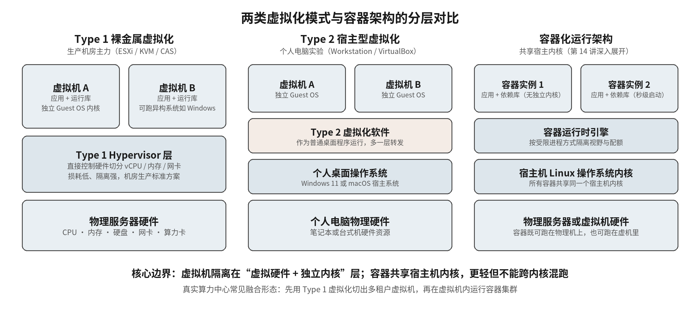
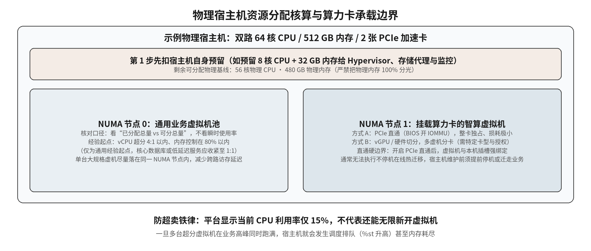
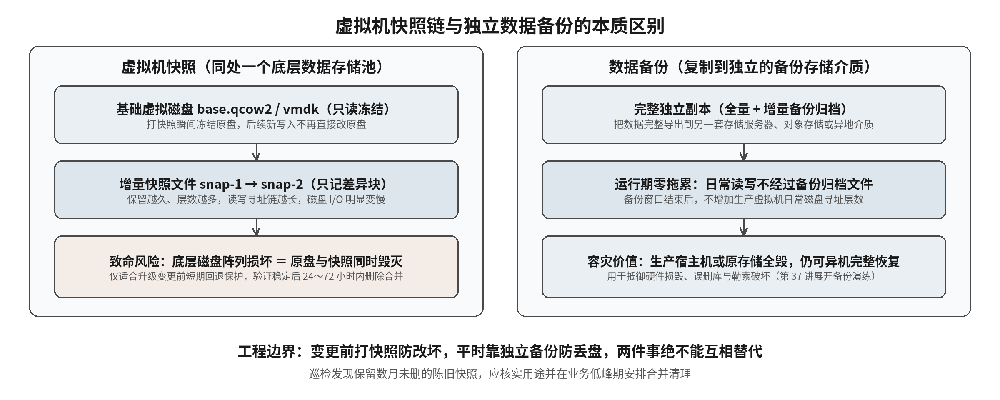
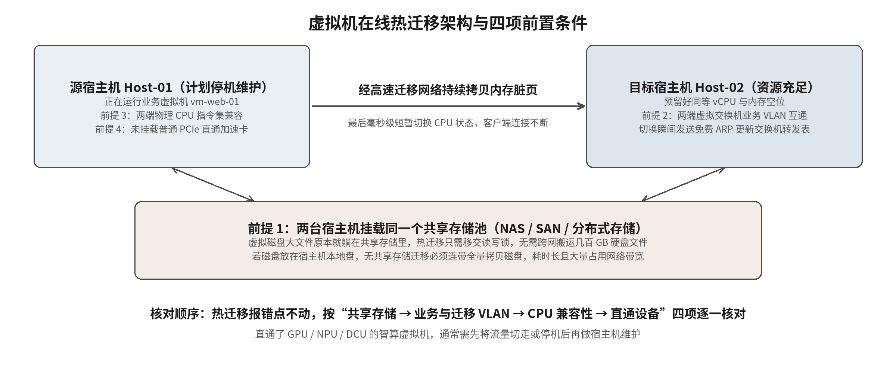

# 第9讲 虚拟化与资源承载

**本课程定位：** 前两讲我们学会了在单台服务器上安装和日常管理操作系统。但在真实算力中心里，一台像 `H3C UniServer R4930 G7` 这样的双路机架服务器动辄拥有 64 核 CPU 和 512 GB 内存。如果只跑一个轻量级内部工单系统或测试环境，九成硬件资源都会空转浪费；如果把十几个不同团队的程序直接混装在同一个操作系统里，软件库版本和管理员权限又会互相冲突。本讲解决“怎样把一台物理服务器安全切成多台独立虚拟机”，同时为第 14 讲学习容器隔离机制立下对照基准。

业务部门发来申请单：希望在一台现有的虚拟化宿主机上新开 2 台通用测试虚拟机和 1 台挂载加速卡的模型验证虚拟机，还问“能不能每天自动打一个虚拟机快照当数据备份”。能不能批、怎么核余量、直通加速卡有什么限制、快照能不能当备份，本讲逐一给出判断依据。

## 本讲学习目标

学完后，你应能：

- 区分 Type 1 裸金属虚拟化与 Type 2 宿主型虚拟化，并从隔离层次上对比虚拟机与容器的边界。
- 说出 vSphere、KVM/Proxmox VE、华为 FusionCompute、新华三 CAS 四类主流平台的计算底座与管理端分工。
- 从物理总量、宿主预留和已分配量核对宿主机余量，解释超分经验起点、NUMA 亲和与 PCIe 直通的限制条件。
- 分清虚拟机创建、模板克隆、快照与独立备份四件事的适用边界，列出克隆后必改的三项信息。
- 判断一台运行中的虚拟机是否具备在线热迁移的四项前置条件，并按核对卡验收交付一台可用虚拟机。

## 9.1、虚拟化模式：从独占物理机到资源切分

虚拟化的核心作用是在物理硬件之上加一层资源调度软件——**Hypervisor**（虚拟机监控器，也常称 VMM）。Hypervisor 把整台物理服务器的 CPU、内存、磁盘和网卡抽象成资源池，再按需切分组装成多台彼此隔离的**虚拟机（VM）**。每台虚拟机都拥有自己独立的虚拟硬件和客户机操作系统（Guest OS），一台虚拟机内部内核崩溃或重启，不会拖垮同宿主机上的其他虚拟机。

### 9.1.1、Type 1 裸金属型与 Type 2 宿主型

按照 Hypervisor 安装在什么位置，硬件虚拟化分为两类模式：

- **Type 1 裸金属型（Bare-Metal Hypervisor）**：虚拟化层直接安装在裸物理服务器上，不经过任何桌面操作系统中转，直接接管硬件中断与内存分配。Linux 内核自带的 `KVM` 模块把宿主 Linux 内核本身变成了 Hypervisor，同样属于 Type 1 范畴。因为少了一层中间系统开销，Type 1 性能损耗低、稳定性高，**数据中心和智算机房生产环境一律采用 Type 1**。
- **Type 2 宿主型（Hosted Hypervisor）**：虚拟化软件作为一款普通桌面应用程序，安装在个人电脑的 Windows 或 macOS 系统之上（常见如 VMware Workstation、Oracle VirtualBox）。每次硬件读写都要先穿过桌面操作系统，适合个人笔记本电脑做课程实验，不用于生产服务器承载业务。



### 9.1.2、虚拟机与容器的隔离边界初探

日常运维经常被问到：“既然以后要学容器和 Kubernetes，为什么还要懂虚拟机？”原因在于两者的隔离层次不同，解决的问题也不同。

表9-1、虚拟机与容器的架构边界对比

| 对比维度 | 虚拟机（VM） | 容器（Container） |
| --- | --- | --- |
| 隔离所在层 | 虚拟硬件层，每台虚机自带独立客户机内核 | 操作系统进程层，共享宿主机同一个内核 |
| 异构系统能力 | 支持跨内核（如 Linux 宿主机上跑 Windows 虚机） | 受宿主机内核约束（Linux 内核不能直跑原生 Windows 内核程序） |
| 资源开销与启动 | 需加载完整操作系统，常见启动在十秒级 | 无独立内核开销，常见启动在秒级 |
| 典型适用场景 | 多租户强安全隔离、异构操作系统、长周期底座 | 微服务快速扩缩容、标准化环境交付、AI 推理任务编排 |

注意表中的“十秒级”与“秒级”只是常见工程经验量级，实际快慢仍取决于镜像体积、磁盘速率与启动自检项。在真实智算中心里，虚拟机与容器往往不是二选一的替代关系，而是**上下层协同关系**：底层物理机先用 Type 1 虚拟化切出多套部门级虚拟机做安全与网络硬隔离，再在虚拟机内部的 Linux 系统上部署容器与 Kubernetes 集群（第 14 讲将深入拆解容器的内核命名空间与配额机制）。

【随堂思考】某传统工业软件只提供依赖 Windows Server 内核驱动的安装包，而机房现有的物理服务器全部运行 Linux KVM 虚拟化平台。这项业务应该交付虚拟机还是直接做成 Linux 容器？为什么？

<!-- pagebreak -->

## 9.2、主流虚拟化平台：底座干活与管理端调度

生产机房不会靠管理员逐台登录几十台宿主机敲命令来管虚拟机。企业级虚拟化平台统一采用**两层组件分工**：一层是装在每台物理服务器上的**计算虚拟化底座**（负责真正运行虚拟机），另一层是独立部署的**集中管理平台**（提供 Web 界面，负责跨宿主机发放资源、监控告警、克隆模板与热迁移调度）。

表9-2、四类主流服务器虚拟化平台组成与定位

| 平台名称 | 节点虚拟化底座 | 集中管理控制端 | 生态特点与常见落地场景 |
| --- | --- | --- | --- |
| VMware vSphere | ESXi | vCenter Server | 商业闭源成熟方案，图形界面完善，传统金融与企业核心系统存量多 |
| KVM 开源体系 | Linux KVM + QEMU | Proxmox VE 或云管平台 | 开源可控，兼容命令行工具 virsh，自建测试集群、公有云底座与信创改造常用 |
| 华为 FusionCompute | CNA（计算节点代理） | VRM（虚拟资源管理） | 基于 KVM 深度优化的商业虚拟化套件，国内政企与国产软硬协同机房常见 |
| 新华三 H3C CAS | CVK（计算虚拟化内核） | CVM（虚拟化管理平台） | 针对服务器集群管理与高可用深度定制，运营商与高校数据中心广泛使用 |

在基于 Linux KVM 的宿主机上，底层实际上由两个组件配合工作：`KVM` 内核模块借助物理 CPU 的硬件虚拟化扩展（Intel 称 `VT-x`，AMD 与海光称 `AMD-V` 或 `SVM`）全速执行计算指令与内存映射；用户态的 `QEMU` 进程负责模拟虚拟磁盘控制器、虚拟显卡和虚拟网卡。当集中管理界面连不上、需要应急登录宿主机只读核查本地跑了哪些虚拟机时，可以使用标准命令行工具 `virsh`：

```bash
# Read-only checks on a Linux KVM host
lscpu | grep -i virtualization
virsh list --all
virsh dominfo vm-app-01
virsh nodememstats
```

【关键区别】集中管理控制端（如 `vCenter`、`VRM`、`CVM`）如果短暂重启或升级，通常**不会导致正在计算节点上运行的业务虚拟机掉线停机**；受影响的只是运维人员暂时打不开 Web 控制台、不能发起新建或迁移任务。但反过来，如果某台底层宿主机断电且未开启集群高可用自动拉起，跑在这台宿主机上的全部虚拟机就会立刻中断。

## 9.3、核对资源与承载边界：防超卖与硬件绑定

接到新建虚拟机工单后，第一件事不是点“下一步”，而是从**物理宿主机实际容量**和**平台已分配账面**两侧做余量核对。

### 9.3.1、余量核对看“已分配量”，超分比只是经验起点

核对宿主机能不能再放新虚拟机，有三条硬规矩：

1. **先扣宿主机自身运行预留**：Hypervisor 内核、分布式存储客户端、虚拟交换机与监控代理本身也要吃 CPU 和内存。例如一台 64 核、512 GB 内存的物理宿主机，工程上常先预留出 4～8 核物理 CPU 和 16～32 GB 物理内存，剩下的才是可分配池（如可分基线按 56 核、480 GB 计）。
2. **余量核对看“已分配量对物理可分总量”，绝不单看当前实时利用率**：假设宿主机白天低谷期 CPU 使用率只有 15%、内存使用率 30%，但账面上已经给现有虚拟机分出去了 460 GB 内存。如果只看实时使用率低就再开几台大内存虚机，等到晚高峰业务流量一齐上涨，多台虚拟机同时向宿主机讨要已承诺的内存，宿主机就会被迫频繁换页甚至触发内核强杀虚拟机进程。
3. **超分比（Overcommitment）必须带业务条件审慎使用**：在许多测试环境或轻负载办公虚机集群里，常把 **vCPU 与物理核超分比控制在 4:1 以内、内存分配控制在物理内存总量的 80% 以内**。但必须牢记：**CPU 4:1 和内存 80% 只是通用运维经验起点，不是厂商硬件规格，更不是性能承诺**。对于高并发在线推理网关、核心生产数据库或科学计算节点，内存通常严格按 **1:1 不超分**（且扣除宿主预留），vCPU 甚至按 1:1 绑核，否则一旦发生宿主调度排队，虚拟机内部用 `top` 会看到 `%st`（Steal Time，被宿主机抢走等待的时间占比）明显飙高，接口响应时延随之剧烈抖动。



### 9.3.2、NUMA 节点、PCIe 直通与共享存储边界

除了算总数，算力中心的虚拟机还会撞上三道底层硬件边界：

- **NUMA（非一致性内存访问）边界**：第 3 讲讲过双路服务器里有两颗物理 CPU，每颗 CPU 直接连接自己身边的内存插槽，组成一个 NUMA 节点。CPU 读本地节点的内存最快，跨通道去读另一颗 CPU 身边的远端内存延迟更高。因此规划单台大规格虚拟机时，尽量把虚拟机的 vCPU 数和内存控制在单个物理 NUMA 节点的容量以内，避免单台虚机横跨两颗物理 CPU 造成访存变慢。
- **算力卡接入虚拟机的两种路径与限制**：要把物理宿主机上的 GPU、NPU 或海光 DCU 交给虚拟机使用，常见有两种方式。第一种是 **PCIe 直通（Passthrough）**：在服务器主板 BIOS 里开启地址重映射开关（Intel 平台称 `VT-d`，AMD 与海光平台称 `IOMMU`），绕过 Hypervisor 模拟层，把整张物理加速卡的 PCIe 设备直接独占挂载给某一台虚拟机。这种方式性能接近物理裸机、驱动兼容性好，是智算虚拟机最常用的做法；**代价是这台虚拟机与当前宿主机的物理 PCIe 插槽强绑定，运行期间通常无法做不停机在线热迁移**。第二种是 **vGPU 或硬件虚拟化切分**（如基于 SR-IOV），可以把一张物理大卡按显存与计算单元切成多个虚拟卡分给多台虚拟机共享，但依赖特定加速卡型号、宿主驱动版本及商业许可支持，不能假设任意一张卡都支持。
- **虚拟网络与存储池边界**：网络侧，虚拟机网卡连在宿主机内的虚拟交换机（`vSwitch` 或 Linux 网桥）上，再经物理上联网卡对接机房交换机的对应 VLAN（呼应第 5、6 讲的管理网、业务网、存储网隔离）。存储侧，虚拟磁盘文件如果放在**宿主机本地硬盘**上，一旦这台宿主机主板故障，虚拟机很难立刻在别的机器上拉起；生产集群通常把虚拟磁盘集中存放在多台宿主机共用的**共享存储池**（NAS、SAN 或 Ceph 等分布式存储）中。

【例题】一台双路宿主机共有 64 个物理逻辑核、512 GB 内存、2 张 PCIe 推理加速卡。按团队基线需先给宿主机自身预留 8 核、32 GB 内存；生产业务要求内存不超分（按可分物理内存 100% 封顶，不借用交换分区），vCPU 最多按可分物理核 2:1 分配。当前宿主机上已开有 6 台通用业务虚机，每台规格为 12 vCPU、64 GB 内存。请问：（1）当前已分配了多少 vCPU 和内存？（2）剩余额度还能不能新开 1 台“16 vCPU、64 GB 内存、直通 1 张加速卡”的推理验证虚拟机？如果将来这台宿主机要停机换风扇或修主板，这台直通加速卡的虚拟机能不能直接在线热迁移走？

解：（1）先算宿主机可分配上限：可分物理核 ＝ 64 － 8 ＝ 56 核，按 2:1 上限最多可分 56 × 2 ＝ 112 vCPU；可分内存 ＝ 512 － 32 ＝ 480 GB。再算现有 6 台虚机已分配量：vCPU 已分 6 × 12 ＝ 72 vCPU，内存已分 6 × 64 ＝ 384 GB。（2）剩余可分额度为 112 － 72 ＝ 40 vCPU、480 － 384 ＝ 96 GB 内存，且 2 张物理加速卡尚未占用。申请的 16 vCPU ≤ 40 vCPU、64 GB ≤ 96 GB，容量上**可以批准开通**（同时注意把这台新虚机的 16 vCPU、64 GB 内存与所选加速卡尽量对齐在同一颗物理 CPU 的 NUMA 节点上）。（3）因为挂载了普通 PCIe 直通加速卡，运行期间**通常不支持在线热迁移**；宿主机停机维护前，需要先把推理流量切到备用节点，再对这台虚拟机执行停机冷迁移或在对端机器冷启动。

<!-- pagebreak -->

## 9.4、虚拟机管理操作：创建、克隆、快照与迁移

日常管理虚拟机的生命周期，核心围绕创建、模板与克隆、快照、迁移四类动作展开。操作本身在图形界面上只是点几下鼠标，真正的运维功力体现在守住每项动作背后的安全边界。

### 9.4.1、分清四件事：模板、克隆、快照与备份

新手在平台上看到“克隆”“转成模板”“创建快照”“备份”四个按钮，很容易混为一谈。下表把四件事的用途与禁区拆开对齐：

表9-3、模板、克隆、快照与备份四项操作边界对比

| 操作名称 | 生成了什么 | 典型正确用途 | 常见误用风险 |
| --- | --- | --- | --- |
| 制作模板 | 一份只读的标准化基准母盘 | 把装好系统补丁、监控代理与安全基线的机器固化，供后续批量发放 | 制作前未清理旧测试账号、历史命令或固定网卡标识，导致克隆机全部带病 |
| 克隆虚机 | 一台拥有独立新虚拟磁盘的新虚拟机 | 从标准模板快速复制交付多台同类业务节点 | **克隆开机后漏改主机名、IP 地址和用途登记**，引发网内 IP 冲突与监控顶替 |
| 创建快照 | 原盘冻结基础上的增量差异记录链 | **系统升级或高危配置变更前的短期回退点**，验证正常后及时删除合并 | 把快照长期留存几个月当备份用，拖慢磁盘读写且底层坏盘时一损俱损 |
| 独立备份 | 导出到另一套独立存储介质的完整副本 | 按周期保存重要业务与数据库数据，防范硬件损毁与人为误删 | 只做备份从不验证恢复（第 37 讲将专门训练真实恢复演练与校验） |

从模板克隆出一台新虚拟机后，在接入业务网交付前**必须逐项修改核对三件事**：

1. **改主机名（Hostname）**：按命名规范改为唯一名称（如 `os-node-02`），严禁多台机器顶着同一个 `template-ubuntu` 上线；
2. **改网络地址（IP）并核对系统唯一标识**：静态 IP 按地址表分配新地址并做 `ping` 防冲突检查；若使用克隆镜像，还须确认 `/etc/machine-id` 与 `/etc/ssh/ssh_host_*` 主机密钥已重新生成，避免 DHCP 分到相同 IP 或运维审计串号；
3. **补齐用途与责任人登记**：在资产台账和虚拟化平台备注栏写明业务用途、所属部门、申请人与到期回收时间，杜绝无人认领的闲置机器长期占着配额。

### 9.4.2、为什么“快照绝不等于备份”

这是虚拟化运维中最重要的一条铁律：**严禁把虚拟机快照当成日常数据备份手段**。



打下快照的那一秒，虚拟化平台会把原来的虚拟磁盘文件设为只读冻结状态，并在同一个数据存储目录里新建一个增量差异文件，后续所有新写入的数据都记在增量文件里。如果连续打多层快照长期不删，会产生两个严重后果：

- **性能与空间双重恶化**：虚拟机每次读取数据，Hypervisor 都要顺着“最新增量层 → 上一层增量 → 基础母盘”逐层回溯查找，快照链越长、保留时间越久，磁盘随机读写延迟越高，增量文件本身也可能膨胀到与原盘一样大，撑爆共享存储池。
- **同盘共损，毫无硬件容灾能力**：快照文件和原虚拟磁盘躺在同一个底层存储池里。一旦底层磁盘阵列损坏或存储文件系统崩溃，**原盘和快照会同时丢失**，根本救不回任何数据。因此，快照只用于变更前留一条几小时到两三天内的快速退路，变更验证稳定后应在业务低峰期及时删除（合并）快照。

### 9.4.3、冷迁移与在线热迁移的四项硬前提

当某台物理宿主机出现内存可纠正错误预警、需要停机更换硬件或升级固件时，就需要把上面的虚拟机迁往集群内其他健康宿主机：

- **冷迁移（Cold Migration）**：先把虚拟机正常关机，再移交注册信息（若无共享存储就一并拷贝磁盘文件）到目标宿主机开机。业务会有明确停机窗口，但对硬件兼容性与直通外设限制最少。
- **在线热迁移（Live Migration，如 vMotion）**：虚拟机保持开机对外服务，平台通过高速迁移网络在后台把源宿主机上的虚拟机内存页一轮轮同步到目标宿主机，等只剩极少量变化内存页时，暂停虚拟机几毫秒到几十毫秒完成 CPU 寄存器状态切换，并在网络上发出免费 ARP 通知交换机刷新端口转发表，用户几乎感知不到中断。



在线热迁移想要成功执行，必须同时满足**四项前置条件**：

1. **共享存储互通**：源宿主机和目标宿主机同时挂载着存放这台虚拟磁盘的同一个共享存储池（若无共享存储而采用跨网连带搬运磁盘的存储热迁移，耗时会拉长到几十分钟甚至数小时，且重度占用网络带宽）；
2. **网络 VLAN 一致**：目标宿主机上的虚拟交换机已配好与源端完全相同的业务网 VLAN，迁过去后原 IP 无需改动即可直通网关，同时两台宿主机之间的迁移专用网络带宽充足；
3. **物理 CPU 指令集兼容**：源宿主机和目标宿主机必须是同架构（如都是 x86-64）且 CPU 代际指令集兼容（跨代混部集群需提前开启平台的兼容屏蔽特性，如 VMware EVC 模式）；
4. **无物理强绑定外设**：虚拟机未挂载普通 PCIe 直通加速卡、未挂载源宿主机本地物理光驱 ISO 文件或本地 USB 加密狗。

【随堂思考】值班时你要腾空 `Host-01` 做固件升级，点选 `vm-portal-02` 发起在线热迁移到 `Host-02`，平台立刻弹窗报错拒绝迁移。已知两台宿主机同型号同批次、共享存储正常、也没有挂加速卡，但 `vm-portal-02` 上个月装系统时挂过一个存放在 `Host-01` 本地硬盘 `/iso/ubuntu-22.04.iso` 的虚拟光驱一直没弹出，同时 `Host-02` 虚拟交换机漏配了业务网 `VLAN 20`。这两处问题分别会导致迁移阶段报什么错或迁过去后出什么故障？

<!-- pagebreak -->

## 9.5、本讲回顾与自测

学习完本讲后，试着用自己的话回答四个问题：为什么生产机房选 Type 1 虚拟化而不是 Type 2？核对宿主机能不能新开虚拟机看哪个数字？为什么快照不能代替备份？在线热迁移需要哪四个前提条件？

表9-4、本讲目标与对应判断

| 学习目标 | 应能做出的判断 |
| --- | --- |
| 分清模式与隔离边界 | 生产宿主机采用 Type 1 裸金属虚拟化；虚拟机隔离独立内核可跨异构系统，容器共享宿主机内核更轻量 |
| 认识主流虚拟化平台 | 分清节点 Hypervisor（ESXi/KVM/CNA/CVK）与集中管理端（vCenter/PVE/VRM/CVM）各自的职责与故障影响面 |
| 核算余量与承载边界 | 先扣宿主预留，按“已分配量 vs 可分总量”核余量；明确 CPU 4:1 与内存 80% 仅为经验起点；知道 PCIe 直通通常阻断热迁移 |
| 规范执行管理四操作 | 克隆后必改主机名、IP、用途登记；快照只做短期变更回退、绝不当备份长期留存；按四前提核对在线热迁移条件 |

### 9.5.1、本讲自测

**1 架构区分。** 关于 Type 1 虚拟化、Type 2 虚拟化与容器，下列说法正确的是哪一项？

- A. 生产机房常在 Windows 11 桌面系统上安装 VirtualBox 承载核心数据库虚拟机
- B. 容器自带独立的客户机操作系统内核，因此可以在 Linux 宿主机内核上直接原生运行 Windows 内核程序
- C. VMware ESXi 与 Linux KVM 都属于 Type 1 虚拟化，虚拟机之间拥有各自独立的客户机内核
- D. 集中管理端 vCenter 重启升级期间，所有受管宿主机上正在运行的业务虚拟机都会自动关机

**2 余量判断。** 某台物理宿主机有 256 GB 内存，扣除宿主机预留后可分配内存上限为 224 GB。目前上面跑着 4 台各分了 48 GB 内存的生产数据库虚拟机（要求内存不超分），监控面板显示当前整机内存实时使用率只有 35%。此时能否再批一台 64 GB 内存的生产虚拟机上去？写出核算过程与理由。

**答：**

____________________________

**3 克隆交付。** 用黄金模板克隆出一台新的 `Ubuntu Server 22.04` 虚拟机后，在接入生产业务网交付给申请人之前，至少必须核对并修改哪三项关键信息？

**答：**

____________________________

**4 快照误区。** 业务同事提议：“不用配复杂的异地备份了，在虚拟化平台上设个策略，每天凌晨给数据库虚拟机打一个快照并永久保留就行。”请指出这个方案存在的两项核心技术风险。

**答：**

____________________________

**5 热迁移前提。** 某台运行在线推理服务的虚拟机通过 PCIe 直通独占挂载了宿主机上的 1 张加速卡。现在宿主机计划停机更换故障主板，为什么不能直接点“在线热迁移”把这台虚拟机无缝挪走？正确的维护处理思路是什么？

**答：**

____________________________

**6 场景核查。** 你将一台无直通外设的 Web 虚拟机从 `Host-01` 在线热迁移到了 `Host-02`。平台显示迁移进度 100% 完成、虚拟机仍在 `Running` 状态，但下一秒监控告警报这台 Web 虚拟机的业务 IP `192.168.10.55` 完全 `ping` 不通了。最先应该核查 `Host-02` 上的哪一项配置？

**答：**

____________________________

<!-- pagebreak -->

## 9.6、参考答案与解析

### 9.6.1、随堂思考解析

**思考 1（只支持 Windows 内核驱动的工业软件）：** 必须交付 **Windows 虚拟机**，不能直接做成 Linux 容器。因为容器共享宿主机的 Linux 内核，无法加载和运行原生 Windows 内核及专属硬件驱动；而 Linux KVM 属于硬件级虚拟化，可以虚拟出整套标准硬件，在上面独立安装并运行完整的 Windows Server 客户机系统。

**思考 2（挂载本地 ISO 与目标机缺业务 VLAN）：** 第一处，虚拟光驱挂着 `Host-01` 本地硬盘上的 `/iso/ubuntu-22.04.iso` 文件，`Host-02` 根本访问不到 `Host-01` 的本地路径，平台在迁移前置校验阶段就会直接报错拦截，必须先在控制台“弹出/断开”虚拟光驱才能发起迁移；第二处，如果目标宿主机 `Host-02` 的虚拟交换机上没配业务网 `VLAN 20`（或物理上联交换机端口未放行 `VLAN 20`），即使虚拟机迁过去依然处于运行状态，也会瞬间断网失联。

### 9.6.2、课后自测解析

**1 选 C。** A 错在 VirtualBox 属于 Type 2，不用于生产机房；B 错在容器共享宿主机内核、无独立内核；D 错在管理端重启一般不影响底层计算节点上已正常运行的虚拟机。

**2 不能批准。** 核算过程：现有 4 台虚拟机已分配内存 ＝ 4 × 48 ＝ 192 GB；剩余可分配额度 ＝ 224 － 192 ＝ 32 GB，小于新申请的 64 GB。理由：余量核对必须看**已分配总量对可分上限**，不能被当前低谷期 35% 的实时使用率迷惑；超额发放一旦遇上业务高峰，多台数据库同时用满自身额度就会引发宿主机内存枯竭。

**3 必改三项：** 一是修改为全局唯一的**主机名**；二是修改为规划分配的新 **IP 地址**（并确认 `/etc/machine-id` 与 SSH 主机密钥已去重重生，防地址与审计冲突）；三是在台账和平台备注里补齐**业务用途、所属部门与责任人登记**。

**4 两项核心风险：** 第一，**同盘共损无容灾能力**——快照与原虚拟磁盘存放在同一个底层存储池，一旦磁盘阵列或存储池损坏，原盘和全部快照一起毁灭；第二，**拖垮读写性能并撑满存储**——永久保留每日快照会形成极长的增量寻址链，导致数据库磁盘读写延迟越来越高，且差异文件持续膨胀直至耗尽存储空间。

**5** 因为普通 PCIe 直通绕过了虚拟化软件模拟层，让虚拟机内核直接读写当前宿主机物理插槽上的加速卡硬件寄存器与显存，硬件状态无法像普通内存那样跨网平滑搬走，因此通常不支持在线热迁移。正确思路：提前在对端宿主机（或集群资源池）准备好备用推理实例，先把上游网关流量平滑切走，再将本宿主机上的直通虚拟机正常关机，待硬件维护完成后恢复。

**6** 最先核查目标宿主机 `Host-02` 的**虚拟交换机端口组及对应物理上联交换机口是否已正确配置并放行这台 Web 虚拟机所在的业务 VLAN**（同时检查上联物理网口链路是否 `UP`）。虚拟机进程仍在 `Running` 却在迁移完成瞬间断网，最典型的原因就是源机与目标机的二层业务网络配置不一致。

### 9.6.3、复习时再问自己

如果你觉得“平台显示 CPU 只用了 10%，再开十台虚拟机也没事”，回看 9.3.1 节；如果你还打算留着半年前的快照当救命稻草，回看 9.4.2 节。下一讲我们将从虚拟化宿主机往机房物理现场走一步，学习承载这些高功耗算力服务器的机房供配电、制冷、BOM 到货核对、操作票规范与资产台账管理。

<!-- pagebreak -->

## 9.7、术语与疑问

### 9.7.1、术语

表9-5、本讲术语

| 术语 | 本讲中的含义 |
| --- | --- |
| Hypervisor | 虚拟机监控器。负责接管物理服务器硬件并把硬件资源切分给多台虚拟机使用的虚拟化核心层 |
| Type 1 / Type 2 | Type 1 直接运行在裸物理硬件上（生产采用）；Type 2 作为普通软件运行在桌面操作系统之上（个人实验采用） |
| Guest OS | 客户机操作系统。安装在每台虚拟机内部的独立操作系统与内核 |
| 超分比 | 全机虚拟机已分配虚拟资源总和与宿主机可分物理资源之比。CPU 4:1、内存 80% 以内仅为通用经验起点，非硬件规格 |
| Steal Time（%st） | 虚拟机内部 `top` 看到的指标，表示虚拟 CPU 想运行却被迫等待物理宿主机调度腾出真核的时间占比 |
| NUMA | 非一致性内存访问架构。双路服务器中 CPU 访问本地插槽内存快、跨路访问另一颗 CPU 侧内存慢 |
| PCIe 直通 | 借助主板 IOMMU 能力将整张物理加速卡或网卡直接交给单台虚拟机独占使用，损耗小但通常不支持在线热迁移 |
| 虚拟机快照 | 冻结当前虚拟磁盘并把后续改动写入增量差异文件的功能，仅用于变更前短期回退，不能替代跨介质独立备份 |
| 在线热迁移 | 在不中断虚拟机运行和网络连接的前提下，依靠共享存储与内存同步把虚拟机从一台宿主机迁到另一台宿主机 |

文中服务器核数、内存规格、IP（`192.168.10.55`）与主机编号均为教学示例，生产环境以本单位规划为准。

### 9.7.2、我的疑问

**写下一项你在理解虚拟化边界、超分或热迁移时希望后续深入的问题**

____________________________

<!-- pagebreak -->

## 附录、虚拟机开通与交付核对卡

日常接到虚拟机发放任务时，可参照下表在开通前核余量、克隆后核去重、交付前核连通（脱敏记录单模板）：

表9-6、虚拟机开通与交付标准核对卡

| 核验阶段 | 核对项 | 核验标准与记录要点 | 结果确认 |
| --- | --- | --- | --- |
| 开通前 | 宿主机可分余量 | 扣除宿主预留后，已分配 vCPU 与内存加上本次申请量未越过集群基线 | 合格 / 待调 |
| 开通前 | NUMA 与直通卡 | 大规格虚机未跨物理 NUMA 节点；若直通加速卡已告知申请人不支持热迁移 | 合格 / 不涉及 |
| 克隆后 | 三项必改与唯一码 | 新主机名唯一、新 IP 无冲突、平台备注已填用途与责任人，machine-id 已更新 | 合格 / 待改 |
| 交付前 | 业务与管理连通 | 虚拟网卡挂对目标 VLAN，按第 7 讲八项基线验通网关、DNS、时间同步与无失败服务 | 合格 / 待查 |
| 交付前 | 快照与挂载检查 | 制作或变更期间产生的临时快照已清理合并，数据盘写入 /etc/fstab 且 mount -a 通过 | 合格 / 待清 |

<!-- md-only -->

## 附：主要参考资料（仅 Markdown 保留，不印入 Word/PDF）

- 中国信通服务《2025 算力运维体系技术白皮书》（课程资料库本地 PDF）。参阅第 2.2.2 节虚拟化与容器化支持（PDF 第 16 页）、第 2.2.5.2 节服务器虚拟化资源隔离（PDF 第 17 页）、第 2.3.3 节操作系统与虚拟化管理（PDF 第 23 页）。
- Linux Kernel KVM Documentation & Libvirt Architecture Guide。用于核对 KVM + QEMU 分工、硬件虚拟化扩展（VT-x / AMD-V）、IOMMU / PCIe 直通对在线迁移的限制及 `virsh` 只读管理命令。网址：https://www.linux-kvm.org/page/Documents 与 https://libvirt.org/docs.html
- VMware vSphere Documentation（Resource Management / vMotion / Using Snapshots Best Practices）。用于核对 Type 1 架构、vMotion 在线迁移四项前置条件，以及官方明确规定“Snapshots are not backups（快照不是备份，单个快照建议保留不超过 24–72 小时）”的运维规范。网址：https://techdocs.broadcom.com/
- Proxmox VE Administration Guide（QEMU/KVM Virtual Machines, PCI/GPU Passthrough, Live Migration）。用于核对开源虚拟化平台模板克隆、存储池类型与算力卡直通配置边界。网址：https://pve.proxmox.com/pve-docs/

<!-- /md-only -->
