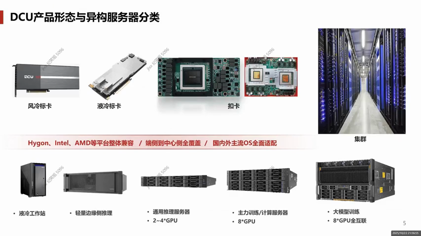
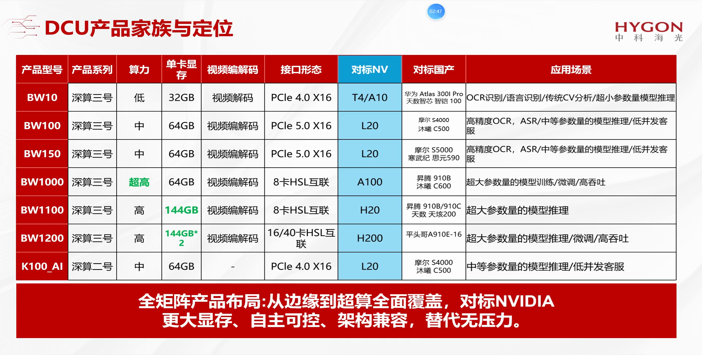
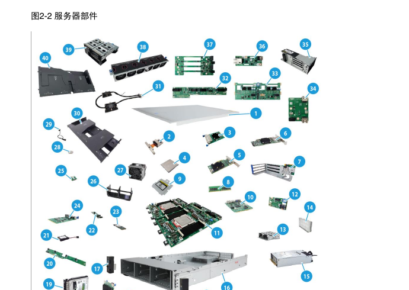
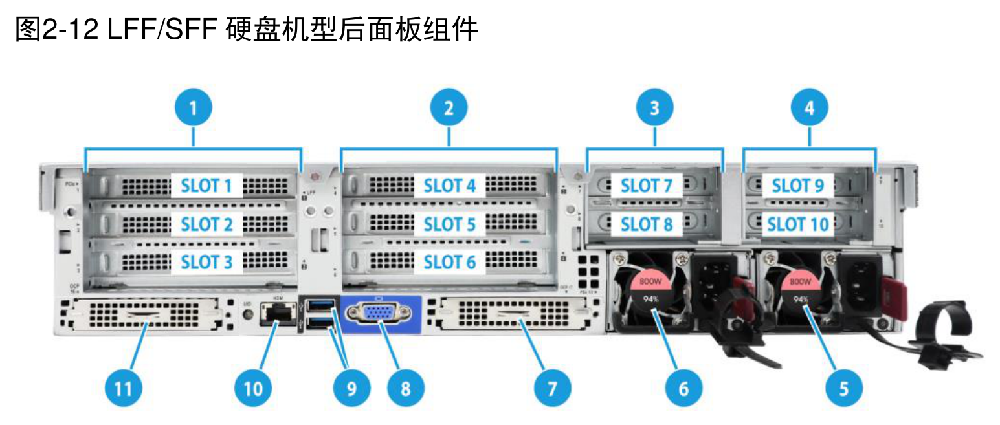
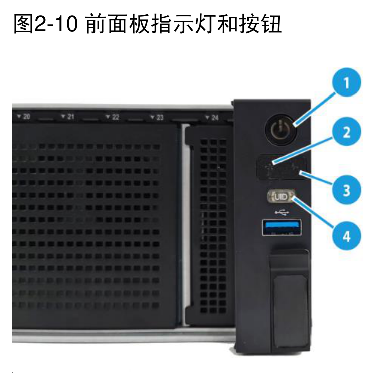
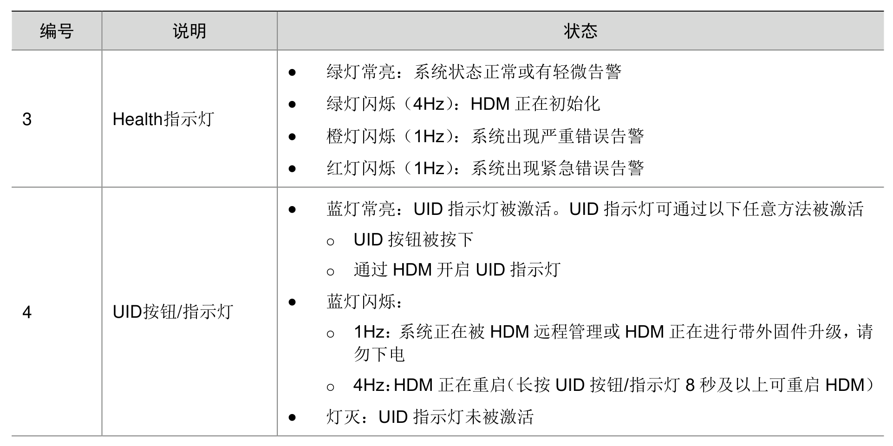

# 第42讲 海光服务器到货验收、导轨上架与标准布线联网

**本课程定位：** 上一讲已经开箱，认过结构，拆过一张教学用的加速卡。这一讲把机器从到货放到机柜，接到电和网，让带外管理能打开。机房环境指标和电源风扇热插拔放到下一讲。驱动和软件栈不在本讲。

到货当天最容易漏的不是“会不会开机”，而是挂耳方向、导轨左右、电源没有分两路、标签只贴了一头。

教室示例整机是新华三 UniServer R4930 G7。它是 2U 机架服务器。现场真实型号以铭牌和模拟 BOM 为准。铭牌和手册对不上时，以现场铭牌和厂商确认函为准。

## 本讲学习目标

学完后，你应能完成下面两组目标。知识目标用“能指出 / 能判定”验收；实操目标用工位上的动作和提交物验收。

**知识目标**

- 读懂到货点检要核哪些项。达成标志：能指出“箱子到了不等于配件齐了”，并列出整机、挂耳、导轨、电源线、Part No.、序列号六项。
- 区分可伸缩滑道与抱轨。达成标志：能说出两类导轨的维修空间差别，并能指出左右、承重方向、U 位三条装反后果。
- 区分 HDM 专用口、OCP 业务口与共享口。达成标志：能判定“两根电源线插同一路 PDU”不算双路，以及“只贴一头标签”不算完成。
- 读懂上电完成和下电允许拔线的灯色。达成标志：能按顺序说出电源灯橙 → 绿闪 → 绿常亮，以及下电须橙灯常亮后再拔线。

**实操目标**

- 完成腕带接地，对照模拟 BOM 点检外观与配件，提交打码后的到货点检单。
- 安装左右挂耳，完成滑道或抱轨中的一种，两人协作抬机锁进课前划定的 2U。
- 接入管理口与业务口（双端教学标签），双路电源用魔术贴防脱后分回路接入 PDU，线扣入导线槽。
- 上电后用教学账号打开 HDM，核对接线在位、无严重告警；按橙灯再拔线的顺序下电；填写上架联网资产台账。

## 42.1、安全准备与 BOM 到货核对

这一节要能判定：配件没齐不能上架，腕带没导通不能碰板卡。判定写在前半；点检动作写在后半。

### 42.1.1、到货先问形态

采购邮件或到货单只写“海光 DCU”，还不够。先问这台机器是 2–4 卡通用机架，还是 8 卡全互联高密整机。形态不同，重量、U 位、风道、导轨承重都不一样。本讲教室按通用 2U 机架上架。高密整机的铜排和整机风道不在本讲拆装范围内。

BOM 点检时再问一次接口形态：是 PCIe x16 标卡，还是 8/16/40 卡 HSL 模组。问清形态，才能对上机柜、导轨和电源回路。对标栏里的友商型号和算力口号不进本讲操作。

表42-1、到货时先问哪两句

| 先问 | 用来对上什么 | 不问会怎样 |
| --- | --- | --- |
| 是通用机架还是高密整机 | U 位、导轨承重、风道、抬机人数 | 按 2U 经验去抬 8 卡整机，承重和人手都不够 |
| 接口是 PCIe x16 还是 HSL 模组 | 机柜后方看到的是 OCP/PCIe 区，还是模组位 | 点检单和实物对不上，后续槽位表会抄错 |

【关键区别】“这台服务器是海光的”只说明处理器或加速卡的品牌。到货点检要核的是这一台的形态、挂耳、导轨和电源线是否在清单上。

### 42.1.2、腕带、验电、安全标识

人体或导体释放的静电会缩短主板和板卡寿命。取放 OCP 网卡、挂耳线缆或任何金手指之前，必须戴防静电腕带，并且接地。

插孔式：腕带紧贴皮肤，插头插入机柜或工作台的防静电插孔。

夹子式：夹子夹到机柜立柱上未喷漆的金属处。夹到喷漆表面，可能导不通。

两种都要按现场腕带说明书确认导通。未导通，就当作没戴。拆下来的网卡立刻放进防静电袋，不要放在桌面、椅子或机箱盖上。

前面板上的“开机 / 待机”按钮不能彻底切断系统电源。部分电源和内部电路仍在工作。完全断电的顺序是：先按按钮，等到系统电源指示灯橙色常亮，再拔掉服务器上的全部电源线。多路电源要拔尽。使用随机附带的电源线，不挪用别的设备的线。

服务器必须安装在标准 19 英寸机柜中。机柜支撑脚完全触地。最重的设备在底部，从下往上装。每次只能从机柜中拉出一台设备。机箱盖、导风罩、空闲槽位假面板不在位，不要运行服务器。

【关键区别】“灯灭了”才允许开盖或拔板卡。橙灯常亮只说明进入待机，线还在插着，机器没有彻底断电。

### 42.1.3、BOM 勾什么

BOM 是到货清单。按清单勾，不凭记忆。L01 用户指南没有“BOM”专章，教室用模拟 BOM。完整序列号只进台账指定格，提交前打码。教学编号和资产标签必须一致。

表42-2、模拟 BOM 至少勾这些

| 勾选项 | 看什么 | 缺了怎么办 |
| --- | --- | --- |
| 整机 | 外观无凹陷、铭牌机型与清单一致 | 拍照报讲师，不上架 |
| 左挂耳、右挂耳 | 左右成套、孔位能对上机箱 | 缺一边不上架 |
| 导轨 | 滑道或抱轨与清单一致，有随机说明书 | 缺说明书则该种导轨只观摩，不硬拧 |
| 电源线 | 配套线、带魔术贴或线扣、数量与电源模块一致 | 不挪用别的机器的线 |
| 挡板、文档 | 假面板、用户指南或滑轨附件 | 空槽假面板不齐，上电前必须补 |
| Part No. | 部件编码与在位件一致 | 不一致写入点检单，不私自换件 |
| 序列号 | 组长抄到台账指定格 | 提交物打码；不把完整序列号写进报告正文 |

场地如果明显不满足安装条件，先停装。L04 安装环境检查表要求：有摆放和维护空间、通道承重够、温湿度与灰尘可接受、线缆和插头数量到位、开关容量够。本讲不测接地电阻、不测腐蚀性气体，那些放到下一讲的机房部分。

**【例题】** 箱子到了，整机外观完好，清单上的右挂耳和滑轨说明书找不到。能不能先把左挂耳装上、下午再补？

**解：** 不能开始上架。缺挂耳或导轨，机箱无法锁到方孔条，滑轨步骤也没有依据。正确动作是：在点检单上写缺项，报讲师，等配件齐了再装。

【随堂思考】点检时看到电源模块灯是灭的。这能说明电源模块坏了吗？先查哪三件事？

### 42.1.4、逐步：腕带接地与 BOM 点检

工位开始前共用注意：未戴腕带并接地，不准碰金手指。提交物不出现完整序列号、BMC 密码、真实管理网地址。用教学编号。海光工程师整节在场。

1. 摘首饰、手表。取插孔式或夹子式腕带。
2. 插孔式：腕带紧贴皮肤，插头插入防静电孔。夹子式：夹到立柱未喷漆金属。
3. 按腕带说明书看导通指示。未导通当作没戴，停手。
4. 打开模拟 BOM。逐项勾表42-2。看外观无凹陷。核教学编号与资产标签一致。
5. 序列号只由组长抄到台账指定格。提交前讲师打码。
6. 点检单无漏项才能进入 42.2。缺项写“未到货”和原因，不编数字。

本步验收：到货点检单勾完，缺项有记录。

本步红线：序列号提交前必须打码；未点检完配件不上架。

## 42.2、挂耳、两类导轨与抬机上架

这一节要能判定：左右和承重方向有没有装反，U 孔是不是课前划定的 2U。判定写在前半；挂耳、滑道、抱轨、抬机写在后半。

### 42.2.1、先认 U，再认导轨

机柜高度用 U 计。施耐德公开说明：1U = 44.45 mm，标准宽度多 19 英寸。这是厂商公开说明，不是把 IEC 或 EIA 原文搬进课堂。

R4930 G7 高度约 87.5 mm，也就是 2U，连续占用两个 U。最大重量 41 kg。机箱深度（含挂耳）约 800 mm。建议机柜深度 1200 mm 及以上。1000 mm 深机柜若配置滑道，可能与后部 PDU 干涉，需工勘；教室这台以现场机柜为准，不在讲义里写死“一定能装”或“一定不能装”。

与其他设备上下叠加时，两个设备之间留出垂直方向 2 mm 以上空隙。未使用的机柜位置装假面板。

表42-3、上架前先看的尺寸（R4930 G7 手册口径）

| 对象 | 手册数字 | 本讲怎么用 |
| --- | --- | --- |
| 高度 | 约 87.5 mm，即 2U | U 孔必须是课前划定的连续 2U |
| 宽度 | 约 445.4 mm，装 19 英寸机柜 | 挂耳贴合方孔条 |
| 深度（含挂耳） | 约 800 mm | 后方预留走线；滑道与 PDU 是否干涉看现场 |
| 最大重量 | 41 kg | 一人抬不允许 |

### 42.2.2、左右挂耳不是同一块板

智能挂耳把服务器固定到机柜方孔条。右侧挂耳集成前面板 I/O 组件。左侧挂耳带 VGA、HDM 专用管理接口（Type-C）和 USB 3.0。左右不能对调。

固定时：两侧挂耳紧贴机柜方孔条，打开智能挂耳的锁扣，用螺丝刀拧紧里面的松不脱螺钉。工具是 T25 星型螺丝刀，一字螺丝刀也可用于该螺钉。扭矩以随机手册或讲师现场规范为准，不把立柱拧滑牙。

用户指南第 6.23 节的“更换智能挂耳”要开盖、拆风扇笼和线缆。本讲只做把挂耳装到机箱并锁到方孔条这一层。不开盖换挂耳。

### 42.2.3、滑道和抱轨，课堂至少做一种

可伸缩滑道：外轨装到机柜，内轨装到服务器。维护时可以把机器沿滑轨拉出。用户指南写明“具体方法请参见滑轨附带的文档”。螺丝顺序、到位声、承重方向以随机附件为准，本讲不编造孔位。

抱轨更接近摩擦轨 / 固定承托。维修空间与滑道不同，通常不能把整机像抽屉一样拉出。孔位和螺丝扭矩同样对照随机附件。

行业上把 Slide Rail（可抽拉）和 Friction Rail（摩擦轨）分成两类产品。这只说明“两种形态维修空间不同”有对应物。不得把联想或其他品牌的导轨步骤写进本机操作。

导轨只承受服务器自重，不得当工作台，不得额外加载。左右标识和承重方向不能装反。

表42-4、两类导轨先看什么

| 对象 | 先看什么 | 做错会怎样 |
| --- | --- | --- |
| 挂耳 | 左右、孔位、贴合 | 机箱晃，导轨对不齐 |
| 滑道 | 左右、前标、承重方向、随机说明书 | 拉出脱落 |
| 抱轨 | 孔位、螺丝是否按附件顺序锁紧 | 滑牙或锁不紧 |
| U 位 | 连续 2U，不压已有设备 | 风道和承重都乱 |
| 理线臂 CMA | 是否与后部 PDU 干涉 | 滑道推不到位或挤线 |

教室缺滑道或抱轨的实物时，该种改观摩授权三维片或讲师演示，另一种必须实做。现有海光视频课没有上架实拍，不能拿软件课顶替。

【关键区别】“导轨装上了”不等于“可以当工作台用”。导轨的额定负载是服务器自重。把显示器、工具箱压在拉出的机器上，属于超载。

### 42.2.4、抬机三条红线

将服务器安装到机柜或从机柜中拉出时，尤其当服务器脱离滑轨时，要求两个人协同工作。安装位置高于胸部时，需要第三个人帮助调整方位。每次只能从机柜中拉出一台设备，否则机柜不稳。拉出或推入前，确认机柜稳固、支撑脚着地。

从底部往上装。不压已有设备。推入听到到位后，再锁挂耳螺钉。

【随堂思考】一个人把 2U 满配机器抱上机柜。错在哪两条？

### 42.2.5、逐步：装左右挂耳

1. 确认点检已完成，腕带仍导通。机器在防静电工作台上，未上架。
2. 分清左挂耳和右挂耳。右侧有前面板 I/O，左侧有 VGA / Type-C / USB 的，对号入座。
3. 将挂耳紧贴机箱，按手册孔位上螺丝。扭矩按随机手册或讲师口令，不滑牙。
4. 装完看挂耳是否贴合机箱，左右没有装反。

本步验收：左右贴合、螺丝齐。

本步红线：不滑牙；左右不装反。

### 42.2.6、逐步：装可伸缩滑道

1. 打开滑轨附带文档。没有文档则停手，改观摩，不要凭别的品牌的视频拧。
2. 分清左右、前标、承重方向。外轨上机柜指定 U 孔，内轨上服务器。
3. 孔位必须是课前划定的连续 2U。
4. 按附件步骤锁紧。试拉到位，听或看附件写明的到位标志。
5. 试拉时一人扶机柜，不要把导轨当梯子。

本步验收：试拉不晃，有附件所说的到位标志。

本步红线：U 孔必须是课前划定的 2U；承重方向不装反。

### 42.2.7、逐步：装抱轨

1. 打开抱轨附带文档。没有文档则该种改观摩。
2. 按孔位把抱轨固定到指定 2U。不滑牙。
3. 确认左右和承重方向。锁紧后轻推，看有没有晃。
4. 两种导轨都要会认。课堂上至少实做一种。

本步验收：抱轨锁紧，孔位正确。

本步红线：不滑牙；不把滑道步骤套到抱轨上。

### 42.2.8、逐步：抬机入柜锁紧

1. 确认导轨已固定、挂耳已在机箱上、机柜支撑脚着地。
2. 两人从底部抬，高于胸部第三人护后部。一次只移动这一台教学机。
3. 按指定 U 位推入。不压已有设备。听到或看到到位后停手。
4. 两侧挂耳紧贴方孔条。打开锁扣，拧紧松不脱螺钉。
5. 看机器水平、U 位标签与课前规划一致。

解锁拆卸（需要拆回时）：先按 42.4 下电并断开外部线，再打开挂耳锁扣、拧松螺钉，沿滑轨缓缓拉出。一次只拉这一台。拆下后放到干净平稳的防静电工作台。

本步验收：U 位正确、螺丝锁紧。

本步红线：禁止一人抬机；禁止同时拉出两台。

## 42.3、OCP 网卡、管理口业务口与双路防脱

这一节要能判定：管理口有没有进教学管理网，两根电源线有没有分回路，标签是不是双端都贴。判定写在前半；接线、供电、理线写在后半。

### 42.3.1、后面板先指认三处

本讲在机柜后方完成灵活 IO 网卡（OCP 网卡）识别，以及管理口、业务口接线。OCP NIC 3.0 是开放形态，不是某家私有插槽名。教室槽位号以现场后面板为准。手册示例：可选 OCP 3.0 网卡 1 在 slot 16，可选 OCP 3.0 网卡 2 在 slot 17。

必须能指到下面三处，再动手插线。

表42-5、后面板本讲要指认的口（LFF/SFF 示例，现场以铭牌为准）

| 手册编号 | 名称 | 本讲用途 |
| --- | --- | --- |
| 10 | HDM 专用网络接口，RJ45，1 Gb/s，缺省 IP `192.168.1.2/24` | 带外管理，进教学管理网 |
| 11 | 可选 OCP 3.0 网卡 1，slot 16 | 业务口或共享口，按课前规划 |
| 7 | 可选 OCP 3.0 网卡 2，slot 17，或串口模块 | 指认在位件，不编槽位 |
| 5、6 | 电源模块 2、电源模块 1 | 双路供电，各插一根配套线 |

装配液冷模块时，后面板 slot 6 会改成进出水口。教室若是风冷，没有红蓝水管，点检单写“风冷，未见液冷接口”。

### 42.3.2、专用口、共享口、业务口

HDM 专用网络接口是带外专用口。它给带外管理用，不把业务流量和带外混在同一根线上。缺省 IP 是 `192.168.1.2/24`。教室必须已经改成课前清单地址。不要在报告里写真实管理网地址，写教学编号和“见课前清单”。

如果配置了 OCP 网卡，可通过 OCP 上的 HDM 共享网络接口登录 HDM。主板 OCP 插槽支持 NCSI。缺省情况下，OCP 网卡 Port1 可为 HDM 共享网络接口。同一时间，只支持将服务器的一个网口设为 HDM 共享网络接口。改共享口由讲师做，学员不改。

业务口走业务规划。管理口进教学管理交换机，不插到生产网。

行业上把 Dedicated（专用）和 Shared（共享）分成两类：专用口不与主机操作系统共享，管理流量走独立物理网络。教室对应关系是：HDM 专用网络接口 ≈ 专用口；OCP 的 NCSI 共享口 ≈ 共享口。不要去配戴尔 iDRAC 的菜单。

网线要先导通测试，再编号。标签用统一规格，分别填写本端和对端的名称、编号。只贴一头，机柜前后对不上。上电后可用 ping 查连通；不通则交叉测试网线或检查接头。

【关键区别】HDM 专用口能打开 WebUI，只说明带外这条路通了。它不能代替业务口。业务不通时，不要先改专用口的地址。

### 42.3.3、双路供电与防脱

LFF/SFF 机型是 2 个热插拔电源模块，支持 1+1 冗余。双路的意思是：两根配套电源线分别插入两个电源模块，另一端插到 PDU 的两个回路（主 + 备）。两根线插同一路 PDU，看起来像双路，实际没有冗余。

电源线缆固定装置有多种形态。用户指南以线扣举例；大纲要求用电源把手上的魔术贴缠绕防脱落。现场有魔术贴就缠把手，有线扣就按线扣步骤把插头固定住。两种都是防脱，不是二选一的口号。

电源模块指示灯：绿灯常亮为工作正常；灯灭优先查电源线是否插上、外部供电是否有电，不要先换模块。橙灯常亮可能是该模块无输入而另一路正常，或出现严重故障。详细灯表见 42.4。

使用配套电源线。连接电源线前，服务器及内部部件已经安装完毕，机箱盖在位。

表42-6、供电与理线的对错

| 做法 | 对或错 | 原因 |
| --- | --- | --- |
| 两根线插两个 PDU 回路，魔术贴缠把手 | 对 | 才是双路加防脱 |
| 两根线插同一路 PDU | 错 | 一路掉电，两路一起没电 |
| 标签只贴服务器这一头 | 错 | 机柜后部对不上对端 |
| 网线和电源捆成一束挡出风口 | 错 | 散热和强弱电都乱 |
| 理线架上把线拉得没有余量 | 错 | 沿滑轨拉出时会拽插头 |

### 42.3.4、理线三条

所有线缆走线时不要遮挡进出风口。线缆连接时无交叉，便于识别和插拔。所有线缆都有有效标识。

用理线架时，每条线缆保持松弛，以免从机柜中拉出服务器时损坏线缆。用线扣把电源线另一端绑入机柜导线槽。电源与网线分束。L04 对机房内保护地与信号线、电力线与信号线的平行间隔有“不小于 30 cm”的要求。那是机房布放要求。机柜内做强弱电分束，与这个方向一致；具体间隔以现场机柜规范为准，不把 30 cm 写死成机柜内必须数出来的尺寸。

【随堂思考】电源模块一个绿灯、一个灯灭。先查什么，不要先换模块？

### 42.3.5、逐步：识别并观摩 OCP 拆装

OCP 网卡不支持预知性热插拔时，更换必须下电。本步以讲师或代表操作为主，全班指认槽位。扩容 OCP 网卡 1 要开盖、拆支撑架，本讲不做开盖扩容。

1. 确认整机已下电、电源线已拔、腕带导通。
2. 在后面板指认 slot 16 / slot 17 和 HDM 专用口。现场没有的槽位写“本机未见”。
3. 代表：断开 OCP 上的线缆，拧松松不脱螺钉，将网卡从槽位拔出，立刻入防静电袋。
4. 检查插槽针脚无弯曲、无异物。将网卡推回槽位，拧紧松不脱螺钉。
5. 先接线、后上电。上电放到 42.4。

本步验收：全班能指认 OCP 槽和专用口；代表拆装后螺钉复位。

本步红线：未下电不拔 OCP；金手指不裸放。

### 42.3.6、逐步：接管理口与业务口

1. 确定口：HDM 专用口进教学管理交换机。业务口按课前规划插或不配地址。不插生产网。
2. 网线导通测试。型号与规划一致。
3. 编号，双端贴教学标签，写本端和对端。
4. 插到位。暂不绑死，等电源线一起理。
5. 上电后的 ping 放到 42.4。

本步验收：管理口已接，双端有标签。

本步红线：不插到生产网；只贴一头不算完成。

### 42.3.7、逐步：双路防脱供电与理线

1. 确认机箱盖在位、假面板在位。使用配套电源线。
2. 将两根电源线分别插入两个电源模块。用模块自带魔术贴缠把手。
3. 另一端插 PDU 两个回路。用线扣绑到导线槽。
4. 电源与网线分束，不挡出风口，留维修环。理线架上保持松弛。
5. 看两个电源模块侧的线都固定住，没有一根悬空。

本步验收：两路都插上，魔术贴或线扣到位，不挡风。

本步红线：不要两根线插同一路 PDU 冒充冗余。

## 42.4、上电、HDM 与台账

这一节要能判定：上电有没有完成，下电能不能拔线，HDM 里看到的是在位还是告警。判定写在前半；开机、登录、建档、下电写在后半。HDM 的具体点击路径以教室 HDM 版本和课前清单为准，本讲不写菜单树。

### 42.4.1、前面板灯怎么读

上电启动后，先看前面板。电源灯和 Health 灯是本讲的验收线索，不是换件依据。

{width=45%}

表42-7、前面板常用灯（R4930 G7 手册口径）

| 灯 | 常见状态 | 本讲怎么记 |
| --- | --- | --- |
| 电源灯 | 绿灯常亮：系统已启动；绿灯闪烁（1 Hz）：正在开机；橙灯常亮：待机；灯灭：未通电 | 上电完成看绿常亮；拔线前必须橙灯常亮 |
| Health | 绿灯常亮：正常或轻微告警；绿闪（4 Hz）：HDM 正在初始化；橙闪：严重；红闪：紧急 | 橙闪、红闪要进 HDM 看事件，不凭灯色换件 |
| UID | 蓝灯常亮：被点亮定位；1 Hz 闪：正在被 HDM 远程管理或带外升级，请勿下电；4 Hz 闪：HDM 正在重启 | 用来在机柜里找到这台机器 |

Health 显示有问题时，通过 HDM 查看系统运行状态。电源灯灭的原因可能有：没有接通电源、未安装电源模块、电源模块故障或电源线未连接。先查线，再怀疑模块。

表42-8、电源模块状态灯（后面板，手册口径）

| 状态 | 含义 | 本讲动作 |
| --- | --- | --- |
| 绿灯常亮 | 电源模块工作正常 | 双路都应该是这个 |
| 绿灯闪烁（0.33 Hz） | 备用电源模式，无功率输出 | 记下，报讲师，不私自换件 |
| 橙灯常亮 | 严重故障，或该路无输入而另一路正常 | 先查这路电源线和 PDU |
| 灯灭 | 无输入：线缆故障或外部供电断电 | 先查线，不先换模块 |

### 42.4.2、上电完成看哪一串灯

上电前提：服务器及内部部件已经安装完毕；已连接外部供电。为确保 HDM 与 BIOS 通信，建议接电后等待 30 秒再开机。刚关机要再开，间隔 30 秒以上。

教室用前面板按钮上电。按下开机/待机按钮。电源指示灯由橙色常亮变为绿色闪烁，最后变为绿色常亮，表明完成上电。Health 正常状态为绿色常亮。初始化阶段 Health 可能绿闪，等它稳定。

HDM Web 的电源管理和远程控制台也可以上电。自动上电（“总是开启”）本讲教学机不要开，除非讲师明确。长按开机按钮 5 秒以上是非正常关机，课堂不用。

【关键区别】插上电源线不等于上电完成。没按按钮时，机器可以停在待机（橙灯）。完成上电的标志是电源灯绿常亮，而不是“线插上了”。

### 42.4.3、下电三步

维护或搬迁前保存数据。教室按正常关机：

1. 按前面板开机/待机按钮（或关闭操作系统）。
2. 等到系统电源指示灯橙色常亮。
3. 拔掉全部电源线。

前面板按钮切不断电。橙灯之前不准拔线。UID 在 1 Hz 闪烁（远程管理或带外升级）时请勿下电。

### 42.4.4、HDM 看什么、台账写什么

BMC 是带外管理控制器。HDM 是新华三这台机器上的带外管理界面。操作系统没装好，也可以登录 HDM 看电源、风扇和 PCIe 是否在列表里。DCU 此时可能只显示为 PCIe 设备。上架完成不等于 hy-smi 能看见卡。hy-smi 不在本讲。

登录用课前清单的教学账号和地址。出厂示例 `192.168.1.2/24` 教室必须已改。改口令由讲师做。截图打码。不把真实密码写入报告。

本讲在 HDM 里核对三件事：整机部件在位、电源状态、无严重告警。菜单怎么点，以教室 HDM 版本为准，不在讲义里写死。轻微告警要结合日志判断，不把“有一条提示”直接写成故障。

台账至少留下：型号、教学编号、U 位、管理口/业务口（教学标签号）、导轨类型、点检结果。完整序列号只在指定格，提交前打码。

**【例题】** 同事说“电源灯已经绿了，HDM 打不开，一定是网卡坏了”。至少跳过了哪三步？

**解：** 至少跳过：管理口是不是插在 HDM 专用口而不是业务口、网线标签和对端是不是教学管理交换机、本机地址是不是课前清单而不是出厂 `192.168.1.2/24`。这三步没查，不能下“网卡坏了”的结论。

### 42.4.5、逐步：上电、登录、建档、下电

1. 确认机箱盖、导风罩、假面板在位。两路电源已按 42.3.7 接好。
2. 插电后等待约 30 秒。看电源模块绿灯。
3. 按前面板开机。电源灯橙 → 绿闪 → 绿常亮。Health 初始化后稳定为绿常亮。
4. 用课前清单地址登录 HDM。全员核电源、风扇、PCIe 在位，无严重告警。DCU 可能只显示为 PCIe 设备。截图打码。
5. 上电后 ping 管理口。不通则交叉测网线、查接头，不先改业务口。
6. 把型号、教学编号、U 位、端口教学标签、导轨类型写入台账。序列号格由组长填，提交前打码。
7. 下电：按待机，等到电源灯橙灯常亮，再拔线。若下一班需要工作台，只拆本讲这台教学机。不拆在架对照机。

本步验收：打码首页截图、无严重告警记录、台账字段齐或标明未采集。

本步红线：不把真实密码写入报告；橙灯之前不准拔线；不插生产网。

## 42.5、本讲回顾与自测

学习完本讲后，试着用自己的话回答：点检缺什么不能上架、两类导轨先看什么、双路怎样才算数、下电何时允许拔线。

表42-9、本讲目标与对应判断

| 学习目标 | 应能做出的判断 |
| --- | --- |
| 读懂到货点检要核哪些项。达成标志：能指出“箱子到了不等于配件齐了”，并列出整机、挂耳、导轨、电源线、Part No.、序列号六项。 | BOM 勾完才能上架；缺挂耳或导轨停手 |
| 区分可伸缩滑道与抱轨。达成标志：能说出两类导轨的维修空间差别，并能指出左右、承重方向、U 位三条装反后果。 | 左右和承重方向没有装反；U 孔是课前划定的 2U |
| 区分 HDM 专用口、OCP 业务口与共享口。达成标志：能判定“两根电源线插同一路 PDU”不算双路，以及“只贴一头标签”不算完成。 | 专用口进管理网；两路分回路；标签双端都贴 |
| 读懂上电完成和下电允许拔线的灯色。达成标志：能按顺序说出电源灯橙 → 绿闪 → 绿常亮，以及下电须橙灯常亮后再拔线。 | 绿常亮才算上电完成；橙灯之后才拔线 |
| 完成腕带接地，对照模拟 BOM 点检外观与配件，提交打码后的到货点检单。 | 腕带导通、点检单无漏项、序列号已打码 |
| 安装左右挂耳，完成滑道或抱轨中的一种，两人协作抬机锁进课前划定的 2U。 | 挂耳贴合；至少一种导轨锁紧；两人抬机 |
| 接入管理口与业务口（双端教学标签），双路电源用魔术贴防脱后分回路接入 PDU，线扣入导线槽。 | 管理口已接；两路都有电；不挡风 |
| 上电后用教学账号打开 HDM，核对接线在位、无严重告警；按橙灯再拔线的顺序下电；填写上架联网资产台账。 | 打码截图 + 台账；对照机未动 |

### 42.5.1、【课后自测】

**1 点检。** “箱子到了”能不能直接上架？写出必须先勾的六项。

**2 导轨。** 用两句话区分滑道和抱轨。各说一个装反时先看的对象。

**3 供电。** 两根电源线插在同一条 PDU 上，电源模块都是绿灯。这算双路吗？为什么？

**4 下电。** 写出正确下电三步。电源灯还是绿灯常亮时能不能拔线？

**5 带外。** 管理口和业务口为什么要分？标签为什么要双端都贴？HDM 能打开是否等于 DCU 已被操作系统认出？

**答：**

____________________________

____________________________

____________________________

## 42.6、参考答案与解析

### 42.6.1、随堂思考解析

**思考 1（电源模块灯灭）：** 不能说明模块坏了。先查：这一路电源线是否插到 PDU、魔术贴或线扣是否脱落、PDU 这一路有没有电。线的问题比模块更常见。

**思考 2（一人抬机）：** 错在两条。第一，2U 满配最重可达约 41 kg，一人抬有摔机风险。第二，脱离滑轨时必须两人协同，高于胸部还要第三人，否则机柜失稳。必须两人抬，禁止同时拉出两台。

**思考 3（一绿一灭）：** 先看灭灯那一路的电源线是否插到 PDU、防脱是否还在、PDU 这一路有没有电。不要先换模块。

### 42.6.2、课后自测解析

**1** 不能直接上架。必须先勾：整机、挂耳、导轨、电源线、Part No.、序列号。缺挂耳或导轨，不能开始上架。

**2** 滑道可把机器沿轨拉出维护，先看左右、前标、承重方向。抱轨是摩擦/固定承托，维修空间不同，先看孔位和是否按随机附件锁紧。课堂至少实做一种。

**3** 不算双路。两根线在同一回路上，这一路掉电时两路一起没电。必须插 PDU 的两个回路。

**4** 按待机 → 等到橙灯常亮 → 拔全部电源线。绿灯常亮时不能拔线。按钮切不断电。

**5** 管理口给 HDM，业务口给业务。分口避免带外被业务风暴打死。双端标签是为了机柜前后都能对上。HDM 能打开只说明带外通路和硬件在位可查；DCU 此时可能只显示为 PCIe 设备，操作系统认出要靠驱动，不在本讲。

下一讲看机房环境和供电散热部件。上架完成不等于 hy-smi 能看见卡。

## 42.7、术语

表42-10、本讲术语

| 术语 | 本讲中的含义 |
| --- | --- |
| BOM | 到货清单。按清单勾整机和配件，不凭记忆。 |
| Part No. | 部件编码。点检和换件都必须与在位件一致。 |
| U | 机柜高度单位。公开说明 1U = 44.45 mm。本机占连续 2U。 |
| 智能挂耳 | 把服务器固定到机柜方孔条的左右板。左右功能不同，用松不脱螺钉锁紧。 |
| 可伸缩滑道 | 外轨上机柜、内轨上服务器，维护时可抽拉。步骤见随机附件。 |
| 抱轨 | 摩擦/固定承托类导轨。维修空间与滑道不同。步骤见随机附件。 |
| OCP 网卡 | 灵活 IO 卡，插主板 OCP 槽（示例 slot 16 / 17），开放形态为 OCP NIC 3.0。 |
| HDM | 新华三服务器的带外管理。专用网络接口缺省 IP 为 `192.168.1.2/24`。 |
| BMC | 带外管理控制器。本机通过 HDM WebUI 访问。 |
| NCSI | 网卡侧带管理通道，使 OCP 某口可作为 HDM 共享网络接口。同时只能有一个共享口。 |
| PDU | 机柜交流插线排。双路指两个回路，不是两根线插同一排的相邻孔。 |
| UID | 机箱定位灯。蓝灯常亮表示这台机器被点亮。远程管理或升级时闪烁，请勿下电。 |
| 假面板 | 空槽挡板。不装会造成热风回流。机箱盖、导风罩、假面板不在位不上电。 |

<!-- pagebreak -->

## 42.8、附录：到货点检单与上架联网资产台账

用教学编号。完整序列号只填指定格，提交前打码。缺的字段写“未采集”和原因，不编数字。

表42-11、到货点检单（课堂填写）

| 项 | 清单要求 | 实物结果 | 勾选 | 备注 |
| --- | --- | --- | --- | --- |
| 教学编号 | 课前发放 |  |  |  |
| 整机外观 | 无凹陷、铭牌可对上 |  |  |  |
| 左挂耳 | 在位、可贴合 |  |  |  |
| 右挂耳 | 在位、可贴合 |  |  |  |
| 导轨类型 | 滑道 / 抱轨 / 两种都有 |  |  | 写实做哪一种 |
| 滑轨/抱轨说明书 | 随机附件在位 |  |  | 无则该种只观摩 |
| 配套电源线 | 数量与模块一致、有魔术贴或线扣 |  |  |  |
| 假面板、挡板 | 空槽可补齐 |  |  |  |
| Part No. | 与在位件一致 |  |  | 不一致报讲师 |
| 序列号（打码） | 只填指定格 |  |  | 提交前讲师打码 |
| 腕带导通 | 已确认 |  |  | 未导通停手 |

表42-12、上架联网资产台账（课堂填写）

| 字段 | 填写 | 说明 |
| --- | --- | --- |
| 教学编号 |  | 不用完整序列号当文件名 |
| 型号 |  | 以铭牌为准 |
| 形态 | 通用 2U / 其他 | 其他须注明 |
| U 位 |  | 课前划定的连续 2U |
| 导轨 | 滑道 / 抱轨 | 写实做的那种 |
| 管理口 | 教学标签号 | 不写真实网段 |
| 业务口 | 教学标签号或未配 | 未配写未配 |
| HDM 登录 | 成功 / 失败 | 截图打码另交 |
| 电源 | 双路绿灯 / 异常 | 异常写哪一路 |
| 严重告警 | 无 / 有 | 有则写现象，不写密码 |
| 下电 | 橙灯后已拔线 | 对照机未动 |

<!-- md-only -->

来源：

- 《算力运维工程师__20261103_修订版_海光实训加细.xlsx》第 42 讲主表与详细表
- 《H3C UniServer R4930 G7 U 系列风冷和液冷服务器用户指南》，资料版本 6W111-20260730（安全、部件、安装、外部线缆、上下电、OCP、智能挂耳）
- 《H3C 室内安装类设备运行环境要求》（安装环境检查表、线缆布放）
- Schneider Electric 台湾机架机柜说明中关于 1U = 44.45 mm、19 英寸宽度的公开表述
- Open Compute Project NIC 项目页对 OCP NIC 3.0 开放形态的说明
- 海光培训材料中「DCU 产品形态与异构服务器分类」「DCU 产品家族与定位」原图（含培训水印，形态分类可参考，对标数字不以教室配置论）

<!-- /md-only -->
