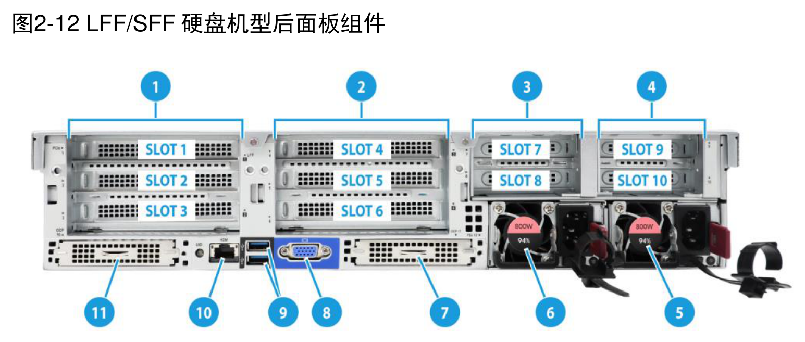
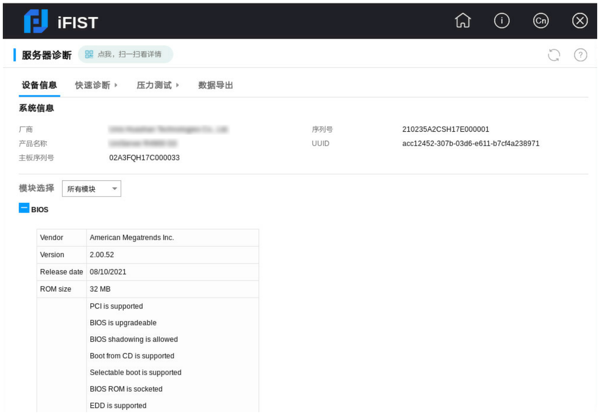
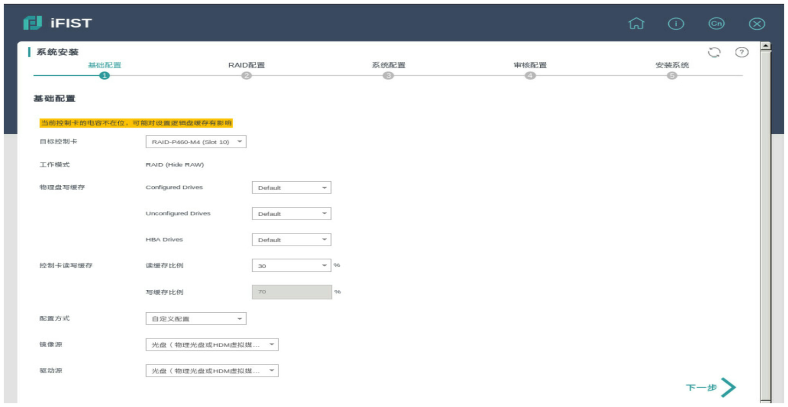
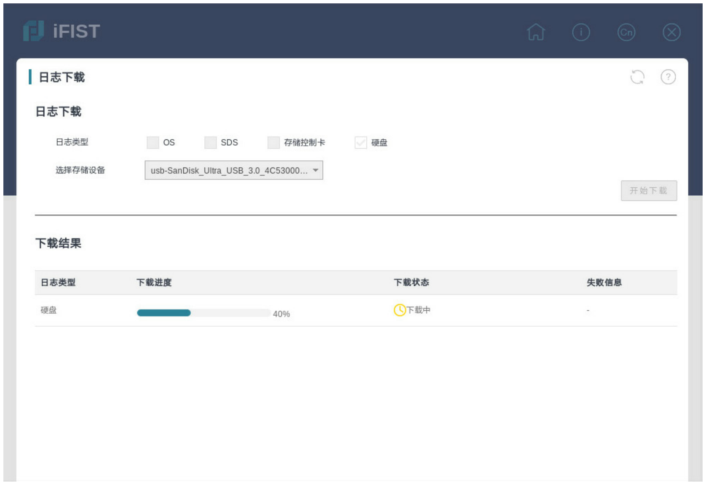
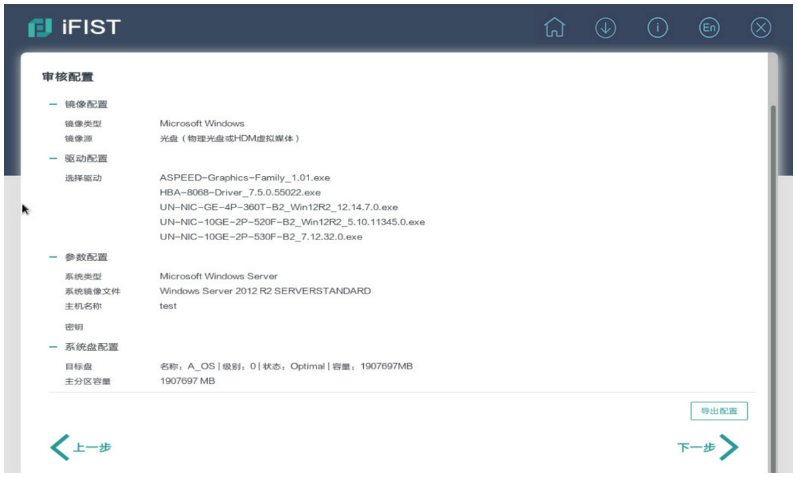

# 第45讲 海光整机验收、算力分配与上线交接

**本课程定位：** 上一讲把机器架进机柜、接通电和网，带外管理能打开。这一讲把机器交出去：先验它是不是清单上的那一台，再装系统、分算力，最后把服务、账号、日志和台账交清楚。

交付到上线，最容易出问题的不是装系统，而是三方对不上：实机槽位、带外清单、资产台账，各说各的。

教室示例整机是新华三 UniServer R4930 G7。单机装机用 iFIST，多台统一配置用 UniSystem，算力分配用 hy-smi 与 vDCU。

## 45.1、学习目标

学完本讲，你应当能够：

- 了解整机终检的四项物理防呆（机箱盖锁扣、导轨锁止、双路电源防脱、双端标签），并能判定哪一项不合规要退回；
- 了解 HDM 的系统信息页与 BIOS 海光平台入口各看什么，能说出“实机槽位—带外清单—资产台账”三方对账的做法；
- 了解 iFIST 的六个功能与系统安装的限制条件，能说明目标控制卡、工作模式、镜像源、驱动源各决定什么；
- 了解 UniSystem 用配置模板批量下发 HDM/BIOS 的前提与五条操作限制；
- 了解 DCU 整卡分配与 vDCU 切分的差别，能说出配额与隔离各怎么验证；
- 实训完成“终检 → 账实核验 → 装机 → 算力分配 → 日志导出与交接”的闭环，交付账实对照表、上线交接单与日志清单。

## 45.2、整机验收与上线交付

这一部分讲五件事：终检看什么、账实怎么核、系统怎么装、算力怎么分、交接交什么。

### 45.2.1、终检：四项物理防呆

装机完成不等于可以交付。终检只看四件事，每件当场可判：

机箱盖：卡爪入槽、扳手回弹、四周缝隙均匀。盖没锁死就上电，风扇会因风道泄漏报错，热风在机箱里打转。

导轨与挂耳：导轨锁止到位、两侧挂耳松不脱螺钉都拧紧。第 42 讲上架时锁过，终检是复核，不是重装。

双路电源：两个电源模块各一根配套线，另一端分插 PDU 的两个回路，插头用魔术贴或线扣固定。

线缆标签：网线与电源线两端都有标签，分别写本端与对端的名称、编号。

四项里任何一项不成立，就退回上一步处理，带着缺项进入装机，等于把问题带到上线之后。

表45-1、终检四项与判定

| 终检项 | 合规的样子 | 不合规的后果 |
| --- | --- | --- |
| 机箱盖 | 卡爪入槽、扳手回弹、缝隙均匀 | 风道泄漏，风扇转速飙高、温度报警 |
| 导轨与挂耳 | 导轨锁止、两侧松不脱螺钉拧紧 | 推拉时机箱晃动，长期运行卡尾下垂 |
| 双路电源 | 两模块各一根线，分插两个 PDU 回路，插头固定 | 一路掉电整机断电，插头被拽出单路失电 |
| 线缆标签 | 网线与电源线双端标签，写本端与对端 | 机柜前后对不上，换线找错口 |

双路电源与接口位置在机柜后方，终检要绕到后面看，图里的编号与第 42 讲的后面板一致：编号 5、6 是两个电源模块，编号 10 是 HDM 专用口，编号 11 与 7 是两个 OCP 槽。

### 45.2.2、账实核验：三方对账

对账有三方：实机槽位（部件在哪个槽、部件上的 Part No. 与序列号）、HDM 的电子清单、资产台账。三方一致才算核完，任何两方一致都不算。

HDM 里的七个页面各管一段：

- 系统信息 / 产品信息：型号、序列号、固件版本；
- 系统信息 / 处理器：CPU 型号、数量、位置；
- 系统信息 / 内存：内存条的位置、容量、频率；
- 系统信息 / PCIe 设备：PCIe 设备与所在槽位；
- 存储管理：阵列卡与逻辑盘；
- 电源管理 / 电源信息：电源模块在位与功率；
- 散热管理 / 风扇信息：风扇在位与转速。

BIOS 侧另有一套入口，海光平台看主页的处理器信息、内存信息，PCIe 板卡在高级里的 UEFI HII 配置。BIOS 与 HDM 不是二选一：HDM 断电也能看，BIOS 只能开机进，现场以 HDM 为主、BIOS 复核异常项。

iFIST 的服务器诊断给出第三份信息：设备信息页上有厂商、产品名称、主板序列号、序列号与 UUID，往下还有 BIOS 版本与各项能力。序列号抄串的排查，靠的就是这一页与实机铭牌对照。

{width=88%}

对账按槽位逐条勾，不看总数。数量对得上、位置对不上，同样是账实不符。序列号是一物一码，两台机器的序列号抄串，账面上数量照样对得上，故障一来就找不到是哪台。

DCU 在 HDM 里可能只显示为 PCIe 设备，型号与显存在系统侧用 hy-smi 看，两边对上了才写进交接单。

**【例题】** 对账时发现实机 CPU 是两颗，HDM 只显示一颗。先怀疑哪三处？

**解：** 先怀疑三处。一是这一页有没有刷新，HDM 刚换过件需要重新获取硬件信息；二是 CPU 2 是否真的装到位——散热器压没压住、插座针脚有没有弯，这类问题 BIOS 里也会少一颗；三是台账与实机是不是本来就不同台，序列号先对一遍再谈其他。三处都没问题，再按缺件报讲师，不自己补一颗进单子。

表45-2、三方对账看哪里

| 对账对象 | 实机看什么 | 带外看什么 | 对不上怎么办 |
| --- | --- | --- | --- |
| 整机 | 铭牌型号、序列号 | 产品信息页的型号与序列号 | 以铭牌为准，改台账，不改实机 |
| CPU 与内存 | 槽位丝印、条数 | 处理器页、内存页 | 记录差异，报讲师复核 |
| 硬盘与阵列 | 盘位编号、盘序列号 | 存储管理页 | 盘位与逻辑盘分开核 |
| PCIe 与 DCU | 槽位号、卡上 Part No. | PCIe 设备页 | 系统侧 hy-smi 补型号与显存 |
| 电源与风扇 | 模块在位 | 电源信息页、风扇信息页 | 缺件即停，不带着缺件交付 |

### 45.2.3、装机：iFIST 的六个功能

iFIST 是内嵌在服务器里的单机部署工具，不用安装。进入方式有两种：本地接 VGA、键盘、鼠标；或者从 HDM 的远程控制台进入，用虚拟介质挂载镜像。

它做六件事：

表45-3、iFIST 的六个功能

| 功能 | 做什么 | 课上用不用 |
| --- | --- | --- |
| 系统安装 | 引导式安装操作系统，集成 RAID 配置、驱动安装、配置导入导出 | 用，主线 |
| 智能诊断 | 扫描组件、收集信息、诊断健康状态；内存 Smart-Test | 用，核硬件 |
| 配置管理 | 导出或导入 HDM、BIOS、RAID、Controller 配置 | 用，出基线 |
| 日志下载 | 下载 OS 日志、存储控制卡日志、SDS 日志、硬盘日志 | 用，出证据 |
| 固件更新 | 更新 HDM、BIOS、CPLD、存储控制卡、网卡、硬盘固件 | 只认读，不操作 |
| 数据安全清除 | 清除 HDM、BIOS 与存储数据 | 只认读，不操作 |

系统安装是一条五步向导，页面顶部的进度条就是这五步：基础配置 → RAID 配置 → 系统配置 → 审核配置 → 安装系统。

基础配置里五个下拉框各决定一件事：目标控制卡决定系统装到哪张卡下的盘上；工作模式决定磁盘直通还是组阵列，例如 LSI 卡的 JBOD 开关，ON 时磁盘直通、不组 RAID 也能在系统里用；配置方式决定手工点还是导入已有配置文件；镜像源决定装哪个系统、从哪个介质读；驱动源决定补哪些卡驱动。

**【随堂思考】** 一台机器的 JBOD 关着，盘也没组 RAID，系统安装时会发生什么？现场怎么快速判断是这个问题？

安装阶段有五条限制：只挂一个可引导介质，否则引导项会认错；安装中不换镜像源，要换只能在基础配置阶段换；安装过程不手动干预；装完第一启动项会变成硬盘；装完尽快装驱动。

审核配置是这条向导里最该停下来看的一屏：镜像配置、驱动配置、参数配置、系统盘配置四项都列在页面上，逐项核对无误再点下一步。这一屏右侧还有 <导出配置>，能把操作系统与 RAID 的参数导出成配置文件（xml 或 img，带 MD5 防改），下次在基础配置阶段用 U 盘导入，就不用再手工点一遍。这就是单机层面的模板。

表45-4、iFIST 系统安装的关键参数

| 参数 | 决定什么 | 选错的后果 |
| --- | --- | --- |
| 目标存储控制卡 | 装到哪张卡下的盘上 | 装到不用的卡上，系统盘看不见 |
| 工作模式 | 磁盘直通还是组阵列 | JBOD 关着又没组 RAID，系统里看不到盘 |
| 配置方式 | 手工配，还是导入配置文件 | 配置与目标机槽位不符时导入失败 |
| 镜像源 | 装哪个系统、从哪个介质读 | 介质格式不支持，安装中断 |
| 驱动源 | 补哪些卡驱动 | 缺卡驱动时系统装完不认盘 |

### 45.2.4、批量：UniSystem 的配置模板

一台一台装，慢的不是装系统，是每台的 HDM 与 BIOS 参数都要照抄一遍。

UniSystem 解决这一段：先把一台配成基准，导出它的 HDM 与 BIOS 配置作为模板，再把模板应用到其他同型号同配置的机器。FIST 从 2.59 版起更名为 UniSystem，两者是一套东西的两个名字。

流程有六步：配好源服务器 → 把服务器加进 UniSystem（类型选 HDM，填 HDM 管理地址与账号）→ 导出 HDM 配置模板与 BIOS 配置模板 → 建服务器配置模板（选适配机型，挂上两个模板）→ 应用模板（目标机先关机）→ 在应用日志里看结果，再登录目标机复核生效。

五条限制要记住：服务器型号与硬件配置相同；源机与目标机的 HDM 版本尽量相同；应用前 HDM 与 BIOS 状态正常；应用时目标机必须关机；应用过程中不动电源、不升级或重启 HDM、不用 KVM 挂载。

表45-5、单机与批量各管什么

| 环节 | 工具 | 产出 | 适用范围 |
| --- | --- | --- | --- |
| 装系统与 RAID | iFIST | 装机后的系统与阵列 | 单台，本地或带外挂载 |
| HDM/BIOS 参数统一 | UniSystem | 配置模板与应用日志 | 同型号同配置的多台 |
| 基线配置留档 | iFIST 配置管理 | HDM/BIOS/RAID 配置文件 | 单台导出，作为基准 |

### 45.2.5、算力分配：整卡与 vDCU

分配之前先看卡：hy-smi 列出全部 DCU 的编号、型号、显存与利用率，hy-smi -d 0 看第 0 张卡，watch -n 1 hy-smi 持续观察。教室机器上几张卡、各多少显存，以 hy-smi 现场输出为准。

分法有两种。

整卡分配：一张卡整个分给一个租户或一个任务。做法是把任务的可见设备限定到这张卡上，别的卡它看不到。适合大模型训练这类吃满显存的任务。

切分分配：把一张物理卡切成多个虚拟 DCU（vDCU），按显存与算力比例分给不同任务。K8s 场景下，HAMi 与 DCU Device Plugin 用三个字段表达配额：dcunum 请求几份、dcumem 每份多少显存、dcucores 每份多少算力比例。任务用量不会超过配额，这是隔离的底线。

验证隔离要看两处：容器内先用 hy-virtual -show-device-info 看虚拟设备的 Compute units 与 Global memory 是否与配额一致；再看任务跑起来后 hy-smi 上这张卡的显存与利用率是否被多任务分摊。

**【随堂思考】** 两个推理任务共用一张卡，各申请 60% 算力。这样分配会发生什么？现场怎么发现？

两条使用限制：init container 里不能用 DCU 复用，否则任务不会被调度；一个容器最多用一个虚拟 DCU，要挂多张卡就不能用显存与算力比例这两个字段。节点侧还要求驱动与工具版本达标，教室以现场版本为准。

表45-6、整卡分配与 vDCU 切分

| 分法 | 怎么做 | 适合什么任务 | 怎么验证 |
| --- | --- | --- | --- |
| 整卡分配 | 按卡号限定任务的可见设备 | 吃满显存的训练任务 | 任务内只看到一个 DCU 编号 |
| vDCU 切分 | 按显存与算力比例设配额 | 多人共用、推理与小任务 | hy-virtual 看算力与显存，hy-smi 看分摊 |
| 组合 | 部分卡整卡、部分卡切分 | 一台机器混跑两类业务 | 两种验证都做一遍 |

### 45.2.6、交接：交什么，凭什么叫交清

交接要交六样：服务清单（哪台跑什么）、账号与权限（谁能进、什么角色）、版本（操作系统、驱动、固件）、监控入口（看哪几个指标、告警发到哪）、责任人（谁接、谁备）、日志与证据（交接时的健康快照）。

交清的判据只有一条：交接单上每一项都能指回证据。服务清单指回端口与进程，账号指回权限截图，版本指回 HDM 与系统两侧的输出，日志指回归档文件。

表45-7、上线交接清单

| 交接项 | 写什么 | 证据从哪来 |
| --- | --- | --- |
| 服务清单 | 节点跑哪些服务、占多少资源 | 进程与端口、算力占用 |
| 账号与权限 | 谁能登、什么角色、口令怎么保管 | HDM 用户列表、系统用户 |
| 版本 | 操作系统、驱动、固件版本 | 系统命令输出、HDM 产品信息页 |
| 监控入口 | 监控地址、看哪几项、告警送到哪 | 监控配置截图 |
| 责任人 | 接手人、备份人、联系方式 | 交接单签字 |
| 日志与证据 | 日志清单与存放路径 | 归档目录 |

### 45.2.7、日志：交接口径与归档

日志分三层收。

带外：HDM 的事件日志、操作日志、SDS 日志，加上传感器信息。这一层记录的是硬件与带外的动作，断电也在记。

装机侧：iFIST 的日志下载，按页面上的日志类型勾选 OS、SDS、存储控制卡、硬盘，选好 U 盘后开始下载，结果区会逐项显示进度与状态。装机做过什么，这一层说得清。

系统侧：内核日志与 hy-smi 输出，证明操作系统看到的卡与带外清单一致。

{width=88%}

用户指南的故障信息收集清单用的是同一套口径：日志与传感器、产品序列号、型号名称、错误截图与描述、硬件变更记录、第三方软件、操作系统版本。交接时按这套清单收，后面排障不用再回来问。

表45-8、日志来源与用途

| 日志 | 从哪导 | 证明什么 |
| --- | --- | --- |
| HDM 事件日志 | HDM 日志页面 | 硬件事件与告警的时间线 |
| HDM 操作日志 | HDM 日志页面 | 谁在什么时候做过什么操作 |
| SDS 日志 | HDM 或 iFIST | 硬件诊断的快照 |
| iFIST 诊断日志 | iFIST 日志下载 | 装机与部件自检的结果 |
| 系统日志 | 操作系统 | 驱动与内核层的运行状态 |

### 45.2.8、术语

表45-9、本讲术语

| 术语 | 一句话解释 |
| --- | --- |
| Part No. | 部件编码，换件与点检都要与在位件一致 |
| 序列号 | 一物一码的设备编号，只进台账指定格 |
| HDM | 新华三服务器的带外管理，断电也能访问 |
| BMC | 带外管理控制器的通称，本机通过 HDM 访问 |
| SDS | 安全诊断系统，收集服务器硬件诊断信息 |
| iFIST | 内嵌在服务器里的单机部署工具 |
| UniSystem | 多台服务器的统一管理软件，FIST 2.59 起更名 |
| vDCU | 虚拟 DCU，把一张物理卡按显存与算力切分 |
| hy-smi | DCU 的命令行查看与监控工具 |
| 配额 | 分配给某个任务的显存与算力上限 |
| 三方一致 | 实机槽位、带外清单、资产台账三者对得上 |

## 45.3、具体实训内容

按交付顺序走：终检、对账、装机、分配、交接。

### 45.3.1、整机终检与账实核验

本任务从机箱盖看到序列号。完成后交付《硬件账实对照表》，差异项有文字说明。

表45-10、整机终检与账实核验的步骤

| 步 | 动作与要领 | 常见错误 | 检查点 |
| --- | --- | --- | --- |
| 1 | 终检机械四项。① 机箱盖：拇指按住后部扳手压到底，向上掰起再松手，听回弹声、看四周缝隙是否均匀，最后轻推盖板确认不松动；② 导轨与挂耳：双手扶住机箱两侧向外拉 2～3 cm 再推回，确认导轨卡扣锁止、推拉顺滑，两侧挂耳松不脱螺钉用 T25 逐个复紧；③ 双路电源：两个模块各一根配套线，沿每根线上溯到 PDU 的具体插孔，确认落在两个不同回路；④ 魔术贴绕电源把手两圈压住插头根部，拉一下插头确认不脱。 | 只看机箱盖不拉机箱；电源线只看服务器这一头，不看 PDU 侧；魔术贴只搭上不压插头。 | 四项都合规，或差异已写进对照表。 |
| 2 | 线缆标签与标识。① 网线两端各读一遍标签，确认写的是本端设备名与端口、对端设备名与端口；② 电源线两端同样要有标签，与 PDU 插孔号对应；③ 机柜 U 位标签与课前规划一致；④ 缺标签的当场补打，不手写。 | 只贴服务器这一头；标签写“交换机”这类对不上具体端口的话；缺标签留到交接时再说。 | 每根线两端都有标签，内容能互相对上。 |
| 3 | 抄 HDM 七页。① 登录 HDM，进系统管理 / 系统信息 / 产品信息，抄型号、序列号、UUID 与固件版本；② 依次进处理器、内存、PCIe 设备三页，记 CPU 型号与颗数、内存条数与单条容量频率、每张 PCIe 卡的名字与 slot 号；③ 进存储管理记阵列卡型号与逻辑盘；④ 进电源管理、散热管理记模块数与风扇转速；⑤ DCU 用 hy-smi 补型号与显存。 | 只看产品信息页就收工；把页面上的总数当逐槽记录；固件版本不抄，后面升级对不上基线。 | 七类信息页都翻过，对照表里字段有值。 |
| 4 | 按槽位逐条对。① 以实机槽位丝印为准，在对照表里逐行填实机的 Part No. 与序列号；② 与 HDM 页面逐条比，差异分三类记：缺件、位置不符、编码不符；③ 序列号与 iFIST 设备信息页、铭牌三方对一次；④ 对不上的行标红，写明现象，不动硬件。 | 只核数量不核位置；两台机器序列号抄串；发现不符就去拆件。 | 每一行都有“实机值 / 带外值 / 是否一致”。 |
| 5 | 收口。① 差异项报讲师，由讲师决定返工还是记入遗留问题；② 按实机更新资产台账的型号、序列号、槽位三列；③ 三方一致才进入装机，遗留项写明责任人与时限。 | 带着差异直接装机；台账空着交；遗留项不写处置人。 | 三方一致，或遗留项有明确处置人。 |

红线：终检不合格不装机；不凭记忆填序列号；不擅自更换硬件。

### 45.3.2、系统安装与基线配置

本任务用 iFIST 把一台机器从裸机装到可用。完成后交付装机参数记录与导出的基线配置。

{width=88%}

表45-11、iFIST 系统安装与基线配置的步骤

| 步 | 动作与要领 | 常见错误 | 检查点 |
| --- | --- | --- | --- |
| 1 | 进 iFIST 并备好介质。① 本地方式：VGA 接显示器、USB 接键鼠，开机后按提示进 iFIST；② 远程方式：登录 HDM 打开远程控制台，用虚拟介质同时挂载操作系统镜像与 REPO 文件；③ 确认只有一块可引导介质在挂载状态；④ U 盘格式按目标系统准备，FAT32 或 NTFS 都备一份。 | 同时挂了多个可引导介质，引导项认错；只挂镜像不挂 REPO，卡驱动装不上；U 盘格式不支持导致安装中断。 | 介质唯一，镜像与 REPO 都在，格式与目标系统匹配。 |
| 2 | 基础配置：控制卡与工作模式。① 目标控制卡下拉框里选要装系统的那张卡，确认后面的 slot 号与实机一致；② 看工作模式，确认是 RAID 还是 JBOD 直通，与装机单要求一致；③ 按需设读写缓存比例；④ 对不上的先改模式，再往下走。 | 选错控制卡，系统装到不用的卡上；JBOD 关着又没组 RAID，系统里看不到盘；缓存比例随手改。 | 控制卡 slot 号与工作模式都与装机单一致。 |
| 3 | 镜像源与驱动源。① 配置方式选自定义，或选导入已有配置文件；② 镜像源按介质选光盘（物理光盘或 HDM 虚拟媒体）或 U 盘；③ 驱动源挂 REPO 的 ISO，iFIST 不认驱动压缩包；④ 镜像文件名不带中文与空格。 | 镜像放在不支持格式的分区里；REPO 用压缩包；文件名带空格导致识别不到。 | 镜像与驱动源都能在下拉框里选到。 |
| 4 | RAID 配置。① 按课前规划选物理盘，确认盘状态可用；② 选 RAID 级别与逻辑盘名，系统盘容量按规划；③ 提交后回到向导，确认逻辑盘已在列表里。 | RAID 级别随手定；把数据盘做进系统盘阵列；只选盘不看状态。 | 逻辑盘级别、容量、成员盘都与规划一致。 |
| 5 | 系统配置。① 选要安装的驱动；② 填系统类型、主机名、密钥等参数，主机名按命名规范；③ 选目标盘，确认是刚建的逻辑盘；④ 主分区容量按规划。 | 主机名随手填，后面台账对不上；目标盘选到数据盘；密钥栏乱填。 | 参数与装机单逐项一致，目标盘正确。 |
| 6 | 审核配置并导出。① 在审核页逐项核对镜像、驱动、参数、系统盘四块；② 点 <导出配置>，把配置文件存到 U 盘（1.36 及以后版本在 /iFIST/OsInstall 目录）；③ 确认导出成功后点 <下一步> 开始安装。 | 不核对就点下一步；导出失败也往下走；安装启动后才发现参数错。 | 四块都核对过，配置文件已在 U 盘。 |
| 7 | 装后收口。① 等服务器自动重启，进 HDM 或 BIOS 确认第一启动项已是硬盘；② 进系统装驱动，确认网卡与存储卡可用；③ 用 iFIST 配置管理导出 HDM、BIOS、RAID、Controller 配置作为本机基线；④ 装机参数与基线路径写进交接单。 | 装完不做基线导出；启动了才发现启动项还是 USB；参数记在脑子里。 | 系统可登录，启动项正确，基线配置与参数记录都在。 |

红线：安装过程中不断电、不拔介质、不手动干预；数据安全清除与固件更新模块只认读不操作。

### 45.3.3、批量配置下发

本任务把一台的 HDM 与 BIOS 参数下发到同型号的另一台。完成后交付配置模板与应用日志。

表45-12、UniSystem 批量配置下发的步骤

| 步 | 动作与要领 | 常见错误 | 检查点 |
| --- | --- | --- | --- |
| 1 | 把基准机配到位。① 在一台机上按基线清单逐项配好，典型几项是带外地址与主机标识、账号与权限、功率封顶、BIOS 启动模式、告警与日志上报目标；② 保存并重启使配置生效；③ 先把这台机自身的账实核验做完。 | 基准没配好就导出，错参数扩散到所有机器；基准机自己还有告警就往下发。 | 基准机参数与基线清单逐项一致，无未处理告警。 |
| 2 | 纳管到 UniSystem。① 打开 UniSystem，用管理员账号登录；② 进服务器管理 / 服务器列表，<添加服务器>；③ 类型选 HDM，填管理地址、账号、口令，可批量导入地址段；④ 添加后确认三台服务器都在列表里且状态正常。 | 地址填成业务网口；账号权限不足；加进来不确认状态。 | 目标机全部在列表里，状态可连。 |
| 3 | 导出 HDM 与 BIOS 模板。① 进模板管理 / HDM/BIOS 配置模板页；② 在源机那一行点 <HDM配置> 导出，写模板描述；③ 同样导出 <BIOS配置>；④ 到模板管理页确认两个模板都在，名称带日期。 | 只导 HDM 不导 BIOS；模板描述写“test”，后面分不清版本。 | 两个模板都在，命名能看出日期与用途。 |
| 4 | 建模板并应用。① 进模板管理 / 服务器配置模板，<添加配置模板>，适配机型选与目标机一致的型号；② 分别挂上 HDM 与 BIOS 模板；③ 确认目标机已关机；④ 进服务器部署 / 服务器配置模板应用，勾选目标机、选模板、勾选操作提示后确认；⑤ 应用完成看操作栏 <日志>。 | 机型选错；目标机没关机就应用；应用过程中重启或断电。 | 应用日志无失败项，机型与目标机一致。 |
| 5 | 复核与归档。① 登录目标机 HDM，看带外地址、功率封顶等参数与源机是否一致；② 进 BIOS 看启动模式等关键项；③ 把应用日志与复核截图归档进交接材料。 | 只看 UniSystem 的“成功”字样，不登录复核；日志不归档。 | HDM 与 BIOS 两侧都复核过，日志已归档。 |

红线：不同型号、不同配置的机器不套同一模板；应用期间不动电源。

### 45.3.4、DCU 算力分配与隔离验证

本任务把 DCU 按业务分出去，并证明分得住。完成后交付分配表与隔离验证记录。

表45-13、DCU 算力分配与隔离验证的步骤

| 步 | 动作与要领 | 常见错误 | 检查点 |
| --- | --- | --- | --- |
| 1 | 盘点算力。① 跑 hy-smi 列出全部卡，记卡数、编号、型号、显存与当前利用率；② hy-smi -d N 逐张看；③ 把卡号与 HDM 的 PCIe 设备页对上；④ 与账实对照表的 DCU 行交叉核对。 | 卡数与清单不符就直接分；只看总显存不看单卡；卡号与 HDM 的 slot 对不上不查。 | 卡号、型号、显存三项与对照表一致。 |
| 2 | 定分法并列表。① 吃满显存的任务走整卡分配；② 多人共用或小任务走 vDCU 切分；③ 在分配表里写清任务名、租户、分法、卡号或配额；④ 配额总和不超过实有算力。 | 全部切分导致大任务跑不动；全部整卡导致小任务占满卡；配额超分。 | 每个任务都有分法与配额，总和未超分。 |
| 3 | 整卡分配。① 确认任务要用的卡号；② 把任务的可见设备限定到这张卡（按现场框架的设备挂载或环境变量）；③ 起任务后确认它只看得到这一张卡。 | 只绑卡不绑显存，任务把整卡吃满；绑错卡号。 | 任务内只看到一个 DCU 编号。 |
| 4 | vDCU 切分。① 在任务描述里写 dcunum、dcumem、dcucores 三个字段；② 需要限定型号的加型号 annotation；③ 容器内 source /opt/hygondriver/env.sh 激活虚拟环境。 | 只写显存不写算力比例；忘记激活环境就去查设备；init container 里挂复用。 | 三个字段齐全，环境已激活。 |
| 5 | 验证隔离。① 容器内跑 hy-virtual -show-device-info，看 Compute units 与 Global memory 是否等于配额；② 同时起两个任务，用 watch -n 1 hy-smi 看这张卡的显存与利用率如何分摊；③ 让一个任务跑满，确认另一个不被挤掉。 | 只看任务能起来，不看用量是否越界；只测单任务不测并发。 | 两个任务的用量都不超过各自配额。 |
| 6 | 收口与归档。① 把分配表、配额字段、两张验证截图归档；② 逐条复核限制项：init container 未用复用、单容器未挂多个 vDCU、配额未超分。 | 不归档配额，后面查不到谁占了多少；限制项只在脑子里过一遍。 | 限制项逐条确认，材料齐全。 |

红线：配额不得超分；验证不过不交付。

### 45.3.5、日志导出与上线交接

本任务把证据收齐、把单子填完。完成后交付日志清单与《算力节点上线交接单》。

表45-14、日志导出与上线交接的步骤

| 步 | 动作与要领 | 常见错误 | 检查点 |
| --- | --- | --- | --- |
| 1 | 导带外日志。① 登录 HDM 日志页面，分别导出事件日志、操作日志与 SDS 日志；② 记下产品序列号、型号与最近一次硬件变更；③ 文件名带日期与教学编号。 | 只导事件日志，操作日志漏掉；文件名只写“日志1”。 | 三类日志齐全，命名可追溯。 |
| 2 | 导装机侧日志。① 进 iFIST 日志下载页；② 按日志类型勾选 OS、SDS、存储控制卡、硬盘；③ 选择 U 盘作为存储设备，<开始下载>；④ 在下载结果区逐项看进度与状态，失败的项记下来重做。 | 只勾一两项；导完不看结果表；U 盘中途拔掉。 | 四项都下载成功，目录在 /iFIST/LogDownload 下。 |
| 3 | 收系统侧证据。① 系统日志里确认无持续报错；② hy-smi 输出当前卡状态；③ 记录操作系统与驱动版本；④ 需要时补 lspci 确认设备在位。 | 用截图代替日志；版本只写系统名不写版本号。 | 证据能对上交接单上的每一项。 |
| 4 | 填交接单。① 服务清单、账号与权限、版本、监控入口、责任人逐项填；② 每一项后面写证据路径；③ 缺的写“未采集”和原因，不编数字。 | 空项不写原因；口令写在交接单正文；证据路径写“见附件”却没有附件。 | 六项齐全，证据可指回。 |
| 5 | 三方复核。① 实机、带外、台账再对一次；② 差异项当场处理或记遗留；③ 三方一致才签字。 | 只对两方；把遗留项写成“已解决”。 | 三方一致，遗留项有处置人。 |
| 6 | 归档与交讲师签字。① 日志与交接单放同一目录，按“型号-教学编号-日期”命名；② 打码后再提交；③ 交讲师签字确认。 | 交接单与日志分离存放；各存一份不同版本。 | 目录与签字齐全，提交物已打码。 |

红线：不把真实密码写进交接单；不交接未处理完的告警。

## 45.4、需要的硬件设施

按用途分四类：防静电与安全用品、检测与操作工具、耗材与标识、机柜与供电配套。

### 45.4.1、防静电与安全用品

表45-15、防静电与安全用品

| 名称 | 型号 / 规格 | 用途 |
| --- | --- | --- |
| 有线防静电腕带 | 单回路，内置 1 MΩ 限流电阻 | 终检与换件时的人体接地 |
| 防静电桌垫 | 双层，配 1 MΩ 接地线 | 放置导出的部件与工具 |
| 防静电屏蔽袋 | 金属化屏蔽袋，自封口 | 拆下的卡与硬盘临时存放 |
| 防静电服与手套 | 长袖分体、手套贴合 | 进入机房与开箱作业 |

### 45.4.2、检测与操作工具

表45-16、检测与操作工具

| 名称 | 型号 / 规格 | 用途 |
| --- | --- | --- |
| T25 星型螺丝刀 | T25，多随整机附送 | 挂耳松不脱螺钉复核 |
| 卷尺 | 3 m 以上 | 量机柜深度与 U 位 |
| 万用表 | 具备电阻档与交流电压档 | 腕带阻值、断电验电 |
| 标签打印机 | 手持式，支持 6 / 9 / 12 mm 标签带 | 线缆双端标签、U 位标签 |
| KVM 或显示器键鼠 | VGA 与 USB 接口 | 本地进 iFIST 与 BIOS |
| 教学笔记本 | 可访问 HDM 与 UniSystem | 带外核验与批量配置 |

### 45.4.3、耗材与标识

表45-17、耗材与标识

| 名称 | 型号 / 规格 | 用途 |
| --- | --- | --- |
| 教学 U 盘 | FAT32 或 NTFS，8 GB 以上 | 镜像、REPO、配置导出与日志下载 |
| 标签纸 | 6 / 9 / 12 mm，防水 | 双端标签、交接标识 |
| 魔术贴扎带 | 与电源把手宽度匹配 | 电源插头防脱复核 |
| 尼龙扎带与线扣 | 多种长度 | 理线与导线槽固定 |
| 装机与交接模板 | 账实对照表、交接单、参数记录表 | 课堂填写与归档 |

### 45.4.4、机柜与供电配套

表45-18、机柜与供电配套

| 名称 | 型号 / 规格 | 用途 |
| --- | --- | --- |
| 标准服务器机柜 | 19 英寸 42U，深度 1200 mm 及以上 | 终检与推拉复核 |
| 机柜 PDU | 水平交流插线排，主备两个回路 | 双路供电复核 |
| 教学管理交换机 | 按课前清单，管理口专用 | HDM 与 UniSystem 组网 |
| KVM 或带外汇聚 | 支持远程控制台 | 本地与远程两种进入方式 |
| UPS | 按机房配置 | 装机与配置下发期间防掉电 |

## 45.5、配套视频

8 条待拍，拍好后供学员课前观看，看完再进机房动手。

表45-19、配套视频清单

| 视频名 | 时长 | 内容要点 |
| --- | --- | --- |
| 整机终检四项 | 5 min | 机箱盖扳手回弹、导轨推拉、双路电源上溯、双端标签读法 |
| 账实对账全过程 | 7 min | HDM 七个系统信息页、按槽位填表、差异标注、iFIST 设备信息页交叉核对 |
| 进 iFIST 的两种方式 | 4 min | 本地 VGA 键鼠、HDM 虚拟介质挂载镜像与 REPO |
| iFIST 系统安装 | 8 min | 控制卡、工作模式、镜像源、RAID、审核配置、自动安装 |
| 基线配置导出与复用 | 5 min | 配置管理导出、下次导入的前置匹配条件 |
| UniSystem 批量下发 | 7 min | 添加服务器、导出模板、建模板、关机应用、看日志 |
| DCU 算力分配 | 6 min | hy-smi 盘点、整卡与 vDCU 两种分法、配额字段 |
| 隔离验证与交接 | 6 min | hy-virtual 看配额、两任务分摊、交接单与日志归档 |

观看节奏：课前 3 天看终检、对账、进 iFIST 三条；课前 1 天看装机与批量下发两条，并把自己工位的机器信息填进对照表；进入机房后，讲师按当前环节回放对应片段，只看动作与判据。

## 45.6、小结与自测

学完本讲，试着用自己的话回答：终检四项哪一项最容易漏、三方对账怎么算对完、iFIST 与 UniSystem 各管哪一段、算力分完怎么证明分住了、交接单凭什么算交清。

### 45.6.1、目标回看

表45-20、学习目标与达成标志

| 学习目标 | 达成标志 | 对应实训 |
| --- | --- | --- |
| 了解整机终检四项与判定 | 四项都能当场判定，差异有记录 | 45.3.1 |
| 了解 HDM 系统信息与三方对账 | 按槽位逐条对完，差异有处置 | 45.3.1 |
| 了解 iFIST 六个功能与安装限制 | 说得出四个参数各决定什么 | 45.3.2 |
| 了解 UniSystem 批量下发的限制 | 说得出五条限制并照着做 | 45.3.3 |
| 了解整卡与 vDCU 的差别 | 两种分法都能说出验证方法 | 45.3.4 |
| 实训完成交付闭环 | 交接单六项齐全、证据可指回、三方一致 | 45.3.5 |

### 45.6.2、课后自测

1 终检。四项物理防呆分别看什么？哪一项漏了会在上电后立刻出问题？

2 对账。实机、带外、台账三方中，两方对上了、第三方对不上，算不算核完？为什么？

3 装机。iFIST 的系统安装里，目标控制卡与工作模式各决定什么？装完第一启动项变成什么？

4 批量。用 UniSystem 批量下发 HDM/BIOS 配置，必须满足哪几条前提？应用时服务器处于什么状态？

5 算力。把一张卡切给两个任务，配额字段是哪几个？怎么在容器内验证配额生效？

答：

____________________________

____________________________

____________________________

### 45.6.3、参考答案与解析

随堂思考解析

思考 1（JBOD 关着又没组 RAID）：系统安装时看不到可选的硬盘，RAID 配置页里也没有可用逻辑盘可挑。现场先看基础配置页的工作模式是 RAID 还是 JBOD，再进 RAID 配置确认有没有逻辑盘；两处都不对，就是磁盘既没直通也没组阵列。

思考 2（两个任务各要 60% 算力共用一张卡）：配额之和 120%，超过一张卡的能力，后起的任务要么排队要么把先起的挤慢，显存也会互相踩。现场用 watch -n 1 hy-smi 看这张卡的利用率与显存，如果两个任务都跑着而利用率长期贴顶、单任务耗时明显变长，就是超分了；改法是按 50/50 分，或其中一个改走整卡。

思考 3（HDM 少显示一颗 CPU）：先刷新产品信息与处理器页，再看 BIOS 的处理器信息是否也只显示一颗，最后核序列号确认是不是同一台。三处都少一颗，按缺件或未装到位报讲师。

课后自测解析

1 机箱盖、导轨与挂耳、双路电源、线缆标签。机箱盖没锁死最容易在上电后立刻出问题，表现为风扇飙高或温度告警。

2 不算。三方一致才算核完，两方一致只是把差异藏起来，故障时会找不到依据。

3 目标控制卡决定系统装到哪张卡下的盘上；工作模式决定磁盘直通还是组阵列，JBOD 关着又没组 RAID，系统里看不到盘。第一启动项变成硬盘。

4 同型号同配置、HDM 版本接近、HDM 与 BIOS 状态正常、目标机关机、应用期间不动电源与 HDM。应用时服务器处于关机状态。

5 dcunum、dcumem、dcucores 三个字段，分别对应份数、显存与算力比例。容器内先 source /opt/hygondriver/env.sh，再跑 hy-virtual -show-device-info，看 Compute units 与 Global memory 是否等于配额。
