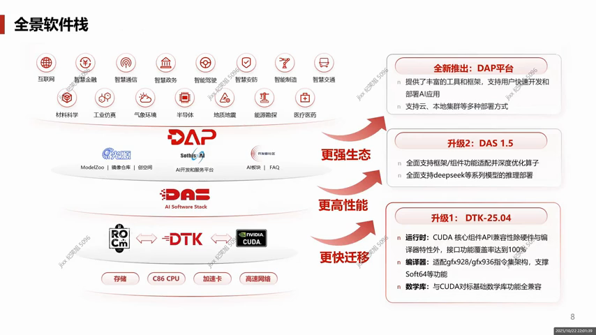
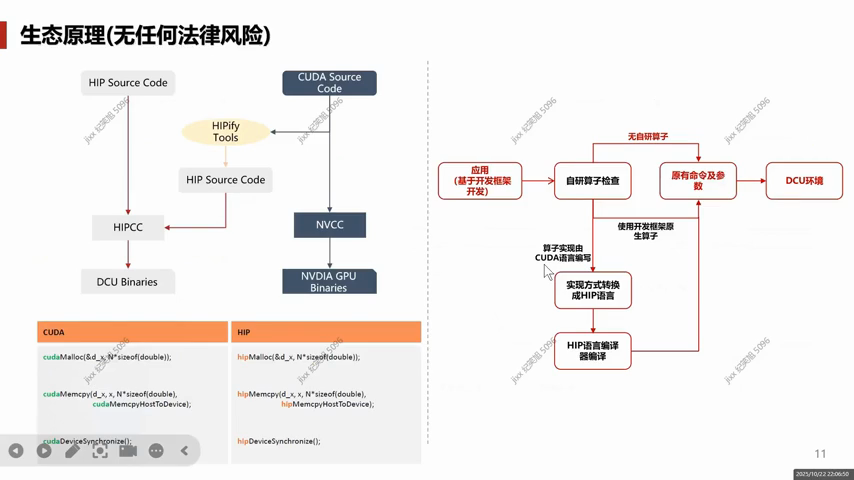
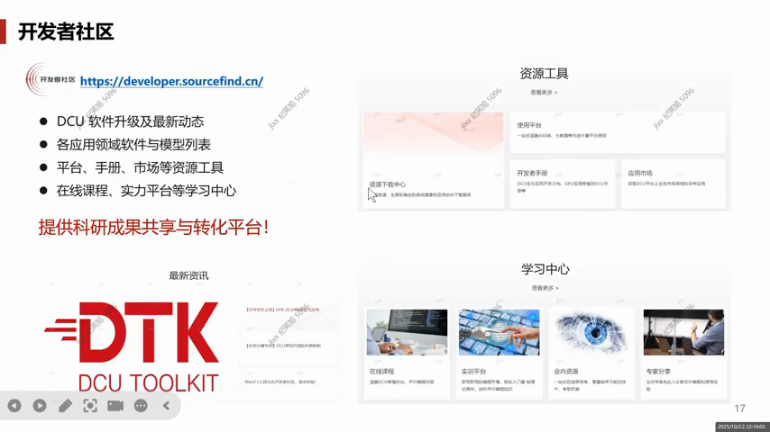

# 第46讲 海光软件栈生态与光合开发者社区介绍

**本课程定位：** 本讲进入海光软件部署环节：先核对教学节点与镜像的关键版本，再按 ModelZoo 条目启动容器并跑通一个固定模型，最后用一个故障案例练习定位问题。

## 46.1、学习目标

知识目标：

- 认识运维定位的四层：能在栈图上指出驱动、DTK、DAS、框架与推理引擎四层，说出每层各用哪条命令验证，以及当前任务先查哪一层。
- 理解 DTK 的关键结构：能说明 GPU Fusion、HIP Library 与 Runtime、内核态驱动的作用，并说清 DCC 与 hipcc 的关系。
- 理解部署前检查：能读取镜像 Tag 和 torch 后缀，判断它们是否与本机 DTK 和 ModelZoo 条目匹配。
- 理解 DAS 三层：能把 lightop、PyTorch、vLLM 归入对应层，并说明组件装错时的第一检查点。
- 知道资源入口：能从 ModelZoo 找到模型部署条目，从光源找到推荐镜像，并知道用户文档、OpenDAS 和论坛分别解决什么问题。

实操目标：

- 完成指定模型的部署前环境检查，给出“可用/不可用”结论及依据。
- 从指定 ModelZoo 条目提取环境依赖、镜像、权重、启动命令和预期输出。
- 拉取指定镜像、按条目参数启动容器，验证容器内卡和关键版本可用。
- 按官方示例跑通固定模型，完成输出比对、问题记录和资源回收。
- 对一个给定的部署故障现象，指出所在层、第一检查点与处理方式。

## 46.2、软件栈分层与光合社区资源

本讲介绍五部分内容：分层与版本闭合、DTK、DAS、社区六入口、ModelZoo 与光源镜像。OpenDAS、论坛、DAP 与 Anaconda 列入 46.2.6 扩展阅读。

### 46.2.1、全景软件栈与版本闭合

DCU 的软件栈自底向上分为四层：硬件基础（包括海光 C86 CPU、加速卡、高速网络）承托驱动，驱动之上是 DTK（编译器与基础库），DTK 之上是 DAS（AI 框架与训练推理组件），最上面是跑模型的框架与推理引擎。海光在 DAS 之上另加 DAP 平台（云原生 AI 平台与大模型应用创新平台），覆盖数据处理、训练加速、微调、推理等整条服务链与大模型应用编排；单机部署模型走不到这一层。

表46-1、软件栈分层、各层职责与验证命令

| 层 | 管什么 | 在机器上怎么确认 | 版本不匹配时的典型现象 |
| --- | --- | --- | --- |
| 驱动 | 操作系统识别与管理 DCU | lspci 能看到设备，hy-smi 能报出卡数、驱动版本与温度 | hy-smi 看不到卡，lspci 却能看到设备 |
| DTK | 编译器、加速库、运行时 | hipcc --version 报出的版本号就是 DTK 版本；卡型决定 offload-arch 填 gfx928 还是 gfx936 | 框架导入失败，运行时报库缺失 |
| DAS | AI 框架适配与训练推理组件 | python 导入 torch 后打印版本，带 +das 与 dtk 后缀才对 | 组件装不上或精度异常 |
| 框架与推理引擎 | 模型训练与推理服务 | 推理服务能起来并对外监听端口，hy-smi 能看到显存被占用 | torch 认不到卡，服务起不来 |

版本闭合指上下层软件包的兼容版本匹配，而不是简单记录四个版本号。驱动向内核暴露设备节点与 ioctl 接口，DTK 按架构编译二进制并依赖驱动提供的运行库，DAS 的 torch、vLLM 则是针对特定 DTK 版本编译的 wheel。

【例题】读一个镜像 Tag：vllm:0.9.2-ubuntu22.04-dtk25.04.2-py3.10。它在镜像仓库中的完整路径是 image.sourcefind.cn:5000/dcu/admin/base/vllm:0.9.2-ubuntu22.04-dtk25.04.2-py3.10，冒号前的三部分决定拉取位置：registry 是 image.sourcefind.cn:5000，命名空间是 dcu/admin/base，镜像名是 vllm。

拆段从镜像名后的冒号开始，按短横线切开，三段以上的部分再按点号读取：0.9.2 是推理框架 vLLM 的版本，归框架与推理引擎层；ubuntu22.04 是基础操作系统的版本，归 OS 层；dtk25.04.2 是 DTK 的版本，归 DTK 层；py3.10 是镜像内置的 Python 版本。镜像名必须与框架段对应：vllm 镜像是推理镜像，pytorch 镜像的框架段才是 PyTorch 版本。

表46-2、镜像 Tag 分段读法

| Tag 段 | 含义 | 对应哪一层 | 为什么归这一层 |
| --- | --- | --- | --- |
| 0.9.2 | 推理框架版本 | 框架与推理引擎 | 镜像名前缀是 vllm，这一段就是 vLLM 的版本 |
| ubuntu22.04 | 操作系统版本 | OS | 决定镜像内用户态库的 ABI，DTK 与框架都要在这一版系统里跑 |
| dtk25.04.2 | DTK 版本，含小版本 | DTK | 编译工具链与基础库的版本，hipcc --version 报的也是它 |
| py3.10 | Python 版本 | 框架运行环境 | 决定 pip 轮子包的 Python 标签，Python 版本不对，包装了也导入不了 |

Tag 覆盖四层中的三层，驱动版本不在 Tag 中，需用 hy-smi 单独采集；框架层还需第二条证据：ModelZoo 条目中同一镜像配的 torch 写着 2.5.1+das.opt1.dtk25042，后缀去掉点号后的紧凑形式为 dtk25042，对应 DTK 25.04.2，与 Tag 的 dtk25.04.2 一致，说明镜像内的 torch 为该版本 DTK 编译。最后将这两个 DTK 值同教学节点的实际版本逐位比对：实际版本填在检查单的“现场结果”列，条目与镜像的要求抄在“条目/镜像要求”列（表46-11）。

【随堂思考】镜像 Tag 为什么要把 OS 和 Python 版本也写进名字？

### 46.2.2、DTK：三层结构、编译与迁移路径

DTK（DCU Toolkit）是海光异构计算基础平台，层级上对应 NVIDIA CUDA 与 AMD ROCm，并同时兼容这两套生态。它按三层组织：最下面是与驱动对接的内核态层，中间是 HIP Library（数学库、DNN 库、通信库）与 HIP Runtime（运行时与编程接口），最上面是把 CUDA 与 ROCm 两套接口接进来的 GPU Fusion 兼容层。厂商管这一层叫 GPU Fusion：运行时 CUDA 核心组件 API 兼容（硬件与编译器差异除外的接口）覆盖率 100%，编译器适配 gfx928 与 gfx936 两类架构，数学库与 CUDA 对应库全兼容。

编译器在这一层叫 DCC，命令行名 hipcc，编译、调试与性能分析工具都在它之下。装完 DTK 后 hipcc --version 报的版本号就是 DTK 版本，这条命令同时是表46-1中 DTK 行的验证命令，也是 46.3.1 检查单里 DTK 一行的采集依据。

表46-3、DTK 与 CUDA 库对照

| CUDA 库 | DTK 对应库 | 用途 |
| --- | --- | --- |
| cuDNN | MIOpen | 深度学习基础算子 |
| cuBLAS | rocBLAS、hipBLAS | 矩阵运算 |
| NCCL | RCCL | 多卡集合通信 |
| CUDA Runtime 与 Driver | HIP Runtime 与 DCU 内核态驱动 | 设备管理、显存分配、内核下发 |

CUDA 代码到 DCU 的迁移路径：CUDA 源码经 HIPify 转成 HIP 源码，再经 HIPCC 编译出 DCU 二进制。HIP 是与 CUDA 几乎一一对应的编程接口。

图下方的代码对照可以看到一一对应：cudaMalloc 对应 hipMalloc、cudaMemcpy 对应 hipMemcpy、cudaDeviceSynchronize 对应 hipDeviceSynchronize，函数名换前缀、参数与语义不变。因此迁移时只换编译工具链；编译时用 hipcc 按本机卡型指定 offload-arch（K100-AI 这类卡传 gfx928，BW1000 这类卡传 gfx936），生成的二进制才对得上机上的卡；架构写错时编译照过，运行时直接报不支持。

迁移前先做自研算子检查，结论决定走哪条路：

表46-4、自研算子检查与两条迁移路径

| 检查结论 | 要做什么 | 检查点 |
| --- | --- | --- |
| 没有自研算子，只用框架原生算子 | 原有命令与参数直接可用，环境里换社区适配轮子包即可 | 训练或推理脚本跑通，卡被识别 |
| 含 CUDA 编写的自研算子 | 先经 HIPify 转成 HIP 源码，再用 hipcc 按卡型架构编译 | 转换后能编译，运行结果与迁移前一致 |

将该结论记入部署记录，便于后续复核。

【关键区别】DTK 与 DAS：DTK 管编译与基础库，DAS 管 AI 组件。RCCL 在 DTK 的通信库层，vLLM 在 DAS 的扩展组件层，两者不在一层。

### 46.2.3、DAS：三层 AI 软件栈

DAS（DCU AI Software Stack）分三层：基础算子层做融合算子与算子生成，框架工具层提供适配版框架与开发工具，扩展组件层（OpenDAS）封装训练与推理组件。

表46-5、DAS 三层代表组件与处置

| 层 | 代表组件 | 做什么 | 出问题先查哪里 |
| --- | --- | --- | --- |
| 基础算子层 | lightop、CK 模板库、triton/XLA/TVM | 融合算子、算子模板与 AI 编译生成 | 算子精度异常，或某个模型跑不出结果时 |
| 框架工具层 | PyTorch、TensorFlow、Paddle、OneFlow、JAX；OnnxRuntime、MIGraphX；FastPT、LayerCheck、GraphRay | 适配框架、推理框架、快速适配与精度定位、图优化 | 框架装不上、导入报错，或前后端精度不一致时 |
| 扩展组件层 | 训练：DeepSpeed、Megatron-DeepSpeed、FlashAttention；推理：vLLM、SGLang、LMDeploy、TGI；通用：Apex、Vision、Audio | 大模型训练与推理组件、通用训练组件 | 训练或推理服务起不来、启动即崩时 |

OpenDAS 是开源代码仓，组件按仓库 Readme 安装；光源镜像已预装部分常用组件。安装扩展组件有两条路：走镜像时，组件与 DTK 一起打包，Tag 中写全版本，拉取即用；走源码时，按 Readme 指定的 DTK 版本编译，编译完成后需运行 source fastpt -E 激活（FastPT 为框架工具层的快速适配工具，激活后对当前 shell 生效）。不要在已有镜像环境外再裸装一套，否则两套库互相覆盖，加载时常报找不到 so。

### 46.2.4、光合开发者社区：入口与常用地址

光合开发者社区是海光软件的统一入口，地址 https://developer.sourcefind.cn/ 。注册登录后，首页最上方是「最新资讯」与「技术沙龙」，中间一排是资源入口；资源工具区里有资源下载中心、开发者手册、应用市场三块，学习中心区里有在线课程、实训平台、业内资源、专家分享。

表46-6、光合社区六个入口

| 入口 | 提供什么 | 本讲用它做什么 |
| --- | --- | --- |
| 软件下载 | 驱动、DTK、DAS、工具包、代码与教学 | 核对安装包版本，记下包名与版本号 |
| ModelZoo | 适配 DCU 的模型代码与部署文档 | 任务三按条目部署模型 |
| 光源镜像库 | 预置基础与应用镜像，即拉即用 | 任务二拉指定镜像 |
| OpenDAS 代码仓 | 扩展组件源码 | 查组件适配的 DTK 版本与安装流程 |
| 用户文档 | 文档中心手册 | 查安装与兼容性细节 |
| 社区论坛 | 提问与搜索已有部署问题 | 部署问题先搜再问 |

软件下载包含六个分类：驱动、DTK、DAS、工具包、代码与教学。DTK 按操作系统分发，下载解压即可用；核对版本时记录包名与版本号，作为部署基线的安装包依据。

表46-7、常用资源地址

| 资源 | 地址 |
| --- | --- |
| 光合开发者社区 | developer.sourcefind.cn |
| 光源（容器镜像与模型仓库） | sourcefind.cn/#/main-page |
| 光源镜像列表 | sourcefind.cn/#/service-list |
| 镜像仓库 | image.sourcefind.cn:5000 |
| 软件下载 | download.sourcefind.cn:65024 |
| DAS 资源门户 | das.sourcefind.cn:55011/portal/#/home |
| 代码仓（OpenDAS、ModelZoo） | developer.hpccube.com/codes |
| 社区论坛 | forum.sourcefind.cn |

### 46.2.5、ModelZoo 条目与光源镜像

ModelZoo 的每个条目是一份按固定模板编写的 README：模型名称与论文、模型简介、环境依赖、预训练权重、数据集、训练、推理、效果展示与精度。部署模型只需读取三部分：环境依赖中的版本表与推荐镜像、推理中的启动方式与示例代码、效果展示中的预期输出。

表46-8、ModelZoo 条目结构与本讲用法

| 条目章节 | 写什么 | 部署时读哪一块 | 课堂要留意的 |
| --- | --- | --- | --- |
| 环境依赖 | DTK、Python、Transformers、vLLM、SGLang 的版本表，加推荐镜像地址 | 版本表对检查单，镜像地址抄进 docker pull | 镜像 Tag 的 DTK 段带小版本号，要与 torch 后缀对上 |
| 预训练权重 | 权重大小、数据类型、支持的 DCU 型号、最低卡数、下载地址 | 下载前确认本机卡型与显存够不够 | FP8 权重只在部分型号支持，其他型号要用 BF16 权重 |
| 推理 | Transformers、vLLM、SGLang 各自的单机与多机启动命令、示例代码、环境变量 | 抄启动命令与示例代码，按条目设环境变量 | 指定卡用 HIP_VISIBLE_DEVICES，不要让库自选 |
| 效果展示与精度 | 输入输出截图、精度对比结论 | 拿它与自己跑出的结果比对 | 比对的是关键字段，不是「有没有输出」 |

条目里的 docker run 是官方启动命令，漏掉关键参数会导致容器起不来或认不到卡。不同条目与卡型会增删参数（多机、指定卡号、共享内存大小都不一样），以条目原文和教室环境为准；下面是常见形态，使用时替换容器名、数据路径与镜像地址：

docker run -it --shm-size 256g --network=host --name 容器名 --device=/dev/kfd --device=/dev/dri --device=/dev/mkfd --group-add video --cap-add=SYS_PTRACE --security-opt seccomp=unconfined -u root -v /opt/hyhal/:/opt/hyhal/:ro -v 数据路径:数据路径 镜像地址 bash

三个设备节点缺一不可：/dev/kfd 是计算接口，/dev/dri 是渲染设备，/dev/mkfd 是管理接口；若仅挂前两个，容器内 hy-smi 可能看得到卡却无法启动推理。-v /opt/hyhal 是宿主驱动目录，挂错或以读写方式覆盖会导致容器内显示 0 卡且不报错。--shm-size 决定共享内存大小，不足时大模型加载会卡死。

表46-9、Docker 与 Anaconda 两种部署方式

| 维度 | Docker | Anaconda |
| --- | --- | --- |
| 环境谁搭 | 镜像预置，拉取即用 | 自己拉包手动搭 |
| 版本闭合可见性 | Tag 写明各层版本，torch 后缀还能再验一遍 | 靠人工记录，每装一个包就多一处不闭合风险 |
| 上手成本 | 低 | 高 |
| 适用 | 课堂与快速验证 | 需要自定义环境时 |

Docker 的版本闭合信息写在 Tag 中，拉取前即可核对；Anaconda 的版本信息分散在每次手动安装中，需人工记录，漏记一层就可能引入不匹配。

光源分容器镜像与模型仓库两部分。vLLM 等应用镜像的条目页写明了启动方式与版本 Tag，操作前先读条目页；应用镜像之外的 Custom 目录也提供各类打包镜像。镜像仓库地址为 image.sourcefind.cn:5000，镜像列表页为 sourcefind.cn/#/service-list，可在页面按软件名搜索。

【随堂思考】RCCL 与 vLLM 各在哪一层？两者角色有什么不同？

### 46.2.6、扩展阅读：OpenDAS、论坛、DAP 与 Anaconda

OpenDAS 是扩展组件的开源代码仓，组件按 Readme 安装。不走镜像、自己编组件时，先看仓库里该组件声明的 DTK 版本，编完用 source fastpt -E 激活；版本对不上，编出来的库加载即报找不到 so。

社区论坛有专人跟踪反馈，部署报错先在论坛搜一遍 FAQ 与历史帖，再发帖；学习中心提供在线课程与实训平台，用于课后补基础。

DAP 是 DAS 之上的平台层，提供云原生 AI 平台与大模型应用创新平台，把数据处理、训练加速、微调与推理串成服务链；模型应用编排时使用，单机部署模型无需涉及。

Anaconda 是镜像之外的另一条部署路径：手动拉包搭建环境，版本信息分散在每次安装记录中。需要修改框架源码或安装镜像外软件时使用；部署固定模型则推荐使用镜像。

### 46.2.7、术语表

表46-10、本讲术语

| 术语 | 含义 |
| --- | --- |
| DCU | 海光深度计算单元，国产 GPGPU 加速卡 |
| DTK | DCU Toolkit，海光异构计算基础平台，分内核态、HIP Library 与 Runtime、GPU Fusion 三层 |
| GPU Fusion | DTK 顶层的兼容层，把 CUDA 与 ROCm 两套接口接到 HIP 上 |
| DCC | DTK 的编译器，命令行名 hipcc |
| HIP | 与 CUDA 几乎一一对应的编程接口 |
| HIPCC | DCC 编译器的命令名，按卡型架构编出 DCU 二进制 |
| HIPify | CUDA 源码转 HIP 源码的转换工具 |
| ROCm | AMD 的异构计算生态，DTK 与其兼容 |
| RCCL | DTK 的多卡集合通信库，在通信库层 |
| MIOpen | DTK 的深度学习基础算子库 |
| FastPT | 框架工具层的快速适配工具，编译完的组件用 source fastpt -E 激活 |
| DAS | DCU AI Software Stack，三层 AI 软件栈 |
| DAP | 厂商平台层延伸，云原生 AI 与大模型应用平台 |
| OpenDAS | DAS 扩展组件的开源代码仓 |
| ModelZoo | 社区代码仓中适配 DCU 的模型与部署文档 |
| 光源 | 社区的容器镜像与模型仓库 |
| 镜像 Tag | 镜像名中写明框架、OS、DTK、Python 版本的段 |
| 版本闭合 | 上下层软件包认的版本对得上、可逐层验证的状态 |
| mkfd | 容器要挂的管理设备节点 /dev/mkfd，漏挂则容器内起不了推理 |

## 46.3、软件环境核对与模型部署实训

本节包含三个实训任务和一个故障案例：先核对节点与镜像的版本并给出结论，再拉镜像验证容器，然后按条目跑通模型，最后用一个版本不匹配的案例练习定位。交付物随任务提交。

### 46.3.1、部署前环境检查

本任务旨在判断当前教学节点能否运行指定 ModelZoo 模型。学员需核对驱动、DTK、Python 及模型版本。

表46-11、部署前环境检查与核对步骤

| 步 | 动作与要领 | 常见错误 | 检查点 |
| --- | --- | --- | --- |
| 1 | 用 lspci 确认加速卡在位，用 hy-smi 报出卡型、卡数与驱动版本 | 只跑 hy-smi 就下结论，忽视驱动本身的问题 | 两条命令输出留存，卡型卡数一致 |
| 2 | 运行 hipcc --version，对比基线版本与条目要求 | 漏掉小版本差别 | DTK 版本完全一致 |
| 3 | 在适配环境查 Python 与 torch 版本（含后缀），对照镜像 Tag | 用公共源包，或忽略 +das 后缀 | 后缀与 DTK 版本闭合，核对结果记入部署日志 |
| 4 | 综合检查结论，写出“可以使用”或不可用原因 | 只写结论不写依据 | 结论和依据明确记入部署日志 |

### 46.3.2、拉取镜像并验证容器

本任务验证指定镜像能否正确使用教学节点的 DCU。容器启动参数参考 ModelZoo 条目和教学环境，核对重点是设备映射与驱动目录。在“部署实训日志”中记录镜像地址、完整 Tag、实际启动命令、容器内卡可见性结果及版本核对结果。

表46-12、容器验证与版本核对

| 步 | 动作与要领 | 常见错误 | 检查点 |
| --- | --- | --- | --- |
| 1 | 按条目复制镜像地址与完整 Tag，与检查单的镜像 Tag 行逐段比 | 只比 dtk25.04，漏掉小版本；拿本机缓存里的旧镜像顶替 | Tag 四段与检查单一致，docker images 能看到该镜像 |
| 2 | 按条目命令 docker run，逐项核对 /dev/kfd、/dev/dri、/dev/mkfd、video 组与 /opt/hyhal 只读挂载 | 漏挂 /dev/mkfd；/opt/hyhal 挂成读写；照抄别的条目的 --shm-size | 启动无报错，实际命令原样存进部署记录 |
| 3 | 容器内运行 hy-smi，核对卡数、型号与宿主一致 | 容器内看不到卡就判镜像坏，不回查挂载 | 容器内卡数与宿主一致，输出留存 |
| 4 | 运行 hipcc --version，在容器内将宿主、容器、Tag 的 DTK 段并排核对 | 只比宿主，不比容器内 | 三处版本一致，差异逐位写明 |
| 5 | 容器内查 torch 或 vLLM 版本与后缀，与条目环境依赖表对照 | 只看 2.5.1，不看 +das 与 dtk 后缀 | 后缀里的 DTK 与 Tag 一致 |
| 6 | 退出并清理自己起的容器，确认 docker ps 里没有残留 | 记录完不清理，占着卡影响后面的任务 | 容器已删，docker ps 无残留 |

### 46.3.3、按 ModelZoo 条目跑通固定模型

本任务旨在按官方条目复现一次模型推理。讲师课前固定一个官方样例，给出条目链接、镜像、权重、离线备份与预期输出；学员按条目执行，不自行更换输入或启动参数。交付一份最小部署记录：条目名与链接、镜像全名与 Tag、启动命令、权重路径、环境变量、推理命令、实际输出、与预期的比对结论、失败与处理、资源回收结果。

表46-13、ModelZoo 部署与输出比对

| 步 | 动作与要领 | 常见错误 | 检查点 |
| --- | --- | --- | --- |
| 1 | 读条目的环境依赖、权重与卡型要求，抄进部署记录 | 不读版本表直接拉镜像 | 条目要求与教学节点条件对齐 |
| 2 | 按条目命令起容器，挂代码与权重目录，设环境变量，指定 HIP_VISIBLE_DEVICES | 漏挂 /dev/mkfd 或 /opt/hyhal；让库自选卡 | 容器内 hy-smi 正常，卡号与指定的一致 |
| 3 | 跑官方推理示例，输入原样照抄，保留命令与输出日志 | 自改输入后仍拿文档预期比对 | 示例完整跑完，日志可复现 |
| 4 | 输出与条目效果展示逐字段比，记一致项与差异 | 只看有没有输出，不比内容 | 比对结论明确，差异能定位到字段 |
| 5 | 停服并用 hy-smi 确认显存回落，删除容器 | 停服不确认显存，容器留着占卡 | 显存回落，容器已清理 |
| 6 | 失败时按现象记下所在层、第一检查点与处理，写进部署记录 | 只记“失败”，不记试过什么 | 失败原因与处理步骤能复述 |

### 46.3.4、故障诊断案例

讲师提供典型故障日志或现象，学员需通过分析识别其所在层、第一检查点、验证命令与处理方式。

表46-14、部署故障诊断研讨步骤

| 步 | 动作与要领 | 常见错误 | 检查点 |
| --- | --- | --- | --- |
| 1 | 对照软件栈分层，定位“教室 DTK 为 25.04.0、镜像为 25.04.2”所属层级 | 不核对小版本即直接运行 | 定位至 DTK 层，验证命令 hipcc --version，结论：更换镜像 |
| 2 | 针对“容器内可见卡但推理启动即退出”，排查设备节点与驱动挂载 | 判定镜像损坏或盲目重装 | 检查 /dev/mkfd 与 /opt/hyhal 挂载，补全映射参数 |
| 3 | 针对“容器内显示 0 卡而宿主正常”，排查挂载目录权限 | 将宿主 /opt/hyhal 挂为可写 | 核实 /opt/hyhal 为只读挂载，并检查 --device 参数 |
| 4 | 针对“权重为 FP8 而本机卡型不支持”，核对卡型限制 | 强行启动服务报错 | 查条目权重要求，更换为 BF16 权重 |

## 46.4、需要的硬件设施

本讲在已装驱动的教学节点上进行软件实操，工位按一套配置。

表46-15、硬件与环境设施

| 名称 | 型号 | 规格 | 用途 |
| --- | --- | --- | --- |
| 海光 DCU 服务器 | 教室机型 | 已装驱动，≥1 张 DCU，卡空闲 | 环境检查与跑模型 |
| 教学终端 | 带 SSH 客户端的 PC | 能连教室节点 | 登录、记录与截图 |
| 教室镜像仓库或离线镜像包 | 按现场 | 含指定镜像与权重 | 任务二拉镜像 |
| 教室网络 | 按现场 | 条目与文档可达，或备离线材料 | 查条目与文档（可选） |

表46-16、软件与账号前提

| 名称 | 版本或来源 | 用途 |
| --- | --- | --- |
| OS、驱动、DTK | 按教学节点实际版本，DTK 记到小版本 | 部署基线 |
| Docker | 教室预装，支持 --device 与 --cap-add | 起容器 |
| hy-smi、lspci | 驱动自带、系统自带 | 卡型、卡数与在位采集 |
| hipcc | DTK 自带 | 取 DTK 版本 |
| 教学 SSH 账号 | 讲师发放 | 登录节点 |
| 社区教学账号 | 讲师发放，可选 | 查条目与文档 |
| 指定 ModelZoo 条目与离线文档 | 讲师发放 | 任务三部署 |

表46-17、讲师课前准备单

| 名称 | 内容要求 | 核对点 |
| --- | --- | --- |
| ModelZoo 条目 | 条目名称与链接，附页面离线快照 | 链接可打开，快照与在线版一致 |
| 镜像 | 全名加完整 Tag，写明所在仓库 | docker pull 能拉到，Tag 四段齐全 |
| 预训练权重 | 下载地址或离线路径、文件大小与校验值 | 权重可读，校验值一致 |
| 卡型与卡数要求 | 条目声明的支持型号、最低卡数与显存要求 | 与教室节点一致，不一致时注明替代方案 |
| 启动命令与环境变量 | 条目原文的 docker run 与 export 行 | 参数与条目一致，能原样复现 |
| 预期输出 | 条目效果展示的截图或文本样本 | 能逐字段比对 |
| 离线备用 | 文档、镜像包、权重的离线位置 | 断网也能完成三个任务 |
| 教室基线 | OS、驱动、DTK、Python 版本 | 与条目要求逐位对过 |

## 46.5、配套视频

表46-18、视频清单

| 视频名 | 时长 | 内容要点 |
| --- | --- | --- |
| 从零开始高效构建海光DCU环境（上） | 约30分钟 | 已有；软件栈分层、DTK/DAS、社区实机走查，本讲主视频 |
| 构建（下）剪辑：光源拉镜像与起容器 | 约2分钟 | 已有剪辑；任务二演示 |
| vLLM 实践剪辑：按光源镜像部署并跑通一个模型 | 约6分钟 | 已有剪辑；任务三演示 |
| 部署前检查单与版本对照 | 待拍 | 任务一演示，含 lspci、hy-smi、hipcc 与 Tag 拆段 |
| 部署故障定位演示 | 待拍 | 任务四演示，含版本不匹配与漏挂设备节点两种现象 |

观看节奏：课前看（上）一遍，重点看分层与 Tag 拆段；任务二前回放拉镜像剪辑，任务三前回放跑模型剪辑；两条待拍视频在对应任务前播放。

## 46.6、小结与自测

### 46.6.1、目标回看

| 学习目标 | 应能做出的判断 | 对应实训 |
| --- | --- | --- |
| 认识运维定位的四层：能在栈图上指出驱动、DTK、DAS、框架与推理引擎四层，说出每层各用哪条命令验证，以及当前任务先查哪一层 | 给一张栈图能标出四层；给一个故障现象能指出先查哪层 | 46.2.1、46.3.1 |
| 理解 DTK 的关键结构：能说明 GPU Fusion、HIP Library 与 Runtime、内核态驱动的作用，并说清 DCC 与 hipcc 的关系 | 能讲清三层分工，能说出 hipcc 就是 DCC 的命令名 | 46.2.2 |
| 理解部署前检查：能读取镜像 Tag 和 torch 后缀，判断它们是否与本机 DTK 和 ModelZoo 条目匹配 | 给一个 Tag 与一个 torch 后缀，能判出是否闭合 | 46.2.1、46.3.1 |
| 理解 DAS 三层：能把 lightop、PyTorch、vLLM 归入对应层，并说明组件装错时的第一检查点 | 三个组件归层全对；给一个报错能指到该查的层 | 46.2.3 |
| 知道资源入口：能从 ModelZoo 找到模型部署条目，从光源找到推荐镜像，并知道用户文档、OpenDAS 和论坛分别解决什么问题 | 四种需求指入口全对 | 46.2.4 |
| 完成指定模型的部署前环境检查，给出“可用/不可用”结论及依据 | 检查单无空项，结论与依据对得上 | 46.3.1 |
| 从指定 ModelZoo 条目提取环境依赖、镜像、权重、启动命令和预期输出 | 五项信息都能在部署记录里找到 | 46.3.3 |
| 拉取指定镜像、按条目参数启动容器，验证容器内卡和关键版本可用 | 容器内 hy-smi 卡数与宿主一致，三处 DTK 版本一致 | 46.3.2 |
| 按官方示例跑通固定模型，完成输出比对、问题记录和资源回收 | 输出与预期逐字段对过，显存已回落 | 46.3.3 |
| 对一个给定的部署故障现象，指出所在层、第一检查点与处理方式 | 四项答案与参考答案一致或讲得通 | 46.3.4 |

### 46.6.2、课后自测

- 某节点 hy-smi 驱动正常，容器里导入 torch 后 is_available 返回 False，查得 torch 来自公共源 pip。问题最可能在哪一层？怎么处理？
- 教学节点 DTK 为 25.04.0，想拉的镜像 Tag 是 dtk25.04.2，条目里 torch 写的是 2.5.1+das.opt1.dtk25042。能否直接用？为什么？
- 查「DeepSeek OCR 在 DCU 上的部署文档」去哪个入口？拉预装 PyTorch 的基础镜像呢？
- 从宿主拉镜像起容器，容器内 hy-smi 看得到卡，但推理一启动就退出。先查哪一个参数？
- 一段 CUDA 代码含 CUDA 编写的自研算子，能否在 DCU 环境直接编译运行？为什么？

### 46.6.3、参考答案与解析

随堂思考：

- Tag 是版本闭合的可见抓手。OS 与 Python 版本决定用户态库与框架轮子包的兼容，写进名字，拉之前就能对账，避免「起得来、跑不对」。
- RCCL 在 DTK 通信库层，管卡间数据交换；vLLM 在 DAS 扩展组件层，是推理引擎。一个是基础库，一个是 AI 组件。

课后自测：

- 框架层。公共源 torch 是 NVIDIA 适配版，二进制里没有 DCU 运行时。换社区 DCU 适配轮子包重装，确认版本带 +das 后缀，再看 is_available。
- 不能。镜像的 DAS 组件是给 DTK 25.04.2 编的，与教学节点的 25.04.0 不闭合。换匹配 25.04.0 的镜像，或由讲师评估后统一升级基线，不得混用。
- 部署文档去 ModelZoo；拉基础镜像去光源镜像库。
- 先查 /dev/mkfd 与 /opt/hyhal 两个挂载。管理接口没挂，hy-smi 能看卡但推理起不来；hyhal 没挂或挂错，容器内直接 0 卡。
- 不能直接。自研算子先经 HIPify 转 HIP 再经 HIPCC 编译；无自研算子的代码才能原命令直接用。

故障案例参考答案：

- DTK 25.04.0 对镜像 25.04.2：落在 DTK 与 DAS 组件层。先跑 hipcc --version，再把 Tag 的 dtk25.04.2 与 torch 后缀 dtk25042 并排，三处都指向 25.04.2，与节点的 25.04.0 不闭合。处理是换与 25.04.0 匹配的镜像，不动主机基线。
- 容器内能看到卡但推理退出：先查 /dev/mkfd 是否漏挂、/opt/hyhal 是否只读挂载，再看容器内 DTK 与宿主驱动是否对得上。缺哪个补哪个，不换镜像。
- 容器内 0 卡而宿主正常：也是挂载问题。/opt/hyhal 没挂或挂成可写会直接 0 卡，--device 少挂 /dev/kfd 或 /dev/dri 同样。补挂后用容器内 hy-smi 复验。
- FP8 权重卡型不支持：落在权重层。先查条目预训练权重表里的支持型号与数据类型，换 BF16 权重，镜像与容器参数不动。
