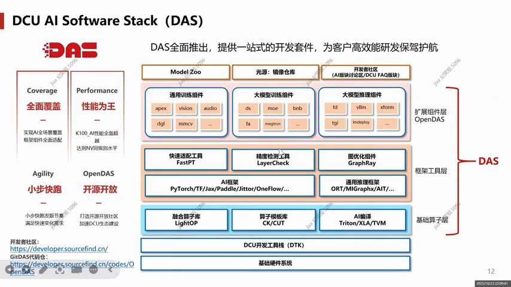
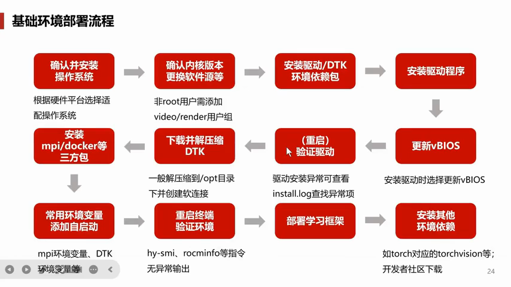
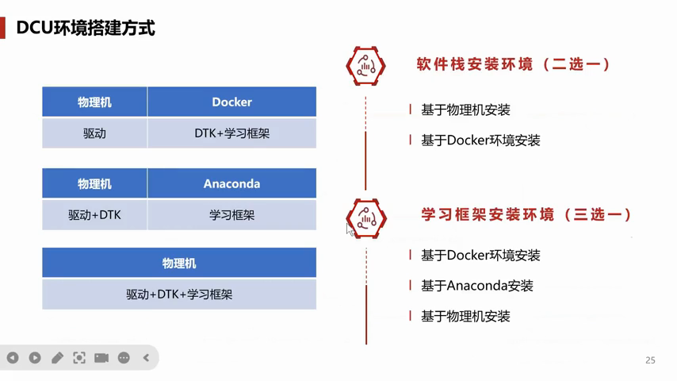
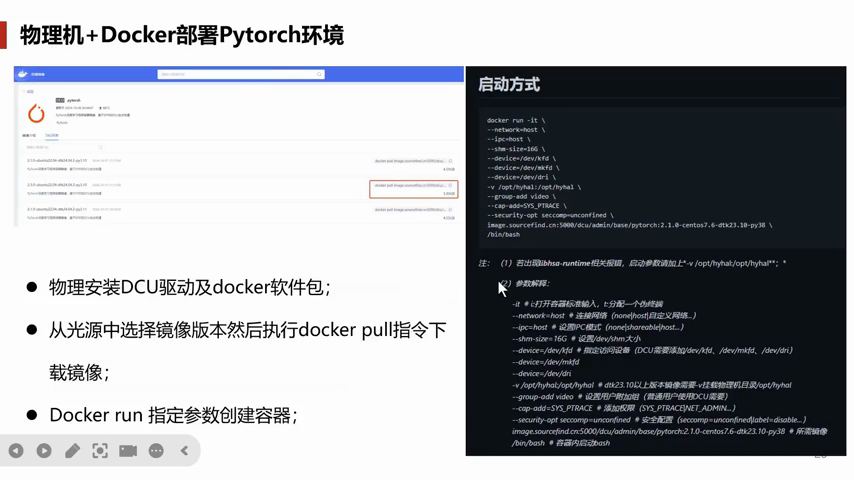
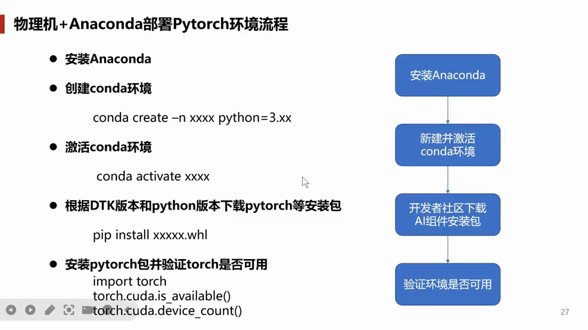
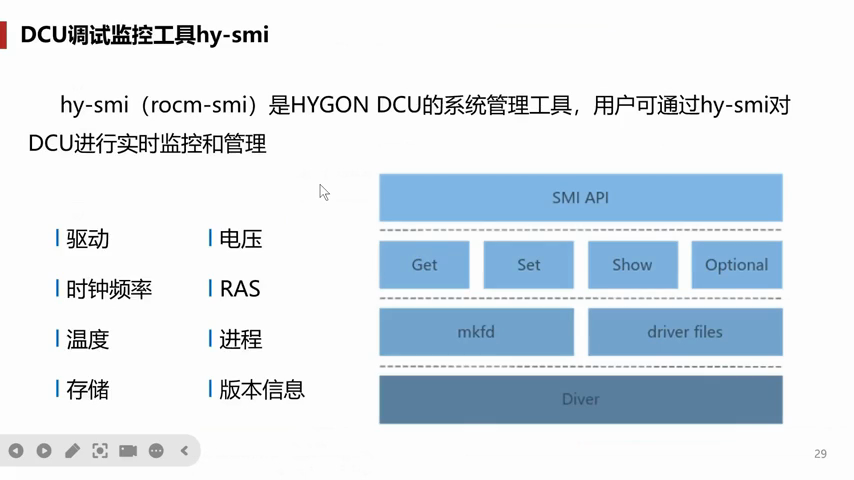

# 第47讲 海光DCU基础环境部署与实践

**本课程定位：** 上一讲把机器验完、系统装完、算力分好，机器交给了业务。这一讲把卡用起来：装驱动、装 DTK、装学习框架，每装一层验一层，最后用 hy-smi 把卡的状态看明白。

DCU 环境是一层压一层的：操作系统之上是驱动，驱动之上是 DTK，DTK 之上才是学习框架。层与层的版本对不上，服务就起不来，而且报错往往指向最上面一层，让人误以为是框架的问题。

教室示例整机是新华三 UniServer R4930 G7，卡上装海光 DCU。环境包从海光开发者社区取，镜像从光源镜像库取。

## 47.1、学习目标

学完本讲，你应当能够：

- 了解驱动、DTK、学习框架三层各管什么，能说出层与层之间版本对不上会出现什么现象；
- 了解基础环境部署的顺序与前置条件，能按链路说出非 root 用户要加哪个用户组、驱动安装异常先看哪个日志；
- 了解纯物理机、物理机加 Anaconda、物理机加 Docker 三种部署方式的差别，能按现场条件选一种；
- 了解 hy-smi 的定位与常用子命令，能按需求选出查设备、查时钟、查温度功耗、查进程、查拓扑的命令；
- 了解“带外可见但系统不可见”与“带外与系统都不可见”两条故障路径的分界，能说出各自的排查顺序；
- 实训完成“驱动与 DTK 部署 → hy-smi 全量采集 → 框架安装与张量验证 → 软硬件分界排障”的闭环，交付安装日志、采集截图、验证结果与排障记录。

## 47.2、DCU 基础环境与工具链

这一部分讲五件事：环境分几层、按什么顺序装、三种装法怎么选、装完怎么验、出问题怎么分界。

### 47.2.1、环境分三层：驱动、DTK、框架

DCU 的软件栈是分层的。最下面是基础硬件与操作系统，之上是 DCU 开发工具链 DTK，再往上是算子层、框架工具层与扩展组件层，这三层合起来叫 DAS。

从运维角度看，真正需要自己动手装的是三层：

- 驱动：让操作系统认得这张卡。装完 `lspci` 能看到设备，`/dev/kfd`、`/dev/dri` 这些设备节点在位。
- DTK：DCU 的开发工具链，提供编译器、数学库、通信库与运行环境。装完 `hy-smi`、`rocminfo` 能跑出正常输出。
- 学习框架：PyTorch、TensorFlow 这一类。装完 `torch.cuda.is_available()` 返回真，才算真正能用卡算东西。

三层之间是版本绑定关系：DTK 跟着驱动走，框架跟着 DTK 走。只记一条判据——上层的东西跑不起来，先怀疑版本，再怀疑安装是否成功。

表47-1、三层环境与各自管什么

| 层 | 装完的标志 | 装错的典型现象 |
| --- | --- | --- |
| 驱动 | lspci 见卡、设备节点在位 | 系统里查不到卡，或查得到但进程用不了 |
| DTK | hy-smi、rocminfo 输出正常 | 命令找不到，或报了文件缺失 |
| 学习框架 | 张量运算能在卡上跑完 | 框架装了但只用 CPU，或导入即报错 |

### 47.2.2、部署流程：按顺序走完十二步

基础环境的部署是一条有顺序的链，前一步没验，后一步的错误就会混进来。

{width=92%}

十二步可以归成四段：

第一段是把系统准备好：确认并安装操作系统（按硬件平台选适配的版本）、确认内核版本并更换软件源；非 root 用户要提前加进 video 或 render 用户组，不加进组，普通用户看不到卡。

第二段是装驱动：先装驱动与 DTK 需要的环境依赖包，再装驱动程序，安装时可以选择是否更新 vBIOS；装完重启，验证驱动是否生效；安装异常时看 install.log 里的异常项。

第三段是装 DTK：下载并解压 DTK，一般解到 /opt 目录下并建一个软链接，方便后续切版本；接着装 mpi、docker 这类三方包；再把 DTK 与 mpi 的环境变量写进自启动，重启终端后验证 `hy-smi`、`rocminfo` 有没有异常输出。

第四段是装框架：按 DTK 与 Python 版本选对应的框架安装包，最后补上框架的配套依赖。

表47-2、部署十二步与验收动作

| 段 | 步骤 | 装完看什么 |
| --- | --- | --- |
| 系统 | 操作系统、内核与软件源 | 内核版本在支持列表里 |
| 系统 | 用户组（video / render） | 普通用户能执行 hy-smi |
| 驱动 | 依赖包、驱动、vBIOS | lspci 见卡，设备节点在位 |
| 驱动 | 重启与验证 | 重启后仍见卡，install.log 无异常 |
| DTK | 解压、软链、三方包 | /opt 下有 DTK 目录与软链 |
| DTK | 环境变量与终端验证 | hy-smi、rocminfo 输出正常 |
| 框架 | 框架包与配套依赖 | 张量运算在卡上跑通 |

### 47.2.3、三种部署方式：按现场条件选

同一套环境有三种装法，差别在于哪一层留在物理机、哪一层装进容器或 conda 环境。

{width=84%}

- 纯物理机：驱动、DTK、框架都装在物理机上。最直接，适合教学机和排障机；缺点是框架之间容易互相污染。
- 物理机 + Anaconda：物理机装驱动与 DTK，框架装在 conda 环境里。一台机器可以并存几套框架版本，做对比测试方便。
- 物理机 + Docker：物理机只装驱动与 Docker，DTK 与框架都在镜像里。环境最干净、最可复制，代价是要记住容器的启动参数。

Docker 这条路的关键在启动参数。少一个 `--device`，容器里就看不到卡；漏了 `--group-add video`，普通用户在容器里同样用不了 DCU。

{width=84%}

一条能跑通的启动命令长这样，参数逐项对应一件事：`--network=host` 与 `--ipc=host` 让容器与宿主共用网络和进程通信；`--shm-size` 给共享内存定大小；三个 `--device` 把 DCU 设备节点放进去；`--group-add video` 给视频组权限；`--cap-add=SYS_PTRACE` 与 `--security-opt seccomp=unconfined` 放开调试与安全限制。DTK 23.10 及以后的版本还要把宿主机的 `/opt/hyhal` 挂进容器，不挂会报运行时库相关的错。

Anaconda 这条路的关键在版本对应。conda 环境可以先建起来，但装框架时必须按当前 DTK 与 Python 版本去选包，不能随手 `pip install torch`——从公共源装到的是另一家的版本，装上也不能调用 DCU。

{width=80%}

表47-3、三种部署方式怎么选

| 方式 | 物理机上装什么 | 适合什么场景 | 注意什么 |
| --- | --- | --- | --- |
| 纯物理机 | 驱动、DTK、框架 | 教学机、排障机 | 多套框架容易互相污染 |
| 物理机 + Anaconda | 驱动、DTK | 一台机并存多套框架版本 | 框架包必须与 DTK 版本对应 |
| 物理机 + Docker | 驱动、Docker | 交付、复现、批量部署 | 容器启动参数不能漏 |

### 47.2.4、hy-smi：把卡的状态看明白

hy-smi 是 DCU 的系统管理与监控工具，命令名在部分文档里写成 rocm-smi。它读的是驱动提供的接口，能看驱动、时钟频率、温度、显存、电压、RAS 与进程，也能看到版本信息。

{width=84%}

先跑 `hy-smi -h`，看这台机器的命令支持哪些选项。常用命令不多，按需求挑：

- 看全部卡：直接执行 `hy-smi`；
- 看设备号：`hy-smi -i`；
- 看 vBIOS 版本：`hy-smi -v`；
- 看频率：`hy-smi -c -d 0`，输出 fclk、mclk、sclk、socclk 与 PCIe 档位；
- 看进程：`hy-smi --showpids`，输出 PID 与它占用的显存；
- 看拓扑：`hy-smi --showtopo`，输出卡间的跳数与链路类型（PCIE 或 XGMI）、NUMA 归属；
- 看性能档位：`hy-smi --showperflevel -d 0`，可在 manual 与 auto 之间切换；
- 复位单卡：`hy-smi --dcureset -d 0`，必须指定卡号。

记两条用法上的规矩：带 `-d` 的选项只作用在一张卡上，看全机就不要加；`--showpids` 反过来，不支持 `-d`，它一次列出所有进程。

表47-4、hy-smi 常用子命令

| 想看什么 | 命令 | 输出里看哪几项 |
| --- | --- | --- |
| 全部卡概览 | hy-smi | 卡号、型号、显存、利用率、温度 |
| 设备号 | hy-smi -i | 每张卡的 Device ID |
| vBIOS 版本 | hy-smi -v | 每张卡的 VBIOS version |
| 频率 | hy-smi -c -d 0 | fclk、mclk、sclk、socclk、PCIe 档位 |
| 进程 | hy-smi --showpids | PID、显存占用、SDMA 使用 |
| 卡间拓扑 | hy-smi --showtopo | 跳数、链路类型、NUMA 归属 |
| 性能档位 | hy-smi --showperflevel -d 0 | manual 或 auto |
| 单卡复位 | hy-smi --dcureset -d 0 | reset was successful |

### 47.2.5、框架验证：一句话证明卡能用

框架装完只验一件事：张量运算是不是在卡上跑。

Docker 方式进容器后，先激活虚拟环境再验；Anaconda 方式先 `conda activate` 再验。验证脚本三步：`import torch`、`torch.cuda.is_available()` 返回真、`torch.cuda.device_count()` 返回卡数。再补一个小张量加法，确认结果对得上。

返回值不等于可用：卡被别的进程占满、显存不够、驱动与框架版本对不上，都可能让张量运算在初始化时失败。所以验证要跑到运算那一步，不只看两个布尔值。

**【随堂思考】** 一台机器上 `torch.cuda.is_available()` 返回真，但一跑训练就报显存不足，而 hy-smi 显示显存大部分空闲。先怀疑哪两处？

### 47.2.6、常见故障：两条分界线

DCU 出问题，先分界，再查因。分界只有一条线：带外能不能看见卡。

分两条路径看：

- 带外可见、系统不可见：BMC 里能看到这张卡，但 `hy-smi` 列不出来，或者 `lspci` 根本没这个设备。这类多半在驱动层或软件层：驱动没装好、装完没重启、内核版本不在支持列表、普通用户没进 video 或 render 组、Docker 启动参数漏了设备。
- 带外不可见、系统也不可见：BMC 里就没有这张卡，`lspci` 自然也看不到。这类先查物理层：卡有没有插到位、辅助供电有没有接、槽位供电是否正常。查 `dmesg` 里有没有初始化失败的信息，把信息交给设备厂商。

再补几个现场高频的坑：

- 掉卡：8 卡机只看到 7 张。先用 `lspci` 数一遍，再看 `dmesg` 有没有这张卡初始化失败的记录，最后看 BMC 里是不是也只有 7 张。
- 框架包装错源：从公共源装到的框架是另一家的版本，装上后 `torch.cuda.is_available()` 永远返回假。
- Anaconda 手工装的环境变量没写对，命令能跑但找不到库。
- 装驱动一路异常：先核对操作系统版本是否在支持列表里，再看 install.log。

表47-5、两条故障路径怎么分

| 现象 | 分界判断 | 先查什么 |
| --- | --- | --- |
| BMC 见卡，hy-smi 不见 | 驱动或软件层 | 驱动是否装好、是否重启过、用户是否在 video 或 render 组 |
| BMC 见卡，lspci 不见 | 软件层或通道 | 内核版本、驱动安装日志、dmesg |
| BMC 与 lspci 都不见 | 物理层 | 卡是否插到位、辅助供电、槽位供电 |
| 8 卡只有 7 张 | 先分界再定责 | lspci 计数、dmesg 记录、BMC 在位 |
| 框架装了用不了 | 版本层 | DTK 与框架版本是否对应、包从哪个源来 |

**【例题】** 一台机器 `hy-smi` 报命令找不到，`lspci` 能看到卡。先查哪三步？

**解：** 先查三步：一是 DTK 装没装、`/opt` 下有没有对应目录与软链接；二是环境变量有没有写进自启动，装完 DTK 之后有没有重开终端；三是执行命令的用户有没有进 video 或 render 组。三步都在，再去看安装日志里有没有失败的包。

### 47.2.7、术语

表47-6、本讲术语

| 术语 | 一句话解释 |
| --- | --- |
| DCU | 海光的深度计算加速器，跑训练与推理的并行计算 |
| 驱动 | 让操作系统识别并使用 DCU 的底层软件 |
| DTK | DCU 开发工具链，含编译器、数学库、通信库与运行环境 |
| DAS | 海光的 AI 软件栈，含基础算子层、框架工具层与扩展组件层 |
| hy-smi | DCU 的系统管理与监控命令，部分文档写作 rocm-smi |
| vBIOS | 显卡固件，驱动安装时可选择一起更新 |
| 光源 | 海光的镜像仓库，容器镜像从这里取 |
| ModelZoo | 开发者社区的模型仓库，提供各模型的部署方式 |
| 用户组 | video 或 render 组，普通用户不加组看不到 DCU |
| 软硬件分界 | 先看带外能不能见卡，再决定查物理层还是软件层 |

## 47.3、具体实训内容

按部署顺序走：装驱动与 DTK、采集状态、装框架、排障。

### 47.3.1、驱动与 DTK 部署

本任务把一台裸机装到 hy-smi 能跑通。完成后交付安装日志与命令输出。

表47-7、驱动与 DTK 部署的步骤

| 步 | 动作与要领 | 常见错误 | 检查点 |
| --- | --- | --- | --- |
| 1 | 核对前置。① `cat /etc/os-release` 记下系统版本，`uname -r` 记下内核版本，与 DTK 的兼容性手册逐项比；② 用 `lspci` 看卡是否在位，记下卡数与设备号；③ 确认当前用户，非 root 用户执行 `id` 看是否在 video 或 render 组。 | 不看内核版本直接装；用普通用户装驱动；卡没插到位就开始装。 | 系统与内核在支持列表里；lspci 见卡；用户在正确用户组。 |
| 2 | 装依赖包。① 按部署手册列出的依赖逐项安装；② 换好软件源，避免装到一半缺包；③ 记下装了哪些包与版本。 | 缺包就跳过，后面驱动装不上；软件源还是旧地址，包版本不对。 | 依赖包齐，安装日志无缺失项。 |
| 3 | 装驱动。① 运行驱动安装程序，看清楚每一步的提示；② 安装过程中选择是否更新 vBIOS；③ 装完看终端提示，是否需要重启。 | 装完不重启就验证；提示里要求重启的版本被忽略；vBIOS 该更新时跳过。 | 安装程序正常结束，提示信息已按要求处理。 |
| 4 | 验证驱动。① 重启后重新 `lspci` 数卡，确认与 BMC 里的在位卡数一致；② 看设备节点是否在位；③ 驱动异常时看 install.log，把异常项记下来。 | 只数一次卡；重启后不复查；出异常不看日志就重装。 | 卡数与 BMC 一致，设备节点在位，install.log 无异常。 |
| 5 | 装 DTK。① 从开发者社区按系统版本下载对应 DTK 包；② 解压到 /opt 下并建软链接；③ 安装 mpi、docker 等三方包；④ 把 DTK 与 mpi 的环境变量写进自启动并重开终端。 | 解压到随意目录，后面切版本找不到；软链接建错指向；环境变量只写当前会话。 | /opt 下有 DTK 目录与软链；重开终端后变量仍在。 |
| 6 | 验证 DTK。① 执行 `hy-smi`，看能否列出全部卡；② 执行 `rocminfo`，看输出是否正常；③ 两条命令都跑通，才算这一层装完。 | 只跑一条命令；报错不看输出直接跳过。 | hy-smi 与 rocminfo 输出正常，卡数与 lspci 一致。 |

红线：装驱动前先看内核版本；出异常先看日志再重装；非 root 用户必须在 video 或 render 组。

### 47.3.2、hy-smi 全量状态采集

本任务把一张卡的状态采全。完成后交付一组命令输出与一张汇总表。

表47-8、hy-smi 状态采集的步骤

| 步 | 动作与要领 | 常见错误 | 检查点 |
| --- | --- | --- | --- |
| 1 | 采设备与版本。① `hy-smi -i` 记 Device ID；② `hy-smi -v` 记 vBIOS 版本；③ 记录驱动版本与 DTK 版本；④ 把卡数与 lspci 的计数对一次。 | 只记卡数不记版本；两张卡的版本不同没发现。 | 卡号、Device ID、vBIOS、驱动与 DTK 版本齐全。 |
| 2 | 采频率与温度功耗。① `hy-smi -c -d 0` 逐卡看 fclk、mclk、sclk、socclk 与 PCIe 档位；② 空闲状态下记一组温度与功耗；③ 加负载后再记一组。 | 只记空闲值；把 PCIe 档位当成固定值不比较。 | 空闲与负载各一组数据，逐卡记录。 |
| 3 | 采显存与进程。① `hy-smi` 看显存占用与利用率；② `hy-smi --showpids` 看有没有别的进程占卡；③ 记下 PID 与显存占用。 | 采数据前不清场，把别人的进程当基线；`--showpids` 加 `-d` 导致报错。 | 采集时无业务进程，或已记下占用者。 |
| 4 | 采拓扑与档位。① `hy-smi --showtopo` 记卡间链路类型与 NUMA 归属；② `hy-smi --showperflevel -d 0` 记当前档位。 | 拓扑只看跳数不看链路类型；档位 manual 与 auto 混记。 | 拓扑与档位都有记录，链路类型写清楚。 |
| 5 | 汇总与留证。① 把每组命令的原始输出截图留存；② 填一张汇总表：卡号、型号、vBIOS、驱动、DTK、空闲与负载温度功耗、显存、进程；③ 数值异常的项标出来。 | 只截图不汇总；异常项不标。 | 原始输出与汇总表都在，异常项已标注。 |

红线：采集前清空业务进程；原始输出与汇总表都要留。

### 47.3.3、框架安装与张量验证

本任务装一套框架，证明卡能算。完成后交付安装日志与验证结果。

表47-9、框架安装与张量验证的步骤

| 步 | 动作与要领 | 常见错误 | 检查点 |
| --- | --- | --- | --- |
| 1 | 确认底座。① 记下当前 DTK 版本与 Python 版本；② 到开发者社区找与这两个版本对应的框架包；③ 确认包名与版本号，别拿错平台的包。 | 直接 `pip install torch`，装到另一家的版本；包名对但版本与 DTK 不匹配。 | 包版本与 DTK、Python 两个版本都对上。 |
| 2 | 建环境。① Anaconda 方式：`conda create -n 名字 python=3.x` 建环境，`conda activate` 激活；② Docker 方式：用带框架的镜像起容器，进容器后激活虚拟环境；③ 物理机方式：直接在当前环境装，先备份环境信息。 | 在 base 环境里直接装；容器里不激活虚拟环境就验证。 | 环境已激活，`which python` 指向该环境。 |
| 3 | 装框架。① `pip install 包名`，安装日志留档；② 装配套依赖（如视觉库对应的配套包）；③ 装完 `pip list` 核对版本。 | 装一半失败就继续；配套依赖版本与框架不匹配。 | 安装日志无错误，`pip list` 里版本正确。 |
| 4 | 验证可用性。① `import torch`；② `torch.cuda.is_available()` 应为真；③ `torch.cuda.device_count()` 应等于卡数；④ 跑一个张量加法，确认结果正确。 | 只看两个布尔值不跑运算；卡被占满时验证失败误判为装错。 | 四个动作都通过，结果可复现。 |
| 5 | 收口。① 把环境名、框架版本、验证输出记进装机记录；② 需要的话导出环境依赖清单；③ 装不上的情况写清缺口，不硬凑版本。 | 验证通过就不记录；版本靠记忆。 | 记录齐全，依赖清单可复现。 |

红线：不从公共源装框架；版本对不上不硬装。

### 47.3.4、软硬件分界排障

本任务按两条路径走一遍排障。完成后交付排障记录与结论。

表47-10、软硬件分界排障的步骤

| 步 | 动作与要领 | 常见错误 | 检查点 |
| --- | --- | --- | --- |
| 1 | 先分界。① 登录 BMC，看卡的在位情况与卡数；② 在系统里 `lspci` 数卡；③ 对两边的卡数，判定落在哪条路径。 | 一上来就重装驱动；只看一边就下结论。 | 带外与系统两侧的卡数都有记录。 |
| 2 | 走软件层路径。① 带外见卡、hy-smi 不见时，先看驱动是否装好、是否重启过；② 看当前用户在不在 video 或 render 组；③ Docker 方式查启动参数有没有漏 `--device` 与 `--group-add`。 | 把用户组问题当驱动问题；容器参数漏了却去重装镜像。 | 三条逐一排除，留下证据。 |
| 3 | 走物理层路径。① 带外与 lspci 都不见时，先看卡是否插到位；② 查辅助供电与槽位供电；③ `dmesg` 搜这张卡的初始化记录。 | 不看 dmesg 就换卡；辅助供电松了当成卡坏。 | 插卡、供电、dmesg 三处都有结论。 |
| 4 | 掉卡专项。① 8 卡机数出 7 张时，`lspci` 与 BMC 各数一遍；② `dmesg` 找初始化失败的记录；③ 把信息整理成一份可交给厂商的说明。 | 只看 hy-smi 的卡数；记录里只有一句“少一张卡”。 | 三方卡数、dmesg 片段、卡位信息齐全。 |
| 5 | 收口。① 结论写清属于哪一层；② 处理动作与结果留档；③ 处理不了的交厂商，附上采集材料。 | 结论含糊写成“环境有问题”；材料不给全。 | 结论落到层，材料可交接。 |

红线：不先分界就重装；不把软件问题当成坏卡。

## 47.4、需要的硬件设施

按用途分四类：防静电与安全用品、检测与操作工具、耗材与标识、机柜与供电配套。

### 47.4.1、防静电与安全用品

表47-11、防静电与安全用品

| 名称 | 型号 / 规格 | 用途 |
| --- | --- | --- |
| 有线防静电腕带 | 单回路，内置 1 MΩ 限流电阻 | 插拔卡与开盖时的人体接地 |
| 防静电桌垫 | 双层，配 1 MΩ 接地线 | 放置拆下的卡与工具 |
| 防静电屏蔽袋 | 金属化屏蔽袋，自封口 | 卡与配件临时存放 |
| 防静电服与手套 | 长袖分体、手套贴合 | 进入机房与开盖作业 |

### 47.4.2、检测与操作工具

表47-12、检测与操作工具

| 名称 | 型号 / 规格 | 用途 |
| --- | --- | --- |
| 教学笔记本或终端 | 可 SSH 或 KVM 接入服务器 | 执行 lspci、hy-smi 与验证脚本 |
| KVM 或显示器键鼠 | VGA 与 USB 接口 | 无带外时的本地接入 |
| T25 星型螺丝刀 | T25，多随整机附送 | 复紧卡与支架螺钉 |
| 万用表 | 具备电阻档与交流电压档 | 腕带阻值、断电验电 |
| 标签打印机 | 手持式，支持 6 / 9 / 12 mm 标签带 | 卡位与线缆标识 |

### 47.4.3、耗材与标识

表47-13、耗材与标识

| 名称 | 型号 / 规格 | 用途 |
| --- | --- | --- |
| 教学 U 盘 | FAT32 或 NTFS，8 GB 以上 | 驱动包、DTK 包、框架包转存 |
| 标签纸 | 6 / 9 / 12 mm，防水 | 卡位标签与线缆标签 |
| 记录模板 | 版本记录表、采集汇总表、排障记录表 | 课堂填写 |

### 47.4.4、机柜与供电配套

表47-14、机柜与供电配套

| 名称 | 型号 / 规格 | 用途 |
| --- | --- | --- |
| 教学服务器 | 装 DCU 的海光整机 1 台 | 环境部署与验证 |
| 机柜 PDU | 水平交流插线排，主备两个回路 | 双路供电保障 |
| 教学管理交换机 | 按课前清单，管理口专用 | 带外访问与软件包下载 |
| UPS | 按机房配置 | 装驱动与刷 vBIOS 期间防掉电 |

## 47.5、配套视频

8 条待拍，拍好后供学员课前观看，看完再进机房动手。

表47-15、配套视频清单

| 视频名 | 时长 | 内容要点 |
| --- | --- | --- |
| 三层环境与版本对应 | 5 min | 驱动、DTK、框架各管什么；版本对不上的现象 |
| 部署十二步 | 7 min | 系统准备、驱动、vBIOS、DTK、环境变量、验证 |
| 驱动安装与验证 | 8 min | 依赖包、安装提示、重启、lspci 与 install.log |
| DTK 解压与软链 | 5 min | 解压到 /opt、建软链、环境变量写自启动 |
| 三种部署方式 | 6 min | 纯物理机、Anaconda、Docker 的差别与选择 |
| Docker 启动参数 | 6 min | 逐个参数讲清，少一个会出现什么现象 |
| hy-smi 全量采集 | 8 min | 设备、版本、频率、温度功耗、进程、拓扑 |
| 软硬件分界排障 | 7 min | 两条路径的判据与排查顺序 |

观看节奏：课前 3 天看三层环境、部署十二步、驱动安装三条；课前 1 天看 DTK 与三种部署方式，并把自己机器上的版本填进记录表；进入机房后，讲师按当前环节回放对应片段，只看动作与判据。

## 47.6、小结与自测

学完本讲，试着用自己的话回答：三层环境各管什么、十二步里哪几步最容易漏、三种装法怎么选、hy-smi 一条命令能看出什么、出问题是物理层还是软件层。

### 47.6.1、目标回看

表47-16、学习目标与达成标志

| 学习目标 | 达成标志 | 对应实训 |
| --- | --- | --- |
| 了解三层环境与版本关系 | 能说出层与层对不上的现象 | 47.3.1 |
| 了解部署顺序与前置条件 | 说得出用户组、install.log、重启三处 | 47.3.1 |
| 了解三种部署方式的差别 | 能按现场条件选一种并说出代价 | 47.3.1、47.3.3 |
| 了解 hy-smi 常用子命令 | 按需求选出对应命令 | 47.3.2 |
| 了解软硬件两条分界 | 能按带外与 lspci 的可见性判层 | 47.3.4 |
| 实训完成部署与验证闭环 | 四份材料齐全，结论落到层 | 47.3.1～47.3.4 |

### 47.6.2、课后自测

1 分层。驱动、DTK、学习框架三层各管什么？装完各用什么命令证明这一层是通的？

2 前置。非 root 用户为什么必须在 video 或 render 组？不加会发生什么？

3 装法。纯物理机、物理机加 Anaconda、物理机加 Docker 三种方式，各适合什么场景？Docker 方式漏了 `--device` 会怎样？

4 工具。要看卡间拓扑和占用卡的进程，分别用哪条命令？这两条命令能加 `-d` 吗？

5 排障。BMC 里看得到卡、`hy-smi` 列不出来，先查哪三处？BMC 与 `lspci` 都看不到卡，又先查什么？

答：

____________________________

____________________________

____________________________

### 47.6.3、参考答案与解析

随堂思考解析

思考 1（显存不足但 hy-smi 显示空闲）：先怀疑两处。一是进程看到的卡与 hy-smi 数的卡不是同一张，比如容器里只挂了一张卡而任务要的是另一张；二是框架装的是另一家的版本，`torch.cuda.is_available()` 虽然为真，实际分配走的是别处的显存。两处都排除，再看是不是框架侧限制了显存比例。

思考 2（hy-smi 找不到命令但 lspci 见卡）：先查 DTK 装没装、`/opt` 下有没有目录与软链；再查环境变量是否写进自启动、有没有重开终端；最后查当前用户在不在 video 或 render 组。

课后自测解析

1 驱动让系统认得卡，装完 `lspci` 见卡、设备节点在位；DTK 是开发工具链，装完 `hy-smi` 与 `rocminfo` 输出正常；框架装完 `torch.cuda.is_available()` 为真且张量运算能跑。

2 因为 DCU 的设备节点只对 video（CentOS）或 render（Ubuntu）组的用户开放，不加组，普通用户执行 hy-smi 看不到卡、程序也拿不到设备。

3 纯物理机适合教学机与排障机；Anaconda 适合一台机并存多套框架版本；Docker 适合交付与复现。漏了 `--device`，容器里看不到卡，hy-smi 与框架都认不到设备。

4 拓扑用 `hy-smi --showtopo`；进程用 `hy-smi --showpids`。拓扑可以带 `-d` 只看单卡，`--showpids` 不支持 `-d`。

5 带外见卡而 hy-smi 不见：查驱动是否装好并重启过、用户在不在用户组、Docker 启动参数有没有漏设备。带外与 lspci 都不见：查卡是否插到位、辅助供电与槽位供电、`dmesg` 里的初始化记录。
