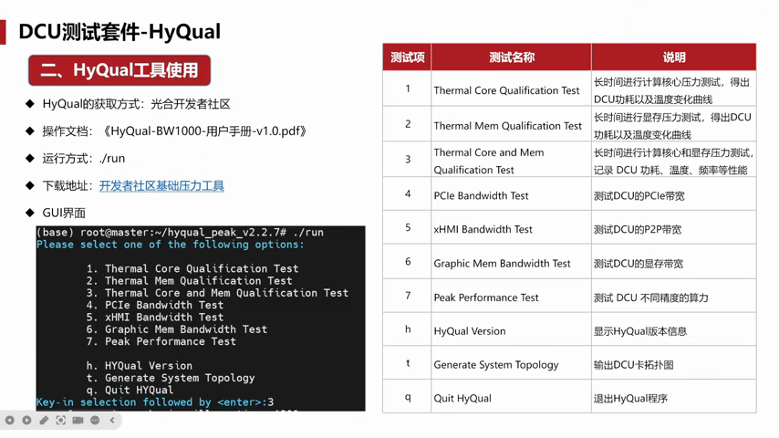
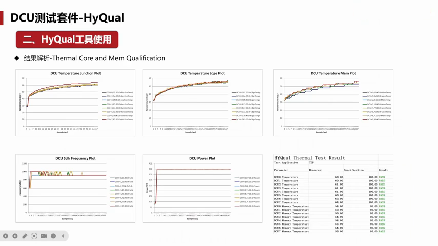
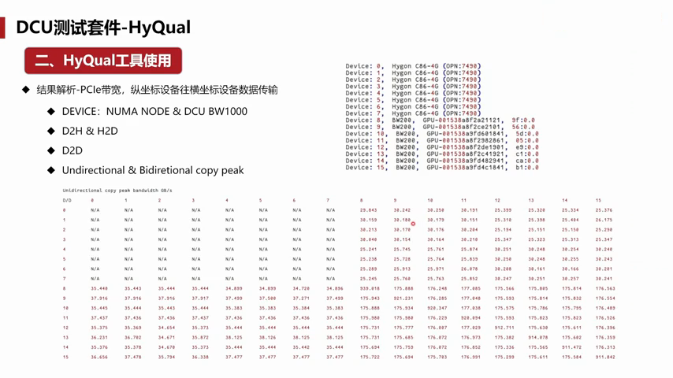
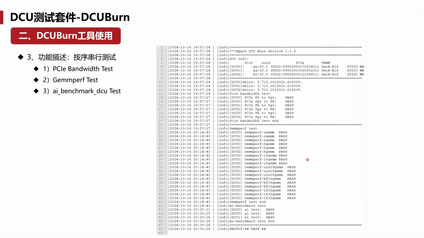
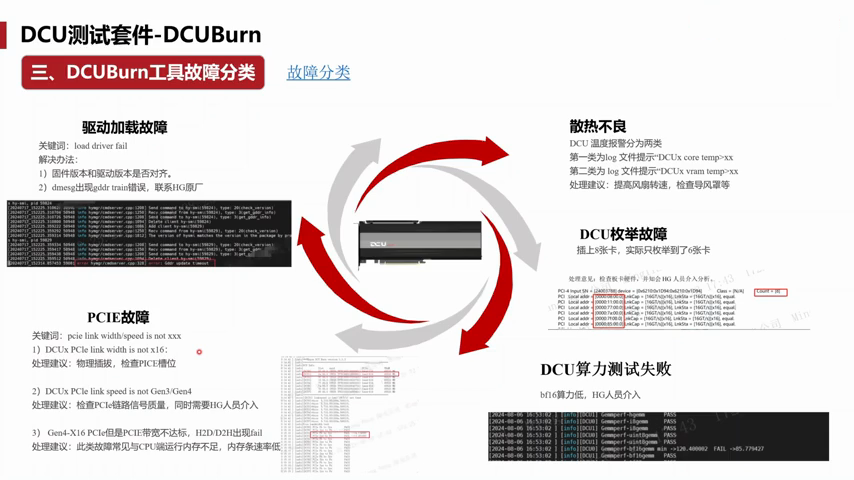
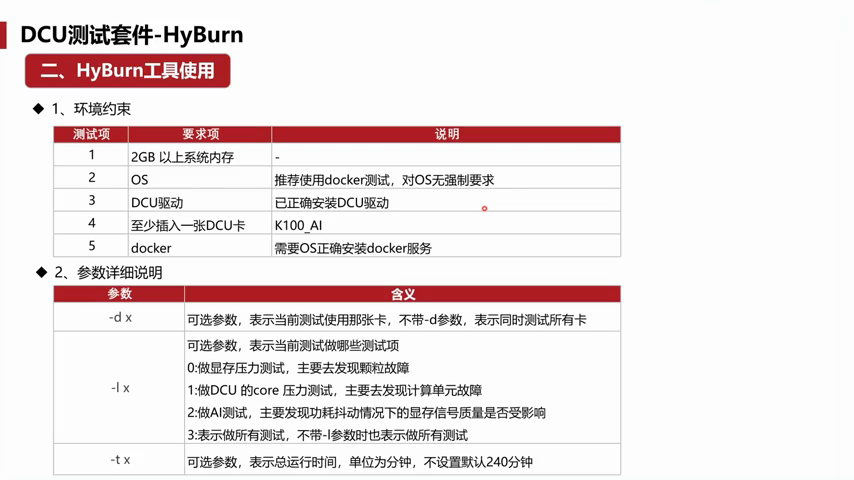

# 第48讲 海光DCU基础工具全解（上）

**本课程定位：** 卡装好、环境部署完之后，要用测试工具证明它够快、够稳、没病。三个工具各管一段：Hyqual 做压力、带宽、算力与综合测试，DCUBurn 做整机满载烤机，HyBurn 做硬件故障诊断。本讲部署这三个工具，逐项跑完测试，把结果与标准值对照判读；出现异常时联动带外传感器与物理部件回查，最后出一份综合测试报告。

## 48.1、学习目标

知识目标：

- 认识三工具分工：能按售前POC、整机出货、售后诊断三种场景把 Hyqual、DCUBurn、HyBurn 归位，并说出各自输出什么。
- 掌握 Hyqual 测试项：能在 GUI 菜单上指认七个测试项，并把带宽、算力、压力、综合四维对应到项号。
- 读懂测试结果：能区分温度曲线、频率、功耗的正常与异常形态，说出工具内置阈值（核心100℃、显存80℃）。
- 掌握判读标准：能说明工具内置阈值、官方标称、实测三者的关系，无书面阈值时标「无法判断」。
- 知道联动回查路径：过温降频、带宽跌落、硬件错误三类异常，各能说出带外与物理回查的第一站。

实操目标：

- 完成三工具部署与版本确认，填完版本闭合表。
- 完成四维压测并同步记录带内与带外满载四行。
- 完成逐项对标与异常联动诊断，偏差项有处置建议。
- 完成综合测试报告（结论、偏差项、风险、处置建议）。

## 48.2、海光DCU测试工具与结果判读

这一节讲六件事：三工具分工与版本闭合、Hyqual 测试项、Hyqual 结果判读、DCUBurn、HyBurn、判读标准与 BMC 联动。

### 48.2.1、三工具分工与版本闭合

表48-1、三个测试工具的分工

| 工具 | 管什么 | 典型场景 | 输出 |
| --- | --- | --- | --- |
| Hyqual | 压力、带宽、算力与综合测试 | 售前POC、交付验收 | 分项 PASS/FAIL、result 目录 Excel 与日志 |
| DCUBurn | 整机满载稳定性烤机 | 整机生产出货 | 串行三测试日志与故障分类 |
| HyBurn | 算力卡硬件故障诊断 | 售后诊断、RMA 判据 | 显存/核心/AI 测试日志、RAS 与坏页记录 |

工具版本跟卡型号走，两条版本线不能混用。

表48-2、Hyqual 版本闭合示例

| 卡型号 | Hyqual 版本 | 驱动要求 | OS |
| --- | --- | --- | --- |
| K100、K100AI | v2.2.7 | ≥6.2.31 | Ubuntu 20.04 及以上、CentOS 7.6 及以上 |
| BW1000 | v3.0.3 | >rock-6.3.6 | 同上 |

表注：据海光培训材料系统要求表重排（工具全解（上）05.png）；教室以现场闭合表为准，不支持 Windows。

型号判定先看 lspci -nn 的设备ID：厂商 1d94 为海光DCU，6210 对应 K100-AI，6320 为 BW150 与 BW1000 共用，6370 对应 BW100，6430 对应 BW1100。芯片ID是板卡级标识，不等于产品名，共用ID的型号要结合整机配置与产品名判定。

表注：设备ID映射据光合社区 dcu-toolkit-skills 仓库 references/dcu-models.md（内部参考口径，含真机实测）。

【例题】教室节点 lspci -nn 见 1d94:6210，判定为 K100_AI，选 Hyqual v2.2.7，并核对驱动≥6.2.31；若驱动低于要求，先记录差异报讲师，不私自升级。示例为课堂假设，实际以教室闭合表为准。

### 48.2.2、Hyqual 七测试项与大纲四维

Hyqual 以 .run 启动，进入菜单后按项号选择测试，h 看版本、t 生成 NUMA（非统一内存访问）拓扑、q 退出。

测试项编号以 GUI 菜单为准：第5项是 xHMI（P2P）带宽，第6项是显存带宽，第7项是多精度算力。七个测试项各做什么、看什么，先过一遍。

表48-3、Hyqual 七测试项各做什么

| 项号 | 测试项 | 做什么 | 看什么 |
| --- | --- | --- | --- |
| 1 | Thermal Core | 功耗压到 TDP（额定功耗）、计算核心满载，随机数据不占满显存 | 核心散热能否压住满载 |
| 2 | Thermal Mem | 显存长时间压力，读回数据做加和校验 | 显存颗粒与读写稳定性 |
| 3 | Thermal Core and Mem | 核心与显存同时满载，默认1800秒 | 整机散热与满载曲线 |
| 4 | PCIe Bandwidth | host 与 device 之间传输带宽 | H2D/D2H 实测与 PASS/FAIL |
| 5 | xHMI Bandwidth | 卡间 P2P 传输带宽 | 卡间互联实测 |
| 6 | Graphic Mem Bandwidth | 显存读写带宽，用 BabelStream 基准工具 | Copy/Scale/Add/Triad 等函数带宽 |
| 7 | Peak Performance | 多精度 GEMM（通用矩阵乘）算力 | 各精度理论峰值与实测值 |

表注：项名与编号据工具全解（上）06.png GUI；各项做法据（上）09.png 与培训讲解重排。

大纲的四维与项号对应如下。

表48-4、大纲四维与 Hyqual 测试项映射

| 大纲维度 | 对应测试项 | 看什么 |
| --- | --- | --- |
| 带宽 | 项4 PCIe、项5 xHMI（P2P）、项6 显存 | host↔device、卡间、显存读写带宽 |
| 算力 | 项7 Peak Performance | 各精度 GEMM 理论值与实测值 |
| 压力 | 项1 核心、项2 显存、项3 核心+显存 | 满载温度、频率、功耗曲线 |
| 综合 | 项3 加 DCUBurn 串行测试 | 核心与显存同时满载的整机表现 |

部署有两种方式。物理机以 root 执行：压力测试要直接操作设备与驱动，厂商建议都在 root 下跑。环境依赖不便安装时用容器：起 Docker 服务、从光源拉基础 Ubuntu 镜像、把工具整包复制进容器再跑。工具包自带依赖环境（miniconda3 与 rocm_install 目录）和编译工具（bin、lib 目录），整包复制即可运行，不依赖宿主机装齐依赖；容器要挂 /opt/hyhal 与 /lib/modules，漏挂会看不到卡或缺 libkmod。工具从光合社区资源中心的工具包进入基础压力工具目录获取，目录内含两个版本的压缩包、readme 与两本用户手册。

表注：获取入口与目录内容据工具全解（上）18.png、21.png 实截；目录结构据（上）04.png；手册为《HyQual-BW1000-用户手册-v1.0.pdf》与《HyQual-用户手册-v2.2.7.pdf》，以教室发放版本为准。

### 48.2.3、Hyqual 结果判读

压力项把功耗压到额定、核心利用率压满；项3 默认1800秒，可用参数改时长。结果保存在 result 目录，按测试类型分三个子目录：bandwidth 存带宽日志、gemmperf 存各精度算力值、thermal 存温度功耗频率数据。Thermal 的 Excel 有一张总览页和逐卡页：总览页给五张曲线与一张带 Specification 列的结果表，逐卡页给该卡温度、频率、功耗的最大最小值。

表注：result 分类据工具全解（上）04.png；Excel 结构据（上）10.png 与培训讲解重排。

表48-5、Thermal 结果判读要点

| 观察项 | 正常形态 | 异常指向 |
| --- | --- | --- |
| junction/edge 温度 | 随时间上升后趋稳 | 持续飙升→散热路径问题 |
| 显存温度 | 趋稳且低于 Specification 80℃ | 超80℃→显存散热或颗粒问题 |
| Sclk 频率 | 小幅波动 | 持续降到最低→过温降频或功耗墙 |
| Power | 达到额定设定 | 远低于额定→负载未压满或功耗受限 |

表注：Specification 列阈值（核心100.00、显存80.00）为工具内置判据，据工具全解（上）10.png。

【例题】读一行 Thermal 结果：某卡核心温度曲线升到92℃后趋稳，Specification 列核心阈值100.00；显存温度76℃，阈值80.00。两项都未超内置阈值，工具判 PASS，曲线先升后稳属正常形态。若核心温度持续飙升不趋稳，即使未超100℃也要查散热路径。示例为课堂假设，实际以教室真机结果为准。

算力项覆盖六种精度，工具同时给出理论峰值与实测值，并按设定阈值输出 PASS/FAIL。

表48-6、GEMM 精度与演示机理论峰值

| 精度 | 工具项名 | 演示机理论峰值 |
| --- | --- | --- |
| FP32 | sgemm | 49.15 TFLOPS |
| FP16 | hgemm | 196.61 TFLOPS |
| TF32 | tf32gemm | 98.30 TFLOPS |
| BF16 | bf16gemm | 196.61 TFLOPS |
| INT8 | i8gemm | 393.22 TOPS |
| UINT8 | ui8gemm | 393.22 TOPS |

表注：理论峰值为演示机工具输出（工具全解（上）14.png），非官方规格表；对标官方标称时以产品白皮书为准。

PCIe 带宽结果是一张矩阵。先认坐标：横纵两轴都是 NUMA node 与 DCU 设备，演示机上前8个节点（0–7）是 CPU 的 NUMA node，后8个（8–15）是 DCU；BW1000 的 DCU 以 BW200 模组名出现。再认方向：host↔device 看 H2D/D2H，卡间看 D2D，单向与双向峰值分开看。读法是从横轴节点往纵轴节点读交叉格：CPU 行对 DCU 列是 host↔device 带宽，DCU 行对 DCU 列是卡间带宽。BW1000 的卡间互联走 xHMI，带宽高于 PCIe 路径，矩阵原图里卡间 D2D copy peak 约175 GB/s 量级（演示值）。

项4 的逐卡结果表列出 Fb to Sys 与 Sys to Fb 两个方向的实测带宽。演示机（K100_AI 4卡）理论 raw 带宽32 GB/s，每卡实测约28.16/28.55 GB/s，全部 PASS。项6 显存带宽用 BabelStream v3.4 跑 Copy、Scale、Add、Triad 等函数，输出各函数最小、最大、平均带宽。菜单里按 t 生成的拓扑存在 result/topology.txt，列出每张卡挂在哪个 NUMA node，读矩阵前先对照它认坐标。

表注：矩阵与逐卡结果据工具全解（上）13.png、11.png，拓扑文件据（上）15.png；演示值为演示机输出，非官方规格。Fb/Sys 方向对应从11.png 参数说明：Fb to Sys 标 host→device、Sys to Fb 标 device→host。

【关键区别】理论峰值、实测值、官方标称是三个数：理论峰值是工具按架构算出的上限，实测是本次运行结果，官方标称来自产品白皮书。对标判读用官方标称；白皮书未到位时，该项标「无法判断」，不拿理论峰值顶替。

【随堂思考】压测中频率持续降到最低、温度却不高，应先查哪两条证据？

### 48.2.4、DCUBurn：整机烤机与五类故障

DCUBurn 面向整机出货，解压后按包内说明更新驱动，再以 dcuburn.sh 加时长参数启动，自动串行跑完三项测试。串行顺序是 PCIe Bandwidth → Gemmperf → ai_benchmark_dcu：先验链路带宽，再验各精度算力，最后用 AI 负载把显存与计算核心同时拉到90%以上，模拟真实大模型场景。前一项通过才跑后一项，故障落在哪一段一目了然。时长建议30分钟左右，不宜过短也不宜过长，过短看不出稳定性。

日志按固定顺序打印：先版本信息，再硬件 Info——卡数、每卡 UID 与槽位、显存容量、VBIOS 版本，然后逐段输出三项测试结果。开跑前先核硬件 Info：卡数与实插一致、链路宽度与代数符合机型，枚举或链路问题在这一步就能发现，不用等压测跑完。演示日志链路 Gen4-X16、显存65520 MB、VBIOS 5.715，三项全 PASS。

表注：日志结构与演示值据工具全解（中）05.png；演示值非教室真机结果。

表48-7、DCUBurn 五类故障与处置

| 类别 | 日志关键词 | 处置 |
| --- | --- | --- |
| 驱动加载 | load driver fail | 固件与驱动版本对齐；dmesg 见 gddr train 错误联系原厂 |
| 散热不良 | core temp、vram temp 超阈 | 提风扇转速、查导风罩等物理散热 |
| 枚举故障 | 插8卡只枚举6卡 | 查供电与插接，硬件无问题再联系原厂 |
| 算力失败 | bf16 算力低 | 原厂介入分析 |
| PCIe 故障 | link width not x16 | 物理插拔、查槽位质量 |
| PCIe 故障 | link speed not Gen3/Gen4 | 查链路信号质量，原厂协助 |
| PCIe 故障 | Gen4-X16 但 H2D/D2H fail | 查 CPU 端内存容量与内存条速率 |

表注：据工具全解（中）06.png 故障分类图重排。

环境约束：16GB 以上内存、20GB 磁盘空间、Python3、驱动≥6.2.31，OS 建议 Ubuntu 20.04 及以上。

表注：环境约束据工具全解（中）03.png 重排。

### 48.2.5、HyBurn：故障诊断与 RMA 衔接

HyBurn 面向售后诊断，以 Docker 镜像方式提供：docker load 导入后起容器，.run -h 看参数。使用前重启节点：上一轮测试或业务留下的进程与驱动状态会干扰诊断，重启后再跑，结果才归因于本次测试。

表48-8、HyBurn 参数与测试项

| 参数 | 含义 | 默认 |
| --- | --- | --- |
| -d | 指定测试卡 | 不带＝全部卡 |
| -l | 0 显存压力、1 核心压力、2 AI 测试、3 全部 | 不带＝全部 |
| -t | 总时长（分钟） | 240 |

三个测试项各有靶点。显存压力逐颗粒检查显存，发现 cell 翻转就把地址记入 EEPROM（卡上可擦写存储），重启驱动后 mask（屏蔽）掉坏地址，继续验证其余颗粒。核心压力把功耗加满检验散热，同时跑各精度计算并把结果与 CPU 对比，不一致即报错——散热异常会让核心发挥不出最大算力，计算对比则抓计算单元本身的错。AI 测试跑 resnet50 benchmark，验证功耗抖动下显存信号质量是否受影响；结束后读 UMC（显存控制器）CRC 计数与门限比较，超门限在日志输出告警。

测试过程可以另开窗口 watch hy-smi 同步看温度、功耗与显存占用，AI 测试时显存与核心都接近拉满（演示：温度65/67℃、AvgPwr 255/278W、PwrCap 400W）。结果落在 lastlog 目录：dcu_ai.log 记 AI 测试过程、summary.txt 给汇总、temperature.log 记温度曲线，取证据时三个文件一起归档。

表注：lastlog 文件与 watch 演示值据工具全解（中）13.png；演示值非教室真机结果。

表48-9、HyBurn 故障分类与阈值

| 类别 | 判据 | 处置 |
| --- | --- | --- |
| 散热不良 | core temp>99 或 vram temp>88 | 查散热路径，联动带外风扇与风道 |
| 芯片不可纠正错误 | hy-smi --showrasinfo 见 UE、DCU reset | 走 RMA 换件 |
| 核心计算单元 | gemmperf-i8gemm fail | int8 计算单元出错，原厂介入 |
| 显存颗粒 | 测试发现 cell 翻转 | 地址写 eeprom，重启驱动 mask |
| 驱动/PCIe | 同 DCUBurn 口径 | 按表48-7 处置 |

表注：阈值与判据据工具全解（中）14.png 重排。

诊断结论指向换件时，按第41讲的换件流程执行。HyBurn 的日志、RAS 记录与坏页记录一起构成 RMA 判据材料：日志证明故障现象，RAS 计数证明错误性质（UE 走换件），坏页记录证明显存颗粒状态。

### 48.2.6、判读标准与 BMC 联动

对标分三层：工具内置阈值管「工具判不判 FAIL」，官方标称管「达不达标」，实测是本次证据。官方标称来自教室型号的产品白皮书，获取前对标表该列留空。

表48-10、对标口径与判定规则

| 项目 | 工具内置阈值 | 官方标称 | 判定规则 |
| --- | --- | --- | --- |
| 核心温度 | 100℃（HyQual 结果表） | 留空待白皮书 | 超内置阈值标偏差；官方对标无书面阈值标无法判断 |
| 显存温度 | 80℃（HyQual 结果表） | 留空待白皮书 | 同上 |
| 散热告警 | core>99、vram>88（HyBurn） | 留空待白皮书 | 超阈即查散热并联动带外 |
| PCIe 带宽 | 无内置 | 留空待白皮书 | 无书面阈值标无法判断 |
| 同精度算力 | 无内置 | 留空待白皮书 | 无书面阈值标无法判断 |
| 整卡功耗 | 额定 PwrCap 为上限参考 | 留空待白皮书 | 满载应接近额定，远低于额定查负载与功耗墙 |

表注：内置阈值据工具全解（上）10.png、（中）14.png；官方标称列待教室型号产品白皮书，获取前留空，不填第三方数字。

带内与带外各看一组数。记录前先对时：两侧时钟不一致，曲线就对不上，互证无从谈起；压测开始后按同一时间间隔逐时记录，满载四行（核心温度、显存温度、风扇转速、整卡功耗）两侧各记一份。

表48-11、带内 hy-smi 与带外 HDM 对照判读

| 观察项 | 带内 hy-smi | 带外 HDM |
| --- | --- | --- |
| 核心温度 | -t（--showtemp） | 传感器信息-温度 |
| 显存温度 | 温度分项与结果表 | 传感器信息-温度 |
| 风扇转速 | dmon -sdmon f 或 -f | 传感器信息-风扇 |
| 整卡功耗 | -P、dmon -sdmon p | 电源管理-当前总功率 |

表注：带外页面据第43讲讲义、机房巡检与常见故障配套PDF、H3C HDM 用户指南目录；机型与菜单以教室实机为准。

三类异常各有回查第一站。过温降频先查散热物理路径：带外看风扇转速是否补偿到位，现场查导风罩在位、机柜假面板补齐，短路风会让进风温度抬高、芯片温度跟着飙。带宽跌落先查 PCIe 物理链路：槽位插接、重新插拔，再核链路 width/speed 是否掉到 x16 以下或 Gen3 以下。硬件错误先查证据计数：带内 RAS 计数与 dmesg XID，带外 HDM 事件日志，两侧对上了再定处置。

PCIe 形态卡与 OAM 形态产品的 BIOS 前提不同：IOMMU/ACS 设置主要影响 PCIe 卡，OAM 机型出现同类现象先查其他根因。

降频的直接证据在带内：--showfdr 给出频率调整原因，--showfdrhistory 给出调整历史；原因指向温度就查散热，指向功耗就核 PwrCap 与供电。内核侧以 dmesg 的 XID 佐证，XID 50 为 High temperature、301 为 SMU hotpot notice，CE 类以监控为主、UE 类走 RMA。

表注：XID 含义据光合社区 dcu-toolkit-skills 仓库 xid_sxid_errors.md（源《HYGON DCU XID/SXID 错误》v2.2.0）。

【随堂思考】带内芯片温度正常、带外传感器却报过温，先信哪一侧、查什么？

### 48.2.7、术语表

表48-12、本讲术语

| 术语 | 含义 |
| --- | --- |
| Hyqual | 海光DCU压力、带宽、算力与综合测试标准工具 |
| DCUBurn | 整机满载稳定性烤机套件 |
| HyBurn | 算力卡硬件故障诊断套件，RMA 判据来源 |
| POC | 售前验证测试（Proof of Concept） |
| RMA | 退料换件流程（Return Material Authorization） |
| RAS | 可靠性、可用性、可服务性错误记录机制 |
| CE / UE | 可纠正错误 / 不可纠正错误 |
| XID | 驱动记录于内核日志的DCU错误标识 |
| TDP / PwrCap | 额定功耗 / 功耗上限 |
| junction / edge 温度 | 芯片中心温度 / 边缘温度 |
| xHMI | 海光卡间高速互联链路 |
| dmon | hy-smi 滚动监控模式 |
| GEMM | 通用矩阵乘，算力测试的基本负载 |
| NUMA | 非统一内存访问，CPU 与设备的内存亲和分组 |
| UMC | 显存控制器，CRC 计数反映显存信号质量 |
| EEPROM / mask | 卡上可擦写存储 / 屏蔽坏地址 |
| BabelStream | 显存带宽基准工具，跑 Copy/Scale/Add/Triad 等函数 |

## 48.3、具体实训内容

四个任务依次完成，交付部署记录、压测证据、对标表与综合测试报告。压测期间工程师或运维在场。

### 48.3.1、部署三工具并确认版本

在空闲教学节点上部署 Hyqual 并确认 DCUBurn、HyBurn 入口，填完版本闭合表。验收看三入口均可启动、闭合表无空层。

表48-13、三工具部署与版本确认

| 步 | 动作与要领 | 常见错误 | 检查点 |
| --- | --- | --- | --- |
| 1 | hy-smi 概览看利用率与显存占用，--showpids 查占用进程，确认卡空闲无业务 | 带业务压测 | 利用率与显存占用低、无占用进程 |
| 2 | 从教室仓库或社区工具包取对应版本包：wget 或直链下载、解压，核对包版本 | 两条版本线选错 | 包版本与闭合表一致 |
| 3 | 物理机 root 直接跑；容器方式起容器挂 /opt/hyhal 与 /lib/modules，工具整包复制进容器 | 漏挂致容器内0卡、libkmod 缺失 | 容器内 hy-smi 见卡 |
| 4 | 启动三入口确认：Hyqual .run 进菜单、DCUBurn dcuburn.sh、HyBurn docker load 后起容器 .run -h | 把讲解当已部署 | 三入口均可启动 |
| 5 | 采集驱动（hy-smi）、DTK（目录版本）、工具版本填闭合表 | 空层不填 | 闭合表无空层 |
| 6 | 记录 lspci -nn 设备ID，按48.2.1口径判定型号 | 芯片ID当产品名 | 型号判定有依据 |

### 48.3.2、跑四项压测并同步监控满载

按带宽、算力、压力、综合四维逐项跑测试，压测期间同步记录带内与带外满载四行。验收看四维结果齐、两侧记录时间戳可对照。

表48-14、四维压测与同步监控

| 步 | 动作与要领 | 常见错误 | 检查点 |
| --- | --- | --- | --- |
| 1 | 菜单进项4/5/6 逐项跑带宽，result/bandwidth 日志与矩阵截图留存 | 只跑一项当带宽维 | 三项结果齐 |
| 2 | 进项7 跑算力，六精度全跑，记录理论峰值与实测值 | 精度漏项 | 六精度输出齐 |
| 3 | 进项1/2/3 跑压力，项3 时长按讲师给定设置，另开窗口 watch 同步看 | 时长随意改 | 时长已记录 |
| 4 | 综合：项3 加 DCUBurn 串行三测试，串行日志留存 | 综合缺位 | 综合结果留证 |
| 5 | 第二窗口 watch -n 0.1 hy-smi 或 dmon，逐时记录带内四行：核心温度、显存温度、风扇转速、整卡功耗 | 只看峰值不看曲线 | 逐时记录与曲线齐 |
| 6 | 同步 BMC WebUI 记同样四行，先对时再记录 | 两侧时间不对齐 | 时间戳可对照 |
| 7 | result Excel 下载到本地，日志与截图编号归档 | 结果留在容器里丢失 | 证据编号归档 |

### 48.3.3、逐项对标规格表并联动诊断异常

把实测填入对标表，逐项判定；异常场景按三条路径回查并取证。验收看每个偏差项有处置建议、无法判断项如实标注。

表48-15、对标与联动诊断

| 步 | 动作与要领 | 常见错误 | 检查点 |
| --- | --- | --- | --- |
| 1 | 填表48-10实测列，每格注明证据编号（日志/截图编号） | 拿演示机峰值当官方标称 | 实测来源可追溯 |
| 2 | 逐项判定：超内置阈值标偏差，无书面阈值标无法判断 | 无阈值硬判合格 | 判定规则一致 |
| 3 | 异常按三路径回查：散热查风扇/导风罩/假面板，带宽查槽位/插拔/width/speed，硬件错误查 RAS/事件日志 | OAM 机型盲改 BIOS | 回查记录对应路径 |
| 4 | dmesg 中查 XID、--showrasinfo 取 RAS 计数、--showfdr 取降频原因，证据留原文 | UE 错误堆软件环境变量 | 证据留原文 |
| 5 | 指向换件的出 RMA 结论，附日志＋RAS＋坏页记录证据包 | 软件规避硬件故障 | 结论与证据一致 |
| 6 | 偏差项写处置建议，对应到部件或版本 | 只标不处置 | 每项有建议 |

### 48.3.4、输出综合测试报告

汇总部署记录、压测证据与对标表，出综合测试报告。验收看四要素齐、证据可反查。

报告四要素各有固定内容：结论写四维测试 PASS/FAIL 与对标判定；偏差项写超内置阈值项与无法判断项的边界；风险写散热、部件、版本三类隐患；处置建议写可执行动作，对应到具体部件或版本。证据清单按编号挂接：部署记录、压测截图、result Excel 与日志、带外记录。

表48-16、综合测试报告

| 步 | 动作与要领 | 常见错误 | 检查点 |
| --- | --- | --- | --- |
| 1 | 搭四要素骨架：结论（四维＋对标）、偏差项（超阈＋无法判断边界）、风险（散热/部件/版本）、处置建议 | 缺要素 | 四要素齐 |
| 2 | 挂接证据清单：部署记录、压测截图、result、带外记录，逐项编号 | 证据无编号 | 编号可反查 |
| 3 | 写偏差与无法判断项的边界 | 把无法判断写成合格 | 边界如实 |
| 4 | 风险与处置建议对应到部件或版本 | 空泛建议 | 建议可执行 |
| 5 | 复核签认提交 | 未复核 | 签认留痕 |

## 48.4、需要的硬件设施

本讲在已装驱动的教学节点上做软件实操，工位按一套计。

表48-17、硬件与工位配套

| 名称 | 型号规格 | 用途 |
| --- | --- | --- |
| 空闲DCU节点 | ≥2张卡、驱动已装 | 压测与诊断 |
| 机柜假面板与空调 | 在位 | 风道完整，避免短路风 |
| 带外可达终端 | 带外网口连通 | HDM 记录与回查 |
| 在场工程师或运维 | 压测期间 | 异常处置与签认 |

表48-18、软件与账号

| 名称 | 版本或来源 | 用途 |
| --- | --- | --- |
| Hyqual、DCUBurn、HyBurn | 教室仓库对应版本 | 三工具实操 |
| hy-smi | 驱动自带 | 带内监控与取证 |
| BMC WebUI 账号 | 教学账号 | 带外记录 |
| 官方规格表与阈值书面说明 | 待教室型号白皮书 | 对标判读 |
| 教室镜像仓库或离线包 | 按现场 | 容器部署 |

## 48.5、配套视频

表48-19、视频清单

| 视频名 | 时长 | 内容要点 |
| --- | --- | --- |
| 海光DCU基础工具全解（上） | 约26分钟 | Hyqual 七项、结果判读与 BW1000 实机演示 |
| 海光DCU基础工具全解（中） | 约15.5分钟 | DCUBurn 五类故障、HyBurn 参数与诊断 |
| 待拍：DCUBurn 真机烤机 | 待定 | 串行三测试与日志判读 |
| 待拍：HyBurn 真机诊断 | 待定 | 三测试项、RAS 与坏页记录 |
| 待拍：BMC 联动回查 | 待定 | 带外四行记录与风道/槽位回查 |

观看节奏：课前看（上）（中）对应段；课上实训2回放实机演示段，实训3回放故障分类段；待拍三条补齐后替换讲解级画面。

## 48.6、小结与自测

### 48.6.1、目标回看

| 学习目标 | 应能做出的判断 | 对应实训 |
| --- | --- | --- |
| 认识三工具分工 | 给场景能归位工具并说出输出 | 48.3.1 |
| 掌握 Hyqual 测试项 | 菜单指认七项、四维对应项号 | 48.3.2 |
| 读懂测试结果 | 区分曲线正常与异常、说出内置阈值 | 48.3.2 |
| 掌握判读标准 | 说清三者关系、无书面阈值标无法判断 | 48.3.3 |
| 知道联动回查路径 | 三类异常说出带外与物理回查第一站 | 48.3.3 |
| 完成三工具部署与版本确认，填完版本闭合表 | 闭合表无空层 | 48.3.1 |
| 完成四维压测并同步记录带内与带外满载四行 | 两侧四行齐、时间戳可对照 | 48.3.2 |
| 完成逐项对标与异常联动诊断，偏差项有处置建议 | 每个偏差项有建议 | 48.3.3 |
| 完成综合测试报告 | 四要素齐、证据可反查 | 48.3.4 |

### 48.6.2、课后自测

- 教室节点 lspci -nn 见 1d94:6320，能否直接选定 Hyqual 版本线？为什么？
- 压测结果核心温度92℃、Specification 为100℃，但产品白皮书未到位，该项如何判定？
- dmesg 出现 XID 2（UMC UE），应走软件规避还是换件？
- 综合测试为什么不能用 Hyqual 项3单独代替？
- DCUBurn 与 HyBurn 都能报散热问题，二者定位差异是什么？

### 48.6.3、参考答案与解析

随堂思考：

- 频率持续最低而温度不高：先查 --showfdr 与 --showfdrhistory 的频率调整原因与历史，再查功耗与 PwrCap 记录；温度不高时降频主因指向功耗墙或供电，而非散热。
- 带内正常而带外过温：先核对两侧测点与时间戳（带外测进风与部件温度、带内测芯片温度），再查风道、导风罩与假面板是否形成短路风。

课后自测：

- 不能。6320 为 BW150 与 BW1000 共用芯片ID，须结合产品名与整机配置判定型号，再选 v3.0.3 线并核驱动>rock-6.3.6。
- 92℃未超内置100℃，工具判 PASS；官方对标列缺白皮书，标「无法判断」，不能写成官方达标。
- 换件。UE 为不可纠正硬件错误，走 RMA，不堆软件环境变量。
- 项3是核心加显存压力；综合维还含 DCUBurn 串行（PCIe→Gemmperf→ai_benchmark）的整机视角，AI 负载把显存与核心同时拉到90%以上，更接近真实业务。
- DCUBurn 面向整机出货烤机，HyBurn 面向售后诊断与 RMA 判据；同报散热问题，输出用途不同。

下一讲把单机工具扩展到多卡集合通信与 Kubernetes 算力插件。

<!-- md-only -->

## 48.7、来源

本地：

- 课程大纲excel/算力运维工程师__20261112_修订版_海光实训加细.xlsx（主表R52、详细R49）
- 海光资料/海光课程大纲-0930.xlsx（海光分册专题8）
- 海光资料/讲义提取/海光DCU基础工具全解（上）（04、06、09、10、11、13、14、15、18、21.png 与文案）
- 海光资料/讲义提取/海光DCU基础工具全解（中）（03、05、06、09、13、14.png 与文案）
- 海光课程讲义/第43讲、第42讲学员讲义（带外与风道判读）
- 海光资料/机房巡检与常见故障-配套硬件(1).pdf（HDM 传感器、风扇、电源页）
- 光合社区代码仓 dcu-toolkit-skills（归档 tmp/dcu-toolkit-skills/：dcu-hy-smi、dcu-ontrack-experience 含 XID/SXID 手册摘录、references/dcu-models）

网络：

- H3C Servers HDM User Guide 目录 https://www.h3c.com/en/d_202202/1551309_294551_0.htm
- rookie-J/hy-smi 命令参考 https://github.com/rookie-J/hy-smi
- rccl-tests 上游 PERFORMANCE.md 与 README https://github.com/ROCm/rccl-tests （跨讲共用）
- Moark《海光 BW1000》 https://moark.com/docs/compute/clusters_gpu/hygon_gpu （平台口径，待核实）
- HAMi v2.10 文档 https://project-hami.io/zh/docs/v2.10.0/userguide/hygon-device/enable-hygon-dcu-sharing 与归档仓 https://github.com/Project-HAMi/dcu-vgpu-device-plugin
- iotdt 市面对比 https://www.iotdt.com/news/xingyezixun/2350.html （市场宣称，不采用为规格）

待获取：教室型号产品白皮书、Hyqual 官方手册（社区账号下载）、社区《RCCL-TEST指导手册》离线副本。

<!-- /md-only -->
