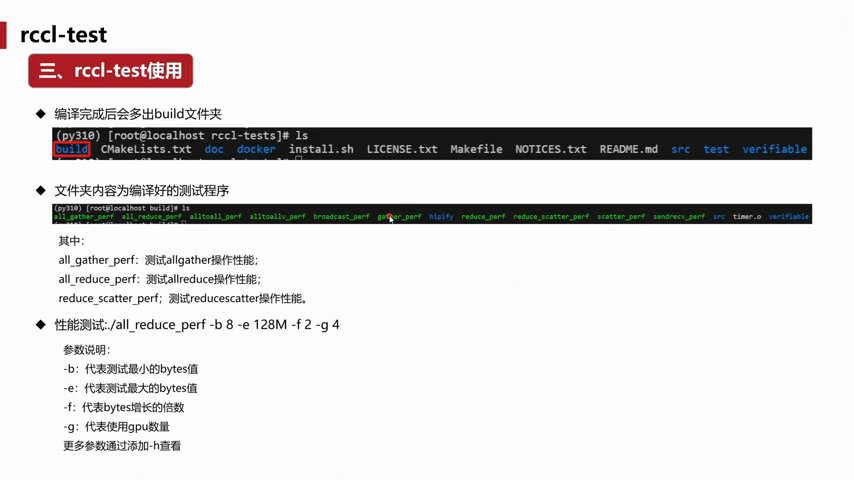
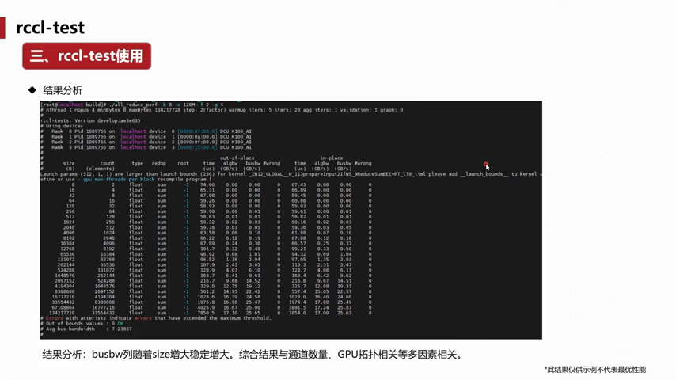
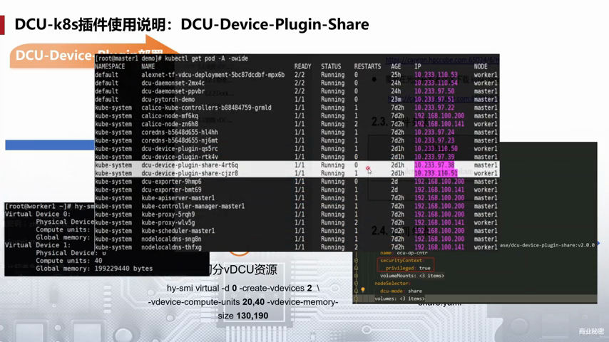

# 第49讲 海光DCU基础工具全解（下）

**本课程定位：** 单卡工具证明了一张卡够快、够稳；多卡训练还要证明卡与卡之间通信够快、集群能把卡分出去。本讲前半用 rccl-test 量化六种集合通信的带宽与延迟，后半在 Kubernetes 上部署三个海光算力插件并逐项验收：指标导出、资源注册、独占申请、共享模式。

## 49.1、学习目标

知识目标：

- 认识 RCCL：能说出它在软件栈中的位置（运行时之上、框架之下）与六种标准集合通信的名字。
- 掌握 rccl-test：能解释 algbw 与 busbw 的区别与换算系数，知道小尺寸看延迟、大尺寸看带宽。
- 知道 DCU-Exporter：能说出三种部署方式与指标查看入口（16080 端口的 metrics）。
- 知道 DCU-Device-Plugin：能说出它把 DCU 注册为 hygon.com/dcu 资源、以 DaemonSet 部署。
- 知道 Device-Plugin-Share：能说出 vDCU 静态划分的约束与共享资源名 hygon.com/dcu-share。
- 掌握验收口径：资源注册、独占申请、共享模式、指标导出、通信效率五项各能说出通过判据。

实操目标：

- 完成六种集合通信逐项测试，记录带宽与延迟并标注测试范围。
- 完成三个插件部署（教室仓库镜像与 YAML）。
- 完成四项功能验收（指标导出、资源注册、独占申请、共享模式）。
- 完成多卡通信与插件验收报告。

## 49.2、集合通信与Kubernetes算力插件

这一节讲六件事：RCCL 与六算子、rccl-test、Exporter、Device-Plugin、Share、验收口径。

### 49.2.1、RCCL 定位与六算子原理

RCCL（ROCm Communication Collectives Library）是 DCU 的集合通信库，位于运行时之上、AI 框架之下，PyTorch 经它做多卡通信；节点内走 PCIe 与卡间高速互联，节点间走 InfiniBand、RoCE 或 TCP。

表49-1、六种标准集合通信与 busbw 修正系数

| 算子 | 数据流向 | busbw 系数 |
| --- | --- | --- |
| broadcast | root 的数据广播到全卡，各卡持同一副本 | 1 |
| allgather | 各卡片段汇总，全卡持完整数据 | (n-1)/n |
| reduce | 全卡数据规约到 root | 1 |
| allreduce | 全卡规约后全卡持同一结果 | 2(n-1)/n |
| reducescatter | 全卡规约后按卡分片 | (n-1)/n |
| alltoall | 各卡向各卡发送不同片段 | (n-1)/n |

表注：系数据 rccl-tests 上游 doc/PERFORMANCE.md；流向据工具全解（下）原理页与上游文档重排；n 为卡数。

Ring AllReduce 分 ReduceScatter 与 AllGather 两阶段、各 N-1 步，总传输量 2(N-1)·K/N：卡数增加时总传输量恒定，理论上具备线性加速能力；代价是延迟随卡数线性增长，大规模集群改用树形结构（Double Binary Tree）把延迟降到对数级。

【关键区别】algbw 与 busbw：algbw＝size/time，反映操作本身的效率；busbw 在 algbw 上乘修正系数、消除卡数影响，才能与硬件峰值带宽比较。报结果时两者都给，结论用 busbw。

### 49.2.2、rccl-test 编译、参数与结果判读

前置是 DTK、驱动与 MPI（消息传递接口，多机进程间通信）。编译在容器内做：物理机的 /opt/dtk 软链容易错位，容器内环境干净。

按型号锁编译 commit 与 GPU_TARGETS：K100-AI 为 gfx928、commit 5e838ad9df47079e0e586ed38049f4f579ea462d（make），BW1000 与 BW150 为 gfx936、commit 5e838ad9df47079e0e586ed38049f4f579ea462d，BW1100 为 gfx938、commit 66e513c24ff42394f5a0c1781f5868da7e094dd1 走 install.sh。

上游 rccl-tests 仓库已 retired、迁移至 rocm-systems；海光内部手册锁旧仓 commit，与迁移注记不冲突。

表注：编译参数据光合社区 dcu-toolkit-skills 仓库 dcu-rccl-test（源内部手册《rccl-test 通信测试-260610》）；上游迁移据 rccl-tests README。

表49-2、rccl-test 常用参数

| 参数 | 含义 | 常用值 |
| --- | --- | --- |
| -b | 最小 bytes | 8 或 2 |
| -e | 最大 bytes | 128M、2G、8G |
| -f | size 增长倍数 | 2 |
| -g | 每进程卡数 | 单机8、多机1 |
| -n | 迭代次数 | 20 |
| -w | 预热次数 | 5 |
| -c | 正确性校验次数 | 1 |
| -o | 规约操作 | sum |
| -d | 数据类型 | float |
| -Z | 输出格式 | csv 或 json |

表注：参数表据 rccl-tests 上游 README 与幻灯片重排。

结果表分 out-of-place 与 in-place 两组，-O 参数可只跑其中一组，默认两组都跑，逐组判读。

表注：双组结果与 -O 参数据 rccl-tests 上游 README。

表49-3、结果字段与判读

| 字段 | 含义 | 判读 |
| --- | --- | --- |
| size | 通信字节数 | 扫描轴，逐 size 看 |
| time(us) | 单次耗时 | 小尺寸段即延迟 |
| algbw | size/time | 操作效率 |
| busbw | 修正后带宽 | 大尺寸段与硬件峰值比 |
| #wrong | 校验错误数 | 必须为0 |
| Out of bounds | 越界计数 | 必须为0 |

【例题】读两行结果：size＝8B 时 time 约50us、busbw 近0；size＝128MB 时 busbw 稳定在峰值附近。结论是小包看 time 判延迟、大包看 busbw 判带宽；只报均值会掩盖逐 size 行为。示例为课堂假设，实测以完整日志为准。

单机覆盖 2/4/8 卡 all_reduce 加 8 卡 alltoall，其余算子逐项跑。指定卡用 HIP_VISIBLE_DEVICES 固定卡序，不要只靠 -g N 让库自选。

跑前检查并清除镜像预置的 NCCL_NCHANNELS_PER_PEER；容器必挂 /opt/hyhal，漏挂会静默0卡。多机需节点免密与 MPI，mpirun 每 GPU 一进程；教室未配 RDMA 时，测试范围标注为单机卡间。

表注：覆盖清单与环境前置据 dcu-rccl-test 内部手册整理版。

### 49.2.3、DCU-Exporter：指标导出

Exporter 把 DCU 指标按 Prometheus 规范对外导出，有三种部署方式：二进制（-port 指定端口）、Docker 容器、K8s DaemonSet。前置为 K8s≥1.18 与特权模式。默认端口16080，用 curl localhost:16080/metrics 查看；改端口改 YAML 的 containerPort 与 Service port。

表49-4、Exporter 指标（metrics）

| 指标 | 含义 |
| --- | --- |
| dcutemp | 温度 |
| dcupowerusage | 功耗 |
| dcusclk | 芯片频率 |
| dcupowercap | 功耗上限 |
| dcuutilizationrate | 使用率 |
| dcuusedmemorybytes | 显存占用 |
| dcumemorycapbytes | 显存总量 |
| dcucontainers | 调用DCU的容器 |

表49-5、Exporter 标签（labels）

| 标签 | 含义 |
| --- | --- |
| minornumber | 设备号 |
| deviceid | 设备识别码 |
| pcieBusnumber | PCIe 总线号 |
| name | 设备名 |
| node | 节点名 |

表注：两表据 CSDN 实测文与幻灯片 metrics/labels 页重排。

### 49.2.4、DCU-Device-Plugin：资源注册与独占申请

Device Plugin 是 K8s 的设备管理机制：发现节点上的 DCU 并注册为可分配资源，Pod 通过 resources.limits 申请；默认以 DaemonSet 部署在所有 DCU 节点。部署四步：核对前置（驱动、K8s≥1.18、特权）→ 下载镜像包 k8s-dcu-plugin.v2.0.0.tar 与 k8s-dcu-plugin.yaml → docker load -i → kubectl apply -f。

表49-6、Device-Plugin DaemonSet 关键字段

| 键 | 值 | 说明 |
| --- | --- | --- |
| kind | DaemonSet | 每节点一副本 |
| metadata.namespace | kube-system | 系统命名空间 |
| containers.image | image.sourcefind.cn:5000/dcu/admin/base/dcu-device-plugin:v2.0.0 | 教室仓库版本为准 |
| securityContext.privileged | true | 需特权访问设备 |

表注：据工具全解（下）43.png YAML 画面与 CSDN 实测文重排。

注册验收看 kubectl describe node：Allocated resources 中出现 hygon.com/dcu，可分配数量等于物理卡数；独占申请看 apply 测试 Pod 后该资源占用 0→1、Pod 进入 Running。

### 49.2.5、Device-Plugin-Share：vDCU 共享

Share 插件让 K8s 管理 vDCU：把一张物理卡静态划分成多个虚拟卡，提升单卡利用率。划分在 DCU 节点上提前做，Pod 再申请虚拟卡。

表49-7、vDCU 静态划分约束

| 约束 | 内容 |
| --- | --- |
| 数量 | 一张物理卡最多划4个 vDCU |
| 配置 | 仅静态配置 |
| 资源 | 每个 vDCU 可任意划分算力与显存，整卡总和不超过物理标称 |
| 申请 | 每容器只用1张 vDCU，超配只认第一张 |
| 操作 | 只用驱动自带命令行创建/销毁，手改配置文件会崩进程 |
| 通信 | vDCU 之间暂不通信 |

表注：据工具全解（下）Share 段与 dynamia 实测文重排。

划分命令为 hy-smi virtual -d 0 -create-vdevices 2 --vdevice-compute-units 20,40 --vdevice-memory-size 130,190；查看用 -show-vdevice-info，销毁用 -d N -destroy-vdevice。容器挂 vDCU 需 /dev/mkfd 设备与 vdev 配置文件挂载。共享资源名为 hygon.com/dcu-share，kubectl describe node 可见。

两条注意：节点重新划分 vDCU 后，重启该节点的 Share Pod 才能重新获取设备信息；Plugin 与 Share 有 ≥2 个 DCU 节点时建议分节点部署；厂商演示为同节点配置（两者同在 master1），同节点可能产生进程冲突，条件允许建议分开。旧 HAMi 线使用 hy-virtual 与 dcunum/dcumem/dcucores 资源名，教室以社区 Share 插件线为准。

### 49.2.6、验收口径

表49-8、五项验收与通过判据

| 验收项 | 命令或画面 | 通过判据 | 基线来源 |
| --- | --- | --- | --- |
| 指标导出 | curl localhost:16080/metrics | 见 dcutemp 等指标与 labels | 社区/CSDN |
| 资源注册 | kubectl describe node | hygon.com/dcu 可分配数＝物理卡数 | 幻灯片46 |
| 独占申请 | apply 测试 Pod | 占用 0→1、Pod Running | 幻灯片48 |
| 共享模式 | 划分后 apply share Pod | hygon.com/dcu-share 可见、申请成功 | 幻灯片55/57 |
| 通信效率 | 逐 size 日志 | 大尺寸 busbw 稳定且接近基线 | 内部参考线 |

表注：内部基线参考线据 dcu-rccl-test（BW1000 单机8卡 allreduce busbw≈137.78 GB/s、alltoall≈116.22 GB/s），标非本机实测；教室以现场基线为准，无书面阈值项标无法判断。

### 49.2.7、术语表

表49-9、本讲术语

| 术语 | 含义 |
| --- | --- |
| RCCL | DCU 集合通信库（ROCm Communication Collectives Library） |
| ring / tree | 集合通信的环形 / 树形算法结构 |
| algbw / busbw | 算法带宽 / 修正后总线带宽 |
| DaemonSet | K8s 每节点一副本的工作负载 |
| Device Plugin | K8s 设备注册与分配机制 |
| vDCU | 静态划分出的虚拟DCU |
| RDMA | 远程直接内存访问（IB/RoCE） |
| GDR | GPU Direct RDMA，网卡直读显存 |
| Prometheus | 指标监控规范与系统 |

## 49.3、具体实训内容

四个任务依次完成，交付命令操作记录、关键步骤证据与多卡通信及插件验收报告。

### 49.3.1、逐项跑六种集合通信测试

在单机多卡节点上逐项跑六种集合通信，记录带宽与延迟并标注测试范围。验收看六算子日志齐（卡数覆盖按节点实际，至少2卡）、校验为0、范围已标注。

表49-10、六算子逐项测试

| 步 | 动作与要领 | 常见错误 | 检查点 |
| --- | --- | --- | --- |
| 1 | 核对 DTK/驱动/MPI，容器挂 /opt/hyhal，清通道变量 | 漏挂致0卡、预置变量污染 | 容器内见卡、变量已清 |
| 2 | 按型号锁 commit 与 GPUTARGETS 编译 | 架构选错编译失败 | build 下二进制齐 |
| 3 | 设 HIPVISIBLEDEVICES 跑2卡 allreduce | 只靠 -g N 不固定卡序 | 2卡日志留证 |
| 4 | 跑4卡 allreduce | 卡序跳号 | 4卡日志留证 |
| 5 | 跑8卡 allreduce | 只跑8卡当覆盖 | 8卡日志留证 |
| 6 | 跑 alltoall 与 broadcast/reduce/reducescatter/allgather | 只跑 allreduce 当六算子 | 六算子日志齐 |
| 7 | 记录逐 size 日志：小尺寸 time、大尺寸 busbw；标注范围 | 均值汇总、范围不标 | #wrong＝0、范围已标注 |

### 49.3.2、部署三个插件

从教室仓库取镜像与 YAML，依次部署 Exporter、Device-Plugin、Share。验收看三组件 Pod 均 Running。

表49-11、三插件部署

| 步 | 动作与要领 | 常见错误 | 检查点 |
| --- | --- | --- | --- |
| 1 | 核对节点前置：驱动、K8s≥1.18、特权、label dcu=on | 漏 label 致不调度 | 前置齐 |
| 2 | 教室仓库取三镜像与 YAML | 直连外网拉错版本 | 镜像在本地列表 |
| 3 | docker load 三镜像 | 漏 load share | 三镜像在列表 |
| 4 | apply exporter，curl metrics 验证 | 端口改漏一处 | 指标可见 |
| 5 | apply device-plugin，get pod 验证 | 漏 rbac | Pod Running |
| 6 | 划分 vDCU 后 apply share | share 与 plugin 同节点 | share Pod Running |

### 49.3.3、四项功能验收

逐项验收指标导出、资源注册、独占申请、共享模式。验收看四项判据齐、证据编号可反查。

表49-12、四项功能验收

| 步 | 动作与要领 | 常见错误 | 检查点 |
| --- | --- | --- | --- |
| 1 | curl metrics 见指标与 labels | 只看 Pod Running | 指标可见 |
| 2 | describe node 核注册数＝物理卡数 | 不核数量 | 数量一致 |
| 3 | apply 独占 Pod，占用 0→1，进容器 hy-smi 见1卡 | 不进容器核卡 | 容器内1卡 |
| 4 | share Pod 申请 vDCU，容器内 hy-smi virtual 见划分 | 独占共享混节点判读 | 划分可见 |
| 5 | 证据编号归档 | 证据无编号 | 编号可反查 |

### 49.3.4、输出多卡通信与插件验收报告

汇总通信日志与四项验收证据，出验收报告。验收看两个结论齐、偏差如实、证据可反查。

表49-13、验收报告

| 步 | 动作与要领 | 常见错误 | 检查点 |
| --- | --- | --- | --- |
| 1 | 写通信效率结论：逐 size 曲线加基线对比 | 只报峰值 | 曲线与对比齐 |
| 2 | 写插件可用性结论：四项验收 | 缺项 | 四项齐 |
| 3 | 写偏差与无法判断项 | 无阈值硬判合格 | 边界如实 |
| 4 | 挂接证据清单 | 证据无编号 | 编号可反查 |
| 5 | 复核签认提交 | 未复核 | 签认留痕 |

## 49.4、需要的硬件设施

本讲在已加入教学 K8s 的多卡节点上实操，工位按一套计。

教室配置适配：节点型号以教室为准，K100_AI 与 BW1000 均按本讲流程实操，rccl-test 编译按型号选 gfx 与 commit（见49.2.2）；卡数覆盖按节点实际卡数执行，至少2卡、建议8卡以完整覆盖2/4/8卡；Plugin 与 Share 有 ≥2 个 DCU 节点时分节点部署，单节点时按厂商演示同节点部署并留意进程冲突。

表49-14、硬件与工位配套

| 名称 | 型号规格 | 用途 |
| --- | --- | --- |
| 教学K8s节点 | 已入集群、≥2张DCU、驱动已装 | 通信测试与插件验收 |
| 教室镜像仓库 | 三插件镜像与YAML | 离线部署 |
| kubectl 终端 | 集群凭证可用 | 部署与验收 |

表49-15、软件与环境

| 名称 | 版本或来源 | 用途 |
| --- | --- | --- |
| rccl-test 编译环境 | DTK＋MPI＋容器 | 六算子测试 |
| 教学Kubernetes | ≥1.18 | 插件部署 |
| 三插件镜像与YAML | 教室仓库 | Exporter/Plugin/Share |
| 与现场DTK匹配的手册 | 社区/教室发放 | 参数与基线核对 |

## 49.5、配套视频

表49-16、视频清单

| 视频名 | 时长 | 内容要点 |
| --- | --- | --- |
| 工具全解（下）RCCL 段 | 约13分钟 | 六算子原理、Ring 分析、rccl-test 使用 |
| 工具全解（下）K8s 段 | 约12分钟 | 三插件部署与验收画面 |
| 待拍：五算子真机 | 待定 | broadcast/reduce/reducescatter/allgather/alltoall 逐项 |
| 待拍：YAML 部署与四项验收 | 待定 | 教室仓库离线部署与验收判据 |

观看节奏：课前看 RCCL 段原理部分；课上实训1回放编译与结果判读段，实训2/3回放 K8s 段；待拍两条补齐后替换讲解级画面。

## 49.6、小结与自测

### 49.6.1、目标回看

| 学习目标 | 应能做出的判断 | 对应实训 |
| --- | --- | --- |
| 认识 RCCL | 说出栈位置与六算子名字 | 49.3.1 |
| 掌握 rccl-test | 解释 algbw/busbw 与系数、小延迟大带宽 | 49.3.1 |
| 知道 DCU-Exporter | 说出三部署与16080 metrics 入口 | 49.3.2 |
| 知道 DCU-Device-Plugin | 说出 hygon.com/dcu 注册与 DaemonSet | 49.3.2 |
| 知道 Device-Plugin-Share | 说出划分约束与 hygon.com/dcu-share | 49.3.2 |
| 掌握验收口径 | 五项各说出通过判据 | 49.3.3 |
| 完成六种集合通信逐项测试，记录带宽与延迟并标注测试范围 | 六算子日志齐、范围已标注 | 49.3.1 |
| 完成三个插件部署 | 三组件 Pod Running | 49.3.2 |
| 完成四项功能验收 | 四项判据齐 | 49.3.3 |
| 完成多卡通信与插件验收报告 | 两结论齐、证据可反查 | 49.3.4 |

### 49.6.2、课后自测

- 为什么与硬件峰值比较要用 busbw 而不是 algbw？
- 教室未配 RDMA，rccl-test 报告的测试范围怎么写？
- Pod 申请 hygon.com/dcu: 2 而节点只剩1卡可分配，会发生什么？
- 一张物理卡划4个 vDCU 后，某容器配置申请2个 vDCU，实际生效几个？
- 节点重新划分 vDCU 后 Share Pod 仍报旧设备信息，第一步做什么？

### 49.6.3、参考答案与解析

课后自测：

- algbw 随卡数变化、理论峰值不等于硬件峰值；busbw 乘修正系数消除卡数影响，反映硬件瓶颈速度，才能与峰值比。
- 标注为单机卡间测试（无 RDMA），不写多机/跨节点结论；多机模板仅作延伸。
- 资源不足不调度，Pod 保持 Pending；不会自动降为1卡。
- 1个。每容器只用1张 vDCU，超配只认第一张。
- 重启该节点的 Share Pod，使其重新获取设备信息。

下一讲在 DCU 上把 vLLM 推理服务部署起来，验收从工具与插件转到服务与请求。

<!-- md-only -->

## 49.7、来源

本地：

- 课程大纲excel/算力运维工程师__20261112_修订版_海光实训加细.xlsx（主表R53、详细R50）
- 海光资料/海光课程大纲-0930.xlsx（海光分册专题9，含 RCCL-TEST 指导手册与插件部署指南地址）
- 海光资料/讲义提取/海光DCU基础工具全解（下）（08、10、42、43、46、48、50、55、57.png 与文案；KVM 直通章不纳入）
- 光合社区代码仓 dcu-toolkit-skills（归档 tmp/dcu-toolkit-skills/：dcu-rccl-test 含内部手册《rccl-test 通信测试-260610》整理版与一键脚本、dcu-ontrack-experience C节）

网络：

- rccl-tests 上游 PERFORMANCE.md 与 README https://github.com/ROCm/rccl-tests （仓库已 retired，迁移至 ROCm/rocm-systems）
- CSDN《基于国产加速器海光DCU&GPGPU的k8s插件dcu-device-plugin安装V2.0.0》 https://blog.csdn.net/qq_27815483/article/details/141925373 （YAML 截图归档 tmp/csdn_yaml/）
- AMD Instinct《RCCL Benchmarking》 https://instinct.docs.amd.com/projects/system-acceptance/en/latest/_sources/common/rccl-benchmarking.md
- HAMi v2.5.0/v2.10.0《启用 Hygon DCU 共享》 https://project-hami.io/zh/docs/v2.10.0/userguide/hygon-device/enable-hygon-dcu-sharing 与归档仓 https://github.com/Project-HAMi/dcu-vgpu-device-plugin （官方后续文档《4.1 HAMi》见 developer.sourcefind.cn）
- 联通云 UPKS《GPUHygon(HYGON-DCU管理组件)》 https://doc.yun.cup.com.cn/tcloud/Container/UPKS/userguide/objmanage/compmanage/gpuhygon
- 腾讯云《DCU-GPU（海光 DCU 插件）》 https://cloud.tencent.cn/document/product/457/130653
- dynamia《HAMi … Hygon DCU vDCU》 https://dynamia.ai/de/blog/open-source-vgpu-hami-k8s-vdcu （改编自微信原文，vDCU 命令与 vdev 挂载互证）

待获取：社区《RCCL-TEST指导手册》与插件部署指南离线副本（SPA 页面）、教室现场基线与 DTK 匹配手册。

<!-- /md-only -->
