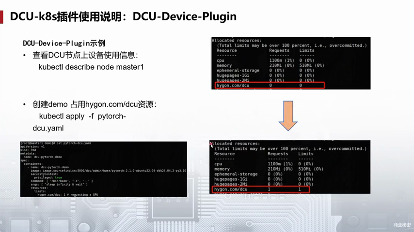

# 第49讲 海光DCU基础工具全解（下）

## 49.1、学习目标

学完本讲，你应当能够：

- 了解 RCCL（ROCm 集合通信库）在海光软件栈中的位置、六种标准集合通信算子的数据流向，以及 Ring AllReduce 与 Double Binary Tree 在带宽和延迟上的扩展权衡；
- 了解 `rccl-test` 针对不同 DCU 型号的编译架构配置、核心运行参数、`out-of-place` 与 `in-place` 双组读法，能用修正系数换算 `algbw` 与 `busbw` 并准确界定单机与多机测试范围；
- 了解 `DCU-Exporter` 的三种部署方式、`hostNetwork` 与 `16080` 端口暴露机制，能读懂 15 项核心监控指标与 12 个定位标签并用 Pod 标签反查占用异常卡的容器；
- 了解 `DCU-Device-Plugin`（`hygon.com/dcu`）与 `DCU-Device-Plugin-Share`（`hygon.com/dcu-share`）的 DaemonSet 工作机制、vDCU 静态切分约束、节点标签隔离规则及重切后的 Pod 刷新步骤；
- 实训完成“编译前置核对 → `rccl-test` 六算子逐项测试 → 逐 size 延迟与带宽判读”的闭环，交付六算子实测日志、范围标注与 `#wrong=0` 校验记录；
- 实训完成“K8s 三插件离线导入与部署 → 指标导出、资源注册、独占与共享 Pod 四项实测验收 → 偏差归档”的闭环，交付命令截图证据与《多卡集合通信及 K8s 插件验收报告》。

<!-- pagebreak -->

## 49.2、集合通信测试与 Kubernetes 海光算力插件

单卡压测工具只证明单张 DCU 卡自身算得稳、显存正常。一旦要把多张卡拼在一起做分布式训练，或者放进 Kubernetes（K8s）集群分给不同业务 Pod 使用，运维人员还要回答两个问题：多卡之间传梯度够不够快，以及集群能不能把整卡或切分后的虚拟卡准确注册、监控和分配出去。本节依次讲透集合通信测试套件 `rccl-test` 和三套 K8s 海光算力插件。

### 49.2.1、RCCL 定位、六种集合通信与 Ring / Tree 权衡

**RCCL**（ROCm Communication Collectives Library，集合通信库）在海光软件栈中位于 **HIP Runtime 与驱动之上、AI 框架（如 PyTorch、DeepSpeed）之下**。训练框架调用分布式通信接口时，底层由 RCCL 调度多卡数据交换：在同一台机器内部，数据通过 PCIe 总线或卡间高速互联通道传输；跨越机器时，通过 RDMA（远程直接内存访问，常见为 InfiniBand 或 RoCE）或 TCP 网络传输，并支持多进程并发调用（通常配合 MPI 消息传递接口实现跨节点协调）。

分布式训练和评测最常用到六种标准集合通信操作。把它们的数据流向和 `rccl-test` 对应的可执行程序记清楚，后面跑测试才不会选错工具。

表49-1、六种标准集合通信算子流向、测试程序与 `busbw` 修正系数
| 算子名称 | `rccl-test` 可执行程序 | 数据流向与动作含义 | `busbw` 修正系数（`n` 为卡数） |
|---|---|---|---|
| `broadcast` | `broadcast_perf` | 把 1 张根卡（root）上的数据原样广播给其余所有卡，完成后每张卡都持有一份相同副本 | `1` |
| `allgather` | `all_gather_perf` | 把每张卡手里各不相同的数据片段收集起来并拼接，完成后每张卡都持有全量完整数据 | `(n-1)/n` |
| `reduce` | `reduce_perf` | 把每张卡的数据按求和、取最大或取最小等运算规约，最终结果只集中到根卡上 | `1` |
| `allreduce` | `all_reduce_perf` | 先对各卡数据做规约（如梯度的求和平均），再把相同的最终结果发回给每一张卡 | `2(n-1)/n` |
| `reducescatter` | `reduce_scatter_perf` | 先对各卡数据按片段分别做规约，完成后每张卡只保留属于自己编号的那一份结果 | `(n-1)/n` |
| `alltoall` | `alltoall_perf` | 每张卡分别向其余每张卡发送互不相同的数据块（常见于混合专家模型 MoE 的令牌分发） | `(n-1)/n` |

注：此外还有 `scatter`（根卡把数据拆分后分别发给各卡）和 `gather`（各卡片段汇总到根卡），它们分别构成了上面 `reducescatter` 与 `allgather` 的拆收动作基础。

为什么 `allreduce` 的修正系数前面多了一个 `2`？答案藏在最常用的 **Ring AllReduce（环形全规约）** 算法里。假设 4 张卡连成一个单向逻辑环，每张卡需要同步的总数据量是 `K`，Ring 算法把 `allreduce` 拆成两轮接力完成：

1. **第一阶段（ReduceScatter）**：每张卡把数据切成 `n` 份，沿环向相邻下一张卡连续传 `n-1` 步，每走一步就把收到的数据与本地对应分片做一次累加。`n-1` 步结束后，每张卡手里恰好拿到了全网 1/n 片段的完整求和结果，每张卡这一轮收发的数据量都是 `(n-1)·K/n`。
2. **第二阶段（AllGather）**：各卡把手里那 1/n 份已求和的成品再沿环接力传 `n-1` 步，直到所有卡都收齐完整的 `n` 份结果。这一轮每张卡传输量同样是 `(n-1)·K/n`。

两轮相加，每张卡在一次 `allreduce` 中的总数据搬运量就是 **`2(n-1)·K/n`**。随着卡数 `n` 增大，`(n-1)/n` 无限趋近于 `1`，单卡传输量几乎保持恒定在 `2K` 左右，不会随卡数翻倍而暴涨，因此 Ring 算法具备良好的带宽扩展能力。但环形结构有一个硬伤：通信需要按跳逐个接力，`2(n-1)` 步的延迟会随卡数 `n` **线性上升**。当集群规模扩大到上百张甚至上千张卡时，小数据包通信会被延迟拖垮。为此，大规模集群通常改用 **Double Binary Tree（双二叉树）** 等树形结构，把通信跳数从线性 `O(n)` 压降到对数级 `O(log n)`。

> **【关键区别】`algbw`（算法带宽）与 `busbw`（总线带宽）不能混用**
>
> `rccl-test` 每行都会输出 `algbw` 和 `busbw` 两列带宽数值，两者衡量对象不同，决不能把 `algbw` 直接拿去和网卡或卡间互联标称带宽比大小：
> - **`algbw = size / time`**：反映的是“从应用视角看，原始数据 `size` 在 `time` 时间内算完”的算法推进效率，没有剔除多卡接力和通信次数带来的数据复用因子。
> - **`busbw = algbw × 修正系数`**：按表 49-1 中的拓扑系数换算后，消除了卡数 `n` 对计算口径的影响，反映每张卡物理通信链路的实际有效带宽。汇报结果时必须同时保留两列原始读数，评估硬件互联是否达标时一律以 **`busbw`** 为准。

### 49.2.2、`rccl-test` 编译适配、运行参数与结果判读

运行 `rccl-test` 前，节点上必须已装妥 DCU 驱动、DTK 开发套件与 MPI 环境。实际运维中建议在与宿主机 DTK 版本对应的容器内编译和运行 `rccl-test`：物理机多版本升级时 `/opt/dtk` 软链接容易指偏，容器内部工具链更加干净。进入容器测试时，**务必加上 `-v /opt/hyhal:/opt/hyhal` 挂载宿主机硬件抽象层目录**，漏挂这个目录会导致测试程序静默识别不到任何 DCU（报错显示 0 卡）。

不同代际的海光 DCU 芯片指令集代号（`GPU_TARGETS`）和源码分支要求不同，编译前先用 `hy-smi` 或 `lspci` 核对机器上的加速卡型号，再按表 49-2 选对架构与编译方式：

表49-2、海光 DCU 型号与 `rccl-test` 编译适配对照表
| DCU 型号 | 架构代号（`GPU_TARGETS`） | 适配代码基线示例（以现场仓库为准） | 编译入口与关键选项 |
|---|---|---|---|
| `K100-AI` | `gfx928` | `5e838ad` | `make`（传 `ROCM_HOME=/opt/dtk`、`NCCL_HOME=/opt/dtk/rccl`、`CUSTOM_RCCL_LIB=/opt/dtk/rccl/lib/librccl.so`、`MPI=1`、`MPI_HOME=/opt/mpi/`） |
| `BW150` / `BW1000` | `gfx936` | `5e838ad` | `make`（选项同上，并指定 `GPU_TARGETS=gfx936`） |
| `BW1100` | `gfx938` | `66e513c` | 使用仓库根目录 `install.sh` 脚本按现场 DTK 手册引导编译 |

编译完成后，源码根目录会生成 `build/` 文件夹，里面包含全部编译好的可执行性能测试程序。图 49-1 展示了编译后 `build/` 目录中的二进制程序清单与单机 4 卡 `all_reduce_perf` 的基础测试命令。


执行单机测试时，常用的命令行参数与设定建议如下表所示：

表49-3、`rccl-test` 常用运行参数与设定说明
| 参数 | 含义 | 常用设定示例 | 运维注意要点 |
|---|---|---|---|
| `-b` | 起始最小数据块大小（bytes） | `8` 或 `2` | 从极小包扫起才能测出小包通信固有延迟 |
| `-e` | 最大数据块大小（bytes） | `128M`、`2G`、`8G` | 必须扫到足够大的数据块，才能压出稳态带宽平台 |
| `-f` | 数据块大小每次增长倍数 | `2` | 按 2 的幂次翻倍扫描，兼顾覆盖面与耗时 |
| `-g` | 每个进程使用的 DCU 卡数 | 单机填 `2`/`4`/`8`；多机通常填 `1` | 单机单进程管多卡；多机由 `mpirun` 按每卡一进程拉起 |
| `-n` | 正式采样迭代次数 | `20` | 次数太少易受单次抖动干扰 |
| `-w` | 正式采样前的预热次数 | `5` | 剔除首次建链和冷启动耗时 |
| `-c` | 每次迭代的数据正确性校验次数 | `1` | 开启后会自动对比输出数据是否算对 |
| `-o` | 规约类算子的运算方式 | `sum` | 支持 `sum`、`prod`、`min`、`max` 等 |
| `-d` | 测试元素数据类型 | `float` | 与训练常用的 `fp16`/`bf16`/`float` 对齐核对 |
| `-O` | 缓冲区模式筛选 | 默认空（两组全跑） | 默认同时跑 `out-of-place` 与 `in-place`，可按需单选 |
| `-Z` | 结构化结果导出格式 | `csv` 或 `json` | 便于留档归并成测试报告表格 |

跑测试前还要检查两处环境变量陷阱，否则测出来的数字不可信：
1. **用 `HIP_VISIBLE_DEVICES` 显式锁定参测卡号**：不要只传 `-g 4` 让程序自行选卡。明确写成 `HIP_VISIBLE_DEVICES=0,1,2,3 ./build/all_reduce_perf ...`，才能保证测试确实覆盖了指定的物理槽位卡序（如覆盖 2 卡、4 卡或 8 卡全序列），避免跳过疑似异常卡却不知情。
2. **排查并清理预置通道变量 `NCCL_NCHANNELS_PER_PEER`**：部分预装镜像会在环境里预先写死 `NCCL_NCHANNELS_PER_PEER`，强行限制每对卡之间的通信通道数。运行前先执行 `env` 过滤 `NCCL_` 确认环境干净，若发现预置变量，应按测试手册先 `unset NCCL_NCHANNELS_PER_PEER` 再跑基准，并在报告中记录环境状态。

测试启动后，终端会打印设备枚举信息与逐行扫描表格（图 49-2）。判读输出结果时重点盯住表 49-4 中的六个字段与双组对比规则。


表49-4、`rccl-test` 结果输出字段与工程判读标准
| 输出字段 | 字段含义 | 工程判读重点与通过条件 |
|---|---|---|
| `size` (B) | 本行测试传输的单个消息总字节数 | 横向对比的基准轴；必须从小数到大数逐行看趋势，不能跳看 |
| `out-of-place` / `in-place` | 源缓冲区与目标缓冲区分开 vs 原地覆盖 | 默认两组都会跑完输出，两边均需合格；若两组差异悬殊需排查显存与驱动调度 |
| `time` (us) | 单次通信平均耗时（微秒） | 重点看 **8 B ～ 4 KB 小尺寸区间**，反映小包通信起始延迟与软件开销 |
| `algbw` (GB/s) | 算法带宽（`size ÷ time`） | 体现算子自身推进速度，随卡数变化而变化 |
| `busbw` (GB/s) | 修正后的总线带宽 | 重点看 **32 MB ～ 128 MB 以上大尺寸区间**，应当稳定爬升至平台区并与本机型参考基线比对 |
| `#wrong` 与 `Out of bounds` | 校验错误计数与越界值个数 | **全表 `#wrong` 必须全部为 `0`**，文末 `Out of bounds values` 必须显示 `0 OK` |

> **【例题 1】从 `all_reduce_perf` 实测行反算 `busbw` 并判断为什么不能只看平均值**
>
> **已知条件**：在一台 4 卡 `K100-AI` 节点上执行 `HIP_VISIBLE_DEVICES=0,1,2,3 ./build/all_reduce_perf -b 8 -e 128M -f 2 -g 4`，终端 `out-of-place` 组打印出如下两行及汇总行（以图 49-2 所示数值为例）：
> - 当 `size = 8` B 时，`time = 74.66` us、`algbw = 0.00` GB/s、`busbw = 0.00` GB/s、`#wrong = 0`；
> - 当 `size = 134217728` B（128 MB）时，`time = 7850.5` us、`algbw = 17.10` GB/s、`busbw = 25.65` GB/s、`#wrong = 0`；
> - 终端末行汇总显示：`Avg bus bandwidth : 7.23837` GB/s。
>
> **分析与推导**：
> 1. **核验修正公式**：`n = 4` 卡的 `allreduce` 修正系数为 `2(4-1)/4 = 1.5`。大包行 `algbw = 17.10 GB/s`，乘以 `1.5` 得 `busbw = 17.10 × 1.5 = 25.65 GB/s`，与表格数值完全吻合。
> 2. **为什么小包 `busbw` 接近 0 是正常的**：8 B 极小消息每次只传几字节，74.66 微秒几乎全部耗在核函数启动与协议握手上，此时看的是 **延迟（74.66 us）**，不能用 0 GB/s 误判硬件故障。
> 3. **为什么不能只汇报 `7.24 GB/s` 均值**：`Avg bus bandwidth` 把从 8 B 到 128 MB 共 25 个档位简单平均，被前面十几行小包的低带宽拉低了超过三分之二，既掩盖了大包实际能跑到 25.65 GB/s 的有效互联带宽，也看不出小包延迟是否异常。提交验收报告时必须保留逐 `size` 明细（或 `-Z csv` 导出表），分开给出小包延迟与大包稳态 `busbw`。

如果要进一步验证**跨机器多节点集合通信**（前提是机房节点之间已接通 RDMA 高速网络并配好驱动），还需提前完成三项集群准备：
1. 配置所有参测节点之间的 **SSH 免密互信**（`ssh-keygen` 与 `ssh-copy-id`），保证 MPI 主控能免口令拉起远端进程；
2. 挂载一套 **共享目录**（如 NFS 挂载 `/home/mpi_share`），让所有节点读取完全一致的 `rccl-test` 编译程序与 `hostfile`（格式示例：`10.0.0.1 slots=4`）；
3. 通过 `mpirun` 启动跨机测试（如 4 机各 4 卡共 16 进程时，每进程传 `-g 1`），并按需附加透传环境变量（例如 `-x HSA_FORCE_FINE_GRAIN_PCIE=1`）：

```bash
mpirun --allow-run-as-root --np 16 --hostfile hostfile \
  -x HSA_FORCE_FINE_GRAIN_PCIE=1 \
  ./build/all_gather_perf -b 1M -e 1G -f 2 -g 1
```

如果实训或交付机房尚未配备 RDMA 跨机高速网络，就在**单机多卡**上完整跑通六种算子（按节点实际卡数覆盖 2 卡、4 卡或 8 卡），并在测试报告的“测试范围”一栏明确标注为**“单机卡间集合通信测试（未含 RDMA 跨机链路）”**，不混写跨节点结论。

> **【随堂思考 1】**
>
> 某同学在容器内准备跑 `rccl-test` 验证 8 卡 `allreduce`，刚敲完 `./build/all_reduce_perf -b 8 -e 128M -f 2 -g 8`，发现程序没有报错退出或直接提示可用设备数为 `0`，而宿主机上运行 `hy-smi` 明明能看到 8 张卡正常在线。最先排查容器启动参数与环境变量里的哪两处？

### 49.2.3、`DCU-Exporter` 部署与监控指标体系

在 Kubernetes 集群中，Prometheus（云原生标准指标监控系统）会主动去各个目标的 HTTP `/metrics` 接口拉取数值。K8s 控制面和节点原生自带部分监控接口，但海光 DCU 卡的温度、功耗、显存与错误计数需要由专门的采集代理读取驱动后按 Prometheus 规范暴露出来，这个组件就是 **`DCU-Exporter`**。

`DCU-Exporter` 支持二进制、Docker 容器与 Kubernetes DaemonSet 三种部署方式（默认监听 **`16080`** 端口），三者的前提和关键配置如下表所示：

表49-5、`DCU-Exporter` 三种部署方式对比与关键参数
| 部署方式 | 前置条件 | 核心启动命令或 YAML 关键配置 | 适用场景与注意要点 |
|---|---|---|---|
| **1. 二进制部署** | 宿主机已装 DCU 驱动、DTK 并激活环境变量 | `./dcu-exporter-v2 -port=16080` | 适合单机调试或未装容器运行时节点；通过 `-port` 修改监听端口 |
| **2. Docker 容器部署** | 宿主机已装 DCU 驱动与 Docker；从仓库导入 `dcu-exporter-v2.0.1.tar` | `docker run --name dcu-exporter-v2 -d --privileged` 并挂载 `/dev/kfd`、`/dev/mkfd`、`/dev/dri`、`/opt/hyhal`、`/etc/hostname`，设 `LD_LIBRARY_PATH` 与 `-p 16080:16080` | 适合固定测试机快速拉起；**漏挂 `/etc/hostname` 会导致监控标签 `node` 显示随机容器 ID** |
| **3. K8s DaemonSet 部署** | K8s ≥ 1.18、节点已装驱动与 DTK、集群允许 `privileged: true` | `kind: DaemonSet`、`namespace: kube-system`、`hostNetwork: true`、`serviceAccount: pod-reader`、`securityContext.privileged: true`、`env: DCU_EXPORTER_LISTEN`、`containerPort/hostPort: 16080` | 生产集群标准做法：每台 DCU 节点自动运行 1 个采集副本；**改端口必须同步修改环境变量、容器端口和 Service 端口** |

注意 DaemonSet 里的 **`hostNetwork: true`**：开启后采集容器直接复用宿主机网络栈，在每台 DCU 节点本地执行 `curl localhost:16080/metrics` 就能直接看到纯文本格式的指标输出。若不开启 `hostNetwork` 或仅映射随机节点端口，Prometheus 按节点 IP 拉取 `16080` 就会连接被拒。同时 `serviceAccount: pod-reader` 赋予 Exporter 查询 K8s Pod 元数据的只读权限，它才能把物理卡的利用率、显存与正在占用这张卡的 `Pod` 名称准确绑定到一起。

部署成功后，通过 `curl localhost:16080/metrics` 可以读到完整的指标与标签。表 49-6 和表 49-7 列出了日常运维巡检与告警对接最核心的 **15 项指标** 与 **12 个定位标签**：

表49-6、`DCU-Exporter` 核心导出指标（Metrics）完整清单
| 指标名称（Metrics） | 物理含义 | 运维关注重点 |
|---|---|---|
| `dcu_temp` | DCU 核心温度 | 与机房散热、风扇转速及第 48 讲压测阈值对照 |
| `dcu_power_usage` | DCU 当前实时功耗 | 判断计算负载是否真实吃满功率或触发功耗墙 |
| `dcu_powercap` | DCU 当前功耗上限阈值 | 核对节点是否被人为或策略调低过功耗封顶 |
| `dcu_sclk` | DCU 核心运行频率（Sclk） | 若温度高同时 `dcu_sclk` 持续跌落，指向过温降频 |
| `dcu_utilizationrate` | DCU 计算核心利用率 | 结合功耗和显存判断卡是满算还是在等 I/O 通信 |
| `dcu_usedmemory_bytes` | DCU 已使用显存（字节） | 监控显存泄漏或模型推理/训练显存水位 |
| `dcu_memorycap_bytes` | DCU 物理总显存容量（字节） | 核算集群总可用显存与节点规格对账 |
| `dcu_memory_remaining` | 可用于继续切分 vDCU 的剩余显存 | 在共享节点上评估单卡还能切出多大虚拟实例 |
| `dcu_compute_unit_count` | DCU 总计算单元（CU）数量 | 核对物理卡计算单元规格 |
| `dcu_compute_unit_remaining_count` | 可用于继续切分 vDCU 的剩余计算单元数 | 共享切分规划时核对剩余可切分算力额度 |
| `dcu_pciebw_mb` | PCIe 显存传输带宽（MB） | 观测主机与 DCU 间数据搬运吞吐与 PCIe 降速迹象 |
| `dcu_ce_count` | 可纠正硬件错误（CE）累计次数 | 少量偶发可继续观察趋势；短期激增需安排巡检 |
| `dcu_ue_count` | 不可纠正硬件错误（UE）累计次数 | **关键硬故障信号**：一旦非零且增长，须留档报修排查硬件 |
| `vdcu_utilizationrate` | 已切分虚拟卡（vDCU）利用率 | 评估共享切分实例的算力饱和度 |
| `vdcu_usedmemory_bytes` | 已切分虚拟卡（vDCU）已用显存（字节） | 核对单个 vDCU 容器是否逼近配额显存上限 |

表49-7、`DCU-Exporter` 指标标签（Labels）完整清单
| 标签名（Label） | 含义 | 排障追踪作用 |
|---|---|---|
| `node` | 宿主机节点名称 | 锁定告警发生在哪台服务器 |
| `minor_number` | 物理 DCU 设备编号（如 `0`、`1`） | 锁定节点上具体是哪张卡（对应 `/dev/dri` 序号） |
| `device_id` | 硬件设备序列识别码 | 与带外 HDM 及资产台账 SN 逐卡核对 |
| `pcieBus_number` | PCIe 总线槽位号（如 `0000:09:00.0`） | 换件拆机时定位到物理主板/Riser 槽位 |
| `name` | 加速卡型号名称（如 `K100 AI`） | 区分集群异构节点上的卡型 |
| `container` | 占用这张卡的容器名称 | 同一 Pod 含多个容器时定位具体容器 |
| `dcu_pod_name` | 占用这张卡的 K8s Pod 名称 | **最常用反查字段**：直接找到卡死或打满显存的业务 Pod |
| `dcu_pod_namespace` | 占用这张卡的 Pod 所属命名空间 | 快速区分是哪个业务线或租户的任务 |
| `block_type` | 触发 CE/UE 错误的芯片模块类型 | 区分是显存控制器、计算核心还是总线模块出错 |
| `vdcu_minor_number` | 虚拟加速卡（vDCU）编号 | 共享节点上精确定位到哪一份虚拟切片 |
| `vdcu_computer_unit` | 这张 vDCU 分配到的计算单元数 | 核验虚拟卡配额是否与划分计划一致 |
| `vdcu_memory_cap` | 这张 vDCU 分配到的显存容量上限 | 核验虚拟卡显存上限配置 |

> **【随堂思考 2】**
>
> 凌晨监控大盘告警：某台海光节点的 `dcu_ue_count` 从 `0` 跳变到了 `3`，同时同一张卡的 `dcu_usedmemory_bytes` 接近满载。值班运维只看 `dcu_ue_count` 一个数字不知道影响谁、也不知道找哪张物理卡。请从表 49-7 中挑出最关键的四个标签，分别说明它们帮你查清“哪台机哪块物理槽位、受影响的是哪个业务任务”；遇到 `dcu_ue_count` 增长时，能否靠重启业务 Pod 解决？

### 49.2.4、`DCU-Device-Plugin` 资源注册与独占申请

在默认情况下，Kubernetes 调度器只认识 CPU 和内存，并不知道节点上插了几张海光 DCU 卡。**`DCU-Device-Plugin`** 利用 K8s 的设备插件机制，在每个 DCU 节点上以 `DaemonSet` 方式常驻运行：它启动后自动扫描本地可用的 DCU 设备，通过节点 `kubelet` 向集群 API 注册名为 **`hygon.com/dcu`** 的扩展资源；当业务提交申请 `hygon.com/dcu: 1` 的 Pod 时，调度器根据各节点可分配余量选定节点，再由目标节点的 `kubelet` 与设备插件配合把指定物理卡映射进 Pod 容器。

离线部署与验证遵循四步流程：确认前置条件（节点已装 DCU 驱动、K8s ≥ 1.18、开启特权容器支持）→ 在节点导入镜像包（如 `docker load -i k8s-dcu-plugin.v2.0.0.tar`）→ 下发清单 `kubectl apply -f k8s-dcu-plugin.yaml` → 验证插件 Pod 运行状态与节点资源注册。表 49-8 汇总了部署清单与测试 Pod 的核心控制字段：

表49-8、`DCU-Device-Plugin` DaemonSet 与申请测试 Pod 关键字段
| 对象类型 | 关键 YAML 字段路径 | 典型取值示例 | 作用与常见配置错误 |
|---|---|---|---|
| **插件 DaemonSet** | `kind` | `DaemonSet` | 保证每台符合条件的节点自动运行 1 个插件 Pod |
| **插件 DaemonSet** | `metadata.namespace` | `kube-system` | 放在系统命名空间统一受控管理 |
| **插件 DaemonSet** | `spec.template.spec.containers[0].image` | `image.sourcefind.cn:5000/dcu/admin/base/dcu-device-plugin:v2.0.0` | 必须与本地导入或教室仓库镜像标签完全一致 |
| **插件 DaemonSet** | `spec.template.spec.containers[0].securityContext.privileged` | `true` | 必须开启特权，否则插件无法访问宿主机设备驱动接口 |
| **测试 Pod** | `spec.containers[0].resources.limits`（生产同步写 `requests`） | `hygon.com/dcu: 1` | **必须写正整数**（不能写 `0.5`）。按扩展资源规范，生产清单建议同时写相等的 `requests` 与 `limits`；只写 `limits` 时 K8s 会自动将 `requests` 补齐为同值 |

下发完成后，先用 `kubectl get pod -n kube-system -o wide` 确认所有 DCU 节点上的 `dcu-device-plugin-*` 均为 `Running`。接着按下面清单拉起测试 Pod 并开展独占调度验收（实际镜像 Tag 与仓库地址以现场为准）：

```yaml
apiVersion: v1
kind: Pod
metadata:
  name: dcu-pytorch-demo
spec:
  containers:
  - name: dcu-pytorch-demo
    image: image.sourcefind.cn:5000/dcu/admin/base/pytorch:2.1.0-ubuntu22.04-dtk24.04.2-py3.10
    securityContext:
      privileged: true
    command: ["/bin/bash", "-c", "--"]
    args: ["sleep infinity & wait"]
    resources:
      limits:
        hygon.com/dcu: 1
```

部署测试 Pod 前，先执行 `kubectl describe node <节点名>` 查看 `Allocated resources` 中 `hygon.com/dcu` 占用为 `0`（且节点 `Allocatable` 中的 `hygon.com/dcu` 数量与物理卡数相等）；执行 `kubectl apply -f pytorch-dcu.yaml` 拉起 Pod 后，再次执行 `kubectl describe node <节点名>`，观察 `hygon.com/dcu` 占用从 **`0` 升为 `1`**，且测试 Pod 进入 `Running`（图 49-3）。



> **【关键区别】测试 Pod 显示 `Running` 不等于加速卡已经交付成功**
>
> 仅凭 `kubectl get pod` 看到测试 Pod 状态是 `Running` 就签字验收，容易漏掉驱动库未挂入或跨卡越界的问题。完整独占验收必须同时看齐三项证据：
> 1. **节点账面扣减正确**：`kubectl describe node` 中 `hygon.com/dcu` 已用计数精确增加（如 `0 → 1`），且剩余余量不能低于物理卡数减已占数；
> 2. **容器内部精准隔离**：使用 `kubectl exec -it <Pod名> -- bash` 进容器运行 `hy-smi`，容器内看到的卡数**必须正好等于申请数（`1` 张）**——既不能是 0 张，也不能把宿主机全部卡都透传进来；
> 3. **算力计算通道可用**：测试环境需保证若容器内未设驱动环境变量，可加载镜像内置环境脚本后运行简单张量运算无报错。

### 49.2.5、`DCU-Device-Plugin-Share`（vDCU 共享）与节点隔离

当多个轻量推理或教学实验任务只需要 10 GB 或 20 GB 显存时，直接用 `hygon.com/dcu: 1` 分走整张 32 GB 或 64 GB 物理卡会造成一半以上的显存闲置。**`DCU-Device-Plugin-Share`** 插件让 Kubernetes 能够直接纳管通过 `hy-smi virtual` 静态切分出来的虚拟加速卡（**vDCU**），对应的集群资源名变为 **`hygon.com/dcu-share`**。

本讲继承第 45 讲已确立的 vDCU 六条基础约束，并在集群插件落地时额外落实 **节点标签筛选、切后刷新、独占与共享分节点隔离** 三项工程规则（表 49-9）：

表49-9、vDCU 静态切分约束与 K8s 共享插件运维规则
| 规则类别 | 核心规则内容 | 集群运维落地动作与违例后果 |
|---|---|---|
| **约束 1：单卡份数** | 单张物理 DCU 最多切分出 **4 个** vDCU | 规划集群共享池总容量时按单卡 ≤ 4 份封顶 |
| **约束 2：静态配置** | 仅支持静态预划分，不支持运行时动态改配额 | 节点切好 vDCU 后再接入集群；调整前须停掉这张卡上运行的业务 Pod |
| **约束 3：总和不超卖** | 同卡所有 vDCU 的计算单元与显存之和不能超过物理卡标称值 | 切卡前跑 `hy-smi` 核准实际总量后再算分配数值 |
| **约束 4：单容器限 1 张** | 每个容器只能使用 **1 张** vDCU；YAML 申请超过 1 张时容器内仍只认第 1 张 | 多卡协同训练任务**禁止调度到共享节点**，必须使用独占 `hygon.com/dcu` 节点 |
| **约束 5：命令唯一入口** | 只能用 `hy-smi virtual` 创建和销毁 vDCU | 严禁直接手工编辑底层 vdev 配置文件，否则会导致驱动异常与运行进程崩溃 |
| **约束 6：无卡间通信** | 暂不支持 vDCU 之间的卡间高速通信 | 同机多卡集合通信测试（`rccl-test`）与多卡并行任务严禁跑在 vDCU 共享模式下 |
| **规则 A：标签筛选调度** | Share 插件 DaemonSet 通过 **`nodeSelector: dcu-mode: share`** 匹配节点 | 忘记给目标共享节点执行 `kubectl label node <节点名> dcu-mode=share`，会导致 Share 插件 Pod 根本不会调度上去 |
| **规则 B：重切必须重启 Pod** | 节点用 `hy-smi virtual` 重新划过 vDCU 后，**必须删除/重启对应节点上的 `dcu-device-plugin-share-*` Pod** | 不重启插件 Pod，K8s 看到的 `hygon.com/dcu-share` 可分配数仍是旧切片数 |
| **规则 C：独占与共享分节点** | 集群有 **≥ 2 个 DCU 节点**时，把 `dcu-device-plugin`（独占）与 `dcu-device-plugin-share`（共享）部署在不同节点上 | 两类插件同机混跑在容器负载下容易发生设备占用冲突；单节点环境如作同机演示，须逐项切换观察或避开并发压力 |

接入共享节点的标准顺序为 **“先切卡、再打标签、后起插件”**：先在目标共享节点宿主机执行 `hy-smi virtual` 切出虚拟卡并用 `-show-vdevice-info` 核实字节数；随后给节点打上 `dcu-mode=share` 标签，导入镜像 `k8s-dcu-plugin-share.v2.0.0.tar` 并执行 `kubectl apply -f k8s-dcu-plugin-share.yaml`；最后提交声明 `hygon.com/dcu-share: 1` 的共享测试 Pod 验证（图 49-4）。常用切分与清理命令如下：

```bash
# 在 0 号物理卡划出 2 个 vDCU（计算单元 20/40，显存 130/190 MiB 示例）
hy-smi virtual -d 0 -create-vdevices 2 -vdevice-compute-units 20,40 -vdevice-memory-size 130,190

# 查看当前节点的 vDCU 切分详情
hy-smi virtual -show-vdevice-info

# 清理回收 0 号物理卡的 vDCU 切分（须先确认无业务 Pod 使用）
hy-smi virtual -d 0 -destroy-vdevice
```

注：早期部分社区版本曾采用 `HAMi` 方案（使用 `hy-virtual` 命令以及 `dcunum`、`dcumem`、`dcucores` 资源名）；本课程实训与集群部署统一采用社区主线的 `dcu-device-plugin-share`（资源名 `hygon.com/dcu-share`）。


> **【例题 2】部署完 `dcu-device-plugin-share` 后，共享测试 Pod 一直卡在 `Pending` 或重划 vDCU 后资源数没更新，按哪三步定位？**
>
> **场景现象**：某运维组在 2 节点 K8s 集群（`master1` 管独占卡，`worker1` 计划作共享卡）上执行完 `kubectl apply -f k8s-dcu-plugin-share.yaml` 后，提交了一个申请 `hygon.com/dcu-share: 1` 的测试 Pod，发现 Pod 始终处于 `Pending`；后来给 `worker1` 补划了第 3 份 vDCU，但 `describe node worker1` 显示可用共享数依然只有 `2`。
>
> **排查步骤与结论**：
> 1. **先看 `kubectl describe pod` 底部 `Events`**：若事件报 `0/2 nodes are available: 2 Insufficient hygon.com/dcu-share`，说明集群没有任何节点成功汇报了这项资源。
> 2. **核对节点标签与 DaemonSet Pod 状态**：执行 `kubectl get pod -n kube-system -o wide` 查找 `worker1` 上有没有 `dcu-device-plugin-share-*` Pod。如果根本没有起 Pod，执行 `kubectl get nodes --show-labels`，九成原因在于 `worker1` 漏打了 `dcu-mode=share` 标签，被 DaemonSet 的 `nodeSelector` 挡在外面；补打标签 `kubectl label node worker1 dcu-mode=share` 后插件 Pod 会自动拉起。
> 3. **排查宿主机切片与插件刷新**：登录 `worker1` 运行 `hy-smi virtual -show-vdevice-info` 确认宿主机已有 3 个 vDCU 后，说明是重划前插件已启动、缓存了旧设备表。执行 `kubectl delete pod -n kube-system <worker1上的share-pod名>`，待 DaemonSet 重建新 Pod 并重新向 `kubelet` 注册后，再次 `kubectl describe node worker1` 即可看到 `hygon.com/dcu-share` 更新为 `3`。

> **【随堂思考 3】**
>
> 某算法组为了把多卡训练塞进共享节点，在提交的 Pod YAML 里同时写了 `hygon.com/dcu-share: 2`，希望让一个容器同时使用 2 个 vDCU 并做卡间梯度同步。这个 Pod 跑起来后会遇到哪两个直接限制？应该改用哪类集群资源？

### 49.2.6、多卡通信与插件五项综合验收判据

完成测试与插件上线后，需要按统一标准逐项把关，任何一项缺口都应记入偏差说明，有书面基线按基线对照，无书面硬件基线时如实标注“无法判断”，不能主观代填“合格”。

表49-10、多卡集合通信与 Kubernetes 插件五项综合验收判据
| 验收项目 | 验证方式或核心命令 | 通过判据 | 实操边界与异常处理 |
|---|---|---|---|
| **1. 集合通信效率** | 逐项执行 6 算子测试，保留逐 `size` 明细或 CSV 日志 | 全表 `#wrong=0`、`Out of bounds values: 0 OK`；大尺寸 `busbw` 稳定达到平台且接近现场卡型基线 | 未配 RDMA 时标清“单机卡间测试”；无书面标称基线时标“无法判断” |
| **2. 指标导出** | 节点本地 `curl localhost:16080/metrics` | 正常返回 Prometheus 文本格式，含 `dcu_temp` 等核心指标及 `node`/`dcu_pod_name` 等标签 | 连接被拒先查 `hostNetwork: true`、DaemonSet 状态及端口一致性 |
| **3. 资源注册** | `kubectl describe node <节点名>` | `Capacity` 与 `Allocatable` 出现 `hygon.com/dcu`，且可分配数精确等于节点物理 DCU 卡数 | 若为 0 或缺这一行，检查 `dcu-device-plugin` Pod 日志、特权配置与驱动状态 |
| **4. 独占申请** | `apply` 独占测试 Pod 并进容器查卡 | 节点 `Allocated resources` 中 `hygon.com/dcu` 占用 `0→1`，Pod `Running`，容器内 `hy-smi` 只见 1 张卡 | 停留 `Pending` 先查节点余量与标签；容器内见全部卡说明未走插件透传 |
| **5. 共享模式** | 切卡并打标签后 `apply` 共享测试 Pod | 节点可见 `hygon.com/dcu-share`（数等于切分 vDCU 总份数），测试 Pod 申请成功 `0→1` 且容器内可见对应 vDCU | 切分未生效重启节点 `share` Pod；独占与共享插件按节点标签拆开 |

### 49.2.7、本讲涉及的术语

表49-11、本讲涉及的术语
| 术语名称 | 解释 | 在本讲中的作用 |
|---|---|---|
| **RCCL** | ROCm 集合通信库，位于运行时之上、AI 框架之下 | 承载单机多卡和跨节点多卡分布式训练的梯度与张量通信 |
| **Ring 与 Double Binary Tree** | 集合通信的环形接力算法与双二叉树算法 | Ring 带宽扩展好但延迟线性涨；双二叉树把大规模延迟压到对数级 |
| **`algbw` 与 `busbw`** | 算法带宽（原始数据除以时间）与总线带宽（乘拓扑修正系数） | 汇报并存两值，与硬件互联峰值比对一律以 `busbw` 为准 |
| **Out-of-place / In-place** | 源与目标缓冲区独立 vs 原地覆盖的两种通信测试模式 | `rccl-test` 默认同时运行两组，验收时两组都必须 `#wrong=0` |
| **`GPU_TARGETS`** | 编译内核代码时指定的 DCU 硬件指令集代号（如 `gfx928`、`gfx936`） | 决定编译出来的 `rccl-test` 二进制能否在现场卡型上运行 |
| **`DCU-Exporter`** | 采集 DCU 硬件与 Pod 映射指标并按 Prometheus 规范暴露的组件 | 通过 `16080` 端口 `/metrics` 提供温度、显存、UE 错误及 Pod 反查标签 |
| **`hostNetwork`** | Kubernetes Pod 直接共享宿主机网络命名空间的配置项 | 让 `DCU-Exporter` 直接绑定宿主机 `16080` 端口并正确识别节点主机名 |
| **`DaemonSet`** | Kubernetes 控制器，确保每个符合条件的节点运行 1 个固定副本 | 三大海光集群组件在各 DCU 节点自动部署与自愈的基础方式 |
| **`DCU-Device-Plugin`** | K8s 设备插件，把物理 DCU 注册为可调度资源 `hygon.com/dcu` | 实现业务 Pod 按正整数颗数独占申请整张物理加速卡 |
| **vDCU 与 `hygon.com/dcu-share`** | `hy-smi virtual` 静态划分的虚拟加速卡及对应 K8s 共享资源名 | 供多路小显存任务合用单张物理卡，须遵循单卡最多 4 份等六项约束 |
| **RDMA（IB / RoCE）** | 远程直接内存访问，网卡绕过 CPU 内核直接读写显存/内存 | 决定 `rccl-test` 能否开展跨机器多节点集合通信测试的硬件前提 |

<!-- pagebreak -->

## 49.3、具体实训内容

本讲实训分为四个连续任务，建议每组 2～3 人协作完成（操作主手、记录取证、复核把关），全程按本机或教室实际 DCU 卡数（≥ 2 卡）和网络条件如实执行并留存命令截图。

### 49.3.1、任务一：执行 `rccl-test` 六种标准集合通信测试

**实训目标**：在匹配 DTK 的容器或测试环境中完成 `rccl-test` 编译确认，对 `broadcast`、`allgather`、`reduce`、`allreduce`、`reducescatter`、`alltoall` 六种算子逐项测试，记录逐 `size` 延迟与带宽并标注测试范围。

表49-12、任务一 `rccl-test` 六算子集合通信测试步骤与检查点
| 步 | 动作与要领 | 常见错误 | 检查点 |
|---|---|---|---|
| 1 | **核查环境与清理干扰变量**：宿主机运行 `hy-smi` 确认所有 DCU 在位空闲；进入与 DTK 匹配的测试容器时确认已挂载 `-v /opt/hyhal:/opt/hyhal`；执行 `env` 过滤 `NCCL_` 并清理预设的 `NCCL_NCHANNELS_PER_PEER`。 | 漏挂 `/opt/hyhal` 导致容器内静默识别 `0` 张卡；遗留通道变量限制了测试吞吐。 | 容器内可执行 `hy-smi` 见全卡，预设干扰通道变量已清空。 |
| 2 | **核对卡型与编译二进制**：根据 `hy-smi` 查到的卡型确定 `GPU_TARGETS`（如 `K100-AI` 用 `gfx928`、`BW1000` 用 `gfx936`）并检查或编译 `build/` 目录下的六类测试程序。 | 选错架构代号导致编译中断或运行报设备不支持；物理机直接编时 `/opt/dtk` 软链指向旧版。 | `build/` 下齐备 `all_reduce_perf`、`alltoall_perf`、`broadcast_perf`、`reduce_perf`、`reduce_scatter_perf`、`all_gather_perf`。 |
| 3 | **固定卡序测试 2 / 4 / 8 卡 `allreduce`**：用 `HIP_VISIBLE_DEVICES=0,1`（节点卡数允许时再扩 `0,1,2,3` 和 8 卡）锁定卡序，运行 `./build/all_reduce_perf -b 8 -e 128M -f 2 -g <卡数> -n 20 -w 5 -c 1`，加 `-Z csv` 导出结构化记录（多机有 RDMA 时再按需执行 `mpirun`）。 | 不写 `HIP_VISIBLE_DEVICES` 仅靠 `-g` 参数导致跳卡；只有 4 张卡的节点强行传 `-g 8` 报错。 | 各卡数档位 `all_reduce_perf` 完整跑完，输出无中断报错。 |
| 4 | **补齐其余五种标准算子**：按现场指定卡数逐一运行 `alltoall_perf`、`broadcast_perf`、`all_gather_perf`、`reduce_perf`、`reduce_scatter_perf`（如 `alltoall_perf` 建议优先覆盖节点满卡数），同样保留逐 `size` 日志。 | 只跑了 `all_reduce_perf` 就当做全部六算子已完成。 | 六种算子实测日志与导出文件均一一齐备，文件名含算子名与卡数。 |
| 5 | **核验错误计数与界定测试范围**：逐份检查六算子 `out-of-place` 与 `in-place` 两组输出，确认每行 `#wrong` 与末尾 `Out of bounds values` 均为 `0`；单独摘出小包延迟（如 8 B `time`）与大包稳态 `busbw`；未配 RDMA 时明确写“单机卡间范围”。 | 只抄底部 `Avg bus bandwidth` 均值；隐去 `#wrong` 检查结果或未标注无 RDMA 单机范围。 | 六算子 `#wrong=0`、测试范围标注清晰，原始输出文本保存完整。 |

红线：容器内未挂载 `/opt/hyhal` 导致卡数异常或 `#wrong` 不为 `0` 时不得采信测试数据；严禁把单机卡间测试结果写成多机跨节点性能结论，也禁止在测试开始前绕过正在运行其他同学任务的卡（先查进程占用再开测）。

### 49.3.2、任务二：部署 Kubernetes 海光三插件

**实训目标**：核对 Kubernetes 节点驱动、版本与标签前置条件，从教室或本地离线包导入镜像并依次部署 `DCU-Exporter`、`DCU-Device-Plugin` 与 `DCU-Device-Plugin-Share`，保证三类系统 Pod 在对应节点进入 `Running`。

表49-13、任务二 Kubernetes 三插件部署步骤与检查点
| 步 | 动作与要领 | 常见错误 | 检查点 |
|---|---|---|---|
| 1 | **核查 K8s 节点前置条件**：用 `kubectl version` 与 `kubectl get nodes -o wide` 确认 K8s ≥ 1.18 且节点 `Ready`；确认节点已安装驱动与 DTK；按节点规划区分独占节点与共享节点。 | 节点本身处于 `NotReady` 或未装驱动就直接下发插件 YAML。 | 节点 `Ready`，宿主机 `hy-smi` 正常，明确哪台跑独占、哪台跑共享（单节点演示按次序切换）。 |
| 2 | **导入离线镜像包并核对 YAML**：从教室指定仓库目录获取三插件镜像 tar 包与 YAML，在对应工作节点执行 `docker load -i <镜像包>`（或对照容器运行时导入命令），核对 YAML 里的镜像地址与仓库一致。 | 直接去外网拉取导致断网超时，或漏导入 `share` 镜像包造成部署 `ImagePullBackOff`。 | 节点镜像列表中可见 `dcu-exporter`、`dcu-device-plugin` 与 `dcu-device-plugin-share` 目标版本。 |
| 3 | **部署 `DCU-Exporter`**：核查 DaemonSet YAML 中的 `hostNetwork: true`、`privileged: true` 与 `16080` 端口配置后执行 `kubectl apply -f dcu-exporter-v2.yaml`；若改过端口须同时核对环境变量与端口字段。 | 仅改 `containerPort` 漏改 `DCU_EXPORTER_LISTEN`，导致端口监听冲突或抓不到数据。 | `kubectl get pod -n kube-system` 显示 `dcu-exporter-*` 处于 `1/1 Running`。 |
| 4 | **部署 `DCU-Device-Plugin`**：核对 YAML 中 `namespace: kube-system`、`privileged: true`（多节点集群按标签限定到独占节点）后执行 `kubectl apply -f k8s-dcu-plugin.yaml`。 | 集群未开启特权容器支持或漏掉 `serviceAccount`/RBAC 权限配置导致 Pod 反复重启。 | `kubectl get pod -n kube-system -o wide` 见 `dcu-device-plugin-*` 稳定 `Running`。 |
| 5 | **切分 vDCU 并部署 `DCU-Device-Plugin-Share`**：在计划作共享演示的节点上先用 `hy-smi virtual -d <卡号> -create-vdevices ...` 切好 vDCU 并用 `-show-vdevice-info` 核验；再执行 `kubectl label node <节点名> dcu-mode=share`，最后 `kubectl apply -f k8s-dcu-plugin-share.yaml`。 | 忘了给节点打 `dcu-mode=share` 标签导致 Share Pod 始终不调度；或双节点条件下把独占与共享混装到同一节点。 | 共享节点上 `dcu-device-plugin-share-*` 状态为 `1/1 Running`，无重启异常。 |

红线：切分 vDCU 严禁手工修改底层配置文件；集群拥有 2 个及以上 DCU 节点时，禁止把 `dcu-device-plugin` 与 `dcu-device-plugin-share` 同时调度到同一台节点运行；禁止在有业务 Pod 运行时强行销毁或重切正在被占用的物理卡。

### 49.3.3、任务三：指标导出、资源注册、独占与共享四项功能验收

**实训目标**：用命令行逐项核验指标导出、节点资源注册、独占 Pod 申请及 vDCU 共享申请四项核心功能，保留可反查的终端截图与文本输出。

表49-14、任务三 四项功能实测验收步骤与检查点
| 步 | 动作与要领 | 常见错误 | 检查点 |
|---|---|---|---|
| 1 | **验收指标导出**：在节点终端执行 `curl localhost:16080/metrics`（可用 grep 过滤 `dcu_` 查看），核对 `dcu_temp`、`dcu_power_usage`、`dcu_usedmemory_bytes`、`dcu_ce_count`/`dcu_ue_count` 及 `node`、`minor_number`、`dcu_pod_name` 等标签输出。 | 只看了 `dcu-exporter` Pod 是 `Running`，没实际访问 `16080/metrics` 核对指标和标签内容。 | 返回完整监控指标文本，且读到的卡数与宿主机 `hy-smi` 一致。 |
| 2 | **验收资源注册**：执行 `kubectl describe node <节点名>`，检查 `Capacity`、`Allocatable` 与 `Allocated resources` 段落中是否出现 `hygon.com/dcu`（独占节点）及 `hygon.com/dcu-share`（共享节点），核对可分配数量与实际物理卡数或切片总数一致。 | 只看了有这一行名字，未对比可分配总数是否等于物理卡数或 vDCU 切分份数。 | 独占节点 `hygon.com/dcu` 数量 = 物理卡数；共享节点 `hygon.com/dcu-share` 数量 = 已切 vDCU 总数。 |
| 3 | **验收独占申请与容器内查卡**：部署申请 `hygon.com/dcu: 1` 的测试 Pod（如 `pytorch-dcu.yaml`）；核对 Pod 进入 `Running`，再次 `describe node` 确认 `hygon.com/dcu` 占用由 `0` 升至 `1`；`kubectl exec` 进容器运行 `hy-smi` 确认只见 `1` 张卡，并在宿主机再查 `metrics` 看 `dcu_pod_name` 是否已绑上测试 Pod 名。 | 只看 Pod `Running` 就收工，未进容器验证实际可见卡数，也没检查超额申请被挂起的行为。 | `describe node` 占用 `0→1`，容器内 `hy-smi` 仅见 `1` 张卡，`metrics` 中已标出 `dcu_pod_name`。 |
| 4 | **验收共享申请与重切刷新机制**：部署申请 `hygon.com/dcu-share: 1` 的共享测试 Pod（如 `pytorch-dcu-share.yaml`），核对 `describe node` 中 `hygon.com/dcu-share` 占用 `0→1`、进容器核对虚拟卡设备；随后（实验窗口内）清理测试 Pod，演练微调一次 vDCU 份数并重启节点 `share` Pod 确认 `describe node` 计数同步更新。 | 修改 vDCU 后未重启节点上的 `dcu-device-plugin-share` Pod，误以为插件坏了；或用超配 2 份 vDCU 测试未核对实际仅 1 份生效。 | 共享 Pod 运行且占用 `0→1`；重切并重启插件 Pod 后可分配数准确同步。 |
| 5 | **清理实训测试资源与复原**：删除两个测试 Pod（`kubectl delete -f ...`），检查 `describe node` 占用回落至 `0`；若课程结束要求复原整卡态，再删除 Share 插件并执行 `hy-smi virtual -d <卡号> -destroy-vdevice` 清理临时切分。 | 测试完把常驻 `sleep infinity` 的测试 Pod 留在节点上占死卡资源，影响下一组或后续推理实验。 | 节点可用卡计数恢复初始空载状态，无残留测试 Pod。 |

红线：未经 `kubectl describe node` 计数核对且未进容器实测 `hy-smi` 的，不得在验收单勾选“通过”；实训结束前必须清理测试 Pod 并确认加速卡资源释放。

### 49.3.4、任务四：汇总数据并输出多卡通信与插件验收报告

**实训目标**：整理任务一六算子实测明细与任务三四项验收证据，按附录模板填写完成《第 49 讲多卡集合通信与 Kubernetes 算力插件验收报告表》，写明通信效率结论、插件可用性结论、偏差与未判定边界后双人复核提交。

表49-15、任务四 验收报告汇总与提交步骤与检查点
| 步 | 动作与要领 | 常见错误 | 检查点 |
|---|---|---|---|
| 1 | **整理通信测试图表与数据摘要**：按算子汇总小包延迟（如 8 B `time`）与大包稳态 `busbw`、记录卡数覆盖范围及 `#wrong=0` 验证结果；有教室下发的书面硬件基线就计算偏差，无书面基线时明确标“无法判断”。 | 只填 1 个整体均值，不附逐算子对比；在没有官方基线数据时主观填写“性能达标”。 | 六算子通信明细表完整，数据范围（单机卡间/多机 RDMA）与基线对比口径明确。 |
| 2 | **汇总 K8s 插件部署与四项验收结论**：逐条填入 `DCU-Exporter`（`16080` 端口及 Pod 标签）、`DCU-Device-Plugin`（注册数与独占 `0→1`）、`DCU-Device-Plugin-Share`（切片份数与共享 `0→1`）的实测结论与异常记录。 | 漏掉某一项或用“已部署”代替“已验证可用”。 | 指标导出、资源注册、独占、共享四项判据全部有对应截图或日志编号支撑。 |
| 3 | **归档命令日志与证据编号**：将 `rccl-test` 导出 CSV/日志、YAML 文件、`curl metrics`、`describe node` 及容器 `hy-smi` 截图按 `日期_组别_节点名` 命名打包，在报告里标明每项对应的文件编号，并对真实集群密钥/内网凭证脱敏。 | 截图散乱无编号，后续复盘对不上哪张图证明哪一步；提交记录中残留集群登录 token。 | 证据清单编号可一一反查，敏感凭证已脱敏，同组交叉复核签字提交。 |

红线：无书面基线严禁硬写“性能达标”；证据编号与实测日志缺项、或未对集群访问凭证脱敏时暂不归档提交。

<!-- pagebreak -->

## 49.4、需要的硬件与集群环境

本讲实训按单套实训工位（1 组 2～3 名学员操作 1 套已加入教学 Kubernetes 集群的多卡海光节点）配置环境，各节点硬件卡数以教室实机为准。

### 49.4.1、集群服务器节点与网络硬件

表49-16、集群服务器节点与网络硬件清单
| 名称 | 型号与规格要求 | 用途 |
|---|---|---|
| 教学 Kubernetes 计算节点 | 已加入教学集群、单机配备 **≥ 2 张海光 DCU 卡**（如 `K100-AI` 或 `BW1000` 等，建议 4 卡或 8 卡以覆盖多档测试）；已安装对应驱动与 DTK | 承担 `rccl-test` 多卡集合通信测试、三插件部署及 Pod 独占/共享验证 |
| 节点间互联网络（选配） | 若开展多机跨节点通信测试，需配备联通节点间的 RDMA 网络（InfiniBand 或 RoCE）；单机实训依靠常规集群管理/业务以太网即可 | 支撑 K8s 控制面通信、镜像拉取及（有条件时的）多机 MPI/RCCL 测试 |

### 49.4.2、离线镜像、YAML 与技术文档

表49-17、离线镜像、YAML 与技术文档清单
| 名称 | 版本与获取方式 | 用途 |
|---|---|---|
| 三插件离线镜像包与 YAML | 从教室本地仓库或光合开发者社区获取：`dcu-exporter`（如 `v2.0.1`）、`dcu-device-plugin`（如 `v2.0.0`）、`dcu-device-plugin-share`（如 `v2.0.0`）镜像 tar 包及配套 YAML、测试 Pod YAML | 在内网教学集群离线导入镜像并部署三套 K8s 插件及测试验证 Pod |
| 测试容器基础镜像 | 与现场节点 DTK 版本一致的光源 PyTorch / 基础测试镜像（如带 `dtk24.04` / `dtk25.04` 标识的镜像） | 支撑容器内编译运行 `rccl-test` 及执行独占/共享验证 Pod |
| 配套技术手册与基线表 | 与现场 DTK 匹配的光合社区 `RCCL-TEST` 指导手册、插件部署指南及教室指定的卡型理论参考基线（若有书面下发） | 核对编译参数、环境变量要求及实测 `busbw` 对标基准 |

### 49.4.3、基础软件与编译运行环境

表49-18、基础软件与编译运行环境清单
| 名称 | 版本与条件要求 | 用途 |
|---|---|---|
| Kubernetes 与容器运行时 | K8s 版本 **≥ 1.18**，已启用特权容器支持（`privileged: true`）并配置 `kubectl` 管理凭证 | 部署 `kube-system` 命名空间下的 DaemonSet 插件并调度测试 Pod |
| `rccl-test` 编译工具链 | 容器或主机内预置匹配版本的 DTK（含 `rccl` 库）、`gcc`/`make` 与 MPI（`/opt/mpi/`）及源码包 | 按本机 DCU 架构代号编译出六种标准集合通信可执行文件 |

### 49.4.4、控制终端与现场记录表单

表49-19、控制终端与现场记录表单清单
| 名称 | 规格要求 | 用途 |
|---|---|---|
| 运维操作终端 | 配有有线或隔离无线网络接入的终端电脑 1 台，已配置好测试集群只读或受限操作权限及 SSH 访问 | 执行 `kubectl` 命令、采集 `curl` 指标与截图留档 |
| 现场验收记录表单 | 49.7 附录《多卡集合通信与 K8s 算力插件验收报告表》（电子表格或打印版） | 逐项填写六算子带宽延迟、四项插件实测结论与证据编号 |

<!-- pagebreak -->

## 49.5、配套视频

本讲配套微课切片均围绕海光 DCU 真机集合通信命令行与 Kubernetes 插件控制台录制或剪辑（排除与本讲无关的虚拟机直通段落，不使用其他品牌加速卡视频替代）。

### 49.5.1、配套视频清单

表49-20、第 49 讲配套实操微课视频清单
| 视频编号 | 视频名称 | 建议时长 | 核心画面与对应环节 | 制作状态 |
|---|---|---|---|---|
| **V49-01** | 《RCCL 栈位、六算子流向与 Ring / Double Binary Tree 原理》 | 6 分钟 | 展示框架到硬件分层、6 种算子数据流、Ring 两阶段与 `algbw`/`busbw` 公式换算（对应 49.2.1） | 待剪辑 |
| **V49-02** | 《`rccl-test` 容器编译与六算子实测结果逐行判读》 | 7 分钟 | 演示挂载 `/opt/hyhal`、核对 `GPU_TARGETS`、`HIP_VISIBLE_DEVICES` 跑 6 算子与 `#wrong=0` 判读（对应 49.3.1） | 待拍 |
| **V49-03** | 《`DCU-Exporter` DaemonSet 部署与 16080 指标/Pod 标签抓取》 | 5 分钟 | 对比三种部署、展示 `hostNetwork: true` 配置与 `curl localhost:16080/metrics` 定位 Pod（对应 49.3.2–49.3.3） | 待剪辑/补拍 |
| **V49-04** | 《`DCU-Device-Plugin` 部署、节点注册与独占 Pod 容器内验卡》 | 5 分钟 | 演示 `docker load`、`apply` 插件、对比 `describe node` `0→1` 与 `exec` 进容器运行 `hy-smi`（对应 49.3.2–49.3.3） | 待剪辑/补拍 |
| **V49-05** | 《`DCU-Device-Plugin-Share` 切卡、打标签与重切后重启刷新》 | 6 分钟 | 演示 `hy-smi virtual` 切卡、`dcu-mode=share` 标签、共享 Pod 申请及重切重启插件 Pod（对应 49.3.2–49.3.3） | 待拍 |

### 49.5.2、观看节奏

1. **课前预习（12 分钟）**：上课前观看 `V49-01` 与 `V49-03`，记住 `busbw` 换算逻辑与 `16080` 端口指标中 `dcu_pod_name`、`dcu_ue_count` 等关键字段。
2. **实训一前观看（7 分钟）**：进容器编译运行 `rccl-test` 前观看 `V49-02`，重点核对 `-v /opt/hyhal:/opt/hyhal`、清理 `NCCL_NCHANNELS_PER_PEER` 与固定 `HIP_VISIBLE_DEVICES`。
3. **实训二、三前观看（11 分钟）**：下发插件 YAML 前对照 `V49-04` 与 `V49-05`，确认独占与共享分节点标签设置以及“先切 vDCU → 打标签 → 起插件 → 重切必重启 Pod”的顺序。

## 49.6、小结与自测

判断一套海光多卡服务器和 Kubernetes 集群是否真正具备算力交付能力，通信层面要靠 `rccl-test` 在 `#wrong=0` 下逐 `size` 核出小包延迟与大包稳态 `busbw`（写清测试范围）；集群层面要确认 `DCU-Exporter`、`DCU-Device-Plugin` 与 `DCU-Device-Plugin-Share` 各自管好自己那一环、独占与共享节点标签分开，并通过 `curl` 指标、`describe node` 计数和容器内 `hy-smi` 实测把四项功能核验落到证据编号上。

### 49.6.1、目标回看

表49-21、第 49 讲学习目标与验收标准对照表
| 学习目标（与 49.1 逐条对应） | 验收要点 | 交付证据 |
|---|---|---|
| **1. 了解 RCCL 栈位、六算子流向及 Ring / Tree 权衡** | 能说出 RCCL 所处层级、6 种算子各自的数据流向，解释为什么 Ring 延迟随卡数线性涨而 Tree 降为对数级 | 课后自测与课堂口头/笔记核对记录 |
| **2. 了解 `rccl-test` 编译、参数、双组读法与 `busbw` 换算** | 能按卡型选出 `GPU_TARGETS`，读懂 `out-of-place`/`in-place` 表格并会算 `busbw`，能准确标注单机与多机测试范围 | 例题 1 推导记录与随堂思考 1 解答 |
| **3. 了解 `DCU-Exporter` 部署、端口机制与 15 指标 / 12 标签** | 能分清三种部署方式、解释 `hostNetwork: 16080` 作用，并用 `dcu_pod_name`/`pcieBus_number` 等标签反查异常 Pod | 随堂思考 2 定位解答与指标清单核对 |
| **4. 了解独占与共享插件机制、约束、节点隔离及刷新步骤** | 能说清 `hygon.com/dcu` 与 `hygon.com/dcu-share` 适用界线、`nodeSelector` 标签、重切后重启插件 Pod 规则与分节点原则 | 例题 2 排查路径与随堂思考 3 解答 |
| **5. 实训完成 `rccl-test` 六算子测试与范围判读闭环** | 在容器中挂载 `/opt/hyhal`、清理干扰变量并固定卡序完成 6 种算子逐 `size` 扫描，验证 `#wrong=0` | 六算子原始日志/CSV 文件及范围标注说明 |
| **6. 实训完成 K8s 三插件部署、四项验收与报告闭环** | 离线部署三插件进入 `Running`，完成指标、`describe node` 计数、独占/共享进容器查卡验收并提交脱敏报告 | 命令截图包与双签《验收报告表》（表 49-24） |

### 49.6.2、课后自测

请独立完成以下 4 道现场情景单选题，再对照答案核对工程判据：

**1. 【集合通信读数与范围标注】** 在一台未接通跨机 RDMA 网络的 4 卡海光服务器上跑完 `all_reduce_perf`，输出显示 `size = 128 MB` 时 `algbw = 18.00 GB/s`、`#wrong = 0`，底部均值行 `Avg bus bandwidth = 8.10 GB/s`；现场没有下发官方理论峰值手册。下列汇报写法规范的一项是？（ ）
- (A) 按 `busbw = algbw = 18.00 GB/s` 汇报，并在报告结论写“跨节点集群通信性能达标”
- (B) 用公式算出 4 卡 `allreduce` 大包稳态 `busbw = 18.00 × 2(4-1)/4 = 27.00 GB/s`，保留逐 `size` 明细（含小包延迟与大包稳态），测试范围标明“单机卡间测试”，官方对标项写“缺书面基线，无法判断”
- (C) 直接抄写 `Avg bus bandwidth = 8.10 GB/s` 作为这台机器的多卡互联最大带宽能力
- (D) 只保留 `broadcast_perf` 一项结果代替六算子，省略其余五种算子

**2. 【`DCU-Exporter` 部署与 Pod 追踪】** 运维同学在 `worker2` 节点用 K8s DaemonSet 部署好 `DCU-Exporter`，随后发现两个现象：① 在 `worker2` 执行 `curl localhost:16080/metrics` 提示 `Connection refused`；② 解决端口问题后，监控指标里出现 `dcu_usedmemory_bytes` 告警，需要立即查出是哪个 K8s 业务占用了这台机 `minor_number="2"` 的 DCU 卡。以下分析与处置最准确的一项是？（ ）
- (A) 端口拒绝先检查 DaemonSet 是否漏配 `hostNetwork: true` 或 `DCU_EXPORTER_LISTEN` 端口不一致；查到数据后通过 `dcu_pod_name`、`dcu_pod_namespace` 和 `container` 标签即可直接锁定占卡的业务 Pod
- (B) 只要 `kubectl get pod` 显示 `Running`，不需要任何标签，直接重启 `worker2` 服务器就能恢复
- (C) `DCU-Exporter` 只能跑二进制方式，无法通过 K8s DaemonSet 部署
- (D) `dcu_ue_count` 升高属于正常缓存波动，删掉测试 Pod 就会自动归零

**3. 【`DCU-Device-Plugin` 资源申请与验卡】** 某 4 卡节点的 `dcu-device-plugin` 已运行，Pod 清单申请 `hygon.com/dcu: 2`，但此时这台节点已有 3 张卡被其他 Pod 占用、只剩 1 张空闲卡。紧接着在另一组验收中，某同学把一个单卡测试 Pod 拉到 `Running` 后就没再做检查。以下判断正确的一项是？（ ）
- (A) 申请 2 张卡的 Pod 会自动降级分配 1 张卡并进入 `Running`
- (B) 申请 2 张卡的 Pod 会因资源不足保持 `Pending` 状态等待调度；而单卡 Pod `Running` 后还必须做 `kubectl describe node` 核对计数变化，并用 `kubectl exec` 进容器运行 `hy-smi` 确认容器内恰好只见 1 张卡
- (C) 可以把测试 Pod 的申请量改写为 `hygon.com/dcu: 0.5` 让它先插队运行起来
- (D) 测试 Pod 在集群里能看到宿主机全部 4 张物理卡说明插件工作得更好

**4. 【`DCU-Device-Plugin-Share` 切分约束与更新排障】** 运维人员在已部署 `dcu-device-plugin-share`（节点已打标签 `dcu-mode=share`）的节点上，先停掉业务 Pod，随后用 `hy-smi virtual` 重新把 0 号卡从原本 2 个 vDCU 改为 4 个 vDCU；另外某同事提出在集群仅有的 1 个 8 卡节点上把独占插件与共享插件永久混装在一起让大训练与小推理同时跑。以下做法与结论正确的一项是？（ ）
- (A) 重新用 `hy-smi virtual` 改划后不用任何操作，等待 1 分钟 `describe node` 自动更新；独占与共享插件适合在所有生产节点长期同机混跑
- (B) 嫌 `hy-smi virtual` 命令参数长，可以直接用 `vim` 修改底层 vdev 配置文件把 2 个 vDCU 改成 5 个
- (C) 重划 vDCU 后必须重启目标节点上的 `dcu-device-plugin-share-*` Pod，插件才会重新扫描设备信息并更新集群可分配数；生产多节点集群应按节点标签把独占与共享插件分别部署在不同节点，避免负载冲突
- (D) 一个容器如果同时需要 2 份算力，只要在共享节点申请 `hygon.com/dcu-share: 2` 就能正常用上 2 张 vDCU 并开启高速卡间通信

---

**随堂思考与课后自测参考答案与解析**

表49-22、【随堂思考】参考答案与解析
| 随堂思考题 | 参考结论 | 核心机制与判断依据 |
|---|---|---|
| **随堂思考 1**（容器内 `rccl-test` 见 0 卡与排查） | 先查 **`-v /opt/hyhal:/opt/hyhal` 挂载** 与 **`--device` 设备透传** | 海光容器依赖宿主机 `/opt/hyhal` 硬件抽象层运行库，漏挂会静默识别 `0` 张卡；同时需确认容器创建时已挂入 `/dev/kfd`、`/dev/dri` 及检查 `HIP_VISIBLE_DEVICES` 是否设错了空值或不存在的卡号。 |
| **随堂思考 2**（`dcu_ue_count` 跳转与标签追踪） | 用 **`node`、`pcieBus_number`、`dcu_pod_name`、`dcu_pod_namespace`**；**不能靠重启 Pod 解决** | `node` 定位服务器、`pcieBus_number` 定位物理插槽、`dcu_pod_namespace` 与 `dcu_pod_name` 锁定受影响业务并通知研发；`UE`（不可纠正错误）属严重硬件异常信号，重启软件只能清进程现场，必须结合 `hy-smi --showrasinfo all`、`dmesg` 与带外 HDM 留档提单检修硬件。 |
| **随堂思考 3**（共享节点申请 `hygon.com/dcu-share: 2` 训练） | **仅第 1 张 vDCU 生效，且无法卡间通信**；应改用 **`hygon.com/dcu`** 独占节点 | 违反 vDCU 约束 4（单容器只能用 1 张 vDCU，超配只认第 1 张）和约束 6（暂不支持 vDCU 间通信）。多卡并行训练必须调度到部署了 `DCU-Device-Plugin` 的整卡独占节点申请 `hygon.com/dcu`。 |

表49-23、课后自测题参考答案与解析
| 题号 | 正确答案 | 解析 |
|---|---|---|
| **1** | **B** | `allreduce` 的 `busbw = algbw × 2(n-1)/n`，4 卡下 `18.00 × 1.5 = 27.00 GB/s`；平均值会掩盖大小包表现，无 RDMA 不能写跨机结论，缺书面基线须如实标“无法判断”。 |
| **2** | **A** | `hostNetwork: true` 与 `DCU_EXPORTER_LISTEN` 决定宿主机 `16080` 是否可达；`dcu_pod_name`、`dcu_pod_namespace` 与 `container` 正是用来反查占卡业务任务的标签。 |
| **3** | **B** | K8s 扩展资源严格按整数调度且绝不会自动降额，资源不足只能 `Pending`（A、C 错）；`Running` 只证明容器启动，必须通过 `describe node` 和容器内 `hy-smi` 实测才算隔离有效（D 错）。 |
| **4** | **C** | 重切 vDCU 后插件不会热更新设备表，必须重启对应节点 `dcu-device-plugin-share` Pod；单卡上限为 4 份且禁手改配置文件（B 错）；多节点应拆分独占与共享节点防冲突，单容器只认 1 张 vDCU 且不支持 vDCU 间通信（D 错）。 |

<!-- pagebreak -->

## 49.7、附录：多卡集合通信与 Kubernetes 算力插件验收报告表

本附录供现场实训任务四（49.3.4）直接汇总填报与双人签字归档，所有实测数值与命令结果均须附上脱敏后的文件编号。

表49-24、第 49 讲多卡集合通信与 Kubernetes 算力插件验收报告表
| 报告板块 | 检查或填报项目 | 实测数据 / 现场核验记录（须写明具体数值与范围） | 证据编号与脱敏状态 |
|---|---|---|---|
| **1. 基础环境与范围** | 节点名、DCU 型号/卡数、DTK 版本与网络条件 | 节点：________ ｜ 卡型/卡数：________ ｜ DTK：________ ｜ 测试范围：□ 单机卡间（无 RDMA） □ 跨机 RDMA（__ 节点 __ 卡） | 环境快照编号：________ |
| **2. 六算子集合通信实测** | `all_reduce_perf`（2/4/8 卡）与其余五算子（`broadcast` / `allgather` / `reduce` / `reducescatter` / `alltoall`） | 4/8 卡 `all_reduce` 8 B 延迟：____ us ｜ 大包稳态 `busbw`：____ GB/s；`alltoall` 稳态 `busbw`：____ GB/s；六算子 `#wrong=0` 与 `Out of bounds: 0 OK`：□ 全数通过 | CSV/日志编号：________（□ 附逐 `size` 明细） |
| **3. 基线对比与偏差** | 与现场下发书面基准比对结果与风险建议 | □ 与书面基线对比偏差在阈值内（偏差：____%）  □ 现场未下发书面基线，标「无法判断」；异常或风险说明：________________ | 对照清单编号：________ |
| **4. K8s 插件部署状态** | `DCU-Exporter`、`DCU-Device-Plugin`、`DCU-Device-Plugin-Share` | 三插件镜像与 YAML 版本：________________ ｜ 节点标签隔离（`dcu-mode=share`）：□ 已确认 ｜ `kube-system` 三类 Pod 全部 `1/1 Running`：□ 是 | `get pod` 截图编号：________ |
| **5. 四项功能逐项验收** | ① `16080/metrics` 指标与标签；② `describe node` 资源数；③ 独占 Pod（`hygon.com/dcu`）；④ 共享 Pod（`hygon.com/dcu-share`） | ① `dcu_temp`/`dcu_pod_name` 可见 □；② 注册数 = 物理卡/切片数 □；③ 独占 `0→1` 且容器 `hy-smi` 见 1 卡 □；④ 共享 `0→1` 且重切重启 Pod 刷新有效 □ | 指标/节点/容器截图编号：________ |
| **6. 资源清理与复核签字** | 测试 Pod 清理、脱敏核对与双签确认 | 临时测试 Pod 已删除（占用归 0）：□ 是 ｜ 集群凭证与敏感地址已脱敏：□ 是 ｜ 实操人：________ ｜ 复核人（组长/指导教师）：________ | 报告归档时间：________ |
