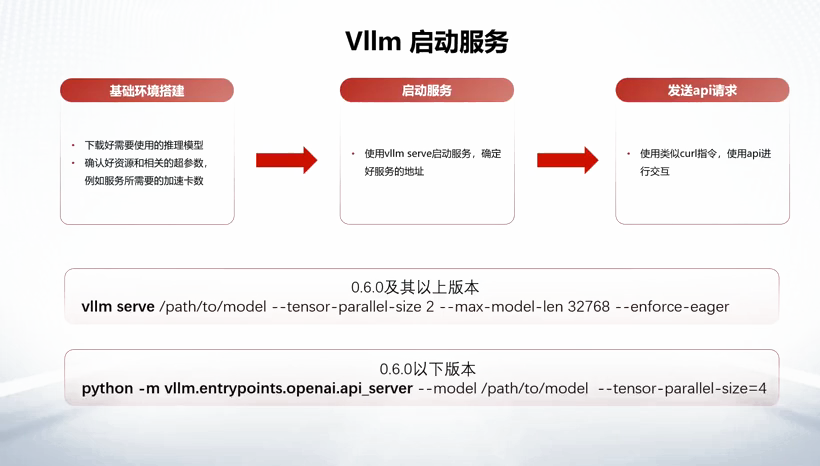
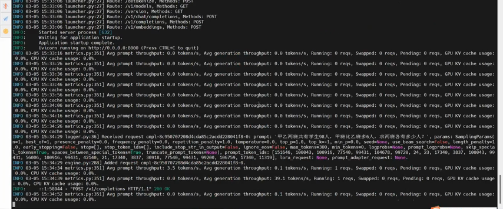
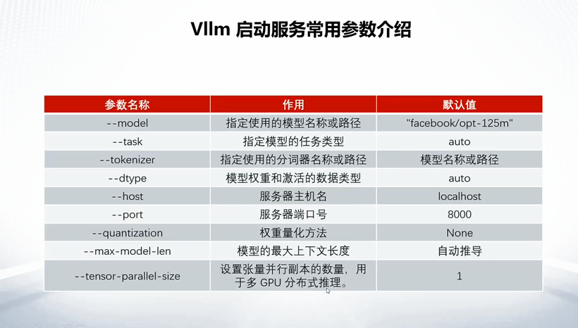
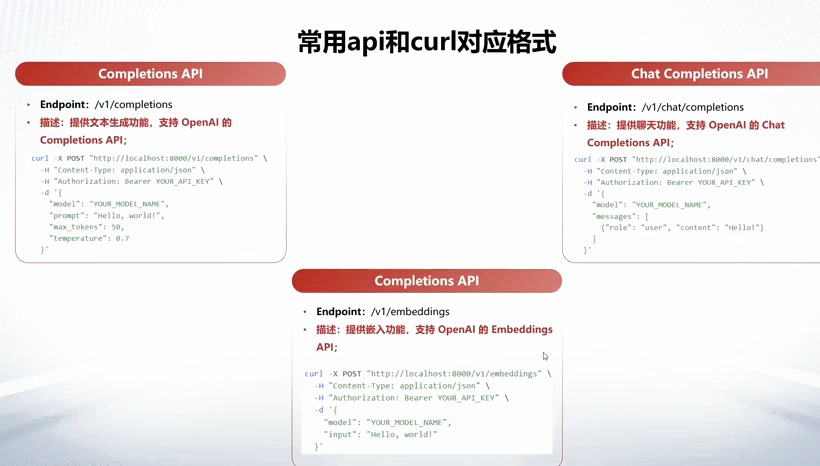
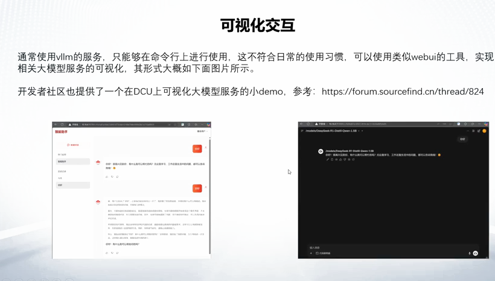

# 第50讲 基于DCU部署 vLLM 推理服务实践

**本课程定位：** 前面几讲把卡装好、环境点亮、工具跑通。这一讲把模型跑成服务：起一个 OpenAI 兼容的接口，用 curl 调通，接一个界面实际问几句，最后停服把显存收回来。

推理服务有两种用法：写个脚本灌 prompt 拿结果，跑完就结束；或者常驻一个服务，随时用接口来问。对外提供能力的是后一种。

教室在一台装 DCU 的机器上做，镜像从光源取，模型用教学权重。服务的地址是宿主加端口，本机访问就是 localhost 加端口。

## 50.1、学习目标

学完本讲，你应当能够：

- 了解在线服务与离线脚本两种推理方式的差别，能说清什么场景该起服务；
- 了解 vLLM 启动命令按版本分成两条，能按现场版本说出该用哪一条；
- 了解模型路径、端口、最大上下文、并行卡数四个参数各决定什么，能按机器卡数配出一个能起来的组合；
- 了解 completions、chat completions、embeddings 三条接口的用途与请求格式，能用 curl 分别调通并看懂返回；
- 了解停服的判据，能用 hy-smi 确认计算进程退出、显存回落到空闲水平；
- 实训完成“起服务 → 调接口 → 可视化问答 → 停服回收”的闭环，交付启动参数、接口记录、问答截图与显存回收证据。

## 50.2、vLLM 推理服务部署

这一部分讲五件事：两种模式怎么选、服务怎么起、参数怎么配、接口怎么调、停了以后怎么确认收干净。

### 50.2.1、在线与离线：两种用法

离线是写脚本：脚本里加载模型、把 prompt 灌进去、拿到输出、程序结束。适合批量跑评测、批量生成数据，一次一算。

在线是起服务：服务常驻，随时用接口来问。网页上跟大模型对话、业务系统里调模型，走的都是这条路。

两种方式的准备动作一样：先把模型下载到本地、算清楚要几张卡、把 vLLM 的环境备好。差别只在跑起来之后是等人来问，还是跑完就退。

表50-1、在线与离线怎么选

| 方式 | 怎么用 | 适合什么 | 代价 |
| --- | --- | --- | --- |
| 离线脚本 | 加载模型、灌 prompt、取输出、退出 | 批量评测、批量生成 | 每次都要重新加载模型 |
| 在线服务 | 常驻进程，接口随时调用 | 对话、业务调用、多人共用 | 服务要看着，显存一直被占 |

### 50.2.2、起服务：版本决定用哪条命令

vLLM 0.6.0 是一个分界。0.6.0 及以上用 `vllm serve`，参数直接跟在后面；0.6.0 以下没有这个入口，要用模块方式启动 OpenAI 兼容的服务。

两条命令做的事一样：按指定模型路径起一个服务，按并行卡数把模型切开，按最大上下文限制单次请求的长度。

启动完，日志里会出现服务监听地址，例如 `http://0.0.0.0:8000`。0.0.0.0 表示监听本机所有网卡，本机调用时用 localhost 就够；要让别的机器访问，用这台机的业务地址加同一个端口。

表50-2、两条启动命令

| 版本 | 命令 | 说明 |
| --- | --- | --- |
| 0.6.0 及以上 | vllm serve 模型路径 加参数 | 官方入口，参数名与文档一致 |
| 0.6.0 以下 | python -m vllm.entrypoints.openai.api_server 加参数 | 模块方式，参数写法略有差别 |

### 50.2.3、参数：四个决定能不能起来

参数不少，真正决定“能不能起来”的是四个：模型路径、并行卡数、最大上下文、端口。

模型路径一般指到本地权重目录；用模型名要能联网拉取，教室里给的是本地权重，写模型名会报找不到权重。并行卡数要与机器上实际可用的卡数一致：给少了模型放不下，超过实际卡数会直接报设备不足。最大上下文不能超过模型本身支持的长度，设大了会在加载阶段被拒绝。端口默认 8000，被占用就换一个。

其余参数按需调整：任务类型、数据类型、量化方法、监听地址。

表50-3、常用参数怎么定

| 参数 | 决定什么 | 现场怎么定 |
| --- | --- | --- |
| 模型路径 | 加载哪份权重 | 指到本地权重目录 |
| 并行卡数 | 用几张卡把模型切开 | 与 hy-smi 看到的可用卡数一致 |
| 最大上下文 | 单次请求最长多少 token | 不超过模型支持的长度 |
| 端口 | 服务监听哪个端口 | 默认 8000，冲突就换 |
| 监听地址 | 谁能访问 | 本机调试用默认，对外用 0.0.0.0 |
| 数据类型 | 权重与激活用什么精度 | 与镜像和卡的能力匹配 |

### 50.2.4、接口：三条 API 与 curl 的对应

vLLM 提供的是 OpenAI 兼容接口，路径与请求体都按 OpenAI 的约定写。

- `/v1/completions`：文本生成，请求体里给 `prompt`；
- `/v1/chat/completions`：聊天，请求体里给 `messages`，每条消息带角色与内容；
- `/v1/embeddings`：向量化，请求体里给 `input`。

curl 的写法固定几段：`-X POST` 指定方法，`-H "Content-Type: application/json"` 声明请求体格式，`-d` 带 JSON。本地部署可以不带鉴权头；接了网关才需要 `-H "Authorization: Bearer 密钥"`。

请求体里两个字段最容易写错：`model` 必须与启动服务时的模型名一致，写错会返回模型不存在；`max_tokens` 是这次最多生成多少 token，不是上下文总长。

表50-4、三条接口与请求体

| 接口 | 用途 | 关键字段 | 调用后的返回 |
| --- | --- | --- | --- |
| /v1/completions | 文本生成 | model、prompt、max_tokens、temperature | choices 里的 text |
| /v1/chat/completions | 多轮聊天 | model、messages（role 与 content）、max_tokens | choices 里的 message |
| /v1/embeddings | 向量化 | model、input | data 里的 embedding 数组 |

### 50.2.5、可视化交互：给业务一个能点的界面

命令行调接口只适合验证，给业务用要一个能输入、能看到回答的界面。常见做法是接一个 WebUI，把服务地址填进去，剩下的与传统对话页面一样。

接之前先确认两件事：服务的监听地址能让界面访问到，端口没有被防火墙挡住。接之后做多轮问答，验证上下文还能接上，而不是每轮都从头开始。

### 50.2.6、停服与显存回收

服务停不停，看两处：进程还在不在，显存回没回落。

停的方式按现场来：前台启动的按 Ctrl+C，后台起的按启动方式结束进程。停完执行 hy-smi 看两件事：卡上没有这个服务的进程，显存占用回到起服务之前的水平。显存没回落，说明还有残留进程或者回收变慢，继续查。

**【随堂思考】** 停服后 hy-smi 显示显存还是占着大半，但 `--showpids` 里已经看不到那个进程。先怀疑哪两处？

### 50.2.7、起不来的常见原因

服务起不来，报错往往只有几行，按顺序看比反复重试快。

- 权重找不到：模型路径写错、目录没挂进容器、下载没完成。
- 卡不够或看不见：并行卡数大于可用卡数；容器启动参数漏了设备；普通用户不在 video 或 render 组。
- 网卡相关的环境变量缺失：演示里就踩过这个坑，补上对应的环境变量后重新执行同一条命令即可启动。
- 端口被占：换端口，或先停掉占用的服务。
- 模型名不一致：请求体里的 model 与服务启动时的名字对不上，返回模型不存在。

表50-5、启动失败先看哪里

| 现象 | 先看什么 | 处理 |
| --- | --- | --- |
| 报找不到权重 | 模型路径、目录是否挂进容器 | 改路径或补挂载 |
| 报设备数量不对 | 并行卡数与 hy-smi 的卡数 | 改卡数 |
| 报网卡或通信相关错误 | 对应的环境变量是否设置 | 补环境变量后重跑 |
| 端口占用 | 8000 是否已被别的服务占用 | 换端口 |
| 请求返回模型不存在 | 请求体里的 model 字段 | 与启动时的模型名对齐 |

### 50.2.8、术语

表50-6、本讲术语

| 术语 | 一句话解释 |
| --- | --- |
| vLLM | 面向大模型推理的服务框架，提供 OpenAI 兼容接口 |
| 在线推理 | 常驻服务，随时接受请求 |
| 离线推理 | 脚本跑一遍就结束，不常驻 |
| OpenAI 兼容 | 接口路径与请求体按 OpenAI 的约定写，客户端可直接复用 |
| 模型路径 | 本地权重目录的绝对路径 |
| 并行卡数 | 把一份模型切到几张卡上跑 |
| 最大上下文 | 单次请求最多能带多少 token |
| 流式输出 | 边生成边返回，适合逐字显示 |
| 可视化前端 | 把服务接成对话框样式的界面 |
| 显存回收 | 停服后显存回到空闲水平 |

## 50.3、具体实训内容

按服务生命周期走：起、调、用、收。

### 50.3.1、服务启动与接口契约验证

本任务把服务起起来并调通三类请求。完成后交付启动参数、调用记录与显存对比。

表50-7、服务启动与接口契约验证的步骤

| 步 | 动作与要领 | 常见错误 | 检查点 |
| --- | --- | --- | --- |
| 1 | 记录基线。① 起服务前执行 `hy-smi`，逐卡记下显存占用、利用率与温度；② `hy-smi --showpids` 确认没有别的进程占这几张卡，有就先问清是谁的；③ 记下 `hy-smi -i` 的卡数，作为并行卡数的上限；④ 把三项数据存成一张基线表。 | 不记基线，事后判断不了显存有没有回落；卡上有别人的任务没发现；只记总数不记单卡。 | 基线表里有卡号、显存、利用率、进程、卡数五项。 |
| 2 | 准备环境与权重。① 进容器或激活环境，`python -c "import vllm; print(vllm.__version__)"` 记下版本；② `ls -l 权重目录` 确认配置文件与权重文件都在、当前用户可读；③ 按卡数与模型大小定并行卡数，写进记录表。 | 用模型名代替本地路径；权重没下完就起服务；卡数凭感觉填，起服务才发现不够。 | 版本、权重路径、卡数三项都有记录。 |
| 3 | 起服务。① 0.6.0 及以上：`vllm serve 权重目录 --served-model-name 教学模型 --port 8000 --max-model-len 32768 --tensor-parallel-size 卡数`；② 0.6.0 以下：`python -m vllm.entrypoints.openai.api_server` 带同名参数；③ 前台起，盯着日志看到 `Uvicorn running on http://0.0.0.0:8000` 才算起来；④ 报错按表50-5 逐条排除，别原地重试。 | 参数名写错；日志没走完就发请求；报错不看原因反复重试；端口 8000 已被占用。 | 日志出现监听地址；终端不退出；进程稳定。 |
| 4 | 记录加载后显存。① 服务就绪后等 30 秒再跑 `hy-smi`；② 与基线逐卡对比，算出每张卡增加的显存；③ 把两组数字并列写进记录表，注明模型名与卡数。 | 只记一组；拿加载过程中的中间值当最终值；不注明模型，换个模型对不上。 | 前后两组齐全，差值明确，模型与卡数可追溯。 |
| 5 | 正常请求。① 用 `curl -X POST http://localhost:8000/v1/chat/completions -H "Content-Type: application/json" -d '{"model":"教学模型","messages":[{"role":"user","content":"用一句话说明什么是显存"}],"max_tokens":128}'`；② 检查 HTTP 状态码、`choices` 结构与内容；③ 把命令与返回原样存成文件。 | 只看有没有回复不看结构；`model` 与启动名不一致；请求体引号被 shell 吃掉。 | 状态码 200，返回里有 choices 与 message。 |
| 6 | 流式与异常请求。① 同一个接口加 `"stream": true` 再调一次，用 `-N` 关掉缓冲，观察是否逐段返回；② 用超过 `max-model-len` 的超长输入或非法字段发一次错误请求；③ 记下错误请求的状态码与报错体，说明属于参数错误还是服务端错误。 | 把流式当普通请求读，误判为不返回；异常请求不发；把 400 当成服务挂了。 | 三类请求都有记录，错误可归因。 |

红线：起服务前记基线；不把别人的进程当自己的占用。

### 50.3.2、可视化交互验证

本任务给业务一个能点的界面。完成后交付交互截图与问答记录。

表50-8、可视化交互的步骤

| 步 | 动作与要领 | 常见错误 | 检查点 |
| --- | --- | --- | --- |
| 1 | 确认连通。① 在界面所在机器上 `curl -s http://服务地址:8000/v1/models` 先验证接口可达；② 不通就看服务监听地址是 0.0.0.0 还是 127.0.0.1，后者只能本机访问；③ 再查防火墙与安全组是否放行端口。 | 服务监听 127.0.0.1 却从别的机器访问；端口被防火墙挡住；用 ping 代替接口测试。 | `/v1/models` 能返回模型列表。 |
| 2 | 接入界面。① 在 WebUI 类工具里填服务地址，末尾不带多余路径；② 模型名填启动时的名字，与 `/v1/models` 返回的一致；③ 需要鉴权的场景才填 API Key，本地部署可留空；④ 保存后先发一条「你好」验证。 | 模型名填成权重路径；地址末尾多写 `/v1`；把 API Key 随便填一个导致 401。 | 首条消息能收到回复。 |
| 3 | 多轮问答。① 连续问不少于 3 轮，第 2、3 轮明确引用前一轮内容（例如「刚才那条再短一点」）；② 每轮把问题与回答记进记录表；③ 留一张包含完整对话的截图，截图里要有界面标题与服务地址。 | 每轮重新开话题，验不出上下文；截图只截半屏；不记录就无法复核。 | 3 轮连贯，能看出上下文被记住。 |
| 4 | 收口。① 把界面配置、服务地址、模型名、鉴权方式写进记录；② 与第 5 步的 curl 返回对照一次，确认是同一个服务；③ 关闭不用的会话，避免占着连接。 | 界面连的是别的服务却不知道；配置不记录，换人接不上。 | 配置与记录一致，能和 curl 结果对上。 |

红线：不把服务地址改成监听不到本机的地址；不跳过连通性确认。

### 50.3.3、停服与资源回收验证

本任务把资源收干净。完成后交付停服操作记录与显存回落证据。

表50-9、停服与资源回收的步骤

| 步 | 动作与要领 | 常见错误 | 检查点 |
| --- | --- | --- | --- |
| 1 | 停服。① 前台起的服务在终端按 `Ctrl+C`，等服务自己退出；② 后台起的按启动方式结束：`pgrep -af vllm` 找到主进程，`kill 进程号`，不生效再 `kill -9`；③ 看日志尾部有没有正常退出的记录。 | 直接关机代替停服；杀错进程（把 ssh 会话杀了）；不确认就往下走。 | 服务进程已退出，日志有退出记录。 |
| 2 | 查进程。① `hy-smi --showpids` 看还有没有这个服务的进程；② `pgrep -afi vllm` 再看一遍系统进程；③ 有残留就按 PID 与启动用户判断归属，不盲杀。 | 只看自己终端；把系统进程当残留；残留不处理就归档。 | 该服务的进程不再出现。 |
| 3 | 查显存。① 停服后每 30 秒跑一次 `hy-smi`，连跑 2～3 次；② 与基线逐卡对比，显存回到基线水平才算收干净；③ 没回落就查残留进程、容器是否还在跑、是否有别的任务接管了卡。 | 只看一次就下结论；显存放着不管就收工；拿别的任务占用当自己的残留。 | 显存回到基线附近，差异有解释。 |
| 4 | 收口。① 三组证据归档：停服命令与日志、进程检查输出、显存前后对比；② 显存未回落的写明原因与后续动作（等回收、清容器、报讲师）；③ 把这次服务的模型、卡数、端口记进台账，供下一轮复用。 | 证据缺项；结论含糊写成「已停」；台账不更新。 | 三组证据齐全，结论可复核，台账已更新。 |

红线：停服以进程退出与显存回落两处为准；不拿关机当停服。

## 50.4、需要的硬件设施

按用途分四类：防静电与安全用品、检测与操作工具、耗材与标识、机柜与供电配套。

### 50.4.1、防静电与安全用品

表50-10、防静电与安全用品

| 名称 | 型号 / 规格 | 用途 |
| --- | --- | --- |
| 有线防静电腕带 | 单回路，内置 1 MΩ 限流电阻 | 插拔卡与开盖作业时的接地 |
| 防静电桌垫 | 双层，配 1 MΩ 接地线 | 放置拆下的卡与工具 |
| 防静电屏蔽袋 | 金属化屏蔽袋，自封口 | 卡与配件临时存放 |
| 防静电服与手套 | 长袖分体、手套贴合 | 进入机房作业 |

### 50.4.2、检测与操作工具

表50-11、检测与操作工具

| 名称 | 型号 / 规格 | 用途 |
| --- | --- | --- |
| 教学笔记本 | 可 SSH 或通过 KVM 接入 | 起服务、跑 curl、接界面 |
| 浏览器 | 支持 WebUI 类前端 | 可视化交互验证 |
| KVM 或显示器键鼠 | VGA 与 USB 接口 | 无带外时的本地接入 |
| 万用表 | 具备电阻档与交流电压档 | 腕带阻值、断电验电 |

### 50.4.3、耗材与标识

表50-12、耗材与标识

| 名称 | 型号 / 规格 | 用途 |
| --- | --- | --- |
| 教学 U 盘 | FAT32 或 NTFS，8 GB 以上 | 模型权重、镜像与记录转存 |
| 标签纸 | 6 / 9 / 12 mm，防水 | 端口与线缆标识 |
| 记录模板 | 启动参数表、接口记录表、显存对比表 | 课堂填写与归档 |

### 50.4.4、机柜与供电配套

表50-13、机柜与供电配套

| 名称 | 型号 / 规格 | 用途 |
| --- | --- | --- |
| 教学服务器 | 装 DCU 的海光整机 1 台 | 起服务与压测 |
| 机柜 PDU | 水平交流插线排，主备两个回路 | 双路供电保障 |
| 教学管理交换机 | 按课前清单，管理口专用 | 带外访问与镜像拉取 |
| UPS | 按机房配置 | 长时间推理期间防掉电 |

## 50.5、配套视频

8 条待拍，拍好后供学员课前观看，看完再进机房动手。

表50-14、配套视频清单

| 视频名 | 时长 | 内容要点 |
| --- | --- | --- |
| 在线与离线两种用法 | 4 min | 脚本与服务的差别；什么场景起服务 |
| 按版本起服务 | 6 min | vllm serve 与模块方式两条命令 |
| 四个关键参数 | 6 min | 模型路径、并行卡数、最大上下文、端口 |
| 启动日志怎么看 | 5 min | 监听地址、路由注册、加载完成 |
| curl 调三条接口 | 8 min | completions、chat、embeddings 的请求体 |
| 流式与错误请求 | 5 min | 流式返回的观察方法、错误码与报错体 |
| 接一个可视化界面 | 6 min | 地址与模型名的填法、多轮问答 |
| 停服与显存回收 | 5 min | 停服方式、进程检查、显存对比 |

观看节奏：课前 3 天看在线与离线、按版本起服务、四个关键参数三条；课前 1 天看启动日志与 curl 调接口两条，把自己机器的卡数与模型路径填进记录表；进入机房后，讲师按当前环节回放对应片段，只看动作与判据。

## 50.6、小结与自测

学完本讲，试着用自己的话回答：什么场景该起服务、启动命令按什么分、四个参数各决定什么、三条接口各要什么字段、怎么证明停服收干净。

### 50.6.1、目标回看

表50-15、学习目标与达成标志

| 学习目标 | 达成标志 | 对应实训 |
| --- | --- | --- |
| 了解在线与离线的差别 | 能说出各自适合什么场景 | 50.3.1 |
| 了解两条启动命令 | 能按版本选出正确的一条 | 50.3.1 |
| 了解四个关键参数 | 能按卡数与模型配出可启动组合 | 50.3.1 |
| 了解三条接口与请求格式 | 三种请求都能调通并看懂返回 | 50.3.1 |
| 了解停服的判据 | 能用进程与显存两处证明收干净 | 50.3.3 |
| 实训完成部署与回收闭环 | 四份材料齐全，数据可复核 | 50.3.1～50.3.3 |

### 50.6.2、课后自测

1 模式。在线与离线两种推理方式，各自的准备动作与适用场景是什么？

2 启动。vLLM 0.6.0 及以上与以下，启动命令有什么区别？启动成功后日志里会出现什么？

3 参数。模型路径、并行卡数、最大上下文、端口各决定什么？模型路径写成模型名会怎样？

4 接口。三条接口分别要哪些关键字段？`max_tokens` 指的是什么？

5 回收。怎么证明推理服务停干净了？只看进程够不够？

答：

____________________________

____________________________

____________________________

### 50.6.3、参考答案与解析

随堂思考解析

思考 1（停服后显存没回落但进程不见了）：先怀疑两处。一是 `--showpids` 只列参与计算的进程，显存可能还被别的进程占着，要按显存占用反查；二是显存回收有延迟，刚停几秒就查，数字还没降到位，等一会儿再看。两处都排除，再看是不是上一次的服务没退干净。

课后自测解析

1 两者准备动作相同：下模型、定卡数、备 vLLM 环境。离线适合批量评测与批量生成，跑完就退；在线适合对话与业务调用，服务常驻、接口随时来。

2 0.6.0 及以上用 `vllm serve` 加参数；以下用 `python -m vllm.entrypoints.openai.api_server` 加参数。启动成功后日志里出现监听地址，例如 0.0.0.0:8000。

3 模型路径决定加载哪份权重，写成模型名会报找不到权重；并行卡数要与可用卡数一致，多了少了都起不来；最大上下文不能超过模型支持的长度；端口默认 8000，被占用要换。

4 completions 要 model 与 prompt；chat completions 要 model 与 messages；embeddings 要 model 与 input。`max_tokens` 是这次生成的最大长度，不是上下文总长。

5 要看两处：服务进程退出，显存回落到起服务前的基线。只看进程不够，进程退了显存也可能还占着。
